# Phase & nghiệm thu

Cập nhật: 2026-10-30 · Phan Hung Cuong · spec chính: [spec.md](spec.md)

MVP chia 7 phase trong khoảng 6,5 tuần cho 1 người. Phase chỉ được coi là xong khi toàn bộ Playwright spec và script nghiệm thu của nó chạy xanh; phase sau không bắt đầu khi phase trước còn đỏ.

## Lộ trình

```mermaid
flowchart LR
  P0["P0 · Spike<br/>Cô lập config, fake harness + CI<br/>3 ngày"] -->|nghiệm thu| P1["P1 · Chat core<br/>Chat realtime, .ade/, @mention → event<br/>1 tuần"]
  P1 -->|nghiệm thu| P2["P2 · Runner<br/>Driver SDK + ACP, live/approval card<br/>1 tuần"]
  P2 -->|nghiệm thu| P3["P3 · Trigger<br/>Rule engine, MCP, grant, hook chặn<br/>1 tuần"]
  P3 -->|nghiệm thu| P4["P4 · Điều phối<br/>Main + 3 worker, cổng plan/review<br/>1 tuần"]
  P4 -->|nghiệm thu| P5["P5 · Settings UI<br/>Agent, skill, wizard, Test agent<br/>1 tuần"]
  P5 -->|nghiệm thu| P6["P6 · Memory<br/>Memory, budget, demo end-to-end<br/>1 tuần"]
  P6 -->|nghiệm thu| DONE(["MVP xong"])
```



Cổng nghiệm thu: Playwright + script của phase phải xanh trên CI mới sang phase sau.

P0 đi trước vì kết quả spike quyết định cách viết driver ở P2; từ P1 trở đi mỗi phase cộng thêm spec vào `pnpm accept:all` nên phase sau luôn chạy lại nghiệm thu của phase trước.

## Hạ tầng kiểm thử chung

Nghiệm thu trên CI chạy bằng **fake harness** nên xác định, nhanh và không tốn token; harness thật chỉ chạy bằng script `@real` trên máy dev đã đăng nhập.

| Thành phần | Vai trò | Chạy ở |
| --- | --- | --- |
| `ade-fake-agent` | Tiến trình nói ACP, làm theo kịch bản YAML: stream plan, tool call, xin quyền, gọi tool ADE MCP, `report_outcome`, chờ N giây | CI + local |
| `FakeClaudeDriver` | Cài cùng interface với driver Claude, đọc cùng loại kịch bản | CI + local |
| Playwright | Spec E2E trên UI; mỗi spec khởi động hub với `ADE_TEST=1`, thư mục data tạm và repo mẫu `git init` mới | CI + local |
| Vitest | Unit/integration cho rule engine, event store, MCP, prompt assembly | CI + local |
| Script `scripts/verify/*.ts` | Kiểm tra ngoài UI: file `.ade/`, DB, event, git status; in PASS/FAIL từng mục, exit code ≠ 0 khi fail | CI + local |
| Script `@real` | Chạy Claude/Codex thật trên repo mẫu, kiểm tra cô lập và luồng end-to-end | Chỉ máy dev |

Ví dụ kịch bản fake:

```yaml
# tests/scenarios/planner-done.yaml
agent: "@planner"
steps:
  - plan: ["Đọc yêu cầu", "Viết spec"]
  - tool_call: { name: Write, path: docs/spec.md }
  - request_permission: { tool: Bash, command: "npm test", expect: allow }
  - mcp: { tool: post_progress, args: { text: "Đã viết xong spec" } }
  - mcp: { tool: report_outcome, args: { status: done, summary: "Spec login" } }
```

**Quy ước lệnh:** `pnpm accept:p<N>` chạy toàn bộ Playwright spec + script của phase N; `pnpm accept:all` chạy mọi phase đã xong để bắt regression; `pnpm real:<tên>` chạy script với harness thật.

**Mỗi phase nộp kèm:** report HTML của Playwright (có trace khi fail), log PASS/FAIL của script, và với phase có script `@real` thì một lần chạy thật ghi lại kết quả.

## P0 — Spike & nền tảng (3 ngày)

Mục tiêu: trả lời 4 câu hỏi spike trước khi viết driver, và dựng sẵn khung test để mọi phase sau có chỗ nghiệm thu. Kết quả spike quyết định Codex đi qua `codex-acp` hay Codex SDK.

**Việc cần làm**

- [ ] Monorepo pnpm: `apps/hub`, `apps/web`, `packages/runner`, `packages/shared` (type event, schema)
- [ ] SQLite + migration, bảng `events` append-only
- [ ] `ade-fake-agent` + `FakeClaudeDriver` + 2 kịch bản mẫu
- [ ] Playwright, Vitest, GitHub Actions chạy `pnpm accept:all`
- [ ] Spike Claude: Agent SDK với `settingSources: []`, `CLAUDE_CONFIG_DIR` riêng, plugin skill tạm
- [ ] Spike Codex: `CODEX_HOME` riêng, tắt skill cá nhân bằng `[[skills.config]]`, thử `codex-acp`

**Nghiệm thu**

| Loại | Kiểm tra | Đạt khi |
| --- | --- | --- |
| Script `@real` `real:spike-claude` | Tạo `HOME` tạm có `~/.claude/CLAUDE.md` chứa chuỗi canary và skill canary trong `~/.claude/skills/`; chạy một run hỏi model lặp lại toàn bộ hướng dẫn nó nhận được | Message `init` không liệt kê skill canary; câu trả lời không chứa chuỗi canary; skill của plugin tạm có trong `init.skills` |
| Script `@real` `real:spike-codex` | Skill canary trong `~/.agents/skills`; chạy Codex với `CODEX_HOME` riêng | Skill canary không được nạp; skill trong `.agents/skills` của worktree được nạp; đăng nhập subscription chạy được |
| Script `@real` `real:spike-codex-acp` | Chạy `codex-acp` với một lệnh cần xin quyền | Nhận được `session/update` và `session/request_permission`; trả allow thì lệnh chạy |
| Vitest | Fake agent chạy kịch bản mẫu qua ACP client | Chuỗi message nhận được đúng thứ tự kịch bản |
| Playwright `p0-smoke.spec.ts` | Mở `localhost` sau khi hub khởi động | Trang hiện, không lỗi console |
| CI | `pnpm accept:all` trên GitHub Actions | Xanh |

Kết quả 4 spike ghi vào checklist “Spike tuần 2” ở [spec.md](spec.md); spike nào fail thì cập nhật spec trước khi sang P2.

## P1 — Chat core (1 tuần)

Mục tiêu: chat realtime theo project/channel/thread chạy trên localhost, đọc cấu hình từ `.ade/`, @mention sinh event `agent.mentioned`. Chưa có agent chạy thật.

**Việc cần làm**

- [ ] Event store + projection: project, channel, thread, message
- [ ] Loader `.ade/` (project.yaml, agents/\*.yaml) có validate schema + file watcher
- [ ] WebSocket realtime UI ↔ hub
- [ ] SPA: sidebar project/channel, danh sách thread, khung chat, ô soạn có gợi ý @mention
- [ ] Parser @mention → `agent.mentioned`

**Nghiệm thu**

| Loại | Kiểm tra | Đạt khi |
| --- | --- | --- |
| Playwright `p1-chat.spec.ts` | Tạo channel và thread, gửi tin nhắn; mở trang thứ hai cùng thread | Tin nhắn hiện ở trang thứ hai trong < 1 giây; reload vẫn còn |
| Playwright `p1-mention.spec.ts` | Gõ `@` trong ô soạn | Danh sách gợi ý đúng các agent trong `.ade/agents/` của repo mẫu; gửi xong thì tin nhắn tô sáng mention |
| Playwright `p1-config-error.spec.ts` | Repo mẫu có một agent YAML sai schema | UI hiện lỗi đúng tên file và trường sai; các agent khác vẫn dùng được |
| Script `verify/replay-events.ts` | Xoá projection, dựng lại từ bảng `events` | Dữ liệu sau khi dựng lại trùng khớp 100% với trước |
| Script `verify/mention-events.ts` | Gửi 3 tin nhắn qua API (1 mention, 2 mention, mention agent không tồn tại) | Đúng 3 event `agent.mentioned` cho agent hợp lệ; agent không tồn tại sinh cảnh báo, không sinh event |
| Vitest | Parser @mention, validate schema `.ade/` | Xanh |

## P2 — Runner & driver (1 tuần)

Mục tiêu: @mention làm agent chạy thật qua hai driver, tiến độ hiện thành live card, xin quyền hiện thành approval card, harness chạy trong hồ sơ ADE cô lập.

**Việc cần làm**

- [ ] Runner cùng tiến trình với hub; interface driver chung + chuẩn hoá `run.event`
- [ ] Driver Claude (Agent SDK): hồ sơ cô lập, plugin skill tạm, `canUseTool` → approval card
- [ ] Driver ACP (Codex): `CODEX_HOME` riêng, `config.toml` sinh tự động, skill vào `.agents/skills` + `.git/info/exclude`
- [ ] Worktree theo thread; live card cập nhật tại chỗ; run.started / completed / failed
- [ ] Credential profile `sub-claude`, `sub-chatgpt`, `api-key`

**Nghiệm thu**

| Loại | Kiểm tra | Đạt khi |
| --- | --- | --- |
| Playwright `p2-live-card.spec.ts` (fake) | Mention `@fake` với kịch bản 5 bước | Live card xuất hiện trong < 5 giây; thread chỉ có đúng 1 message cho run; card hiện đủ 5 bước rồi chuyển trạng thái hoàn thành |
| Playwright `p2-permission.spec.ts` (fake) | Kịch bản xin quyền chạy `npm test`; bấm Approve, rồi chạy lại và bấm Deny | Approve: fake agent nhận allow và đi tiếp. Deny: fake nhận deny, card ghi “đã từ chối” |
| Playwright `p2-two-drivers.spec.ts` (fake) | Cùng thread mention một agent driver Claude giả và một agent driver ACP giả | Hai live card cùng định dạng, không phân biệt được trên UI |
| Script `verify/worktree.ts` | Sau 1 run Codex giả trong thread | Worktree tồn tại đúng đường dẫn; `git status --porcelain` ở repo gốc không có `.agents/skills` |
| Script `@real` `real:isolation` | Chạy lại kiểm tra canary của P0 nhưng qua driver thật của ADE | Cả Claude và Codex không thấy skill, plugin, CLAUDE.md cá nhân |
| Script `@real` `real:hello` | Mention agent Claude và agent Codex thật với câu lệnh ngắn trên repo mẫu | Mỗi run kết thúc `run.completed`, có live card, không cần thao tác tay ngoài approval |

## P3 — Trigger & ADE MCP (1 tuần)

Mục tiêu: workflow YAML điều khiển state của thread qua rule engine; agent nói chuyện với ADE qua MCP; quyền đọc theo grant; hook chặn lệnh nguy hiểm.

**Việc cần làm**

- [ ] Rule engine: `on` / `when` / `do`, action `dispatch`, `set_state`, `post_message`, `ask_human`, `deny_tool`
- [ ] Chống loop: `max_depth`, chuỗi causation > 20, budget
- [ ] ADE MCP server: `report_outcome`, `post_progress`, `ask_human`, `read_memory`, `get_thread`; token gắn run
- [ ] Grant theo mention (`thread_agents`) + kiểm tra quyền ở mọi tool đọc
- [ ] Hook PreToolUse cho Claude (callback), deny theo pattern trong workflow

**Nghiệm thu**

| Loại | Kiểm tra | Đạt khi |
| --- | --- | --- |
| Vitest `rule-engine.test.ts` | Bảng fixture: chuỗi event đầu vào → state và action mong đợi (ít nhất 15 case, gồm outcome `done` / `blocked` / `unknown`) | Xanh toàn bộ |
| Vitest `loop-guard.test.ts` | Hai agent fake mention nhau liên tục | Dừng ở depth 3; chuỗi causation dừng ở 20 và thread hiện cảnh báo |
| Script `verify/mcp-contract.ts` | Dùng MCP client gọi từng tool bằng token của run | Mọi tool trả đúng schema; token của thread A đọc thread B bị từ chối; token hết hạn bị từ chối |
| Script `verify/grant.ts` | Agent chưa được mention gọi `get_thread` | Bị từ chối; sau khi mention thì đọc được |
| Playwright `p3-workflow.spec.ts` (fake) | Mention `@planner` với kịch bản `report_outcome: done` | Badge state của thread chuyển `plan` → `plan_review`; card `ask_human` xuất hiện; trả lời xong thì rule chạy tiếp |
| Playwright `p3-unknown-outcome.spec.ts` (fake) | Kịch bản kết thúc không gọi `report_outcome` | Thread hiện câu hỏi cho người, state không đổi |
| Script `@real` `real:hook-deny` | Yêu cầu agent Claude thật chạy `rm -rf` trong thư mục tạm | Lệnh bị chặn, thư mục còn nguyên, có event `hook.fired` |

## P4 — Điều phối (1 tuần)

Mục tiêu: main agent giao việc song song cho worker, gom kết quả một lần, và chỉ vượt cổng plan/review khi người duyệt.

**Việc cần làm**

- [ ] Main agent theo workflow, lệnh `/main @x`
- [ ] `delegate`, child run, giới hạn 3 worker song song, khoá ghi theo thread
- [ ] Fan-in: `delegation.completed` → một `session/prompt` gửi main
- [ ] `request_approval`, bảng `approvals` có version, approval card, badge “Chờ duyệt”, `/approve`, `/revise`
- [ ] Chặn chuyển state qua cổng khi chưa duyệt; scratchpad; card con thu gọn dưới card main

**Nghiệm thu**

| Loại | Kiểm tra | Đạt khi |
| --- | --- | --- |
| Playwright `p4-orchestration.spec.ts` (fake) | Kịch bản đầy đủ: mention `@lead` → plan → “Yêu cầu sửa” → plan v2 → Approve → 3 worker → review → Approve | Card plan có v1 và v2; sau Approve có 3 card con; state cuối là `done` |
| Script `verify/parallel.ts` | Đọc thời điểm start/end của các run trong kịch bản trên | `@qa` (chỉ đọc) chạy chồng thời gian với worker ghi; `@coder` và `@tester` (cùng ghi) không chồng nhau |
| Script `verify/fan-in.ts` | Đếm số lần main nhận kết quả | Đúng 1 lần `session/prompt` chứa đủ 3 kết quả |
| Script `verify/gate.ts` | Gọi `set_state: building` qua MCP và qua rule khi approval còn `pending` | Cả hai bị từ chối; sau khi approve thì thành công |
| Script `verify/context-scope.ts` | Worker `scope: brief` và `scope: full` cùng gọi `get_thread` | Brief chỉ nhận brief + summary; full nhận toàn bộ tin nhắn; worker không đọc được scratchpad của agent khác |
| Playwright `p4-chat-approve.spec.ts` (fake) | Trả lời cổng bằng `/revise cần thêm test` trong chat | Main nhận đúng ghi chú, approval chuyển `changes_requested` |

## P5 — Project Settings UI (1 tuần)

Mục tiêu: tạo project, thêm agent, quản lý skill và gắn skill cho agent hoàn toàn qua UI; mọi thay đổi ghi đúng vào `.ade/`.

**Việc cần làm**

- [ ] Wizard tạo project 3 bước
- [ ] Tab General, Agents (form đầy đủ), Skills (editor, import thư mục/zip/git), Harness (phát hiện, trạng thái đăng nhập)
- [ ] Thư viện skill global `~/.ade/skills` + project `.ade/skills`
- [ ] Nút Test agent; công tắc “Dùng hướng dẫn của repo”
- [ ] `runs.skills_snapshot`

**Nghiệm thu**

| Loại | Kiểm tra | Đạt khi |
| --- | --- | --- |
| Playwright `p5-wizard.spec.ts` | Tạo project từ repo mẫu trống | `.ade/project.yaml` và agent template được tạo; vào thẳng tab Agents |
| Playwright `p5-agent-form.spec.ts` | Thêm `@coder` qua form, đổi harness, gắn 2 skill | `.ade/agents/coder.yaml` khớp giá trị đã nhập (so bằng YAML parse) |
| Playwright `p5-skill-editor.spec.ts` | Tạo skill mới; thử lưu với tên có khoảng trắng | Tên sai bị chặn với thông báo rõ; tên đúng tạo `.ade/skills/<tên>/SKILL.md` hợp lệ |
| Playwright `p5-test-agent.spec.ts` (fake) | Bấm Test agent | Hiện đủ 3 mục: harness khởi động, skill nạp đủ, MCP kết nối |
| Script `verify/config-roundtrip.ts` | Sửa tay `coder.yaml` rồi đọc lại qua API; sửa qua API rồi đọc file | Hai chiều khớp; file watcher cập nhật UI trong < 2 giây |
| Script `verify/skill-snapshot.ts` | Đổi nội dung skill khi một run đang chạy | Run đang chạy giữ hash cũ; run kế tiếp dùng hash mới |
| Script `@real` `real:skill-isolation` | Gắn skill A cho `@coder`, skill B cho `@qa` (cả hai Claude) | `init.skills` của mỗi run chỉ có skill đã gắn cho agent đó |

## P6 — Memory & hoàn thiện (1 tuần)

Mục tiêu: memory hoạt động đủ vòng, các giới hạn an toàn chạy đúng, và luồng demo chạy thật từ đầu đến cuối. Cuối phase đối chiếu toàn bộ tiêu chí thành công ở [spec.md](spec.md).

**Việc cần làm**

- [ ] Project memory `.ade/memory/`, `propose_memory` + card duyệt, tab Memory
- [ ] Thread summary cập nhật từ `report_outcome`, fallback nối message cuối
- [ ] Prompt assembly theo thứ tự: project memory → thread → recent messages → skill → task
- [ ] Tab Workflow (editor YAML có kiểm tra), budget theo agent và thread
- [ ] Session ACP: đóng sau 30 phút idle, tối đa 4 session, mở lại kèm summary

**Nghiệm thu**

| Loại | Kiểm tra | Đạt khi |
| --- | --- | --- |
| Vitest `prompt-assembly.test.ts` | So context sinh ra với file golden | Khớp thứ tự và nội dung; vượt giới hạn token thì cắt đúng phần quy định |
| Playwright `p6-memory.spec.ts` (fake) | Kịch bản gọi `propose_memory`; bấm duyệt | File trong `.ade/memory/` đổi đúng nội dung đề xuất; từ chối thì file không đổi |
| Script `verify/summary.ts` | Chạy 2 run fake liên tiếp trong một thread | `threads.summary` chứa summary và decisions của cả hai run; run không gọi `report_outcome` thì dùng fallback |
| Script `verify/budget.ts` | Fake báo usage vượt `budget_usd` | Run kết thúc `run.failed` lý do `budget_exceeded`; thread hiện cảnh báo |
| Script `verify/session-idle.ts` | Rút ngắn idle timeout còn 5 giây, mở 5 session | Session thứ 5 đóng session cũ nhất; reply vào thread đã đóng thì session mới có summary |
| Script `@real` `real:demo` | Luồng đầy đủ với harness thật trên repo mẫu: `@lead` (Claude) lập plan → duyệt → `@coder` (Codex) + `@tester` + `@qa` → duyệt review | Thread về `done`; code và test mới nằm trong worktree; test của repo mẫu xanh; ghi lại video |
| Checklist | Đối chiếu 10 tiêu chí thành công ở spec chính | Đủ 10/10 có bằng chứng (spec, script hoặc video) |
