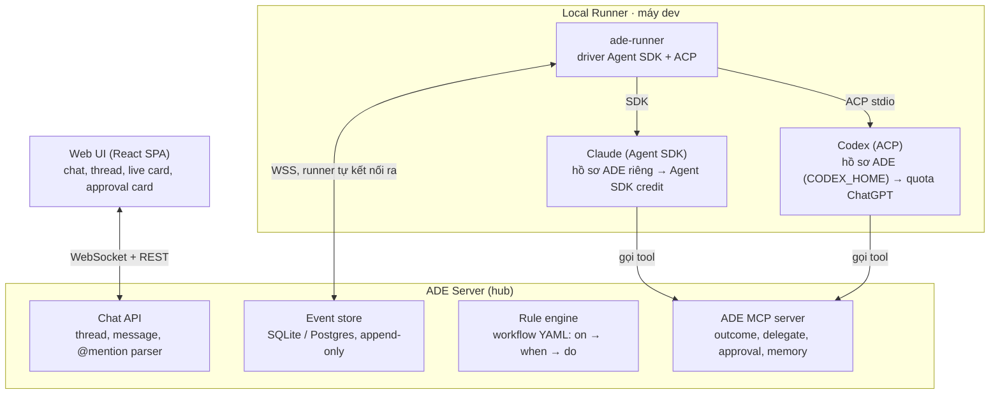
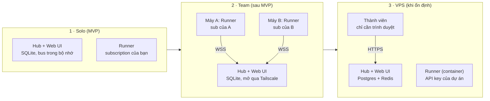
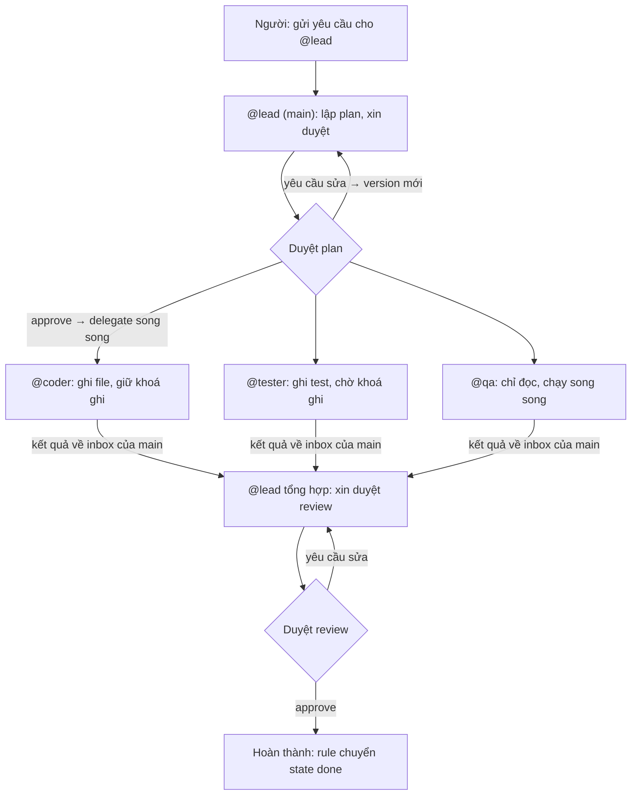

# ADE PoC — Runner + ACP + Trigger

Cập nhật: 2026-10-30 · Phan Hung Cuong · bản gốc: https://claude.ai/artifact/BKVkFvrdchWwHC6AFcefpH

## Mục tiêu & phạm vi

PoC chứng minh một vòng khép kín: gõ `@coder` trong thread → Local Runner trên máy dev chạy Claude Code hoặc Codex qua ACP (dùng login của chính dev) → agent stream tiến độ thành live card, hỏi quyền bằng approval card, và kết thúc bằng một event đổi state thread.

**Tiêu chí thành công**

- [ ] @mention một agent trong thread → agent bắt đầu chạy trong < 5 giây
- [ ] Live card cập nhật tại chỗ (1 message/agent/run), không spam
- [ ] `request_permission` của harness hiện thành approval card; bấm Approve/Deny trên web → harness nhận đúng kết quả
- [ ] Cùng một thread gọi được cả Claude Code (subscription) và Codex (Sign in with ChatGPT)
- [ ] Agent gọi được tool của ADE MCP (`report_outcome`, `post_progress`, `ask_human`, `read_memory`)
- [ ] Agent chưa được mention vào thread thì mọi tool đọc thread đó đều bị từ chối
- [ ] Main agent giao việc cho 3 worker chạy song song và nhận đủ kết quả trong một lần `session/prompt`
- [ ] Thread không vượt qua cổng plan/review khi chưa có người duyệt; yêu cầu sửa tạo version mới
- [ ] Tạo project qua UI, thêm agent và gắn skill; run kế tiếp của agent Claude chỉ thấy đúng skill đã gắn, không thấy skill, plugin, subagent cá nhân của dev
- [ ] Project memory + thread summary được inject vào prompt mỗi lần gọi

**Ngoài phạm vi PoC:** merge PR, diff viewer, CI, Kanban board, fork thread, skill marketplace, mobile, multi-tenant/billing, workflow editor kéo thả.

## Kiến trúc PoC

Ba khối: ADE Server giữ chat, event và rule; Local Runner trên máy dev chạy harness qua Agent SDK (Claude) hoặc ACP (Codex); harness gọi ngược ADE MCP để báo tiến độ và hỏi người.



Runner tự kết nối ra server nên không cần mở port trên máy dev, và token đăng nhập của Claude Code/Codex không bao giờ rời máy.

| Lớp | Chọn | Lý do |
| --- | --- | --- |
| Web | Vite + React SPA do hub phục vụ, TanStack Query, WebSocket | Chạy local không cần server riêng cho UI; live card cần realtime |
| Server | Node/TS (NestJS hoặc Fastify) | MVP: cùng ngôn ngữ với runner, SDK MCP/ACP TypeScript; chuyển sang Rust (Axum) khi ổn định |
| DB | SQLite (Solo/Team), Postgres (VPS) | Local-first không cần cài DB; lên VPS chỉ đổi adapter, thêm pgvector sau |
| Queue / pubsub | Trong bộ nhớ (Solo/Team), Redis + BullMQ (VPS) | Hàng đợi event cho rule engine, fan-out WebSocket |
| Runner | Node/TS daemon (MVP), sau chuyển sang Rust binary | MVP cài bằng npm; bản Rust sau này không cần Node, nhẹ, đóng gói được bằng Tauri |
| ADE MCP | MCP TypeScript SDK (MVP, sau dùng Rust SDK), Streamable HTTP | Harness nào hỗ trợ MCP đều gọi được |

## Chế độ triển khai: local-first → VPS

ADE chạy local trước: hub (server + web UI) và runner nằm trên máy dev, dùng subscription. Khi ổn định mới đưa hub lên VPS, và lúc đó chỉ dùng API key. Cả ba chế độ dùng chung một codebase, chọn bằng `ADE_MODE=solo|team|vps`.

**Phạm vi MVP:** chỉ triển khai Solo. Team và VPS chỉ ghi lại thiết kế để không khoá đường về sau. MVP vẫn khai báo ba adapter dưới dạng interface nhưng chỉ cài bản SQLite, event bus trong bộ nhớ và runner cùng tiến trình.



Từ Solo sang Team chỉ cần mở hub ra mạng (Tailscale/LAN) và cho runner của người khác kết nối vào; từ Team sang VPS thì đổi adapter và credential.

|  | Solo | Team | VPS |
| --- | --- | --- | --- |
| Hub chạy ở | Máy bạn | Máy một thành viên (hoặc mini PC) | VPS |
| Runner | Cùng tiến trình với hub | Mỗi thành viên một runner | Container trên VPS |
| DB / event bus | SQLite / trong bộ nhớ | SQLite / trong bộ nhớ | Postgres / Redis |
| Truy cập | localhost | Tailscale hoặc LAN, invite token | HTTPS + đăng nhập |
| Repo | Thư mục local | Mỗi runner dùng bản clone của mình | VPS clone từ git remote |
| Credential | `sub-*` của bạn | `sub-*` của từng người | Chỉ `api-key` |

**Ba adapter để đổi chế độ mà không sửa logic**

- `Storage`: SQLite ↔ Postgres, dùng chung schema qua ORM (Drizzle).
- `EventBus`: EventEmitter trong tiến trình ↔ Redis pub/sub.
- `RunnerTransport`: gọi trực tiếp trong tiến trình (Solo) ↔ WebSocket (Team, VPS).

**Quy tắc credential:** ở chế độ `vps`, hub từ chối mọi agent khai báo profile `sub-*` ngay lúc khởi động và báo lỗi rõ ràng; API key lưu trong secret store của VPS, ngân sách tính theo dự án và theo người gọi.

## Nhiều người dùng: chia sẻ agent

Mọi thành viên thấy mọi thread, agent và live card trong project. Agent là định nghĩa chung của project, còn mỗi run chạy bằng credential của **người gọi**.

**Chưa làm trong MVP:** đây là thiết kế cho chế độ Team và VPS. MVP chỉ có một người dùng, nhưng vẫn lưu `invoked_by` và `credential_profile` trong `runs` để sau này không phải migrate.

**Agent dùng chung, credential theo người gọi**

- `@coder` là một định nghĩa trong `.ade/` (vai trò, skill, harness). A gọi thì run chạy trên runner của A bằng subscription của A; B gọi thì chạy trên runner của B.
- Nhờ vậy không ai dùng subscription của người khác, vì subscription là gói cá nhân.
- Nếu runner của B offline hoặc B chưa login harness đó, run vào hàng đợi và thread hiện thông báo. Thành viên khác có thể bấm “Chạy bằng runner của tôi”, tức tự nhận run về credential của mình.
- Ở VPS, mọi run dùng API key của dự án; chi phí vẫn ghi theo người gọi để theo dõi ngân sách.

**Ai được làm gì với một run**

| Thao tác | Người gọi run | Thành viên khác | Owner dự án |
| --- | --- | --- | --- |
| Xem thread, live card, log | Có | Có | Có |
| @mention agent (tạo run mới) | Có | Có, chạy bằng credential của chính mình | Có |
| Reply tiếp vào session đang chạy | Có | Local: gửi dạng gợi ý, người gọi bấm chuyển cho agent. VPS: có | Có |
| Duyệt approval card (xin quyền) | Có | Không | Có |
| Huỷ run | Có | Không | Có |
| Duyệt `propose_memory` | Không | Không | Có |
| Sửa định nghĩa agent, workflow | Không | Không | Có (qua PR vào `.ade/`) |

Reply của thành viên khác ở chế độ local được giữ ở dạng gợi ý vì nó sẽ tiêu vào subscription của người gọi.

**Hiển thị trên UI:** live card ghi rõ “@coder · chạy cho Cuong · runner Cuong-MBP”; sidebar có bộ lọc “Run của tôi” và danh sách runner đang online.

**Bổ sung data model:** bảng `users`, bảng `project_members` (project\_id, user\_id, role: owner/member), và hai cột `invoked_by`, `credential_profile` trong `runs`.

## Data model tối thiểu

Tám bảng đủ cho PoC; mọi thay đổi trạng thái đều ghi thêm vào bảng `events` (append-only), các bảng còn lại là projection dựng từ event.

| Bảng | Cột chính | Ghi chú |
| --- | --- | --- |
| `projects` | id, name, repo\_path, workflow\_id, memory\_path | `memory_path` mặc định `.ade/memory/` trong repo |
| `channels` | id, project\_id, name, default\_workflow |  |
| `threads` | id, channel\_id, title, state, workflow\_id, summary, created\_by | `state` là state hiện tại của workflow |
| `messages` | id, thread\_id, author\_type (human/agent/system), author\_id, kind, body, card\_json, run\_id | `kind`: text, live\_card, approval\_card, question\_card, system |
| `agents` | id, project\_id, handle (`@coder`), harness (claude-code/codex/…), skills\[\], mcp\_allow\[\], credential\_profile, write, max\_depth, budget\_usd | handle duy nhất trong project |
| `runs` | id, thread\_id, agent\_id, invoked\_by, runner\_id, credential\_profile, acp\_session\_id, status, outcome, depth, parent\_run\_id, cost\_usd, started\_at, ended\_at | 1 lần gọi agent = 1 run; `depth` dùng chống loop |
| `runners` | id, owner\_user\_id, machine\_name, harnesses\_available\[\], status, last\_seen | mỗi dev 1 runner |
| `events` | id, type, thread\_id, run\_id, actor, payload, causation\_id, correlation\_id, ts | nguồn sự thật duy nhất |

Thread memory nằm trong `threads.summary` (rolling summary) ở PoC; tách bảng `memories` riêng khi làm promotion ở phase sau.

## Event schema

Mọi trigger đều là một event cùng một envelope; rule engine chỉ đọc `type` + `payload`, nên thêm nguồn trigger mới không phải sửa engine.

```json
{
  "id": "evt_01J...",
  "type": "agent.mentioned",
  "ts": "2026-10-28T09:12:03Z",
  "project_id": "prj_1",
  "thread_id": "thr_42",
  "run_id": null,
  "actor": { "type": "human", "id": "usr_cuong" },
  "causation_id": "evt_01H...",
  "correlation_id": "thr_42",
  "payload": { "agent": "@planner", "message_id": "msg_9", "text": "viết spec login" }
}
```

`causation_id` = event gây ra event này; dùng để truy vết chuỗi và phát hiện loop.

| Type | Nguồn | Payload chính |
| --- | --- | --- |
| `message.posted` | Chat | message\_id, text, mentions\[\] |
| `agent.mentioned` | Chat (tách từ message) | agent, message\_id, text |
| `command.invoked` | Chat `/run`, `/state` | name, args |
| `reaction.added` | Chat | message\_id, emoji |
| `approval.resolved` | Approval card | request\_id, decision (approve/deny), by |
| `thread.state_changed` | Rule / MCP / người | from, to, reason |
| `run.started` | Runner | agent, harness, acp\_session\_id |
| `run.progress` | Runner (ACP `session/update`) | kind (plan/tool\_call/message\_chunk), data |
| `run.permission_requested` | Runner (ACP `request_permission`) | request\_id, tool, args, options\[\] |
| `run.completed` / `run.failed` | Runner | stop\_reason, outcome, summary, cost\_usd |
| `hook.fired` | Hook của harness (vd. Claude Code PreToolUse/Stop) | hook\_name, data |
| `mcp.called` | ADE MCP server | tool, args |
| `webhook.received` / `schedule.tick` | Bên ngoài | source, body |

`run.progress` có tần suất cao: lưu vào log riêng, chỉ bản gộp (mỗi \~1 giây) mới đẩy vào event store.

## Rule engine & workflow YAML

Workflow là một file YAML trong repo (`.ade/workflows/*.yaml`), gồm `states` và `rules`; mỗi rule = `on` (event type) + `when` (điều kiện) + `do` (danh sách action).

```yaml
workflow: feature
initial: open
states: [open, plan, plan_review, implement, done]

agents:
  "@planner": { harness: claude-code, skills: [write-spec], write: false }
  "@coder":   { harness: codex,       skills: [implement],  write: true }

rules:
  - on: agent.mentioned               # gọi tay bằng @mention
    do:
      - dispatch: { agent: "{{payload.agent}}", prompt: "{{payload.text}}" }

  - on: thread.state_changed
    when: { to: plan }
    do:
      - dispatch: { agent: "@planner", skill: write-spec }

  - on: run.completed
    when: { agent: "@planner", state: plan, outcome: done }
    do:
      - set_state: plan_review
      - ask_human: { text: "Duyệt spec để chuyển sang code?", options: [approve, revise] }

  - on: approval.resolved
    when: { state: plan_review, decision: approve }
    do:
      - set_state: implement
      - dispatch: { agent: "@coder", skill: implement, prompt: "Làm theo spec đã duyệt trong thread" }

  - on: run.completed
    when: { agent: "@coder", state: implement, outcome: done }
    do:
      - set_state: done

  - on: run.completed
    when: { outcome: [blocked, needs_revision, unknown] }   # kẹt hoặc không báo kết quả
    do:
      - ask_human: { text: "{{run.agent}} cần bạn xem lại: {{run.summary}}" }

  - on: hook.fired
    when: { hook_name: PreToolUse, "data.command": { matches: "rm -rf|DROP TABLE" } }
    do:
      - deny_tool: { reason: "Lệnh bị chặn bởi policy" }
```

**Action có trong PoC:** `dispatch`, `set_state`, `post_message`, `ask_human`, `deny_tool`, `run_script` (chạy hook script trên server).

**Thứ tự xử lý một event**

1. Ghi event vào store (append-only).
2. Cập nhật projection (thread, message, run).
3. Tìm rule khớp `on` + `when`, chạy theo thứ tự khai báo trong file.
4. Mỗi action sinh event mới với `causation_id` = event hiện tại, đưa lại vào hàng đợi.

**Chống loop**

- `runs.depth`: run do agent khác gọi = depth cha + 1; vượt `max_depth` (mặc định 3) → không dispatch, post cảnh báo.
- Chuỗi `causation_id` dài quá 20 event trong 1 thread → dừng rule engine cho thread đó, chờ người.
- Ngân sách `budget_usd` theo agent và theo thread; hết → `run.failed` với lý do `budget_exceeded`.

## ADE MCP server

Runner inject MCP server này vào mọi session qua `session/new` (`mcpServers`), kèm một token ngắn hạn gắn với `run_id`; nhờ vậy tool luôn biết agent đang ở thread nào và chỉ thao tác được thread đó.

| Tool | Input | Output | Event sinh ra | Quyền |
| --- | --- | --- | --- | --- |
| `report_outcome` | status (done/blocked/needs\_revision), summary, decisions\[\] | ok | ghi vào `runs.outcome`, đi kèm `run.completed` | mọi agent; gọi cuối mỗi run |
| `post_progress` | text, step?, percent? | ok | `run.progress` | mọi agent |
| `post_message` | text, kind? (note/result) | message\_id | `message.posted` | mọi agent |
| `ask_human` | question, options\[\]?, timeout\_s? | answer (chờ đến khi có) | `question.asked` → `approval.resolved` | mọi agent |
| `read_memory` | scope (project/thread), query? | entries\[\] | — | mọi agent |
| `propose_memory` | scope, content, reason | proposal\_id | `memory.proposed` | mọi agent; người duyệt mới ghi |
| `get_thread` | include\_messages? (n) | title, state, summary, messages\[\] | — | mọi agent |
| `set_state` | to, reason | ok / lỗi nếu transition không hợp lệ | `thread.state_changed` | chỉ agent điều phối được cấp `mcp_allow: [set_state]`; MVP chưa dùng |
| `delegate` | agent, task, inputs\[\], scope, expects | run\_id | `task.delegated` (depth+1) | chỉ main agent; theo `max_depth` |

`ask_human` là tool “blocking”: MCP server giữ request mở cho đến khi người trả lời hoặc hết `timeout_s` (mặc định 30 phút), rồi trả kết quả về cho agent.

Agent không tự đổi state. Cuối mỗi run, agent gọi `report_outcome` để báo `done` / `blocked` / `needs_revision` kèm summary; rule đọc outcome trong `run.completed` để quyết state. Agent không gọi thì outcome = `unknown` và thread hỏi người.

## Runner protocol & driver harness

Local Runner (`ade-runner`) là daemon Node/TS (MVP, chuyển sang Rust khi ổn định) chạy trên máy dev, tự mở kết nối WebSocket ra server (không cần mở port), chạy harness qua hai driver (Claude qua Agent SDK, Codex qua ACP) và không bao giờ gửi token đăng nhập của harness lên server.

Trong MVP (Solo), runner chạy cùng tiến trình với hub nên các message dưới đây chỉ là lời gọi hàm trong bộ nhớ. Giữ đúng format này để khi làm chế độ Team chỉ cần thay transport bằng WebSocket.

**Hai driver, chung một định dạng event**

| Driver | Harness | Cách chạy | Kiểm soát |
| --- | --- | --- | --- |
| Claude | Claude Code | `query()` của Agent SDK ngay trong tiến trình runner | Skill qua plugin tạm, hook là callback, duyệt quyền qua `canUseTool`, tiếp tục session bằng `resume` |
| ACP | Codex (và harness ACP khác sau này) | Spawn adapter (`codex-acp`), JSON-RPC qua stdio | Theo chuẩn ACP; cấu hình qua `CODEX_HOME` riêng |

Cả hai driver chuẩn hoá về cùng một bộ `run.event`, nên hub, rule engine và UI không cần biết agent chạy bằng driver nào.

**Message giữa server và runner**

| Chiều | Message | Nội dung |
| --- | --- | --- |
| runner → server | `runner.hello` | runner\_id, harness có sẵn (claude-code, codex…), version |
| server → runner | `run.start` | run\_id, agent, harness, repo, thread\_id, prompt, context (memory + summary), mcp\_token |
| server → runner | `run.prompt` | run\_id, text (người reply tiếp vào thread) |
| server → runner | `run.cancel` | run\_id |
| runner → server | `run.event` | run\_id, ACP update đã chuẩn hoá |
| runner → server | `permission.request` | run\_id, request\_id, tool, args, options\[\] |
| server → runner | `permission.reply` | request\_id, option\_id |
| runner → server | `run.end` | run\_id, stop\_reason, usage |

**Vòng đời một run (driver ACP)**

1. Runner tạo worktree riêng cho thread: `git worktree add .ade/wt/<thread_id>`.
2. Spawn adapter ACP của harness (Claude Code, Codex `codex-acp`, Gemini CLI có ACP sẵn; kiểm tra tên package mới nhất trên ACP Registry), gửi `initialize`.
3. `session/new` với `cwd` = worktree và `mcpServers` = ADE MCP (kèm `mcp_token`).
4. `session/prompt` với context: project memory + thread summary + skill + câu lệnh.
5. Nhận `session/update` liên tục → chuẩn hoá → `run.event` → server cập nhật live card.
6. Gặp `session/request_permission` → `permission.request` → approval card → người bấm → `permission.reply` → trả option đã chọn cho harness.
7. `session/prompt` trả về với `stopReason` → `run.end` → server phát `run.completed` → rule engine chạy.
8. Giữ session sống theo cặp (thread, agent) để người reply tiếp thành `session/prompt` mới; runner khởi động lại thì tạo session mới và inject lại thread summary.

Driver Claude đi đúng các bước trên nhưng bằng lời gọi hàm: `query()` kèm options thay cho `session/new` + `session/prompt`, message stream của SDK thay cho `session/update`, callback `canUseTool` thay cho `session/request_permission`, option `resume` để tiếp tục session.

**Mapping ACP → giao diện**

| ACP | Event ADE | Hiển thị |
| --- | --- | --- |
| `session/update` · `plan` | `run.progress` (plan) | checklist trong live card |
| `session/update` · `tool_call` / `tool_call_update` | `run.progress` (tool\_call) | dòng log thu gọn “Edit src/auth.ts ✓” |
| `session/update` · `agent_message_chunk` | `run.progress` (message) | đoạn text cuối của live card |
| `session/request_permission` | `run.permission_requested` | approval card có nút |
| response `stopReason` | `run.completed` / `run.failed` | live card chuyển sang result |

**Hook**

Với Claude, hook là callback của Agent SDK chạy ngay trong runner (PreToolUse, PostToolUse, Stop…): callback gọi thẳng rule engine, và với PreToolUse thì trả `deny` để chặn lệnh. Không cần cầu nối `ade-hook` hay file settings. Với Codex, PoC chỉ dựa vào event ACP và luồng xin quyền.

**Credential profile**

| Profile | Chạy ở | Đăng nhập | Tính vào |
| --- | --- | --- | --- |
| `sub-claude` | Runner của dev | Đăng nhập một lần trong hồ sơ Claude của ADE | Agent SDK credit hàng tháng của gói Pro/Max |
| `sub-chatgpt` | Runner của dev | Sign in with ChatGPT một lần trong hồ sơ Codex của ADE | Quota gói ChatGPT |
| `api-key` | Runner hoặc server | Key trong secret store | Giá API |

Server chỉ biết tên profile, không giữ token. Run của agent dùng profile `sub-*` chỉ được giao cho runner của chính người gọi agent, để mỗi người dùng subscription của mình.

**Cô lập cấu hình harness (hồ sơ ADE)**

Harness chạy trong ADE không bao giờ đọc `~/.claude` hay `~/.codex` cá nhân của dev, để skill, subagent, plugin cài sẵn không làm loãng context hay chạy lệch workflow. Mọi thứ agent cần do ADE sinh ra từ `.ade/` cho từng run; dev đăng nhập harness một lần trong tab Harness, tách khỏi Claude Desktop hay CLI dùng hằng ngày.

|  | Claude Code | Codex |
| --- | --- | --- |
| Tách config cá nhân | `settingSources: []`; `CLAUDE_CONFIG_DIR=~/.ade/harness/claude`; `CLAUDE_CODE_DISABLE_AUTO_MEMORY=1`; `strictMcpConfig` để không nạp MCP connector của claude.ai | `CODEX_HOME=~/.ade/harness/codex` với `config.toml` do ADE sinh (model, sandbox, MCP của ADE) |
| ADE nạp lại | `systemPrompt` (vai trò agent), `plugins` (skill của agent), `skills`, `mcpServers`, `agents`, `hooks` | Skill chép vào `.agents/skills/` của worktree, MCP của ADE trong `config.toml` |
| Chỗ còn rò | Policy do tổ chức quản lý vẫn được đọc; bug báo từ 4/2026: `~/.claude/CLAUDE.md` vẫn nạp dù đã giới hạn `settingSources` | Skill cá nhân ở `~/.agents/skills` nằm ngoài `CODEX_HOME` nên vẫn nạp |
| Cách bịt | Kiểm tra trong spike; còn rò thì đặt `HOME` riêng cho tiến trình | ADE quét `~/.agents/skills` và sinh `[[skills.config]] enabled = false`, hoặc đặt `HOME` riêng cho tiến trình |

CLAUDE.md, AGENTS.md và `.claude/` trong repo là của dự án, không phải của cá nhân: mỗi project có công tắc **Dùng hướng dẫn của repo** (bật thì Claude dùng `settingSources: ["project"]`).

**Spike tuần 2 (1–2 ngày) cần trả lời:**

- [ ] Với `settingSources: []` và `CLAUDE_CONFIG_DIR` riêng, `~/.claude/CLAUDE.md` còn bị nạp không?
- [ ] Tắt skill cá nhân của Codex bằng `[[skills.config]]` trong `CODEX_HOME` riêng có hiệu lực không?
- [ ] Đăng nhập bằng subscription trong thư mục config riêng của ADE chạy được với cả Claude và Codex không?
- [ ] `codex-acp` có đủ luồng xin quyền và stream tiến độ không, hay cần chuyển sang Codex SDK?

## Memory trong PoC

PoC chỉ cần hai tầng: project memory là file markdown trong repo, thread memory là rolling summary; chưa cần vector search.

**Project memory:** `.ade/memory/` trong repo, ví dụ `architecture.md`, `conventions.md`, `how-to-test.md`. Runner đọc trực tiếp từ worktree, nên memory luôn khớp với branch. Ghi mới chỉ qua `propose_memory` → card duyệt → server commit file.

**Thread memory:** `threads.summary`, khoảng 300–500 từ, gồm mục tiêu, quyết định, câu hỏi mở, trạng thái hiện tại. Cập nhật sau mỗi `run.completed` từ summary và decisions mà agent gửi trong report\_outcome; thiếu thì nối message cuối của run vào summary, không dùng LLM (API key chỉ là tuỳ chọn).

**Context inject vào `session/prompt`**, theo thứ tự:

```text
<project_memory>   nội dung .ade/memory/*.md (cắt theo giới hạn token)
<thread>           title, state hiện tại, summary
<recent_messages>  10 message gần nhất của thread
<skill>            SKILL.md của skill được chỉ định
<task>             câu lệnh từ @mention hoặc rule
<tools_hint>       nhắc dùng ade.post_progress / ade.ask_human
```

Agent cần nhiều hơn thì tự gọi `read_memory` hoặc `get_thread`, thay vì nhồi hết vào prompt.

## Điều phối trong thread

Mỗi thread có một main agent điều phối. Agent chỉ đọc được context của thread sau khi được mention. Worker làm song song và trả kết quả về main. Main chỉ vượt được cổng plan, spec, review khi người duyệt.



Hai cổng là nơi duy nhất người bắt buộc phải vào; giữa hai cổng, main tự giao việc và gom kết quả. Spec là cổng thứ ba cùng cơ chế, bật khi workflow cần.

### Quyền đọc context theo mention

Agent không đọc được gì của một thread cho đến khi được mention vào thread đó. Mỗi lần mention tạo một **grant** (agent, thread, người cấp, vai trò); grant còn hiệu lực đến khi thread đóng hoặc người gỡ agent ra.

Ba loại context agent được đọc sau khi có grant:

1. **Chat context:** tin nhắn của thread và thread summary.
2. **Kết quả suy luận:** kết quả các run khác trong thread, gồm summary, decisions, artifact từ `report_outcome`.
3. **Scratchpad riêng:** bộ nhớ làm việc của chính agent trong thread này (ghi chú, giả thuyết, việc dở dang). Chỉ agent đó đọc/ghi; người xem được; giữ qua các run.

| Context | Main agent | Worker | Người |
| --- | --- | --- | --- |
| Tin nhắn chat + thread summary | Toàn bộ | Brief từ main + summary; xin thêm qua `get_thread` nếu main cấp `scope: full` | Toàn bộ |
| Kết quả run khác (summary, decisions, artifact) | Toàn bộ | Chỉ các kết quả main truyền vào | Toàn bộ |
| Log chi tiết của run (tool call, message chunk) | Không mặc định, xin qua `get_run_log` | Không | Toàn bộ |
| Scratchpad | Của mình | Của mình | Xem tất cả (chỉ đọc) |
| Project memory | Có | Có | Có |

Worker mặc định chỉ nhận brief vì context nhỏ hơn thì rẻ hơn và ít nhiễu hơn; main quyết định khi nào cần cho worker đọc toàn bộ.

**Thực thi:** mọi tool đọc của ADE MCP kiểm tra grant qua `mcp_token` gắn với run, nên agent không đọc được thread khác dù đang chạy cùng lúc. Context inject lúc dispatch cũng lọc theo bảng trên. Giới hạn: quyền này chỉ áp cho dữ liệu của ADE; file trong worktree thì harness vẫn đọc được.

### Main agent và worker

Mỗi thread có đúng một main agent; mọi worker làm việc song song và trả kết quả về main, không trả trực tiếp cho người.

**Chọn main agent**

- Mặc định theo workflow (`main_agent: "@lead"`), hoặc agent đầu tiên được mention nếu workflow không khai báo.
- Người đổi bằng `/main @x`. Main cũ mất quyền delegate; các worker đang chạy chuyển kết quả về main mới.

**Phân vai**

|  | Main agent | Worker |
| --- | --- | --- |
| Nhận yêu cầu từ | Người trong thread | Main (qua `delegate`) hoặc người mention trực tiếp |
| Giao việc cho agent khác | Có (`delegate`) | Không |
| Xin duyệt plan, spec, review | Có (`request_approval`) | Không; báo main nếu cần |
| Kết quả gửi về | Rule engine (`report_outcome`) + tin nhắn tổng hợp cho người | Inbox của main |
| Live card | Card chính của thread | Card con thu gọn dưới card của main |

Người vẫn mention trực tiếp một worker được, ví dụ `@qa chạy lại test`. Run đó vẫn tính là worker và kết quả vẫn về inbox của main, để main luôn nắm đủ bức tranh.

**Giao việc song song (fan-out)**

1. Main gọi `delegate` cho từng worker: agent, task (brief), inputs (kết quả hoặc tin nhắn cần đọc), scope (`brief`/`full`), expects (outcome mong đợi).
2. Mỗi `delegate` tạo một child run: `parent_run_id` = run của main, `depth` + 1, grant role worker.
3. Worker chỉ đọc (`write: false`) chạy song song ngay; worker ghi xếp hàng theo khoá ghi của thread (đã chốt ở câu hỏi mở số 3).
4. Giới hạn song song mặc định: 3 worker mỗi thread, cấu hình được.

**Gom kết quả (fan-in)**

1. Worker kết thúc bằng `report_outcome` → kết quả vào inbox của main (`run.result_ready`).
2. Khi mọi child run của một lượt delegate xong (hoặc hết `timeout`), ADE gửi một `session/prompt` cho main, kèm toàn bộ kết quả: “Kết quả từ @coder (done), @qa (blocked: …)”.
3. Main không phải chờ chủ động. Session của main đã bị đóng vì idle thì mở lại theo quy tắc ở câu hỏi mở số 4.
4. Main tổng hợp, quyết định giao tiếp, xin duyệt, hoặc `report_outcome`.

Worker báo `blocked` thì main quyết: giao lại, đổi hướng, hoặc hỏi người.

### Cổng duyệt của người: plan, spec, review

Main agent không tự vượt qua cổng plan, spec hay review. Mọi lần vượt cổng phải có một `approval` được người duyệt, và chỉ rule engine (khi nhận `approval.resolved`) mới đổi state.

**Hai loại duyệt, không trộn**

|  | Duyệt công việc (cổng) | Duyệt quyền tool |
| --- | --- | --- |
| Ví dụ | Accept plan, accept spec, accept review | Cho chạy `npm install`, ghi file ngoài worktree |
| Ai tạo | Main agent qua `request_approval` | Harness qua ACP `request_permission` |
| Có đổi state không | Có | Không |
| Lưu | Bảng `approvals`, có version | Event `run.permission_requested` |

**Luồng một cổng**

1. Main gọi `request_approval`: kind (`plan`/`spec`/`review`), title, summary, artifacts (link file spec, kết quả worker), options.
2. ADE tạo approval `pending` (version 1), đăng **approval card** vào thread, đồng thời bật **alert**: badge “Chờ duyệt” ở sidebar, thông báo trình duyệt, và tin nhắn hệ thống mention người duyệt.
3. Thread chuyển sang state chờ (vd. `plan_review`); main dừng, worker không được giao việc mới cho đến khi có quyết định.
4. Người chọn trên card:
   - **Approve** → `approval.resolved(approve)` → rule chuyển state, gửi `session/prompt` cho main để làm tiếp.
   - **Yêu cầu sửa** + ghi chú → ghi chú gửi cho main, main sửa rồi xin duyệt lại (version 2).
   - **Từ chối** → thread về state trước, main nhận lý do.
5. Người cũng có thể trả lời bằng chat: `/approve`, `/revise <ghi chú>`; hiệu lực như bấm nút.

**Thực thi:** workflow đánh dấu state có `gate: <kind>`; server từ chối mọi chuyển vào state sau cổng nếu chưa có approval `approved` của đúng kind, dù lệnh đến từ agent hay rule. Approval không tự hết hạn; sau 4 giờ chưa duyệt thì nhắc lại một lần.

**Approval card hiển thị:** kind + version, tóm tắt của main, danh sách kết quả worker (mở rộng được), link artifact, ba nút Approve / Yêu cầu sửa / Từ chối, và lịch sử các version trước.

### Bổ sung cho data model, event, MCP, workflow

**Data model**

| Bảng / cột | Nội dung |
| --- | --- |
| `threads.main_agent_id` | Main agent hiện tại của thread |
| `thread_agents` | thread\_id, agent\_id, role (main/worker), scope (brief/full), granted\_by, granted\_at, revoked\_at |
| `agent_scratchpads` | thread\_id, agent\_id, content (markdown), updated\_at |
| `approvals` | id, thread\_id, run\_id, kind (plan/spec/review), version, title, summary, artifact\_refs, status (pending/approved/changes\_requested/rejected), decided\_by, comment, created\_at, decided\_at |
| `runs.role`, `runs.task`, `runs.delegation_id` | Vai trò của run, brief được giao, nhóm delegate để biết khi nào đủ kết quả |

**Event mới:** `agent.granted`, `agent.revoked`, `main.changed`, `task.delegated`, `run.result_ready`, `delegation.completed`, `approval.requested`, `approval.reminded`. Event `approval.resolved` có sẵn, thêm `kind`, `version`, `comment` vào payload.

**Tool mới trong ADE MCP**

| Tool | Ai dùng | Input | Output |
| --- | --- | --- | --- |
| `delegate` | Main | agent, task, inputs\[\], scope, expects, timeout\_s? | run\_id, delegation\_id |
| `get_results` | Main | delegation\_id? | results\[\] (agent, outcome, summary, decisions) |
| `request_approval` | Main | kind, title, summary, artifacts\[\], options? | approval\_id (kết quả đến qua `session/prompt`) |
| `get_run_log` | Main | run\_id, limit? | các bước chi tiết của run |
| `read_scratchpad` / `write_scratchpad` | Mọi agent có grant | content (khi ghi) | content |

`delegate` thay cho `mention_agent` trong bảng ADE MCP; `ask_human` giữ cho câu hỏi thường, còn quyết định qua cổng dùng `request_approval`.

**Workflow YAML**

```yaml
workflow: feature
main_agent: "@lead"
max_parallel_workers: 3

agents:
  "@lead":   { harness: claude-code, skills: [orchestrate], write: false }
  "@coder":  { harness: codex,       skills: [implement],   write: true }
  "@tester": { harness: claude-code, skills: [write-tests], write: true }
  "@qa":     { harness: claude-code, skills: [review],      write: false }

states:
  open:        {}
  planning:    {}
  plan_review: { gate: plan }
  building:    {}
  review:      { gate: review }
  done:        {}

rules:
  - on: approval.resolved
    when: { kind: plan, decision: approve }
    do:
      - set_state: building
      - resume_main: "Plan đã duyệt, bắt đầu giao việc"

  - on: approval.resolved
    when: { decision: changes_requested }
    do:
      - resume_main: "Người duyệt yêu cầu sửa: {{payload.comment}}"

  - on: approval.resolved
    when: { kind: review, decision: approve }
    do:
      - set_state: done
```

Action mới `resume_main` gửi một `session/prompt` cho main agent của thread.

## Cấu hình project, agent và skill

Mỗi project có trang Settings riêng để thêm và cấu hình agent, gắn skill riêng cho từng agent. Nguồn sự thật là thư mục `.ade/` trong repo: UI chỉ đọc và ghi các file này, DB chỉ là bản cache để truy vấn nhanh.

```text
.ade/
  project.yaml          # tên, main agent mặc định, workflow mặc định
  agents/
    lead.yaml           # mỗi agent một file
    coder.yaml
  skills/
    write-spec/SKILL.md # skill riêng của project (chuẩn Agent Skills)
    implement/SKILL.md
  workflows/feature.yaml
  memory/*.md
```

Vì nằm trong repo, cấu hình agent và skill được version cùng code; người sửa bằng tay hay qua UI đều ra cùng một kết quả.

### UI Project Settings

Trang Settings có 6 tab; tạo project mới đi qua wizard 3 bước (chọn repo → chọn template agent → kiểm tra harness) rồi vào thẳng tab Agents.

| Tab | Nội dung | Ghi vào |
| --- | --- | --- |
| General | Tên, đường dẫn repo, branch mặc định, main agent mặc định, workflow mặc định | `.ade/project.yaml` |
| Agents | Danh sách agent; thêm, sửa, nhân bản, tắt tạm thời | `.ade/agents/*.yaml` |
| Skills | Thư viện skill của project: tạo, import, sửa, xem agent nào đang dùng | `.ade/skills/` |
| Workflow | Editor YAML có kiểm tra cú pháp, state, gate, rule | `.ade/workflows/` |
| Memory | Xem và sửa project memory; duyệt `propose_memory` đang chờ | `.ade/memory/` |
| Harness | Harness phát hiện được, version, đã login chưa, credential profile khả dụng | Chỉ đọc |

**Form cấu hình một agent**

| Trường | Ví dụ | Ghi chú |
| --- | --- | --- |
| Handle, tên hiển thị, avatar | `@coder`, “Coder” | Handle duy nhất trong project |
| Mô tả vai trò | “Viết code theo spec đã duyệt, không tự đổi kiến trúc” | Thành system prompt của agent |
| Harness + model | Codex, model mặc định | Chỉ hiện harness đã phát hiện ở tab Harness |
| Credential profile | `sub-chatgpt` | Solo chỉ có `sub-*` hoặc `api-key` của máy |
| Skills | `implement`, `tdd` | Chọn từ thư viện, hoặc tạo mới ngay trong form |
| Quyền | `write`, `mcp_allow`, có được làm main không |  |
| Giới hạn | `max_depth`, `budget_usd`, timeout |  |

Nút **Test agent** chạy một run thử trong thread nháp: kiểm tra harness khởi động được, skill nạp đủ, MCP của ADE kết nối được.

### Thư viện skill và gắn skill cho agent

Skill viết theo chuẩn mở Agent Skills (`SKILL.md` + frontmatter `name`, `description`), nên cùng một skill dùng được cho cả Claude Code và Codex. Agent chỉ được dùng những skill đã gắn cho nó.

**Hai cấp thư viện**

- **Global** (`~/.ade/skills/`): skill dùng lại qua nhiều project, ví dụ `review`, `write-tests`.
- **Project** (`.ade/skills/`): skill gắn với codebase, ví dụ `deploy-staging`. Trùng tên thì project thắng.

**Cách thêm skill vào thư viện:** tạo mới bằng editor có template; import từ thư mục hoặc file zip; import từ git URL; hoặc sao chép từ thư viện global vào project để sửa riêng.

**Gắn skill cho agent**

```yaml
# .ade/agents/coder.yaml
handle: "@coder"
role: "Viết code theo spec đã duyệt"
harness: codex
credential: sub-chatgpt
write: true
skills:
  - implement            # project skill
  - global:write-tests   # skill từ thư viện global
```

- Tab Agents có nút **+ Skill**: chọn từ thư viện hoặc tạo mới; skill tạo từ đây tự vào thư viện project.
- Main agent tự có thêm skill hệ thống `ade-orchestrate` (cách dùng `delegate`, `request_approval`); mọi agent có `ade-basics` (`report_outcome`, `post_progress`).
- Đổi skill có hiệu lực từ run kế tiếp; run đang chạy giữ nguyên bộ skill lúc bắt đầu.
- UI cảnh báo khi một agent gắn quá nhiều skill, vì mô tả của mọi skill nằm trong context mọi lượt và tốn token.

**Kiểm tra khi lưu skill:** frontmatter đúng chuẩn, `name` hợp lệ (không khoảng trắng, dấu ngoặc, dấu phẩy), có `description`; cảnh báo nếu skill chứa script chạy lệnh shell.

### Ràng buộc kỹ thuật khi nạp skill vào harness

Không cần sửa hay fork code native của harness. Ràng buộc nằm ở chỗ cả Claude Code và Codex chỉ nạp skill từ file trên đĩa, mỗi bên đọc ở chỗ khác nhau, nên ADE phải chuẩn bị file và tham số khởi chạy cho từng run (kiểm tra theo tài liệu chính thức, 10/2026).

| Harness | Nạp skill từ đâu | Giới hạn skill theo session | ADE nạp skill riêng cho agent bằng cách |
| --- | --- | --- | --- |
| Claude Code (qua Agent SDK) | `~/.claude/skills`, `.claude/skills` ở cwd và thư mục cha tới root repo, thư mục `--add-dir`, plugin (`--plugin-dir` / option `plugins`). Không có API đăng ký skill bằng code | Có: option `skills` (danh sách tên được dùng) và `settingSources` để bỏ skill cá nhân | Sinh một plugin tạm cho run chứa đúng skill của agent, truyền qua `plugins`, đặt `skills` = danh sách đã gắn. Cô lập được hoàn toàn theo agent |
| Codex | `.agents/skills` ở cwd và thư mục cha tới root repo, `~/.agents/skills`, `/etc/codex/skills`, skill có sẵn | Không có cờ theo session; chỉ tắt được bằng `[[skills.config]]` trong `~/.codex/config.toml` rồi khởi động lại | Chép skill vào `.agents/skills/` của worktree, loại khỏi git qua `.git/info/exclude`. Mọi agent Codex trong cùng thread thấy chung; skill cá nhân của dev vẫn nạp |
| Harness khác qua ACP | Tuỳ harness | Tuỳ harness | Fallback qua ADE MCP (bên dưới) |

**Năm ràng buộc cần tính**

1. **Skill là file, không phải API:** trước mỗi run, ADE phải ghi skill ra đĩa (`~/.ade/runs/<run_id>/` hoặc worktree) và dọn sau khi run kết thúc.
2. **ACP không có trường skill:** `session/new` chỉ có cwd và MCP server. Adapter ACP của Claude chỉ có tài liệu cho `_meta.claudeCode.options.settings`, chưa thấy cho `plugins` hay `skills`. Vì vậy để kiểm soát skill của Claude, runner nên gọi **Agent SDK trực tiếp** thay vì đi qua adapter ACP.
3. **Codex không cô lập được theo agent** trong cùng worktree và không tắt được skill cá nhân của dev theo session. Chấp nhận cho MVP; cần cô lập chặt thì dùng fallback MCP.
4. **Không ghi vào thư mục skill cá nhân** (`~/.claude/skills`, `~/.agents/skills`), vì skill của ADE sẽ lẫn vào phiên làm việc thường của dev.
5. **Script trong skill chạy với quyền của harness:** vẫn phải qua `request_permission` và hook chặn lệnh nguy hiểm như mọi tool khác.

**Đã chốt cho MVP**

- **Claude:** runner gọi Agent SDK trực tiếp (cùng Node/TS) với `plugins`, `skills`, `settingSources: ["project"]`. Lợi thêm: hook của Agent SDK là callback trong tiến trình, nên bỏ được cầu nối `ade-hook`. Tính tiền vẫn vào Agent SDK credit như khi đi qua adapter, vì adapter cũng chạy trên Agent SDK.
- **Codex:** giữ ACP, nạp skill qua `.agents/skills/` trong worktree.
- **Fallback cho mọi harness:** ADE MCP thêm `list_skills` và `load_skill(name)`. Prompt chỉ chứa tên + mô tả skill; agent gọi `load_skill` để lấy nội dung và đường dẫn file đã chép ra. Dùng được với mọi harness, nhưng harness không tự kích hoạt skill như cách native.

Nguồn: [Claude Agent SDK — Skills](https://code.claude.com/docs/en/agent-sdk/skills), [Claude Code — Plugins](https://code.claude.com/docs/en/plugins), [Codex — Agent Skills](https://developers.openai.com/codex/skills), [Claude Agent ACP](https://docsearch.algolia.com/mcp/docs/repo/agentclientprotocol/claude-agent-acp).

### Bổ sung data model, MCP và kế hoạch

| Bảng / cột | Nội dung |
| --- | --- |
| `agents` | Trở thành cache của `.ade/agents/*.yaml`; thêm `role`, `model`, `can_be_main`, `enabled` |
| `skills` | id, name, scope (global/project), path, description, content\_hash |
| `agent_skills` | agent\_id, skill\_id |
| `runs.skills_snapshot` | Danh sách skill + hash lúc run bắt đầu, để biết run đã dùng bản skill nào |

**ADE MCP thêm:** `list_skills` và `load_skill(name)` cho cơ chế fallback.

**Kế hoạch:** tuần 1–4 cấu hình agent và skill bằng file YAML trong `.ade/`; UI Project Settings làm ở tuần 5, nên MVP thành 6 tuần.

## Kế hoạch, rủi ro & câu hỏi mở

MVP chia 6 tuần cho 1 người và chỉ làm chế độ Solo; Team và VPS chỉ thiết kế, triển khai sau khi MVP ổn định; tuần 2 là rủi ro nhất (ACP + runner), nên làm spike ACP ngay ngày đầu.

Kế hoạch chi tiết theo phase (P0 spike 3 ngày + P1–P6) và cách nghiệm thu từng phase bằng Playwright hoặc script nằm ở [phases.md](phases.md); danh sách tuần dưới đây là bản tóm tắt.

1. **Tuần 1 — Chat core:** project/channel/thread/message, WebSocket realtime giữa UI và hub, event store trên SQLite, đọc cấu hình từ `.ade/`, parser @mention → `agent.mentioned`, hub phục vụ SPA trên localhost.
2. **Tuần 2 — Runner:** runner chạy cùng tiến trình với hub; Claude qua Agent SDK với plugin skill tạm cho từng run; live card; approval card cho quyền tool; spike 1–2 ngày kiểm chứng cô lập cấu hình harness.
3. **Tuần 3 — Trigger + Codex:** rule engine + workflow YAML, ADE MCP server (`report_outcome`, `post_progress`, `ask_human`, `read_memory`), grant theo mention, hook chặn lệnh nguy hiểm; Codex qua ACP với skill trong `.agents/skills`.
4. **Tuần 4 — Điều phối:** main agent, `delegate` song song + khoá ghi, fan-in về main, `request_approval` + approval card + alert, scratchpad.
5. **Tuần 5 — Project Settings UI:** wizard tạo project, tab General / Agents / Skills / Harness, gắn skill cho agent, nút Test agent.
6. **Tuần 6 — Memory & hoàn thiện:** project memory + thread summary, tab Workflow / Memory, chống loop (depth, budget), demo luồng `@lead` lập plan → duyệt → 3 worker song song → duyệt review.

| Rủi ro | Ảnh hưởng | Cách giảm |
| --- | --- | --- |
| Chính sách subscription của provider đổi | Mất nguồn model rẻ | Credential profile cho phép chuyển sang `api-key` bằng 1 dòng config |
| Agent SDK credit của Claude hết sớm | Agent dừng giữa chừng | Hiển thị usage theo run; cảnh báo khi còn 20% |
| Adapter ACP của từng harness khác nhau về tính năng | Live card thiếu thông tin | Chuẩn hoá ở runner, thiếu field thì bỏ qua |
| Agent gọi nhau vô hạn | Đốt tiền | `max_depth`, giới hạn chuỗi causation, budget |
| Runner offline khi có trigger | Run bị treo | Hàng đợi chờ runner; báo trong thread; fallback `api-key` nếu agent cho phép |

**Câu hỏi mở**

Đã chốt cả 5 câu theo đề xuất bên dưới. Câu 2 và câu 5 có chung một lời giải: agent báo kết quả có cấu trúc qua một tool `report_outcome`, còn rule là nơi duy nhất đổi state.

**1. Server self-host hay cloud?** Đã chốt: MVP chạy Solo trên máy dev; Team và VPS làm sau.

**2. Ai chủ động chuyển state: rule hay agent?**

| Phương án | Ưu | Nhược |
| --- | --- | --- |
| A. Rule trên `run.completed` | Chắc chắn, dễ debug, nhìn YAML là biết luồng | Không biết agent xong “tốt” hay đang kẹt |
| B. Agent tự gọi `set_state` | Linh hoạt, agent tự quyết quay lại hay đi tiếp | LLM có thể quên gọi hoặc gọi sai; luồng khó đoán |
| C. Agent gọi `report_outcome`, rule quyết state | Agent chỉ báo `done` / `blocked` / `needs_revision`; state vẫn do rule đổi | Cần quy ước outcome cho mỗi skill |

Đề xuất: **C**. Rule viết dạng `on: run.completed` + `when: { outcome: done }`. Agent không gọi `report_outcome` thì outcome = `unknown` → `ask_human`. `set_state` chỉ cấp cho agent điều phối nếu sau này cần.

**3. Hai agent ghi chung một worktree hay mỗi agent một worktree?**

| Phương án | Ưu | Nhược |
| --- | --- | --- |
| A. Một worktree/thread, chạy tuần tự | Đơn giản; agent sau thấy ngay code của agent trước | Không chạy song song được |
| B. Mỗi agent một worktree (branch con) | Song song, không giẫm chân nhau | Phải merge giữa các branch, mà merge/diff đang ngoài phạm vi |
| C. Một worktree/thread + khoá ghi | Agent chỉ đọc (planner, reviewer) chạy song song; agent ghi xếp hàng | Cần khai báo agent nào được ghi |

Đề xuất: **C**. Thêm `write: true|false` vào định nghĩa agent; mỗi thời điểm chỉ một run có quyền ghi trong thread, run ghi khác vào hàng đợi. Agent read-only được sandbox chặn ghi file qua `request_permission`. Phương án B để sau khi có merge/diff.

**4. (Mới) ACP session sống bao lâu?**

| Phương án | Ưu | Nhược |
| --- | --- | --- |
| Giữ đến khi thread đóng | Agent nhớ đủ ngữ cảnh, reply nhanh | Nhiều thread mở = nhiều tiến trình harness, tốn RAM |
| Mỗi run một session mới | Nhẹ, dễ khôi phục | Mất chi tiết giữa các lần; tốn token nạp lại context |
| Giữ, tự đóng khi idle | Cân bằng hai cái trên | Cần logic mở lại session |

Đề xuất: giữ session, đóng sau 30 phút idle, tối đa 4 session cùng lúc (đóng cái cũ nhất khi vượt). Mở lại thì dùng `session/load` nếu harness hỗ trợ, không thì tạo mới và inject thread summary.

**5. (Mới) Thread summary dùng model nào khi Solo không có API key?** Phần Memory đang giả định dùng API key của server, mâu thuẫn với Solo chỉ dùng subscription.

| Phương án | Ưu | Nhược |
| --- | --- | --- |
| Agent tự viết summary trong `report_outcome` | Không tốn thêm lần gọi; agent hiểu việc vừa làm nhất | Phụ thuộc agent nhớ gọi |
| Gọi harness headless (`claude -p`) để tóm tắt | Không cần API key | Trừ vào Agent SDK credit; chậm hơn |
| API key cho model rẻ (tuỳ chọn) | Ổn định, rẻ | Người dùng phải có key |

Đề xuất: mặc định agent gửi `summary` + `decisions[]` trong `report_outcome`. Thiếu thì fallback không dùng LLM: nối message cuối của run vào summary. API key chỉ là tuỳ chọn.

**Đã cập nhật vào các phần liên quan:**

- [x] ADE MCP: thêm tool `report_outcome({ status, summary, decisions[] })`
- [x] Workflow YAML: điều kiện `when` dùng `outcome`, thêm `write` cho agent
- [x] Data model: thêm `agents.write`, `runs.outcome`; event `run.completed` mang `outcome`
- [x] Memory: summary lấy từ `report_outcome`, không cần API key của server
