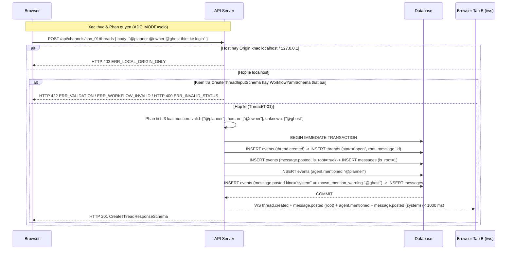

# API Specification — Quản lý Kênh, Tin nhắn gốc Thread, Phản hồi, Biểu cảm, Loader `.ade/` & WebSocket Realtime

| Trường | Giá trị |
| --- | --- |
| API ID | `API-CH-01` |
| Tên nhóm API | Quản lý Kênh, Tin nhắn gốc Thread, Phản hồi, Biểu cảm, Loader `.ade/` & WebSocket Realtime |
| Module | `chat` (Phase P1) |
| Đường dẫn chốt | `specs/dd/chat/ch-01/api-chat.md` |
| Phương thức | `GET` · `POST` · `PATCH` · `DELETE` · `WS` |
| Hiện trạng | BE chưa implement (xây mới ở phase P1) |
| Schema Zod (`packages/shared`) | `ProjectIdParamSchema`, `ChannelIdParamSchema`, `ThreadIdParamSchema`, `MessageIdParamSchema`, `ConfigErrorItemSchema`, `ColleagueSummarySchema`, `ProjectSummarySchema`, `ProjectListResponseSchema`, `AgentSummarySchema`, `AgentListResponseSchema`, `ChannelMemberSchema`, `ChannelSchema`, `ChannelResponseSchema`, `ChannelListResponseSchema`, `CreateChannelInputSchema`, `UpdateChannelInputSchema`, `DeleteChannelResponseSchema`, `ReactionSummarySchema`, `ToggleReactionInputSchema`, `ToggleReactionResponseSchema`, `ThreadSchema`, `ThreadResponseSchema`, `CreateThreadResponseSchema`, `ThreadListResponseSchema`, `CreateThreadInputSchema`, `MessageKindSchema`, `MessageSchema`, `MessageListResponseSchema`, `CreateMessageInputSchema`, `PostMessageResponseSchema`, `WsServerEventSchema`, `WsClientEventSchema`, `ApiErrorResponseSchema` (`packages/shared/src/schemas/chat.ts`, `packages/shared/src/schemas/common.ts`) |
| Schema DB (`apps/hub`) | `users`, `project_members`, `projects`, `agents`, `channels`, `channel_members`, `threads`, `messages`, `events` (`apps/hub/src/db/schema.ts`) |
| Liên quan | [specs/dd/chat/overview.md](../overview.md) · [specs/dd/chat/ch-01/ui-chat.md](./ui-chat.md) · [specs/dd/domain-model.md](../../domain-model.md) · [specs/message.md](../../../message.md) |
| Ngày tạo | 2026-10-31 |
| Ngày cập nhật | 2026-10-31 |

## Lịch sử sửa đổi

| Ver | Ngày | Tác giả | Thay đổi |
| --- | --- | --- | --- |
| 1.0 | 2026-10-31 | Kiến trúc sư ADE | Khởi tạo đặc tả REST & WebSocket cho P1 Chat Core |
| 1.1 | 2026-10-31 | Kiến trúc sư ADE | Đồng bộ mô hình Slack 3+1 cột (`1 Tin nhắn gốc = 1 Thread`), thành viên kênh, xóa mềm `channels.deleted_at`, 8 biểu cảm và phân giải 3 nhánh `@mention` |
| 1.2 | 2026-10-31 | Kiến trúc sư ADE | Mở rộng tập giá trị `MessageSchema.kind` thêm `'explorer_card'` cho `@explorer` và bổ sung `pendingQuestionCount`, `explorerCitationCount` trên `ThreadSchema` phục vụ thanh tóm tắt dưới tin nhắn gốc từ Phase P3 |

---

## §1. Mục đích & Danh sách Endpoint

- **Actor**: Người dùng cục bộ `'usr_local'` (`handle = 'owner'`, `role = 'owner'`) gọi từ giao diện `UI-CH-01` trên `localhost` / `127.0.0.1` ở `ADE_MODE=solo`.
- **Use case**: Cung cấp tập API REST và kênh WebSocket `/ws` để đọc dự án/đồng nghiệp/agent từ `.ade/`, quản lý vòng đời kênh (`tạo`, `cập nhật`, `xóa mềm`), đăng tin nhắn gốc mở thread (`1 Tin nhắn gốc = 1 Thread`), gửi phản hồi, thả 8 biểu cảm và phân giải `@mention` thời gian thực.
- **Kết quả thành công**: Mọi thao tác ghi được tuần tự hóa thành sự kiện bất biến trong bảng `events` append-only, chiếu đồng bộ sang các bảng đọc SQLite trong cùng giao dịch và phát qua `/ws` tới mọi trình khách đang mở trong vòng dưới `1000 ms`.
- **Ngoài phạm vi**: Khởi chạy tiến trình agent thật từ `agent.mentioned` (thuộc P2 `packages/runner`), thực thi Rule Engine đổi `threads.state` sau trạng thái khởi tạo (thuộc P3), cổng duyệt `approvals` (thuộc P4), API đăng ký/sửa cài đặt dự án từ giao diện (thuộc P5) và xác thực đa người dùng qua mạng (chế độ Team nằm ngoài MVP).
- **Giả định**: Ở `ADE_MODE=solo`, biến môi trường `ADE_DEFAULT_REPO` (hay tham số `defaultRepoPath` trong kiểm thử) trỏ tới thư mục kho Git cục bộ tồn tại và có quyền đọc trên đĩa.
- **Câu hỏi mở**: Không có.

| Ký hiệu | Phương thức & Đường dẫn | Mục đích nghiệp vụ | Zod Response Schema |
| --- | --- | --- | --- |
| `API-1` | `GET /api/projects` | Lấy danh sách dự án kèm đồng nghiệp `colleagues` và lỗi cấu hình `.ade/` | `ProjectListResponseSchema` |
| `API-2` | `GET /api/projects/:projectId/agents` | Lấy danh sách agent hợp lệ đọc từ `.ade/agents/*.yaml` và mảng `configErrors` | `AgentListResponseSchema` |
| `API-3` | `GET /api/projects/:projectId/channels` | Lấy danh sách kênh đang hoạt động của dự án kèm danh sách thành viên `members` | `ChannelListResponseSchema` |
| `API-4` | `POST /api/projects/:projectId/channels` | Tạo kênh mới qua sự kiện `channel.created` kèm thành viên mặc định | `ChannelResponseSchema` |
| `API-5` | `PATCH /api/channels/:channelId` | Cập nhật tên, mô tả và danh sách thành viên kênh qua sự kiện `channel.updated` | `ChannelResponseSchema` |
| `API-6` | `DELETE /api/channels/:channelId` | Xóa mềm kênh (`channels.deleted_at`) qua sự kiện `channel.deleted` (giữ tối thiểu 1 kênh hoạt động) | `DeleteChannelResponseSchema` |
| `API-7` | `GET /api/channels/:channelId/threads` | Lấy luồng tin nhắn gốc (`ThreadSchema` kèm `rootMessage`, `replyCount`, `lastReplyAt`, `participantIds`, `pendingQuestionCount`, `explorerCitationCount`) của kênh | `ThreadListResponseSchema` |
| `API-8` | `POST /api/channels/:channelId/threads` | Gửi tin nhắn gốc vào kênh, tạo nguyên tử `thread.created` (`Thread/T-01`) + `message.posted` (`is_root = true`) + `agent.mentioned` | `CreateThreadResponseSchema` |
| `API-9` | `GET /api/threads/:threadId/messages` | Lấy tin nhắn gốc (`is_root = true`) đứng đầu và toàn bộ phản hồi (`is_root = false`) của thread | `MessageListResponseSchema` |
| `API-10` | `POST /api/threads/:threadId/messages` | Gửi tin nhắn phản hồi vào thread (`is_root = false`) và phân giải `@mention` | `PostMessageResponseSchema` |
| `API-11` | `POST /api/messages/:messageId/reactions` | Đảo trạng thái biểu cảm của `'usr_local'` trên tin nhắn qua `message.reaction_toggled` | `ToggleReactionResponseSchema` |
| `API-12` | `GET /ws` (WebSocket Upgrade) | Kênh đẩy sự kiện thời gian thực (`channel.*`, `thread.created`, `message.*`, `agent.mentioned`, `project.config_updated`) | `WsServerEventSchema` |

---

## §2. Request

### §2.1. Headers

| Tên Header | Áp dụng cho | Bắt buộc | Quy tắc kiểm tra | Ghi chú |
| --- | --- | --- | --- | --- |
| `Host` | `API-1`..`API-12` | Có | Hostname thuộc `localhost` hay `127.0.0.1` ở `ADE_MODE=solo` | Sai hostname → HTTP `403` `ERR_LOCAL_ORIGIN_ONLY` |
| `Origin` | `API-1`..`API-12` | Không | Khi có mặt, phải là URL hợp lệ có hostname thuộc `localhost` hay `127.0.0.1` | Khác localhost (kể cả `"null"`) → HTTP `403` `ERR_LOCAL_ORIGIN_ONLY` |
| `Content-Type` | `API-4`, `API-5`, `API-8`, `API-10`, `API-11` | Có | `application/json` | Payload mã hóa UTF-8 |
| `Upgrade` | `API-12` | Có | `websocket` | Kết nối WebSocket chuẩn RFC 6455 |

### §2.2. Path Parameters

| Endpoint | Tham số | Kiểu | Bắt buộc | Zod Schema (`packages/shared`) | Quy tắc & Mô tả |
| --- | --- | --- | --- | --- | --- |
| `API-2`, `API-3`, `API-4` | `:projectId` | `string` | Có | `ProjectIdParamSchema` | `z.string().trim().min(1)` (định danh thực thể mang tiền tố `prj_`; không khớp bản ghi trong `projects` → HTTP `404` `ERR_NOT_FOUND`) |
| `API-5`, `API-6`, `API-7`, `API-8` | `:channelId` | `string` | Có | `ChannelIdParamSchema` | `z.string().trim().min(1)` (định danh thực thể mang tiền tố `chn_`; không khớp bản ghi hoạt động trong `channels` → HTTP `404` `ERR_NOT_FOUND`) |
| `API-9`, `API-10` | `:threadId` | `string` | Có | `ThreadIdParamSchema` | `z.string().trim().min(1)` (định danh thực thể mang tiền tố `thr_`; không khớp bản ghi hoạt động trong `threads` → HTTP `404` `ERR_NOT_FOUND`) |
| `API-11` | `:messageId` | `string` | Có | `MessageIdParamSchema` | `z.string().trim().min(1)` (định danh thực thể mang tiền tố `msg_`; không khớp bản ghi hoạt động trong `messages` → HTTP `404` `ERR_NOT_FOUND`) |

> Quy ước Path Params: Bốn schema `ProjectIdParamSchema`, `ChannelIdParamSchema`, `ThreadIdParamSchema`, `MessageIdParamSchema` chỉ kiểm tra chuỗi khác rỗng sau khi cắt ký tự trắng (`z.string().trim().min(1)`). Mọi tham số đường dẫn không tìm thấy trong cơ sở dữ liệu đều trả HTTP `404` `ERR_NOT_FOUND` (không trả `422` cho tham số đường dẫn).

### §2.3. Request Body & Khung tin WebSocket từ Client

#### `API-4: POST /api/projects/:projectId/channels` — `CreateChannelInputSchema`

| Field | Kiểu | Bắt buộc | Mặc định | Nhãn `FIELD_LABELS` | Mô tả |
| --- | --- | --- | --- | --- | --- |
| `name` | `string` | Có | — | `channelName` (`Tên kênh`) | Tên kênh viết thường kiểu slug (`general`, `frontend-ui`, `bug_triage`) |
| `description` | `string` | Không | `""` | `description` (`Mô tả`) | Mô tả mục đích kênh hiển thị ở dòng phụ tiêu đề kênh |

#### `API-5: PATCH /api/channels/:channelId` — `UpdateChannelInputSchema`

| Field | Kiểu | Bắt buộc | Mặc định | Nhãn `FIELD_LABELS` | Mô tả |
| --- | --- | --- | --- | --- | --- |
| `name` | `string` | Có | — | `channelName` (`Tên kênh`) | Tên kênh sau chỉnh sửa |
| `description` | `string` | Không | `""` | `description` (`Mô tả`) | Mô tả kênh sau chỉnh sửa |
| `memberUserIds` | `string[]` | Không | Giữ danh sách hiện tại (luôn bảo toàn `'usr_local'`) | `memberUserIds` (`Danh sách đồng nghiệp`) | Danh sách `users.id` thuộc dự án tham gia kênh |
| `memberAgentIds` | `string[]` | Không | Giữ danh sách hiện tại | `memberAgentIds` (`Danh sách agent`) | Danh sách `agents.id` của dự án tham gia kênh |

#### `API-8: POST /api/channels/:channelId/threads` — `CreateThreadInputSchema`

| Field | Kiểu | Bắt buộc | Mặc định | Nhãn `FIELD_LABELS` | Mô tả |
| --- | --- | --- | --- | --- | --- |
| `body` | `string` | Có | — | `body` (`Nội dung tin nhắn`) | Nội dung Markdown của tin nhắn gốc đăng trực tiếp lên luồng kênh |
| `title` | `string` | Không | Suy dẫn từ dòng đầu của `body` (tối đa `80` ký tự) | `title` (`Tiêu đề`) | Tiêu đề tóm tắt của thread |

#### `API-10: POST /api/threads/:threadId/messages` — `CreateMessageInputSchema`

| Field | Kiểu | Bắt buộc | Mặc định | Nhãn `FIELD_LABELS` | Mô tả |
| --- | --- | --- | --- | --- | --- |
| `body` | `string` | Có | — | `body` (`Nội dung tin nhắn`) | Nội dung Markdown của tin nhắn phản hồi trong ngăn Thread |

#### `API-11: POST /api/messages/:messageId/reactions` — `ToggleReactionInputSchema`

| Field | Kiểu | Bắt buộc | Mặc định | Nhãn `FIELD_LABELS` | Mô tả |
| --- | --- | --- | --- | --- | --- |
| `emoji` | `string` | Có | — | `emoji` (`Biểu cảm`) | Một trong 8 biểu cảm chuẩn: `👍`, `❤️`, `🔥`, `🚀`, `🎉`, `👀`, `✅`, `🙌` |

#### `API-12: GET /ws` — `WsClientEventSchema` (Client → Hub)

| Field | Kiểu | Bắt buộc | Quy tắc | Mô tả |
| --- | --- | --- | --- | --- |
| `type` | `"ping"` | Có | Hằng chuỗi `"ping"` | Gói tin giữ kết nối chủ động từ trình duyệt |

---

## §3. Quy tắc kiểm tra hợp lệ (Validation)

Dùng chung `VALIDATION_CATALOG` trong `packages/shared/src/validation-catalog.ts` và bảng mã thông báo tại [specs/message.md](../../../message.md). Mỗi dòng chỉ định **đúng một** rule token. Khi vi phạm, API trả HTTP `422` `ERR_VALIDATION` với `details.fieldErrors[<field>]`.

| ID | Catalog Key | Endpoint | Trường JSON (`FIELD_LABELS`) | Quy tắc kiểm tra | Mã MSG | Thông điệp hiển thị sau nội suy |
| --- | --- | --- | --- | --- | --- | --- |
| `V-01` | `chat.channel.create` | `API-4` | `name` (`channelName`: `Tên kênh`) | `trim` | — | — |
| `V-02` | `chat.channel.create` | `API-4` | `name` (`channelName`: `Tên kênh`) | `required` | `MSG01` | `Tên kênh là bắt buộc.` |
| `V-03` | `chat.channel.create` | `API-4` | `name` (`channelName`: `Tên kênh`) | `max:80` | `MSG02` | `Tên kênh không được vượt quá 80 ký tự.` |
| `V-04` | `chat.channel.create` | `API-4` | `name` (`channelName`: `Tên kênh`) | `regex:^[a-z0-9][a-z0-9-_]*$` | `MSG04` | `Định dạng Tên kênh không hợp lệ.` |
| `V-05` | `chat.channel.create` | `API-4` | `description` (`description`: `Mô tả`) | `nullable` | — | — |
| `V-06` | `chat.channel.create` | `API-4` | `description` (`description`: `Mô tả`) | `trim` | — | — |
| `V-07` | `chat.channel.create` | `API-4` | `description` (`description`: `Mô tả`) | `max:300` | `MSG02` | `Mô tả không được vượt quá 300 ký tự.` |
| `V-08` | `chat.channel.update` | `API-5` | `name` (`channelName`: `Tên kênh`) | `trim` | — | — |
| `V-09` | `chat.channel.update` | `API-5` | `name` (`channelName`: `Tên kênh`) | `required` | `MSG01` | `Tên kênh là bắt buộc.` |
| `V-10` | `chat.channel.update` | `API-5` | `name` (`channelName`: `Tên kênh`) | `max:80` | `MSG02` | `Tên kênh không được vượt quá 80 ký tự.` |
| `V-11` | `chat.channel.update` | `API-5` | `name` (`channelName`: `Tên kênh`) | `regex:^[a-z0-9][a-z0-9-_]*$` | `MSG04` | `Định dạng Tên kênh không hợp lệ.` |
| `V-12` | `chat.channel.update` | `API-5` | `description` (`description`: `Mô tả`) | `nullable` | — | — |
| `V-13` | `chat.channel.update` | `API-5` | `description` (`description`: `Mô tả`) | `trim` | — | — |
| `V-14` | `chat.channel.update` | `API-5` | `description` (`description`: `Mô tả`) | `max:300` | `MSG02` | `Mô tả không được vượt quá 300 ký tự.` |
| `V-15` | `chat.channel.update` | `API-5` | `memberUserIds` (`memberUserIds`: `Danh sách đồng nghiệp`) | `nullable` | — | — |
| `V-16` | `chat.channel.update` | `API-5` | `memberUserIds` (`memberUserIds`: `Danh sách đồng nghiệp`) | `array` | `MSG04` | `Định dạng Danh sách đồng nghiệp không hợp lệ.` |
| `V-17` | `chat.channel.update` | `API-5` | `memberAgentIds` (`memberAgentIds`: `Danh sách agent`) | `nullable` | — | — |
| `V-18` | `chat.channel.update` | `API-5` | `memberAgentIds` (`memberAgentIds`: `Danh sách agent`) | `array` | `MSG04` | `Định dạng Danh sách agent không hợp lệ.` |
| `V-19` | `chat.thread.create` | `API-8` | `body` (`body`: `Nội dung tin nhắn`) | `trim` | — | — |
| `V-20` | `chat.thread.create` | `API-8` | `body` (`body`: `Nội dung tin nhắn`) | `required` | `MSG01` | `Nội dung tin nhắn là bắt buộc.` |
| `V-21` | `chat.thread.create` | `API-8` | `body` (`body`: `Nội dung tin nhắn`) | `max:20000` | `MSG02` | `Nội dung tin nhắn không được vượt quá 20000 ký tự.` |
| `V-22` | `chat.thread.create` | `API-8` | `title` (`title`: `Tiêu đề`) | `nullable` | — | — |
| `V-23` | `chat.thread.create` | `API-8` | `title` (`title`: `Tiêu đề`) | `trim` | — | — |
| `V-24` | `chat.thread.create` | `API-8` | `title` (`title`: `Tiêu đề`) | `max:200` | `MSG02` | `Tiêu đề không được vượt quá 200 ký tự.` |
| `V-25` | `chat.message.create` | `API-10` | `body` (`body`: `Nội dung tin nhắn`) | `trim` | — | — |
| `V-26` | `chat.message.create` | `API-10` | `body` (`body`: `Nội dung tin nhắn`) | `required` | `MSG01` | `Nội dung tin nhắn là bắt buộc.` |
| `V-27` | `chat.message.create` | `API-10` | `body` (`body`: `Nội dung tin nhắn`) | `max:20000` | `MSG02` | `Nội dung tin nhắn không được vượt quá 20000 ký tự.` |
| `V-28` | `chat.message.react` | `API-11` | `emoji` (`emoji`: `Biểu cảm`) | `required` | `MSG01` | `Biểu cảm là bắt buộc.` |
| `V-29` | `chat.message.react` | `API-11` | `emoji` (`emoji`: `Biểu cảm`) | `in:👍,❤️,🔥,🚀,🎉,👀,✅,🙌` | `MSG04` | `Định dạng Biểu cảm không hợp lệ.` |

---

## §4. Bước thực thi phía Server (`S<N>-NN`)

### Kiểm tra nguồn kết nối chung (`API-1`..`API-12`)

| ID | Bước thực thi (EARS) |
| --- | --- |
| `S0-01` | Nếu header `Host` vắng mặt hay mang hostname khác `"localhost"` và khác `"127.0.0.1"` ở `ADE_MODE=solo`, thì Hub phải từ chối yêu cầu với HTTP `403` `ERR_LOCAL_ORIGIN_ONLY`. |
| `S0-02` | Nếu header `Origin` có mặt nhưng không phải URL hợp lệ có hostname thuộc `"localhost"` hay `"127.0.0.1"` ở `ADE_MODE=solo`, thì Hub phải từ chối yêu cầu với HTTP `403` `ERR_LOCAL_ORIGIN_ONLY`. |

### `API-1: GET /api/projects`

| ID | Bước thực thi (EARS) |
| --- | --- |
| `S1-01` | Khi nhận `GET /api/projects`, Hub phải truy vấn danh sách dự án từ bảng `projects` sắp theo `created_at ASC` kèm mảng `colleagues` từ `project_members` nối `users` và mảng `configErrors` giải mã từ `projects.config_errors_json`. |
| `S1-02` | Khi truy vấn xong danh sách dự án, Hub phải trả HTTP `200` khớp `ProjectListResponseSchema`. |

### `API-2: GET /api/projects/:projectId/agents`

| ID | Bước thực thi (EARS) |
| --- | --- |
| `S2-01` | Nếu `:projectId` không tồn tại trong bảng `projects`, thì Hub phải trả HTTP `404` `ERR_NOT_FOUND`. |
| `S2-02` | Khi `:projectId` tồn tại, Hub phải truy vấn các bản ghi `agents` của dự án sắp theo `handle ASC` kèm mảng `configErrors` từ `projects.config_errors_json` và trả HTTP `200` khớp `AgentListResponseSchema`. |

### `API-3: GET /api/projects/:projectId/channels`

| ID | Bước thực thi (EARS) |
| --- | --- |
| `S3-01` | Nếu `:projectId` không tồn tại trong bảng `projects`, thì Hub phải trả HTTP `404` `ERR_NOT_FOUND`. |
| `S3-02` | Khi `:projectId` tồn tại, Hub phải truy vấn các bản ghi `channels` thỏa `project_id = :projectId`, `deleted_at IS NULL` và `name NOT LIKE '__ade_%'` sắp theo `created_at ASC, rowid ASC` kèm danh sách `members` từ `channel_members`, rồi trả HTTP `200` khớp `ChannelListResponseSchema`. |

### `API-4: POST /api/projects/:projectId/channels`

| ID | Bước thực thi (EARS) |
| --- | --- |
| `S4-01` | Nếu payload không vượt qua `CreateChannelInputSchema` (`V-01`..`V-07`), thì Hub phải trả HTTP `422` `ERR_VALIDATION` kèm `details.fieldErrors`. |
| `S4-02` | Nếu `:projectId` không tồn tại trong bảng `projects`, thì Hub phải trả HTTP `404` `ERR_NOT_FOUND`. |
| `S4-03` | Nếu trong cùng `:projectId` đã tồn tại bản ghi `channels` có `deleted_at IS NULL` và `name` bằng `body.name`, thì Hub phải trả HTTP `409` `ERR_CHANNEL_NAME_EXISTS`. |
| `S4-04` | Khi dữ liệu tạo kênh hợp lệ, Hub phải ghi sự kiện `channel.created` (khởi tạo `member_user_ids = ["usr_local"]` và `member_agent_ids` gồm toàn bộ `agents.id` có `enabled = 1` của dự án) và chiếu vào bảng `channels`, `channel_members` trong cùng giao dịch SQLite. |
| `S4-05` | Khi giao dịch tạo kênh đã commit, Hub phải phát khung tin `channel.created` qua WebSocket `/ws` và trả HTTP `201` khớp `ChannelResponseSchema`. |

### `API-5: PATCH /api/channels/:channelId`

| ID | Bước thực thi (EARS) |
| --- | --- |
| `S5-01` | Nếu payload không vượt qua `UpdateChannelInputSchema` (`V-08`..`V-18`), thì Hub phải trả HTTP `422` `ERR_VALIDATION` kèm `details.fieldErrors`. |
| `S5-02` | Nếu `:channelId` không tồn tại trong `channels`, có `deleted_at IS NOT NULL`, hay có `name LIKE '__ade_%'`, thì Hub phải trả HTTP `404` `ERR_NOT_FOUND`. |
| `S5-03` | Nếu `body.name` khác tên hiện tại của kênh và trùng với một bản ghi `channels` khác có `deleted_at IS NULL` trong cùng `project_id`, thì Hub phải trả HTTP `409` `ERR_CHANNEL_NAME_EXISTS`. |
| `S5-04` | Khi dữ liệu cập nhật kênh hợp lệ, Hub phải xác định tập thành viên mới bằng cách giữ nguyên danh sách hiện tại khi trường tương ứng không được gửi, còn khi có gửi mảng thì lọc giao tập hợp khử trùng lặp chỉ giữ các `user_id` thuộc `project_members` của dự án (luôn nối `'usr_local'` ở đầu) cùng các `agent_id` thuộc bảng `agents` của dự án, sau đó ghi sự kiện `channel.updated` và chiếu cập nhật `channels`, `channel_members` trong cùng giao dịch SQLite. |
| `S5-05` | Khi giao dịch cập nhật kênh đã commit, Hub phải phát khung tin `channel.updated` qua WebSocket `/ws` và trả HTTP `200` khớp `ChannelResponseSchema`. |

### `API-6: DELETE /api/channels/:channelId`

| ID | Bước thực thi (EARS) |
| --- | --- |
| `S6-01` | Nếu `:channelId` không tồn tại trong `channels`, có `deleted_at IS NOT NULL`, hay có `name LIKE '__ade_%'`, thì Hub phải trả HTTP `404` `ERR_NOT_FOUND`. |
| `S6-02` | Nếu tổng số kênh đang hoạt động (`deleted_at IS NULL AND name NOT LIKE '__ade_%'`) của `project_id` nhỏ hơn hay bằng `1`, thì Hub phải trả HTTP `409` `ERR_LAST_CHANNEL_DELETE`. |
| `S6-03` | Khi dự án có từ `2` kênh đang hoạt động trở lên, Hub phải ghi sự kiện `channel.deleted` và chiếu xóa mềm (`UPDATE channels SET deleted_at = event.ts, updated_at = event.ts WHERE id = :channelId`) trong cùng giao dịch SQLite. |
| `S6-04` | Khi giao dịch xóa mềm kênh đã commit, Hub phải phát khung tin `channel.deleted` qua WebSocket `/ws` và trả HTTP `200` khớp `DeleteChannelResponseSchema`. |

### `API-7: GET /api/channels/:channelId/threads`

| ID | Bước thực thi (EARS) |
| --- | --- |
| `S7-01` | Nếu `:channelId` không tồn tại trong `channels`, có `deleted_at IS NOT NULL`, hay có `name LIKE '__ade_%'`, thì Hub phải trả HTTP `404` `ERR_NOT_FOUND`. |
| `S7-02` | Khi `:channelId` đang hoạt động, Hub phải truy vấn danh sách `threads` của kênh sắp theo `created_at ASC, rowid ASC`, đính kèm `rootMessage` (`is_root = 1`), `replyCount`, `lastReplyAt`, `participantIds`, `pendingQuestionCount` và `explorerCitationCount` của từng thread, rồi trả HTTP `200` khớp `ThreadListResponseSchema`. |

### `API-8: POST /api/channels/:channelId/threads`

| ID | Bước thực thi (EARS) |
| --- | --- |
| `S8-01` | Nếu payload không vượt qua `CreateThreadInputSchema` (`V-19`..`V-24`), thì Hub phải trả HTTP `422` `ERR_VALIDATION` kèm `details.fieldErrors`. |
| `S8-02` | Nếu `:channelId` không tồn tại trong `channels`, có `deleted_at IS NOT NULL`, hay có `name LIKE '__ade_%'`, thì Hub phải trả HTTP `404` `ERR_NOT_FOUND`. |
| `S8-03` | Khi tạo thread mới, Hub phải đọc tệp `.ade/workflows/<projects.workflow_id>.yaml` của dự án để kiểm tra theo `WorkflowYamlSchema`. |
| `S8-04` | Nếu tệp workflow YAML bị lỗi cú pháp hay thiếu trường `initial`, thì Hub phải trả HTTP `422` `ERR_WORKFLOW_INVALID`. |
| `S8-05` | Nếu giá trị `initial` không tồn tại trong danh sách `workflow.states` (vi phạm Guard của chuyển trạng thái `Thread/T-01`), thì Hub phải trả HTTP `400` `ERR_INVALID_STATUS`. |
| `S8-06` | Khi workflow hợp lệ theo `Thread/T-01`, Hub phải phân tích 3 nhánh `@mention` trên `body.body`, suy dẫn `title` (lấy `body.title` nếu khác rỗng, ngược lại lấy dòng khác rỗng đầu tiên của `body.body` cắt tối đa `80` ký tự), và ghi nguyên tử `thread.created` + tin nhắn gốc `message.posted` (`is_root = true`) + các `agent.mentioned` cho `validMentions` + tin nhắn hệ thống `unknown_mention_warning` (`is_root = false`) khi `unknownMentions` khác rỗng trong cùng giao dịch SQLite. |
| `S8-07` | Khi giao dịch tạo thread đã commit, Hub phải phát tuần tự các khung tin sự kiện vừa ghi qua WebSocket `/ws` và trả HTTP `201` khớp `CreateThreadResponseSchema`. |

### `API-9: GET /api/threads/:threadId/messages`

| ID | Bước thực thi (EARS) |
| --- | --- |
| `S9-01` | Nếu `:threadId` không tồn tại trong `threads` hay thuộc một kênh có `channels.deleted_at IS NOT NULL`, thì Hub phải trả HTTP `404` `ERR_NOT_FOUND`. |
| `S9-02` | Khi `:threadId` hợp lệ, Hub phải truy vấn toàn bộ `messages` của thread sắp theo `is_root DESC, created_at ASC, rowid ASC` và trả HTTP `200` khớp `MessageListResponseSchema`. |

### `API-10: POST /api/threads/:threadId/messages`

| ID | Bước thực thi (EARS) |
| --- | --- |
| `S10-01` | Nếu payload không vượt qua `CreateMessageInputSchema` (`V-25`..`V-27`), thì Hub phải trả HTTP `422` `ERR_VALIDATION` kèm `details.fieldErrors`. |
| `S10-02` | Nếu `:threadId` không tồn tại trong `threads` hay thuộc một kênh có `channels.deleted_at IS NOT NULL`, thì Hub phải trả HTTP `404` `ERR_NOT_FOUND`. |
| `S10-03` | Khi gửi phản hồi hợp lệ, Hub phải phân tích 3 nhánh `@mention` trên `body.body` và ghi nguyên tử `message.posted` (`is_root = false`, `actor = usr_local`) + các `agent.mentioned` cho `validMentions` + tin nhắn hệ thống `unknown_mention_warning` (`is_root = false`) khi `unknownMentions` khác rỗng trong cùng giao dịch SQLite. |
| `S10-04` | Khi giao dịch gửi phản hồi đã commit, Hub phải phát tuần tự các khung tin sự kiện vừa ghi qua WebSocket `/ws` và trả HTTP `201` khớp `PostMessageResponseSchema`. |

### `API-11: POST /api/messages/:messageId/reactions`

| ID | Bước thực thi (EARS) |
| --- | --- |
| `S11-01` | Nếu payload không vượt qua `ToggleReactionInputSchema` (`V-28`..`V-29`), thì Hub phải trả HTTP `422` `ERR_VALIDATION` kèm `details.fieldErrors`. |
| `S11-02` | Nếu `:messageId` không tồn tại trong `messages` hay thuộc một kênh có `channels.deleted_at IS NOT NULL`, thì Hub phải trả HTTP `404` `ERR_NOT_FOUND`. |
| `S11-03` | Khi `:messageId` hợp lệ, Hub phải kiểm tra sự hiện diện của `'usr_local'` trong mục `body.emoji` của `messages.reactions_json` để xác định `added` (`true` nếu chưa có, `false` nếu đã có), ghi sự kiện `message.reaction_toggled` và chiếu cập nhật `messages.reactions_json` trong cùng giao dịch SQLite. |
| `S11-04` | Khi giao dịch đảo biểu cảm đã commit, Hub phải phát khung tin `message.reaction_toggled` qua WebSocket `/ws` và trả HTTP `200` khớp `ToggleReactionResponseSchema`. |

### `API-12: GET /ws`

| ID | Bước thực thi (EARS) |
| --- | --- |
| `S12-01` | Khi kết nối WebSocket `/ws` từ localhost nâng cấp thành công, Hub phải gửi ngay khung tin `ws.connected` chứa `{ mode: "solo", serverTime }`. |
| `S12-02` | Khi nhận khung tin `ping` hợp lệ theo `WsClientEventSchema`, Hub phải phản hồi khung tin `ws.pong` chứa `{ ts }`. |
| `S12-03` | Nếu nhận khung tin client sai cú pháp JSON hay sai `WsClientEventSchema`, thì Hub phải phản hồi khung tin `ws.error` có `code = "ERR_VALIDATION"` và giữ kết nối mở. |
| `S12-04` | Khi `EventBus` phát sự kiện sau commit SQLite hay khi `AdeConfigLoader` phát `project.config_updated`, Hub phải đẩy khung tin `WsServerEventSchema` tương ứng tới toàn bộ kết nối `/ws` đang mở trong `< 1000 ms`. |

---

## §5. Response & Bản đồ dữ liệu

### §5.1. Phản hồi thành công (HTTP 200 / 201 & WebSocket Frames)

| Endpoint | HTTP | Zod Schema | Cấu trúc khóa cấp cao |
| --- | --- | --- | --- |
| `API-1` | `200` | `ProjectListResponseSchema` | `{ projects: ProjectSummary[] }` |
| `API-2` | `200` | `AgentListResponseSchema` | `{ agents: AgentSummary[], configErrors: ConfigErrorItem[] }` |
| `API-3` | `200` | `ChannelListResponseSchema` | `{ channels: Channel[] }` |
| `API-4` | `201` | `ChannelResponseSchema` | `{ channel: Channel }` |
| `API-5` | `200` | `ChannelResponseSchema` | `{ channel: Channel }` |
| `API-6` | `200` | `DeleteChannelResponseSchema` | `{ deletedChannelId: string }` |
| `API-7` | `200` | `ThreadListResponseSchema` | `{ threads: Thread[] }` |
| `API-8` | `201` | `CreateThreadResponseSchema` | `{ thread: Thread, rootMessage: Message, systemMessage: Message \| null, validMentions: string[], humanMentions: string[], unknownMentions: string[] }` |
| `API-9` | `200` | `MessageListResponseSchema` | `{ messages: Message[] }` |
| `API-10` | `201` | `PostMessageResponseSchema` | `{ message: Message, systemMessage: Message \| null, validMentions: string[], humanMentions: string[], unknownMentions: string[] }` |
| `API-11` | `200` | `ToggleReactionResponseSchema` | `{ messageId: string, threadId: string, channelId: string, reactions: ReactionSummary[] }` |
| `API-12` | `101` | `WsServerEventSchema` | Discriminated union trên khóa `type` (xem bảng khung tin bên dưới) |

> Ghi chú Schema dùng chung: `ThreadResponseSchema` (`{ thread: Thread }`) được xuất sẵn trong `packages/shared/src/schemas/chat.ts` theo danh mục Chat (P1) của [specs/dd/domain-model.md](../../domain-model.md) (§3) làm phong bì chuẩn cho một đối tượng `Thread` đơn lẻ (được tái sử dụng bởi API đọc chi tiết một thread từ Phase P4), trong khi `API-8` trả `CreateThreadResponseSchema` bao hàm cả `rootMessage`, `systemMessage` và kết quả phân giải 3 nhánh `@mention`.

#### Bảng khung tin `WsServerEventSchema` (Hub → Client)

| `type` | Các trường trong `data` | Thời điểm phát |
| --- | --- | --- |
| `ws.connected` | `mode: "solo"`, `serverTime: string` | Ngay khi nâng cấp kết nối `/ws` thành công |
| `ws.pong` | `ts: string` | Phản hồi gói tin `ping` từ client |
| `ws.error` | `code: string`, `message: string` | Khi khung tin client gửi lên không hợp lệ |
| `channel.created` | `eventId: string`, `seq: number`, `projectId: string`, `channel: Channel` | Sau commit của `API-4` |
| `channel.updated` | `eventId: string`, `seq: number`, `projectId: string`, `channel: Channel` | Sau commit của `API-5` |
| `channel.deleted` | `eventId: string`, `seq: number`, `projectId: string`, `channelId: string` | Sau commit của `API-6` |
| `thread.created` | `eventId: string`, `seq: number`, `projectId: string`, `channelId: string`, `thread: Thread` | Sau commit của `API-8` |
| `message.posted` | `eventId: string`, `seq: number`, `projectId: string`, `channelId: string`, `threadId: string`, `message: Message` | Sau commit của `API-8` (tin nhắn gốc + cảnh báo hệ thống) và `API-10` (phản hồi + cảnh báo hệ thống) |
| `message.reaction_toggled` | `eventId: string`, `seq: number`, `projectId: string`, `channelId: string`, `threadId: string`, `messageId: string`, `emoji: string`, `actorId: string`, `added: boolean`, `reactions: ReactionSummary[]` | Sau commit của `API-11` |
| `agent.mentioned` | `eventId: string`, `seq: number`, `projectId: string`, `threadId: string`, `messageId: string`, `agent: string`, `agentId: string`, `text: string` | Sau mỗi `validMentions` được ghi trong `API-8` và `API-10` |
| `project.config_updated` | `projectId: string`, `agents: AgentSummary[]`, `configErrors: ConfigErrorItem[]` | Khi `AdeConfigLoader` quét lại `.ade/` do thay đổi tệp trên đĩa |

### §5.2. Phản hồi lỗi (`ApiErrorResponseSchema`)

> Nội dung thông điệp tiếng Việt mặc định (`defaultMessage`) của từng mã lỗi tuân thủ bảng `ERROR_CODES` trong [specs/message.md](../../../message.md).

| HTTP | Mã lỗi (`code`) | Endpoint phát sinh | Điều kiện kích hoạt | Nguồn thông điệp |
| --- | --- | --- | --- | --- |
| `400` | `ERR_INVALID_STATUS` | `API-8` | Trường `initial` của workflow YAML không tồn tại trong danh sách `workflow.states` (`Thread/T-01`) | `ERROR_CODES.ERR_INVALID_STATUS` (`specs/message.md`) |
| `403` | `ERR_LOCAL_ORIGIN_ONLY` | `API-1`..`API-12` | Header `Host` hay `Origin` không thuộc `localhost` / `127.0.0.1` ở `ADE_MODE=solo` | `ERROR_CODES.ERR_LOCAL_ORIGIN_ONLY` (`specs/message.md`) |
| `404` | `ERR_NOT_FOUND` | `API-2`..`API-11` | Không tìm thấy `projectId`, `channelId` (kể cả kênh đã xóa mềm `deleted_at IS NOT NULL` hay kênh ẩn `__ade_*`), `threadId` hay `messageId` | `ERROR_CODES.ERR_NOT_FOUND` (`specs/message.md`) |
| `409` | `ERR_CHANNEL_NAME_EXISTS` | `API-4`, `API-5` | Tên kênh trùng với một kênh đang hoạt động (`deleted_at IS NULL`) trong cùng `project_id` | `ERROR_CODES.ERR_CHANNEL_NAME_EXISTS` (`specs/message.md`) |
| `409` | `ERR_LAST_CHANNEL_DELETE` | `API-6` | Yêu cầu xóa kênh khi dự án chỉ còn `1` kênh đang hoạt động | `ERROR_CODES.ERR_LAST_CHANNEL_DELETE` (`specs/message.md`) |
| `422` | `ERR_VALIDATION` | `API-4`, `API-5`, `API-8`, `API-10`, `API-11`, `API-12` | Request body hay khung tin WS không vượt qua kiểm tra `VALIDATION_CATALOG` / Zod schema | `ERROR_CODES.ERR_VALIDATION` + `MSG01`..`MSG04` (`specs/message.md`) |
| `422` | `ERR_WORKFLOW_INVALID` | `API-8` | Tệp `.ade/workflows/<workflow_id>.yaml` sai cú pháp YAML hay thiếu trường `initial` | `ERROR_CODES.ERR_WORKFLOW_INVALID` (`specs/message.md`) |

> Ghi chú cô lập lỗi `.ade/`: Khi một tệp `.ade/project.yaml` hay `.ade/agents/*.yaml` sai cú pháp YAML / sai schema (`ERR_ADE_CONFIG_INVALID` nội bộ của `AdeConfigLoader`), `API-1` và `API-2` không trả HTTP `422` mà vẫn trả HTTP `200` kèm danh sách lỗi trong mảng `configErrors: ConfigErrorItem[]` (`AC-API-CH-01-03`). Ngoại lệ hệ thống bất ngờ ngoài kiểm soát trả HTTP `500` `ERR_INTERNAL_ERROR`.

### §5.3. Bản đồ dữ liệu (Data Mapping)

| Đối tượng Zod | Field | Nguồn | Biến đổi | Ghi chú |
| --- | --- | --- | --- | --- |
| `ColleagueSummarySchema` | `handle` | `users.handle` | Tiền tố `"@" + users.handle` | Ví dụ `"@owner"` cho `'usr_local'` |
| `ColleagueSummarySchema` | `role` | `project_members.role` | Giữ nguyên chuỗi (`"owner"`) | Nối `project_members` ↔ `users` theo `project_id` |
| `ProjectSummarySchema` | `useRepoInstructions` | `projects.use_repo_instructions` | `Boolean(row.use_repo_instructions === 1)` | SQLite lưu `0` / `1` |
| `ProjectSummarySchema` | `colleagues` | `project_members` ⋈ `users` | Sắp theo `users.handle ASC` | Phục vụ sidebar `Đồng nghiệp` và gợi ý `@human` |
| `ProjectSummarySchema` | `configErrors` | `projects.config_errors_json` | `JSON.parse(row.config_errors_json)` | Mảng `ConfigErrorItem[]` |
| `AgentSummarySchema` | `handle` | `agents.handle` | Đảm bảo tiền tố `"@"` (ví dụ `"@planner"`) | Đọc từ `.ade/agents/*.yaml` |
| `AgentSummarySchema` | `write`, `canBeMain`, `enabled` | `agents.write`, `agents.can_be_main`, `agents.enabled` | `row.<col> === 1` | Chuyển `INTEGER` sang `boolean` |
| `AgentSummarySchema` | `mcpAllow` | `agents.mcp_allow_json` | `JSON.parse(row.mcp_allow_json)` | Mảng tên công cụ MCP |
| `ChannelSchema` | `members` | `channel_members` | Sắp theo `added_at ASC, member_type ASC, member_id ASC` | Ánh xạ `{ memberType, memberId, addedAt }` |
| `ThreadSchema` | `engineHalted` | `threads.engine_halted` | `row.engine_halted === 1` | Mặc định `false` ở P1 |
| `ThreadSchema` | `rootMessage` | `messages` (`id = threads.root_message_id`) | Ánh xạ sang `MessageSchema` | Tin nhắn gốc hiển thị trực tiếp trên luồng kênh |
| `ThreadSchema` | `replyCount` | `messages` (`thread_id`, `is_root = 0`, `kind != 'system'`) | `COUNT(*)` | Chỉ đếm phản hồi hội thoại, không đếm tin nhắn cảnh báo hệ thống |
| `ThreadSchema` | `lastReplyAt` | `messages` (`thread_id`, `is_root = 0`, `kind != 'system'`) | `MAX(created_at)` (`null` nếu `replyCount = 0`) | Dấu thời gian phản hồi gần nhất |
| `ThreadSchema` | `participantIds` | `messages` (`thread_id`, `kind != 'system'`) | Tập khử trùng lặp `author_id` theo thứ tự tham gia đầu tiên | Dùng vẽ cụm avatar người tham gia trên thanh tóm tắt phản hồi |
| `ThreadSchema` | `pendingQuestionCount` | `messages` (`thread_id`, `kind = 'question_card'`) | Đếm số bản ghi có `card.status === 'pending'` | Bằng `0` ở P1; hiển thị huy hiệu chờ trả lời trên thanh tóm tắt từ P3 (`UI-TR-01`) |
| `ThreadSchema` | `explorerCitationCount` | `messages` (`thread_id`, `kind = 'explorer_card'`) | Độ dài mảng `card.citations` của bản ghi `explorer_card` mới nhất (`0` khi chưa có) | Bằng `0` ở P1; hiển thị huy hiệu chỉ đọc trích dẫn file trên thanh tóm tắt từ P3 (`UI-TR-01`) |
| `MessageSchema` | `kind` | `messages.kind` | Thuộc `MessageKindSchema` (`'text' \| 'system' \| 'live_card' \| 'explorer_card' \| 'approval_card' \| 'question_card'`) | Ở P1 phát sinh `'text'` và `'system'`; các loại thẻ tương tác kích hoạt từ P2–P6 |
| `MessageSchema` | `isRoot` | `messages.is_root` | `row.is_root === 1` | `true` cho tin nhắn gốc, `false` cho phản hồi |
| `MessageSchema` | `mentions` | `messages.mentions_json` | `JSON.parse(row.mentions_json)` | Mảng `@agent` hợp lệ |
| `MessageSchema` | `humanMentions` | `messages.human_mentions_json` | `JSON.parse(row.human_mentions_json)` | Mảng `@human` đồng nghiệp |
| `MessageSchema` | `reactions` | `messages.reactions_json` | Giải mã mảng `{ emoji, userIds }` thành `{ emoji, count: userIds.length, userIds, reactedByMe: userIds.includes("usr_local") }` | Chỉ giữ các mục có `count >= 1` |
| `MessageSchema` | `card` | `messages.card_json` | `row.card_json ? JSON.parse(row.card_json) : null` | Ở P1 mang `{ type: "unknown_mention_warning", handles }` khi có `@handle` lạ |

---

## §6. Tác động Cơ sở dữ liệu (Database Operations)

| Endpoint / Tác nhân | Model (Bảng) | Thao tác | Field chính | Điều kiện / Filter | Ghi chú & Bất biến |
| --- | --- | --- | --- | --- | --- |
| Khởi động Hub (`openHubDatabase`) | `users` | `C` | `id`, `handle`, `name`, `created_at` | `INSERT OR IGNORE` với `id = 'usr_local'` | Không ghi `events` để giữ `eventCount = 0` khi khởi động rỗng |
| Khởi động Hub (`ADE_DEFAULT_REPO` — Bước 1 & 2) | `events`, `projects`, `project_members` | `C` | `type = 'project.registered'`, `payload` | Khi `repo_path` chưa có trong `projects` | Đọc trước `.ade/project.yaml` + `.ade/agents/*.yaml`, sau đó ghi `project.registered` append-only |
| Khởi động Hub (`ADE_DEFAULT_REPO` — Bước 3) / `AdeConfigLoader` | `projects`, `agents` | `C` / `U` / `D` | Cấu hình bộ nhớ đệm `.ade/` + `config_errors_json` | Theo `project_id` | Chạy `syncProjectAdeConfig(projectId)` nạp `projects`/`agents` trước khi tạo `#general`; giữ nguyên `projects.updated_at` khi replay |
| Khởi động Hub (`ADE_DEFAULT_REPO` — Bước 4) | `events`, `channels`, `channel_members` | `C` | `type = 'channel.created'` (`#general`), `member_agent_ids` | Ngay sau khi `syncProjectAdeConfig` nạp xong `agents` | Lấy `member_agent_ids` từ các bản ghi `agents` có `enabled = 1` để danh sách agent mặc định của `#general` đầy đủ ngay từ đầu |
| `API-1` | `projects`, `project_members`, `users` | `R` | Toàn bộ cột tóm tắt | `ORDER BY projects.created_at ASC` | Đọc kèm `colleagues` và `configErrors` |
| `API-2` | `projects`, `agents` | `R` | Toàn bộ cột `agents` + `config_errors_json` | `WHERE project_id = :projectId ORDER BY handle ASC` | — |
| `API-3` | `channels`, `channel_members` | `R` | `id`, `project_id`, `name`, `description`, `created_at`, `updated_at`, `members` | `WHERE project_id = :projectId AND deleted_at IS NULL AND name NOT LIKE '__ade_%' ORDER BY created_at ASC, rowid ASC` | Ẩn kênh đã xóa mềm và kênh nội bộ `__ade_*` |
| `API-4` | `events` | `C` | `type = 'channel.created'`, `seq = MAX(seq)+1`, `payload` | Trong `sqlite.transaction` | Bắt buộc append-only |
| `API-4` | `channels`, `channel_members` | `C` | `id`, `project_id`, `name`, `description`, `deleted_at = NULL`, thành viên mặc định | Chiếu đồng bộ từ `channel.created` | Unique partial index `(project_id, name) WHERE deleted_at IS NULL` |
| `API-5` | `events` | `C` | `type = 'channel.updated'`, `seq = MAX(seq)+1`, `payload` | Trong `sqlite.transaction` | Bắt buộc append-only |
| `API-5` | `channels`, `channel_members` | `U` / `C` / `D` | `name`, `description`, `updated_at`, tập thành viên kênh | `WHERE id = :channelId AND deleted_at IS NULL` | Luôn giữ `'usr_local'` trong `channel_members` |
| `API-6` | `channels` | `R` | `COUNT(*)` kênh hoạt động | `WHERE project_id = :projectId AND deleted_at IS NULL AND name NOT LIKE '__ade_%'` | Chặn xóa bằng `409 ERR_LAST_CHANNEL_DELETE` nếu `COUNT <= 1` |
| `API-6` | `events` | `C` | `type = 'channel.deleted'`, `seq = MAX(seq)+1`, `payload` | Trong `sqlite.transaction` | Bắt buộc append-only |
| `API-6` | `channels` | `U` | `deleted_at = event.ts`, `updated_at = event.ts` | `WHERE id = :channelId` | Xóa mềm để bảo toàn khóa ngoại lịch sử của `threads`, `messages`, `runs`, `approvals` |
| `API-7` | `threads`, `messages` | `R` | Toàn bộ cột `threads` + `rootMessage` + thống kê phản hồi | `WHERE channel_id = :channelId ORDER BY threads.created_at ASC, threads.rowid ASC` | Kênh phải có `deleted_at IS NULL` |
| `API-8` | `events` | `C` | `thread.created` + `message.posted` (`is_root = true`) + `agent.mentioned`[] + `message.posted` (`system`) | Trong cùng một `sqlite.transaction` | Trỏ chuyển trạng thái `Thread/T-01`; append-only |
| `API-8` | `threads`, `messages` | `C` / `U` | Bản ghi `threads` (`state = initial`, `root_message_id`) và bản ghi `messages` (`is_root = 1`) | Chiếu đồng bộ từ chuỗi sự kiện trong giao dịch | — |
| `API-9` | `threads`, `channels`, `messages` | `R` | Toàn bộ cột `messages` | `WHERE thread_id = :threadId ORDER BY is_root DESC, created_at ASC, rowid ASC` | Tin nhắn gốc đứng vị trí `0`, tiếp theo là các phản hồi |
| `API-10` | `events` | `C` | `message.posted` (`is_root = false`) + `agent.mentioned`[] + `message.posted` (`system`) | Trong cùng một `sqlite.transaction` | Append-only; `causation_id` của `agent.mentioned` trỏ `message.posted.id` |
| `API-10` | `messages`, `threads` | `C` / `U` | Chèn `messages` (`is_root = 0`), cập nhật `threads.updated_at` | Chiếu đồng bộ trong giao dịch | — |
| `API-11` | `events` | `C` | `type = 'message.reaction_toggled'`, `seq = MAX(seq)+1`, `payload` | Trong `sqlite.transaction` | Append-only |
| `API-11` | `messages` | `U` | `reactions_json`, `updated_at` | `WHERE id = :messageId` | Đảo sự có mặt của `'usr_local'` trong mục `emoji` |

- **Bất biến toàn vẹn & Độc quyền ghi**: SQLite chạy ở chế độ `journal_mode = WAL`, `foreign_keys = ON`. Hai trigger `trg_events_no_update` và `trg_events_no_delete` chặn cứng mọi câu lệnh `UPDATE` / `DELETE` trực tiếp trên bảng `events`. Mọi bước cấp `seq` tuần tự (`COALESCE(MAX(seq), 0) + 1`) và chiếu bảng đọc đều nằm gọn trong `sqlite.transaction` đồng bộ của `better-sqlite3`, loại bỏ hoàn toàn tranh chấp `seq`.

---

## §7. Sơ đồ tuần tự (`sequenceDiagram`)



---

## §8. Tài liệu DD liên quan

- Tổng quan module `chat`: [specs/dd/chat/overview.md](../overview.md)
- Đặc tả giao diện `UI-CH-01`: [specs/dd/chat/ch-01/ui-chat.md](./ui-chat.md)
- Mô hình Domain & State Machine `Thread/T-01`: [specs/dd/domain-model.md](../../domain-model.md)
- Danh mục mã thông báo & mã lỗi: [specs/message.md](../../../message.md)

---

## §9. Tiêu chí chấp nhận (Acceptance Criteria — Gherkin)

```gherkin
Feature: API-CH-01 — Quản lý Kênh, Tin nhắn gốc Thread, Phản hồi, Biểu cảm, Loader .ade/ & WebSocket Realtime

  Background:
    Given ADE Hub đang chạy ở chế độ "solo" trên "127.0.0.1"
    And kho mẫu đã đăng ký thành project "prj_demo" có workflow "feature" với trạng thái khởi tạo "open"
    And bảng `users` có bản ghi "usr_local" với `handle` là "owner" thuộc `project_members` của "prj_demo"
    And thư mục `.ade/agents/` của "prj_demo" có hai agent đang bật là "@planner" và "@coder" cùng một agent đang tắt là "@disabled-bot"
    And project "prj_demo" đang có kênh mặc định "chn_general" với `name` là "general" và `deleted_at` là null

  Scenario: AC-API-CH-01-01 — Chặn truy cập từ Host hay Origin khác localhost ở chế độ Solo (nguồn: S0-01, S0-02; nghiệm thu: p1-chat.spec.ts)
    Given trình khách gửi header `Origin` là "https://evil.example.com"
    When gọi `GET /api/projects`
    Then nhận HTTP 403 với `code` là "ERR_LOCAL_ORIGIN_ONLY"

  Scenario: AC-API-CH-01-02 — Lấy danh sách dự án kèm đồng nghiệp @owner và lỗi cấu hình (nguồn: S1-01, S1-02; nghiệm thu: p1-chat.spec.ts)
    Given project "prj_demo" không có lỗi cấu hình trong `.ade/`
    When gọi `GET /api/projects`
    Then nhận HTTP 200 khớp `ProjectListResponseSchema` chứa project "prj_demo"
    And mảng `colleagues` của "prj_demo" chứa phần tử có `id` là "usr_local" và `handle` là "@owner"
    And mảng `configErrors` của "prj_demo" rỗng

  Scenario: AC-API-CH-01-03 — Lấy danh sách agent và cô lập tệp YAML hỏng trong .ade/agents/ (nguồn: S2-01, S2-02; nghiệm thu: p1-config-error.spec.ts)
    Given thư mục `.ade/agents/` có thêm tệp "broken.yaml" khai báo `harness` bằng "invalid_harness"
    When gọi `GET /api/projects/prj_demo/agents`
    Then nhận HTTP 200 khớp `AgentListResponseSchema` vẫn chứa "@coder" và "@planner"
    And mảng `configErrors` có phần tử mang `file` là ".ade/agents/broken.yaml" và `field` là "harness"

  Scenario: AC-API-CH-01-04 — Trả lỗi 404 khi truy vấn agent hay kênh của dự án không tồn tại (nguồn: S2-01, S3-01; nghiệm thu: p1-chat.spec.ts)
    Given mã dự án "prj_missing" không tồn tại trong bảng `projects`
    When gọi `GET /api/projects/prj_missing/channels`
    Then nhận HTTP 404 với `code` là "ERR_NOT_FOUND"

  Scenario: AC-API-CH-01-05 — Tạo kênh mới thành công ghi sự kiện channel.created và gán thành viên mặc định (nguồn: S4-04, S4-05; nghiệm thu: p1-chat.spec.ts)
    Given kết nối WebSocket `/ws` đang mở trên "127.0.0.1"
    When gọi `POST /api/projects/prj_demo/channels` với `name` là "frontend-ui" và `description` là "Thiết kế giao diện"
    Then nhận HTTP 201 khớp `ChannelResponseSchema` với `channel.name` là "frontend-ui" và `channel.description` là "Thiết kế giao diện"
    And danh sách `channel.members` chứa "usr_local" và các agent đang bật của "prj_demo"
    And bảng `events` có thêm bản ghi `channel.created`
    And kết nối `/ws` nhận được khung tin `channel.created` trong vòng dưới 1000 ms

  Scenario Outline: AC-API-CH-01-06 — Kiểm tra hợp lệ trường name và description khi tạo hay cập nhật kênh (nguồn: V-01, V-02, V-03, V-04, V-05, V-06, V-07, V-08, V-09, V-10, V-11, V-12, V-13, V-14, S4-01, S5-01; nghiệm thu: p1-chat.spec.ts)
    Given project "prj_demo" đang hoạt động
    When gọi `POST /api/projects/prj_demo/channels` với `name` là "<raw_name>" và `description` có độ dài <desc_len> ký tự
    Then nhận HTTP 422 với `code` là "ERR_VALIDATION"
    And `details.fieldErrors.<target_field>` chứa mã "<msg_code>" với thông điệp "<expected_msg>"

    Examples:
      | raw_name                                                                              | desc_len | target_field | msg_code | expected_msg                               |
      |                                                                                       | 10       | name         | MSG01    | Tên kênh là bắt buộc.                      |
      | UpperCaseName                                                                         | 10       | name         | MSG04    | Định dạng Tên kênh không hợp lệ.           |
      | -bad-prefix                                                                           | 10       | name         | MSG04    | Định dạng Tên kênh không hợp lệ.           |
      | aaaaaaaaaaaaaaaaaaaaaaaaaaaaaaaaaaaaaaaaaaaaaaaaaaaaaaaaaaaaaaaaaaaaaaaaaaaaaaaaaaaaa | 10       | name         | MSG02    | Tên kênh không được vượt quá 80 ký tự.     |
      | valid-name                                                                            | 301      | description  | MSG02    | Mô tả không được vượt quá 300 ký tự.       |

  Scenario: AC-API-CH-01-07 — Chặn tạo hay đổi tên kênh trùng với kênh đang hoạt động trong cùng dự án (nguồn: S4-03, S5-03; nghiệm thu: p1-chat.spec.ts)
    Given project "prj_demo" đã có kênh đang hoạt động tên "general"
    When gọi `POST /api/projects/prj_demo/channels` với `name` là "general"
    Then nhận HTTP 409 với `code` là "ERR_CHANNEL_NAME_EXISTS"

  Scenario: AC-API-CH-01-08 — Cập nhật tên, mô tả và thành viên kênh qua PATCH /api/channels/:channelId (nguồn: V-15, V-16, V-17, V-18, S5-04, S5-05; nghiệm thu: p1-chat.spec.ts)
    Given project "prj_demo" có kênh "chn_fe" với `name` là "fe"
    When gọi `PATCH /api/channels/chn_fe` với `name` là "frontend", `description` là "Kênh UI", `memberUserIds` là `["usr_local"]` và `memberAgentIds` là `[]`
    Then nhận HTTP 200 khớp `ChannelResponseSchema` với `channel.name` là "frontend" và `channel.description` là "Kênh UI"
    And danh sách `channel.members` chỉ còn đúng 1 bản ghi `human` là "usr_local"
    And bảng `events` có thêm bản ghi `channel.updated`

  Scenario Outline: AC-API-CH-01-09 — Kiểm tra hợp lệ kiểu mảng của memberUserIds và memberAgentIds khi cập nhật kênh (nguồn: V-16, V-18, S5-01; nghiệm thu: p1-chat.spec.ts)
    Given project "prj_demo" có kênh "chn_general"
    When gọi `PATCH /api/channels/chn_general` với payload JSON có `name` là "general" và `<field>` là chuỗi `"not-an-array"`
    Then nhận HTTP 422 với `code` là "ERR_VALIDATION"
    And `details.fieldErrors.<field>` chứa mã "MSG04" với thông điệp "<expected_message>"

    Examples:
      | field          | expected_message                           |
      | memberUserIds  | Định dạng Danh sách đồng nghiệp không hợp lệ. |
      | memberAgentIds | Định dạng Danh sách agent không hợp lệ.       |

  Scenario: AC-API-CH-01-10 — Chặn xóa kênh hoạt động cuối cùng của dự án bằng ERR_LAST_CHANNEL_DELETE (nguồn: S6-02; nghiệm thu: p1-chat.spec.ts)
    Given project "prj_demo" chỉ có duy nhất 1 kênh đang hoạt động là "chn_general"
    When gọi `DELETE /api/channels/chn_general`
    Then nhận HTTP 409 với `code` là "ERR_LAST_CHANNEL_DELETE"
    And cột `deleted_at` của "chn_general" trong bảng `channels` vẫn là null

  Scenario: AC-API-CH-01-11 — Xóa mềm kênh khi dự án có từ 2 kênh trở lên và bảo toàn khóa ngoại lịch sử (nguồn: S3-02, S6-03, S6-04; nghiệm thu: scripts/verify/replay-events.ts)
    Given project "prj_demo" có 2 kênh đang hoạt động là "chn_general" và "chn_temp" (tên "temp")
    And kênh "chn_temp" đang chứa 1 thread lịch sử "thr_hist"
    When gọi `DELETE /api/channels/chn_temp`
    Then nhận HTTP 200 với `deletedChannelId` là "chn_temp"
    And bản ghi "chn_temp" vẫn tồn tại trong bảng `channels` với `deleted_at` khác null để bảo toàn khóa ngoại của "thr_hist"
    And kết quả `GET /api/projects/prj_demo/channels` không còn liệt kê "chn_temp"
    And bảng `events` có thêm bản ghi `channel.deleted`

  Scenario: AC-API-CH-01-12 — Trả lỗi 404 khi thao tác trên kênh đã xóa mềm hay không tồn tại (nguồn: S5-02, S6-01, S7-01; nghiệm thu: p1-chat.spec.ts)
    Given kênh "chn_deleted" có cột `deleted_at` là "2026-10-31T08:00:00.000Z"
    When gọi `GET /api/channels/chn_deleted/threads`
    Then nhận HTTP 404 với `code` là "ERR_NOT_FOUND"

  Scenario: AC-API-CH-01-13 — Gửi tin nhắn gốc vào kênh tạo nguyên tử Thread ở trạng thái open và Root Message (nguồn: S8-06, S8-07, Thread/T-01; nghiệm thu: p1-chat.spec.ts)
    Given kết nối WebSocket `/ws` đang mở trên "127.0.0.1"
    When gọi `POST /api/channels/chn_general/threads` với `body` là "Thiết kế luồng đăng nhập OAuth cho ứng dụng"
    Then nhận HTTP 201 khớp `CreateThreadResponseSchema` với `thread.state` là "open" và `thread.workflowId` là "feature"
    And `thread.rootMessageId` bằng `rootMessage.id` và `rootMessage.isRoot` bằng true
    And `thread.title` bằng "Thiết kế luồng đăng nhập OAuth cho ứng dụng"
    And bảng `events` có thêm cặp bản ghi `thread.created` và `message.posted` (`payload.is_root = true`)
    And kết nối `/ws` nhận được `thread.created` và `message.posted` trong vòng dưới 1000 ms

  Scenario Outline: AC-API-CH-01-14 — Kiểm tra hợp lệ trường body và title khi gửi tin nhắn gốc tạo thread (nguồn: V-19, V-20, V-21, V-22, V-23, V-24, S8-01; nghiệm thu: p1-chat.spec.ts)
    Given kênh "chn_general" đang hoạt động
    When gọi `POST /api/channels/chn_general/threads` với `body` có độ dài sau cắt trắng là <body_len> ký tự và `title` có độ dài là <title_len> ký tự
    Then nhận HTTP 422 với `code` là "ERR_VALIDATION"
    And `details.fieldErrors.<target_field>` chứa mã "<msg_code>"

    Examples:
      | body_len | title_len | target_field | msg_code |
      | 0        | 0         | body         | MSG01    |
      | 20001    | 0         | body         | MSG02    |
      | 15       | 201       | title        | MSG02    |

  Scenario: AC-API-CH-01-15 — Chặn tạo thread khi tệp workflow YAML thiếu trường initial (nguồn: S8-03, S8-04; nghiệm thu: p1-config-error.spec.ts)
    Given tệp `.ade/workflows/feature.yaml` của "prj_demo" bị sửa mất khóa `initial`
    When gọi `POST /api/channels/chn_general/threads` với `body` là "Kiểm tra workflow hỏng"
    Then nhận HTTP 422 với `code` là "ERR_WORKFLOW_INVALID"

  Scenario: AC-API-CH-01-16 — Chặn chuyển trạng thái khởi tạo bị cấm khi initial không thuộc workflow.states (nguồn: S8-05, Thread/T-01 bị cấm; nghiệm thu: p1-config-error.spec.ts)
    Given tệp `.ade/workflows/feature.yaml` khai báo `initial` là "ghost_state" không nằm trong `states`
    When gọi `POST /api/channels/chn_general/threads` với `body` là "Kiểm tra trạng thái đầu bị cấm"
    Then nhận HTTP 400 với `code` là "ERR_INVALID_STATUS"

  Scenario: AC-API-CH-01-17 — Gửi phản hồi vào Thread và phân giải đúng 3 nhánh @agent, @human, @unknown (nguồn: S9-02, S10-03, S10-04; nghiệm thu: scripts/verify/mention-events.ts)
    Given kênh "chn_general" đã có thread "thr_01"
    When gọi `POST /api/threads/thr_01/messages` với `body` là "Nhờ @planner phối hợp @coder và @owner xem giúp `@coder`, còn @ghost chưa có"
    Then nhận HTTP 201 khớp `PostMessageResponseSchema` với `message.isRoot` bằng false
    And `validMentions` bằng `["@planner", "@coder"]`
    And `humanMentions` bằng `["@owner"]`
    And `unknownMentions` bằng `["@ghost"]`
    And `systemMessage` khác null có `kind` là "system" và `body` chứa "@ghost"
    And bảng `events` chỉ sinh đúng 2 bản ghi `agent.mentioned` cho "@planner" và "@coder" (không sinh cho "@owner" và không sinh cho "@ghost")

  Scenario Outline: AC-API-CH-01-18 — Kiểm tra hợp lệ trường body khi gửi phản hồi trong Thread (nguồn: V-25, V-26, V-27, S10-01; nghiệm thu: p1-chat.spec.ts)
    Given kênh "chn_general" đã có thread "thr_01"
    When gọi `POST /api/threads/thr_01/messages` với `body` có độ dài sau cắt trắng là <body_len> ký tự
    Then nhận HTTP 422 với `code` là "ERR_VALIDATION"
    And `details.fieldErrors.body` chứa mã "<msg_code>"

    Examples:
      | body_len | msg_code |
      | 0        | MSG01    |
      | 20001    | MSG02    |

  Scenario: AC-API-CH-01-19 — Lấy tin nhắn gốc đứng đầu và ngăn phản hồi Thread đúng thứ tự thời gian (nguồn: S9-01, S9-02; nghiệm thu: p1-chat.spec.ts)
    Given kênh "chn_general" có thread "thr_01" gồm tin nhắn gốc "msg_root" và 2 phản hồi "msg_r1", "msg_r2"
    When gọi `GET /api/threads/thr_01/messages`
    Then nhận HTTP 200 với phần tử đầu tiên là "msg_root" (`isRoot` bằng true), tiếp theo là "msg_r1" rồi đến "msg_r2"

  Scenario: AC-API-CH-01-20 — Đảo trạng thái biểu cảm 8 emoji trên tin nhắn qua POST /api/messages/:messageId/reactions (nguồn: S11-03, S11-04; nghiệm thu: p1-chat.spec.ts)
    Given thread "thr_01" có tin nhắn gốc "msg_root" chưa có biểu cảm nào
    When gọi `POST /api/messages/msg_root/reactions` với `emoji` là "🚀"
    Then nhận HTTP 200 khớp `ToggleReactionResponseSchema` chứa mục `{ emoji: "🚀", count: 1, userIds: ["usr_local"], reactedByMe: true }`
    And bảng `events` có thêm bản ghi `message.reaction_toggled` với `payload.added` bằng true

  Scenario Outline: AC-API-CH-01-21 — Kiểm tra hợp lệ trường emoji khi thả biểu cảm (nguồn: V-28, V-29, S11-01; nghiệm thu: p1-chat.spec.ts)
    Given thread "thr_01" có tin nhắn gốc "msg_root"
    When gọi `POST /api/messages/msg_root/reactions` với `emoji` là "<raw_emoji>"
    Then nhận HTTP 422 với `code` là "ERR_VALIDATION"
    And `details.fieldErrors.emoji` chứa mã "<msg_code>"

    Examples:
      | raw_emoji | msg_code |
      |           | MSG01    |
      | 💩        | MSG04    |

  Scenario: AC-API-CH-01-22 — WebSocket /ws chào kết nối và phản hồi ws.pong khi nhận ping (nguồn: S12-01, S12-02; nghiệm thu: p1-chat.spec.ts)
    Given trình khách mở kết nối WebSocket tới `GET /ws` trên "127.0.0.1" và đã nhận khung tin `ws.connected`
    When trình khách gửi chuỗi JSON `{"type":"ping"}`
    Then trình khách nhận khung tin `ws.pong` chứa dấu thời gian `ts` hợp lệ

  Scenario: AC-API-CH-01-23 — WebSocket /ws báo lỗi ws.error và giữ kết nối mở khi nhận khung tin sai định dạng (nguồn: S12-03; nghiệm thu: p1-chat.spec.ts)
    Given trình khách mở kết nối WebSocket tới `GET /ws` trên "127.0.0.1" và đã nhận khung tin `ws.connected`
    When trình khách gửi chuỗi JSON `{"type":"unknown_cmd"}`
    Then trình khách nhận khung tin `ws.error` có `code` là "ERR_VALIDATION" và trạng thái socket vẫn là `OPEN`

  Scenario: AC-API-CH-01-24 — Dựng lại toàn bộ bảng projection từ bảng events khớp 100% trước và sau replay (nguồn: overview.md §3.3; nghiệm thu: scripts/verify/replay-events.ts)
    Given bảng `events` đã ghi nhận đầy đủ các sự kiện tạo dự án, tạo/sửa/xóa mềm kênh, tạo thread, gửi phản hồi, thả biểu cảm và mention agent
    When chạy quy trình xóa trắng các bảng projection rồi chiếu lại từ `events.seq = 1`
    Then ảnh chụp toàn bộ các bảng `projects`, `project_members`, `channels`, `channel_members`, `threads`, `messages` và `agents` sau khi dựng lại trùng khớp 100% với trước khi xóa

  Scenario: AC-API-CH-01-25 — Thay đổi tệp trong .ade/agents/ tự động phát khung tin project.config_updated qua /ws (nguồn: S12-04, overview.md §4.3; nghiệm thu: p1-config-error.spec.ts)
    Given kết nối WebSocket `/ws` đang mở trên "127.0.0.1"
    When thêm tệp hợp lệ `.ade/agents/reviewer.yaml` với `handle` là "reviewer" vào thư mục kho mẫu
    Then kết nối `/ws` nhận được khung tin `project.config_updated` chứa "@reviewer" trong vòng dưới 1000 ms

  Scenario: AC-API-CH-01-26 — Cho phép tạo lại kênh mới trùng tên với kênh đã xóa mềm (nguồn: S4-03, S4-04, S6-03; nghiệm thu: scripts/verify/replay-events.ts)
    Given project "prj_demo" đang có kênh hoạt động "chn_general" và một bản ghi kênh lịch sử "chn_temp" mang `name` là "temp" cùng `deleted_at` là "2026-10-31T08:00:00.000Z"
    When gọi `POST /api/projects/prj_demo/channels` với `name` là "temp" và `description` là "Kênh tạo lại"
    Then nhận HTTP 201 khớp `ChannelResponseSchema` với `channel.name` là "temp" và `channel.id` khác "chn_temp"
    And bảng `channels` đồng thời giữ bản ghi lịch sử "chn_temp" (`deleted_at` khác null) và bản ghi hoạt động mới (`deleted_at` là null)

  Scenario: AC-API-CH-01-27 — Lấy danh sách thread trên luồng kênh đúng thứ tự thời gian kèm trường tóm tắt phản hồi (nguồn: S7-02; nghiệm thu: p1-chat.spec.ts)
    Given kênh hoạt động "chn_general" có 2 thread theo thứ tự tạo là "thr_01" (có tin nhắn gốc "msg_root_1" và 1 phản hồi của "usr_local") và "thr_02" (có tin nhắn gốc "msg_root_2" chưa có phản hồi)
    When gọi `GET /api/channels/chn_general/threads`
    Then nhận HTTP 200 khớp `ThreadListResponseSchema` với phần tử đầu là "thr_01" (`replyCount` bằng 1, `lastReplyAt` khác null, `participantIds` bằng `["usr_local"]`, `pendingQuestionCount` bằng 0, `explorerCitationCount` bằng 0) và phần tử thứ hai là "thr_02" (`replyCount` bằng 0, `lastReplyAt` là null, `pendingQuestionCount` bằng 0, `explorerCitationCount` bằng 0)
```
