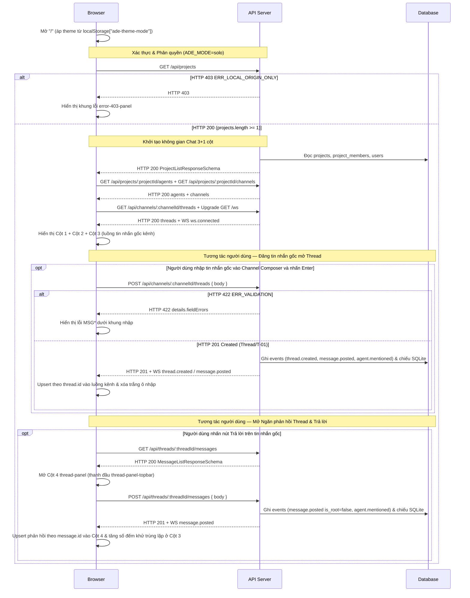

# UI-CH-01 - Không gian Chat Slack 3+1 cột, Kênh, Ngăn Thread, Biểu cảm & Gợi ý `@mention` (Chat Workspace)

| Trường | Giá trị |
| --- | --- |
| Mã màn hình | `UI-CH-01` |
| Tên màn hình | Không gian Chat Slack 3+1 cột, Kênh, Ngăn Thread, Biểu cảm & Gợi ý `@mention` (Chat Workspace) |
| Đường dẫn chốt | `specs/dd/chat/ch-01/ui-chat.md` |
| URL | `/` (khi đã có ít nhất 1 dự án) · `/projects/:projectId/channels/:channelId` · `/projects/:projectId/channels/:channelId/threads/:threadId` |
| Ngày tạo | 2026-10-31 |
| Ngày cập nhật | 2026-10-31 |

## TÓM TẮT

- **Mục tiêu**: Cung cấp không gian làm việc trò chuyện thời gian thực kiểu Slack (`Project → Channel → Chat Box + Ngăn phản hồi Thread kéo giãn`) để người dùng quản lý kênh, đăng tin nhắn gốc mở thread, trao đổi phản hồi, thả 8 biểu cảm và gọi `@agent` / `@human` kèm cảnh báo trực quan khi tệp `.ade/` sai cấu hình.
- **Actor**: Chủ sở hữu máy cục bộ `usr_local` (`handle = "owner"`, `role = "owner"`) truy cập trên `localhost` / `127.0.0.1` ở `ADE_MODE=solo`.
- **Trong phạm vi**: Bố cục 3+1 cột đáp ứng 3 mốc khung nhìn (`Desktop >= 1025px`, `Tablet 768px–1024px`, `Mobile < 768px`), tạo/cập nhật/xóa mềm kênh, luồng tin nhắn gốc kênh (`1 Tin nhắn gốc = 1 Thread`), ngăn phản hồi Thread kéo giãn ngang (`340px–780px`), hai khung nhập mặc định `84px` tự giãn theo dòng nhập (`48px–260px`) kèm thanh kéo dọc và nút chuyển bậc `⇕` (`84px ↔ 180px`), hộp gợi ý `@mention` chia 2 nhóm (`Đồng nghiệp` và `Bot / Agent`), tô sáng chip mention theo ngữ nghĩa màu, thanh 8 biểu cảm, đồng bộ thời gian thực khử trùng lặp qua `/ws`, dải cảnh báo lỗi `.ade/` và chuyển đổi chế độ giao diện `Sáng` / `Tối` / `Hệ thống`.
- **Ngoài phạm vi**: Khởi chạy agent thật và hiển thị `LiveCard` / `PermissionCard` (thuộc P2 `UI-RN-01`), hiển thị thanh Tầng 2 điều phối workflow, thẻ giải thích mã nguồn `ExplorerCard` (`@explorer`), thẻ câu hỏi / phỏng vấn làm rõ `QuestionCard` (`ask_human`) và cổng duyệt trong ngăn Thread (thuộc P3 `UI-TR-01` và P4 `UI-OR-01`), Wizard thêm dự án và màn hình Cài đặt dự án (thuộc P5 `UI-ST-01`, `UI-ST-02`), màn hình Smoke khi chưa có dự án nào (`UI-P0-01` tại `/smoke` hay `/` lúc `projects` rỗng).
- **Giả định**: Khi chạy ở P1 với biến `ADE_DEFAULT_REPO` trỏ tới kho Git hợp lệ có `.ade/project.yaml`, Hub đã khởi tạo sẵn ít nhất 1 dự án và kênh mặc định `#general`.
- **Câu hỏi mở**: Không có.

## Lịch sử sửa đổi

| Ver | Ngày | Tác giả | Thay đổi |
| --- | --- | --- | --- |
| 1.0 | 2026-10-31 | Kiến trúc sư ADE | Khởi tạo đặc tả giao diện P1 |
| 1.1 | 2026-10-31 | Kiến trúc sư ADE | Bổ sung đồng bộ bước server và kiểm tra hợp lệ |
| 1.2 | 2026-10-31 | Kiến trúc sư ADE | Cập nhật kiến trúc Slack 3+1 cột theo Prototype đã khóa, thêm quản lý kênh, thành viên kênh, xóa mềm kênh, 8 biểu cảm và tách ngữ nghĩa `@human` / `@agent` |
| 1.3 | 2026-10-31 | Kiến trúc sư ADE | Đồng bộ 3 mốc Responsive khớp `design.md`, tách `thread-panel` / `thread-panel-topbar` cùng `aria-label` nút biểu tượng, bổ sung tự giãn & nút `⇕` (`84px ↔ 180px`), giới hạn §II vào đúng ô văn bản trên màn hình, tách đơn nhất `I-NN`/`E-NN`, chốt khử trùng lặp theo `id` giữa HTTP `201` và `/ws`, hoàn thiện các Scenario Gherkin nguyên tử |
| 1.4 | 2026-10-31 | Kiến trúc sư ADE | Ghi rõ điểm mở rộng trên `thread-reply-bar-<threadId>` cho huy hiệu chờ trả lời (`pendingQuestionCount`) và huy hiệu kết quả chỉ đọc của `@explorer` (`explorerCitationCount`) uỷ quyền cho `UI-TR-01` ở Phase P3 |

---

## BỐ CỤC

```text
+------+------------------------+---------------------------------------------------+----------------------------------------+
| Cột 1| Cột 2: Kênh & Đội ngũ  | Cột 3: Khung trò chuyện Kênh (Channel Chat Box)   | Cột 4: Ngăn Thread (340px–780px)       |
| 64px | (224px / 200px)        | (flex: 1, min 380px)                              | (mặc định 448px, kéo vách dọc ‖)       |
+------+------------------------+---------------------------------------------------+----------------------------------------+
| [AR] | ade-runner      ● Live | # general                       [👤🤖 3]  [⚙]     | ‖ Thread · #general · 2 phản hồi [⇔][×]|
|      |------------------------| Thảo luận chung toàn dự án                        | ‖--------------------------------------|
| [ + ]| Kênh               [+] |---------------------------------------------------| ‖ [L] Local Owner  09:10               |
|      | # general          (●) | [! Banner lỗi .ade/ hay mất kết nối /ws khi có]   | ‖   Nhờ @planner thiết kế luồng OAuth  |
|      | # frontend-ui          |                                                   | ‖   [🚀 1]                             |
|      |                        | [L] Local Owner  09:10     [👍 ❤️ 🔥 🚀 + | Trả lời]| ‖ ---- 2 phản hồi -------------------- |
|      | Đồng nghiệp            |   Nhờ @planner thiết kế luồng OAuth cùng @owner   | ‖ [L] Local Owner  09:12               |
|      | ● Local Owner (@owner) |   [🚀 1]                                          | ‖   Bổ sung kiểm tra @ghost            |
|      |                        |   [👤 2 phản hồi · Phản hồi cuối 09:12       ->]  | ‖ [!] Agent chưa bật hay không tồn tại |
|      | Bot / Agent            |                                                   | ‖     @ghost                           |
|      | [PL] @planner          |                                                   | ‖                                      |
|      | [CD] @coder            |                                                   | ‖                                      |
|      | [DB] @disabled (Tắt)   |---------------------------------------------------| ‖--------------------------------------|
|      |                        | ================ [=== Kéo cao 48–260px ===] ======| ‖ ======== [=== Kéo cao 48–260px ===] =|
| [☀/☾]|                        | [ Nhắn tin vào #general — nhấn @ để gọi agent   ] | ‖ [ Trả lời trong thread — nhấn @     ] |
| [ ⚙ ]|                        | [@] [⇕] Enter gửi · Shift+Enter xuống dòng  [Gửi] | ‖ [@] [⇕]                        [Gửi] |
+------+------------------------+---------------------------------------------------+----------------------------------------+
```

- **Hệ thống giao diện Hallmark ([design.md](../../../../design.md))**: Toàn bộ màu sắc, chữ và đường viền đọc từ `apps/web/src/styles/tokens.css` (`Coral` ở chế độ Sáng, `Console` ở chế độ Tối); kích thước chữ nhỏ nhất `12px`; không dùng nhãn chữ in hoa giãn chữ.
- **Đáp ứng 3 mốc khung nhìn (`Responsive Breakpoints` theo `design.md`)**:
  - **Desktop (`>= 1025px`)**: Lưới 3 cột nội tuyến (`64px 224px 1fr`), mở rộng thành 4 cột (`64px 224px 1fr var(--thread-panel-w, 448px)`) khi mở Ngăn phản hồi Thread.
  - **Tablet (`768px – 1024px`)**: Không gian chính giữ 3 cột trái (`64px 200px 1fr`, ẩn nút Hamburger `mobile-sidebar-btn`); khi mở Thread, Cột 4 `thread-panel` trượt đè bên phải (`position: fixed`, `width: min(448px, 88vw)`) phía trên lớp nền mờ `--color-backdrop`.
  - **Mobile (`< 768px`, ví dụ khung nhìn `390x844`)**: Khung `Channel Chat Box` chiếm toàn bộ chiều ngang màn hình (`100vw`), thanh đầu kênh hiển thị nút Hamburger (`mobile-sidebar-btn`) để mở ngăn kéo trái (`mobile-left-drawer`) chứa cả `Project Rail + Channel Sidebar` phía trên nền mờ `--color-backdrop`; khi mở Thread, Cột 4 `thread-panel` hiển thị dạng tấm toàn màn hình (`100vw`).

---

## LOGIC

### I. Các phần tử (Items)

| STT | Tên logic | Loại đối tượng | Cột trong DB | Mô tả | Ghi chú |
| --- | --- | --- | --- | --- | --- |
| 1 | Nút biểu tượng dự án (`project-rail-item-<id>`) | Nút | `projects.name` | Hiển thị tối đa 2 chữ cái đầu của dự án trên Cột 1; chọn dự án hoạt động | Có vạch nhấn trái `--color-accent` khi đang chọn |
| 2 | Nút thêm dự án (`add-project-btn`) | Nút biểu tượng | — | Nút `+` trên Cột 1 | `aria-label="Thêm dự án"`; ở P1 khóa `disabled`, `title="Wizard tạo dự án mở ở Phase P5"` |
| 3 | Nút đổi chế độ giao diện (`theme-toggle-btn`) | Nút biểu tượng | — | Đổi vòng tròn `system` → `light` → `dark` → `system` | `aria-label="Đổi chế độ Sáng / Tối / Hệ thống"`; lưu `localStorage["ade-theme-mode"]` |
| 4 | Nút Cài đặt dự án (`project-settings-btn`) | Nút biểu tượng | — | Biểu tượng `⚙` ở chân Cột 1 | `aria-label="Cài đặt dự án"`; ở P1 khóa `disabled` |
| 5 | Nhãn tên dự án (`active-project-name`) | Nhãn | `projects.name` | Hiển thị tên dự án đang mở ở đầu Cột 2 | Đọc từ bộ nhớ đệm `.ade/project.yaml` |
| 6 | Huy hiệu kết nối WS (`ws-status-pill`) | Huy hiệu | — | Hiển thị `"Trực tuyến"` khi socket mở, `"Mất kết nối"` khi socket đóng | Đặt cạnh `active-project-name` |
| 7 | Nút mở tạo kênh (`create-channel-btn`) | Nút biểu tượng | — | Nút `+` cạnh tiêu đề nhóm `Kênh` ở Cột 2 | `aria-label="Tạo kênh mới"`; mở `create-channel-modal` |
| 8 | Dòng kênh (`channel-item-<id>`) | Nút danh sách | `channels.name` | Hiển thị `# <name>` cho từng kênh hoạt động (`deleted_at IS NULL`) | Không hiển thị huy hiệu số đếm hay tên workflow |
| 9 | Danh sách Đồng nghiệp (`colleague-item-<id>`) | Mục danh sách | `users.name`, `users.handle` | Hiển thị chấm trực tuyến, tên và `@<handle>` của thành viên người trong dự án | Nối từ `project_members` ↔ `users` |
| 10 | Danh sách Bot / Agent (`agent-sidebar-item-<handle>`) | Mục danh sách | `agents.handle`, `agents.display_name`, `agents.enabled` | Hiển thị avatar chữ, `@<handle>`, vai trò; làm mờ và gắn nhãn `"Tắt"` khi `enabled = 0` | Đọc từ bộ nhớ đệm `.ade/agents/*.yaml` |
| 11 | Nút Hamburger mở ngăn kéo trái di động (`mobile-sidebar-btn`) | Nút biểu tượng | — | Nút 3 gạch ngang ở thanh đầu Cột 3 trên khung nhìn Mobile `< 768px` (ẩn ở `>= 768px`) | `aria-label="Mở danh sách dự án và kênh"`; mở `mobile-left-drawer` chứa cả `Project Rail + Channel Sidebar` |
| 12 | Tiêu đề kênh dòng 1 (`channel-header-name`) | Nhãn | `channels.name` | Hiển thị `# <channels.name>` ở dòng chính thanh đầu Cột 3 | — |
| 13 | Mô tả kênh dòng 2 (`channel-header-desc`) | Nhãn | `channels.description` | Hiển thị mô tả kênh dưới tên kênh; ẩn khi chuỗi rỗng | — |
| 14 | Viên thuốc thành viên kênh (`channel-members-pill`) | Nút | `channel_members.member_id` | Hiển thị cụm avatar xếp chồng (tối đa 4) kèm tổng số thành viên kênh | Nhấn mở `channel-settings-modal` tại tab `Thành viên` |
| 15 | Nút Cài đặt kênh (`channel-settings-btn`) | Nút biểu tượng | — | Biểu tượng `⚙` góc phải thanh đầu Cột 3 | `aria-label="Cài đặt kênh"`; mở `channel-settings-modal` tại tab `Thông tin chung` |
| 16 | Dải cảnh báo mất kết nối (`ws-reconnect-banner`) | Khung thông báo | — | Hiển thị `"Đang kết nối lại với ADE Hub"` khi mất kết nối `/ws` | `role="status"` |
| 17 | Dải cảnh báo lỗi cấu hình (`config-error-banner`) | Khung cảnh báo | `projects.config_errors_json` | Liệt kê từng lỗi `<file> — trường <field>: <message>` khi `.ade/` có tệp hỏng | `role="alert"` |
| 18 | Khung hướng dẫn kênh trống (`empty-state-guide`) | Khung nội dung | — | Hiển thị khi kênh chưa có tin nhắn gốc nào | Hướng dẫn nhập tin nhắn đầu tiên và gõ `@` |
| 19 | Luồng tin nhắn gốc của Kênh (`thread-list`) | Danh sách | `threads.id`, `messages.body` | Hiển thị tuần tự thời gian tăng dần các tin nhắn gốc (`is_root = 1`) của kênh | Mỗi dòng mang `data-testid="thread-row-<threadId>"` |
| 20 | Nội dung tin nhắn & Chip Mention (`message-item-<id>`) | Khối văn bản | `messages.body`, `messages.mentions_json`, `messages.human_mentions_json` | Hiển thị Markdown, chip `.ade-mention--agent` cho `@agent` và `.ade-mention--human` (`.ade-mention--me`) cho `@human` | Dùng chung cho Cột 3 và Cột 4 |
| 21 | Thanh công cụ nổi trên tin nhắn (`.ade-msg-toolbar`) | Thanh nút | — | Hiện khi rê chuột hay đặt tiêu điểm: 4 nút `👍`, `❤️`, `🔥`, `🚀`, nút `+` (`aria-label="Mở bảng biểu cảm"`) mở bảng 8 emoji, và nút `Trả lời` (`reply-in-thread-btn-<threadId>`) | Trong Cột 4 ẩn nút `Trả lời` |
| 22 | Hàng viên thuốc biểu cảm (`.ade-reactions`) | Danh sách nút | `messages.reactions_json` | Hiển thị từng biểu cảm đã thả `<emoji> <count>`, gắn lớp `.is-mine` khi `reactedByMe = true` | Nhấn vào viên thuốc sẽ đảo biểu cảm đó |
| 23 | Thanh tóm tắt phản hồi nội tuyến (`thread-reply-bar-<threadId>`) | Nút | `messages.thread_id` | Hiện dưới tin nhắn gốc trên Cột 3 khi `replyCount > 0`: cụm avatar + `"<replyCount> phản hồi"` + giờ cuối (từ Phase P3 mở rộng thêm huy hiệu chờ trả lời và huy hiệu trích dẫn `@explorer` theo `UI-TR-01`) | Nhấn mở Cột 4 cho `threadId` |
| 24 | Thanh kéo cao Khung nhập Kênh (`channel-composer-resizer`) | Thanh kéo | — | Kéo chuột dọc hay nhấn `ArrowUp` (`+16px`) / `ArrowDown` (`-16px`) đổi chiều cao `channel-composer-input` trong dải `48px–260px` | `role="separator"`, `aria-orientation="horizontal"`, `aria-label="Kéo đổi chiều cao khung nhập kênh"` |
| 25 | Ô nhập tin nhắn Kênh (`channel-composer-input`) | Ô nhập đa dòng | `messages.body` | Soạn tin nhắn gốc mới cho kênh (mặc định cao `84px`, tự giãn theo dòng nhập trong dải `48px–260px`); hỗ trợ gợi ý `@mention` | `Enter` gửi, `Shift+Enter` xuống dòng |
| 26 | Nút gửi tin nhắn Kênh (`channel-send-btn`) | Nút chính | — | Gửi `POST /api/channels/:channelId/threads` | Khóa khi đang gửi request |
| 27 | Vách kéo rộng Ngăn Thread (`thread-panel-resizer`) | Thanh phân cách | — | Kéo chuột ngang hay nhấn `ArrowLeft` (`+24px`) / `ArrowRight` (`-24px`) đổi chiều rộng Cột 4 trong dải `340px–780px` | `role="separator"`, `aria-orientation="vertical"`, `aria-label="Kéo đổi độ rộng ngăn Thread"`, lưu `localStorage["ade-thread-panel-w"]` |
| 28 | Khung Ngăn phản hồi Thread bao ngoài (`thread-panel`) | Khung vùng | — | Khung Cột 4 bao ngoài (`data-testid="thread-panel"`): rộng `340px–780px` (mặc định `448px`) trên Desktop; trượt đè phải (`position: fixed`, `width: min(448px, 88vw)`) trên nền mờ `--color-backdrop` ở Tablet; phủ `100vw` ở Mobile | Bên trong đầu khung chứa thanh `thread-panel-topbar` (Item 36) |
| 29 | Luồng tin nhắn trong Thread (`message-list`) | Danh sách | `messages.body`, `messages.kind` | Hiện tin nhắn gốc ở đầu, vạch ngăn cách và toàn bộ phản hồi kèm cảnh báo hệ thống (`message-system-warning`) | — |
| 30 | Thanh kéo cao Khung nhập Thread (`thread-composer-resizer`) | Thanh kéo | — | Kéo chuột dọc hay nhấn `ArrowUp` (`+16px`) / `ArrowDown` (`-16px`) đổi chiều cao `composer-input` trong dải `48px–260px` | `role="separator"`, `aria-orientation="horizontal"`, `aria-label="Kéo đổi chiều cao khung nhập phản hồi"` |
| 31 | Ô nhập phản hồi Thread (`composer-input`) | Ô nhập đa dòng | `messages.body` | Soạn tin nhắn phản hồi trong ngăn Thread (mặc định cao `84px`, tự giãn theo dòng nhập trong dải `48px–260px`); hỗ trợ gợi ý `@mention` | `Enter` gửi, `Shift+Enter` xuống dòng |
| 32 | Nút gửi phản hồi Thread (`send-message-btn`) | Nút chính | — | Gửi `POST /api/threads/:threadId/messages` | Khóa khi đang gửi request |
| 33 | Hộp gợi ý `@mention` (`mention-popup`) | Hộp nổi | `users.handle`, `agents.handle` | Hiển thị 2 nhóm có tiêu đề: `Đồng nghiệp` (`mention-group-colleagues`) và `Bot / Agent` (`mention-group-agents`) | Chỉ liệt kê agent có `enabled = true` |
| 34 | Hộp thoại Tạo kênh mới (`create-channel-modal`) | Hộp thoại | `channels.name`, `channels.description` | Chứa `channel-name-input`, `channel-desc-input`, nút biểu tượng đóng `×` ở góc phải tiêu đề (`aria-label="Đóng"`), nút `Hủy` ở chân hộp thoại và nút `Tạo kênh` (`submit-channel-btn`) | Không lặp nút chữ `"Hủy"` trên thanh tiêu đề |
| 35 | Hộp thoại Cài đặt kênh (`channel-settings-modal`) | Hộp thoại | `channels.name`, `channels.description`, `channel_members.*` | Nút biểu tượng đóng `×` ở góc phải tiêu đề (`aria-label="Đóng"`), 2 tab `Thông tin chung` (`tab-general`: ô `edit-channel-name-input`, ô `edit-channel-desc-input`, nút lưu `save-channel-btn`, nút mở xác nhận xóa `delete-channel-btn`, nút xác nhận xóa mềm `confirm-delete-channel-btn`) và `Thành viên` (`tab-members`: danh sách hộp kiểm đồng nghiệp/agent, nút lưu `save-channel-members-btn`) | Khóa `delete-channel-btn` khi dự án chỉ còn `1` kênh hoạt động |
| 36 | Thanh đầu Ngăn Thread Tầng 1 (`thread-panel-topbar`) | Thanh tiêu đề | `channels.name` | Thanh tiêu đề đầu Cột 4 (`data-testid="thread-panel-topbar"`) hiển thị `"Thread"`, `#<channels.name>`, số phản hồi, nút biểu tượng đổi độ rộng `448px ↔ 640px` (`thread-width-toggle-btn`, `aria-label="Đổi độ rộng ngăn Thread"`) và nút biểu tượng đóng `×` (`thread-close-btn`, `aria-label="Đóng ngăn Thread"`) | Đặt bên trong `thread-panel` |
| 37 | Nút đổi bậc chiều cao Khung nhập (`channel-height-toggle-btn`, `thread-height-toggle-btn`) | Nút biểu tượng | — | Nút biểu tượng `⇕` (`.ade-icon-btn`) trên thanh công cụ của 2 khung nhập, chuyển bậc chiều cao ô nhập giữa `84px` và `180px` | Cả 2 nút đều mang `aria-label="Đổi chiều cao khung nhập"` |
| 38 | Ngăn kéo trái di động (`mobile-left-drawer`) | Khung ngăn kéo | — | Ngăn trượt từ cạnh trái trên Mobile `< 768px` (`data-testid="mobile-left-drawer"`) bao bọc cả `Project Rail` (Cột 1) và `Channel & Team Sidebar` (Cột 2) phía trên lớp nền mờ `--color-backdrop` (`mobile-drawer-backdrop`), kèm nút biểu tượng đóng `×` (`aria-label="Đóng"`) | Trên Desktop và Tablet (`>= 768px`) hiển thị nội tuyến thành 2 cột trái |

---

### II. Kiểm tra hợp lệ (Validate)

Dùng chung `VALIDATION_CATALOG` (`packages/shared/src/validation-catalog.ts`) và [specs/message.md](../../../message.md). Bảng dưới giới hạn vào đúng 6 ô nhập văn bản thực tế có trên `UI-CH-01`; các quy tắc kiểm tra trường không phải ô văn bản trên màn hình (`V-15`..`V-18` cho mảng hộp kiểm `memberUserIds`/`memberAgentIds`, `V-22`..`V-24` cho `title` tùy chọn khi gọi API trực tiếp, `V-28`..`V-29` cho nút biểu cảm `emoji`) được kiểm tra đầy đủ ở tầng server (§III.4 bên dưới và §3 của [specs/dd/chat/ch-01/api-chat.md](./api-chat.md)). Mỗi dòng chỉ định **đúng một** rule token; giữ nguyên số hiệu `V-NN` đồng bộ với `API-CH-01`.

| ID | Tên logic | Tên trường (`FIELD_LABELS`) | Quy tắc kiểm tra | Mã message | Message |
| --- | --- | --- | --- | --- | --- |
| `V-01` | Ô Tên kênh (`channel-name-input` — Modal Tạo kênh) | `name` (`channelName`: `Tên kênh`) | `trim` | — | — |
| `V-02` | Ô Tên kênh (`channel-name-input` — Modal Tạo kênh) | `name` (`channelName`: `Tên kênh`) | `required` | `MSG01` | `Tên kênh là bắt buộc.` |
| `V-03` | Ô Tên kênh (`channel-name-input` — Modal Tạo kênh) | `name` (`channelName`: `Tên kênh`) | `max:80` | `MSG02` | `Tên kênh không được vượt quá 80 ký tự.` |
| `V-04` | Ô Tên kênh (`channel-name-input` — Modal Tạo kênh) | `name` (`channelName`: `Tên kênh`) | `regex:^[a-z0-9][a-z0-9-_]*$` | `MSG04` | `Định dạng Tên kênh không hợp lệ.` |
| `V-05` | Ô Mô tả (`channel-desc-input` — Modal Tạo kênh) | `description` (`description`: `Mô tả`) | `nullable` | — | — |
| `V-06` | Ô Mô tả (`channel-desc-input` — Modal Tạo kênh) | `description` (`description`: `Mô tả`) | `trim` | — | — |
| `V-07` | Ô Mô tả (`channel-desc-input` — Modal Tạo kênh) | `description` (`description`: `Mô tả`) | `max:300` | `MSG02` | `Mô tả không được vượt quá 300 ký tự.` |
| `V-08` | Ô Tên kênh (`edit-channel-name-input` — Modal Cài đặt kênh) | `name` (`channelName`: `Tên kênh`) | `trim` | — | — |
| `V-09` | Ô Tên kênh (`edit-channel-name-input` — Modal Cài đặt kênh) | `name` (`channelName`: `Tên kênh`) | `required` | `MSG01` | `Tên kênh là bắt buộc.` |
| `V-10` | Ô Tên kênh (`edit-channel-name-input` — Modal Cài đặt kênh) | `name` (`channelName`: `Tên kênh`) | `max:80` | `MSG02` | `Tên kênh không được vượt quá 80 ký tự.` |
| `V-11` | Ô Tên kênh (`edit-channel-name-input` — Modal Cài đặt kênh) | `name` (`channelName`: `Tên kênh`) | `regex:^[a-z0-9][a-z0-9-_]*$` | `MSG04` | `Định dạng Tên kênh không hợp lệ.` |
| `V-12` | Ô Mô tả (`edit-channel-desc-input` — Modal Cài đặt kênh) | `description` (`description`: `Mô tả`) | `nullable` | — | — |
| `V-13` | Ô Mô tả (`edit-channel-desc-input` — Modal Cài đặt kênh) | `description` (`description`: `Mô tả`) | `trim` | — | — |
| `V-14` | Ô Mô tả (`edit-channel-desc-input` — Modal Cài đặt kênh) | `description` (`description`: `Mô tả`) | `max:300` | `MSG02` | `Mô tả không được vượt quá 300 ký tự.` |
| `V-19` | Khung nhập Kênh (`channel-composer-input`) | `body` (`body`: `Nội dung tin nhắn`) | `trim` | — | — |
| `V-20` | Khung nhập Kênh (`channel-composer-input`) | `body` (`body`: `Nội dung tin nhắn`) | `required` | `MSG01` | `Nội dung tin nhắn là bắt buộc.` |
| `V-21` | Khung nhập Kênh (`channel-composer-input`) | `body` (`body`: `Nội dung tin nhắn`) | `max:20000` | `MSG02` | `Nội dung tin nhắn không được vượt quá 20000 ký tự.` |
| `V-25` | Khung nhập Phản hồi Thread (`composer-input`) | `body` (`body`: `Nội dung tin nhắn`) | `trim` | — | — |
| `V-26` | Khung nhập Phản hồi Thread (`composer-input`) | `body` (`body`: `Nội dung tin nhắn`) | `required` | `MSG01` | `Nội dung tin nhắn là bắt buộc.` |
| `V-27` | Khung nhập Phản hồi Thread (`composer-input`) | `body` (`body`: `Nội dung tin nhắn`) | `max:20000` | `MSG02` | `Nội dung tin nhắn không được vượt quá 20000 ký tự.` |

---

### III. Logic

#### Thông tin màn hình

- **Phân quyền**: Kết nối cục bộ `ADE_MODE=solo` trên `localhost` / `127.0.0.1` với actor mặc định `usr_local` (`role = owner`); không yêu cầu đăng nhập tài khoản.
- **Mẫu URL**:
  - `/` (tự động điều hướng nội bộ sang `/projects/<projectId>/channels/<channelId>` của dự án đầu tiên khi `projects.length >= 1`; khi `projects.length === 0` thì hiển thị màn hình `UI-P0-01`).
  - `/projects/:projectId/channels/:channelId` (xem kênh, đóng ngăn Thread).
  - `/projects/:projectId/channels/:channelId/threads/:threadId` (xem kênh đồng thời mở ngăn phản hồi Thread bên phải).
- **API chính**:

| STT | Method | Path | Mục đích |
| --- | --- | --- | --- |
| 1 | `GET` | `/api/projects` | Nạp danh sách dự án kèm đồng nghiệp và lỗi cấu hình |
| 2 | `GET` | `/api/projects/:projectId/agents` | Nạp danh sách agent hợp lệ và lỗi `.ade/` của dự án đang mở |
| 3 | `GET` | `/api/projects/:projectId/channels` | Nạp danh sách kênh hoạt động kèm thành viên của dự án đang mở |
| 4 | `POST` | `/api/projects/:projectId/channels` | Tạo kênh mới |
| 5 | `PATCH` | `/api/channels/:channelId` | Cập nhật tên, mô tả và danh sách thành viên kênh |
| 6 | `DELETE` | `/api/channels/:channelId` | Xóa mềm kênh đang chọn |
| 7 | `GET` | `/api/channels/:channelId/threads` | Nạp luồng tin nhắn gốc của kênh đang mở |
| 8 | `POST` | `/api/channels/:channelId/threads` | Đăng tin nhắn gốc mở thread mới trong kênh |
| 9 | `GET` | `/api/threads/:threadId/messages` | Nạp tin nhắn gốc và toàn bộ phản hồi trong ngăn Thread |
| 10 | `POST` | `/api/threads/:threadId/messages` | Gửi tin nhắn phản hồi trong ngăn Thread |
| 11 | `POST` | `/api/messages/:messageId/reactions` | Đảo biểu cảm của người dùng trên một tin nhắn |
| 12 | `GET` | `/ws` | Mở kết nối WebSocket nhận sự kiện thời gian thực |

#### 1. Kiểm tra phân quyền

| ID | Mô tả |
| --- | --- |
| `P-01` | Khi truy cập ứng dụng từ `localhost` hay `127.0.0.1` ở `ADE_MODE=solo`, màn hình phải tải dữ liệu với tư cách `usr_local` mà không hiển thị trang đăng nhập. |
| `P-02` | Nếu truy vấn khởi tạo nhận HTTP `403` `ERR_LOCAL_ORIGIN_ONLY`, thì màn hình phải hiển thị khung lỗi `error-403-panel` với thông điệp từ `translateApiError("ERR_LOCAL_ORIGIN_ONLY")` và dừng gọi lại request. |

#### 2. Khởi tạo màn hình

| ID | Mô tả |
| --- | --- |
| `I-01` | Khi mở ứng dụng, trình duyệt phải đọc `localStorage["ade-theme-mode"]` trước nhịp vẽ đầu tiên để gán `document.documentElement.dataset.mode` (`"light"`, `"dark"`, hay gỡ thuộc tính khi `"system"`) chống nháy màu. |
| `I-02` | Khi mở URL `/`, màn hình phải gọi `GET /api/projects` để kiểm tra danh sách dự án đã đăng ký. |
| `I-03` | Khi `GET /api/projects` trả về ít nhất `1` dự án và URL chưa chỉ định `:projectId`, màn hình phải chọn dự án đầu tiên, gọi song song `GET /api/projects/:projectId/agents` cùng `GET /api/projects/:projectId/channels`, rồi điều hướng URL sang `/projects/<projectId>/channels/<firstChannelId>`. |
| `I-04` | Khi `GET /api/channels/:channelId/threads` trả về ít nhất `1` phần tử, màn hình phải hiển thị luồng tin nhắn gốc trên `thread-list` của Cột 3 theo thứ tự thời gian tăng dần. |
| `I-05` | Khi URL khớp mẫu `/projects/:projectId/channels/:channelId/threads/:threadId`, màn hình phải mở Cột 4 `thread-panel` theo độ rộng lưu trong `localStorage["ade-thread-panel-w"]` (mặc định `448px` khi chưa lưu) và gọi `GET /api/threads/:threadId/messages`. |
| `I-06` | Khi không gian Chat khởi tạo thành công, màn hình phải mở kết nối WebSocket tới `/ws` và đặt `ws-status-pill` sang `"Trực tuyến"` ngay khi nhận khung tin `ws.connected`. |
| `I-07` | Trong khi mảng `configErrors` của dự án đang chọn có ít nhất `1` phần tử, màn hình phải hiển thị `config-error-banner` ở đầu Cột 3 liệt kê chính xác `<file>`, `<field>` và `<message>` của từng phần tử. |
| `I-08` | Nếu truy vấn khởi tạo nhận HTTP `>= 500` hay lỗi đứt mạng sau `1` lần tự động thử lại, thì màn hình phải hiển thị khung lỗi `500` kèm nút `Thử lại`. |
| `I-09` | Khi `GET /api/projects` trả về mảng `projects` rỗng tại URL `/`, màn hình phải hiển thị giao diện kiểm tra kết nối `UI-P0-01`. |
| `I-10` | Khi `GET /api/channels/:channelId/threads` trả về mảng `threads` rỗng, màn hình phải hiển thị khung hướng dẫn `empty-state-guide` trên Cột 3. |

#### 3. Xử lý hành vi sự kiện

> Nội dung message của các mã trong mục này: xem [specs/message.md](../../../message.md).

| ID | Sự kiện | Kích hoạt | Mô tả |
| --- | --- | --- | --- |
| `E-01` | Đổi dự án trên Cột 1 | Khi người dùng nhấn vào `project-rail-item-<id>` khác dự án hiện tại | Phải đóng Cột 4 `thread-panel`, tải lại danh sách agent và kênh của dự án mới, rồi chuyển URL sang kênh đầu tiên của dự án đó. |
| `E-02` | Đổi chế độ giao diện | Khi người dùng nhấn `theme-toggle-btn` | Phải chuyển tuần tự chế độ `system` → `light` → `dark` → `system`, lưu vào `localStorage["ade-theme-mode"]` và cập nhật ngay `document.documentElement.dataset.mode`. |
| `E-03` | Đổi kênh trên Cột 2 | Khi người dùng nhấn vào `channel-item-<id>` khác kênh hiện tại | Phải đóng Cột 4 `thread-panel`, cập nhật URL sang `/projects/:projectId/channels/:channelId` và gọi `GET /api/channels/:channelId/threads`. |
| `E-04` | Mở hộp thoại Tạo kênh | Khi người dùng nhấn `create-channel-btn` (`+`) ở Cột 2 | Phải hiển thị `create-channel-modal` với hai ô nhập trống và đặt tiêu điểm vào `channel-name-input`. |
| `E-05` | Gửi tạo kênh mới — lỗi kiểm tra phía client | Khi người dùng nhấn `submit-channel-btn` mà dữ liệu vi phạm `V-01`..`V-07` | Phải hiển thị thông điệp lỗi `MSG*` tương ứng ngay bên dưới trường vi phạm và chặn gọi `POST /api/projects/:projectId/channels`. |
| `E-06` | Gửi tạo kênh mới — hợp lệ | Khi người dùng nhấn `submit-channel-btn` và dữ liệu đạt `V-01`..`V-07` | Phải khóa nút `submit-channel-btn` và gọi `POST /api/projects/:projectId/channels`. |
| `E-07` | Tạo kênh thành công | Khi `POST /api/projects/:projectId/channels` trả HTTP `201` | Phải đóng `create-channel-modal`, hiển thị toast `MSG15` (`"Đã tạo thành công."`), upsert kênh theo `channel.id` vào bộ nhớ đệm danh sách kênh Cột 2 (khử trùng lặp với khung tin WS `channel.created`) và điều hướng sang kênh vừa tạo. |
| `E-08` | Tạo hay sửa kênh bị trùng tên | Nếu `POST /api/projects/:projectId/channels` hay `PATCH /api/channels/:channelId` trả HTTP `409` `ERR_CHANNEL_NAME_EXISTS` | Phải hiển thị toast tiếng Việt `"Tên kênh đã tồn tại trong dự án này."` qua `translateApiError` và giữ nguyên hộp thoại đang mở. |
| `E-09` | Mở hộp thoại Cài đặt kênh ở tab Thông tin chung | Khi người dùng nhấn nút biểu tượng `⚙` (`channel-settings-btn`) | Phải mở `channel-settings-modal` tại tab `Thông tin chung` (`tab-general`) đã điền sẵn `name` và `description` hiện tại của kênh. |
| `E-10` | Mở hộp thoại Cài đặt kênh ở tab Thành viên | Khi người dùng nhấn `channel-members-pill` trên thanh tiêu đề kênh | Phải mở `channel-settings-modal` tại tab `Thành viên` (`tab-members`) với trạng thái hộp kiểm khớp `channel.members` hiện tại và khóa hộp kiểm của `usr_local`. |
| `E-11` | Lưu cập nhật kênh thành công | Khi người dùng nhấn `save-channel-btn` (đạt `V-08`..`V-14`) hay `save-channel-members-btn` và `PATCH /api/channels/:channelId` trả HTTP `200` | Phải upsert dữ liệu kênh theo `channel.id` trên Cột 2 và thanh tiêu đề Cột 3, đóng `channel-settings-modal` và hiển thị toast `MSG14` (`"Đã lưu thay đổi."`). |
| `E-12` | Khóa nút Xóa kênh khi chỉ còn 1 kênh | Trong khi tổng số kênh hoạt động của dự án bằng `1` lúc mở `channel-settings-modal` | Phải khóa `disabled` nút `delete-channel-btn` và hiển thị dòng chú thích `"Dự án phải giữ lại ít nhất 1 kênh hoạt động."`. |
| `E-13` | Xác nhận và xóa mềm kênh thành công | Khi người dùng nhấn `confirm-delete-channel-btn` trong khu vực xác nhận xóa kênh và `DELETE /api/channels/:channelId` trả HTTP `200` | Phải đóng `channel-settings-modal`, loại bỏ kênh đã xóa khỏi Cột 2, đóng Cột 4 khi đang mở thread thuộc kênh đó và điều hướng sang kênh hoạt động đầu tiên còn lại. |
| `E-14` | Gửi tin nhắn gốc từ Khung nhập Kênh — chặn rỗng | Khi người dùng nhấn `Enter` (không giữ `Shift`) hay nhấn `channel-send-btn` mà `channel-composer-input` rỗng sau khi cắt ký tự trắng (`V-20`) | Phải giữ nguyên khung nhập, chặn gọi `POST /api/channels/:channelId/threads` và không tạo dòng mới trên `thread-list`. |
| `E-15` | Gửi tin nhắn gốc từ Khung nhập Kênh — quá 20000 ký tự | Khi người dùng gửi `channel-composer-input` vượt quá `20000` ký tự (`V-21`) | Phải hiển thị thông điệp `MSG02` (`"Nội dung tin nhắn không được vượt quá 20000 ký tự."`) dưới khung nhập kênh và chặn gọi `POST /api/channels/:channelId/threads`. |
| `E-16` | Gửi tin nhắn gốc thành công mở Thread mới | Khi người dùng gửi `channel-composer-input` đạt `V-19`..`V-21` và `POST /api/channels/:channelId/threads` trả HTTP `201` (`Thread/T-01`) | Phải xóa trắng `channel-composer-input` (trả chiều cao về `84px`), upsert bản ghi thread mới theo `thread.id` (kèm `rootMessage` theo `message.id`, khử trùng lặp với khung tin WS `thread.created` / `message.posted`) vào `thread-list` trên Cột 3 và cuộn xuống tin nhắn vừa đăng. |
| `E-17` | Lỗi workflow khi gửi tin nhắn gốc | Nếu `POST /api/channels/:channelId/threads` trả HTTP `422` `ERR_WORKFLOW_INVALID` hay HTTP `400` `ERR_INVALID_STATUS` | Phải giữ nguyên nội dung trong `channel-composer-input` và hiển thị toast tiếng Việt từ `translateApiError`. |
| `E-18` | Mở Ngăn phản hồi Thread (Cột 4) | Khi người dùng nhấn `reply-in-thread-btn-<threadId>` trên thanh nổi của tin nhắn gốc hay nhấn `thread-reply-bar-<threadId>` | Phải mở Cột 4 `thread-panel`, cập nhật URL sang `/projects/:projectId/channels/:channelId/threads/<threadId>`, gọi `GET /api/threads/<threadId>/messages` và đặt tiêu điểm vào `composer-input`. |
| `E-19` | Đóng Ngăn phản hồi Thread | Khi người dùng nhấn nút `×` (`thread-close-btn`) trên thanh `thread-panel-topbar` | Phải ẩn Cột 4 `thread-panel` và cập nhật URL về `/projects/:projectId/channels/:channelId`. |
| `E-20` | Kéo giãn chiều rộng Ngăn Thread | Khi người dùng kéo `thread-panel-resizer` bằng chuột hay nhấn phím `ArrowLeft` (tăng độ rộng `+24px`) / `ArrowRight` (giảm độ rộng `-24px`) lúc thanh phân cách đang nhận tiêu điểm | Phải cập nhật chiều rộng Cột 4 `thread-panel` kẹp trong biên `340px–780px` và lưu giá trị pixel vào `localStorage["ade-thread-panel-w"]`. |
| `E-21` | Chuyển độ rộng Ngăn Thread bằng nút tiêu đề | Khi người dùng nhấn `thread-width-toggle-btn` trên thanh `thread-panel-topbar` | Phải đặt chiều rộng Cột 4 sang `640px` khi chiều rộng hiện tại nhỏ hơn `560px` (ngược lại trả về `448px`) và lưu giá trị mới vào `localStorage["ade-thread-panel-w"]`. |
| `E-22` | Kéo giãn chiều cao Khung nhập bằng thanh kéo hay bàn phím | Khi người dùng kéo `channel-composer-resizer` hay `thread-composer-resizer` bằng chuột hay nhấn phím `ArrowUp` (tăng chiều cao `+16px`) / `ArrowDown` (giảm chiều cao `-16px`) lúc thanh kéo đang nhận tiêu điểm | Phải cập nhật chiều cao ô nhập tương ứng kẹp trong biên `48px–260px`. |
| `E-23` | Mở và lọc hộp gợi ý `@mention` 2 nhóm | Khi người dùng gõ `@<prefix>` ở đầu dòng hay ngay sau ký tự trắng trong `channel-composer-input` hay `composer-input` | Phải hiển thị `mention-popup` gồm nhóm `Đồng nghiệp` (`mention-group-colleagues`) và nhóm `Bot / Agent` (`mention-group-agents`, chỉ gồm agent có `enabled = true`) khớp không phân biệt hoa thường với `<prefix>`. |
| `E-24` | Chọn mục trong hộp gợi ý `@mention` | Khi người dùng nhấn `Enter`, `Tab`, hay nhấp chuột vào một dòng trong `mention-popup` | Phải thay thế cụm `@<prefix>` tại con trỏ bằng `@<handle> ` (kèm 1 dấu cách phía sau) và đóng `mention-popup`. |
| `E-25` | Đóng hộp gợi ý `@mention` bằng Escape | Khi `mention-popup` đang mở và người dùng nhấn phím `Escape` | Phải đóng `mention-popup` và giữ nguyên văn bản hiện có trong ô nhập. |
| `E-26` | Gửi tin nhắn phản hồi trong Ngăn Thread | Khi người dùng gửi `composer-input` đạt `V-25`..`V-27` và `POST /api/threads/:threadId/messages` trả HTTP `201` | Phải xóa trắng `composer-input` (trả chiều cao về `84px`), upsert phản hồi mới (cùng `systemMessage` khi khác `null`) theo `message.id` vào `message-list`, đồng thời cập nhật `thread-reply-bar-<threadId>` trên Cột 3 có khử trùng lặp theo `message.id` để không cộng đúp `replyCount` khi nhận khung tin WS `message.posted`. |
| `E-27` | Gửi phản hồi trong Ngăn Thread — chặn rỗng | Khi người dùng nhấn `Enter` (không giữ `Shift`) hay nhấn `send-message-btn` mà `composer-input` rỗng sau khi cắt ký tự trắng (`V-26`) | Phải giữ nguyên khung nhập phản hồi, chặn gọi `POST /api/threads/:threadId/messages` và giữ nguyên `message-list`. |
| `E-28` | Đảo biểu cảm 8 emoji trên tin nhắn | Khi người dùng nhấn một biểu cảm trên `.ade-msg-toolbar`, trong bảng 8 emoji, hay trên `.ade-reaction-pill` | Phải gọi `POST /api/messages/:messageId/reactions` với `{ emoji }` và cập nhật hàng `.ade-reactions` cùng trạng thái `.is-mine` theo phản hồi HTTP `200`. |
| `E-29` | Đồng bộ sự kiện thời gian thực qua `/ws` | Khi kết nối `/ws` nhận các khung tin `channel.created`, `channel.updated`, `channel.deleted`, `thread.created`, `message.posted`, `message.reaction_toggled`, hay `project.config_updated` | Phải upsert/cập nhật ngay bộ nhớ đệm TanStack Query theo khóa định danh (`channel.id`, `thread.id`, `message.id`) kèm tập theo dõi ID phản hồi đã tính để không nhân đôi bản ghi hay cộng đúp `replyCount`, đồng bộ giao diện trên mọi tab trình duyệt trong `< 1000 ms` mà không tải lại trang. |
| `E-30` | Mất kết nối `/ws` và thử nối lại theo chu kỳ lùi | Khi kết nối WebSocket `/ws` bị đóng ngoài ý muốn | Phải hiển thị `ws-reconnect-banner` (`"Đang kết nối lại với ADE Hub"`), đổi `ws-status-pill` sang `"Mất kết nối"` và lên lịch kết nối lại theo chu kỳ lùi `1s → 2s → 5s`. |
| `E-31` | Mở ngăn kéo trái trên Mobile `< 768px` | Khi người dùng nhấn nút Hamburger `mobile-sidebar-btn` ở thanh đầu Cột 3 trên khung nhìn Mobile (`< 768px`) | Phải trượt ngăn kéo trái `mobile-left-drawer` chứa cả `Project Rail` và `Channel Sidebar` ra phía trên lớp nền mờ `--color-backdrop`. |
| `E-32` | Lưu thông tin kênh — lỗi kiểm tra phía client | Khi người dùng nhấn `save-channel-btn` ở tab `Thông tin chung` của `channel-settings-modal` mà dữ liệu vi phạm `V-08`..`V-14` | Phải hiển thị thông điệp lỗi `MSG*` tương ứng ngay bên dưới trường vi phạm trong `channel-settings-modal` và chặn gọi `PATCH /api/channels/:channelId`. |
| `E-33` | Mở khung xác nhận xóa mềm kênh | Khi dự án có từ `2` kênh hoạt động trở lên và người dùng nhấn `delete-channel-btn` trong `channel-settings-modal` | Phải hiển thị khu vực xác nhận xóa kênh kèm nút `confirm-delete-channel-btn` ngay trong `channel-settings-modal`. |
| `E-34` | Tự động mở Ngăn Thread khi tin nhắn gốc chứa `@unknown` | Khi phản hồi HTTP `201` của `POST /api/channels/:channelId/threads` có trường `systemMessage` khác `null` | Phải mở ngay Cột 4 `thread-panel` cho `thread.id` vừa tạo, cập nhật URL sang `/projects/:projectId/channels/:channelId/threads/<threadId>` và hiển thị dòng cảnh báo `message-system-warning` trong `message-list`. |
| `E-35` | Tự giãn chiều cao Khung nhập theo dòng văn bản | Khi người dùng nhập văn bản hay xuống dòng (`Shift+Enter`) làm `scrollHeight` của `channel-composer-input` hay `composer-input` vượt chiều cao hiện tại | Phải tự động giãn chiều cao ô nhập theo `scrollHeight` kẹp trong biên `48px–260px`. |
| `E-36` | Chuyển bậc chiều cao Khung nhập bằng nút `⇕` | Khi người dùng nhấn nút biểu tượng `⇕` (`channel-height-toggle-btn` hay `thread-height-toggle-btn`) | Phải đặt chiều cao ô nhập tương ứng sang `180px` khi chiều cao hiện tại nhỏ hơn `132px`, ngược lại trả về `84px`. |
| `E-37` | Gửi phản hồi trong Ngăn Thread — quá 20000 ký tự | Khi người dùng gửi `composer-input` vượt quá `20000` ký tự (`V-27`) | Phải hiển thị thông điệp `MSG02` (`"Nội dung tin nhắn không được vượt quá 20000 ký tự."`) dưới `composer-input` và chặn gọi `POST /api/threads/:threadId/messages`. |
| `E-38` | Phục hồi kết nối `/ws` thành công | Khi kết nối lại WebSocket `/ws` nhận được khung tin `ws.connected` sau đợt gián đoạn | Phải ẩn `ws-reconnect-banner`, đổi `ws-status-pill` về `"Trực tuyến"` và gọi lại các query đang mở để bù sự kiện bị lỡ. |
| `E-39` | Đóng ngăn kéo trái trên Mobile `< 768px` | Khi `mobile-left-drawer` đang mở trên khung nhìn Mobile (`< 768px`) và người dùng chọn một kênh, nhấn nút đóng `×` (`aria-label="Đóng"`), hay nhấn vào lớp nền mờ `--color-backdrop` | Phải đóng ngăn kéo trái `mobile-left-drawer` và ẩn lớp nền mờ `--color-backdrop`. |
| `E-40` | Hiển thị Ngăn Thread trượt đè phải trên Tablet `768px – 1024px` | Khi mở Ngăn phản hồi Thread trên khung nhìn Tablet (`768px – 1024px`) | Phải giữ nguyên 3 cột trái (`64px 200px 1fr`, không hiện `mobile-sidebar-btn`) và hiển thị Cột 4 `thread-panel` trượt đè bên phải (`position: fixed`, `width: min(448px, 88vw)`) phía trên lớp nền mờ `--color-backdrop`. |

#### 4. Xử lý phía server

> Nội dung message của các mã trong mục này: xem [specs/message.md](../../../message.md). Toàn bộ bước server đồng bộ 1:1 với §4 của [specs/dd/chat/ch-01/api-chat.md](./api-chat.md).

**Kiểm tra nguồn kết nối chung (`API-1`..`API-12`)**

| ID | Bước | Mô tả |
| --- | --- | --- |
| `S0-01` | Kiểm tra `Host` | Nếu header `Host` vắng mặt hay mang hostname khác `"localhost"` và khác `"127.0.0.1"` ở `ADE_MODE=solo`, thì Hub phải từ chối yêu cầu với HTTP `403` `ERR_LOCAL_ORIGIN_ONLY`. |
| `S0-02` | Kiểm tra `Origin` | Nếu header `Origin` có mặt nhưng không phải URL hợp lệ có hostname thuộc `"localhost"` hay `"127.0.0.1"` ở `ADE_MODE=solo`, thì Hub phải từ chối yêu cầu với HTTP `403` `ERR_LOCAL_ORIGIN_ONLY`. |

**API-1: GET /api/projects**

| ID | Bước | Mô tả |
| --- | --- | --- |
| `S1-01` | Truy vấn dự án | Khi nhận `GET /api/projects`, Hub phải truy vấn danh sách dự án từ bảng `projects` sắp theo `created_at ASC` kèm mảng `colleagues` từ `project_members` nối `users` và mảng `configErrors` giải mã từ `projects.config_errors_json`. |
| `S1-02` | Trả kết quả | Khi truy vấn xong danh sách dự án, Hub phải trả HTTP `200` khớp `ProjectListResponseSchema`. |

**API-2: GET /api/projects/:projectId/agents**

| ID | Bước | Mô tả |
| --- | --- | --- |
| `S2-01` | Kiểm tra dự án | Nếu `:projectId` không tồn tại trong bảng `projects`, thì Hub phải trả HTTP `404` `ERR_NOT_FOUND`. |
| `S2-02` | Trả danh sách agent | Khi `:projectId` tồn tại, Hub phải truy vấn các bản ghi `agents` của dự án sắp theo `handle ASC` kèm mảng `configErrors` từ `projects.config_errors_json` và trả HTTP `200` khớp `AgentListResponseSchema`. |

**API-3: GET /api/projects/:projectId/channels**

| ID | Bước | Mô tả |
| --- | --- | --- |
| `S3-01` | Kiểm tra dự án | Nếu `:projectId` không tồn tại trong bảng `projects`, thì Hub phải trả HTTP `404` `ERR_NOT_FOUND`. |
| `S3-02` | Trả danh sách kênh | Khi `:projectId` tồn tại, Hub phải truy vấn các bản ghi `channels` thỏa `project_id = :projectId`, `deleted_at IS NULL` và `name NOT LIKE '__ade_%'` sắp theo `created_at ASC, rowid ASC` kèm danh sách `members` từ `channel_members`, rồi trả HTTP `200` khớp `ChannelListResponseSchema`. |

**API-4: POST /api/projects/:projectId/channels**

| ID | Bước | Mô tả |
| --- | --- | --- |
| `S4-01` | Kiểm tra hợp lệ | Nếu payload không vượt qua `CreateChannelInputSchema` (`V-01`..`V-07`), thì Hub phải trả HTTP `422` `ERR_VALIDATION` kèm `details.fieldErrors`. |
| `S4-02` | Kiểm tra dự án | Nếu `:projectId` không tồn tại trong bảng `projects`, thì Hub phải trả HTTP `404` `ERR_NOT_FOUND`. |
| `S4-03` | Kiểm tra trùng tên | Nếu trong cùng `:projectId` đã tồn tại bản ghi `channels` có `deleted_at IS NULL` và `name` bằng `body.name`, thì Hub phải trả HTTP `409` `ERR_CHANNEL_NAME_EXISTS`. |
| `S4-04` | Ghi event & chiếu | Khi dữ liệu tạo kênh hợp lệ, Hub phải ghi sự kiện `channel.created` (khởi tạo `member_user_ids = ["usr_local"]` và `member_agent_ids` gồm toàn bộ `agents.id` có `enabled = 1` của dự án) và chiếu vào bảng `channels`, `channel_members` trong cùng giao dịch SQLite. |
| `S4-05` | Phát WS & trả về | Khi giao dịch tạo kênh đã commit, Hub phải phát khung tin `channel.created` qua WebSocket `/ws` và trả HTTP `201` khớp `ChannelResponseSchema`. |

**API-5: PATCH /api/channels/:channelId**

| ID | Bước | Mô tả |
| --- | --- | --- |
| `S5-01` | Kiểm tra hợp lệ | Nếu payload không vượt qua `UpdateChannelInputSchema` (`V-08`..`V-18`), thì Hub phải trả HTTP `422` `ERR_VALIDATION` kèm `details.fieldErrors`. |
| `S5-02` | Kiểm tra kênh | Nếu `:channelId` không tồn tại trong `channels`, có `deleted_at IS NOT NULL`, hay có `name LIKE '__ade_%'`, thì Hub phải trả HTTP `404` `ERR_NOT_FOUND`. |
| `S5-03` | Kiểm tra trùng tên | Nếu `body.name` khác tên hiện tại của kênh và trùng với một bản ghi `channels` khác có `deleted_at IS NULL` trong cùng `project_id`, thì Hub phải trả HTTP `409` `ERR_CHANNEL_NAME_EXISTS`. |
| `S5-04` | Ghi event & chiếu | Khi dữ liệu cập nhật kênh hợp lệ, Hub phải xác định tập thành viên mới bằng cách giữ nguyên danh sách hiện tại khi trường tương ứng không được gửi, còn khi có gửi mảng thì lọc giao tập hợp khử trùng lặp chỉ giữ các `user_id` thuộc `project_members` của dự án (luôn nối `'usr_local'` ở đầu) cùng các `agent_id` thuộc bảng `agents` của dự án, sau đó ghi sự kiện `channel.updated` và chiếu cập nhật `channels`, `channel_members` trong cùng giao dịch SQLite. |
| `S5-05` | Phát WS & trả về | Khi giao dịch cập nhật kênh đã commit, Hub phải phát khung tin `channel.updated` qua WebSocket `/ws` và trả HTTP `200` khớp `ChannelResponseSchema`. |

**API-6: DELETE /api/channels/:channelId**

| ID | Bước | Mô tả |
| --- | --- | --- |
| `S6-01` | Kiểm tra kênh | Nếu `:channelId` không tồn tại trong `channels`, có `deleted_at IS NOT NULL`, hay có `name LIKE '__ade_%'`, thì Hub phải trả HTTP `404` `ERR_NOT_FOUND`. |
| `S6-02` | Giữ kênh cuối cùng | Nếu tổng số kênh đang hoạt động (`deleted_at IS NULL AND name NOT LIKE '__ade_%'`) của `project_id` nhỏ hơn hay bằng `1`, thì Hub phải trả HTTP `409` `ERR_LAST_CHANNEL_DELETE`. |
| `S6-03` | Xóa mềm kênh | Khi dự án có từ `2` kênh đang hoạt động trở lên, Hub phải ghi sự kiện `channel.deleted` và chiếu xóa mềm (`UPDATE channels SET deleted_at = event.ts, updated_at = event.ts WHERE id = :channelId`) trong cùng giao dịch SQLite. |
| `S6-04` | Phát WS & trả về | Khi giao dịch xóa mềm kênh đã commit, Hub phải phát khung tin `channel.deleted` qua WebSocket `/ws` và trả HTTP `200` khớp `DeleteChannelResponseSchema`. |

**API-7: GET /api/channels/:channelId/threads**

| ID | Bước | Mô tả |
| --- | --- | --- |
| `S7-01` | Kiểm tra kênh | Nếu `:channelId` không tồn tại trong `channels`, có `deleted_at IS NOT NULL`, hay có `name LIKE '__ade_%'`, thì Hub phải trả HTTP `404` `ERR_NOT_FOUND`. |
| `S7-02` | Trả luồng kênh | Khi `:channelId` đang hoạt động, Hub phải truy vấn danh sách `threads` của kênh sắp theo `created_at ASC, rowid ASC`, đính kèm `rootMessage` (`is_root = 1`), `replyCount`, `lastReplyAt`, `participantIds`, `pendingQuestionCount` và `explorerCitationCount` của từng thread, rồi trả HTTP `200` khớp `ThreadListResponseSchema`. |

**API-8: POST /api/channels/:channelId/threads**

| ID | Bước | Mô tả |
| --- | --- | --- |
| `S8-01` | Kiểm tra hợp lệ | Nếu payload không vượt qua `CreateThreadInputSchema` (`V-19`..`V-24`), thì Hub phải trả HTTP `422` `ERR_VALIDATION` kèm `details.fieldErrors`. |
| `S8-02` | Kiểm tra kênh | Nếu `:channelId` không tồn tại trong `channels`, có `deleted_at IS NOT NULL`, hay có `name LIKE '__ade_%'`, thì Hub phải trả HTTP `404` `ERR_NOT_FOUND`. |
| `S8-03` | Đọc workflow YAML | Khi tạo thread mới, Hub phải đọc tệp `.ade/workflows/<projects.workflow_id>.yaml` của dự án để kiểm tra theo `WorkflowYamlSchema`. |
| `S8-04` | Báo lỗi workflow hỏng | Nếu tệp workflow YAML bị lỗi cú pháp hay thiếu trường `initial`, thì Hub phải trả HTTP `422` `ERR_WORKFLOW_INVALID`. |
| `S8-05` | Kiểm tra Guard `Thread/T-01` | Nếu giá trị `initial` không tồn tại trong danh sách `workflow.states` (vi phạm Guard của chuyển trạng thái `Thread/T-01`), thì Hub phải trả HTTP `400` `ERR_INVALID_STATUS`. |
| `S8-06` | Ghi nguyên tử Thread + Root Message | Khi workflow hợp lệ theo `Thread/T-01`, Hub phải phân tích 3 nhánh `@mention` trên `body.body`, suy dẫn `title` (lấy `body.title` nếu khác rỗng, ngược lại lấy dòng khác rỗng đầu tiên của `body.body` cắt tối đa `80` ký tự), và ghi nguyên tử `thread.created` + tin nhắn gốc `message.posted` (`is_root = true`) + các `agent.mentioned` cho `validMentions` + tin nhắn hệ thống `unknown_mention_warning` (`is_root = false`) khi `unknownMentions` khác rỗng trong cùng giao dịch SQLite. |
| `S8-07` | Phát WS & trả về | Khi giao dịch tạo thread đã commit, Hub phải phát tuần tự các khung tin sự kiện vừa ghi qua WebSocket `/ws` và trả HTTP `201` khớp `CreateThreadResponseSchema`. |

**API-9: GET /api/threads/:threadId/messages**

| ID | Bước | Mô tả |
| --- | --- | --- |
| `S9-01` | Kiểm tra thread | Nếu `:threadId` không tồn tại trong `threads` hay thuộc một kênh có `channels.deleted_at IS NOT NULL`, thì Hub phải trả HTTP `404` `ERR_NOT_FOUND`. |
| `S9-02` | Trả danh sách tin nhắn | Khi `:threadId` hợp lệ, Hub phải truy vấn toàn bộ `messages` của thread sắp theo `is_root DESC, created_at ASC, rowid ASC` và trả HTTP `200` khớp `MessageListResponseSchema`. |

**API-10: POST /api/threads/:threadId/messages**

| ID | Bước | Mô tả |
| --- | --- | --- |
| `S10-01` | Kiểm tra hợp lệ | Nếu payload không vượt qua `CreateMessageInputSchema` (`V-25`..`V-27`), thì Hub phải trả HTTP `422` `ERR_VALIDATION` kèm `details.fieldErrors`. |
| `S10-02` | Kiểm tra thread | Nếu `:threadId` không tồn tại trong `threads` hay thuộc một kênh có `channels.deleted_at IS NOT NULL`, thì Hub phải trả HTTP `404` `ERR_NOT_FOUND`. |
| `S10-03` | Ghi event phản hồi & mention | Khi gửi phản hồi hợp lệ, Hub phải phân tích 3 nhánh `@mention` trên `body.body` và ghi nguyên tử `message.posted` (`is_root = false`, `actor = usr_local`) + các `agent.mentioned` cho `validMentions` + tin nhắn hệ thống `unknown_mention_warning` (`is_root = false`) khi `unknownMentions` khác rỗng trong cùng giao dịch SQLite. |
| `S10-04` | Phát WS & trả về | Khi giao dịch gửi phản hồi đã commit, Hub phải phát tuần tự các khung tin sự kiện vừa ghi qua WebSocket `/ws` và trả HTTP `201` khớp `PostMessageResponseSchema`. |

**API-11: POST /api/messages/:messageId/reactions**

| ID | Bước | Mô tả |
| --- | --- | --- |
| `S11-01` | Kiểm tra hợp lệ | Nếu payload không vượt qua `ToggleReactionInputSchema` (`V-28`..`V-29`), thì Hub phải trả HTTP `422` `ERR_VALIDATION` kèm `details.fieldErrors`. |
| `S11-02` | Kiểm tra tin nhắn | Nếu `:messageId` không tồn tại trong `messages` hay thuộc một kênh có `channels.deleted_at IS NOT NULL`, thì Hub phải trả HTTP `404` `ERR_NOT_FOUND`. |
| `S11-03` | Đảo biểu cảm & chiếu | Khi `:messageId` hợp lệ, Hub phải kiểm tra sự hiện diện của `'usr_local'` trong mục `body.emoji` của `messages.reactions_json` để xác định `added` (`true` nếu chưa có, `false` nếu đã có), ghi sự kiện `message.reaction_toggled` và chiếu cập nhật `messages.reactions_json` trong cùng giao dịch SQLite. |
| `S11-04` | Phát WS & trả về | Khi giao dịch đảo biểu cảm đã commit, Hub phải phát khung tin `message.reaction_toggled` qua WebSocket `/ws` và trả HTTP `200` khớp `ToggleReactionResponseSchema`. |

**API-12: GET /ws**

| ID | Bước | Mô tả |
| --- | --- | --- |
| `S12-01` | Chào kết nối | Khi kết nối WebSocket `/ws` từ localhost nâng cấp thành công, Hub phải gửi ngay khung tin `ws.connected` chứa `{ mode: "solo", serverTime }`. |
| `S12-02` | Phản hồi `ping` | Khi nhận khung tin `ping` hợp lệ theo `WsClientEventSchema`, Hub phải phản hồi khung tin `ws.pong` chứa `{ ts }`. |
| `S12-03` | Báo lỗi gói tin sai | Nếu nhận khung tin client sai cú pháp JSON hay sai `WsClientEventSchema`, thì Hub phải phản hồi khung tin `ws.error` có `code = "ERR_VALIDATION"` và giữ kết nối mở. |
| `S12-04` | Phát sự kiện `< 1000 ms` | Khi `EventBus` phát sự kiện sau commit SQLite hay khi `AdeConfigLoader` phát `project.config_updated`, Hub phải đẩy khung tin `WsServerEventSchema` tương ứng tới toàn bộ kết nối `/ws` đang mở trong `< 1000 ms`. |

---

### IV. Sơ đồ luồng



---

## TIÊU CHÍ CHẤP NHẬN

```gherkin
Feature: UI-CH-01 — Không gian Chat Slack 3+1 cột, Kênh, Ngăn Thread, Biểu cảm & Gợi ý @mention

  Background:
    Given ADE Hub đang chạy ở chế độ "solo" trên "127.0.0.1" với kho mẫu đã đăng ký thành project "prj_demo" (tên "ADE Demo")
    And project "prj_demo" có đồng nghiệp "Local Owner" (`@owner`) cùng hai agent đang bật là "@planner", "@coder" và một agent đang tắt là "@disabled-bot"
    And project "prj_demo" có kênh mặc định "chn_general" với `name` là "general" và `description` là "Thảo luận chung toàn dự án"

  Scenario: AC-UI-CH-01-01 — Mở trang chủ tự động tải không gian 3 cột, điều hướng vào #general và kết nối /ws trực tuyến (nguồn: P-01, I-01, I-02, I-03, I-06, I-10; nghiệm thu: p1-chat.spec.ts)
    Given kênh "chn_general" chưa có tin nhắn gốc nào và trình duyệt chạy ở khung nhìn Desktop `1280x900`
    When người dùng mở URL "/" trên trình duyệt local
    Then URL tự động chuyển sang "/projects/prj_demo/channels/chn_general"
    And Cột 2 hiển thị tên dự án "ADE Demo", huy hiệu `ws-status-pill` là "Trực tuyến", kênh "# general", đồng nghiệp "@owner" và danh sách Bot / Agent
    And Cột 3 hiển thị tiêu đề "# general", mô tả "Thảo luận chung toàn dự án" và khung `empty-state-guide`
    And Cột 4 `thread-panel` đang đóng

  Scenario: AC-UI-CH-01-02 — Chặn truy cập và hiển thị khung lỗi 403 khi API trả ERR_LOCAL_ORIGIN_ONLY (nguồn: P-02; nghiệm thu: p0-smoke.spec.ts)
    Given trình duyệt nhận phản hồi HTTP 403 `ERR_LOCAL_ORIGIN_ONLY` từ truy vấn khởi tạo
    When người dùng mở ứng dụng trên trình duyệt
    Then màn hình hiển thị khung `error-403-panel` với nội dung "ADE ở chế độ Solo chỉ cho phép truy cập từ localhost."

  Scenario: AC-UI-CH-01-03 — Hiển thị khung lỗi 500 kèm nút Thử lại sau 1 lần tự động thử lại thất bại (nguồn: I-08; nghiệm thu: p0-smoke.spec.ts)
    Given truy vấn khởi tạo trả lỗi HTTP 500 liên tiếp
    When người dùng mở URL "/projects/prj_demo/channels/chn_general"
    Then trình duyệt tự động thử lại đúng 1 lần rồi hiển thị khung lỗi 500 kèm nút "Thử lại"

  Scenario: AC-UI-CH-01-04 — Chuyển đổi chế độ giao diện Sáng / Tối / Hệ thống trên Cột 1 và lưu vào localStorage (nguồn: I-01, E-02; nghiệm thu: p1-chat.spec.ts)
    Given người dùng đang mở "/projects/prj_demo/channels/chn_general" ở chế độ "system"
    When người dùng nhấn nút `theme-toggle-btn` trên Cột 1
    Then thuộc tính `data-mode` trên `document.documentElement` đổi sang "light" và `localStorage["ade-theme-mode"]` lưu giá trị "light"

  Scenario: AC-UI-CH-01-05 — Đổi dự án trên Cột 1 đóng ngăn Thread và nạp kênh đầu tiên của dự án mới (nguồn: E-01; nghiệm thu: p1-chat.spec.ts)
    Given Hub có thêm dự án thứ hai "prj_two" (kênh đầu tiên "chn_two" tên "backend") và người dùng đang mở ngăn Thread ở "prj_demo"
    When người dùng nhấn vào nút dự án `project-rail-item-prj_two` trên Cột 1
    Then Cột 4 `thread-panel` đóng lại và URL chuyển sang "/projects/prj_two/channels/chn_two"
    And tiêu đề kênh trên Cột 3 hiển thị "# backend"

  Scenario: AC-UI-CH-01-06 — Tạo kênh mới thành công từ Modal Tạo kênh khử trùng lặp với WS và chuyển sang kênh mới (nguồn: E-06, E-07; nghiệm thu: p1-chat.spec.ts)
    Given người dùng đang mở hộp thoại `create-channel-modal` đã điền "frontend-ui" vào `channel-name-input` và "Giao diện React" vào `channel-desc-input`
    When người dùng nhấn nút `submit-channel-btn`
    Then hộp thoại `create-channel-modal` đóng lại và xuất hiện toast "Đã tạo thành công."
    And Cột 2 xuất hiện đúng 1 dòng kênh "# frontend-ui" không kèm huy hiệu số đếm hay workflow
    And Cột 3 chuyển sang hiển thị tiêu đề "# frontend-ui" cùng dòng mô tả "Giao diện React"

  Scenario Outline: AC-UI-CH-01-07 — Kiểm tra hợp lệ phía client trên Modal Tạo kênh (nguồn: V-01, V-02, V-03, V-04, V-05, V-06, V-07, E-05; nghiệm thu: p1-chat.spec.ts)
    Given người dùng đang mở hộp thoại `create-channel-modal`
    When người dùng gửi biểu mẫu Tạo kênh qua `submit-channel-btn` với `channel-name-input` là "<raw_name>" và `channel-desc-input` dài <desc_len> ký tự
    Then bên dưới trường `<field_name>` hiển thị thông điệp "<expected_msg>"
    But trình duyệt không gửi request `POST /api/projects/prj_demo/channels`

    Examples:
      | raw_name                                                                          | desc_len | field_name  | expected_msg                           |
      |                                                                                   | 0        | name        | Tên kênh là bắt buộc.                  |
      | aaaaaaaaaaaaaaaaaaaaaaaaaaaaaaaaaaaaaaaaaaaaaaaaaaaaaaaaaaaaaaaaaaaaaaaaaaaaaaaaa | 0        | name        | Tên kênh không được vượt quá 80 ký tự. |
      | Bad Channel!                                                                      | 0        | name        | Định dạng Tên kênh không hợp lệ.       |
      | valid-channel                                                                     | 301      | description | Mô tả không được vượt quá 300 ký tự.   |

  Scenario: AC-UI-CH-01-08 — Hiển thị toast tiếng Việt khi tạo kênh bị trùng tên ERR_CHANNEL_NAME_EXISTS (nguồn: E-08; nghiệm thu: p1-chat.spec.ts)
    Given người dùng đang mở hộp thoại `create-channel-modal` đã điền "general" vào `channel-name-input`
    When người dùng nhấn nút `submit-channel-btn`
    Then màn hình hiển thị toast "Tên kênh đã tồn tại trong dự án này." và hộp thoại `create-channel-modal` vẫn mở

  Scenario: AC-UI-CH-01-09 — Cập nhật danh sách thành viên kênh từ tab Thành viên của Modal Cài đặt kênh (nguồn: E-10, E-11; nghiệm thu: p1-chat.spec.ts)
    Given người dùng đang mở `channel-settings-modal` tại tab "Thành viên" (`tab-members`) của kênh "chn_general" và đã bỏ chọn hộp kiểm của "@coder"
    When người dùng nhấn nút `save-channel-members-btn`
    Then hộp thoại `channel-settings-modal` đóng lại, xuất hiện toast "Đã lưu thay đổi." và số đếm trên `channel-members-pill` giảm đi 1

  Scenario: AC-UI-CH-01-10 — Khóa nút Xóa kênh khi dự án chỉ còn duy nhất 1 kênh hoạt động (nguồn: E-09, E-12; nghiệm thu: p1-chat.spec.ts)
    Given project "prj_demo" chỉ có 1 kênh hoạt động là "chn_general"
    When người dùng nhấn nút `channel-settings-btn` mở `channel-settings-modal`
    Then nút `delete-channel-btn` ở trạng thái `disabled` và hiển thị chú thích "Dự án phải giữ lại ít nhất 1 kênh hoạt động."

  Scenario: AC-UI-CH-01-11 — Xác nhận xóa mềm kênh đang chọn khi dự án có từ 2 kênh trở lên và chuyển về kênh còn lại (nguồn: E-13; nghiệm thu: p1-chat.spec.ts)
    Given project "prj_demo" có 2 kênh hoạt động là "chn_general" và "chn_design", người dùng đang mở "chn_design" và đã mở khu vực xác nhận xóa kênh trong `channel-settings-modal`
    When người dùng nhấn nút `confirm-delete-channel-btn`
    Then hộp thoại `channel-settings-modal` đóng lại, dòng kênh "# design" biến mất khỏi Cột 2 và URL tự động chuyển về "/projects/prj_demo/channels/chn_general"

  Scenario: AC-UI-CH-01-12 — Đăng tin nhắn gốc tại Khung nhập Kênh tạo Thread mới khử trùng lặp trên luồng kênh (nguồn: V-19, E-16, Thread/T-01; nghiệm thu: p1-chat.spec.ts)
    Given người dùng đang xem kênh "chn_general" trên Cột 3 và đã nhập "Triển khai giao diện Slack cho P1" vào `channel-composer-input`
    When người dùng nhấn phím `Enter` trong `channel-composer-input`
    Then ô `channel-composer-input` được xóa trắng và xuất hiện đúng 1 dòng tin nhắn gốc "Triển khai giao diện Slack cho P1" trên `thread-list` của Cột 3

  Scenario: AC-UI-CH-01-13 — Chặn gửi tin nhắn gốc vượt quá 20000 ký tự tại Khung nhập Kênh (nguồn: V-21, E-15; nghiệm thu: p1-chat.spec.ts)
    Given người dùng đang xem kênh "chn_general" và đã nhập chuỗi dài 20001 ký tự vào `channel-composer-input`
    When người dùng nhấn nút `channel-send-btn`
    Then bên dưới khung nhập kênh hiển thị "Nội dung tin nhắn không được vượt quá 20000 ký tự."
    But trình duyệt không gửi request `POST /api/channels/chn_general/threads`

  Scenario: AC-UI-CH-01-14 — Giữ nguyên nội dung Khung nhập Kênh và báo toast khi workflow YAML bị lỗi lúc đăng tin nhắn gốc (nguồn: E-17; nghiệm thu: p1-config-error.spec.ts)
    Given tệp `.ade/workflows/feature.yaml` bị sửa mất trường `initial` và người dùng đã nhập "Kiểm tra workflow lỗi" vào `channel-composer-input`
    When người dùng nhấn nút `channel-send-btn`
    Then màn hình hiển thị toast lỗi workflow từ `translateApiError("ERR_WORKFLOW_INVALID")` và ô `channel-composer-input` vẫn giữ chuỗi "Kiểm tra workflow lỗi"

  Scenario: AC-UI-CH-01-15 — Gửi phản hồi trong Ngăn Thread đồng bộ sang trình duyệt thứ hai dưới 1 giây mà không cộng đúp replyCount (nguồn: E-18, E-26, E-29; nghiệm thu: p1-chat.spec.ts)
    Given ở Tab A và Tab B đều đang mở ngăn Thread của "thr_01" tại "/projects/prj_demo/channels/chn_general/threads/thr_01" và ở Tab A ô `composer-input` đang có nội dung "Đã chốt layout 3+1 cột"
    When ở Tab A người dùng nhấn nút `send-message-btn`
    Then phản hồi "Đã chốt layout 3+1 cột" xuất hiện đúng 1 lần trong `message-list` của cả Tab A và Tab B trong vòng dưới 1000 ms
    And thanh `thread-reply-bar-thr_01` dưới tin nhắn gốc ở Cột 3 trên cả Tab A và Tab B hiển thị "1 phản hồi"

  Scenario: AC-UI-CH-01-16 — Đóng Ngăn phản hồi Thread bằng nút biểu tượng × trả URL về kênh hiện tại (nguồn: E-19; nghiệm thu: p1-chat.spec.ts)
    Given người dùng đang mở ngăn Thread tại URL "/projects/prj_demo/channels/chn_general/threads/thr_01"
    When người dùng nhấn nút đóng `thread-close-btn` (`×`, `aria-label="Đóng ngăn Thread"`) trên thanh `thread-panel-topbar`
    Then Cột 4 `thread-panel` ẩn đi và URL trở về "/projects/prj_demo/channels/chn_general"

  Scenario: AC-UI-CH-01-17 — Chuyển độ rộng Ngăn Thread 448px ↔ 640px qua nút trên thanh đầu và lưu vào localStorage (nguồn: E-21; nghiệm thu: p1-chat.spec.ts)
    Given người dùng đang mở Cột 4 `thread-panel` ở độ rộng mặc định `448px`
    When người dùng nhấn nút `thread-width-toggle-btn` (`aria-label="Đổi độ rộng ngăn Thread"`) trên thanh `thread-panel-topbar`
    Then chiều rộng của `thread-panel` chuyển sang `640px` và `localStorage["ade-thread-panel-w"]` mang giá trị "640"

  Scenario: AC-UI-CH-01-18 — Điều chỉnh chiều cao Khung nhập bằng phím ArrowUp trên thanh kéo trong dải 48px–260px (nguồn: E-22; nghiệm thu: p1-chat.spec.ts)
    Given ô `channel-composer-input` đang ở chiều cao mặc định `84px` và tiêu điểm đang đặt tại `channel-composer-resizer`
    When người dùng nhấn phím `ArrowUp`
    Then chiều cao của `channel-composer-input` tăng thêm `16px` thành `100px` nằm trong dải `48px–260px`

  Scenario: AC-UI-CH-01-19 — Gõ @ hiển thị hộp gợi ý 2 nhóm Đồng nghiệp và Bot / Agent đang bật (nguồn: E-23; nghiệm thu: p1-mention.spec.ts)
    Given người dùng đang đặt con trỏ tại `channel-composer-input` của kênh "chn_general"
    When người dùng gõ ký tự "@"
    Then hộp nổi `mention-popup` xuất hiện gồm nhóm `mention-group-colleagues` chứa "@owner" và nhóm `mention-group-agents` chứa "@coder", "@planner"
    But `mention-popup` không liệt kê "@disabled-bot"

  Scenario: AC-UI-CH-01-20 — Nhấn Escape đóng hộp gợi ý @mention mà không làm mất văn bản đang gõ (nguồn: E-25; nghiệm thu: p1-mention.spec.ts)
    Given người dùng đã gõ "Xin chào @pl" trong `composer-input` và `mention-popup` đang hiển thị
    When người dùng nhấn phím `Escape`
    Then `mention-popup` đóng lại và `composer-input` vẫn giữ nguyên chuỗi "Xin chào @pl"

  Scenario: AC-UI-CH-01-21 — Gửi phản hồi chứa @unknown hiển thị dòng cảnh báo hệ thống nội tuyến trong Ngăn Thread (nguồn: E-26; nghiệm thu: p1-mention.spec.ts)
    Given người dùng đang mở ngăn Thread của "thr_01" và đã nhập "Nhờ @ghost xem giúp" vào `composer-input`
    When người dùng nhấn nút `send-message-btn`
    Then trong `message-list` xuất hiện phản hồi của người dùng kèm dòng `message-system-warning` có nội dung "Agent chưa bật hay không tồn tại: @ghost"

  Scenario: AC-UI-CH-01-22 — Thả biểu cảm trong bộ 8 emoji trên tin nhắn cập nhật tức thời hàng .ade-reactions (nguồn: E-28; nghiệm thu: p1-chat.spec.ts)
    Given kênh "chn_general" đang hiển thị tin nhắn gốc "msg_root" chưa có biểu cảm nào và thanh nổi `.ade-msg-toolbar` đang mở trên "msg_root"
    When người dùng nhấn nút biểu cảm "🚀" trên `.ade-msg-toolbar`
    Then dưới "msg_root" xuất hiện viên thuốc `.ade-reaction-pill.is-mine` hiển thị "🚀 1"

  Scenario: AC-UI-CH-01-23 — Hiển thị dải cảnh báo lỗi tệp YAML hỏng trong .ade/agents/ mà vẫn giữ các agent hợp lệ trên Sidebar (nguồn: I-07, E-29; nghiệm thu: p1-config-error.spec.ts)
    Given thư mục `.ade/agents/` của "prj_demo" có tệp "broken.yaml" sai trường `harness`
    When người dùng mở "/projects/prj_demo/channels/chn_general"
    Then đầu Cột 3 hiển thị `config-error-banner` nêu rõ ".ade/agents/broken.yaml" và trường "harness"
    And danh sách Bot / Agent ở Cột 2 vẫn hiển thị "@coder" và "@planner"

  Scenario: AC-UI-CH-01-24 — Hiển thị dải Đang kết nối lại với ADE Hub khi đứt kết nối /ws (nguồn: E-30; nghiệm thu: p1-chat.spec.ts)
    Given người dùng đang mở "/projects/prj_demo/channels/chn_general" với `ws-status-pill` là "Trực tuyến"
    When kết nối WebSocket `/ws` bị ngắt ngoài ý muốn
    Then đầu Cột 3 hiển thị `ws-reconnect-banner` có nội dung "Đang kết nối lại với ADE Hub" và `ws-status-pill` đổi sang "Mất kết nối"

  Scenario: AC-UI-CH-01-25 — Mở ngăn kéo trái chứa cả Project Rail và Channel Sidebar trên khung nhìn Mobile < 768px (nguồn: E-31; nghiệm thu: p1-chat.spec.ts)
    Given trình duyệt đặt kích thước khung nhìn Mobile là `390x844` tại "/projects/prj_demo/channels/chn_general"
    When người dùng nhấn nút Hamburger `mobile-sidebar-btn` ở thanh tiêu đề Cột 3
    Then ngăn kéo trái `mobile-left-drawer` trượt ra phía trên lớp nền mờ `--color-backdrop` hiển thị đầy đủ cả `Project Rail` và `Channel Sidebar`

  Scenario: AC-UI-CH-01-26 — Hiển thị màn hình Smoke UI-P0-01 khi mở trang chủ lúc chưa có dự án nào (nguồn: I-02, I-09; nghiệm thu: p0-smoke.spec.ts)
    Given Hub khởi động rỗng chưa có bản ghi nào trong bảng `projects`
    When người dùng mở URL "/"
    Then màn hình hiển thị giao diện kiểm tra kết nối `UI-P0-01` với `app-title` là "ADE Runner"

  Scenario: AC-UI-CH-01-27 — Mở trực tiếp URL có :threadId tự động mở Cột 4 theo độ rộng đã lưu và thu hẹp bằng phím ArrowRight (nguồn: I-05, E-20; nghiệm thu: p1-chat.spec.ts)
    Given `localStorage["ade-thread-panel-w"]` đang lưu "500", người dùng đã mở trực tiếp URL "/projects/prj_demo/channels/chn_general/threads/thr_01" (Cột 4 mở sẵn ở `500px`) và tiêu điểm đang đặt tại `thread-panel-resizer`
    When người dùng nhấn phím `ArrowRight`
    Then Cột 4 `thread-panel` giảm độ rộng `24px` thành `476px` và lưu "476" vào `localStorage["ade-thread-panel-w"]`

  Scenario: AC-UI-CH-01-28 — Chặn gửi phản hồi vượt quá 20000 ký tự trong Ngăn Thread (nguồn: V-27, E-37; nghiệm thu: p1-chat.spec.ts)
    Given người dùng đang mở ngăn Thread của "thr_01" và đã nhập chuỗi dài 20001 ký tự vào `composer-input`
    When người dùng nhấn nút `send-message-btn`
    Then bên dưới `composer-input` hiển thị "Nội dung tin nhắn không được vượt quá 20000 ký tự."
    But trình duyệt không gửi request `POST /api/threads/thr_01/messages`

  Scenario: AC-UI-CH-01-29 — Gửi tin nhắn có @agent và @human tô sáng đúng hai kiểu chip ngữ nghĩa (nguồn: E-16; nghiệm thu: p1-mention.spec.ts)
    Given người dùng đang ở kênh "chn_general" và đã nhập "@planner phối hợp @owner" vào `channel-composer-input`
    When người dùng nhấn nút `channel-send-btn`
    Then tin nhắn mới trên `thread-list` hiển thị chip `.ade-mention--agent` cho "@planner" và chip `.ade-mention--human.ade-mention--me` cho "@owner"

  Scenario: AC-UI-CH-01-30 — Nhấn dòng kênh khác trên Cột 2 tự động đóng Cột 4 và nạp luồng tin nhắn kênh mới (nguồn: I-04, E-03; nghiệm thu: p1-chat.spec.ts)
    Given project "prj_demo" có thêm kênh "chn_frontend" (`name` là "frontend-ui") đã chứa 1 tin nhắn gốc "Thiết kế nút bấm" và người dùng đang mở ngăn Thread ở kênh "chn_general"
    When người dùng nhấn vào dòng kênh `channel-item-chn_frontend` trên Cột 2
    Then Cột 4 `thread-panel` đóng lại, URL chuyển sang "/projects/prj_demo/channels/chn_frontend" và `thread-list` hiển thị tin nhắn gốc "Thiết kế nút bấm"

  Scenario: AC-UI-CH-01-31 — Lưu tên và mô tả kênh từ tab Thông tin chung của Modal Cài đặt kênh (nguồn: E-09, E-11; nghiệm thu: p1-chat.spec.ts)
    Given người dùng đã nhấn `channel-settings-btn` mở `channel-settings-modal` tại tab "Thông tin chung" (`tab-general`), sửa `edit-channel-name-input` thành "general-dev" và sửa `edit-channel-desc-input` thành "Kênh kỹ thuật chung"
    When người dùng nhấn nút `save-channel-btn`
    Then hộp thoại `channel-settings-modal` đóng lại, xuất hiện toast "Đã lưu thay đổi.", dòng kênh trên Cột 2 đổi thành "# general-dev" và `channel-header-desc` hiển thị "Kênh kỹ thuật chung"

  Scenario Outline: AC-UI-CH-01-32 — Kiểm tra hợp lệ phía client trên tab Thông tin chung của Modal Cài đặt kênh (nguồn: V-08, V-09, V-10, V-11, V-12, V-13, V-14, E-32; nghiệm thu: p1-chat.spec.ts)
    Given người dùng đang mở `channel-settings-modal` tại tab "Thông tin chung" (`tab-general`) của kênh "chn_general"
    When người dùng gửi biểu mẫu qua `save-channel-btn` với `edit-channel-name-input` là "<raw_name>" và `edit-channel-desc-input` dài <desc_len> ký tự
    Then bên dưới trường `<field_name>` trong `channel-settings-modal` hiển thị thông điệp "<expected_msg>"
    But trình duyệt không gửi request `PATCH /api/channels/chn_general`

    Examples:
      | raw_name                                                                          | desc_len | field_name  | expected_msg                           |
      |                                                                                   | 0        | name        | Tên kênh là bắt buộc.                  |
      | aaaaaaaaaaaaaaaaaaaaaaaaaaaaaaaaaaaaaaaaaaaaaaaaaaaaaaaaaaaaaaaaaaaaaaaaaaaaaaaaa | 0        | name        | Tên kênh không được vượt quá 80 ký tự. |
      | Bad Name!                                                                         | 0        | name        | Định dạng Tên kênh không hợp lệ.       |
      | general-ok                                                                        | 301      | description | Mô tả không được vượt quá 300 ký tự.   |

  Scenario: AC-UI-CH-01-33 — Nhấn nút Xóa kênh khi có từ 2 kênh trở lên mở khu vực xác nhận xóa mềm (nguồn: E-33; nghiệm thu: p1-chat.spec.ts)
    Given project "prj_demo" có 2 kênh hoạt động là "chn_general" và "chn_design" và người dùng đang mở `channel-settings-modal` của "chn_design"
    When người dùng nhấn nút `delete-channel-btn`
    Then khu vực xác nhận xóa kênh kèm nút `confirm-delete-channel-btn` xuất hiện ngay trong `channel-settings-modal`

  Scenario: AC-UI-CH-01-34 — Chặn gửi tin nhắn gốc chỉ chứa ký tự trắng tại Khung nhập Kênh (nguồn: V-19, V-20, E-14; nghiệm thu: p1-chat.spec.ts)
    Given người dùng đang xem kênh "chn_general" chưa có tin nhắn gốc nào và đã nhập "   " vào `channel-composer-input`
    When người dùng nhấn nút `channel-send-btn`
    Then trình duyệt không gửi request `POST /api/channels/chn_general/threads` và Cột 3 vẫn giữ khung `empty-state-guide`

  Scenario: AC-UI-CH-01-35 — Đăng tin nhắn gốc chứa @unknown tự động mở Cột 4 hiển thị cảnh báo hệ thống (nguồn: E-16, E-34; nghiệm thu: p1-mention.spec.ts)
    Given người dùng đang xem kênh "chn_general" (Cột 4 đang đóng) và đã nhập "Nhờ @ghost kiểm tra" vào `channel-composer-input`
    When người dùng nhấn nút `channel-send-btn`
    Then Cột 4 `thread-panel` tự động mở ra và `message-list` hiển thị dòng cảnh báo `message-system-warning` có nội dung "Agent chưa bật hay không tồn tại: @ghost"

  Scenario: AC-UI-CH-01-36 — Chọn mục trong hộp gợi ý @mention chèn @handle kèm dấu cách và đóng popup (nguồn: E-24; nghiệm thu: p1-mention.spec.ts)
    Given người dùng đã gõ "Nhờ @pl" trong `channel-composer-input` và hộp `mention-popup` đang hiển thị dòng "@planner"
    When người dùng nhấp chuột vào dòng gợi ý "@planner" trong `mention-popup`
    Then giá trị của `channel-composer-input` trở thành "Nhờ @planner " và hộp `mention-popup` đóng lại

  Scenario: AC-UI-CH-01-37 — Chặn gửi phản hồi chỉ chứa ký tự trắng trong Ngăn Thread (nguồn: V-25, V-26, E-27; nghiệm thu: p1-chat.spec.ts)
    Given người dùng đang mở ngăn Thread của "thr_01" (chưa có phản hồi) và đã nhập "   " vào `composer-input`
    When người dùng nhấn nút `send-message-btn`
    Then trình duyệt không gửi request `POST /api/threads/thr_01/messages` và `message-list` chỉ giữ nguyên tin nhắn gốc

  Scenario: AC-UI-CH-01-38 — Khung nhập tự động giãn chiều cao khi nhập văn bản nhiều dòng trong dải 48px–260px (nguồn: E-35; nghiệm thu: p1-chat.spec.ts)
    Given ô `channel-composer-input` đang ở chiều cao mặc định `84px`
    When người dùng dán đoạn văn bản gồm 8 dòng xuống hàng vào `channel-composer-input`
    Then chiều cao của `channel-composer-input` tự động giãn lớn hơn `84px` và không vượt quá `260px`

  Scenario: AC-UI-CH-01-39 — Nhấn nút biểu tượng ⇕ chuyển bậc chiều cao Khung nhập từ 84px lên 180px (nguồn: E-36; nghiệm thu: p1-chat.spec.ts)
    Given ô `channel-composer-input` đang ở chiều cao mặc định `84px`
    When người dùng nhấn nút `channel-height-toggle-btn` (`⇕`, `aria-label="Đổi chiều cao khung nhập"`)
    Then chiều cao của `channel-composer-input` chuyển sang `180px`

  Scenario: AC-UI-CH-01-40 — Ẩn dải cảnh báo và đặt lại huy hiệu Trực tuyến ngay khi kết nối /ws phục hồi (nguồn: E-38; nghiệm thu: p1-chat.spec.ts)
    Given màn hình đang hiển thị `ws-reconnect-banner` và `ws-status-pill` là "Mất kết nối" do đứt `/ws` trước đó
    When kết nối WebSocket `/ws` nối lại thành công và nhận khung tin `ws.connected`
    Then dải `ws-reconnect-banner` ẩn đi và huy hiệu `ws-status-pill` đổi về "Trực tuyến"

  Scenario: AC-UI-CH-01-41 — Đóng ngăn kéo trái trên khung nhìn Mobile < 768px khi chọn kênh (nguồn: E-39; nghiệm thu: p1-chat.spec.ts)
    Given trình duyệt đặt khung nhìn Mobile `390x844` và ngăn kéo trái `mobile-left-drawer` đang mở
    When người dùng nhấn chọn dòng kênh `channel-item-chn_general` trong `mobile-left-drawer`
    Then ngăn kéo trái `mobile-left-drawer` đóng lại và lớp nền mờ `--color-backdrop` biến mất

  Scenario: AC-UI-CH-01-42 — Mở Ngăn Thread trượt đè bên phải trên khung nhìn Tablet 768px–1024px (nguồn: E-18, E-40; nghiệm thu: p1-chat.spec.ts)
    Given trình duyệt đặt khung nhìn Tablet `820x900` tại "/projects/prj_demo/channels/chn_general" có sẵn tin nhắn gốc của "thr_01" (3 cột trái đang hiển thị, nút `mobile-sidebar-btn` ẩn)
    When người dùng nhấn nút `reply-in-thread-btn-thr_01`
    Then Cột 4 `thread-panel` mở ở chế độ `position: fixed` trượt đè bên phải phía trên lớp nền mờ `--color-backdrop` trong khi 3 cột trái vẫn giữ nguyên

  Scenario: AC-UI-CH-01-43 — Mở hộp thoại Tạo kênh từ nút + trên Cột 2 và đặt tiêu điểm vào ô Tên kênh (nguồn: E-04; nghiệm thu: p1-chat.spec.ts)
    Given người dùng đang mở "/projects/prj_demo/channels/chn_general"
    When người dùng nhấn nút `create-channel-btn` (`+`, `aria-label="Tạo kênh mới"`) ở Cột 2
    Then hộp thoại `create-channel-modal` hiển thị với hai ô trống và tiêu điểm bàn phím đặt tại `channel-name-input`
```

---

## Màn hình liên quan

| Mã màn hình | Tên | Quan hệ |
| --- | --- | --- |
| `UI-P0-01` | Khung SPA & Màn hình kiểm tra kết nối Hub ([specs/dd/chat/p0-smoke/ui-smoke.md](../p0-smoke/ui-smoke.md)) | Hiển thị tại `/smoke` hay tại `/` khi Hub chưa có dự án nào được đăng ký |
| `UI-RN-01` | Live Card & Permission Card trong ngăn Thread (`specs/dd/runner/rn-01/ui-run-cards.md` — P2) | Mở rộng `message-list` của `UI-CH-01` để hiển thị tiến độ chạy agent thời gian thực |
| `UI-TR-01` | Thanh trạng thái Workflow Tầng 2, ExplorerCard, Clarifier / QuestionCard & Quản lý Grant (`specs/dd/trigger/tr-01/ui-workflow-cards.md` — P3) | Bổ sung thanh Tầng 2, `ExplorerCard`, `Clarifier / QuestionCard` vào Cột 4 `thread-panel` cùng các huy hiệu tóm tắt trên `thread-reply-bar-<threadId>` |
| `UI-OR-01` | Điều phối Main/Worker, Cổng duyệt & Scratchpad (`specs/dd/orchestration/or-01/ui-orchestration.md` — P4) | Bổ sung thẻ cổng duyệt `plan`/`spec`/`review` và ngăn nháp vào `UI-CH-01` |
| `UI-ST-01` / `UI-ST-02` | Wizard Tạo dự án & Màn hình Cài đặt dự án (`specs/dd/settings/st-01/ui-wizard.md`, `specs/dd/settings/st-02/ui-settings.md` — P5) | Kích hoạt nút `+` (`add-project-btn`) và nút `⚙` (`project-settings-btn`) trên Cột 1 |
