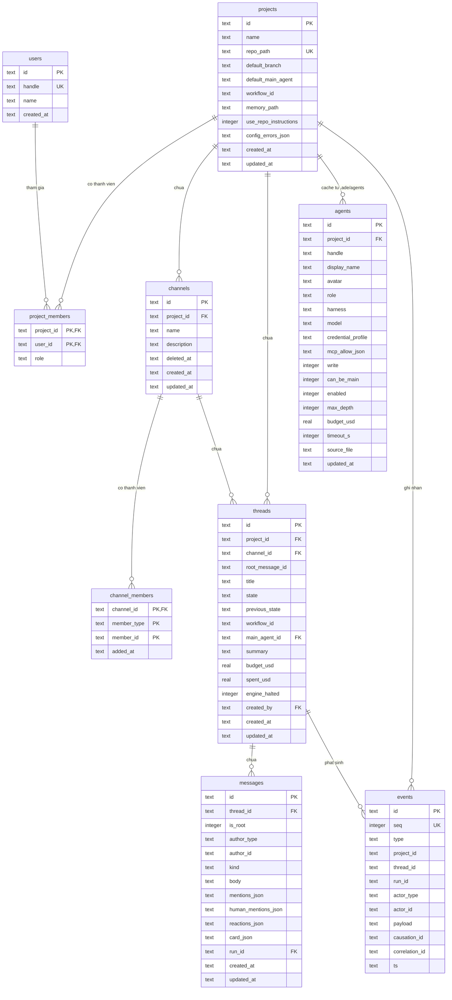

# Module Overview — `chat` (P1 Chat Core)

| Trường | Giá trị |
| --- | --- |
| Module | `chat` |
| Phase chính | P1 (mở rộng trên nền Smoke của P0) |
| Đường dẫn chốt | `specs/dd/chat/overview.md` |
| Nguồn tham chiếu | `docs/spec.md` (§2, §4, §6, §9, §10), `docs/phases.md` (§P1), [specs/dd/domain-model.md](../domain-model.md), [design.md](../../../design.md) |
| Ngày tạo | 2026-10-31 |
| Ngày cập nhật | 2026-10-31 |

## 1. Phạm vi & Quyết định kiến trúc của Module `chat`

1. **Mô hình Slack `Project -> Channel -> Chat Box (+ Ngăn phản hồi Thread)`**:
   - Không gian làm việc của module `chat` ở P1 hiển thị kiến trúc 3 cột chính kèm ngăn phản hồi thứ 4 mở theo ngữ cảnh (trên Desktop `>= 1025px` dàn hàng ngang `64px 224px 1fr` và mở rộng thành 4 cột khi bật Thread; trên Tablet `768px–1024px` giữ `64px 200px 1fr` và trượt đè ngăn Thread bên phải; trên Mobile `< 768px` hiển thị toàn màn hình kèm ngăn kéo trái gộp Cột 1 + Cột 2).
   - Áp dụng bất biến **1 Tin nhắn gốc trong kênh = 1 Thread**: mỗi khi người dùng gửi một tin nhắn mới tại khung nhập của Kênh (`POST /api/channels/:channelId/threads`), Hub ghi nguyên tử `thread.created` kèm `message.posted` (`is_root = true`) và gán `threads.root_message_id = message_id`. Luồng kênh hiển thị các tin nhắn gốc theo thứ tự thời gian tăng dần (`threads.created_at ASC`); toàn bộ tin nhắn phản hồi (`is_root = false`) nằm trong Ngăn phản hồi Thread bên phải.
   - Kênh (`channels`) chỉ mang `name`, `description`, danh sách thành viên `channel_members` (`member_type` thuộc `'human' | 'agent'`) và dấu thời gian xóa mềm `deleted_at` (`NULL` khi kênh đang hoạt động). Kênh **không** khai báo workflow riêng; mọi thread tạo trong dự án kế thừa trực tiếp `projects.workflow_id` đọc từ `.ade/project.yaml`.
2. **Ranh giới của P1 (`Chat Core`)**:
   - Cung cấp giao diện trò chuyện thời gian thực theo `Project → Channel → Thread` trên `127.0.0.1` thông qua REST `/api/*` và WebSocket `/ws`.
   - Quản lý vòng đời kênh đầy đủ ngay ở P1: tạo kênh mới (`POST /api/projects/:projectId/channels`), cập nhật tên/mô tả/thành viên kênh (`PATCH /api/channels/:channelId`), xóa mềm kênh (`DELETE /api/channels/:channelId`, chặn xóa kênh hoạt động cuối cùng của dự án bằng `409 ERR_LAST_CHANNEL_DELETE`), và thả biểu cảm 8 emoji chuẩn trên mọi tin nhắn gốc lẫn phản hồi (`POST /api/messages/:messageId/reactions`).
   - Toàn bộ trạng thái hội thoại (`projects`, `project_members`, `channels`, `channel_members`, `threads`, `messages`) được chiếu đồng bộ từ bảng `events` append-only thông qua `EventProjector` trong cùng giao dịch SQLite.
   - Đọc cấu hình dự án và danh sách agent từ thư mục `.ade/` trên đĩa (`.ade/project.yaml`, `.ade/agents/*.yaml`, `.ade/workflows/<workflow_id>.yaml`), kiểm tra hợp lệ bằng Zod schema dùng chung, nạp vào bảng bộ nhớ đệm (`projects`, `agents`) và theo dõi thay đổi tệp tin thời gian thực bằng `chokidar`.
   - Tách ngữ nghĩa `@mention` làm 3 nhánh rõ ràng: `@agent` (agent đang bật trong `.ade/agents/*.yaml`) sinh sự kiện `agent.mentioned` và tô chip xanh kỹ thuật `--color-agent`; `@human` (đồng nghiệp thuộc `project_members` khớp `users.handle`, mặc định `@owner` ở Solo) lưu vào `messages.human_mentions_json`, tô chip `--color-human` và **không** sinh `agent.mentioned`; `@handle` lạ hay agent đang tắt (`enabled = false`) sinh tin nhắn cảnh báo hệ thống nội tuyến và **không** sinh `agent.mentioned`.
   - Ở P1 **chưa** khởi chạy tiến trình agent thật (`packages/runner` sẽ tiêu thụ `agent.mentioned` từ P2).
3. **Khởi tạo Actor & Dự án mặc định khi Hub khởi động ở P1**:
   - Khi mở cơ sở dữ liệu SQLite (`openHubDatabase`), Hub khởi tạo sẵn bản ghi người dùng cục bộ `users` (`id = 'usr_local'`, `handle = 'owner'`, `name = 'Local Owner'`) mà không sinh bản ghi `events`, giữ `eventCount = 0` khi khởi động rỗng.
   - Khi biến môi trường `ADE_DEFAULT_REPO` hay tham số `defaultRepoPath` truyền từ test fixture trỏ tới một thư mục chứa `.git` mà `repo_path` đó chưa có trong bảng `projects`, Hub thực hiện đúng thứ tự 4 bước: (1) đọc trước `.ade/project.yaml` cùng `.ade/agents/*.yaml` để lấy `name` và `workflow_id`; (2) ghi sự kiện `project.registered` để tạo dòng `projects` và `project_members` cho `'usr_local'`; (3) chạy `syncProjectAdeConfig(projectId)` nạp đầy đủ bộ nhớ đệm `projects` và bảng `agents`; (4) ghi sự kiện `channel.created` cho kênh mặc định `#general` (`name = 'general'`, `description = 'Thảo luận chung toàn dự án'`, `member_user_ids = ['usr_local']`, `member_agent_ids` lấy trực tiếp danh sách `agents.id` có `enabled = 1` vừa nạp ở bước 3 để `member_agent_ids` không bị rỗng lúc tạo `#general`).

---

## 2. Ma trận Sub-DD trong Module `chat`

| Mã DD | Loại | Tên tài liệu | Đường dẫn chốt | Trạng thái |
| --- | --- | --- | --- | --- |
| `UI-P0-01` | UI | Khung SPA & Màn hình kiểm tra kết nối Hub | [specs/dd/chat/p0-smoke/ui-smoke.md](./p0-smoke/ui-smoke.md) | Đã viết nháp ở P0 |
| `API-P0-01` | API | Kiểm tra trạng thái Hub & Event Store | [specs/dd/chat/p0-smoke/api-health.md](./p0-smoke/api-health.md) | Đã viết nháp ở P0 |
| `UI-CH-01` | UI | Không gian Chat Slack 3+1 cột, Kênh, Ngăn Thread, Biểu cảm & Gợi ý `@mention` | [specs/dd/chat/ch-01/ui-chat.md](./ch-01/ui-chat.md) | Đang thiết kế (P1) |
| `API-CH-01` | API | Quản lý Kênh, Tin nhắn gốc Thread, Phản hồi, Biểu cảm, Loader `.ade/` & WebSocket `/ws` | [specs/dd/chat/ch-01/api-chat.md](./ch-01/api-chat.md) | Đang thiết kế (P1) |

---

## 3. Quy tắc Event Store & Projection (`EventProjector`)

1. **Nguyên tử hoá Append + Project**:
   - Mọi thao tác làm thay đổi dữ liệu hội thoại đi qua `appendAndProject(events[])` bên trong **một** giao dịch `sqlite.transaction`.
   - Nếu bước ghi `events` hay bước cập nhật bảng projection ném ngoại lệ, toàn bộ giao dịch được rollback; `EventBus` chỉ phát sự kiện ra WebSocket `/ws` sau khi giao dịch SQLite đã commit thành công.
2. **Bảng ánh xạ Event → Projection của P1 (8 loại sự kiện)**:

| `events.type` | Bảng Projection tác động | Quy tắc chiếu xác định (Deterministic Projection) |
| --- | --- | --- |
| `project.registered` | `users`, `projects`, `project_members` | `INSERT OR IGNORE INTO users` cho `'usr_local'` (`handle = 'owner'`, `name = 'Local Owner'`, `created_at = event.ts`); `INSERT INTO projects` (`id = payload.project_id`, `name = payload.name`, `repo_path = payload.repo_path`, `workflow_id = payload.workflow_id`, `default_branch = 'main'`, `memory_path = '.ade/memory/'`, `use_repo_instructions = 0`, `config_errors_json = '[]'`, `created_at = event.ts`, `updated_at = event.ts`); `INSERT OR IGNORE INTO project_members (project_id, user_id, role)` với `(payload.project_id, 'usr_local', 'owner')` |
| `channel.created` | `channels`, `channel_members` | `INSERT INTO channels` (`id = payload.channel_id`, `project_id = payload.project_id`, `name = payload.name`, `description = payload.description`, `deleted_at = NULL`, `created_at = event.ts`, `updated_at = event.ts`); với từng `userId` trong `payload.member_user_ids` ghi `INSERT OR IGNORE INTO channel_members (channel_id, member_type, member_id, added_at)` (`member_type = 'human'`, `added_at = event.ts`); với từng `agentId` trong `payload.member_agent_ids` ghi `INSERT OR IGNORE INTO channel_members` (`member_type = 'agent'`, `added_at = event.ts`) |
| `channel.updated` | `channels`, `channel_members` | `UPDATE channels SET name = payload.name, description = payload.description, updated_at = event.ts WHERE id = payload.channel_id AND deleted_at IS NULL`; xóa các dòng `channel_members` của `payload.channel_id` không còn nằm trong `payload.member_user_ids` / `payload.member_agent_ids` và chèn bổ sung các thành viên mới với `added_at = event.ts` (giữ nguyên `added_at` của thành viên đã có mặt từ trước) |
| `channel.deleted` | `channels` | Xóa mềm kênh: `UPDATE channels SET deleted_at = event.ts, updated_at = event.ts WHERE id = payload.channel_id` nhằm bảo toàn toàn vẹn khóa ngoại lịch sử của `threads`, `messages`, `runs`, `approvals`, `memory_proposals` |
| `thread.created` | `threads` | `INSERT INTO threads` (`id = payload.thread_id`, `project_id = event.project_id`, `channel_id = payload.channel_id`, `root_message_id = payload.root_message_id`, `title = payload.title`, `state = payload.initial_state`, `previous_state = NULL`, `workflow_id = payload.workflow_id`, `main_agent_id = NULL`, `summary = ''`, `budget_usd = NULL`, `spent_usd = 0`, `engine_halted = 0`, `created_by = event.actor_id`, `created_at = event.ts`, `updated_at = event.ts`) |
| `message.posted` | `messages`, `threads` | `INSERT INTO messages` (`id = payload.message_id`, `thread_id = event.thread_id`, `is_root = payload.is_root ? 1 : 0`, `author_type = event.actor_type`, `author_id = event.actor_id`, `kind = payload.kind`, `body = payload.body`, `mentions_json = JSON.stringify(payload.mentions)`, `human_mentions_json = JSON.stringify(payload.human_mentions)`, `reactions_json = '[]'`, `card_json = payload.card ? JSON.stringify(payload.card) : NULL`, `run_id = event.run_id`, `created_at = event.ts`, `updated_at = event.ts`); đồng thời `UPDATE threads SET updated_at = event.ts WHERE id = event.thread_id` |
| `message.reaction_toggled` | `messages` | Đọc `messages.reactions_json` của `payload.message_id`: nếu `payload.added = true` thì thêm `payload.actor_id` vào mảng `userIds` của mục `emoji` (tạo mới mục `{ emoji, userIds: [payload.actor_id] }` ở cuối mảng nếu chưa có); nếu `payload.added = false` thì loại `payload.actor_id` khỏi `userIds` và xóa mục `emoji` khi `userIds` rỗng; ghi lại `reactions_json` và `updated_at = event.ts` (không đổi `threads.updated_at`) |
| `agent.mentioned` | *(không đổi bảng P1)* | Phát qua `EventBus` tới WebSocket `/ws` và lưu vết trong `events` để Rule Engine / Dispatcher sử dụng từ P2–P3 |

3. **Dựng lại toàn bộ Projection (`rebuildProjections`)**:
   - Phục vụ script nghiệm thu `scripts/verify/replay-events.ts`: xóa trắng dữ liệu các bảng projection hội thoại theo đúng thứ tự khóa ngoại (`messages` → `threads` → `channel_members` → `channels` → `agents` → `project_members` → `projects`), đọc toàn bộ `events` theo `seq ASC` từ `seq = 1`, áp lại từng sự kiện qua cùng hàm `applyEventToProjection`, sau đó gọi lại `syncProjectAdeConfig(projectId)` cho từng dự án để nạp lại bộ nhớ đệm `.ade/` (giữ nguyên `projects.created_at` và `projects.updated_at` từ lịch sử sự kiện).
   - Nhờ quy tắc sinh khóa chính tất định `agents.id = "agt_" + projectId + "_" + handleWithoutAt` và lấy `agents.updated_at = fs.statSync(absFile).mtime.toISOString()` trực tiếp từ siêu dữ liệu tệp `.yaml` trên đĩa, kết quả chụp toàn bộ các bảng `projects`, `project_members`, `channels`, `channel_members`, `threads`, `messages`, `agents` sau replay trùng khớp 100% từng cột và từng hàng với trạng thái trước khi xóa.

---

## 4. Quy tắc Bộ nạp `.ade/` (`AdeConfigLoader`) & File Watcher

1. **Tệp tin đọc & Bảng ánh xạ Schema YAML sang Cột DB ở P1**:
   - `<repo_path>/.ade/project.yaml`: kiểm tra theo `ProjectYamlSchema` và cập nhật các cột bộ nhớ đệm trên `projects` (không ghi đè `projects.created_at` và `projects.updated_at`).
   - `<repo_path>/.ade/agents/*.yaml`: đọc từng tệp theo thứ tự bảng chữ cái tăng dần (`localeCompare`), kiểm tra độc lập bằng `AgentYamlSchema`. Mỗi agent hợp lệ phân giải khóa chính tất định `agents.id = COALESCE(yaml.id, "agt_" + projectId + "_" + cleanHandle)` (với `cleanHandle` là chữ thường đã bỏ tiền tố `@`; khóa tùy chọn `yaml.id` được bảo toàn khi agent từng đổi tên `handle` ở Phase P5), lưu `source_file = ".ade/agents/<fileName>"` và `updated_at = fs.statSync(absFile).mtime.toISOString()`.
   - `<repo_path>/.ade/workflows/<workflow_id>.yaml`: đọc khi khởi tạo dự án và khi gọi `POST /api/channels/:channelId/threads` để lấy trạng thái đầu `initial` theo `WorkflowYamlSchema`. Nếu thiếu tệp workflow mà `workflow_id === "feature"`, Hub dùng định nghĩa `feature` mặc định tích hợp sẵn (`initial: "open"`, `states: open, planning, plan_review, building, review, done`).

| Schema (`packages/shared`) | Trường YAML (kèm bí danh) | Kiểu & Quy tắc kiểm tra | Giá trị mặc định | Ánh xạ Cột SQLite / Chuẩn hoá |
| --- | --- | --- | --- | --- |
| `ProjectYamlSchema` | `name` | `string`, cắt trắng, `min:1` | *(bắt buộc)* | `projects.name` |
| `ProjectYamlSchema` | `default_branch` | `string`, cắt trắng, `min:1` | `"main"` | `projects.default_branch` |
| `ProjectYamlSchema` | `default_main_agent` | `string \| null` | `null` | `projects.default_main_agent` (chuẩn hoá có tiền tố `@` khi khác `null`) |
| `ProjectYamlSchema` | `default_workflow` (bí danh `workflow`, `workflow_id`) | `string`, cắt trắng, `min:1` | `"feature"` | `projects.workflow_id` (ưu tiên `default_workflow`, sau đó `workflow_id`, rồi `workflow`) |
| `ProjectYamlSchema` | `memory_path` | `string`, cắt trắng, `min:1` | `".ade/memory/"` | `projects.memory_path` |
| `ProjectYamlSchema` | `use_repo_instructions` | `boolean` | `false` | `projects.use_repo_instructions` (`1` khi `true`, `0` khi `false`) |
| `AgentYamlSchema` | `id` *(tùy chọn)* | `string`, khớp `^agt_[a-zA-Z0-9_-]+$` | Suy từ `"agt_" + projectId + "_" + cleanHandle` | `agents.id` (bảo toàn khóa chính khi đổi `handle` ở P5) |
| `AgentYamlSchema` | `handle` | `string`, khớp `^@?[a-z0-9][a-z0-9-_]*$` (duy nhất trong `project_id`) | *(bắt buộc)* | `agents.handle` (`"@" + cleanHandle.toLowerCase()`), sinh `agents.id = COALESCE(yaml.id, "agt_" + projectId + "_" + cleanHandle)` |
| `AgentYamlSchema` | `display_name` | `string`, cắt trắng, `min:1` | Suy từ `cleanHandle` viết hoa chữ đầu | `agents.display_name` |
| `AgentYamlSchema` | `avatar` | `string \| null` | `null` | `agents.avatar` |
| `AgentYamlSchema` | `role` | `string`, cắt trắng | `""` | `agents.role` |
| `AgentYamlSchema` | `harness` | `'claude' \| 'claude-code' \| 'codex'` | *(bắt buộc)* | `agents.harness` (chuẩn hoá `'claude'` về `'claude-code'` để cột `agents.harness` lưu giá trị thống nhất `'claude-code' \| 'codex'`) |
| `AgentYamlSchema` | `model` | `string`, cắt trắng, `min:1` | `"sonnet"` (Claude) / `"gpt-5-codex"` (Codex) | `agents.model` |
| `AgentYamlSchema` | `credential_profile` (bí danh `credential`) | `'sub-claude' \| 'sub-chatgpt' \| 'api-key'` | `'sub-claude'` (Claude) / `'sub-chatgpt'` (Codex) | `agents.credential_profile` |
| `AgentYamlSchema` | `skills` | `string[]`, mỗi mục khớp `^(?:global:)?[a-z0-9][a-z0-9-]*$` | `[]` | Kiểm tra cú pháp ngay ở P1 (hỗ trợ tiền tố `global:` cho `~/.ade/skills/`); nạp bảng `agent_skills` ở P5 |
| `AgentYamlSchema` | `mcp_allow` | `string[]` | `[]` | `agents.mcp_allow_json` (`JSON.stringify`) |
| `AgentYamlSchema` | `write` | `boolean` | `false` | `agents.write` (`0` / `1`) |
| `AgentYamlSchema` | `can_be_main` | `boolean` | `false` | `agents.can_be_main` (`0` / `1`) |
| `AgentYamlSchema` | `enabled` | `boolean` | `true` | `agents.enabled` (`0` / `1`) |
| `AgentYamlSchema` | `max_depth` | `integer`, `1..10` | `3` | `agents.max_depth` |
| `AgentYamlSchema` | `budget_usd` | `number > 0 \| null` | `null` | `agents.budget_usd` |
| `AgentYamlSchema` | `timeout_s` | `integer`, `5..7200` | `600` | `agents.timeout_s` |
| `WorkflowYamlSchema` | `id` (bí danh `workflow`) | `string`, cắt trắng, `min:1` | Tên tệp bỏ `.yaml` | Định danh workflow đối chiếu với `projects.workflow_id` |
| `WorkflowYamlSchema` | `initial` | `string`, cắt trắng, `min:1` | *(bắt buộc)* | Trạng thái khởi tạo dùng kiểm tra Guard `Thread/T-01` |
| `WorkflowYamlSchema` | `states` | Hỗ trợ cả **2 dạng**: mảng `Array<string \| Record<string, { gate?: 'plan' \| 'spec' \| 'review' }>>` (`min:1`) và đối tượng `Record<string, { gate?: 'plan' \| 'spec' \| 'review' }>` (`>= 1` khóa) | *(bắt buộc)* | Chuẩn hoá qua `extractWorkflowStateNames(workflow)` thành mảng tên trạng thái để kiểm tra `initial` thuộc `states` |
| `WorkflowYamlSchema` | `rules` | `array` | `[]` | Lưu cấu trúc rule YAML để Rule Engine thực thi từ P3 |
2. **Cô lập lỗi từng tệp YAML (Fault Isolation)**:
   - Một tệp `.ade/agents/<bad>.yaml` sai cú pháp YAML hay không khớp `AgentYamlSchema` **không** làm hỏng các agent hợp lệ khác trong cùng thư mục.
   - Mọi lỗi phát hiện được gom vào cột `projects.config_errors_json` dưới dạng mảng `ConfigErrorItem` (`{ file: string, field: string, message: string }`), trong đó:
     - `file`: đường dẫn tương đối tính từ gốc kho mã nguồn (ví dụ `".ade/agents/broken.yaml"`).
     - `field`: đường dẫn trường Zod bị sai nối bằng dấu chấm (ví dụ `"harness"`, `"timeout_s"`, `"$yaml"` nếu lỗi cú pháp YAML, `"handle"` nếu trùng `handle` giữa hai tệp agent).
     - `message`: thông điệp mô tả lỗi tiếng Việt rõ ràng.
   - Tệp agent bị lỗi bị loại khỏi danh sách agent hợp lệ trả cho gợi ý `@mention` và bị xóa khỏi bảng bộ nhớ đệm `agents` ở lần quét đó nếu trước đó đã tồn tại.
3. **File Watcher (`chokidar`)**:
   - Hub theo dõi `<repo_path>/.ade/{project.yaml,agents/*.yaml,workflows/*.yaml}` với ngưỡng gộp sự kiện `150 ms` (`awaitWriteFinish` / debounce).
   - Khi tệp tin thêm mới, chỉnh sửa hay bị xóa trên đĩa, Hub chạy lại `syncProjectAdeConfig(projectId)` và phát khung tin WebSocket `project.config_updated` kèm `{ projectId, agents, configErrors }` tới mọi trình duyệt đang mở trong `< 1000 ms`.

---

## 5. Quy tắc Parser `@mention` (`parseMentions`)

1. **Cú pháp nhận diện**:
   - Biểu thức chính quy: `/(?:^|(?<=[\s([{"']))@([a-z0-9][a-z0-9-_]*)/gi` — chỉ bắt `@handle` đứng ở đầu dòng hay ngay sau ký tự trắng và dấu mở ngoặc/nháy `(`, `[`, `{`, `"`, `'`.
   - **Bỏ qua vùng mã**: trước khi quét biểu thức chính quy, bộ phân tích loại trừ toàn bộ khối mã rào 3 dấu huyền (`` ```<code>``` ``) và đoạn mã nội tuyến (`` `<code>` ``) để việc viết ví dụ như `` `@planner` `` hay `user@example.com` không kích hoạt `@mention`.
   - Chuẩn hoá chữ thường (`toLowerCase()`) và khử trùng lặp theo thứ tự xuất hiện đầu tiên trong cùng một tin nhắn (ví dụ viết `@coder` hai lần trong cùng một tin nhắn chỉ sinh **1** sự kiện `agent.mentioned` cho `@coder`).
2. **Đối chiếu 3 nhánh (`@agent` · `@human` · `unknownMentions`)**:
   - **Nhánh 1 — Agent hợp lệ (`validMentions`)**: `@<handle>` khớp một bản ghi trong bảng `agents` của `project_id` hiện tại với `enabled = 1` → đưa vào mảng `validMentions` (lưu tại `messages.mentions_json`) và phát tương ứng một sự kiện `agent.mentioned` có `payload = { agent: "@<handle>", agent_id: agent.id, message_id, text: message.body }`, `causation_id = message_posted_event.id`, `correlation_id = thread_id`.
   - **Nhánh 2 — Đồng nghiệp con người (`humanMentions`)**: `@<handle>` không thuộc `validMentions`, nhưng `<handle>` khớp không phân biệt hoa thường với `users.handle` của một thành viên trong `project_members` thuộc `project_id` hiện tại (ví dụ `@owner` ở Solo) → đưa vào mảng `humanMentions` (lưu tại `messages.human_mentions_json`). Nhánh này hiển thị chip đồng nghiệp `.ade-mention--human` (thêm `.ade-mention--me` nếu là `usr_local`), **không** phát sự kiện `agent.mentioned` và **không** sinh cảnh báo `unknownMentions`.
   - **Nhánh 3 — Handle không hợp lệ (`unknownMentions`)**: `@<handle>` không khớp agent đang bật và không khớp đồng nghiệp trong dự án (bao gồm cả trường hợp agent tồn tại nhưng `enabled = 0`) → đưa vào mảng `unknownMentions`, **không** phát sự kiện `agent.mentioned`. Trong cùng giao dịch gửi tin nhắn, Hub tự động ghi thêm một sự kiện `message.posted` với `actor = { type: "system", id: "system" }`, `kind = "system"`, `is_root = false`, `card = { type: "unknown_mention_warning", handles: unknownMentions }` và `body = "Agent chưa bật hay không tồn tại: " + unknownMentions.join(", ")`.

---

## 6. Sơ đồ quan hệ thực thể con của Module `chat` (P1)



---

## 7. Máy trạng thái sử dụng trong P1

P1 khởi tạo thực thể `Thread` thông qua chuyển trạng thái **`Thread/T-01`** đã định nghĩa tại [specs/dd/domain-model.md](../domain-model.md) (§5 — State machine `Thread.state`):

- Khi người dùng gửi tin nhắn gốc vào kênh (`POST /api/channels/:channelId/threads`), hệ thống đọc `.ade/workflows/<projects.workflow_id>.yaml` để xác định `initial` (mặc định `"open"`), kiểm tra `initial` nằm trong `workflow.states`, và ghi nguyên tử cặp sự kiện `thread.created` + `message.posted` (`is_root = true`) với `threads.state = initial`.
- Nếu tệp workflow YAML sai cú pháp hay thiếu `initial`, API trả HTTP `422` `ERR_WORKFLOW_INVALID`; nếu `initial` không tồn tại trong danh sách `workflow.states`, API trả HTTP `400` `ERR_INVALID_STATUS`.
- Các bước chuyển trạng thái tiếp theo (`Thread/T-02`..`Thread/T-11`) sẽ do Rule Engine thực thi từ Phase P3.
