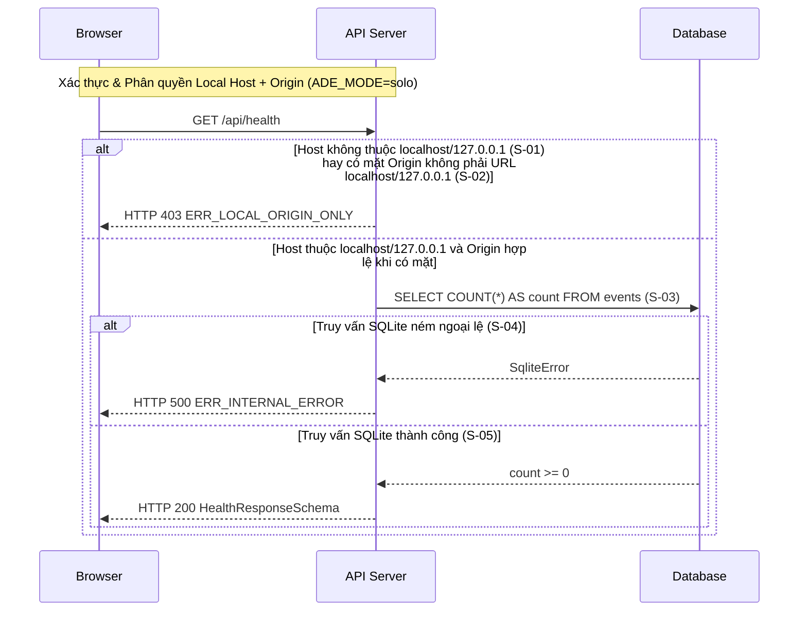

# API-P0-01 — GET /api/health — Kiểm tra trạng thái sẵn sàng của Hub

| Trường | Giá trị |
|--------|--------|
| API ID | `API-P0-01` |
| Đường dẫn chốt | `specs/dd/chat/p0-smoke/api-health.md` |
| Method | `GET` |
| Endpoint | `/api/health` |
| Phân quyền | Local Origin Guard (`ADE_MODE=solo`) · Actor mặc định `usr_local` (`role = owner`) |
| Zod schema | `HealthResponseSchema`, `ApiErrorResponseSchema` (`packages/shared`) |
| Hiện trạng BE | BE chưa implement (xây mới ở phase P0) |
| Ngày tạo | 2026-10-31 |
| Ngày cập nhật | 2026-10-31 |

## Lịch sử sửa đổi

| Ver | Ngày | Tác giả | Thay đổi |
|-----|------|--------|---------|
| 1.0 | 2026-10-31 | cuongph | Phát hành lần đầu |

---

## 1. Mục đích

- **Actor**: Màn hình `UI-P0-01` trên trình duyệt local với actor mặc định `usr_local` (`role = owner`).
- **Use case**: Kiểm tra tiến trình `apps/hub` đang vận hành ở chế độ `ADE_MODE=solo` và xác nhận kết nối SQLite cùng bảng `events` append-only đọc được.
- **Kết quả thành công**: API trả HTTP 200 kèm dữ liệu khớp `HealthResponseSchema` gồm `status = "ok"`, `mode = "solo"`, `dbConnected = true`, `eventCount` bằng tổng số bản ghi trong bảng `events`, và `version` của tiến trình Hub.
- **Ngoài phạm vi**: Kiểm tra trạng thái đăng nhập của Claude Code và Codex (thuộc API tab Harness ở phase P5); khởi tạo dữ liệu project, channel, thread (thuộc phase P1); xác thực tài khoản nhiều người dùng.
- **Giả định**: Biến môi trường `ADE_MODE` của tiến trình Hub mang giá trị `"solo"` trong phạm vi MVP; migration khởi tạo bảng `events` đã chạy trước khi Hub mở cổng lắng nghe HTTP.
- **Câu hỏi mở**: Không có

## 2. Request

### 2.1 Headers & Phân quyền

| Header | Bắt buộc | Mô tả |
|--------|----------|-------|
| `Host` | Có | Header chuẩn HTTP/1.1; trong mọi request, hostname trong `Host` bắt buộc thuộc tập `{"localhost", "127.0.0.1"}` (không phân biệt cổng) nhằm chặn DNS rebinding kể cả khi có mặt `Origin`. |
| `Origin` | Không | Trình duyệt gửi kèm khi gọi từ ứng dụng web; khi header `Origin` có mặt, giá trị bắt buộc là URL hợp lệ có hostname thuộc tập `{"localhost", "127.0.0.1"}` (không phân biệt cổng; từ chối cả giá trị `"null"`). |
| `Accept` | Không | `application/json` |

### 2.2 Path & Query params

Không có.

### 2.3 Request body

Không có.

## 3. Kiểm tra hợp lệ (Validate)

| ID | Tên logic | Quy tắc kiểm tra | Mã message | Message |
|-----|-----------|-----------------|------------|---------|
| — | Không có | — | — | Endpoint `GET /api/health` không nhận path param, query param và request body. |

## 4. Xử lý phía server

| ID | Bước | Mô tả |
|-----|------|-------|
| S-01 | Kiểm tra Host local | Nếu request thiếu header `Host` hay hostname trích từ `Host` không thuộc tập `{"localhost", "127.0.0.1"}`, thì hệ thống phải trả HTTP 403 kèm mã lỗi `ERR_LOCAL_ORIGIN_ONLY`. |
| S-02 | Kiểm tra Origin local | Nếu request có mặt header `Origin` mà giá trị `Origin` không phân tích được thành URL hợp lệ có hostname thuộc tập `{"localhost", "127.0.0.1"}`, thì hệ thống phải trả HTTP 403 kèm mã lỗi `ERR_LOCAL_ORIGIN_ONLY`. |
| S-03 | Truy vấn bảng `events` | Khi nguồn kết nối của request hợp lệ với chế độ local tại `S-01` và `S-02`, hệ thống phải thực thi câu lệnh `SELECT COUNT(*) AS count FROM events` trên kết nối SQLite hiện hành. |
| S-04 | Phản hồi lỗi cơ sở dữ liệu | Nếu câu lệnh SQLite tại `S-03` ném ngoại lệ, thì hệ thống phải trả HTTP 500 kèm mã lỗi `ERR_INTERNAL_ERROR` theo cấu trúc `ApiErrorResponseSchema`. |
| S-05 | Trả phản hồi thành công | Khi câu lệnh SQLite tại `S-03` trả về tổng số dòng, hệ thống phải trả HTTP 200 với payload khớp `HealthResponseSchema`. |

## 5. Response

### 5.1 Thành công

| HTTP | Zod schema | Mô tả |
|------|-----------|-------|
| 200 | `HealthResponseSchema` | Tiến trình Hub hoạt động ở chế độ `"solo"` và kết nối SQLite đọc được bảng `events` |

```json
{
  "status": "ok",
  "mode": "solo",
  "dbConnected": true,
  "eventCount": 0,
  "version": "0.1.0"
}
```

### 5.2 Lỗi

> Nội dung thông điệp tiếng Việt của các mã lỗi: xem `specs/message.md`.

| HTTP | Mã lỗi | Điều kiện | Mã message |
|------|--------|-----------|------------|
| 403 | `ERR_LOCAL_ORIGIN_ONLY` | Request ở `ADE_MODE=solo` thiếu `Host`, có hostname của `Host` không thuộc tập `{"localhost", "127.0.0.1"}` (`S-01`), hay có mặt header `Origin` nhưng không phải URL hợp lệ có hostname thuộc tập `{"localhost", "127.0.0.1"}` bao gồm cả `Origin: null` (`S-02`) | — |
| 500 | `ERR_INTERNAL_ERROR` | Kết nối SQLite đã đóng dẫn tới truy vấn đếm bảng `events` tại `S-03` ném ngoại lệ (`S-04`) | — |

### 5.3 Bản đồ dữ liệu

| Field | Nguồn | Biến đổi | Ghi chú |
|-------|-------|----------|---------|
| `status` | Hằng số runtime | Gán chuỗi cố định `"ok"` khi `S-03` hoàn tất không lỗi | Kiểu literal `"ok"` trong `HealthResponseSchema` |
| `mode` | Biến môi trường `ADE_MODE` | Đọc cấu hình khởi động Hub, mặc định `"solo"` | Kiểu literal `"solo"` trong `HealthResponseSchema` |
| `dbConnected` | Kết quả thực thi `S-03` | Gán `true` khi câu lệnh `SELECT COUNT(*)` hoàn tất | Kiểu literal `true` trong `HealthResponseSchema` |
| `eventCount` | `events.id` | Lấy giá trị `COUNT(*)` ép sang số nguyên không âm (`>= 0`) | Phản ánh tổng số bản ghi trong kho sự kiện append-only |
| `version` | `apps/hub/package.json#version` | Nạp chuỗi phiên bản lúc khởi tạo Hub (mặc định `"0.1.0"`) | Chuỗi phiên bản SemVer khác rỗng |

## 6. Database

| Model | Thao tác | Field | Điều kiện / filter | Ghi chú |
|-------|----------|-------|--------------------|---------|
| `events` | R | `COUNT(*)` | Toàn bộ bảng `events` (không có điều kiện lọc) | Chỉ đọc; không sinh bản ghi mới trong `events` và không đổi trạng thái thực thể nào |

- **Invariant**: Bảng `events` tuân thủ bất biến append-only (hai trigger SQLite chặn mọi câu lệnh `UPDATE` và `DELETE`); giá trị `eventCount` luôn là số nguyên `>= 0`.
- **Transaction**: Không có (chỉ gồm một câu lệnh đọc `SELECT COUNT(*) AS count FROM events`).
- **Concurrency**: Kết nối SQLite bật `PRAGMA journal_mode = WAL`, cho phép các yêu cầu đọc `GET /api/health` thực thi đồng thời với tác vụ `INSERT` vào bảng `events`.

## 7. Sơ đồ luồng



---

## 8. Liên quan

| Loại | Tên / ID | Quan hệ |
|------|----------|---------|
| Màn hình | [UI-P0-01](specs/dd/chat/p0-smoke/ui-smoke.md) | Màn hình Khung khởi động ADE gọi `GET /api/health` khi mở trang và khi làm mới trạng thái |
| Domain Model | [Domain Model E0](specs/dd/domain-model.md) | Định nghĩa lược đồ bảng `events` append-only được truy vấn tại `S-03` |

## 9. Tiêu chí chấp nhận

```gherkin
Feature: API-P0-01 — Kiểm tra trạng thái sẵn sàng của Hub và kết nối SQLite

  Background:
    Given tiến trình Hub đang chạy ở chế độ ADE_MODE là "solo" với phiên bản "0.1.0"

  Scenario: AC-API-P0-01-01 — Trả trạng thái sẵn sàng từ Origin localhost khi bảng events rỗng (nguồn: S-01, S-02, S-03, S-05; nghiệm thu: e2e/p0-smoke.spec.ts)
    Given bảng "events" trong SQLite hiện có 0 bản ghi
    When gửi yêu cầu GET "/api/health" kèm header "Host" là "localhost:3000" và header "Origin" là "http://localhost:5173"
    Then nhận phản hồi HTTP 200 với body khớp "HealthResponseSchema"
    And trường "status" bằng "ok"
    And trường "mode" bằng "solo"
    And trường "dbConnected" bằng true
    And trường "eventCount" bằng 0
    And trường "version" bằng "0.1.0"

  Scenario: AC-API-P0-01-02 — Trả đúng tổng số bản ghi hiện có trong bảng events append-only (nguồn: S-01, S-03, S-05; nghiệm thu: e2e/p0-smoke.spec.ts)
    Given bảng "events" trong SQLite đã có 2 bản ghi sự kiện append-only
    When gửi yêu cầu GET "/api/health" không kèm header "Origin" và có header "Host" là "127.0.0.1:3000"
    Then nhận phản hồi HTTP 200 với body khớp "HealthResponseSchema"
    And trường "eventCount" bằng 2
    And trường "dbConnected" bằng true

  Scenario Outline: AC-API-P0-01-03 — Chặn yêu cầu có Origin không hợp lệ kể cả khi Host là localhost (nguồn: S-01, S-02, 403 ERR_LOCAL_ORIGIN_ONLY; nghiệm thu: e2e/p0-smoke.spec.ts)
    Given kết nối SQLite của Hub đang mở bình thường
    When gửi yêu cầu GET "/api/health" kèm header "Host" là "localhost:3000" và header "Origin" là "<origin>"
    Then nhận phản hồi HTTP 403 với body khớp "ApiErrorResponseSchema"
    And trường "code" bằng "ERR_LOCAL_ORIGIN_ONLY"

    Examples:
      | origin                   |
      | https://evil.example.com |
      | null                     |

  Scenario: AC-API-P0-01-04 — Chặn yêu cầu vắng Origin nhưng có Host ngoài localhost và 127.0.0.1 (nguồn: S-01, 403 ERR_LOCAL_ORIGIN_ONLY; nghiệm thu: e2e/p0-smoke.spec.ts)
    Given kết nối SQLite của Hub đang mở bình thường
    When gửi yêu cầu GET "/api/health" không kèm header "Origin" và có header "Host" là "ade.remote.example.com"
    Then nhận phản hồi HTTP 403 với body khớp "ApiErrorResponseSchema"
    And trường "code" bằng "ERR_LOCAL_ORIGIN_ONLY"

  Scenario: AC-API-P0-01-05 — Trả lỗi HTTP 500 ERR_INTERNAL_ERROR khi truy vấn SQLite thất bại (nguồn: S-04, 500 ERR_INTERNAL_ERROR; nghiệm thu: e2e/p0-smoke.spec.ts)
    Given kết nối SQLite của tiến trình Hub đang ở trạng thái đã đóng
    When gửi yêu cầu GET "/api/health" kèm header "Host" là "127.0.0.1:3000" và header "Origin" là "http://127.0.0.1:3000"
    Then nhận phản hồi HTTP 500 với body khớp "ApiErrorResponseSchema"
    And trường "code" bằng "ERR_INTERNAL_ERROR"

  Scenario: AC-API-P0-01-06 — Chặn DNS rebinding khi Host ngoài localhost dù Origin là localhost (nguồn: S-01, 403 ERR_LOCAL_ORIGIN_ONLY; nghiệm thu: e2e/p0-smoke.spec.ts)
    Given kết nối SQLite của Hub đang mở bình thường
    When gửi yêu cầu GET "/api/health" kèm header "Host" là "ade.remote.example.com" và header "Origin" là "http://localhost:5173"
    Then nhận phản hồi HTTP 403 với body khớp "ApiErrorResponseSchema"
    And trường "code" bằng "ERR_LOCAL_ORIGIN_ONLY"
```
