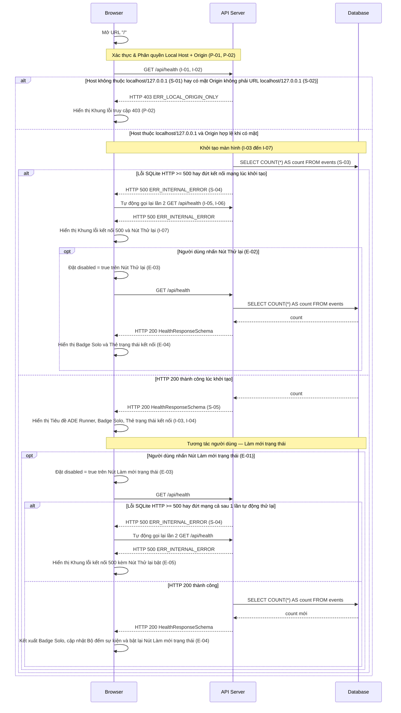

# UI-P0-01 - Khung khởi động ADE (ADE Smoke Shell)

| Trường | Giá trị |
|-------|-------|
| Mã màn hình | `UI-P0-01` |
| Tên màn hình | Khung khởi động ADE (ADE Smoke Shell) |
| Đường dẫn chốt | `specs/dd/chat/p0-smoke/ui-smoke.md` |
| URL | `/` |
| Ngày tạo | 2026-10-31 |
| Ngày cập nhật | 2026-10-31 |

## TÓM TẮT

- **Mục tiêu**: Hiển thị khung khởi động của ứng dụng web ADE tại `/` để người phát triển xác nhận tiến trình Hub và cơ sở dữ liệu SQLite đang hoạt động ở chế độ `Solo`.
- **Actor**: Người phát triển truy cập từ trình duyệt trên máy local với actor mặc định `usr_local` (`role = owner`).
- **Trong phạm vi**: Gọi `GET /api/health` khi tải trang, hiển thị tiêu đề `ADE Runner`, huy hiệu chế độ `Solo`, trạng thái kết nối Hub + SQLite, tổng số sự kiện trong bảng `events`, phiên bản Hub, nút `Làm mới trạng thái`, khung lỗi 403 khi vi phạm Origin local và khung lỗi 500 kèm nút `Thử lại`.
- **Ngoài phạm vi**: Thanh bên project/channel, danh sách thread và khung chat thời gian thực (thuộc phase P1); giao diện cấu hình project, agent, skill và harness (thuộc phase P5).
- **Giả định**: Ứng dụng SPA được phục vụ cùng nguồn trên máy local ở chế độ `ADE_MODE=solo`, không có màn hình đăng nhập.
- **Câu hỏi mở**: Không có

## Lịch sử sửa đổi

| Ver | Ngày | Tác giả | Thay đổi |
|-----|------|--------|---------|
| 1.0 | 2026-10-31 | cuongph | Phát hành lần đầu |

---

## BỐ CỤC

> Ghi chú: Chưa có ảnh chụp màn hình do màn hình được xây dựng mới ở phase P0; bố cục được quy định bằng sơ đồ khối ASCII và bảng vùng hiển thị dưới đây.

```text
+-----------------------------------------------------------------------+
| [Header]  ADE Runner                                         [ Solo ] |
+-----------------------------------------------------------------------+
| [Main Region]                                                         |
|                                                                       |
|  Trạng thái sẵn sàng (HTTP 200):                                      |
|  +-----------------------------------------------------------------+  |
|  |  Hub & SQLite: Đã kết nối                                       |  |
|  |  Số sự kiện đã ghi: 0                                           |  |
|  |  Phiên bản: 0.1.0                                               |  |
|  |                                        [ Làm mới trạng thái ]   |  |
|  +-----------------------------------------------------------------+  |
|                                                                       |
|  Trạng thái lỗi kết nối / HTTP >= 500 (sau 1 lần tự động thử lại):     |
|  +-----------------------------------------------------------------+  |
|  |  Không thể kết nối tới ADE Hub                                  |  |
|  |  Kiểm tra lại tiến trình Hub và tệp SQLite trên máy local.      |  |
|  |                                                   [ Thử lại ]   |  |
|  +-----------------------------------------------------------------+  |
|                                                                       |
|  Trạng thái bị từ chối Origin HTTP 403:                               |
|  +-----------------------------------------------------------------+  |
|  |  ADE ở chế độ Solo chỉ cho phép truy cập từ localhost.          |  |
|  +-----------------------------------------------------------------+  |
+-----------------------------------------------------------------------+
```

| Vùng bố cục | Vai trò hiển thị | Phần tử chứa bên trong |
|-------------|------------------|------------------------|
| Thanh đầu trang (`Header`) | Luôn cố định ở cạnh trên màn hình trong mọi trạng thái tải và lỗi | `Tiêu đề ứng dụng` (`"ADE Runner"`), `Badge chế độ triển khai` (`"Solo"` khi đã nhận dữ liệu HTTP 200) |
| Vùng nội dung chính (`Main Region`) | Hiển thị đúng 1 trong 4 khung theo trạng thái truy vấn `GET /api/health`: đang tải lần đầu, sẵn sàng HTTP 200, lỗi 403, lỗi 500/mất kết nối | `Trạng thái tải`, `Thẻ trạng thái kết nối`, `Khung lỗi truy cập 403`, `Khung lỗi kết nối 500` |

---

## LOGIC

### I. Các phần tử (Items)

| STT | Tên logic | Loại đối tượng | Cột trong DB | Mô tả | Ghi chú |
|----|-------------|----------------|-------------|-------------|------|
| 1 | Tiêu đề ứng dụng | Nhãn (`h1`) | — | Hiển thị văn bản cố định `"ADE Runner"` trên thanh đầu trang | `data-testid="app-title"` |
| 2 | Badge chế độ triển khai | Huy hiệu (`span`) | — | Hiển thị nhãn `"Solo"` khi phản hồi `GET /api/health` có `mode = "solo"` | `data-testid="mode-badge"` |
| 3 | Trạng thái tải | Khối thông báo | — | Hiển thị văn bản `"Đang kiểm tra kết nối Hub"` khi truy vấn lần đầu đang chờ phản hồi | `data-testid="health-loading"` |
| 4 | Thẻ trạng thái kết nối | Khối thông tin | — | Hiển thị dòng trạng thái `"Hub & SQLite: Đã kết nối"` khi `status = "ok"` và `dbConnected = true` | `data-testid="health-status"` |
| 5 | Bộ đếm sự kiện | Nhãn giá trị | `events.id` | Hiển thị tổng số dòng bảng `events` theo mẫu `"Số sự kiện đã ghi: {eventCount}"` | Tính từ `COUNT(*)` qua `HealthResponseSchema.eventCount`; `data-testid="event-count"` |
| 6 | Nhãn phiên bản Hub | Nhãn giá trị | — | Hiển thị chuỗi phiên bản theo mẫu `"Phiên bản: {version}"` | Nguồn `HealthResponseSchema.version`; `data-testid="hub-version"` |
| 7 | Nút Làm mới trạng thái | Nút (`button`) | — | Nút bấm kích hoạt gọi lại `GET /api/health` từ `Thẻ trạng thái kết nối` | Nhãn `"Làm mới trạng thái"`; `data-testid="refresh-health-btn"` |
| 8 | Khung lỗi truy cập 403 | Khối thông báo lỗi | — | Hiển thị thông điệp tiếng Việt của `ERR_LOCAL_ORIGIN_ONLY`: `"ADE ở chế độ Solo chỉ cho phép truy cập từ localhost."` | `data-testid="error-403-panel"` |
| 9 | Khung lỗi kết nối 500 | Khối thông báo lỗi | — | Hiển thị tiêu đề `"Không thể kết nối tới ADE Hub"` kèm hướng dẫn kiểm tra tiến trình local khi gặp HTTP `>= 500` hay đứt mạng | `data-testid="error-500-panel"` |
| 10 | Nút Thử lại | Nút (`button`) | — | Nút bấm nằm trong `Khung lỗi kết nối 500` để phát lại yêu cầu `GET /api/health` | Nhãn `"Thử lại"`; `data-testid="retry-health-btn"` |

### II. Kiểm tra hợp lệ (Validate)

| ID | Tên logic | Tên | Quy tắc kiểm tra | Mã message | Message |
|----|-------------|------|-----------------|--------------|---------|
| — | Không có | — | — | — | Màn hình không có trường nhập liệu form. |

### III. Logic

#### Thông tin màn hình
- **Phân quyền**: Truy cập local ở `ADE_MODE=solo` (hostname của `Host` luôn bắt buộc thuộc tập `{"localhost", "127.0.0.1"}`, và khi có mặt header `Origin` thì `Origin` bắt buộc là URL hợp lệ có hostname thuộc tập `{"localhost", "127.0.0.1"}` từ chối cả `"null"`; gán actor mặc định `usr_local` với `role = owner`; không yêu cầu màn hình đăng nhập)
- **Mẫu URL**: `/`
- **API chính**: `GET /api/health` ([API-P0-01](specs/dd/chat/p0-smoke/api-health.md))

#### 1. Kiểm tra phân quyền

| ID | Mô tả |
|----|-------------|
| P-01 | Khi người dùng truy cập đường dẫn `/` từ hostname thuộc tập `{"localhost", "127.0.0.1"}` ở `ADE_MODE=solo`, hệ thống phải cho phép mở màn hình với actor mặc định `usr_local` (`role = owner`) mà không yêu cầu đăng nhập. |
| P-02 | Nếu API `GET /api/health` trả phản hồi HTTP 403 kèm mã lỗi `ERR_LOCAL_ORIGIN_ONLY`, thì màn hình phải kết xuất duy nhất `Khung lỗi truy cập 403` mang nội dung `"ADE ở chế độ Solo chỉ cho phép truy cập từ localhost."` trong vùng nội dung chính mà không tự động thử lại. |

#### 2. Khởi tạo màn hình

| ID | Mô tả |
|----|-------------|
| I-01 | Khi màn hình `/` được khởi tạo lần đầu, màn hình phải kết xuất `Tiêu đề ứng dụng` (`"ADE Runner"`) trên thanh đầu trang và `Trạng thái tải` trong vùng nội dung chính. |
| I-02 | Khi màn hình `/` được gắn vào DOM lần đầu, màn hình phải gửi ngay 1 yêu cầu `GET /api/health` tới Hub. |
| I-03 | Khi yêu cầu `GET /api/health` lúc khởi tạo trả về HTTP 200 khớp `HealthResponseSchema`, màn hình phải kết xuất trạng thái sẵn sàng gồm `Badge chế độ triển khai` (`"Solo"`) và `Thẻ trạng thái kết nối` chứa `Bộ đếm sự kiện`, `Nhãn phiên bản Hub` cùng `Nút Làm mới trạng thái`. |
| I-04 | Trong suốt quá trình tải trang `/` và hoàn tất hiển thị trạng thái HTTP 200 trên `localhost`, màn hình phải không phát sinh bản ghi `console.error` và sự kiện `pageerror` trên trình duyệt. |
| I-05 | Nếu yêu cầu `GET /api/health` thất bại với mã trạng thái HTTP `>= 500` ở lần gọi đầu tiên, thì bộ quản lý truy vấn của màn hình phải tự động gửi lại đúng 1 lần yêu cầu `GET /api/health` trước khi chuyển sang trạng thái lỗi. |
| I-06 | Nếu yêu cầu `GET /api/health` thất bại do lỗi đứt kết nối mạng ở lần gọi đầu tiên, thì bộ quản lý truy vấn của màn hình phải tự động gửi lại đúng 1 lần yêu cầu `GET /api/health` trước khi chuyển sang trạng thái lỗi. |
| I-07 | Nếu lần tự động gửi lại của `GET /api/health` tại `I-05` hay `I-06` tiếp tục thất bại, thì màn hình phải kết xuất `Khung lỗi kết nối 500` kèm `Nút Thử lại` trong vùng nội dung chính. |

#### 3. Xử lý hành vi sự kiện

> Nội dung thông điệp của các mã lỗi trong mục này: xem `specs/message.md`.

| ID | Sự kiện | Kích hoạt | Mô tả |
|----|-------|---------|-------------|
| E-01 | Làm mới trạng thái | Khi người dùng nhấn `Nút Làm mới trạng thái` | Màn hình phải gửi yêu cầu `GET /api/health` mới để đọc lại trạng thái kết nối và tổng số sự kiện. |
| E-02 | Thử lại sau lỗi kết nối | Khi người dùng nhấn `Nút Thử lại` bên trong `Khung lỗi kết nối 500` | Màn hình phải gửi yêu cầu `GET /api/health` mới để khôi phục trạng thái hiển thị. |
| E-03 | Khóa nút khi đang tải | Trong khi yêu cầu `GET /api/health` đang chờ phản hồi từ server | Màn hình phải đặt thuộc tính `disabled = true` trên nút hành động thuộc khung đang hiển thị (`Nút Làm mới trạng thái` tại `Thẻ trạng thái kết nối`, `Nút Thử lại` tại `Khung lỗi kết nối 500`). |
| E-04 | Cập nhật trạng thái thành công | Khi yêu cầu `GET /api/health` từ `E-01` hay `E-02` trả về HTTP 200 khớp `HealthResponseSchema` | Màn hình phải kết xuất `Badge chế độ triển khai` (`"Solo"`) trên thanh đầu trang cùng `Thẻ trạng thái kết nối` mang giá trị `eventCount` và `version` mới nhất trong vùng nội dung chính. |
| E-05 | Hiển thị khung lỗi kết nối 500 | Nếu yêu cầu `GET /api/health` từ `E-01` hay `E-02` thất bại cả ở lần gọi chính và sau 1 lần tự động thử lại do HTTP `>= 500` hay đứt kết nối mạng | Màn hình phải kết xuất `Khung lỗi kết nối 500` kèm `Nút Thử lại` ở trạng thái kích hoạt (`disabled = false`) trong vùng nội dung chính. |

#### 4. Xử lý phía server

> Nội dung chi tiết hợp đồng endpoint: xem [API-P0-01](specs/dd/chat/p0-smoke/api-health.md) và `specs/message.md`.

| ID | Bước | Mô tả |
|----|------|-------------|
| S-01 | Kiểm tra Host local | Nếu request thiếu header `Host` hay hostname trích từ `Host` không thuộc tập `{"localhost", "127.0.0.1"}`, thì hệ thống phải trả HTTP 403 kèm mã lỗi `ERR_LOCAL_ORIGIN_ONLY`. |
| S-02 | Kiểm tra Origin local | Nếu request có mặt header `Origin` mà giá trị `Origin` không phân tích được thành URL hợp lệ có hostname thuộc tập `{"localhost", "127.0.0.1"}`, thì hệ thống phải trả HTTP 403 kèm mã lỗi `ERR_LOCAL_ORIGIN_ONLY`. |
| S-03 | Truy vấn bảng `events` | Khi nguồn kết nối của request hợp lệ với chế độ local tại `S-01` và `S-02`, hệ thống phải thực thi câu lệnh `SELECT COUNT(*) AS count FROM events` trên kết nối SQLite hiện hành. |
| S-04 | Phản hồi lỗi cơ sở dữ liệu | Nếu câu lệnh SQLite tại `S-03` ném ngoại lệ, thì hệ thống phải trả HTTP 500 kèm mã lỗi `ERR_INTERNAL_ERROR` theo cấu trúc `ApiErrorResponseSchema`. |
| S-05 | Trả phản hồi thành công | Khi câu lệnh SQLite tại `S-03` trả về tổng số dòng, hệ thống phải trả HTTP 200 với payload khớp `HealthResponseSchema`. |

### IV. Sơ đồ luồng



---

## TIÊU CHÍ CHẤP NHẬN

```gherkin
Feature: UI-P0-01 — Khung khởi động ADE (ADE Smoke Shell)

  Background:
    Given tiến trình Hub đang phục vụ ứng dụng web ở chế độ ADE_MODE là "solo" tại "http://127.0.0.1:3000"

  Scenario: AC-UI-P0-01-01 — Mở trang khởi động trên localhost hiển thị trạng thái sẵn sàng và không phát sinh lỗi console (nguồn: P-01, I-01, I-02, I-03, I-04; nghiệm thu: e2e/p0-smoke.spec.ts)
    Given bảng "events" trong SQLite hiện có 0 bản ghi và phiên bản Hub là "0.1.0"
    When người dùng mở đường dẫn "/" trên trình duyệt local
    Then phần tử "app-title" hiển thị văn bản "ADE Runner"
    And phần tử "mode-badge" hiển thị văn bản "Solo"
    And phần tử "health-status" hiển thị văn bản "Hub & SQLite: Đã kết nối"
    And phần tử "event-count" hiển thị văn bản "Số sự kiện đã ghi: 0"
    And phần tử "hub-version" hiển thị văn bản "Phiên bản: 0.1.0"
    And trình duyệt ghi nhận 0 bản ghi "console.error" và 0 sự kiện "pageerror"

  Scenario: AC-UI-P0-01-02 — Nhấn Làm mới trạng thái khóa nút khi đang tải và cập nhật số lượng sự kiện mới (nguồn: E-01, E-03, E-04; nghiệm thu: e2e/p0-smoke.spec.ts)
    Given màn hình "/" đang hiển thị "Số sự kiện đã ghi: 0" và bảng "events" vừa được chèn thêm 2 bản ghi
    When người dùng nhấn nút "Làm mới trạng thái"
    Then nút "Làm mới trạng thái" mang thuộc tính disabled trong lúc yêu cầu "GET /api/health" đang chờ phản hồi
    And sau khi nhận HTTP 200 thì phần tử "mode-badge" hiển thị văn bản "Solo"
    And phần tử "event-count" hiển thị văn bản "Số sự kiện đã ghi: 2"
    And nút "Làm mới trạng thái" trở về trạng thái không bị disabled

  Scenario: AC-UI-P0-01-03 — Tự động thử lại 1 lần rồi hiển thị khung lỗi 500 khi API trả HTTP 500 lúc mở trang (nguồn: I-05, I-07; nghiệm thu: e2e/p0-smoke.spec.ts)
    Given endpoint "GET /api/health" liên tục trả phản hồi HTTP 500 kèm mã lỗi "ERR_INTERNAL_ERROR"
    When người dùng mở đường dẫn "/" trên trình duyệt local
    Then trình duyệt thực hiện tổng cộng 2 lần gọi "GET /api/health" (gồm 1 lần gọi đầu và 1 lần tự động thử lại)
    And phần tử "error-500-panel" hiển thị văn bản "Không thể kết nối tới ADE Hub" kèm nút "Thử lại"
    But phần tử "health-status" không hiển thị trên màn hình

  Scenario: AC-UI-P0-01-04 — Tự động thử lại 1 lần rồi hiển thị khung lỗi 500 khi mất kết nối mạng lúc mở trang (nguồn: I-06, I-07; nghiệm thu: e2e/p0-smoke.spec.ts)
    Given kết nối mạng tới endpoint "GET /api/health" bị ngắt
    When người dùng mở đường dẫn "/" trên trình duyệt local
    Then trình duyệt thực hiện tổng cộng 2 lần gọi "GET /api/health" trước khi dừng thử lại
    And phần tử "error-500-panel" hiển thị văn bản "Không thể kết nối tới ADE Hub" kèm nút "Thử lại"

  Scenario: AC-UI-P0-01-05 — Nhấn Thử lại trên khung lỗi 500 khôi phục thẻ trạng thái và badge Solo khi Hub hoạt động trở lại (nguồn: E-02, E-03, E-04; nghiệm thu: e2e/p0-smoke.spec.ts)
    Given màn hình "/" đang hiển thị phần tử "error-500-panel" và endpoint "GET /api/health" đã hoạt động trở lại với HTTP 200
    When người dùng nhấn nút "Thử lại"
    Then phần tử "error-500-panel" bị ẩn khỏi màn hình
    And phần tử "mode-badge" hiển thị văn bản "Solo"
    And phần tử "health-status" hiển thị văn bản "Hub & SQLite: Đã kết nối"

  Scenario: AC-UI-P0-01-06 — Hiển thị khung lỗi 403 và không thử lại khi API từ chối Origin ngoài localhost (nguồn: P-02; nghiệm thu: e2e/p0-smoke.spec.ts)
    Given endpoint "GET /api/health" trả phản hồi HTTP 403 với mã lỗi "ERR_LOCAL_ORIGIN_ONLY"
    When người dùng mở đường dẫn "/" trên trình duyệt
    Then trình duyệt chỉ thực hiện đúng 1 lần gọi "GET /api/health"
    And phần tử "error-403-panel" hiển thị văn bản "ADE ở chế độ Solo chỉ cho phép truy cập từ localhost."
    But phần tử "health-status" không hiển thị trên màn hình

  Scenario: AC-UI-P0-01-07 — Nhấn Làm mới trạng thái khi API trả lỗi HTTP 500 liên tiếp chuyển sang khung lỗi 500 với nút Thử lại bật (nguồn: E-01, E-03, E-05; nghiệm thu: e2e/p0-smoke.spec.ts)
    Given màn hình "/" đang hiển thị phần tử "health-status" và sau đó endpoint "GET /api/health" liên tục trả phản hồi HTTP 500 với mã lỗi "ERR_INTERNAL_ERROR"
    When người dùng nhấn nút "Làm mới trạng thái"
    Then trình duyệt thực hiện 2 lần gọi "GET /api/health" cho lượt làm mới (gồm 1 lần gọi chính và 1 lần tự động thử lại)
    And phần tử "health-status" bị ẩn khỏi màn hình
    And phần tử "error-500-panel" hiển thị văn bản "Không thể kết nối tới ADE Hub"
    And phần tử "retry-health-btn" hiển thị với thuộc tính disabled bằng false
```

---

## Màn hình liên quan

| Mã màn hình | Tên | Quan hệ |
|-----------|------|----------|
| — | Không có | Màn hình khung duy nhất ở phase P0; từ phase P1 được mở rộng thành giao diện Chat Workspace tại `/` |
