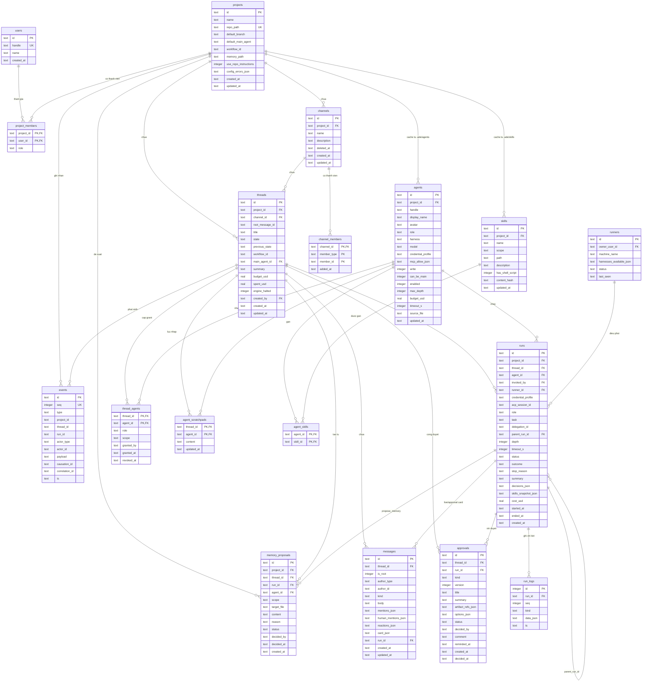
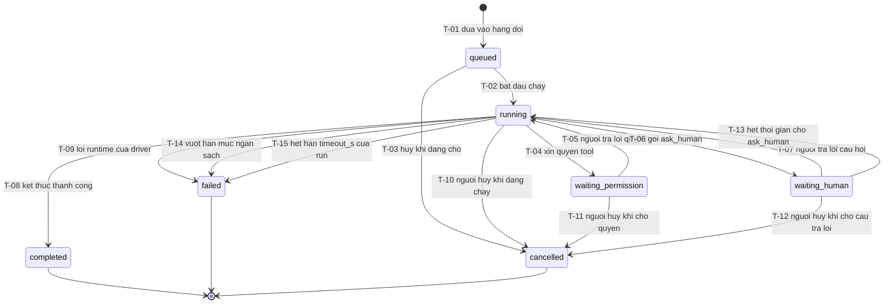
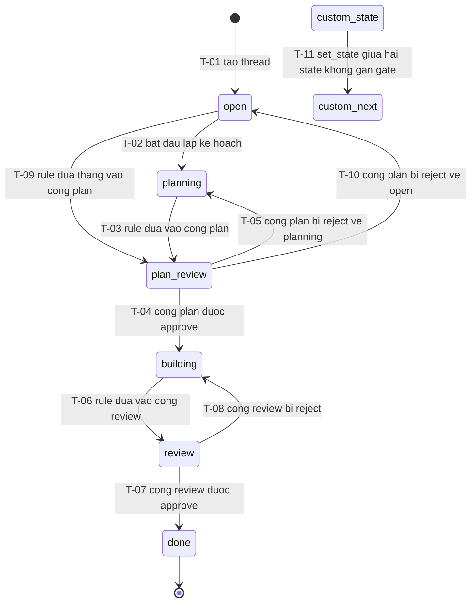
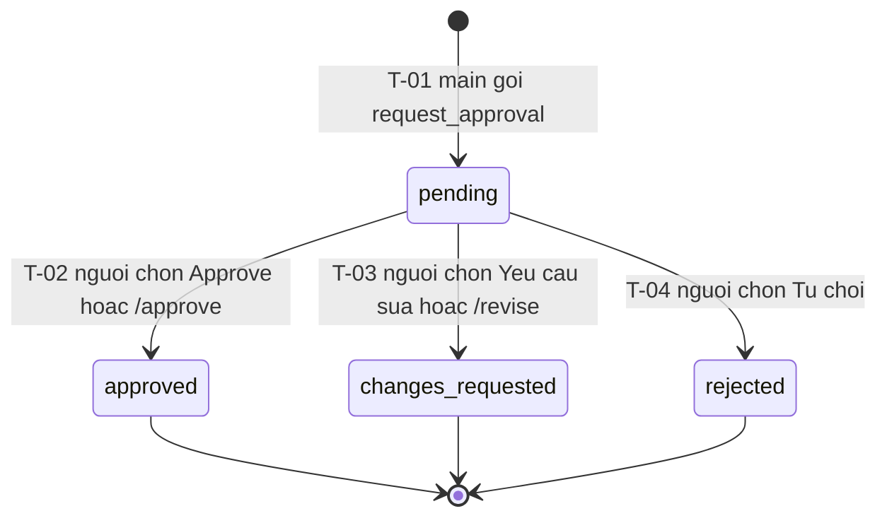
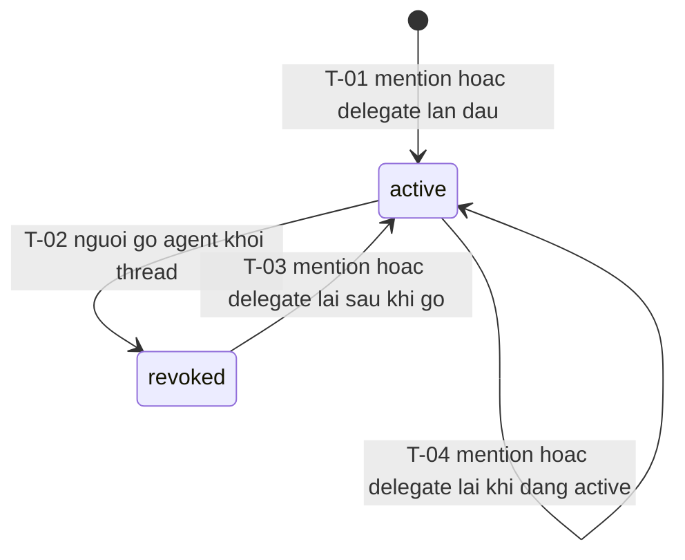
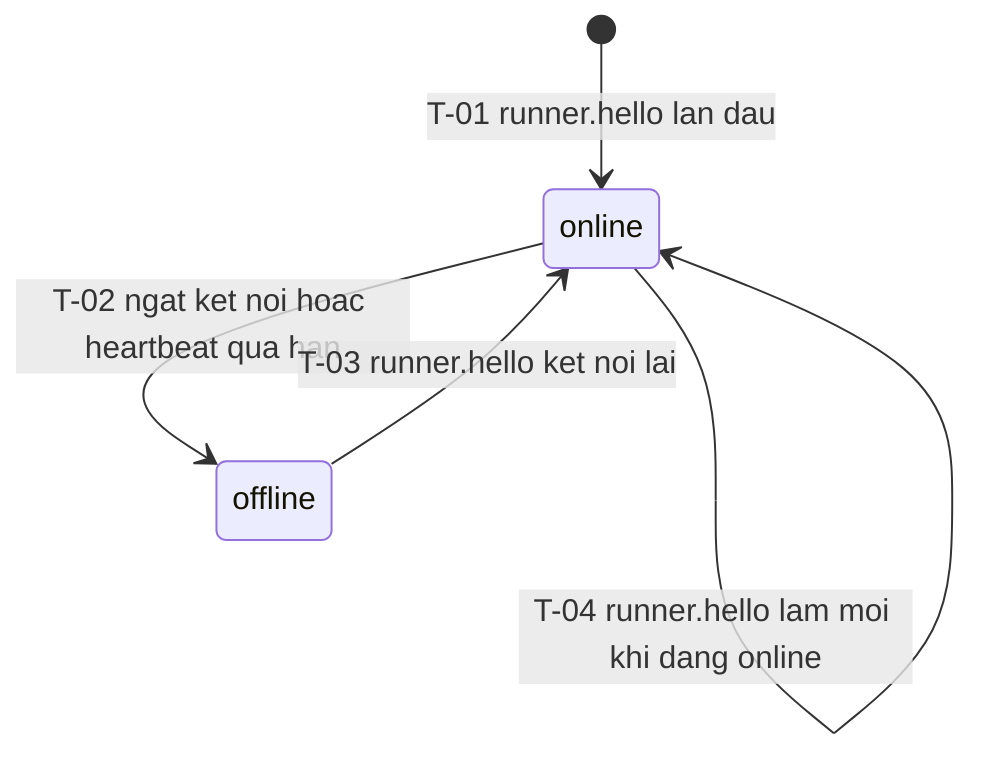
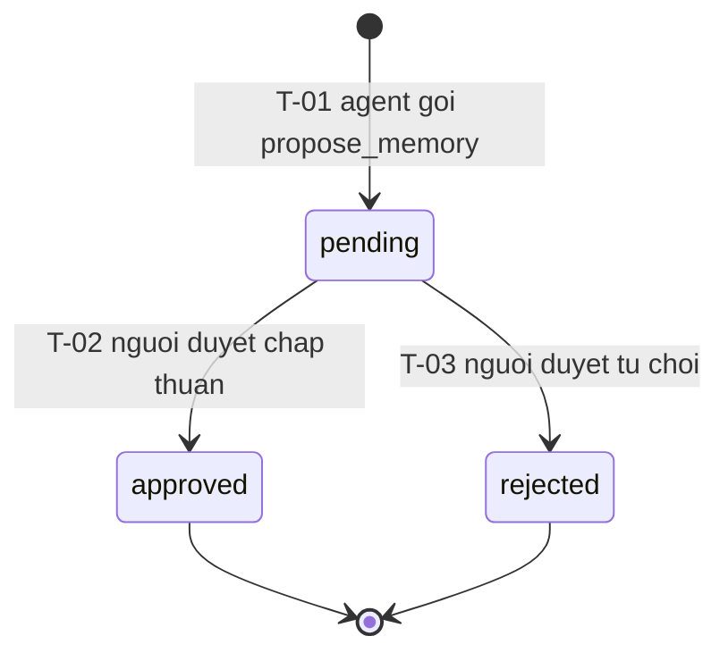

# Domain Model — ADE Solo MVP (E0)

| Trường | Giá trị |
| --- | --- |
| Loại tài liệu | Domain Model dùng chung (E0) |
| Đường dẫn chốt | `specs/dd/domain-model.md` |
| Nguồn thiết kế gốc | `docs/spec.md`, `docs/phases.md`, `AGENTS.md` |
| Schema ORM | `apps/hub/src/db/schema.ts` (SQLite · Drizzle ORM) |
| Schema Zod | `packages/shared/src/schemas/*` |
| Ngày tạo | 2026-10-31 |
| Ngày cập nhật | 2026-10-31 |

## 1. Bất biến kiến trúc Domain

1. **Event Sourcing một nguồn sự thật**: Bảng `events` chỉ cho phép `INSERT` (append-only). Mọi thay đổi trên `channels`, `channel_members`, `threads`, `messages`, `runs`, `runners`, `thread_agents`, `agent_scratchpads`, `approvals`, `memory_proposals` đều là projection đồng bộ từ `events` và dựng lại khớp 100% khi chạy replay từ `events.seq = 1`. Khi chiếu `channel.deleted`, projector gán `channels.deleted_at = event.ts` (xóa mềm để bảo toàn toàn vẹn khóa ngoại lịch sử của `threads`, `messages`, `runs`, `approvals`, `memory_proposals`; kênh đang hoạt động thỏa `deleted_at IS NULL AND name NOT LIKE '__ade_%'`).
2. **Thư mục `.ade/` là nguồn sự thật cấu hình**: Các bảng `projects` (phần cấu hình), `agents`, `skills`, `agent_skills` trong SQLite là bộ nhớ đệm đọc từ `.ade/project.yaml`, `.ade/agents/*.yaml`, `.ade/skills/*/SKILL.md` và `~/.ade/skills/*/SKILL.md`.
3. **Ba Adapter chế độ triển khai**: `Storage` (`SqliteStorage`), `EventBus` (`InMemoryEventBus`), `RunnerTransport` (`InProcessRunnerTransport`) được khai báo bằng interface để giữ đường nâng cấp lên `ADE_MODE=team|vps`, nhưng trong MVP chỉ kích hoạt `ADE_MODE=solo`.
4. **Quy ước khóa chính**: Mọi ID thực thể là chuỗi có tiền tố cố định: `evt_`, `prj_`, `chn_`, `thr_`, `msg_`, `agt_`, `skl_`, `rnr_`, `run_`, `apr_`, `mpr_`, `usr_`.
5. **Actor mặc định ở `ADE_MODE=solo`**: Khi Hub khởi động, hệ thống khởi tạo bản ghi `users` (`id = 'usr_local'`, `handle = 'owner'`, `name = 'Local Owner'`). Mỗi khi xử lý sự kiện `project.registered`, projector tự động ghi bản ghi `project_members` (`project_id`, `user_id = 'usr_local'`, `role = 'owner'`). Mọi thao tác từ trình duyệt local được gán `actor = { type: 'human', id: 'usr_local' }`.
6. **Mô hình Slack `1 Tin nhắn gốc trong kênh = 1 Thread`**: Mỗi thread gắn với đúng một tin nhắn gốc (`threads.root_message_id` ↔ `messages.is_root = 1`) hiển thị trực tiếp trên luồng tin nhắn của kênh; các phản hồi và thẻ tương tác (`live_card`, `explorer_card`, `question_card`, `approval_card`) nằm bên trong ngăn phản hồi của thread đó. Kênh không khai báo workflow riêng; mọi thread kế thừa `projects.workflow_id` từ `.ade/project.yaml`.

### 1.1. Phân ranh giới Module & Ma trận Sub-DD

| Module | Phase | Ranh giới trách nhiệm | Tài liệu DD thành phần (`specs/dd/...`) |
| --- | --- | --- | --- |
| `chat` | P0, P1 | Kiểm tra trạng thái Hub, khung SPA, Event Store + Projector cơ sở, nạp `.ade/`, parser `@mention`, chat realtime `/ws` | `specs/dd/chat/overview.md` · `specs/dd/chat/p0-smoke/api-health.md` · `specs/dd/chat/p0-smoke/ui-smoke.md` · `specs/dd/chat/ch-01/api-chat.md` · `specs/dd/chat/ch-01/ui-chat.md` |
| `runner` | P2 | Giao thức `RunnerTransport`, `ClaudeSdkDriver` và `CodexAcpDriver` cô lập hồ sơ ADE, Git worktree theo thread (chế độ chỉ đọc cho agent `write = 0`), `LiveCard` và `PermissionCard` | `specs/dd/runner/overview.md` · `specs/dd/runner/rn-01/api-runs.md` · `specs/dd/runner/rn-01/ui-run-cards.md` |
| `trigger` | P3 | Rule Engine YAML (`on`/`when`/`do`), `LoopGuard`, ADE MCP Server (`/mcp`), kiểm tra Grant `thread_agents`, hook `PreToolUse`, `ExplorerCard` (`@explorer` giải thích code & trích dẫn `file:line`) và `QuestionCard` / `ClarifierCard` đa câu hỏi (`single`/`multi`/`text` + `Khác` cho `@planner`, `@spec`, `@lead`) | `specs/dd/trigger/overview.md` · `specs/dd/trigger/tr-01/api-mcp-trigger.md` · `specs/dd/trigger/tr-01/ui-workflow-cards.md` |
| `orchestration` | P4 | Điều phối Main/Worker, `/main`, `delegate` song song + khoá ghi theo thread, fan-in, cổng duyệt `plan`/`spec`/`review`, `/approve`, `/revise`, scratchpad | `specs/dd/orchestration/overview.md` · `specs/dd/orchestration/or-01/api-orchestration.md` · `specs/dd/orchestration/or-01/ui-orchestration.md` |
| `settings` | P5 | Wizard 3 bước tạo project, cấu hình hai chiều `.ade/`, thư viện Skill hai cấp, `skills_snapshot`, phát hiện Harness, `Test agent` | `specs/dd/settings/overview.md` · `specs/dd/settings/st-01/api-settings.md` · `specs/dd/settings/st-01/ui-wizard.md` · `specs/dd/settings/st-02/ui-settings.md` |
| `memory` | P6 | Project memory `.ade/memory/*.md`, `propose_memory`, rolling `threads.summary`, `PromptAssembler`, `BudgetGuard`, pool `AcpSession`, Workflow YAML editor | `specs/dd/memory/overview.md` · `specs/dd/memory/mm-01/api-memory-workflow.md` · `specs/dd/memory/mm-01/ui-memory-workflow.md` |

---

## 2. Sơ đồ quan hệ thực thể (`erDiagram`)



---

## 3. Danh mục Schema Zod dùng chung (`packages/shared`)

| Nhóm | Tên Zod Schema | Đường dẫn trong `packages/shared` | Vai trò |
| --- | --- | --- | --- |
| Smoke & Health (P0) | `HealthResponseSchema` | `src/schemas/health.ts` | Phản hồi kiểm tra kết nối Hub, SQLite và tổng số bản ghi `events` |
| Event Envelope | `EventEnvelopeSchema`, `AdeEventSchema`, `EventTypeSchema` | `src/schemas/events.ts` | Envelope append-only và discriminated union của toàn bộ event |
| `.ade/` YAML | `ProjectYamlSchema`, `AgentYamlSchema`, `WorkflowYamlSchema`, `SkillFrontmatterSchema`, `SkillSnapshotItemSchema` | `src/schemas/ade-config.ts` | Kiểm tra hợp lệ file trong `.ade/` và `~/.ade/skills/` |
| Chat (P1) | `ProjectIdParamSchema`, `ChannelIdParamSchema`, `ThreadIdParamSchema`, `MessageIdParamSchema`, `ConfigErrorItemSchema`, `ColleagueSummarySchema`, `ProjectSummarySchema`, `ProjectListResponseSchema`, `AgentSummarySchema`, `AgentListResponseSchema`, `ChannelMemberSchema`, `ChannelSchema`, `ChannelResponseSchema`, `ChannelListResponseSchema`, `CreateChannelInputSchema`, `UpdateChannelInputSchema`, `DeleteChannelResponseSchema`, `ReactionSummarySchema`, `ToggleReactionInputSchema`, `ToggleReactionResponseSchema`, `ThreadSchema`, `ThreadResponseSchema`, `CreateThreadResponseSchema`, `ThreadListResponseSchema`, `CreateThreadInputSchema`, `MessageKindSchema`, `MessageSchema`, `MessageListResponseSchema`, `CreateMessageInputSchema`, `PostMessageResponseSchema`, `WsServerEventSchema`, `WsClientEventSchema` | `src/schemas/chat.ts` | Hợp đồng REST `/api/projects`, `/api/channels`, `/api/threads`, `/api/messages` (với tập đóng `MessageKindSchema`: `'text' \| 'system' \| 'live_card' \| 'explorer_card' \| 'approval_card' \| 'question_card'`; `post_message` kiểu `'note' \| 'result'` lưu `messages.kind = 'text'` kèm `card_json.messageKind`, còn `memory_proposal` dùng `kind = 'approval_card'`) và WebSocket `/ws` |
| Runner (P2) | `RunnerMessageSchema`, `RunnerHelloMessageSchema`, `RunStartMessageSchema`, `RunPromptMessageSchema`, `RunEventMessageSchema`, `RunEndMessageSchema`, `RunCancelMessageSchema`, `PermissionRequestMessageSchema`, `PermissionReplyMessageSchema`, `NormalizedRunEventSchema`, `RunStatusSchema`, `RunSchema`, `RunListResponseSchema`, `ProjectRunsParamsSchema`, `ThreadRunsParamsSchema`, `CancelRunParamsSchema`, `CancelRunResponseSchema`, `PermissionReplyParamsSchema`, `PermissionReplyBodySchema`, `PermissionReplyResponseSchema`, `LiveCardPayloadSchema`, `PermissionCardPayloadSchema`, `WsRunnerServerEventSchema`, `FakeScenarioYamlSchema` | `src/schemas/runner.ts` | Giao thức Hub ↔ Runner, chuẩn hoá driver Claude/ACP và kịch bản YAML fake |
| Trigger & MCP (P3) | `McpOkOutputSchema`, `McpReportOutcomeInputSchema`, `McpReportOutcomeOutputSchema`, `McpPostProgressInputSchema`, `ExplorerCitationSchema`, `ExplorerInsightInputSchema`, `ExplorerCardPayloadSchema`, `McpPostMessageInputSchema`, `McpPostMessageOutputSchema`, `ClarifierOptionSchema`, `ClarifierQuestionSchema`, `QuestionAnswerItemSchema`, `McpAskHumanInputSchema`, `McpAskHumanOutputSchema`, `McpReadMemoryInputSchema`, `McpReadMemoryOutputSchema`, `McpGetThreadInputSchema`, `McpGetThreadOutputSchema`, `McpListSkillsInputSchema`, `McpListSkillsOutputSchema`, `McpLoadSkillInputSchema`, `McpLoadSkillOutputSchema`, `McpSetStateInputSchema`, `McpSetStateOutputSchema`, `QuestionStatusSchema`, `QuestionCardPayloadSchema`, `ThreadParamSchema`, `ThreadQuestionParamSchema`, `ReplyQuestionInputSchema`, `ReplyQuestionResponseSchema`, `ThreadAgentParamSchema`, `ThreadAgentListResponseSchema`, `RevokeThreadAgentResponseSchema` | `src/schemas/mcp.ts` | Input/Output (`snake_case`) của các tool trên ADE MCP Server (`/mcp`), `ExplorerCard`, `QuestionCard` (kiêm `ClarifierCard` đa câu hỏi) và Grant API |
| Orchestration (P4) | `McpDelegateInputSchema`, `McpDelegateOutputSchema`, `McpGetResultsInputSchema`, `McpGetResultsOutputSchema`, `McpRequestApprovalInputSchema`, `McpRequestApprovalOutputSchema`, `McpGetRunLogInputSchema`, `McpGetRunLogOutputSchema`, `McpReadScratchpadInputSchema`, `McpWriteScratchpadInputSchema`, `McpScratchpadOutputSchema`, `ApprovalStatusSchema`, `ApprovalSchema`, `ApprovalListResponseSchema`, `ApprovalIdParamSchema`, `ApprovalDecideInputSchema`, `ScratchpadSchema`, `ScratchpadListResponseSchema`, `ThreadOrchestrationSchema`, `ThreadDetailResponseSchema` | `src/schemas/orchestration.ts` | Hợp đồng điều phối main/worker, cổng duyệt và scratchpad |
| Settings (P5) | `ValidateRepoInputSchema`, `ValidateRepoResponseSchema`, `CreateProjectWizardInputSchema`, `ProjectSettingsResponseSchema`, `UpdateProjectGeneralInputSchema`, `AgentIdParamSchema`, `UpsertAgentInputSchema`, `AgentConfigResponseSchema`, `DeleteAgentResponseSchema`, `SkillNameParamSchema`, `SkillListQuerySchema`, `SkillListResponseSchema`, `SkillDetailResponseSchema`, `CreateSkillInputSchema`, `UpdateSkillInputSchema`, `UpsertSkillInputSchema`, `DeleteSkillResponseSchema`, `ImportSkillInputSchema`, `ImportSkillResponseSchema`, `HarnessStatusSchema`, `HarnessListResponseSchema`, `TestAgentResultSchema` | `src/schemas/settings.ts` | Hợp đồng Wizard tạo project và 6 tab Project Settings |
| Memory (P6) | `AcpSessionStatusSchema`, `MemoryFileParamSchema`, `MemoryFileSchema`, `MemoryFileListResponseSchema`, `PutMemoryFileInputSchema`, `McpProposeMemoryInputSchema`, `McpProposeMemoryOutputSchema`, `MemoryProposalParamSchema`, `MemoryProposalQuerySchema`, `MemoryProposalSchema`, `MemoryProposalListResponseSchema`, `MemoryCardPayloadSchema`, `DecideMemoryProposalInputSchema`, `WorkflowParamSchema`, `WorkflowParsedSchema`, `WorkflowDetailResponseSchema`, `PutWorkflowYamlInputSchema` | `src/schemas/memory.ts` | Hợp đồng quản lý `.ade/memory/*.md`, duyệt đề xuất memory, sửa workflow và vòng đời phiên ACP |
| Lỗi & Validate | `ApiErrorResponseSchema`, `VALIDATION_CATALOG` | `src/schemas/common.ts`, `src/validation-catalog.ts` | Phản hồi lỗi chuẩn `{ code, message, details }` và luật kiểm tra trường |

---

## 4. Danh mục Event trong bảng `events`

| `events.type` | Phase giới thiệu | Nguồn phát | Các trường bắt buộc trong `payload` |
| --- | --- | --- | --- |
| `project.registered` | P1 | Hub / Settings | `project_id`, `name`, `repo_path`, `workflow_id` |
| `channel.created` | P1 | Chat API / Settings | `channel_id`, `project_id`, `name`, `description`, `member_user_ids`, `member_agent_ids` |
| `channel.updated` | P1 | Chat API / Settings | `channel_id`, `project_id`, `name`, `description`, `member_user_ids`, `member_agent_ids` |
| `channel.deleted` | P1 | Chat API | `channel_id`, `project_id` |
| `thread.created` | P1 | Chat API / Settings | `thread_id`, `channel_id`, `title`, `initial_state`, `workflow_id`, `root_message_id` |
| `message.posted` | P1 | Chat API / MCP / Rule | `message_id`, `kind`, `body`, `is_root`, `mentions`, `human_mentions`, `card` (`null` cho tin nhắn thường; đối tượng JSON chiếu thẳng sang `messages.card_json` cho `explorer_card`, `note`/`result` từ MCP, `memory_proposal` và cảnh báo `system`) |
| `message.reaction_toggled` | P1 | Chat API | `message_id`, `thread_id`, `channel_id`, `emoji`, `actor_id`, `added` |
| `agent.mentioned` | P1 | Mention Parser | `agent`, `agent_id`, `message_id`, `text` |
| `runner.connected` | P2 | Runner (`runner.hello`) | `runner_id`, `machine_name`, `harnesses_available` |
| `runner.disconnected` | P2 | Runner | `runner_id`, `reason` |
| `run.queued` | P2 | Dispatcher | `run_id`, `agent_id`, `role`, `depth`, `timeout_s`, `credential_profile`, `skills_snapshot` |
| `run.started` | P2 | Runner | `run_id`, `agent`, `harness`, `acp_session_id`, `live_card_message_id` |
| `run.progress` | P2 | Runner / MCP (gộp 1s) | `run_id`, `kind` (`plan` \| `tool_call` \| `message_chunk` \| `step`), `data` |
| `run.permission_requested` | P2 | Runner | `run_id`, `request_id`, `tool`, `args`, `options`, `card_message_id` |
| `run.permission_resolved` | P2 | Chat API | `run_id`, `request_id`, `option_id`, `decision` (`allow` \| `deny`), `decided_by` |
| `run.completed` | P2 | Runner | `run_id`, `stop_reason`, `outcome`, `summary`, `decisions`, `cost_usd` |
| `run.failed` | P2 | Runner / Guard | `run_id`, `stop_reason`, `error_code`, `cost_usd` |
| `run.cancelled` | P2 | Chat API | `run_id`, `cancelled_by` |
| `agent.granted` | P3 | Mention / Delegate | `thread_id`, `agent_id`, `role`, `scope`, `granted_by` |
| `agent.revoked` | P3 | Chat API | `thread_id`, `agent_id`, `revoked_by` |
| `thread.state_changed` | P3 | Rule Engine / MCP | `from`, `to`, `reason` |
| `question.asked` | P3 | MCP `ask_human` / Rule | `question_id`, `run_id` (`null` khi phát từ Rule), `question`, `options` (`string[]`, rỗng `[]` khi không dùng), `questions` (`ClarifierQuestion[]`, rỗng `[]` ở câu hỏi đơn), `timeout_s` (`null` khi phát từ Rule), `card_message_id` |
| `question.answered` | P3 | Chat API | `question_id`, `run_id` (`null` khi thẻ từ Rule), `answer`, `option_id` (`null` khi trả lời tự do hay đa câu hỏi), `answers` (`QuestionAnswerItem[]`, rỗng `[]` ở câu hỏi đơn), `answered_by` |
| `question.timed_out` | P3 | Timer `ask_human` | `question_id`, `run_id`, `timeout_s` |
| `hook.fired` | P3 | Driver Claude Hook | `run_id`, `hook_name`, `decision` (`allow` \| `deny`), `data` |
| `mcp.called` | P3 | ADE MCP Server | `run_id`, `tool`, `args_summary` |
| `run.outcome_reported` | P3 | MCP `report_outcome` | `run_id`, `status` (`done` \| `blocked` \| `needs_revision`), `summary`, `decisions` |
| `engine.halted` | P3 | Loop Guard | `thread_id`, `reason` (`causation_limit`), `count` |
| `command.invoked` | P4 | Chat `/main`, `/approve`, `/revise` | `name`, `args`, `message_id` |
| `main.changed` | P4 | Chat `/main` / Init | `previous_agent_id`, `new_agent_id`, `changed_by` |
| `task.delegated` | P4 | MCP `delegate` | `delegation_id`, `parent_run_id`, `child_run_id`, `agent_id`, `task`, `scope`, `expects` |
| `run.result_ready` | P4 | Fan-in Tracker | `delegation_id`, `child_run_id`, `agent`, `outcome`, `summary` |
| `delegation.completed` | P4 | Fan-in Tracker | `delegation_id`, `parent_run_id`, `results` |
| `approval.requested` | P4 | MCP `request_approval` | `approval_id`, `run_id`, `kind`, `version`, `title`, `summary`, `artifact_refs`, `card_message_id` |
| `approval.resolved` | P4 | UI Card / Chat command | `approval_id`, `kind`, `version`, `decision` (`approve` \| `changes_requested` \| `reject`), `comment`, `by` |
| `approval.reminded` | P4 | Timer 4 giờ | `approval_id`, `kind`, `version` |
| `scratchpad.updated` | P4 | MCP `write_scratchpad` | `thread_id`, `agent_id`, `content` |
| `memory.proposed` | P6 | MCP `propose_memory` | `proposal_id`, `run_id`, `scope`, `target_file`, `content`, `reason`, `card_message_id` |
| `memory.resolved` | P6 | UI Memory Card / Tab | `proposal_id`, `decision` (`approve` \| `reject`), `decided_by` |
| `thread.summary_updated` | P6 | Summary Updater | `thread_id`, `run_id`, `summary`, `source` (`report_outcome` \| `fallback_last_message`) |
| `run.usage_updated` | P6 | Runner | `run_id`, `cost_usd`, `tokens_in`, `tokens_out` |
| `budget.warning` | P6 | Budget Guard | `scope` (`agent` \| `thread`), `run_id`, `spent_usd`, `budget_usd`, `remaining_ratio` |

---

## 5. Các máy trạng thái (State Machines)

### State machine — `Run.status`

| Trường | Giá trị |
| --- | --- |
| Thực thể | `Run` (bảng `runs`) |
| Cột | `status` — chuỗi cố định `RunStatusSchema` |
| Trạng thái đầu | `queued` (khi tạo bởi Dispatcher từ `agent.mentioned`, `dispatch`, `delegate`) |
| Trạng thái cuối | `completed`, `failed`, `cancelled` |
| Khi bị cấm | HTTP `400` `ERR_INVALID_STATUS` cho chuyển trạng thái nội bộ không hợp lệ; HTTP `409` `ERR_RUN_NOT_CANCELLABLE` khi gọi huỷ trên run đã ở trạng thái cuối; HTTP `409` `ERR_PERMISSION_ALREADY_RESOLVED` khi trả lời quyền tool lúc run không ở `waiting_permission`; HTTP `409` `ERR_QUESTION_ALREADY_RESOLVED` khi trả lời câu hỏi đã đóng hoặc hết hạn |

#### Trạng thái

| Trạng thái | Ý nghĩa nghiệp vụ | Được sửa dữ liệu? |
| --- | --- | --- |
| `queued` | Đã ghi nhận run, đang chờ khoá ghi của thread hoặc chờ slot song song (tối đa 3 worker) | Có (cập nhật khi bắt đầu hoặc huỷ) |
| `running` | Driver đang chạy session và stream `run.progress` | Có (cập nhật `cost_usd`, `outcome`, `summary`) |
| `waiting_permission` | Driver đang tạm dừng chờ người dùng quyết định `request_permission` | Có |
| `waiting_human` | Run đang giữ kết nối MCP chờ người dùng trả lời `ask_human` | Có |
| `completed` | Harness kết thúc bình thường (`end_turn`), đã chốt `outcome` (`done`/`blocked`/`needs_revision`/`unknown`) | Không |
| `failed` | Run dừng do lỗi runtime của driver, hết thời gian thực thi `timeout_s` hoặc chạm ngưỡng ngân sách `budget_exceeded` | Không |
| `cancelled` | Người dùng chủ động bấm huỷ run | Không |

#### Sơ đồ



#### Chuyển trạng thái

| ID | Từ | Sự kiện | Guard | Sang | Actor | Side effect | API / job |
| --- | --- | --- | --- | --- | --- | --- | --- |
| T-01 | — | Tạo run | `depth <= agents.max_depth` và `threads.engine_halted = 0` | `queued` | Dispatcher | Chốt `timeout_s = COALESCE(delegate_input.timeout_s, agents.timeout_s)`; ghi event `run.queued`; chụp `skills_snapshot_json` | Nội bộ / MCP `delegate` |
| T-02 | `queued` | Runner nhận run | Nếu `agents.write = 1` thì không có run nào khác trong cùng `thread_id` đang giữ khoá ghi; nếu `role = 'worker'` thì số worker `running` trong thread `< max_parallel_workers` | `running` | Runner | Tạo message `live_card` nếu chưa có; ghi event `run.started` kèm `live_card_message_id` | `RunnerTransport` (`run.start`) |
| T-03 | `queued` | Huỷ run | Actor là `invoked_by` hoặc `owner` | `cancelled` | Người dùng | Ghi event `run.cancelled`, gán `ended_at` | `POST /api/runs/:runId/cancel` |
| T-04 | `running` | Harness phát `request_permission` | — | `waiting_permission` | Runner | Ghi event `run.permission_requested`; tạo `approval_card` loại quyền tool | `RunnerTransport` (`permission.request`) |
| T-05 | `waiting_permission` | Người chọn Allow / Deny | `request_id` khớp yêu cầu đang chờ | `running` | Người dùng | Ghi event `run.permission_resolved`; gửi `permission.reply` xuống driver | `POST /api/runs/:runId/permissions/:requestId/reply` |
| T-06 | `running` | Agent gọi MCP `ask_human` | Token MCP hợp lệ của `run_id` | `waiting_human` | Agent | Ghi event `question.asked`; tạo `question_card` | `POST /mcp` (`ask_human`) |
| T-07 | `waiting_human` | Người dùng gửi câu trả lời | `question_id` đang ở trạng thái chờ trả lời | `running` | Người dùng | Ghi event `question.answered`; trả câu trả lời về kết nối MCP `ask_human` | `POST /api/threads/:threadId/questions/:questionId/reply` |
| T-08 | `running` | Driver báo `run.end` thành công | `(agents.budget_usd IS NULL OR runs.cost_usd <= agents.budget_usd)` và `(threads.budget_usd IS NULL OR threads.spent_usd + runs.cost_usd <= threads.budget_usd)` | `completed` | Runner | Nếu `runs.outcome IS NULL` thì gán `outcome = 'unknown'`; nhả khoá ghi; gán `runs.cost_usd = COALESCE(payload.cost_usd, runs.cost_usd)` rồi cộng `runs.cost_usd` vào `threads.spent_usd`; ghi `run.completed` | `RunnerTransport` (`run.end`) |
| T-09 | `running` | Driver gặp lỗi runtime hoặc tiến trình thoát khác `0` | — | `failed` | Runner | Nhả khoá ghi; gán `runs.cost_usd = COALESCE(payload.cost_usd, runs.cost_usd)` rồi cộng `runs.cost_usd` vào `threads.spent_usd`; ghi `run.failed` với `stop_reason = 'error'`, `error_code = 'ERR_DRIVER_EXECUTION'` | `RunnerTransport` (`run.end`) |
| T-10 | `running` | Huỷ run | Actor là `invoked_by` hoặc `owner` | `cancelled` | Người dùng | Gửi `run.cancel` xuống driver; nhả khoá ghi; cộng `runs.cost_usd` vào `threads.spent_usd`; ghi `run.cancelled` | `POST /api/runs/:runId/cancel` |
| T-11 | `waiting_permission` | Huỷ run khi đang chờ quyền | Actor là `invoked_by` hoặc `owner` | `cancelled` | Người dùng | Gửi `run.cancel` xuống driver; nhả khoá ghi; cộng `runs.cost_usd` vào `threads.spent_usd`; ghi `run.cancelled` | `POST /api/runs/:runId/cancel` |
| T-12 | `waiting_human` | Huỷ run khi đang chờ trả lời | Actor là `invoked_by` hoặc `owner` | `cancelled` | Người dùng | Đóng request MCP `ask_human`; gửi `run.cancel`; nhả khoá ghi; cộng `runs.cost_usd` vào `threads.spent_usd`; ghi `run.cancelled` | `POST /api/runs/:runId/cancel` |
| T-13 | `waiting_human` | Hết hạn `timeout_s` của `ask_human` | Quá `timeout_s` kể từ lúc ghi `question.asked` mà chưa có `question.answered` | `running` | Timer | Ghi event `question.timed_out`; trả HTTP `408` `ERR_QUESTION_TIMEOUT` cho kết nối MCP `ask_human` | Timer `ask_human` |
| T-14 | `running` | Usage vượt hạn mức ngân sách | `(agents.budget_usd IS NOT NULL AND runs.cost_usd > agents.budget_usd)` hoặc `(threads.budget_usd IS NOT NULL AND threads.spent_usd + runs.cost_usd > threads.budget_usd)` | `failed` | Budget Guard | Gửi `run.cancel` dừng tiến trình harness; nhả khoá ghi; cộng `threads.spent_usd`; ghi `run.failed` với `stop_reason = 'budget_exceeded'`, `error_code = 'ERR_BUDGET_EXCEEDED'` | Budget Guard |
| T-15 | `running` | Hết hạn `timeout_s` thực thi của run | Thời gian kể từ `runs.started_at` vượt quá `runs.timeout_s` | `failed` | Run Timer | Gửi `run.cancel` dừng tiến trình harness; nhả khoá ghi; gán `outcome = 'blocked'`; cộng `threads.spent_usd`; ghi `run.failed` với `stop_reason = 'timeout'`, `error_code = 'ERR_RUN_TIMEOUT'` | Run Timeout Timer |

#### Tiêu chí chấp nhận

```gherkin
Feature: Run — vòng đời trạng thái thực thi agent

  Scenario: AC-Run-01 — Run hoàn thành mà không gọi report_outcome tự động nhận outcome unknown (nguồn: T-08; nghiệm thu: p3-unknown-outcome.spec.ts)
    Given run "run_01" đang ở trạng thái "running" và `outcome` là null
    When driver gửi `run.end` với `stop_reason` là "end_turn"
    Then "run_01" chuyển sang trạng thái "completed"
    And `outcome` của "run_01" bằng "unknown"
    And bảng `events` có thêm bản ghi `run.completed` với `payload.outcome` bằng "unknown"

  Scenario: AC-Run-02 — Không được huỷ run đã hoàn thành (nguồn: bị cấm; nghiệm thu: p2-live-card.spec.ts)
    Given run "run_02" đang ở trạng thái "completed"
    When gọi `POST /api/runs/run_02/cancel`
    Then nhận HTTP 409 `ERR_RUN_NOT_CANCELLABLE`
    And "run_02" vẫn ở trạng thái "completed"

  Scenario: AC-Run-03 — Run vượt quá timeout_s tự động chuyển sang failed với stop_reason timeout (nguồn: T-15; nghiệm thu: scripts/verify/fan-in.ts)
    Given run "run_03" đang ở trạng thái "running" và agent có `timeout_s` bằng 5
    When thời gian chạy của "run_03" vượt quá 5 giây
    Then "run_03" chuyển sang trạng thái "failed" với `stop_reason` là "timeout" và `outcome` là "blocked"
    And bảng `events` có thêm bản ghi `run.failed` với `error_code` bằng "ERR_RUN_TIMEOUT"
```

---

### State machine — `Thread.state`

| Trường | Giá trị |
| --- | --- |
| Thực thể | `Thread` (bảng `threads`) |
| Cột | `state` — chuỗi thuộc danh sách `states` trong `.ade/workflows/<workflow_id>.yaml` |
| Trạng thái đầu | Giá trị `initial` của workflow (mặc định `"open"` trong workflow `feature`) |
| Trạng thái cuối | `"done"` \| Không cố định (tùy định nghĩa workflow YAML) |
| Khi bị cấm | HTTP `409` `ERR_GATE_APPROVAL_REQUIRED` khi vượt cổng `gate: <kind>` chưa có approval `approved`; HTTP `400` `ERR_INVALID_STATUS` khi `to` không tồn tại trong `workflow.states` |

#### Trạng thái (theo workflow chuẩn `feature`)

| Trạng thái | Ý nghĩa nghiệp vụ | Được sửa dữ liệu? |
| --- | --- | --- |
| `open` | Thread mới mở, chờ yêu cầu đầu tiên của người dùng | Có |
| `planning` | Main agent đang phân tích và lập kế hoạch / viết spec | Có |
| `plan_review` | Cổng duyệt `gate: plan` (tương ứng `spec_review` nếu workflow khai báo `gate: spec`), chờ người dùng quyết định | Có (không cho `delegate` mới) |
| `building` | Đã qua cổng plan, main agent giao việc song song cho các worker | Có |
| `review` | Cổng duyệt `gate: review`, main agent đã gom kết quả và chờ người dùng nghiệm thu | Có (không cho `delegate` mới) |
| `done` | Luồng công việc trong thread đã hoàn tất | Có (người dùng vẫn gửi được tin nhắn mới) |

#### Sơ đồ



#### Chuyển trạng thái

| ID | Từ | Sự kiện | Guard | Sang | Actor | Side effect | API / job |
| --- | --- | --- | --- | --- | --- | --- | --- |
| T-01 | — | Gửi tin nhắn gốc tạo thread mới trong kênh | `initial` hợp lệ trong workflow YAML của `projects.workflow_id` | `open` | Người dùng | Ghi event `thread.created` kèm `message.posted` (`is_root = true`) trong cùng giao dịch | `POST /api/channels/:channelId/threads` |
| T-02 | `open` | Rule `set_state` khi bắt đầu lập plan | State đích tồn tại trong `workflow.states` | `planning` | Rule Engine | Lưu `previous_state = 'open'`; ghi `thread.state_changed` | Rule action `set_state` |
| T-03 | `planning` | Rule `set_state` khi nhận `approval.requested(kind='plan')` hoặc `run.completed` | State đích có `gate: plan` trong `workflow.states` | `plan_review` | Rule Engine | Lưu `previous_state = 'planning'`; ghi `thread.state_changed` | Rule action `set_state` |
| T-04 | `plan_review` | Chuyển sang state sau cổng `plan` | Tồn tại bản ghi `approvals` mới nhất của `thread_id` với `kind = 'plan'` và `status = 'approved'` | `building` | Rule Engine / MCP `set_state` (khi có `mcp_allow`) | Lưu `previous_state = 'plan_review'`; ghi `thread.state_changed` | Rule `set_state` sau `approval.resolved(approve)` |
| T-05 | `plan_review` | Rule lùi state khi nhận `approval.resolved(reject)` | `approvals.status = 'rejected'` và `previous_state = 'planning'` | `planning` | Rule Engine | Khôi phục `state = previous_state`; ghi `thread.state_changed` | Rule trên `approval.resolved(reject)` |
| T-06 | `building` | Rule `set_state` khi nhận `approval.requested(kind='review')` hoặc `run.completed` | State đích có `gate: review` trong `workflow.states` | `review` | Rule Engine | Lưu `previous_state = 'building'`; ghi `thread.state_changed` | Rule action `set_state` |
| T-07 | `review` | Chuyển sang state sau cổng `review` | Tồn tại bản ghi `approvals` mới nhất của `thread_id` với `kind = 'review'` và `status = 'approved'` | `done` | Rule Engine / MCP `set_state` (khi có `mcp_allow`) | Lưu `previous_state = 'review'`; ghi `thread.state_changed` | Rule `set_state` sau `approval.resolved(approve)` |
| T-08 | `review` | Rule lùi state khi nhận `approval.resolved(reject)` | `approvals.status = 'rejected'` và `previous_state = 'building'` | `building` | Rule Engine | Khôi phục `state = previous_state`; ghi `thread.state_changed` | Rule trên `approval.resolved(reject)` |
| T-09 | `open` | Rule `set_state` khi nhận `approval.requested(kind='plan')` trực tiếp từ `open` | State đích có `gate: plan` trong `workflow.states` | `plan_review` | Rule Engine | Lưu `previous_state = 'open'`; ghi `thread.state_changed` | Rule action `set_state` |
| T-10 | `plan_review` | Rule lùi state khi nhận `approval.resolved(reject)` từ cổng mở trực tiếp | `approvals.status = 'rejected'` và `previous_state = 'open'` | `open` | Rule Engine | Khôi phục `state = previous_state`; ghi `thread.state_changed` | Rule trên `approval.resolved(reject)` |
| T-11 | `<any_non_gate_state>` | Rule `set_state` trong workflow không gắn `gate` trên state nguồn | State hiện tại không khai báo `gate` và `to` tồn tại trong `workflow.states` | `<to>` | Rule Engine / MCP `set_state` (khi có `mcp_allow`) | Lưu `previous_state`; ghi `thread.state_changed` | Rule action `set_state` |

> Ghi chú mở rộng cho workflow tùy chỉnh (bao gồm cổng `gate: spec`): với mọi workflow YAML, chỉ Rule Engine mới đổi `threads.state` trong luồng nghiệp vụ (Quy tắc #4 `AGENTS.md`; MCP `set_state` chỉ chạy khi `agents.mcp_allow` chứa `"set_state"`). Hàm `transitionThreadState(threadId, toState)` luôn kiểm tra hai điều kiện: (1) `toState` phải có trong `workflow.states` (sai → HTTP 400 `ERR_INVALID_STATUS`); (2) nếu `threads.state` hiện tại khai báo `gate: <kind>` (`plan` \| `spec` \| `review`) và `toState !== threads.previous_state`, bản ghi `approvals` có `version` cao nhất của `(thread_id, kind)` bắt buộc phải có `status = 'approved'` (chưa có hoặc còn `pending`/`changes_requested` → HTTP 409 `ERR_GATE_APPROVAL_REQUIRED`). Khi người dùng chọn `changes_requested`, thread giữ nguyên ở state cổng để chờ main agent nộp version kế tiếp.

#### Tiêu chí chấp nhận

```gherkin
Feature: Thread — chuyển trạng thái theo workflow và bảo vệ cổng duyệt

  Scenario: AC-Thread-01 — Chuyển sang building thành công sau khi cổng plan được approve (nguồn: T-04; nghiệm thu: scripts/verify/gate.ts)
    Given thread "thr_01" đang ở state "plan_review" có `gate: plan`
    And bản ghi approval "apr_01" của "thr_01" với `kind` "plan" có `status` là "approved"
    When rule engine thực thi `set_state` sang "building"
    Then `state` của "thr_01" bằng "building"
    And bảng `events` có bản ghi `thread.state_changed` với `from` là "plan_review" và `to` là "building"

  Scenario Outline: AC-Thread-02 — Chặn vượt cổng plan khi approval còn pending trên mọi kênh gọi (nguồn: bị cấm; nghiệm thu: scripts/verify/gate.ts)
    Given thread "thr_01" đang ở state "plan_review" có `gate: plan`
    And bản ghi approval "apr_01" của "thr_01" với `kind` "plan" đang có `status` là "pending"
    When thực hiện lệnh chuyển `state` của "thr_01" sang "building" qua kênh "<channel>"
    Then kênh "<channel>" bị từ chối với mã lỗi `ERR_GATE_APPROVAL_REQUIRED`
    And `state` của "thr_01" vẫn là "plan_review"

    Examples:
      | channel        |
      | mcp_set_state  |
      | rule_set_state |

  Scenario: AC-Thread-03 — Chuyển trạng thái giữa hai state tùy chỉnh không gắn gate theo Thread/T-11 (nguồn: T-11; nghiệm thu: scripts/verify/gate.ts)
    Given thread "thr_custom" dùng workflow tùy chỉnh đang ở state "triage" không khai báo `gate` và state đích "investigating" thuộc `workflow.states`
    When rule engine thực thi `set_state` sang "investigating"
    Then `state` của "thr_custom" bằng "investigating" và `previous_state` bằng "triage"
    And bảng `events` có bản ghi `thread.state_changed` với `from` là "triage" và `to` là "investigating"
```

---

### State machine — `Approval.status`

| Trường | Giá trị |
| --- | --- |
| Thực thể | `Approval` (bảng `approvals`) |
| Cột | `status` — chuỗi cố định `ApprovalStatusSchema` |
| Trạng thái đầu | `pending` (khi tạo bởi MCP `request_approval`) |
| Trạng thái cuối | `approved`, `changes_requested`, `rejected` |
| Khi bị cấm | HTTP `409` `ERR_APPROVAL_ALREADY_DECIDED` khi quyết định lại bản ghi đã đóng; HTTP `403` `ERR_MAIN_AGENT_ONLY` khi người gọi `request_approval` không phải Main Agent hiện tại; HTTP `409` `ERR_APPROVAL_PENDING_LOCK` khi thread đang có `approval` ở trạng thái `pending` |

#### Trạng thái

| Trạng thái | Ý nghĩa nghiệp vụ | Được sửa dữ liệu? |
| --- | --- | --- |
| `pending` | Đang chờ người dùng duyệt cổng (`plan` / `spec` / `review`); khóa tạo `delegate` mới trong thread | Có (chỉ cập nhật `reminded_at` sau 4 giờ) |
| `approved` | Người dùng đồng ý cho vượt cổng | Không |
| `changes_requested` | Người dùng yêu cầu sửa kèm `comment`; lần gọi `request_approval` kế tiếp cùng `kind` sẽ tạo bản ghi mới với `version + 1` | Không |
| `rejected` | Người dùng bác bỏ, kích hoạt rule đưa thread lùi về `previous_state` | Không |

#### Sơ đồ



#### Chuyển trạng thái

| ID | Từ | Sự kiện | Guard | Sang | Actor | Side effect | API / job |
| --- | --- | --- | --- | --- | --- | --- | --- |
| T-01 | — | Main gọi `request_approval` | `runs.role = 'main'` và `threads.main_agent_id = runs.agent_id`; không có `approval` nào của `thread_id` đang ở trạng thái `pending`; workflow của thread có state mang `gate: <kind>` | `pending` | Main Agent | Tính `version = COALESCE(MAX(version), 0) + 1`; tạo `approval_card`; ghi event `approval.requested` để Rule Engine thực hiện `Thread/T-03`, `Thread/T-06` hoặc `Thread/T-09` | `POST /mcp` (`request_approval`) |
| T-02 | `pending` | Người bấm Approve hoặc gõ `/approve` | Actor là `owner` hoặc `invoked_by` | `approved` | Người dùng | Gán `decided_by`, `decided_at`; ghi `approval.resolved(approve)` kích hoạt rule `Thread/T-04` hoặc `Thread/T-07` | `POST /api/approvals/:approvalId/decide` / Chat command |
| T-03 | `pending` | Người bấm Yêu cầu sửa hoặc gõ `/revise <ghi chú>` | Actor là `owner` hoặc `invoked_by`; `comment` sau `trim` có độ dài `>= 1` | `changes_requested` | Người dùng | Gán `comment`, `decided_by`, `decided_at`; ghi `approval.resolved(changes_requested)` để rule gọi `resume_main` | `POST /api/approvals/:approvalId/decide` / Chat command |
| T-04 | `pending` | Người bấm Từ chối | Actor là `owner` hoặc `invoked_by` | `rejected` | Người dùng | Gán `comment`, `decided_by`, `decided_at`; ghi `approval.resolved(reject)` để rule thực hiện `Thread/T-05`, `Thread/T-08` hoặc `Thread/T-10` kèm `resume_main` | `POST /api/approvals/:approvalId/decide` |

#### Tiêu chí chấp nhận

```gherkin
Feature: Approval — vòng đời quyết định cổng duyệt

  Scenario: AC-Approval-01 — Yêu cầu sửa đóng version 1 để main nộp version 2 (nguồn: T-01, T-03; nghiệm thu: p4-orchestration.spec.ts, p4-chat-approve.spec.ts)
    Given approval "apr_v1" có `kind` là "plan", `version` bằng 1 và `status` là "pending"
    When người dùng gửi quyết định "changes_requested" kèm `comment` "cần thêm test"
    Then "apr_v1" chuyển sang `status` "changes_requested" với `comment` là "cần thêm test"
    And lần gọi `request_approval` tiếp theo cho `kind` "plan" trong cùng thread tạo bản ghi có `version` bằng 2

  Scenario: AC-Approval-02 — Không được quyết định lại approval đã duyệt (nguồn: bị cấm; nghiệm thu: p4-orchestration.spec.ts)
    Given approval "apr_v1" đang có `status` là "approved"
    When gọi `POST /api/approvals/apr_v1/decide` với `decision` là "reject"
    Then nhận HTTP 409 `ERR_APPROVAL_ALREADY_DECIDED`
    And "apr_v1" vẫn có `status` là "approved"
```

---

### State machine — `ThreadAgent` (vòng đời Grant truy cập thread)

| Trường | Giá trị |
| --- | --- |
| Thực thể | `ThreadAgent` (bảng `thread_agents`) |
| Cột | Trạng thái dẫn xuất từ `revoked_at` (`NULL` = `active`, `NOT NULL` = `revoked`) |
| Trạng thái đầu | `active` (khi người dùng `@mention` agent hoặc main gọi `delegate`) |
| Trạng thái cuối | Không có (được cấp lại khi có lượt `@mention` hoặc `delegate` mới) |
| Khi bị cấm | HTTP `400` `ERR_INVALID_STATUS` |

#### Trạng thái

| Trạng thái | Ý nghĩa nghiệp vụ | Được sửa dữ liệu? |
| --- | --- | --- |
| `active` | `revoked_at IS NULL`; agent được đọc ngữ cảnh thread theo `role` (`main`/`worker`) và `scope` (`brief`/`full`) | Có (nâng cấp `scope` hoặc `role`) |
| `revoked` | `revoked_at IS NOT NULL`; mọi lời gọi đọc dữ liệu thread qua MCP đều bị chặn với HTTP 403 `ERR_GRANT_REQUIRED` | Có (cấp lại khi mention mới) |

#### Sơ đồ



#### Chuyển trạng thái

| ID | Từ | Sự kiện | Guard | Sang | Actor | Side effect | API / job |
| --- | --- | --- | --- | --- | --- | --- | --- |
| T-01 | — | `@mention` hợp lệ hoặc `delegate` lần đầu | Agent tồn tại và `enabled = 1` | `active` | Người dùng / Main Agent | `INSERT` vào `thread_agents` với `revoked_at = NULL`; ghi `agent.granted` | Mention Parser / MCP `delegate` |
| T-02 | `active` | Gỡ quyền truy cập agent khỏi thread | Bản ghi đang có `revoked_at IS NULL` | `revoked` | Người dùng | Gán `revoked_at = now()`; ghi `agent.revoked` | `DELETE /api/threads/:threadId/agents/:agentId` |
| T-03 | `revoked` | `@mention` hoặc `delegate` lại agent đã bị gỡ | Agent `enabled = 1` | `active` | Người dùng / Main Agent | Đặt lại `revoked_at = NULL`, cập nhật `scope`, `granted_at`; ghi `agent.granted` | Mention Parser / MCP `delegate` |
| T-04 | `active` | `@mention` hoặc `delegate` lại agent đang `active` | Agent `enabled = 1` | `active` | Người dùng / Main Agent | Cập nhật `scope` (ví dụ nâng `brief` lên `full`) hoặc `role`; ghi `agent.granted` nếu `scope` hoặc `role` thay đổi | Mention Parser / MCP `delegate` |

#### Tiêu chí chấp nhận

```gherkin
Feature: ThreadAgent — kiểm soát quyền đọc ngữ cảnh theo mention

  Scenario: AC-ThreadAgent-01 — Cấp grant khi agent được mention vào thread (nguồn: T-01, T-04; nghiệm thu: scripts/verify/grant.ts)
    Given agent "@coder" chưa có bản ghi trong `thread_agents` của thread "thr_01"
    When người dùng đăng tin nhắn chứa "@coder kiểm tra lỗi" vào "thr_01"
    Then bảng `thread_agents` có dòng `("thr_01", "@coder")` với `revoked_at` là null
    And `@coder` gọi MCP `get_thread` trên "thr_01" nhận được dữ liệu HTTP 200

  Scenario: AC-ThreadAgent-02 — Không thể gỡ quyền agent đã ở trạng thái revoked (nguồn: bị cấm; nghiệm thu: scripts/verify/grant.ts)
    Given bản ghi `thread_agents` của `("thr_01", "@coder")` đang có `revoked_at` khác null
    When gọi `DELETE /api/threads/thr_01/agents/agt_coder`
    Then nhận HTTP 400 `ERR_INVALID_STATUS`
```

---

### State machine — `Runner.status`

| Trường | Giá trị |
| --- | --- |
| Thực thể | `Runner` (bảng `runners`) |
| Cột | `status` — chuỗi cố định (`online` \| `offline`) |
| Trạng thái đầu | `online` (khi nhận `runner.hello`) |
| Trạng thái cuối | Không có |
| Khi bị cấm | HTTP `400` `ERR_INVALID_STATUS` |

#### Trạng thái

| Trạng thái | Ý nghĩa nghiệp vụ | Được sửa dữ liệu? |
| --- | --- | --- |
| `online` | Runner đang kết nối và sẵn sàng nhận `run.start` (nhịp heartbeat định kỳ chỉ cập nhật `last_seen`, không sinh event `runner.connected`) | Có (`harnesses_available_json`, `last_seen`) |
| `offline` | Runner mất kết nối hoặc đã tắt; run mới lưu ở `queued` | Có (khi kết nối lại) |

#### Sơ đồ



#### Chuyển trạng thái

| ID | Từ | Sự kiện | Guard | Sang | Actor | Side effect | API / job |
| --- | --- | --- | --- | --- | --- | --- | --- |
| T-01 | — | Nhận `runner.hello` lần đầu | — | `online` | Runner | `INSERT` vào `runners`; ghi `runner.connected` | `RunnerTransport` |
| T-02 | `online` | Đóng transport hoặc quá 30 giây không heartbeat | — | `offline` | Hub | Cập nhật `status = 'offline'`; ghi `runner.disconnected` | `RunnerTransport` |
| T-03 | `offline` | Nhận `runner.hello` kết nối lại | — | `online` | Runner | Cập nhật `status = 'online'`, `last_seen`; ghi `runner.connected` | `RunnerTransport` |
| T-04 | `online` | Nhận `runner.hello` làm mới khi đang `online` | — | `online` | Runner | Cập nhật `last_seen` và `harnesses_available_json`; ghi `runner.connected` | `RunnerTransport` |

#### Tiêu chí chấp nhận

```gherkin
Feature: Runner — trạng thái kết nối của Local Runner

  Scenario: AC-Runner-01 — Runner đăng ký online ngay khi gửi runner.hello (nguồn: T-01, T-04; nghiệm thu: p2-live-card.spec.ts)
    Given bảng `runners` chưa có bản ghi "rnr_local"
    When `InProcessRunnerTransport` gửi thông điệp `runner.hello` cho "rnr_local"
    Then bảng `runners` có "rnr_local" với `status` bằng "online"

  Scenario: AC-Runner-02 — Đánh dấu ngắt kết nối lặp lại trên runner đã offline bị từ chối (nguồn: bị cấm; nghiệm thu: p2-live-card.spec.ts)
    Given runner "rnr_local" đang có `status` bằng "offline"
    When gọi hàm chuyển trạng thái ngắt kết nối lần nữa cho "rnr_local"
    Then hàm trả lỗi `ERR_INVALID_STATUS` và không sinh thêm event `runner.disconnected`
```

---

### State machine — `MemoryProposal.status`

| Trường | Giá trị |
| --- | --- |
| Thực thể | `MemoryProposal` (bảng `memory_proposals`) |
| Cột | `status` — chuỗi cố định (`pending` \| `approved` \| `rejected`) |
| Trạng thái đầu | `pending` (khi agent gọi MCP `propose_memory`) |
| Trạng thái cuối | `approved`, `rejected` |
| Khi bị cấm | HTTP `409` `ERR_MEMORY_PROPOSAL_DECIDED` |

#### Trạng thái

| Trạng thái | Ý nghĩa nghiệp vụ | Được sửa dữ liệu? |
| --- | --- | --- |
| `pending` | Đề xuất ghi memory đang chờ chủ dự án xem xét trên thẻ chat hoặc Tab Memory | Không |
| `approved` | Đã được duyệt và nội dung đã ghi vào `.ade/memory/<target_file>` | Không |
| `rejected` | Đã bị từ chối, file trong `.ade/memory/` giữ nguyên | Không |

#### Sơ đồ



#### Chuyển trạng thái

| ID | Từ | Sự kiện | Guard | Sang | Actor | Side effect | API / job |
| --- | --- | --- | --- | --- | --- | --- | --- |
| T-01 | — | Agent gọi MCP `propose_memory` | Grant active trên thread; `target_file` hợp lệ `.md` | `pending` | Agent | Tạo bản ghi `messages` có `kind = 'approval_card'` (`card_json.cardType = 'memory_proposal'`); ghi `memory.proposed` | `POST /mcp` (`propose_memory`) |
| T-02 | `pending` | Người dùng bấm Duyệt | Actor là `owner` (`usr_local`) | `approved` | Người dùng | Ghi nội dung vào `.ade/memory/<target_file>`; ghi `memory.resolved(approve)` | `POST /api/memory-proposals/:proposalId/decide` |
| T-03 | `pending` | Người dùng bấm Từ chối | Actor là `owner` (`usr_local`) | `rejected` | Người dùng | Không sửa file `.ade/memory/`; ghi `memory.resolved(reject)` | `POST /api/memory-proposals/:proposalId/decide` |

#### Tiêu chí chấp nhận

```gherkin
Feature: MemoryProposal — quy trình duyệt đề xuất ghi nhớ dự án

  Scenario: AC-MemoryProposal-01 — Duyệt đề xuất ghi thành công vào thư mục .ade/memory (nguồn: T-02; nghiệm thu: p6-memory.spec.ts)
    Given đề xuất "mpr_01" có `target_file` là "conventions.md", `content` là "# Quy ước mới" và `status` là "pending"
    When người dùng gọi `POST /api/memory-proposals/mpr_01/decide` với `decision` là "approve"
    Then "mpr_01" có `status` bằng "approved"
    And file `.ade/memory/conventions.md` có nội dung "# Quy ước mới"

  Scenario: AC-MemoryProposal-02 — Không được duyệt lại đề xuất đã từ chối (nguồn: bị cấm; nghiệm thu: p6-memory.spec.ts)
    Given đề xuất "mpr_02" đang có `status` là "rejected"
    When người dùng gọi `POST /api/memory-proposals/mpr_02/decide` với `decision` là "approve"
    Then nhận HTTP 409 `ERR_MEMORY_PROPOSAL_DECIDED`
    And "mpr_02" vẫn có `status` bằng "rejected"
```
