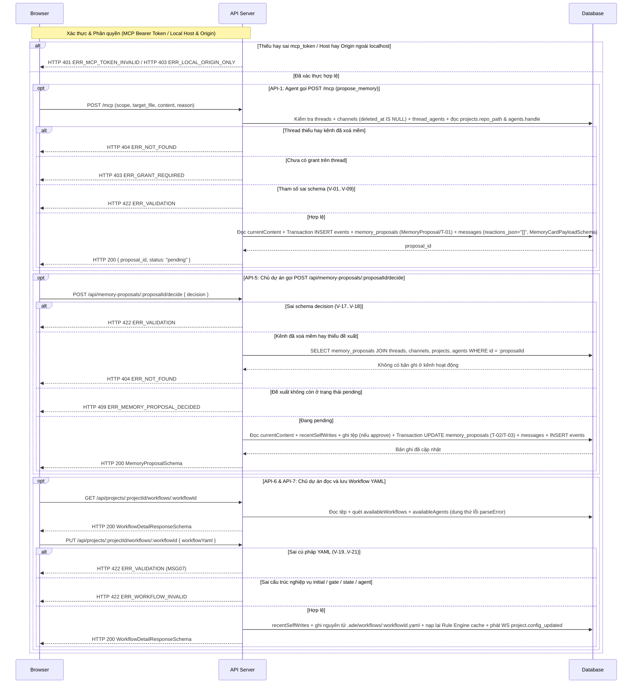

# API-MM-01 — MCP `propose_memory` & REST `/api/projects/:projectId/memory*`, `/api/memory-proposals*`, `/api/projects/:projectId/workflows/:workflowId` — Quản lý Memory & Workflow YAML

| Trường | Giá trị |
| --- | --- |
| API ID | `API-MM-01` |
| Đường dẫn chốt | `specs/dd/memory/mm-01/api-memory-workflow.md` |
| Method | `POST` / `GET` / `PUT` |
| Endpoint | `POST /mcp` (`propose_memory`) · `GET /api/projects/:projectId/memory` · `PUT /api/projects/:projectId/memory/:fileName` · `GET /api/projects/:projectId/memory-proposals` · `POST /api/memory-proposals/:proposalId/decide` · `GET /api/projects/:projectId/workflows/:workflowId` · `PUT /api/projects/:projectId/workflows/:workflowId` |
| Phân quyền | `POST /mcp`: `Bearer <mcp_token>` kèm grant active trên thread thuộc kênh hoạt động · REST `/api/*`: `Host` bắt buộc thuộc `localhost` / `127.0.0.1` và `Origin` (khi có mặt) thuộc `localhost` / `127.0.0.1` (`usr_local`, `role = owner` ở `ADE_MODE=solo`) |
| Zod schema | `McpProposeMemoryInputSchema`, `McpProposeMemoryOutputSchema`, `MemoryFileSchema`, `MemoryFileListResponseSchema`, `PutMemoryFileInputSchema`, `MemoryProposalSchema`, `MemoryProposalListResponseSchema`, `MemoryCardPayloadSchema`, `DecideMemoryProposalInputSchema`, `WorkflowDetailResponseSchema`, `PutWorkflowYamlInputSchema` (`packages/shared/src/schemas/memory.ts`) · `WorkflowYamlSchema` (`packages/shared/src/schemas/ade-config.ts`) |
| Hiện trạng BE | BE chưa implement (xây mới ở phase P6) |
| Ngày tạo | 2026-10-31 |
| Ngày cập nhật | 2026-10-31 |

## Lịch sử sửa đổi

| Ver | Ngày | Tác giả | Thay đổi |
| --- | --- | --- | --- |
| 1.0 | 2026-10-31 | Kiến trúc sư ADE | Phát hành lần đầu cho nhóm MCP & REST của module `memory` |
| 1.1 | 2026-10-31 | Kiến trúc sư ADE | Bổ sung `availableWorkflows` và `parseError` vào `WorkflowDetailResponseSchema`, đồng bộ `WorkflowYamlSchema` / `MemoryCardPayloadSchema`, đọc `currentContent` trước khi ghi đè ở `API-5`, chuẩn hoá `FIELD_LABELS` và mở rộng AC |
| 1.2 | 2026-10-31 | Kiến trúc sư ADE | Đồng bộ kiến trúc Prototype v1.2 (`design.md` & `domain-model.md`): bổ sung các cột `is_root`, `mentions_json`, `human_mentions_json`, `reactions_json` trên `messages`, ghi rõ mọi thread kế thừa `projects.workflow_id` (kênh không có `default_workflow`), và cập nhật ngữ cảnh Modal Cài đặt dự án (`ade-modal-shell`) cùng Ngăn phản hồi Thread (`Thread Reply Panel`) |
| 1.3 | 2026-10-31 | Kiến trúc sư ADE | Tách kiểm tra `Host` bắt buộc và `Origin` tuỳ chọn theo `API-CH-01`, kiểm tra kênh chưa xoá mềm (`channels.deleted_at IS NULL`) ở `API-1` / `API-4` / `API-5`, chuẩn hoá `reactions_json = '[]'` khớp `MessageSchema.reactions`, đăng ký `recentSelfWrites` và phát sự kiện WebSocket `project.config_updated` ở `API-3` / `API-7` |

---

## 1. Mục đích

- **Actor**: Agent đang thực thi run có grant trên thread (gọi `API-1: POST /mcp` — `propose_memory`) và chủ dự án cục bộ `usr_local` thao tác trên Modal Cài đặt dự án (`UI-MM-01`: Tab `Memory` và Tab `Workflows` trong `ade-modal-shell`) cùng Ngăn phản hồi Thread (`Thread Reply Panel`, gọi từ `API-2` đến `API-7`).
- **Use case**: Cung cấp giao thức để agent đề xuất ghi nhớ dự án qua cổng duyệt của người dùng, cho phép chủ dự án đọc/ghi trực tiếp tệp `.ade/memory/*.md`, duyệt hay từ chối đề xuất memory, và đọc/ghi kèm kiểm tra cấu trúc nghiệp vụ cho tệp `.ade/workflows/*.yaml` (nguồn workflow mà mọi thread của dự án kế thừa qua `projects.workflow_id`).
- **Kết quả thành công**: Tệp trong `.ade/memory/` và `.ade/workflows/` trên đĩa được đọc/ghi nguyên tử đúng nội dung đã kiểm chứng, bảng `memory_proposals`, `messages` cùng `events` ghi nhận đầy đủ lịch sử duyệt append-only và đồng bộ tới giao diện qua WebSocket `/ws`.
- **Ngoài phạm vi**: Không tự động gọi LLM để tóm tắt memory dự án, không cấu hình workflow riêng theo từng kênh (bảng `channels` không có trường `default_workflow`), không xoá lịch sử `events`, không sửa định nghĩa agent `.ade/agents/*.yaml` (thuộc module `settings`).
- **Giả định**: Dự án đã được đăng ký hợp lệ trong bảng `projects` với đường dẫn kho Git cục bộ `projects.repo_path` đọc/ghi được bởi tiến trình Hub.
- **Câu hỏi mở**: Không có.

---

## 2. Request

### 2.1 Headers & Phân quyền

| Kênh | Header | Bắt buộc | Mô tả |
| --- | --- | --- | --- |
| `API-1` (`POST /mcp`) | `Authorization` | Có | `Bearer <mcp_token>` gắn cứng với `(run_id, thread_id, agent_id)` của run đang chạy |
| `API-1` (`POST /mcp`) | `Content-Type` | Có | `application/json` (JSON-RPC 2.0 MCP `tools/call` cho tool `propose_memory`) |
| `API-2` đến `API-7` (`/api/*`) | `Host` | Có | Hostname bắt buộc thuộc `localhost` hay `127.0.0.1` theo quy chế `ADE_MODE=solo`; gán actor `usr_local` (`role = owner`) |
| `API-2` đến `API-7` (`/api/*`) | `Origin` | Không | Khi header này có mặt, giá trị phải là URL hợp lệ có hostname thuộc `localhost` hay `127.0.0.1` (từ chối cả chuỗi `"null"`) |
| `API-3`, `API-5`, `API-7` | `Content-Type` | Có | `application/json` |

### 2.2 Path & Query params

| API | Tên | Loại | Bắt buộc | Zod | Mô tả |
| --- | --- | --- | --- | --- | --- |
| `API-2`, `API-4` | `:projectId` | path | Có | `ProjectIdParamSchema` | Định danh dự án (`prj_*`) |
| `API-3` | `:projectId`, `:fileName` | path | Có | `MemoryFileParamSchema` | Định danh dự án và tên tệp Markdown trong `.ade/memory/` (ví dụ `conventions.md`) |
| `API-4` | `status` | query | Không | `MemoryProposalQuerySchema` | Lọc đề xuất theo trạng thái (`pending` \| `approved` \| `rejected`); bỏ trống trả toàn bộ |
| `API-5` | `:proposalId` | path | Có | `MemoryProposalParamSchema` | Định danh đề xuất memory (`mpr_*`) |
| `API-6`, `API-7` | `:projectId`, `:workflowId` | path | Có | `WorkflowParamSchema` | Định danh dự án và mã tệp workflow không kèm đuôi `.yaml` (ví dụ `feature`) |

### 2.3 Request body

| API | Zod Schema (`packages/shared`) | Trường | Loại | Bắt buộc | Mô tả |
| --- | --- | --- | --- | --- | --- |
| `API-1` (`propose_memory`) | `McpProposeMemoryInputSchema` | `scope` | string | Có | Phạm vi ngữ cảnh ghi nhớ (`"project"`) |
| `API-1` (`propose_memory`) | `McpProposeMemoryInputSchema` | `target_file` | string | Có | Tên tệp `.md` đích bên trong `.ade/memory/` |
| `API-1` (`propose_memory`) | `McpProposeMemoryInputSchema` | `content` | string | Có | Toàn bộ nội dung Markdown đề xuất ghi vào tệp đích |
| `API-1` (`propose_memory`) | `McpProposeMemoryInputSchema` | `reason` | string | Có | Lý do nghiệp vụ giải thích vì sao cần ghi nhớ nội dung này |
| `API-3` | `PutMemoryFileInputSchema` | `content` | string | Có | Nội dung Markdown mới do chủ dự án lưu trực tiếp từ Tab `Memory` trong Modal Cài đặt dự án |
| `API-5` | `DecideMemoryProposalInputSchema` | `decision` | string | Có | Quyết định duyệt đề xuất (`"approve"` \| `"reject"`) |
| `API-7` | `PutWorkflowYamlInputSchema` | `workflowYaml` | string | Có | Toàn bộ chuỗi YAML của tệp `.ade/workflows/:workflowId.yaml` từ Tab `Workflows` trong Modal Cài đặt dự án |

---

## 3. Kiểm tra hợp lệ (Validate)

> Danh mục rule đồng bộ với `VALIDATION_CATALOG` (`memory.mcp.propose`, `memory.file.put`, `memory.proposal.decide`, `memory.workflow.put`) và bảng `FIELD_LABELS` trong `specs/message.md`.

| ID | Tên logic | Quy tắc kiểm tra | Mã message | Message |
| --- | --- | --- | --- | --- |
| V-01 | Phạm vi ngữ cảnh (`scope` — `API-1`) | `required` | `MSG01` | Phạm vi ngữ cảnh là bắt buộc. |
| V-02 | Phạm vi ngữ cảnh (`scope` — `API-1`) | `in:project` | `MSG04` | Định dạng Phạm vi ngữ cảnh không hợp lệ. |
| V-03 | Tên tệp memory (`target_file` — `API-1`) | `required` | `MSG01` | Tên tệp memory là bắt buộc. |
| V-04 | Tên tệp memory (`target_file` — `API-1`) | `max:100` | `MSG02` | Tên tệp memory không được vượt quá 100 ký tự. |
| V-05 | Tên tệp memory (`target_file` — `API-1`) | `regex:^[a-zA-Z0-9][a-zA-Z0-9._-]*\.md$` | `MSG04` | Định dạng Tên tệp memory không hợp lệ. |
| V-06 | Nội dung (`content` — `API-1`) | `required` | `MSG01` | Nội dung là bắt buộc. |
| V-07 | Nội dung (`content` — `API-1`) | `max:65536` | `MSG02` | Nội dung không được vượt quá 65536 ký tự. |
| V-08 | Lý do đề xuất (`reason` — `API-1`) | `required` | `MSG01` | Lý do đề xuất là bắt buộc. |
| V-09 | Lý do đề xuất (`reason` — `API-1`) | `max:1000` | `MSG02` | Lý do đề xuất không được vượt quá 1000 ký tự. |
| V-10 | Tên tệp (`:fileName` — `API-3`) | `required` | `MSG01` | Tên tệp là bắt buộc. |
| V-11 | Tên tệp (`:fileName` — `API-3`) | `max:100` | `MSG02` | Tên tệp không được vượt quá 100 ký tự. |
| V-12 | Tên tệp (`:fileName` — `API-3`) | `regex:^[a-zA-Z0-9][a-zA-Z0-9._-]*\.md$` | `MSG04` | Định dạng Tên tệp không hợp lệ. |
| V-13 | Nội dung (`content` — `API-3`) | `required` | `MSG01` | Nội dung là bắt buộc. |
| V-14 | Nội dung (`content` — `API-3`) | `max:65536` | `MSG02` | Nội dung không được vượt quá 65536 ký tự. |
| V-15 | Trạng thái (`status` — `API-4`) | `nullable` | `—` | — |
| V-16 | Trạng thái (`status` — `API-4`) | `in:pending,approved,rejected` | `MSG04` | Định dạng Trạng thái không hợp lệ. |
| V-17 | Quyết định (`decision` — `API-5`) | `required` | `MSG01` | Quyết định là bắt buộc. |
| V-18 | Quyết định (`decision` — `API-5`) | `in:approve,reject` | `MSG04` | Định dạng Quyết định không hợp lệ. |
| V-19 | Nội dung Workflow YAML (`workflowYaml` — `API-7`) | `required` | `MSG01` | Nội dung Workflow YAML là bắt buộc. |
| V-20 | Nội dung Workflow YAML (`workflowYaml` — `API-7`) | `max:65536` | `MSG02` | Nội dung Workflow YAML không được vượt quá 65536 ký tự. |
| V-21 | Nội dung Workflow YAML (`workflowYaml` — `API-7`) | `yaml` | `MSG07` | Nội dung Workflow YAML không đúng cú pháp YAML. |
| V-22 | Mã dự án (`:projectId` — `API-2`, `API-3`, `API-4`, `API-6`, `API-7`) | `required` | `MSG01` | Mã dự án là bắt buộc. |
| V-23 | Mã đề xuất ghi nhớ (`:proposalId` — `API-5`) | `required` | `MSG01` | Mã đề xuất ghi nhớ là bắt buộc. |
| V-24 | Mã workflow (`:workflowId` — `API-6`, `API-7`) | `required` | `MSG01` | Mã workflow là bắt buộc. |
| V-25 | Mã workflow (`:workflowId` — `API-6`, `API-7`) | `regex:^[a-z0-9][a-z0-9-_]*$` | `MSG04` | Định dạng Mã workflow không hợp lệ. |

---

## 4. Xử lý phía server

**API-1: POST /mcp (`tools/call` — `propose_memory`)**

| ID | Bước | Mô tả |
| --- | --- | --- |
| S1-01 | Kiểm tra chữ ký token MCP | Nếu thiếu header `Authorization: Bearer <mcp_token>` hay chữ ký token sai, thì server phải trả HTTP 401 `ERR_MCP_TOKEN_INVALID`. |
| S1-02 | Kiểm tra hiệu lực run của token | Nếu run gắn với `mcp_token` đã ở trạng thái kết thúc (`completed`, `failed`, `cancelled`) hay token quá hạn TTL, thì server phải trả HTTP 401 `ERR_MCP_TOKEN_EXPIRED`. |
| S1-03 | Kiểm tra thread và kênh hoạt động | Truy vấn `threads` kết hợp `channels` theo `mcp_token.thread_id`; nếu thread không tồn tại hay kênh chứa thread đã bị xoá mềm (`channels.deleted_at IS NOT NULL`), thì server phải trả HTTP 404 `ERR_NOT_FOUND`. |
| S1-04 | Kiểm tra grant active trên thread | Truy vấn `thread_agents` theo `(mcp_token.thread_id, mcp_token.agent_id)`; nếu không tồn tại bản ghi có `revoked_at IS NULL`, thì server phải trả HTTP 403 `ERR_GRANT_REQUIRED`. |
| S1-05 | Kiểm tra hợp lệ tham số | Kiểm tra `arguments` theo `McpProposeMemoryInputSchema` (`V-01` đến `V-09`); nếu thất bại, thì server phải trả HTTP 422 `ERR_VALIDATION`. |
| S1-06 | Khởi tạo đề xuất và thẻ duyệt | Truy vấn `projects.repo_path` và `agents.handle` của run, đọc nội dung hiện hành của `<repo_path>/.ade/memory/<target_file>` làm `currentContent` (`""` nếu tệp chưa có trên đĩa); trong một transaction SQLite, chuyển trạng thái theo `MemoryProposal/T-01` để tạo bản ghi `memory_proposals` (`status = 'pending'`), tạo bản ghi `messages` (`is_root = 0`, `kind = 'approval_card'`, `mentions_json = '[]'`, `human_mentions_json = '[]'`, `reactions_json = '[]'`, `card_json` khớp `MemoryCardPayloadSchema` gồm `{ cardType: 'memory_proposal', proposalId, agentHandle, targetFile, currentContent, content, reason, status: 'pending' }`) trong Ngăn phản hồi Thread và ghi các event `mcp.called`, `message.posted`, `memory.proposed` vào bảng `events`. |
| S1-07 | Phát realtime và trả kết quả | Phát sự kiện `memory.proposed` cùng `message.posted` qua WebSocket `/ws`, sau đó trả HTTP 200 khớp `McpProposeMemoryOutputSchema`. |

**API-2: GET /api/projects/:projectId/memory**

| ID | Bước | Mô tả |
| --- | --- | --- |
| S2-01 | Kiểm tra Host / Origin local | Nếu thiếu header `Host`, hostname của `Host` khác `localhost` và khác `127.0.0.1`, hay header `Origin` có mặt nhưng không phải URL hợp lệ thuộc `localhost` / `127.0.0.1`, thì server phải trả HTTP 403 `ERR_LOCAL_ORIGIN_ONLY`. |
| S2-02 | Kiểm tra tham số và tải dự án | Giải mã URL và `trim` `:projectId` theo `V-22` (rỗng thì trả HTTP 422 `ERR_VALIDATION`); tiếp theo tìm bản ghi `projects` theo `:projectId`, nếu không tồn tại thì server phải trả HTTP 404 `ERR_NOT_FOUND`. |
| S2-03 | Quét thư mục memory | Đọc danh sách tệp có đuôi `.md` trong `<repo_path>/.ade/memory/` (nếu thư mục chưa có trên đĩa thì trả mảng rỗng `[]`), sắp xếp tên tệp theo thứ tự bảng chữ cái tăng dần (`A → Z`) và đọc `content`, `sizeBytes`, `updatedAt`. |
| S2-04 | Trả về | Trả HTTP 200 khớp `MemoryFileListResponseSchema`. |

**API-3: PUT /api/projects/:projectId/memory/:fileName**

| ID | Bước | Mô tả |
| --- | --- | --- |
| S3-01 | Kiểm tra Host / Origin local | Nếu thiếu header `Host`, hostname của `Host` khác `localhost` và khác `127.0.0.1`, hay header `Origin` có mặt nhưng không phải URL hợp lệ thuộc `localhost` / `127.0.0.1`, thì server phải trả HTTP 403 `ERR_LOCAL_ORIGIN_ONLY`. |
| S3-02 | Kiểm tra hợp lệ đầu vào | Kiểm tra `:projectId` (`V-22`), `:fileName` (sau giải mã URL và `trim`) và body theo `memory.file.put` (`V-10` đến `V-14`); nếu thất bại, thì server phải trả HTTP 422 `ERR_VALIDATION`. |
| S3-03 | Tải dự án | Tìm bản ghi `projects` theo `:projectId`; nếu không tồn tại, thì server phải trả HTTP 404 `ERR_NOT_FOUND`. |
| S3-04 | Ghi nguyên tử tệp `.md` | Tạo thư mục `<repo_path>/.ade/memory/` nếu chưa có, đăng ký mã băm `sha256` của `content` vào `recentSelfWrites` để tránh vòng lặp watcher, ghi nguyên tử `content` vào `<repo_path>/.ade/memory/:fileName` qua tệp tạm cùng thư mục rồi `rename`, đồng thời sao chép sang `.ade/wt/<threadId>/.ade/memory/:fileName` của mọi worktree đang tồn tại trong dự án. |
| S3-05 | Phát đồng bộ cấu hình và trả về | Phát sự kiện WebSocket `project.config_updated` (`{ projectId, agents, configErrors }`) qua `/ws` để đồng bộ đa cửa sổ và trả HTTP 200 khớp `MemoryFileSchema`. |

**API-4: GET /api/projects/:projectId/memory-proposals**

| ID | Bước | Mô tả |
| --- | --- | --- |
| S4-01 | Kiểm tra Host / Origin local | Nếu thiếu header `Host`, hostname của `Host` khác `localhost` và khác `127.0.0.1`, hay header `Origin` có mặt nhưng không phải URL hợp lệ thuộc `localhost` / `127.0.0.1`, thì server phải trả HTTP 403 `ERR_LOCAL_ORIGIN_ONLY`. |
| S4-02 | Kiểm tra tham số và query | Kiểm tra `:projectId` theo `V-22` và tham số `status` theo `V-15` đến `V-16`; nếu thất bại, thì server phải trả HTTP 422 `ERR_VALIDATION`. |
| S4-03 | Tải dự án | Tìm bản ghi `projects` theo `:projectId`; nếu không tồn tại, thì server phải trả HTTP 404 `ERR_NOT_FOUND`. |
| S4-04 | Truy vấn đề xuất và đọc bản hiện hành | Truy vấn `memory_proposals` kết hợp `threads`, `channels` (`channels.deleted_at IS NULL`) và `agents.handle` lọc theo `project_id = :projectId` cùng `status` (nếu có), đọc nội dung hiện tại của `<repo_path>/.ade/memory/<target_file>` làm `currentContent` (bằng `""` nếu tệp chưa tồn tại), sắp xếp theo `created_at` giảm dần. |
| S4-05 | Trả về | Trả HTTP 200 khớp `MemoryProposalListResponseSchema`. |

**API-5: POST /api/memory-proposals/:proposalId/decide**

| ID | Bước | Mô tả |
| --- | --- | --- |
| S5-01 | Kiểm tra Host / Origin local | Nếu thiếu header `Host`, hostname của `Host` khác `localhost` và khác `127.0.0.1`, hay header `Origin` có mặt nhưng không phải URL hợp lệ thuộc `localhost` / `127.0.0.1`, thì server phải trả HTTP 403 `ERR_LOCAL_ORIGIN_ONLY`. |
| S5-02 | Kiểm tra hợp lệ đầu vào | Kiểm tra `:proposalId` (`V-23`) và body theo `memory.proposal.decide` (`V-17` đến `V-18`); nếu thất bại, thì server phải trả HTTP 422 `ERR_VALIDATION`. |
| S5-03 | Tải bản ghi đề xuất kèm kênh hoạt động | Tìm bản ghi `memory_proposals` theo `:proposalId` kết hợp `projects.repo_path`, `agents.handle`, `threads` và `channels`; nếu đề xuất không tồn tại hay kênh chứa thread đã bị xoá mềm (`channels.deleted_at IS NOT NULL`), thì server phải trả HTTP 404 `ERR_NOT_FOUND`. |
| S5-04 | Kiểm tra trạng thái chờ duyệt | Nếu `memory_proposals.status` khác `'pending'`, thì server phải trả HTTP 409 `ERR_MEMORY_PROPOSAL_DECIDED`. |
| S5-05 | Thực thi quyết định duyệt (`approve`) | Khi `decision` bằng `'approve'`, server phải đọc nội dung hiện hành của `<repo_path>/.ade/memory/<target_file>` làm `currentContent` (`""` nếu chưa có) trước khi ghi đè, sau đó đăng ký mã băm `sha256` vào `recentSelfWrites`, ghi nguyên tử `content` vào `<repo_path>/.ade/memory/<target_file>` (kèm đồng bộ sang các worktree đang mở), chuyển trạng thái theo `MemoryProposal/T-02` sang `'approved'`, cập nhật `messages.card_json` (`status = 'approved'`, giữ `currentContent` trước khi ghi) theo `MemoryCardPayloadSchema` và ghi event `memory.resolved` vào bảng `events`. |
| S5-06 | Thực thi quyết định từ chối (`reject`) | Khi `decision` bằng `'reject'`, server phải đọc `currentContent` từ `<repo_path>/.ade/memory/<target_file>` (`""` nếu chưa có), giữ nguyên tệp trong `<repo_path>/.ade/memory/`, chuyển trạng thái theo `MemoryProposal/T-03` sang `'rejected'`, cập nhật `messages.card_json` (`status = 'rejected'`) theo `MemoryCardPayloadSchema` và ghi event `memory.resolved` vào bảng `events`. |
| S5-07 | Phát realtime và trả kết quả | Phát sự kiện `memory.resolved` qua WebSocket `/ws` tới mọi kết nối đang mở và trả HTTP 200 khớp `MemoryProposalSchema`. |

**API-6: GET /api/projects/:projectId/workflows/:workflowId**

| ID | Bước | Mô tả |
| --- | --- | --- |
| S6-01 | Kiểm tra Host / Origin local | Nếu thiếu header `Host`, hostname của `Host` khác `localhost` và khác `127.0.0.1`, hay header `Origin` có mặt nhưng không phải URL hợp lệ thuộc `localhost` / `127.0.0.1`, thì server phải trả HTTP 403 `ERR_LOCAL_ORIGIN_ONLY`. |
| S6-02 | Kiểm tra tham số và tải tệp workflow | Kiểm tra `:projectId` và `:workflowId` theo `WorkflowParamSchema` (`V-22`, `V-24`, `V-25`, sai trả HTTP 422 `ERR_VALIDATION`); tiếp theo tìm dự án theo `:projectId` và đọc `<repo_path>/.ade/workflows/:workflowId.yaml`, nếu dự án hay tệp không tồn tại thì server phải trả HTTP 404 `ERR_NOT_FOUND`. |
| S6-03 | Quét danh mục workflow và agent | Quét các tệp `*.yaml` trong `<repo_path>/.ade/workflows/` (cắt hậu tố `.yaml`, sắp xếp `A → Z`) tạo mảng `availableWorkflows` và truy vấn bảng `agents` (`enabled = 1`) thuộc dự án tạo mảng `availableAgents`. |
| S6-04 | Phân tích workflow dung thứ lỗi | Thử parse `workflowYaml` theo cú pháp YAML, `WorkflowYamlSchema` và ràng buộc nghiệp vụ; nếu hợp lệ thì gán `parsed` khớp `WorkflowYamlSchema` và `parseError = null`; nếu tệp trên đĩa đang bị sửa tay gây lỗi cú pháp hay lỗi cấu trúc thì gán `parsed = null` và `parseError = { code, message, line, issues }` (không chặn 422 để chủ dự án mở trình soạn thảo sửa lại tệp). |
| S6-05 | Trả về | Trả HTTP 200 khớp `WorkflowDetailResponseSchema`. |

**API-7: PUT /api/projects/:projectId/workflows/:workflowId**

| ID | Bước | Mô tả |
| --- | --- | --- |
| S7-01 | Kiểm tra Host / Origin local | Nếu thiếu header `Host`, hostname của `Host` khác `localhost` và khác `127.0.0.1`, hay header `Origin` có mặt nhưng không phải URL hợp lệ thuộc `localhost` / `127.0.0.1`, thì server phải trả HTTP 403 `ERR_LOCAL_ORIGIN_ONLY`. |
| S7-02 | Kiểm tra tham số và cú pháp YAML | Kiểm tra `:projectId`, `:workflowId` (`V-22`, `V-24`, `V-25`) và `workflowYaml` theo `memory.workflow.put` (`V-19` đến `V-21`); nếu vi phạm tham số, độ dài hay lỗi cú pháp YAML (`MSG07`), thì server phải trả HTTP 422 `ERR_VALIDATION` kèm số dòng lỗi trong `details.line`. |
| S7-03 | Tải dự án | Tìm bản ghi `projects` theo `:projectId` và danh sách `handle` trong bảng `agents` thuộc dự án; nếu dự án không tồn tại, thì server phải trả HTTP 404 `ERR_NOT_FOUND`. |
| S7-04 | Kiểm tra cấu trúc nghiệp vụ workflow | Kiểm tra đối tượng YAML đã parse theo `WorkflowYamlSchema` và ràng buộc nghiệp vụ: (1) `states` có ít nhất 1 phần tử và `initial` thuộc tập khóa của `states`; (2) mọi trường `gate` trên state thuộc tập `plan \| spec \| review`; (3) mọi tên state tham chiếu trong `rules[].when.state`, `rules[].when.to` và `rules[].do[].set_state` đều tồn tại trong `states`; (4) `main_agent` (nếu khai báo) và mọi handle tĩnh bắt đầu bằng `@` (không chứa biểu thức `{{biến}}`) trong `rules[].when.agent` và `rules[].do[].dispatch.agent` đều tồn tại trong `agents` của file workflow hay `.ade/agents/*.yaml` của dự án; nếu vi phạm bất kỳ mục nào, thì server phải trả HTTP 422 `ERR_WORKFLOW_INVALID` kèm danh sách lỗi `details.issues`. |
| S7-05 | Ghi tệp workflow và làm mới cache | Đăng ký mã băm `sha256` của `workflowYaml` vào `recentSelfWrites`, ghi nguyên tử `workflowYaml` vào `<repo_path>/.ade/workflows/:workflowId.yaml` (cập nhật định nghĩa workflow mà mọi thread kế thừa qua `projects.workflow_id` trong `.ade/project.yaml`), đồng thời nạp lại cấu hình dự án để cập nhật `configErrors` cùng bộ nhớ đệm của Rule Engine. |
| S7-06 | Phát đồng bộ cấu hình và trả về | Phát sự kiện WebSocket `project.config_updated` (`{ projectId, agents, configErrors }`) qua `/ws`, quét lại `availableWorkflows` và trả HTTP 200 khớp `WorkflowDetailResponseSchema` với `parsed` khớp `WorkflowYamlSchema` và `parseError = null`. |

---

## 5. Response

### 5.1 Thành công

| API | HTTP | Zod schema | Mô tả |
| --- | --- | --- | --- |
| `API-1` | 200 | `McpProposeMemoryOutputSchema` | Tạo đề xuất memory `pending` và đăng thẻ `approval_card` (`MemoryCardPayloadSchema`) thành công |
| `API-2` | 200 | `MemoryFileListResponseSchema` | Danh sách tệp `.ade/memory/*.md` kèm nội dung |
| `API-3` | 200 | `MemoryFileSchema` | Nội dung và thông tin tệp `.ade/memory/:fileName` vừa lưu |
| `API-4` | 200 | `MemoryProposalListResponseSchema` | Danh sách đề xuất memory kèm `currentContent` để so sánh diff |
| `API-5` | 200 | `MemoryProposalSchema` | Bản ghi đề xuất memory sau khi chuyển sang `approved` hay `rejected` (giữ `currentContent` trước khi ghi đè) |
| `API-6` | 200 | `WorkflowDetailResponseSchema` | Nội dung YAML gốc, `parsed` (`WorkflowYamlSchema \| null`), `parseError`, `availableWorkflows` và `availableAgents` |
| `API-7` | 200 | `WorkflowDetailResponseSchema` | Nội dung và cấu trúc workflow vừa lưu vào `.ade/workflows/:workflowId.yaml` |

Ví dụ JSON phản hồi của `API-5` (`MemoryProposalSchema`):

```json
{
  "id": "mpr_01JBC9K2M4R8V6W0X1Y2Z3A4B5",
  "projectId": "prj_01JBC800000000000000000001",
  "threadId": "thr_01JBC811111111111111111111",
  "runId": "run_01JBC822222222222222222222",
  "agentId": "agt_01JBC833333333333333333333",
  "agentHandle": "@lead",
  "scope": "project",
  "targetFile": "conventions.md",
  "currentContent": "# Conventions\n- Dùng pnpm\n",
  "content": "# Conventions\n- Dùng pnpm\n- Mọi state đổi qua event append-only\n",
  "reason": "Ghi nhận quy tắc bất biến event sourcing của dự án",
  "status": "approved",
  "decidedBy": "usr_local",
  "decidedAt": "2026-10-31T08:05:12.000Z",
  "createdAt": "2026-10-31T08:04:00.000Z"
}
```

### 5.2 Lỗi

| HTTP | Mã lỗi | Điều kiện | Mã message |
| --- | --- | --- | --- |
| 401 | `ERR_MCP_TOKEN_INVALID` | Thiếu hay sai chữ ký `Bearer <mcp_token>` trên `API-1` | — |
| 401 | `ERR_MCP_TOKEN_EXPIRED` | `mcp_token` gắn với run đã kết thúc hay hết hạn TTL trên `API-1` | — |
| 403 | `ERR_GRANT_REQUIRED` | Agent gọi `API-1` chưa có grant active (`revoked_at IS NULL`) trên thread của run | — |
| 403 | `ERR_LOCAL_ORIGIN_ONLY` | Request tới `API-2` đến `API-7` thiếu `Host`, có `Host` ngoài `localhost` / `127.0.0.1`, hay có `Origin` không phải URL thuộc `localhost` / `127.0.0.1` | — |
| 404 | `ERR_NOT_FOUND` | Không tìm thấy `project`, `thread`, `memory_proposal`, tệp workflow hay kênh chứa thread đã bị xoá mềm (`channels.deleted_at IS NOT NULL`) | — |
| 409 | `ERR_MEMORY_PROPOSAL_DECIDED` | Gọi `API-5` trên đề xuất đã có `status` là `approved` hay `rejected` | — |
| 422 | `ERR_VALIDATION` | Vi phạm quy tắc kiểm tra trường (`V-01` đến `V-25`, gồm cả lỗi cú pháp YAML `MSG07`) | `MSG01`, `MSG02`, `MSG04`, `MSG07` |
| 422 | `ERR_WORKFLOW_INVALID` | YAML đúng cú pháp nhưng sai cấu trúc nghiệp vụ (`initial`, `gate`, `state`, `agent`) trên `API-7` | — |

### 5.3 Bản đồ dữ liệu

| Field | Nguồn | Biến đổi | Ghi chú |
| --- | --- | --- | --- |
| `files[].fileName` | Hệ thống tệp `<repo_path>/.ade/memory/*.md` | Lấy `path.basename(filePath)` | Sắp xếp tăng dần `A → Z` |
| `files[].content` | Hệ thống tệp `<repo_path>/.ade/memory/:fileName` | Đọc chuỗi UTF-8 nguyên bản | — |
| `files[].sizeBytes` | `fs.statSync(filePath).size` | Số nguyên không âm (byte) | Không lưu SQLite |
| `files[].updatedAt` | `fs.statSync(filePath).mtime` | Chuẩn hoá sang chuỗi ISO-8601 UTC | Không lưu SQLite |
| `proposals[].agentHandle` | `agents.handle` qua `memory_proposals.agent_id` | Join sang bảng `agents` | Dùng ở `API-4`, `API-5` |
| `proposals[].currentContent` | Hệ thống tệp `<repo_path>/.ade/memory/<target_file>` | Đọc chuỗi UTF-8 (`""` nếu chưa tồn tại); riêng `API-5` đọc trước lúc ghi đè tệp | Bảo toàn diff đối chiếu trước/sau |
| `messages.card_json` | `memory_proposals.*` + `agents.handle` + `<repo_path>/.ade/memory/<target_file>` | Đóng gói JSON khớp `MemoryCardPayloadSchema` (`cardType = 'memory_proposal'`) | Tạo ở `API-1`, cập nhật `status` ở `API-5` |
| `workflowYaml` | Hệ thống tệp `<repo_path>/.ade/workflows/:workflowId.yaml` | Đọc chuỗi UTF-8 nguyên bản | — |
| `parsed` | Tính toán từ `workflowYaml` | Parse YAML và xác thực sang `WorkflowYamlSchema`; trả `null` nếu tệp trên đĩa đang lỗi ở `API-6` | Không lưu cột riêng trong SQLite |
| `parseError` | Kết quả kiểm tra `workflowYaml` ở `API-6` | Trả `null` nếu hợp lệ; trả `{ code, message, line, issues }` nếu tệp trên đĩa bị lỗi cú pháp hay schema | Giúp UI mở được tệp hỏng để sửa |
| `availableWorkflows` | Hệ thống tệp `<repo_path>/.ade/workflows/*.yaml` | Cắt hậu tố `.yaml` từ tên tệp, sắp xếp tăng dần `A → Z` | Cấp danh sách cho Bộ chọn tệp Workflow |
| `availableAgents` | `agents.handle` | Lọc theo `project_id = :projectId` và `enabled = 1` | Phục vụ kiểm tra chéo trên UI |

---

## 6. Database

| Model | Thao tác | Field | Điều kiện / filter | Ghi chú |
| --- | --- | --- | --- | --- |
| `runs` | R | `id`, `project_id`, `thread_id`, `agent_id`, `status` | `id = mcp_token.run_id` | Dùng ở `API-1` (`S1-02`) |
| `threads` | R | `id`, `channel_id`, `project_id` | `id = mcp_token.thread_id` hay `id = memory_proposals.thread_id` | Kết hợp sang `channels` ở `API-1` (`S1-03`), `API-4` (`S4-04`), `API-5` (`S5-03`) |
| `channels` | R | `id`, `project_id`, `deleted_at` | `id = threads.channel_id AND deleted_at IS NULL` | Chặn/lọc kênh đã xoá mềm ở `API-1` (`S1-03`), `API-4` (`S4-04`), `API-5` (`S5-03`) |
| `thread_agents` | R | `thread_id`, `agent_id`, `revoked_at` | `thread_id = mcp_token.thread_id AND agent_id = mcp_token.agent_id AND revoked_at IS NULL` | Kiểm tra grant đọc/đề xuất ở `API-1` (`S1-04`) |
| `projects` | R | `id`, `repo_path`, `memory_path`, `workflow_id` | `id = :projectId` (kèm join qua `runs.project_id` / `memory_proposals.project_id`) | Dùng ở `API-1`, `API-2`, `API-3`, `API-4`, `API-5`, `API-6`, `API-7` |
| `agents` | R | `id`, `handle`, `enabled` | `id = :agentId` hay `project_id = :projectId` | Join `agents.handle` ở `API-1`, `API-4`, `API-5`; kiểm tra tham chiếu agent ở `API-6`, `API-7` |
| `memory_proposals` | C | `id`, `project_id`, `thread_id`, `run_id`, `agent_id`, `scope`, `target_file`, `content`, `reason`, `status`, `created_at` | — | `API-1` (`S1-06`): khởi tạo `status = 'pending'` theo `MemoryProposal/T-01` |
| `memory_proposals` | R | Toàn bộ cột | `project_id = :projectId` (kèm `channels.deleted_at IS NULL` và `status = :status` nếu truyền) hay `id = :proposalId` | Dùng ở `API-4`, `API-5` |
| `memory_proposals` | U | `status`, `decided_by`, `decided_at` | `id = :proposalId AND status = 'pending'` | `API-5`: đổi `status` theo `MemoryProposal/T-02` (`approved`) hay `MemoryProposal/T-03` (`rejected`) |
| `messages` | C | `id`, `thread_id`, `is_root`, `author_type`, `author_id`, `kind`, `body`, `mentions_json`, `human_mentions_json`, `reactions_json`, `card_json`, `run_id`, `created_at`, `updated_at` | `is_root = 0`, `mentions_json = '[]'`, `human_mentions_json = '[]'`, `reactions_json = '[]'` | `API-1` (`S1-06`): đăng thẻ `kind = 'approval_card'` (`MemoryCardPayloadSchema`) vào Ngăn phản hồi Thread |
| `messages` | U | `card_json`, `updated_at` | `thread_id = proposal.thread_id` và `json_extract(card_json, '$.proposalId') = :proposalId` | `API-5`: đồng bộ `status` thẻ `MemoryProposalCard` trong Ngăn phản hồi Thread |
| `events` | C | `id`, `seq`, `type`, `project_id`, `thread_id`, `run_id`, `actor_type`, `actor_id`, `payload`, `causation_id`, `correlation_id`, `ts` | Append-only (`INSERT` duy nhất) | Ghi `mcp.called`, `message.posted`, `memory.proposed` ở `API-1` (`MemoryProposal/T-01`); ghi `memory.resolved` ở `API-5` (`MemoryProposal/T-02`, `MemoryProposal/T-03`) |

- **Invariant**: Mọi ghi chép từ agent vào `.ade/memory/*.md` bắt buộc đi qua bản ghi `memory_proposals` được duyệt (`MemoryProposal/T-02`); không có đường tắt cho phép agent sửa trực tiếp tệp memory qua MCP. Tên tệp `target_file` và `:fileName` không được chứa dấu `/` hay `..` để chặn thoát thư mục `.ade/memory/`.
- **Transaction**:
  - Ở `API-1`: thao tác `INSERT events` (`mcp.called`, `message.posted`, `memory.proposed`), `INSERT memory_proposals` và `INSERT messages` nằm trong cùng 1 transaction SQLite.
  - Ở `API-5`: server đọc `currentContent` trước; khi `decision = 'approve'` thì ghi nguyên tử tệp `.ade/memory/<target_file>` trên đĩa, sau đó thực thi transaction SQLite gồm `INSERT events` (`memory.resolved`), `UPDATE memory_proposals` (`WHERE status = 'pending'`) và `UPDATE messages`.
- **Concurrency**: Câu lệnh `UPDATE memory_proposals SET status = :nextStatus WHERE id = :proposalId AND status = 'pending'` kiểm tra số dòng cập nhật (`changes === 1`); nếu hai request đồng thời quyết định cùng một đề xuất, request đến sau nhận `changes === 0` và trả HTTP 409 `ERR_MEMORY_PROPOSAL_DECIDED`. Với `API-3` và `API-7`, cơ chế ghi tệp nguyên tử (`writeFileSync` ra tệp tạm `.tmp` rồi `renameSync`) đảm bảo người thắng cuối cùng theo thứ tự hoàn tất mà không tạo tệp rỗng dở dang.

---

## 7. Sơ đồ luồng



---

## 8. Liên quan

| Loại | Tên / ID | Quan hệ |
| --- | --- | --- |
| Màn hình | [UI-MM-01](./ui-memory-workflow.md) | Tab `Memory` và Tab `Workflows` trong Modal Cài đặt dự án (`ade-modal-shell`) cùng `MemoryProposalCard` trong Ngăn phản hồi Thread (`Thread Reply Panel`) trực tiếp gọi `API-2` đến `API-7` và nhận sự kiện từ `API-1` |
| Overview | [specs/dd/memory/overview.md](../overview.md) | Quy định hai tầng Memory, `PromptAssembler`, `BudgetGuard` và `AcpSessionPool` |
| Domain Model | [specs/dd/domain-model.md](../../domain-model.md) | Định nghĩa state machine `MemoryProposal.status` (`MemoryProposal/T-01..T-03`) và bảng `events` |

---

## 9. Tiêu chí chấp nhận

```gherkin
Feature: API-MM-01 — Đề xuất, phê duyệt Project Memory và cập nhật Workflow YAML

  Background:
    Given dự án "prj_01" có `repo_path` hợp lệ chứa `.ade/memory/conventions.md` với nội dung "# Quy ước cũ"
    And dự án "prj_01" có agent "@lead" (`id` là "agt_lead") và "@coder" (`id` là "agt_coder") đang `enabled`
    And thread "thr_01" thuộc "prj_01" có run "run_01" của "@lead" đang ở trạng thái "running" với token MCP "tok_valid"

  Scenario: AC-API-MM-01-01 — Agent có grant gọi propose_memory tạo đề xuất pending và thẻ duyệt khớp MemoryCardPayloadSchema (nguồn: S1-01, S1-02, S1-03, S1-04, S1-05, S1-06, S1-07, MemoryProposal/T-01; nghiệm thu: e2e/p6-memory.spec.ts)
    Given bảng `thread_agents` có dòng `("thr_01", "agt_lead")` với `revoked_at` là null
    When gọi `POST /mcp` tool "propose_memory" bằng token "tok_valid" với `{"scope": "project", "target_file": "conventions.md", "content": "# Quy ước mới", "reason": "Chuẩn hoá kiến trúc"}`
    Then nhận HTTP 200 khớp `McpProposeMemoryOutputSchema` với `status` bằng "pending"
    And bảng `memory_proposals` có bản ghi mới ở trạng thái "pending" cho `target_file` là "conventions.md"
    And bảng `messages` của "thr_01" có thêm bản ghi `is_root` bằng 0, `reactions_json` bằng "[]" và `kind` bằng "approval_card" với `card_json` khớp `MemoryCardPayloadSchema` (`cardType` là "memory_proposal", `agentHandle` là "@lead", `currentContent` là "# Quy ước cũ")
    And bảng `events` có bản ghi `memory.proposed` nhưng tệp `.ade/memory/conventions.md` vẫn giữ nội dung "# Quy ước cũ"

  Scenario Outline: AC-API-MM-01-02 — Từ chối propose_memory khi token MCP sai hay đã hết hạn (nguồn: S1-01, S1-02, 401 ERR_MCP_TOKEN_INVALID, 401 ERR_MCP_TOKEN_EXPIRED; nghiệm thu: scripts/verify/mcp-contract.ts)
    Given run "run_done" trong "thr_01" đã ở trạng thái "completed" với token cũ "tok_expired"
    When gọi `POST /mcp` tool "propose_memory" bằng header `Authorization: Bearer <token>`
    Then nhận HTTP 401 `<errorCode>`

    Examples:
      | token       | errorCode             |
      | wrong_token | ERR_MCP_TOKEN_INVALID |
      | tok_expired | ERR_MCP_TOKEN_EXPIRED |

  Scenario: AC-API-MM-01-03 — Từ chối propose_memory khi agent chưa có grant active trên thread (nguồn: S1-04, 403 ERR_GRANT_REQUIRED; nghiệm thu: scripts/verify/grant.ts, e2e/p6-memory.spec.ts)
    Given agent "@coder" đang chạy "run_02" với token "tok_no_grant" nhưng `thread_agents` của `("thr_01", "agt_coder")` có `revoked_at` khác null
    When gọi `POST /mcp` tool "propose_memory" bằng token "tok_no_grant" với `{"scope": "project", "target_file": "conventions.md", "content": "# Quy ước", "reason": "Bổ sung"}`
    Then nhận HTTP 403 `ERR_GRANT_REQUIRED`
    And bảng `memory_proposals` không phát sinh bản ghi mới

  Scenario Outline: AC-API-MM-01-04 — Kiểm tra hợp lệ đầu vào của MCP propose_memory phủ đủ V-01 đến V-09 (nguồn: V-01, V-02, V-03, V-04, V-05, V-06, V-07, V-08, V-09, S1-05; nghiệm thu: scripts/verify/mcp-contract.ts)
    Given bảng `thread_agents` có dòng `("thr_01", "agt_lead")` với `revoked_at` là null
    When gọi `POST /mcp` tool "propose_memory" bằng token "tok_valid" với `scope` "<scope>", `target_file` "<targetFile>", `content` "<content>", `reason` "<reason>"
    Then nhận HTTP 422 `ERR_VALIDATION` chứa mã thông báo "<msg>"

    Examples:
      | scope   | targetFile               | content                 | reason                 | msg   |
      |         | conventions.md           | # Nội dung              | Lý do đúng             | MSG01 |
      | invalid | conventions.md           | # Nội dung              | Lý do đúng             | MSG04 |
      | project |                          | # Nội dung              | Lý do đúng             | MSG01 |
      | project | (chuỗi 101 ký tự "a").md | # Nội dung              | Lý do đúng             | MSG02 |
      | project | ../secret.txt            | # Nội dung              | Lý do đúng             | MSG04 |
      | project | notes.txt                | # Nội dung              | Lý do đúng             | MSG04 |
      | project | conventions.md           |                         | Lý do đúng             | MSG01 |
      | project | conventions.md           | (chuỗi 65537 ký tự "c") | Lý do đúng             | MSG02 |
      | project | conventions.md           | # Nội dung              |                        | MSG01 |
      | project | conventions.md           | # Nội dung              | (chuỗi 1001 ký tự "r") | MSG02 |

  Scenario: AC-API-MM-01-05 — Đọc danh sách tệp .ade/memory/*.md sắp xếp theo tên tăng dần (nguồn: S2-01, S2-02, S2-03, S2-04; nghiệm thu: e2e/p6-memory.spec.ts)
    Given thư mục `.ade/memory/` của "prj_01" có hai tệp "conventions.md" và "architecture.md"
    When gọi `GET /api/projects/prj_01/memory` từ Origin "http://localhost:5173"
    Then nhận HTTP 200 khớp `MemoryFileListResponseSchema`
    And mảng `files` có phần tử đầu tiên là "architecture.md" và phần tử thứ hai là "conventions.md"

  Scenario: AC-API-MM-01-06 — Chủ dự án ghi trực tiếp tệp .ade/memory/:fileName từ Tab Memory và phát project.config_updated (nguồn: S3-01, S3-02, S3-03, S3-04, S3-05; nghiệm thu: e2e/p6-memory.spec.ts)
    When gọi `PUT /api/projects/prj_01/memory/how-to-test.md` từ Origin "http://localhost:5173" với body `{"content": "# Kiểm thử\nChạy pnpm test"}`
    Then nhận HTTP 200 khớp `MemoryFileSchema` với `fileName` bằng "how-to-test.md"
    And tệp `.ade/memory/how-to-test.md` trên đĩa có nội dung "# Kiểm thử\nChạy pnpm test"
    And kết nối WebSocket `/ws` nhận được sự kiện `project.config_updated` của "prj_01"

  Scenario Outline: AC-API-MM-01-07 — Kiểm tra hợp lệ khi ghi trực tiếp tệp memory phủ đủ V-10 đến V-14 (nguồn: V-10, V-11, V-12, V-13, V-14, S3-02; nghiệm thu: e2e/p6-memory.spec.ts)
    When gọi `PUT /api/projects/prj_01/memory/<fileName>` từ Origin "http://localhost:5173" với body `{"content": "<content>"}`
    Then nhận HTTP 422 `ERR_VALIDATION` chứa mã thông báo "<msg>"

    Examples:
      | fileName                 | content                 | msg   |
      | %20%20%20                | # Nội dung              | MSG01 |
      | (chuỗi 101 ký tự "a").md | # Nội dung              | MSG02 |
      | bad_ext.yaml             | # Nội dung              | MSG04 |
      | ..%2Fhack.md             | # Nội dung              | MSG04 |
      | conventions.md           |                         | MSG01 |
      | conventions.md           | (chuỗi 65537 ký tự "x") | MSG02 |

  Scenario: AC-API-MM-01-08 — Liệt kê đề xuất memory theo bộ lọc trạng thái trên kênh hoạt động kèm currentContent (nguồn: V-15, S4-01, S4-02, S4-03, S4-04, S4-05; nghiệm thu: e2e/p6-memory.spec.ts)
    Given dự án "prj_01" có đề xuất "mpr_01" ở trạng thái "pending" cho tệp "conventions.md" thuộc kênh hoạt động (`deleted_at` là null), "mpr_02" ở trạng thái "rejected" và "mpr_del" ở trạng thái "pending" thuộc kênh đã xoá mềm (`deleted_at` khác null)
    When gọi `GET /api/projects/prj_01/memory-proposals?status=pending` từ Origin "http://localhost:5173"
    Then nhận HTTP 200 khớp `MemoryProposalListResponseSchema` chỉ chứa "mpr_01" với `currentContent` bằng "# Quy ước cũ" và không chứa "mpr_del"

  Scenario: AC-API-MM-01-09 — Từ chối lọc đề xuất memory khi query status sai tập giá trị cho phép (nguồn: V-16, S4-02; nghiệm thu: e2e/p6-memory.spec.ts)
    When gọi `GET /api/projects/prj_01/memory-proposals?status=unknown_state` từ Origin "http://localhost:5173"
    Then nhận HTTP 422 `ERR_VALIDATION` chứa mã thông báo `MSG04`

  Scenario: AC-API-MM-01-10 — Duyệt đề xuất memory đọc currentContent trước khi ghi đè, chuyển sang approved và ghi tệp lên đĩa (nguồn: S5-01, S5-03, S5-05, S5-07, MemoryProposal/T-02; nghiệm thu: e2e/p6-memory.spec.ts)
    Given đề xuất "mpr_01" của "@lead" thuộc "prj_01" đang ở trạng thái "pending" với `target_file` là "conventions.md" và `content` là "# Quy ước mới đã duyệt"
    When gọi `POST /api/memory-proposals/mpr_01/decide` từ Origin "http://localhost:5173" với body `{"decision": "approve"}`
    Then nhận HTTP 200 khớp `MemoryProposalSchema` với `status` bằng "approved", `agentHandle` bằng "@lead", `currentContent` bằng "# Quy ước cũ" và `decidedBy` bằng "usr_local"
    And tệp `.ade/memory/conventions.md` trên đĩa có nội dung "# Quy ước mới đã duyệt"
    And bảng `events` có thêm bản ghi `memory.resolved` với `payload.decision` bằng "approve"

  Scenario: AC-API-MM-01-11 — Từ chối đề xuất memory chuyển sang rejected và giữ nguyên tệp trên đĩa (nguồn: S5-01, S5-03, S5-06, S5-07, MemoryProposal/T-03; nghiệm thu: e2e/p6-memory.spec.ts)
    Given đề xuất "mpr_02" của "prj_01" đang ở trạng thái "pending" với `target_file` là "conventions.md" và `content` là "# Nội dung bị bác bỏ"
    When gọi `POST /api/memory-proposals/mpr_02/decide` từ Origin "http://localhost:5173" với body `{"decision": "reject"}`
    Then nhận HTTP 200 với `status` bằng "rejected"
    And tệp `.ade/memory/conventions.md` trên đĩa vẫn giữ nguyên nội dung "# Quy ước cũ"
    And bảng `events` có thêm bản ghi `memory.resolved` với `payload.decision` bằng "reject"

  Scenario: AC-API-MM-01-12 — Chặn quyết định lại đề xuất memory đã đóng (nguồn: S5-04, 409 ERR_MEMORY_PROPOSAL_DECIDED, chuyển trạng thái bị cấm; nghiệm thu: e2e/p6-memory.spec.ts)
    Given đề xuất "mpr_03" của "prj_01" đang ở trạng thái "approved"
    When gọi `POST /api/memory-proposals/mpr_03/decide` từ Origin "http://localhost:5173" với body `{"decision": "reject"}`
    Then nhận HTTP 409 `ERR_MEMORY_PROPOSAL_DECIDED`
    And bản ghi "mpr_03" vẫn giữ `status` bằng "approved"

  Scenario Outline: AC-API-MM-01-13 — Kiểm tra hợp lệ trường decision khi quyết định đề xuất memory (nguồn: V-17, V-18, S5-02; nghiệm thu: e2e/p6-memory.spec.ts)
    Given đề xuất "mpr_01" của "prj_01" đang ở trạng thái "pending"
    When gọi `POST /api/memory-proposals/mpr_01/decide` từ Origin "http://localhost:5173" với body `{"decision": "<decision>"}`
    Then nhận HTTP 422 `ERR_VALIDATION` chứa mã thông báo "<msg>"

    Examples:
      | decision | msg   |
      |          | MSG01 |
      | maybe    | MSG04 |

  Scenario: AC-API-MM-01-14 — Đọc chi tiết tệp workflow YAML kèm availableWorkflows và cấu trúc đã parse (nguồn: S6-01, S6-02, S6-03, S6-04, S6-05; nghiệm thu: e2e/p6-memory.spec.ts)
    Given dự án "prj_01" có hai tệp `.ade/workflows/bugfix.yaml` và `.ade/workflows/feature.yaml` (khai báo `initial: open`)
    When gọi `GET /api/projects/prj_01/workflows/feature` từ Origin "http://localhost:5173"
    Then nhận HTTP 200 khớp `WorkflowDetailResponseSchema` với `parsed.initial` bằng "open", `parseError` bằng null, `availableWorkflows` bằng `["bugfix", "feature"]` và `availableAgents` chứa "@lead"

  Scenario: AC-API-MM-01-15 — Ghi thành công tệp workflow YAML hợp lệ và phát project.config_updated (nguồn: S7-01, S7-02, S7-03, S7-04, S7-05, S7-06; nghiệm thu: e2e/p6-memory.spec.ts)
    Given dự án "prj_01" có tệp `.ade/workflows/feature.yaml` hợp lệ
    When gọi `PUT /api/projects/prj_01/workflows/feature` từ Origin "http://localhost:5173" với YAML khai báo `initial: open`, `states: { open: {}, plan_review: { gate: plan }, done: {} }` và rule tham chiếu `@lead`
    Then nhận HTTP 200 khớp `WorkflowDetailResponseSchema` với `parseError` bằng null
    And tệp `.ade/workflows/feature.yaml` trên đĩa khớp chính xác chuỗi YAML đã gửi
    And kết nối WebSocket `/ws` nhận được sự kiện `project.config_updated` của "prj_01"

  Scenario Outline: AC-API-MM-01-16 — Từ chối lưu workflow khi rỗng, quá độ dài hay sai cú pháp YAML (nguồn: V-19, V-20, V-21, S7-02; nghiệm thu: e2e/p6-memory.spec.ts)
    When gọi `PUT /api/projects/prj_01/workflows/feature` từ Origin "http://localhost:5173" với `workflowYaml` là "<yamlInput>"
    Then nhận HTTP 422 `ERR_VALIDATION` chứa mã thông báo "<msg>"

    Examples:
      | yamlInput                   | msg   |
      |                             | MSG01 |
      | (chuỗi 65537 ký tự "w")     | MSG02 |
      | workflow: [unclosed_bracket | MSG07 |

  Scenario Outline: AC-API-MM-01-17 — Từ chối lưu workflow khi vi phạm cấu trúc nghiệp vụ initial, gate, state hay agent (nguồn: S7-04, 422 ERR_WORKFLOW_INVALID; nghiệm thu: e2e/p6-memory.spec.ts)
    When gọi `PUT /api/projects/prj_01/workflows/feature` từ Origin "http://localhost:5173" với cấu hình YAML bị lỗi "<invalidCase>"
    Then nhận HTTP 422 `ERR_WORKFLOW_INVALID` với danh sách chi tiết trong `details.issues`
    And tệp `.ade/workflows/feature.yaml` trên đĩa không bị ghi đè

    Examples:
      | invalidCase                                                                  |
      | `initial: missing_state` không nằm trong `states`                            |
      | state `plan_review` khai báo `gate: deploy` không thuộc `plan\|spec\|review` |
      | rule `do: [{ set_state: ghost_state }]` không tồn tại trong `states`         |
      | rule `do: [{ dispatch: { agent: "@ghost" } }]` không tồn tại trong dự án     |

  Scenario Outline: AC-API-MM-01-18 — Chặn truy cập REST khi Host hay Origin nằm ngoài localhost ở chế độ Solo (nguồn: S2-01, S3-01, S4-01, S5-01, S6-01, S7-01, 403 ERR_LOCAL_ORIGIN_ONLY; nghiệm thu: e2e/p6-memory.spec.ts)
    When gọi `GET /api/projects/prj_01/memory` với header `Host: <hostHeader>` và `Origin: <originHeader>`
    Then nhận HTTP 403 `ERR_LOCAL_ORIGIN_ONLY`

    Examples:
      | hostHeader       | originHeader             |
      | localhost:3100   | https://evil.example.com |
      | evil.example.com |                          |
      | localhost:3100   | null                     |

  Scenario Outline: AC-API-MM-01-19 — Trả 404 ERR_NOT_FOUND khi dự án, đề xuất memory, tệp workflow không tồn tại hay kênh chứa thread đã xoá mềm (nguồn: S1-03, S2-02, S3-03, S4-03, S5-03, S6-02, S7-03, 404 ERR_NOT_FOUND; nghiệm thu: e2e/p6-memory.spec.ts)
    Given đề xuất "mpr_deleted_chn" và run đang chạy có token "tok_deleted_chn" đều gắn với thread thuộc kênh đã xoá mềm (`deleted_at` khác null)
    When gọi `<method>` `<path>` từ Origin "http://localhost:5173" kèm header `Authorization: Bearer tok_deleted_chn` và body `<bodyJson>`
    Then nhận HTTP 404 `ERR_NOT_FOUND`

    Examples:
      | method | path                                           | bodyJson                                                                                                                                                       |
      | GET    | /api/projects/prj_not_exist/memory             |                                                                                                                                                                |
      | POST   | /api/memory-proposals/mpr_not_exist/decide     | {"decision": "approve"}                                                                                                                                        |
      | POST   | /api/memory-proposals/mpr_deleted_chn/decide   | {"decision": "approve"}                                                                                                                                        |
      | POST   | /mcp                                           | {"jsonrpc":"2.0","id":1,"method":"tools/call","params":{"name":"propose_memory","arguments":{"scope":"project","target_file":"conventions.md","content":"# Mới","reason":"Ghi chú"}}} |
      | GET    | /api/projects/prj_01/workflows/wf_not_exist    |                                                                                                                                                                |

  Scenario: AC-API-MM-01-20 — Đọc tệp workflow trên đĩa đang bị lỗi cú pháp vẫn trả HTTP 200 kèm parseError để sửa trên UI (nguồn: S6-04; nghiệm thu: e2e/p6-memory.spec.ts)
    Given tệp `.ade/workflows/feature.yaml` trên đĩa của "prj_01" đang bị sửa tay chứa chuỗi lỗi cú pháp "workflow: [unclosed"
    When gọi `GET /api/projects/prj_01/workflows/feature` từ Origin "http://localhost:5173"
    Then nhận HTTP 200 khớp `WorkflowDetailResponseSchema` với `workflowYaml` bằng "workflow: [unclosed", `parsed` bằng null và `parseError.code` bằng "MSG07"

  Scenario Outline: AC-API-MM-01-21 — Từ chối tham số đường dẫn projectId, proposalId, workflowId rỗng hay sai định dạng (nguồn: V-22, V-23, V-24, V-25, S2-02, S5-02, S6-02; nghiệm thu: e2e/p6-memory.spec.ts)
    When gọi `<method>` `<path>` từ Origin "http://localhost:5173" với body `<bodyJson>`
    Then nhận HTTP 422 `ERR_VALIDATION` chứa mã thông báo "<msg>"

    Examples:
      | method | path                                          | bodyJson                | msg   |
      | GET    | /api/projects/%20%20/memory                   |                         | MSG01 |
      | POST   | /api/memory-proposals/%20%20/decide           | {"decision": "approve"} | MSG01 |
      | GET    | /api/projects/prj_01/workflows/%20%20         |                         | MSG01 |
      | GET    | /api/projects/prj_01/workflows/bad%20workflow |                         | MSG04 |
```
