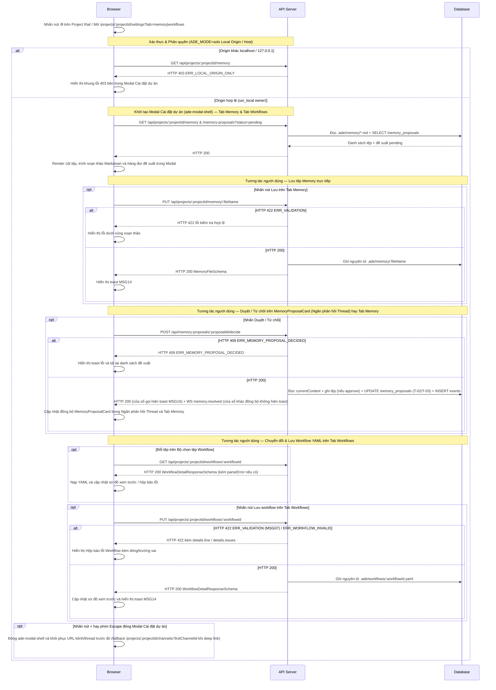

# UI-MM-01 - Cấu hình Memory, Workflows YAML & Duyệt Đề xuất Ghi nhớ (Memory & Workflows Modal Tabs + Thread Reply Panel Cards)

| Trường | Giá trị |
| --- | --- |
| Mã màn hình | `UI-MM-01` |
| Đường dẫn chốt | `specs/dd/memory/mm-01/ui-memory-workflow.md` |
| Tên màn hình | Cấu hình Memory, Workflows YAML & Duyệt Đề xuất Ghi nhớ (Memory & Workflows Modal Tabs + Thread Reply Panel Cards) |
| URL | `/projects/:projectId/settings` (`?tab=memory\|workflows`) |
| Ngày tạo | 2026-10-31 |
| Ngày cập nhật | 2026-10-31 |

## TÓM TẮT

- **Mục tiêu**: Cho phép chủ dự án đọc/ghi tệp `.ade/memory/*.md` và biên tập `.ade/workflows/*.yaml` ngay trong Modal Cài đặt dự án (`ade-modal-shell`), đồng thời duyệt hay từ chối đề xuất ghi nhớ của agent, xem tóm tắt luân chuyển `threads.summary` và theo dõi ngân sách thời gian thực bên trong Ngăn phản hồi Thread co giãn (`Thread Reply Panel`).
- **Actor**: Chủ dự án cục bộ (`usr_local`, `role = owner`) ở chế độ `ADE_MODE=solo`.
- **Trong phạm vi**: Tab `Memory` (`?tab=memory`) và Tab `Workflows` (`?tab=workflows`, chuẩn hoá cả bí danh `?tab=workflow`) bên trong Modal Cài đặt dự án (`ade-modal-shell`, `data-testid="project-settings-page"`, `role="dialog"`, `aria-modal="true"`, mở từ nút bánh răng `⚙` `data-testid="project-settings-btn"` trên `Project Rail`, từ nút `Mở Memory` trên thẻ đề xuất hay từ URL trực tiếp; đóng bằng nút biểu tượng `×` `aria-label="Đóng"` ở góc trên bên phải Header Modal hay phím `Escape`); các thành phần nhúng bên trong Ngăn phản hồi Thread co giãn (`data-testid="thread-panel"`, `340px..780px`, mặc định `448px`) gồm Thanh tiến trình ngân sách Thread ở Tầng 2 Header (`Subbar`), `BudgetExceededBanner`, Khối tóm tắt luân chuyển Thread (`threads.summary`), Dòng chi phí trên `LiveCard` và thẻ cổng người duyệt `MemoryProposalCard` (`.ade-gate-card`).
- **Ngoài phạm vi**: Các tab `General`, `Agents`, `Skills`, `Harnesses` của Modal Cài đặt dự án (thuộc `UI-ST-02` của module `settings`); cấu hình workflow riêng theo từng kênh (kênh không có trường `default_workflow`, mọi thread kế thừa `projects.workflow_id` từ `.ade/project.yaml`); trình thiết kế workflow kéo thả bằng chuột; quản lý thanh toán đa người dùng.
- **Giả định**: Kết nối WebSocket `/ws` của ứng dụng đã hoạt động ở tầng không gian làm việc để phát các sự kiện `message.posted`, `memory.proposed`, `memory.resolved`, `thread.summary_updated`, `budget.warning`, `run.failed` và `project.config_updated`.
- **Câu hỏi mở**: Không có.

## Lịch sử sửa đổi

| Ver | Ngày | Tác giả | Thay đổi |
| --- | --- | --- | --- |
| 1.0 | 2026-10-31 | Kiến trúc sư ADE | Phát hành lần đầu |
| 1.1 | 2026-10-31 | Kiến trúc sư ADE | Bổ sung `I-07`, các dòng sự kiện cho `+ Tạo tệp mới` / `Huỷ` / trùng tên tệp / đổi `Bộ chọn tệp Workflow`, khử trùng `E-07`, tách đơn nhất `E-10` / `E-23` và `E-17` / `E-24`, đồng bộ `Run/T-14`, `FIELD_LABELS` và phủ đủ AC |
| 1.2 | 2026-10-31 | Kiến trúc sư ADE | Đồng bộ Prototype v1.2 (`design.md` & `domain-model.md`): chuyển Tab `Memory` và Tab `Workflows` vào Modal Cài đặt dự án (`ade-modal-shell`, đóng bằng nút icon `×` góc trên phải, không có nút chữ `"Hủy"` ở Header), đưa ngân sách Thread lên Tầng 2 Header (`Subbar`) cùng khối `threads.summary` và `MemoryProposalCard` (`.ade-gate-card`, `.ade-mention--agent`) vào Ngăn phản hồi Thread co giãn (`340px..780px`), và đồng bộ kế thừa `projects.workflow_id` |
| 1.3 | 2026-10-31 | Kiến trúc sư ADE | Đồng bộ `project-settings-btn`, `project-settings-page`, `thread-panel`, `aria-label="Đóng"`, đóng Modal bằng `×` cùng `Escape` khôi phục URL kênh/thread trước đó, đồng bộ thứ tự 6 tab (`General`, `Agents`, `Skills`, `Workflows`, `Memory`, `Harnesses`), đổi nhãn wireframe sang Mixed-Case kèm quy tắc token chế độ kép Hallmark và 3 ngưỡng responsive, bổ sung `E-30` / `AC-UI-MM-01-29` cho `project.config_updated` |

---

## BỐ CỤC

```text
+==================================================================================================+
| Modal Cài đặt dự án (ade-modal-shell · data-testid="project-settings-page" · role="dialog")      |
| Cài đặt dự án: ade-runner                                                                   [×]  |
| [General]  [Agents]  [Skills]  [Workflows]  [Memory (2)]  [Harnesses]                            |
+--------------------------------------------------------------------------------------------------+
| (A) Khi đang mở Tab "Memory" (?tab=memory):                                                      |
| +----------------------------+  +--------------------------------------------------------------+ |
| | Tệp Memory (.ade/memory/)  |  | .ade/memory/conventions.md                           [ Lưu ] | |
| | [+ Tạo tệp mới]            |  | +----------------------------------------------------------+ | |
| | [how-to-test.md] [Xác][Huỷ]|  | | # Conventions                                            | | |
| | [conventions.md        ] < |  | | - Dùng pnpm monorepo                                     | | |
| | [architecture.md       ]   |  | | - Mọi state đổi qua event append-only                    | | |
| +----------------------------+  | +----------------------------------------------------------+ | |
|                                 |                                                              | |
|                                 | Đề xuất Memory đang chờ duyệt (2)                            | |
|                                 | +----------------------------------------------------------+ | |
|                                 | | ■ [bot @lead] đề xuất sửa: conventions.md  [Đang chờ duyệt]| |
|                                 | | Lý do: Ghi nhận quy tắc không vượt cổng duyệt            | | |
|                                 | | - # Quy ước cũ                                           | | |
|                                 | | + # Quy ước mới đã chuẩn hoá                             | | |
|                                 | |                                    [ Từ chối ] [ Duyệt ] | | |
|                                 | +----------------------------------------------------------+ | |
+--------------------------------------------------------------------------------------------------+
| (B) Khi đang mở Tab "Workflows" (?tab=workflows):                                                |
| Bộ chọn tệp Workflow (.ade/workflows/*.yaml): [ feature.yaml v ]              [ Lưu workflow ]   |
| +-----------------------------------------------+ +--------------------------------------------+ |
| | Trình soạn thảo YAML (.ade/workflows/feature) | | Sơ đồ xem trước states & gate              | |
| | 01 workflow: feature                          | | [open (initial)] --> [planning]            | |
| | 02 initial: open                              | |   --> [plan_review | gate: plan]           | |
| | 03 main_agent: "@lead"                        | |   --> [building]                           | |
| | 04 states:                                    | |   --> [review | gate: review] --> [done]   | |
| | 05   open: {}                                 | +--------------------------------------------+ |
| | 06   plan_review: { gate: plan }              | | Hộp báo lỗi cú pháp & nghiệp vụ Workflow   | |
| +-----------------------------------------------+ | Dòng 12: state "ghost" chưa khai báo       | |
|                                                   +--------------------------------------------+ |
+==================================================================================================+

+==================================================================================================+
| (C) Ngăn phản hồi Thread co giãn (data-testid="thread-panel" · 340px..780px, mặc định 448px):    |
| <-> Tầng 1 Header (Topbar): Thread · #feat-auth · 5 phản hồi              [Quyền (3)] [⤢] [×]    |
|     Tầng 2 Header (Subbar): [Phản hồi | Sổ nháp] | [bot @lead] [building] [████░ $0.85/$1.00 !]  |
| ------------------------------------------------------------------------------------------------ |
| [BudgetExceededBanner (.ade-panel--bad)]: Đã vượt hạn mức ngân sách ($1.05 / $1.00).             |
| [ThreadSummaryBlock (threads.summary)]: Mục tiêu: Chuẩn hoá bộ nhớ · [@lead · done] Đã chốt quy  |
| [LiveCard @coder]: Chi phí run: $0.42 / $0.50 [Cảnh báo: ngân sách còn <= 20%]                   |
| [MemoryProposalCard (.ade-gate-card · viền 1px --color-human + dấu vuông 8x8 ■)]:                |
|   ■ [bot @lead] đề xuất sửa .ade/memory/conventions.md                         [Đang chờ duyệt]  |
|   - # Quy ước cũ   /   + # Quy ước mới từ @lead              [Mở Memory]  [Từ chối]  [Duyệt]     |
+==================================================================================================+
```

- **Quy tắc token chế độ kép Hallmark (`design.md`)**:
  - Mọi màu nền, chữ, đường viền, bán kính bo góc và bóng đổ bắt buộc tham chiếu biến CSS trong `apps/web/src/styles/tokens.css` (chế độ Sáng `Coral` và chế độ Tối `Console`); cấm viết cứng mã màu ngoài `tokens.css`; cấm khai báo `transition: all`.
  - Cỡ chữ nhỏ nhất trên toàn bộ giao diện là `12px`; không sử dụng nhãn chữ in hoa giãn chữ.
  - Mọi số liệu ngân sách (`$spent_usd / $budget_usd`), số đếm đề xuất, tên tệp `.md` / `.yaml`, vùng soạn thảo Markdown / YAML và khung diff đều dùng phông `--font-outlier` với `font-variant-numeric: tabular-nums slashed-zero`.
- **Ba ngưỡng đáp ứng khung nhìn (Responsive Breakpoints)**:

| Ngưỡng khung nhìn | Modal Cài đặt dự án (`ade-modal-shell` · `data-testid="project-settings-page"`) | Ngăn phản hồi Thread (`data-testid="thread-panel"`) |
| --- | --- | --- |
| `>= 1025px` | Hộp thoại nổi giữa màn hình (`max-width: 1040px`, `max-height: 88vh`) trên lớp mờ `--color-backdrop`; Tab `Memory` chia 2 cột (`260px` + `1fr`) và Tab `Workflows` chia 2 cột (`1.15fr` + `0.85fr`) | Cột cố định bên phải không gian làm việc chat, kéo rộng `340px–780px` (mặc định `448px`) |
| `768px–1024px` | Hộp thoại co theo khung nhìn (`width: calc(100vw - 32px)`, `max-height: 92vh`); Tab `Memory` thu cột trái còn `220px`, Tab `Workflows` xếp chồng dọc trình soạn thảo YAML phía trên sơ đồ xem trước | Ngăn trượt đè bên phải (`position: fixed`, `width: min(448px, 88vw)`) trên lớp mờ `--color-backdrop` |
| `< 768px` | Hộp thoại mở toàn màn hình (`width: 100vw`, `height: 100dvh`, `border-radius: 0`), thanh 6 tab cuộn ngang, các vùng trong Tab `Memory` và Tab `Workflows` xếp chồng 1 cột dọc | Trang toàn màn hình (`position: fixed`, `width: 100vw`) |

---

## LOGIC

### I. Các phần tử (Items)

| STT | Tên logic | Loại đối tượng | Cột trong DB | Mô tả | Ghi chú |
| --- | --- | --- | --- | --- | --- |
| 1 | Thanh chuyển Tab `Memory` | Tab | — | Chuyển sang khu vực cấu hình Project Memory (`?tab=memory`) bên trong Modal Cài đặt dự án kèm huy hiệu đếm số đề xuất `pending` | Truy vấn đếm từ `memory_proposals.status = 'pending'` |
| 2 | Thanh chuyển Tab `Workflows` | Tab | — | Chuyển sang khu vực biên tập tệp `.ade/workflows/*.yaml` (`?tab=workflows`, tương thích bí danh `?tab=workflow`) bên trong Modal Cài đặt dự án | — |
| 3 | Danh sách tệp Memory | Danh sách chọn | — | Hiển thị các tệp `*.md` đọc từ `<repo_path>/.ade/memory/` theo thứ tự `A → Z` bằng font `--font-outlier` (`.ade-mono`) | Nguồn sự thật trên đĩa `.ade/memory/*.md` |
| 4 | Nút `+ Tạo tệp mới` | Nút | — | Bật ô nhập tên tệp `.md` mới ngay đầu cột trái của Tab `Memory` | — |
| 5 | Ô nhập Tên tệp memory mới | Ô nhập | — | Nhập tên tệp mới có đuôi `.md` (ví dụ `how-to-test.md`) | Kiểm tra theo `V-01` đến `V-03` |
| 6 | Nút `Xác nhận tạo tệp` | Nút | — | Khởi tạo tệp nháp mới trên vùng soạn thảo (hay mở tệp hiện có nếu trùng tên) | — |
| 7 | Nút `Huỷ tạo tệp` | Nút | — | Đóng Ô nhập Tên tệp memory mới và xoá thông báo lỗi tên tệp bên dưới | Chỉ hiển thị khi đang mở ô nhập tên tệp mới |
| 8 | Thông báo inline danh sách tệp | Nhãn thông báo | — | Hiển thị thông báo khi tên tệp nhập mới trùng với tệp `.md` đã có trong danh sách | Ẩn khi người dùng chọn tệp khác |
| 9 | Vùng soạn thảo Markdown | Ô văn bản nhiều dòng | — | Hiển thị và chỉnh sửa nội dung UTF-8 của tệp `.ade/memory/:fileName` đang chọn bằng font `--font-outlier` | Nguồn `.ade/memory/:fileName`; kiểm tra `V-04` đến `V-05` |
| 10 | Nút `Lưu` (Tab Memory) | Nút | — | Gửi nội dung Markdown lên `PUT /api/projects/:projectId/memory/:fileName` | Vô hiệu hoá khi chưa có thay đổi so với bản gốc |
| 11 | Hàng đợi `Đề xuất Memory đang chờ duyệt` | Danh sách thẻ | `memory_proposals.*` | Liệt kê các đề xuất có `status = 'pending'` của dự án trên Tab `Memory`, sắp theo `created_at` giảm dần | — |
| 12 | Chip Agent & Nhãn Tệp đích | Chip + Nhãn | `agents.handle`, `memory_proposals.target_file` | Hiển thị chip kỹ thuật `.ade-mention--agent` (kèm biểu tượng SVG `bot` `12×12` và chữ `--font-outlier`) của agent đề xuất cùng tên tệp `.md` mục tiêu | — |
| 13 | Nhãn Lý do đề xuất | Nhãn | `memory_proposals.reason` | Hiển thị lý do nghiệp vụ mà agent truyền trong `propose_memory` | — |
| 14 | Khung Diff xem trước | Khung hiển thị | `memory_proposals.content` | Hiển thị đối chiếu dòng thêm (`+`, `.ade-diff-add`) và dòng bớt (`-`, `.ade-diff-del`) bằng font `--font-outlier` trên nền `.ade-well` | Dùng chung trên Tab `Memory` và `MemoryProposalCard` |
| 15 | Nút `Duyệt` (Đề xuất Memory) | Nút | `memory_proposals.status` | Gửi quyết định `decision = "approve"` cho đề xuất (`.ade-btn--primary`) | Chỉ hiển thị khi `status = 'pending'` |
| 16 | Nút `Từ chối` (Đề xuất Memory) | Nút | `memory_proposals.status` | Gửi quyết định `decision = "reject"` cho đề xuất (`.ade-btn`) | Chỉ hiển thị khi `status = 'pending'` |
| 17 | Thẻ `MemoryProposalCard` (`MemoryCard`) | Thẻ cổng duyệt | `messages.card_json` | Thẻ cổng người duyệt (`.ade-panel.ade-gate-card`: viền hairline `1px` `--color-human` bao quanh kèm dấu vuông `8×8` `--color-human` `.ade-gate-mark`, không dùng vạch dọc `border-left: 3px+`) hiển thị trong luồng dọc phản hồi của Ngăn phản hồi Thread | Khử trùng theo `card_message_id` / `proposal_id` |
| 18 | Huy hiệu trạng thái `MemoryProposalCard` | Huy hiệu | `memory_proposals.status` | Hiển thị `Đang chờ duyệt` (`.ade-chip--human`), `Đã duyệt` (`.ade-chip--ok`), `Đã từ chối` (`.ade-chip--bad`) | Khi khác `pending` thì ẩn nút `Duyệt` / `Từ chối` |
| 19 | Bộ chọn tệp Workflow | Hộp chọn | `projects.workflow_id` | Chọn tệp workflow từ mảng `availableWorkflows` của `API-6` (mặc định chọn `projects.workflow_id` từ `.ade/project.yaml`; kênh không có `default_workflow`) | Nguồn `.ade/workflows/*.yaml` |
| 20 | Trình soạn thảo Workflow YAML | Ô mã nguồn | — | Biên tập nội dung chuỗi YAML của `.ade/workflows/:workflowId.yaml` bằng font `--font-outlier` | Nguồn `.ade/workflows/*.yaml`; kiểm tra `V-06` đến `V-08` |
| 21 | Sơ đồ xem trước `states` & `gate` | Khung sơ đồ | — | Hiển thị danh sách `states`, đánh dấu `initial` (`.ade-chip--agent`) và gắn nhãn `gate: plan \| spec \| review` (`.ade-chip--human`) từ dữ liệu YAML vừa parse | Tiêu đề thường (không in hoa giãn chữ); cập nhật trực tiếp khi cú pháp YAML hợp lệ |
| 22 | Hộp báo lỗi Workflow | Khung thông báo lỗi | — | Hiển thị số dòng và thông điệp lỗi trong khung `.ade-panel--bad` khi vi phạm cú pháp YAML (`MSG07`), `parseError` trên đĩa hay cấu trúc nghiệp vụ (`ERR_WORKFLOW_INVALID`) | Ẩn khi không có lỗi |
| 23 | Nút `Lưu workflow` | Nút | — | Gọi `PUT /api/projects/:projectId/workflows/:workflowId` để ghi tệp YAML lên đĩa (`.ade-btn--primary`) | Vô hiệu hoá khi đang có lỗi cú pháp (`V-06` đến `V-08`) |
| 24 | Thanh tiến trình ngân sách Thread | Thanh tiến trình | `threads.spent_usd`, `threads.budget_usd` | Hiển thị `$spent_usd / $budget_usd` (`.ade-mono`, `tabular-nums`) kèm `.ade-progress-track` / `.ade-progress-fill` tại Tầng 2 Header (`Subbar` — `.ade-thread-subbar`) của Ngăn phản hồi Thread trên Work Thread (ẩn nếu `budget_usd IS NULL`) | Chuyển sang `.ade-progress-fill--warn` khi đạt từ `80%` `threads.budget_usd` trở lên và `.ade-progress-fill--bad` khi vượt trần |
| 25 | Huy hiệu cảnh báo ngân sách sắp chạm trần | Huy hiệu cảnh báo | `threads.spent_usd`, `threads.budget_usd` | Hiển thị huy hiệu `.ade-chip--human` mang nội dung `Cảnh báo: ngân sách còn <= 20%` khi chi phí đạt từ `80%` hạn mức trở lên | Dùng cho Tầng 2 Header của Ngăn phản hồi Thread và `LiveCard` |
| 26 | Dòng chi phí trên Live Card | Nhãn | `runs.cost_usd`, `agents.budget_usd` | Hiển thị `$cost_usd / $budget_usd` bằng font `--font-outlier` (`.ade-mono`) trên thẻ thực thi của từng run bên trong Ngăn phản hồi Thread | Hiển thị huy hiệu `.ade-chip--human` khi nhận `budget.warning(scope='agent')` |
| 27 | Banner vượt ngân sách (`BudgetExceededBanner`) | Banner cảnh báo | `runs.stop_reason` | Hiển thị khung `.ade-panel--bad` (`--color-bad` / `--color-bad-soft`) ở đầu luồng dọc của Ngăn phản hồi Thread khi thread có run dừng với `stop_reason = 'budget_exceeded'` | Đi kèm tin nhắn hệ thống `is_root = 0` trong Ngăn phản hồi Thread |
| 28 | Khung Modal Cài đặt dự án (`ProjectSettingsModal`) | Hộp thoại Modal | `projects.name` | Hộp thoại `.ade-modal-shell` (`role="dialog"`, `aria-modal="true"`) phủ trên nền `--color-backdrop` của Chat Workspace, chứa thanh 6 tab theo đúng thứ tự `General`, `Agents`, `Skills`, `Workflows`, `Memory`, `Harnesses` (chấp nhận bí danh URL `workflow` và `harness`) | `data-testid="project-settings-page"`; không đặt nút chữ `"Hủy"` ở góc trên bên phải Header Modal |
| 29 | Nút biểu tượng `Cài đặt dự án` (`⚙`) | Nút biểu tượng | — | Nút `.ade-icon-btn` (`aria-label="Cài đặt dự án"`, `data-testid="project-settings-btn"`) nằm trên cột `Project Rail` (`64px`) để mở Modal Cài đặt dự án | Khớp `UI-CH-01` Item 4 |
| 30 | Nút biểu tượng Đóng Modal (`×`) | Nút biểu tượng | — | Nút `.ade-icon-btn` (`aria-label="Đóng"`, `data-testid="close-project-settings-btn"`) nằm ở góc trên bên phải Header của Modal Cài đặt dự án | Phần tử đóng duy nhất trên góc phải Header Modal; đồng bộ với phím `Escape` |
| 31 | Nút `Mở Memory` trên `MemoryProposalCard` | Nút | — | Nút `.ade-btn.ade-btn--sm` (`data-testid="btn-open-memory-tab"`) đặt trên `MemoryProposalCard` trong Ngăn phản hồi Thread để mở Modal Cài đặt dự án tại Tab `Memory` (`?tab=memory`) | Hiển thị trên thẻ đề xuất trong Ngăn phản hồi Thread |
| 32 | Khối tóm tắt luân chuyển Thread (`ThreadSummaryBlock`) | Khung hiển thị | `threads.summary` | Hiển thị bản tóm tắt cuốn chiếu `threads.summary` (`data-testid="thread-summary-block"`) trong luồng dọc của Ngăn phản hồi Thread (ẩn khi `threads.summary` sau `trim` rỗng) | Tự động cập nhật khi nhận sự kiện WS `thread.summary_updated` |
| 33 | Khung Ngăn phản hồi Thread co giãn (`ThreadReplyPanel`) | Khung bên phải | `threads.id` | Khung chứa co giãn `340px–780px` (mặc định `448px`, `data-testid="thread-panel"`) bên phải không gian chat, chứa Tầng 2 Header (`Subbar`), `BudgetExceededBanner`, `ThreadSummaryBlock`, `LiveCard` và `MemoryProposalCard` | Khớp `UI-CH-01` Item 28 |

### II. Kiểm tra hợp lệ (Validate)

| ID | Tên logic | Tên | Quy tắc kiểm tra | Mã message | Message |
| --- | --- | --- | --- | --- | --- |
| V-01 | Ô nhập Tên tệp memory mới (`fileName`) | Tên tệp | `required` | `MSG01` | Tên tệp là bắt buộc. |
| V-02 | Ô nhập Tên tệp memory mới (`fileName`) | Tên tệp | `max:100` | `MSG02` | Tên tệp không được vượt quá 100 ký tự. |
| V-03 | Ô nhập Tên tệp memory mới (`fileName`) | Tên tệp | `regex:^[a-zA-Z0-9][a-zA-Z0-9._-]*\.md$` | `MSG04` | Định dạng Tên tệp không hợp lệ. |
| V-04 | Vùng soạn thảo Markdown (`content`) | Nội dung | `required` | `MSG01` | Nội dung là bắt buộc. |
| V-05 | Vùng soạn thảo Markdown (`content`) | Nội dung | `max:65536` | `MSG02` | Nội dung không được vượt quá 65536 ký tự. |
| V-06 | Trình soạn thảo Workflow YAML (`workflowYaml`) | Nội dung Workflow YAML | `required` | `MSG01` | Nội dung Workflow YAML là bắt buộc. |
| V-07 | Trình soạn thảo Workflow YAML (`workflowYaml`) | Nội dung Workflow YAML | `max:65536` | `MSG02` | Nội dung Workflow YAML không được vượt quá 65536 ký tự. |
| V-08 | Trình soạn thảo Workflow YAML (`workflowYaml`) | Nội dung Workflow YAML | `yaml` | `MSG07` | Nội dung Workflow YAML không đúng cú pháp YAML. |

### III. Logic

#### Thông tin màn hình

- **Phân quyền**: Chế độ `ADE_MODE=solo` — yêu cầu `Host` thuộc `localhost` / `127.0.0.1` và `Origin` (khi có mặt) thuộc `localhost` / `127.0.0.1`, gán actor mặc định `usr_local` (`role = owner`).
- **Mẫu URL**: `/projects/:projectId/settings` (hỗ trợ thanh 6 tab `General`, `Agents`, `Skills`, `Workflows`, `Memory`, `Harnesses` với `?tab=memory|workflows` và chuẩn hoá bí danh `?tab=workflow` về Tab `Workflows`, `?tab=harness` về Tab `Harnesses` trong Modal Cài đặt dự án `ade-modal-shell`; thành phần cấp thread hiển thị bên trong Ngăn phản hồi Thread `data-testid="thread-panel"` tại `/projects/:projectId/channels/:channelId/threads/:threadId`).
- **API chính**:

| STT | Method | Path | Mục đích |
| --- | --- | --- | --- |
| 1 | GET | `/api/projects/:projectId/memory` | Tải danh sách tệp `.ade/memory/*.md` và nội dung |
| 2 | PUT | `/api/projects/:projectId/memory/:fileName` | Lưu nội dung tệp `.ade/memory/:fileName` |
| 3 | GET | `/api/projects/:projectId/memory-proposals` | Tải hàng đợi đề xuất memory đang chờ duyệt kèm `currentContent` |
| 4 | POST | `/api/memory-proposals/:proposalId/decide` | Duyệt (`approve`) hay từ chối (`reject`) đề xuất memory |
| 5 | GET | `/api/projects/:projectId/workflows/:workflowId` | Tải danh sách `availableWorkflows`, nội dung YAML gốc, `parsed` và `parseError` |
| 6 | PUT | `/api/projects/:projectId/workflows/:workflowId` | Kiểm tra nghiệp vụ và ghi tệp `.ade/workflows/:workflowId.yaml` |

#### 1. Kiểm tra phân quyền

| ID | Mô tả |
| --- | --- |
| P-01 | Khi người dùng mở Modal Cài đặt dự án hay Ngăn phản hồi Thread từ `localhost` hay `127.0.0.1` ở chế độ `ADE_MODE=solo`, hệ thống phải cấp quyền `usr_local` (`role = owner`) và cho phép thao tác toàn bộ Tab `Memory`, Tab `Workflows` và `MemoryProposalCard`. |
| P-02 | Nếu bất kỳ query khởi tạo nào trả HTTP 403 `ERR_LOCAL_ORIGIN_ONLY`, thì màn hình phải hiển thị khung lỗi 403 bên trong vùng nội dung của Modal Cài đặt dự án và giữ nguyên nền không gian làm việc. |

#### 2. Khởi tạo màn hình

| ID | Mô tả |
| --- | --- |
| I-01 | Khi người dùng mở Tab `Memory` (`/projects/:projectId/settings?tab=memory`) bên trong Modal Cài đặt dự án (`ade-modal-shell`), màn hình phải gọi song song `GET /api/projects/:projectId/memory` và `GET /api/projects/:projectId/memory-proposals?status=pending`. |
| I-02 | Khi API danh sách tệp trả về ít nhất 1 tệp `.md`, màn hình phải tự động chọn tệp đầu tiên theo thứ tự `A → Z` và nạp nội dung của tệp đó vào Vùng soạn thảo Markdown. |
| I-03 | Khi người dùng mở Tab `Workflows` (`/projects/:projectId/settings?tab=workflows` hay bí danh `?tab=workflow`) bên trong Modal Cài đặt dự án (`ade-modal-shell`), màn hình phải gọi `GET /api/projects/:projectId/workflows/:workflowId` (mặc định lấy `projects.workflow_id` từ `.ade/project.yaml`) để nạp `availableWorkflows` vào Bộ chọn tệp Workflow, hiển thị `workflowYaml` gốc và vẽ Sơ đồ xem trước từ `parsed` (nếu `parseError` khác `null` thì hiển thị lỗi trong Hộp báo lỗi Workflow và vô hiệu hoá nút `Lưu workflow`). |
| I-04 | Khi mở Ngăn phản hồi Thread (`Thread Reply Panel`) của một Work Thread có `threads.budget_usd` khác `null`, màn hình phải hiển thị Thanh tiến trình ngân sách Thread tại Tầng 2 Header (`Subbar` — `.ade-thread-subbar`) cạnh chip `.ade-mention--agent` của Main Agent và huy hiệu `threads.state`. |
| I-05 | Trong khi chi phí đã tiêu của thread từ `80%` `threads.budget_usd` trở lên và chưa vượt `threads.budget_usd`, màn hình phải chuyển Thanh tiến trình ngân sách Thread trên Tầng 2 Header sang trạng thái cảnh báo (`.ade-progress-fill--warn`) và hiển thị huy hiệu `Cảnh báo: ngân sách còn <= 20%`. |
| I-06 | Khi khởi tạo Modal Cài đặt dự án hay Ngăn phản hồi Thread, ứng dụng phải đăng ký lắng nghe các sự kiện WebSocket `message.posted`, `memory.proposed`, `memory.resolved`, `thread.summary_updated`, `budget.warning`, `run.failed` và `project.config_updated` để đồng bộ trạng thái tức thời. |
| I-07 | Khi người dùng mở hay tải lại Ngăn phản hồi Thread của một thread đã có ít nhất một run dừng với `stop_reason = 'budget_exceeded'`, màn hình phải hiển thị `BudgetExceededBanner` (`.ade-panel--bad`) ở đầu vùng luồng của Ngăn phản hồi Thread. |
| I-08 | Khi người dùng mở Ngăn phản hồi Thread của một thread có `threads.summary` sau `trim` khác rỗng, màn hình phải hiển thị Khối tóm tắt luân chuyển Thread (`ThreadSummaryBlock`) mang nội dung `threads.summary` trong luồng dọc của Ngăn phản hồi Thread. |

#### 3. Xử lý hành vi sự kiện

> Nội dung message của các mã trong mục này: xem [message.md](../../../message.md).

| ID | Sự kiện | Kích hoạt | Mô tả |
| --- | --- | --- | --- |
| E-01 | Chọn tệp Memory khác | Khi người dùng nhấn vào một tên tệp `.md` trong Danh sách tệp Memory | Màn hình phải nạp nội dung của tệp vừa chọn vào Vùng soạn thảo Markdown, xoá thông báo lỗi dưới vùng soạn thảo và đặt lại trạng thái nút `Lưu` về vô hiệu hoá. |
| E-02 | Tạo tệp Memory mới — tên hợp lệ chưa tồn tại | Khi người dùng nhập tên tệp chưa có trong Danh sách tệp Memory vào Ô nhập Tên tệp memory mới và nhấn `Xác nhận tạo tệp` vượt qua `V-01` đến `V-03` | Màn hình phải thêm tên tệp vào Danh sách tệp Memory ở trạng thái nháp đang chọn, điền sẵn dòng tiêu đề `# <tên tệp>` vào Vùng soạn thảo Markdown và đóng Ô nhập Tên tệp memory mới. |
| E-03 | Tạo tệp Memory mới — sai quy tắc tên | Nếu tên tệp nhập vào vi phạm `V-01`, `V-02` hay `V-03` khi nhấn `Xác nhận tạo tệp` | Màn hình phải hiển thị thông báo lỗi tương ứng (`MSG01`, `MSG02`, `MSG04`) ngay dưới Ô nhập Tên tệp memory mới và không tạo mục nháp. |
| E-04 | Nhấn `Lưu` tệp Memory — hợp lệ client | Khi người dùng nhấn nút `Lưu` trên Tab `Memory` và nội dung vượt qua `V-04` đến `V-05` | Màn hình phải gọi `PUT /api/projects/:projectId/memory/:fileName` với nội dung hiện tại. |
| E-05 | Lưu tệp Memory thành công | Khi `PUT /api/projects/:projectId/memory/:fileName` trả HTTP 200 | Màn hình phải hiển thị toast thành công `MSG14` (`Đã lưu thay đổi.`) và cập nhật lại bản gốc đã lưu của tệp. |
| E-06 | Lưu tệp Memory thất bại 422 từ server | Nếu `PUT /api/projects/:projectId/memory/:fileName` trả HTTP 422 `ERR_VALIDATION` | Màn hình phải hiển thị thông báo lỗi dưới Vùng soạn thảo Markdown theo `details.fieldErrors`. |
| E-07 | Nhận sự kiện đề xuất mới qua WS (khử trùng) | Khi WebSocket `/ws` phát sự kiện `message.posted` (`cardType = 'memory_proposal'`) và `memory.proposed` thuộc dự án đang mở | Màn hình phải khử trùng theo `card_message_id` và `proposal_id` để chỉ hiển thị đúng 1 thẻ `MemoryProposalCard` (`.ade-gate-card`) ở trạng thái `Đang chờ duyệt` trong Ngăn phản hồi Thread và tăng bộ đếm đề xuất chờ duyệt trên Tab `Memory` thêm đúng 1. |
| E-08 | Nhấn `Duyệt` đề xuất Memory | Khi người dùng nhấn nút `Duyệt` trên `MemoryProposalCard` hay trong hàng đợi Tab `Memory` | Màn hình phải vô hiệu hoá hai nút của đề xuất đó và gọi `POST /api/memory-proposals/:proposalId/decide` với body `{"decision": "approve"}` để chuyển trạng thái theo `MemoryProposal/T-02`. |
| E-09 | Nhấn `Từ chối` đề xuất Memory | Khi người dùng nhấn nút `Từ chối` trên `MemoryProposalCard` hay trong hàng đợi Tab `Memory` | Màn hình phải vô hiệu hoá hai nút của đề xuất đó và gọi `POST /api/memory-proposals/:proposalId/decide` với body `{"decision": "reject"}` để chuyển trạng thái theo `MemoryProposal/T-03`. |
| E-10 | Quyết định đề xuất thành công từ mutation | Khi `POST /api/memory-proposals/:proposalId/decide` trả HTTP 200 | Màn hình phải hiển thị toast `MSG16` (`Đã gửi phản hồi duyệt.`), cập nhật huy hiệu trạng thái trên `MemoryProposalCard`, gỡ mục đó khỏi hàng đợi `pending` trên Tab `Memory` và tải lại tệp trên vùng soạn thảo. |
| E-11 | Đề xuất đã được quyết định trước đó | Nếu `POST /api/memory-proposals/:proposalId/decide` trả HTTP 409 `ERR_MEMORY_PROPOSAL_DECIDED` | Màn hình phải hiển thị toast tiếng Việt từ `translateApiError` (`Đề xuất ghi nhớ này đã được xử lý trước đó.`) và làm mới lại danh sách đề xuất. |
| E-12 | Sửa nội dung Workflow YAML hợp lệ cú pháp | Khi người dùng thay đổi nội dung trong Trình soạn thảo Workflow YAML vượt qua `V-06` đến `V-08` | Màn hình phải cập nhật trực tiếp Sơ đồ xem trước `states` cùng `gate`, ẩn Hộp báo lỗi Workflow và bật nút `Lưu workflow`. |
| E-13 | Sửa nội dung Workflow YAML sai cú pháp | Nếu nội dung trong Trình soạn thảo Workflow YAML vi phạm `V-06`, `V-07` hay `V-08` | Màn hình phải hiển thị mã lỗi (`MSG01`, `MSG02`, `MSG07`) kèm số dòng lỗi trong Hộp báo lỗi Workflow và vô hiệu hoá nút `Lưu workflow`. |
| E-14 | Nhấn `Lưu workflow` thành công | Khi người dùng nhấn `Lưu workflow` trên Tab `Workflows` và `PUT /api/projects/:projectId/workflows/:workflowId` trả HTTP 200 | Màn hình phải cập nhật Sơ đồ xem trước theo `parsed` trả về và hiển thị toast `MSG14` (`Đã lưu thay đổi.`). |
| E-15 | Nhấn `Lưu workflow` bị lỗi cấu trúc nghiệp vụ | Nếu `PUT /api/projects/:projectId/workflows/:workflowId` trả HTTP 422 `ERR_WORKFLOW_INVALID` | Màn hình phải hiển thị Hộp báo lỗi Workflow liệt kê từng mục trong `details.issues` (sai `initial`, sai `gate`, sai tên `state` hay sai handle `agent`) và giữ nguyên nội dung đang soạn thảo. |
| E-16 | Nhấn `Lưu workflow` bị lỗi cú pháp từ server | Nếu `PUT /api/projects/:projectId/workflows/:workflowId` trả HTTP 422 `ERR_VALIDATION` | Màn hình phải hiển thị thông báo `MSG07` kèm số dòng `details.line` trong Hộp báo lỗi Workflow. |
| E-17 | Nhận cảnh báo ngân sách cấp Thread qua WS | Khi nhận sự kiện WebSocket `budget.warning` có `scope = 'thread'` (ngân sách thread còn `<= 20%`) | Màn hình phải chuyển Thanh tiến trình ngân sách Thread trên Tầng 2 Header của Ngăn phản hồi Thread sang trạng thái cảnh báo (`.ade-progress-fill--warn`) và hiển thị huy hiệu `Cảnh báo: ngân sách còn <= 20%`. |
| E-18 | Run dừng do vượt ngân sách (`budget_exceeded`) | Khi nhận sự kiện WebSocket `run.failed` có `stop_reason = 'budget_exceeded'` (theo `Run/T-14`) | Màn hình phải hiển thị `BudgetExceededBanner` (`.ade-panel--bad`) ở đầu vùng luồng của Ngăn phản hồi Thread kèm thông điệp từ `ERR_BUDGET_EXCEEDED` và chuyển Live Card của run sang trạng thái `Thất bại (Vượt ngân sách)`. |
| E-19 | Mở ô nhập tạo tệp Memory mới | Khi người dùng nhấn nút `+ Tạo tệp mới` trên Tab `Memory` | Màn hình phải hiển thị Ô nhập Tên tệp memory mới rỗng kèm hai nút `Xác nhận tạo tệp` và `Huỷ tạo tệp`, đồng thời đặt tiêu điểm con trỏ vào ô nhập. |
| E-20 | Huỷ tạo tệp Memory mới | Khi người dùng nhấn nút `Huỷ tạo tệp` bên cạnh Ô nhập Tên tệp memory mới | Màn hình phải đóng Ô nhập Tên tệp memory mới, xoá chuỗi đang gõ và xoá thông báo lỗi bên dưới. |
| E-21 | Tạo tệp Memory mới trùng tên đã có | Nếu người dùng nhấn `Xác nhận tạo tệp` với tên tệp `.md` đã tồn tại trong Danh sách tệp Memory | Màn hình phải đóng Ô nhập Tên tệp memory mới, chuyển sang chọn và nạp nội dung của tệp hiện có đó vào Vùng soạn thảo Markdown (không thêm mục nháp trùng) và hiển thị thông báo inline `Tệp <fileName> đã tồn tại, đã mở tệp hiện có.`. |
| E-22 | Đổi lựa chọn trên Bộ chọn tệp Workflow | Khi người dùng chọn một `workflowId` khác trên Bộ chọn tệp Workflow của Tab `Workflows` | Màn hình phải gọi `GET /api/projects/:projectId/workflows/:workflowId` để nạp `workflowYaml` của tệp vừa chọn vào Trình soạn thảo và cập nhật Sơ đồ xem trước (nếu `parseError` khác `null` thì hiển thị lỗi trong Hộp báo lỗi Workflow và vô hiệu hoá nút `Lưu workflow`). |
| E-23 | Đồng bộ kết quả duyệt từ sự kiện WS `memory.resolved` | Khi nhận sự kiện WebSocket `memory.resolved` thuộc dự án đang mở | Màn hình phải cập nhật huy hiệu trạng thái trên `MemoryProposalCard`, gỡ mục đó khỏi hàng đợi `pending` trên Tab `Memory` và tải lại tệp trên vùng soạn thảo mà không hiển thị toast `MSG16`. |
| E-24 | Nhận cảnh báo ngân sách cấp Agent qua WS | Khi nhận sự kiện WebSocket `budget.warning` có `scope = 'agent'` (ngân sách run còn `<= 20%`) | Màn hình phải chuyển Dòng chi phí trên Live Card của `run_id` tương ứng trong Ngăn phản hồi Thread sang trạng thái cảnh báo và hiển thị huy hiệu `Cảnh báo: ngân sách còn <= 20%`. |
| E-25 | Nhấn `Lưu` tệp Memory vi phạm kiểm tra client | Nếu nội dung trong Vùng soạn thảo Markdown vi phạm `V-04` hay `V-05` khi người dùng nhấn nút `Lưu` | Màn hình phải hiển thị mã lỗi (`MSG01` hay `MSG02`) dưới Vùng soạn thảo Markdown và không gọi API `PUT`. |
| E-26 | Mở Modal Cài đặt dự án từ `Project Rail` | Khi người dùng nhấn nút biểu tượng `Cài đặt dự án` (`⚙`, `aria-label="Cài đặt dự án"`, `data-testid="project-settings-btn"`) trên cột `Project Rail` | Màn hình phải mở Modal Cài đặt dự án (`ade-modal-shell`, `data-testid="project-settings-page"`, `role="dialog"`, `aria-modal="true"`) phủ trên nền không gian chat mà không hiển thị nút chữ `"Hủy"` ở góc trên bên phải Header Modal. |
| E-27 | Đóng Modal Cài đặt dự án bằng nút biểu tượng `×` hay phím `Escape` | Khi người dùng nhấn nút biểu tượng `×` (`aria-label="Đóng"`, `data-testid="close-project-settings-btn"`) ở góc trên bên phải Header Modal hay nhấn phím `Escape` | Màn hình phải đóng Modal Cài đặt dự án và khôi phục URL kênh hay thread đang mở trước đó (giữ nguyên Ngăn phản hồi Thread `data-testid="thread-panel"` đang mở nếu mở từ `E-28`, chỉ điều hướng về `/projects/:projectId/channels/:firstChannelId` khi truy cập trực tiếp qua deep link). |
| E-28 | Mở Tab `Memory` từ `MemoryProposalCard` | Khi người dùng nhấn nút `Mở Memory` (`data-testid="btn-open-memory-tab"`) trên `MemoryProposalCard` bên trong Ngăn phản hồi Thread (`data-testid="thread-panel"`) | Màn hình phải ghi nhớ URL thread hiện hành rồi mở Modal Cài đặt dự án (`ade-modal-shell`, `data-testid="project-settings-page"`) tại Tab `Memory` (`/projects/:projectId/settings?tab=memory`). |
| E-29 | Cập nhật Khối tóm tắt luân chuyển Thread qua WS | Khi nhận sự kiện WebSocket `thread.summary_updated` có `thread_id` khớp thread đang mở trong Ngăn phản hồi Thread | Màn hình phải cập nhật nội dung của Khối tóm tắt luân chuyển Thread (`ThreadSummaryBlock`, `data-testid="thread-summary-block"`) trong luồng dọc của Ngăn phản hồi Thread theo `payload.summary`. |
| E-30 | Đồng bộ tệp Memory và Workflow qua WS `project.config_updated` | Khi nhận sự kiện WebSocket `project.config_updated` có `projectId` khớp `:projectId` đang mở trong Modal Cài đặt dự án | Màn hình phải làm mới truy vấn danh sách tệp Memory và chi tiết tệp Workflow của `:projectId` trong dưới `2000 ms` mà vẫn bảo toàn bản nháp chưa lưu nếu người dùng đang sửa dở trên vùng soạn thảo. |

#### 4. Xử lý phía server

> Đặc tả chi tiết request, response, bản đồ dữ liệu và bảng thao tác DB nằm tại [API-MM-01](./api-memory-workflow.md).

**API-1: GET /api/projects/:projectId/memory**

| ID | Bước | Mô tả |
| --- | --- | --- |
| S1-01 | Kiểm tra Host / Origin & dự án | Kiểm tra Host bắt buộc cùng Origin local (`403 ERR_LOCAL_ORIGIN_ONLY`) và sự tồn tại của `:projectId` (`404 ERR_NOT_FOUND`) theo `API-MM-01/S2-01` đến `S2-02`. |
| S1-02 | Trả danh sách tệp | Đọc `.ade/memory/*.md` sắp xếp `A → Z` và trả HTTP 200 `MemoryFileListResponseSchema` theo `API-MM-01/S2-03` đến `S2-04`. |

**API-2: PUT /api/projects/:projectId/memory/:fileName**

| ID | Bước | Mô tả |
| --- | --- | --- |
| S2-01 | Kiểm tra Host / Origin & đầu vào | Kiểm tra Host bắt buộc cùng Origin local (`403 ERR_LOCAL_ORIGIN_ONLY`) và quy tắc `memory.file.put` (`422 ERR_VALIDATION`) theo `API-MM-01/S3-01` đến `S3-03`. |
| S2-02 | Ghi tệp nguyên tử & phát cấu hình | Đăng ký `recentSelfWrites`, ghi `<repo_path>/.ade/memory/:fileName`, đồng bộ worktree, phát `project.config_updated` và trả HTTP 200 `MemoryFileSchema` theo `API-MM-01/S3-04` đến `S3-05`. |

**API-3: GET /api/projects/:projectId/memory-proposals**

| ID | Bước | Mô tả |
| --- | --- | --- |
| S3-01 | Kiểm tra Host / Origin & query | Kiểm tra Host bắt buộc cùng Origin local và query `status` theo `API-MM-01/S4-01` đến `S4-03`. |
| S3-02 | Trả danh sách đề xuất kênh hoạt động | Truy vấn `memory_proposals` trên kênh chưa xoá mềm (`channels.deleted_at IS NULL`) kèm `currentContent` và trả HTTP 200 `MemoryProposalListResponseSchema` theo `API-MM-01/S4-04` đến `S4-05`. |

**API-4: POST /api/memory-proposals/:proposalId/decide**

| ID | Bước | Mô tả |
| --- | --- | --- |
| S4-01 | Kiểm tra Host / Origin, kênh & trạng thái | Kiểm tra Host bắt buộc cùng Origin local, `memory.proposal.decide` (`422`), kênh chưa xoá mềm (`404 ERR_NOT_FOUND`), đọc `currentContent` trước khi ghi đè và kiểm tra trạng thái `pending` (`409 ERR_MEMORY_PROPOSAL_DECIDED`) theo `API-MM-01/S5-01` đến `S5-04`. |
| S4-02 | Chuyển trạng thái & đồng bộ đĩa | Chuyển theo `MemoryProposal/T-02` (đăng ký `recentSelfWrites` và ghi tệp `.ade/memory/<target_file>`) hay `MemoryProposal/T-03` (giữ nguyên tệp), ghi event `memory.resolved` và trả HTTP 200 theo `API-MM-01/S5-05` đến `S5-07`. |

**API-5: GET /api/projects/:projectId/workflows/:workflowId**

| ID | Bước | Mô tả |
| --- | --- | --- |
| S5-01 | Kiểm tra Host / Origin & đọc tệp | Kiểm tra Host bắt buộc cùng Origin local, đọc `<repo_path>/.ade/workflows/:workflowId.yaml` (`404` nếu thiếu), quét `availableWorkflows` và trả HTTP 200 `WorkflowDetailResponseSchema` (dung thứ lỗi `parseError`) theo `API-MM-01/S6-01` đến `S6-05`. |

**API-6: PUT /api/projects/:projectId/workflows/:workflowId**

| ID | Bước | Mô tả |
| --- | --- | --- |
| S6-01 | Kiểm tra Host / Origin & cú pháp YAML | Kiểm tra Host bắt buộc cùng Origin local và quy tắc `memory.workflow.put` (`422 ERR_VALIDATION` / `MSG07`) theo `API-MM-01/S7-01` đến `S7-03`. |
| S6-02 | Kiểm tra nghiệp vụ & lưu tệp | Kiểm tra `initial`, `gate`, `states`, `agents` (sai trả `422 ERR_WORKFLOW_INVALID`), hợp lệ thì đăng ký `recentSelfWrites`, ghi nguyên tử `.ade/workflows/:workflowId.yaml`, phát `project.config_updated` và trả HTTP 200 theo `API-MM-01/S7-04` đến `S7-06`. |

### IV. Sơ đồ luồng



---

## TIÊU CHÍ CHẤP NHẬN

```gherkin
Feature: UI-MM-01 — Modal Cài đặt Memory & Workflows YAML, MemoryProposalCard và Ngân sách trong Ngăn phản hồi Thread

  Background:
    Given chủ dự án "usr_local" đang mở ứng dụng từ "http://localhost:5173" cho dự án "prj_01" có kênh "chn_01"
    And dự án "prj_01" có hai tệp `.ade/memory/architecture.md` (nội dung "# Kiến trúc") và `.ade/memory/conventions.md` (nội dung "# Quy ước cũ")
    And dự án "prj_01" có hai tệp `.ade/workflows/feature.yaml` (hợp lệ, được gán làm `projects.workflow_id`) và `.ade/workflows/bugfix.yaml`

  Scenario: AC-UI-MM-01-01 — Khởi tạo Tab Memory trong Modal Cài đặt dự án và lưu nội dung Markdown hợp lệ thành công (nguồn: P-01, I-01, I-02, E-04, E-05; nghiệm thu: e2e/p6-memory.spec.ts)
    Given đang mở Tab "Memory" trong Modal Cài đặt dự án tại "/projects/prj_01/settings?tab=memory", đã chọn tệp "conventions.md" và nhập nội dung "# Quy ước cập nhật"
    When người dùng nhấn nút "Lưu"
    Then thấy toast thông báo `MSG14` ("Đã lưu thay đổi.")
    And tệp `.ade/memory/conventions.md` trên đĩa có nội dung "# Quy ước cập nhật"

  Scenario: AC-UI-MM-01-02 — Tạo tệp Memory mới hợp lệ chưa tồn tại trên Tab Memory (nguồn: E-02; nghiệm thu: e2e/p6-memory.spec.ts)
    Given đang mở ô nhập tên tệp mới trên Tab "Memory" tại "/projects/prj_01/settings?tab=memory" với giá trị "how-to-test.md"
    When người dùng nhấn "Xác nhận tạo tệp"
    Then mục "how-to-test.md" xuất hiện trong Danh sách tệp Memory ở trạng thái đang chọn
    And Vùng soạn thảo Markdown hiển thị sẵn tiêu đề "# how-to-test.md" và Ô nhập Tên tệp memory mới được đóng

  Scenario Outline: AC-UI-MM-01-03 — Kiểm tra hợp lệ tên tệp Memory mới trên Tab Memory (nguồn: V-01, V-02, V-03, E-03; nghiệm thu: e2e/p6-memory.spec.ts)
    Given đang mở ô nhập tên tệp mới trên Tab "Memory" tại "/projects/prj_01/settings?tab=memory" với giá trị "<fileName>"
    When người dùng nhấn "Xác nhận tạo tệp"
    Then thấy thông báo `<msg>` bên dưới Ô nhập Tên tệp memory mới
    But không có mục nháp mới nào được thêm vào Danh sách tệp Memory

    Examples:
      | fileName                 | msg   |
      |                          | MSG01 |
      | (chuỗi 101 ký tự "a").md | MSG02 |
      | ten file co dau cach.md  | MSG04 |
      | notes.txt                | MSG04 |

  Scenario Outline: AC-UI-MM-01-04 — Kiểm tra hợp lệ phía client cho nội dung Markdown khi nhấn Lưu (nguồn: V-04, V-05, E-25; nghiệm thu: e2e/p6-memory.spec.ts)
    Given đang chọn tệp "conventions.md" trên Tab "Memory" tại "/projects/prj_01/settings?tab=memory" với nội dung đã sửa thành "<content>"
    When người dùng nhấn nút "Lưu"
    Then thấy thông báo `<msg>` dưới Vùng soạn thảo Markdown
    But không có request `PUT` nào được gửi tới server

    Examples:
      | content                 | msg   |
      |                         | MSG01 |
      | (chuỗi 65537 ký tự "m") | MSG02 |

  Scenario: AC-UI-MM-01-05 — Nhấn Duyệt trên MemoryProposalCard trong Ngăn phản hồi Thread hiển thị toast MSG16 và ghi tệp lên đĩa (nguồn: E-08, E-10, MemoryProposal/T-02; nghiệm thu: e2e/p6-memory.spec.ts)
    Given Ngăn phản hồi Thread của "thr_01" đang hiển thị `MemoryProposalCard` (`.ade-gate-card`) của đề xuất "mpr_01" (`status` là "pending", chip `.ade-mention--agent` là "@lead") cho "conventions.md" với nội dung "# Quy ước mới từ @lead"
    When người dùng nhấn nút "Duyệt" trên `MemoryProposalCard` của "mpr_01"
    Then thấy toast `MSG16` ("Đã gửi phản hồi duyệt.") và huy hiệu trên `MemoryProposalCard` đổi thành "Đã duyệt"
    And tệp `.ade/memory/conventions.md` trên đĩa có nội dung "# Quy ước mới từ @lead"

  Scenario: AC-UI-MM-01-06 — Từ chối đề xuất Memory giữ nguyên nội dung tệp trên đĩa (nguồn: E-09, E-10, MemoryProposal/T-03; nghiệm thu: e2e/p6-memory.spec.ts)
    Given đang có đề xuất "mpr_02" ở trạng thái "pending" cho "conventions.md" hiển thị trong hàng đợi của Tab "Memory"
    When người dùng nhấn nút "Từ chối" trên đề xuất "mpr_02"
    Then thấy toast `MSG16` ("Đã gửi phản hồi duyệt.") và đề xuất "mpr_02" biến mất khỏi hàng đợi chờ duyệt
    And tệp `.ade/memory/conventions.md` vẫn giữ nguyên nội dung "# Quy ước cũ"

  Scenario: AC-UI-MM-01-07 — Hiển thị toast lỗi tiếng Việt khi đề xuất đã được quyết định trước đó (nguồn: E-11, 409 ERR_MEMORY_PROPOSAL_DECIDED; nghiệm thu: e2e/p6-memory.spec.ts)
    Given đề xuất "mpr_03" đang hiển thị nút "Duyệt" trên màn hình cũ nhưng trong DB đã chuyển sang trạng thái "approved"
    When người dùng nhấn nút "Duyệt" trên "mpr_03"
    Then thấy toast thông báo "Đề xuất ghi nhớ này đã được xử lý trước đó."
    And danh sách đề xuất được tải lại không còn "mpr_03" trong hàng đợi chờ duyệt

  Scenario: AC-UI-MM-01-08 — Lưu thành công Workflow YAML hợp lệ trên Tab Workflows trong Modal Cài đặt dự án (nguồn: I-03, E-14; nghiệm thu: e2e/p6-memory.spec.ts)
    Given đang mở Tab "Workflows" trong Modal Cài đặt dự án tại "/projects/prj_01/settings?tab=workflows" với YAML hợp lệ đã thêm state `spec_review: { gate: spec }`
    When người dùng nhấn nút "Lưu workflow"
    Then thấy toast `MSG14` ("Đã lưu thay đổi.")
    And tệp `.ade/workflows/feature.yaml` trên đĩa chứa state `spec_review`

  Scenario Outline: AC-UI-MM-01-09 — Báo lỗi trực tiếp cú pháp YAML MSG07 hay vượt độ dài trên Tab Workflows (nguồn: V-06, V-07, V-08, E-13; nghiệm thu: e2e/p6-memory.spec.ts)
    Given đang mở Tab "Workflows" tại "/projects/prj_01/settings?tab=workflows"
    When người dùng nhập "<yamlInput>" vào Trình soạn thảo Workflow YAML
    Then Hộp báo lỗi Workflow hiển thị thông báo chứa mã `<msg>`
    And nút "Lưu workflow" chuyển sang trạng thái bị vô hiệu hoá

    Examples:
      | yamlInput               | msg   |
      |                         | MSG01 |
      | (chuỗi 65537 ký tự "y") | MSG02 |
      | states: [open, unclosed | MSG07 |

  Scenario: AC-UI-MM-01-10 — Báo lỗi cấu trúc nghiệp vụ ERR_WORKFLOW_INVALID khi lưu Workflow tham chiếu sai state hay agent (nguồn: E-15, 422 ERR_WORKFLOW_INVALID; nghiệm thu: e2e/p6-memory.spec.ts)
    Given đang mở Tab "Workflows" tại "/projects/prj_01/settings?tab=workflows" với YAML đúng cú pháp nhưng khai báo `initial: state_khong_ton_tai`
    When người dùng nhấn nút "Lưu workflow"
    Then Hộp báo lỗi Workflow hiển thị lỗi chi tiết từ `ERR_WORKFLOW_INVALID` chỉ rõ trường `initial`
    And nội dung đang gõ trong Trình soạn thảo Workflow YAML vẫn được giữ nguyên

  Scenario: AC-UI-MM-01-11 — Hiển thị BudgetExceededBanner và trạng thái thất bại trong Ngăn phản hồi Thread khi nhận sự kiện run.failed do vượt ngân sách (nguồn: E-18, Run/T-14; nghiệm thu: scripts/verify/budget.ts, e2e/p6-memory.spec.ts)
    Given đang mở Ngăn phản hồi Thread của Work Thread "thr_01" có `budget_usd` bằng 1.00 và run "run_01" đang chạy
    When sự kiện WebSocket `run.failed` của "run_01" được phát với `stop_reason` là "budget_exceeded" và `spent_usd` bằng 1.05
    Then đầu vùng luồng của Ngăn phản hồi Thread hiển thị `BudgetExceededBanner` (`.ade-panel--bad`) báo vượt hạn mức ngân sách
    And Live Card của "run_01" đổi trạng thái sang "Thất bại (Vượt ngân sách)"

  Scenario: AC-UI-MM-01-12 — Hiển thị khung lỗi 403 trong Modal Cài đặt dự án khi API từ chối Origin ngoài localhost (nguồn: P-02, 403 ERR_LOCAL_ORIGIN_ONLY; nghiệm thu: e2e/p6-memory.spec.ts)
    Given API `/api/projects/prj_01/memory` trả phản hồi HTTP 403 `ERR_LOCAL_ORIGIN_ONLY`
    When người dùng mở "/projects/prj_01/settings?tab=memory"
    Then vùng nội dung của Modal Cài đặt dự án hiển thị khung lỗi 403 và không hiển thị nội dung tệp Memory

  Scenario: AC-UI-MM-01-13 — Chọn tệp Memory khác trong danh sách nạp nội dung tệp đó và vô hiệu hoá nút Lưu (nguồn: E-01; nghiệm thu: e2e/p6-memory.spec.ts)
    Given đang mở Tab "Memory" tại "/projects/prj_01/settings?tab=memory" với tệp mặc định "architecture.md" đang được chọn
    When người dùng nhấn vào mục "conventions.md" trong Danh sách tệp Memory
    Then Vùng soạn thảo Markdown hiển thị nội dung "# Quy ước cũ"
    And nút "Lưu" ở trạng thái bị vô hiệu hoá

  Scenario: AC-UI-MM-01-14 — Nhấn nút Tạo tệp mới hiển thị ô nhập tên tệp và nút Huỷ tạo tệp (nguồn: E-19; nghiệm thu: e2e/p6-memory.spec.ts)
    Given đang mở Tab "Memory" tại "/projects/prj_01/settings?tab=memory" và Ô nhập Tên tệp memory mới đang đóng
    When người dùng nhấn nút "+ Tạo tệp mới"
    Then Ô nhập Tên tệp memory mới rỗng hiển thị kèm nút "Xác nhận tạo tệp" và nút "Huỷ tạo tệp"

  Scenario: AC-UI-MM-01-15 — Nhấn nút Huỷ tạo tệp đóng ô nhập và xoá thông báo lỗi tên tệp (nguồn: E-20; nghiệm thu: e2e/p6-memory.spec.ts)
    Given đang mở Ô nhập Tên tệp memory mới trên Tab "Memory" kèm thông báo lỗi `MSG04` bên dưới
    When người dùng nhấn nút "Huỷ tạo tệp"
    Then Ô nhập Tên tệp memory mới và thông báo lỗi `MSG04` đều biến mất

  Scenario: AC-UI-MM-01-16 — Nhập tên tệp mới trùng tệp đã tồn tại chuyển sang mở tệp hiện có và báo inline (nguồn: E-21; nghiệm thu: e2e/p6-memory.spec.ts)
    Given đang chọn "architecture.md" và mở Ô nhập Tên tệp memory mới với giá trị "conventions.md"
    When người dùng nhấn "Xác nhận tạo tệp"
    Then Ô nhập Tên tệp memory mới đóng lại, mục "conventions.md" hiện có được chọn kèm nội dung "# Quy ước cũ" và thông báo inline hiển thị "Tệp conventions.md đã tồn tại, đã mở tệp hiện có."
    But Danh sách tệp Memory không xuất hiện dòng "conventions.md" thứ hai

  Scenario: AC-UI-MM-01-17 — Hiển thị lỗi dưới vùng soạn thảo khi server trả HTTP 422 lúc lưu tệp Memory (nguồn: E-06; nghiệm thu: e2e/p6-memory.spec.ts)
    Given đang chọn "conventions.md" với nội dung "# Hợp lệ ở client" nhưng endpoint `PUT /api/projects/prj_01/memory/conventions.md` trả HTTP 422 `ERR_VALIDATION` cho trường `content`
    When người dùng nhấn nút "Lưu"
    Then thông báo lỗi từ `details.fieldErrors.content` hiển thị bên dưới Vùng soạn thảo Markdown

  Scenario: AC-UI-MM-01-18 — Nhận đồng thời message.posted và memory.proposed qua WebSocket khử trùng chỉ hiển thị đúng 1 MemoryProposalCard (nguồn: I-06, E-07; nghiệm thu: e2e/p6-memory.spec.ts)
    Given đang mở Ngăn phản hồi Thread "thr_01" và Tab "Memory" của "prj_01" (đang có 0 đề xuất chờ duyệt)
    When WebSocket `/ws` phát liên tiếp hai sự kiện `message.posted` (`card_message_id` là "msg_card_01", `proposalId` là "mpr_01") và `memory.proposed` (`proposal_id` là "mpr_01", `card_message_id` là "msg_card_01")
    Then Ngăn phản hồi Thread "thr_01" chỉ hiển thị đúng 1 thẻ `MemoryProposalCard` (`.ade-gate-card`) của "mpr_01" ở trạng thái "Đang chờ duyệt"
    And bộ đếm đề xuất chờ duyệt trên Tab "Memory" tăng lên 1

  Scenario: AC-UI-MM-01-19 — Nhận sự kiện WebSocket memory.resolved từ cửa sổ khác đồng bộ UI mà không bật toast MSG16 (nguồn: E-23; nghiệm thu: e2e/p6-memory.spec.ts)
    Given cửa sổ hiện tại đang mở Tab "Memory" (chọn "conventions.md") với đề xuất "mpr_01" ở trạng thái "pending" và tệp `.ade/memory/conventions.md` trên đĩa đã có nội dung "# Quy ước mới"
    When WebSocket `/ws` phát sự kiện `memory.resolved` (`proposal_id` là "mpr_01", `decision` là "approve")
    Then đề xuất "mpr_01" được gỡ khỏi hàng đợi `pending` và Vùng soạn thảo Markdown cập nhật thành "# Quy ước mới"
    But cửa sổ hiện tại không hiển thị toast `MSG16`

  Scenario: AC-UI-MM-01-20 — Đổi lựa chọn trên Bộ chọn tệp Workflow nạp tệp mới kèm parseError nếu tệp hỏng (nguồn: I-03, E-22; nghiệm thu: e2e/p6-memory.spec.ts)
    Given đang mở Tab "Workflows" tại "/projects/prj_01/settings?tab=workflows" (đang chọn "feature") và tệp `.ade/workflows/bugfix.yaml` trên đĩa chứa cú pháp lỗi "workflow: [unclosed"
    When người dùng đổi lựa chọn trên Bộ chọn tệp Workflow sang "bugfix"
    Then Trình soạn thảo Workflow YAML hiển thị "workflow: [unclosed", Hộp báo lỗi Workflow hiển thị `MSG07` và nút "Lưu workflow" bị vô hiệu hoá

  Scenario: AC-UI-MM-01-21 — Sửa lại nội dung Workflow YAML hợp lệ cập nhật trực tiếp sơ đồ xem trước và bật nút Lưu workflow (nguồn: E-12; nghiệm thu: e2e/p6-memory.spec.ts)
    Given đang mở Tab "Workflows" với nội dung đang bị lỗi cú pháp khiến Hộp báo lỗi Workflow hiện `MSG07` và nút "Lưu workflow" bị vô hiệu hoá
    When người dùng sửa nội dung trong Trình soạn thảo Workflow YAML thành cấu hình hợp lệ có `initial: open` và `review: { gate: review }`
    Then Hộp báo lỗi Workflow ẩn đi, Sơ đồ xem trước hiển thị nút "open (initial)" cùng "review" ("gate: review") và nút "Lưu workflow" được bật sáng

  Scenario: AC-UI-MM-01-22 — Hiển thị MSG07 kèm số dòng khi server trả HTTP 422 ERR_VALIDATION lúc nhấn Lưu workflow (nguồn: E-16; nghiệm thu: e2e/p6-memory.spec.ts)
    Given đang mở Tab "Workflows" với nút "Lưu workflow" đang bật nhưng endpoint `PUT /api/projects/prj_01/workflows/feature` trả HTTP 422 `ERR_VALIDATION` kèm `msgCode` là "MSG07" và `line` là 4
    When người dùng nhấn nút "Lưu workflow"
    Then Hộp báo lỗi Workflow hiển thị mã `MSG07` kèm thông tin "Dòng 4"

  Scenario Outline: AC-UI-MM-01-23 — Nhận sự kiện WebSocket budget.warning chuyển sang trạng thái cảnh báo đúng thành phần theo scope thread hay agent (nguồn: I-04, I-05, E-17, E-24; nghiệm thu: scripts/verify/budget.ts, e2e/p6-memory.spec.ts)
    Given đang mở Ngăn phản hồi Thread của Work Thread "thr_01" có `budget_usd` bằng 1.00 trên Tầng 2 Header và Live Card của "run_01" có `budget_usd` bằng 0.50
    When WebSocket `/ws` phát sự kiện `budget.warning` với `scope` là "<scope>", `run_id` là "run_01", `spent_usd` bằng <spentUsd>, `budget_usd` bằng <budgetUsd> và `remaining_ratio` bằng 0.16
    Then thành phần "<targetUi>" chuyển sang trạng thái cảnh báo và hiển thị huy hiệu "Cảnh báo: ngân sách còn <= 20%"

    Examples:
      | scope  | spentUsd | budgetUsd | targetUi                         |
      | thread | 0.84     | 1.00      | Thanh tiến trình ngân sách Thread|
      | agent  | 0.42     | 0.50      | Dòng chi phí trên Live Card      |

  Scenario: AC-UI-MM-01-24 — Tải lại Ngăn phản hồi Thread của thread đã có run dừng vì budget_exceeded hiển thị ngay BudgetExceededBanner (nguồn: I-07; nghiệm thu: e2e/p6-memory.spec.ts)
    Given thread "thr_01" trong DB đã có bản ghi run "run_old" ở trạng thái "failed" với `stop_reason` là "budget_exceeded"
    When người dùng mở Ngăn phản hồi Thread của "thr_01"
    Then `BudgetExceededBanner` (`.ade-panel--bad`) hiển thị ngay ở đầu vùng luồng của Ngăn phản hồi Thread "thr_01"

  Scenario: AC-UI-MM-01-25 — Nhấn nút bánh răng trên Project Rail mở Modal Cài đặt dự án phủ trên không gian chat không có nút chữ Hủy ở góc phải Header (nguồn: E-26; nghiệm thu: e2e/p6-memory.spec.ts)
    Given người dùng đang ở không gian làm việc chat "/projects/prj_01/channels/chn_01"
    When người dùng nhấn nút biểu tượng "Cài đặt dự án" (`data-testid="project-settings-btn"`) trên cột `Project Rail`
    Then Modal Cài đặt dự án (`data-testid="project-settings-page"`, `role="dialog"`, `aria-modal="true"`) mở ra phủ trên nền không gian chat với nút biểu tượng `×` (`aria-label="Đóng"`, `data-testid="close-project-settings-btn"`) ở góc trên bên phải Header
    And phần Header của Modal Cài đặt dự án chứa thanh 6 tab theo thứ tự "General", "Agents", "Skills", "Workflows", "Memory", "Harnesses" và không có nút chữ "Hủy"

  Scenario Outline: AC-UI-MM-01-26 — Đóng Modal Cài đặt dự án bằng nút × hay phím Escape khôi phục URL kênh/thread trước đó và giữ thread-panel nếu mở từ E-28 (nguồn: E-27; nghiệm thu: e2e/p6-memory.spec.ts)
    Given người dùng mở Modal Cài đặt dự án (`data-testid="project-settings-page"`) tại "/projects/prj_01/settings?tab=memory" theo ngữ cảnh "<entryContext>"
    When người dùng thực hiện thao tác "<closeAction>"
    Then Modal Cài đặt dự án đóng lại và URL trình duyệt chuyển về "<expectedUrl>"
    And trạng thái hiển thị của Ngăn phản hồi Thread (`data-testid="thread-panel"`) là "<threadPanelState>"

    Examples:
      | entryContext                                                                 | closeAction                                                                    | expectedUrl                                        | threadPanelState |
      | mở từ nút Cài đặt dự án trên nền kênh "/projects/prj_01/channels/chn_01"     | nhấn nút biểu tượng × (aria-label="Đóng", data-testid="close-project-settings-btn") | /projects/prj_01/channels/chn_01                   | đang ẩn          |
      | mở từ nút Mở Memory trong thread "/projects/prj_01/channels/chn_01/threads/thr_01" | nhấn phím Escape                                                               | /projects/prj_01/channels/chn_01/threads/thr_01    | đang mở          |
      | truy cập trực tiếp bằng deep link không có lịch sử kênh/thread trước đó      | nhấn nút biểu tượng × (aria-label="Đóng", data-testid="close-project-settings-btn") | /projects/prj_01/channels/chn_01                   | đang ẩn          |

  Scenario: AC-UI-MM-01-27 — Nhấn nút Mở Memory trên MemoryProposalCard trong Ngăn phản hồi Thread mở Modal Cài đặt dự án tại Tab Memory (nguồn: E-28; nghiệm thu: e2e/p6-memory.spec.ts)
    Given Ngăn phản hồi Thread (`data-testid="thread-panel"`) của "thr_01" đang hiển thị `MemoryProposalCard` của đề xuất "mpr_01" ở trạng thái "pending"
    When người dùng nhấn nút "Mở Memory" (`data-testid="btn-open-memory-tab"`) trên `MemoryProposalCard`
    Then Modal Cài đặt dự án (`data-testid="project-settings-page"`, `role="dialog"`) mở ra tại Tab "Memory" với URL "/projects/prj_01/settings?tab=memory"

  Scenario: AC-UI-MM-01-28 — Hiển thị và cập nhật Khối tóm tắt luân chuyển Thread trong Ngăn phản hồi Thread khi nhận sự kiện thread.summary_updated (nguồn: I-08, E-29; nghiệm thu: e2e/p6-memory.spec.ts)
    Given đang mở Ngăn phản hồi Thread (`data-testid="thread-panel"`) của "thr_01" có `threads.summary` ban đầu là "Mục tiêu: Chuẩn hoá bộ nhớ"
    When WebSocket `/ws` phát sự kiện `thread.summary_updated` cho "thr_01" với `summary` là "Mục tiêu: Chuẩn hoá bộ nhớ\n[@lead · done] Đã thiết kế xong cổng duyệt memory"
    Then Khối tóm tắt luân chuyển Thread (`data-testid="thread-summary-block"`) trong Ngăn phản hồi Thread hiển thị chuỗi "[@lead · done] Đã thiết kế xong cổng duyệt memory"

  Scenario Outline: AC-UI-MM-01-29 — Nhận sự kiện WebSocket project.config_updated làm mới dữ liệu trong dưới 2000 ms và bảo toàn bản nháp chưa lưu (nguồn: I-06, E-30; nghiệm thu: e2e/p6-memory.spec.ts)
    Given đang mở Tab "Memory" tại "/projects/prj_01/settings?tab=memory" chọn tệp "conventions.md" ở trạng thái "<editorState>" và tệp `.ade/memory/conventions.md` trên đĩa vừa đổi thành "# Cập nhật từ đĩa"
    When WebSocket `/ws` phát sự kiện `project.config_updated` với `projectId` là "prj_01"
    Then truy vấn danh sách tệp Memory của "prj_01" được làm mới trong dưới 2000 ms
    And Vùng soạn thảo Markdown hiển thị nội dung "<expectedEditorContent>"

    Examples:
      | editorState                        | expectedEditorContent |
      | chưa chỉnh sửa ("# Quy ước cũ")    | # Cập nhật từ đĩa     |
      | đang sửa dở chưa lưu ("# Nháp dở") | # Nháp dở             |
```

---

## Màn hình liên quan

| Mã màn hình | Tên | Quan hệ |
| --- | --- | --- |
| [UI-CH-01](../../chat/ch-01/ui-chat.md) · [UI-OR-01](../../orchestration/or-01/ui-orchestration.md) | Chat Workspace + Ngăn phản hồi Thread co giãn (`data-testid="thread-panel"`, `340px–780px`) | Chứa nút `project-settings-btn` trên `Project Rail` và nhúng Thanh tiến trình ngân sách Thread ở Tầng 2 Header (`Subbar`), cùng `BudgetExceededBanner`, `ThreadSummaryBlock`, dòng chi phí `LiveCard` và `MemoryProposalCard` (`.ade-gate-card`) trong luồng dọc phản hồi |
| [UI-ST-02](../../settings/st-02/ui-settings.md) | Modal Cài đặt dự án — Tab General / Agents / Skills / Harnesses | Dùng chung khung Modal `ade-modal-shell` (`data-testid="project-settings-page"`) 6 tab tại `/projects/:projectId/settings` |
| [API-MM-01](./api-memory-workflow.md) | Đặc tả API & MCP Memory / Workflow | Cung cấp toàn bộ endpoint HTTP và sự kiện WebSocket cho `UI-MM-01` |
