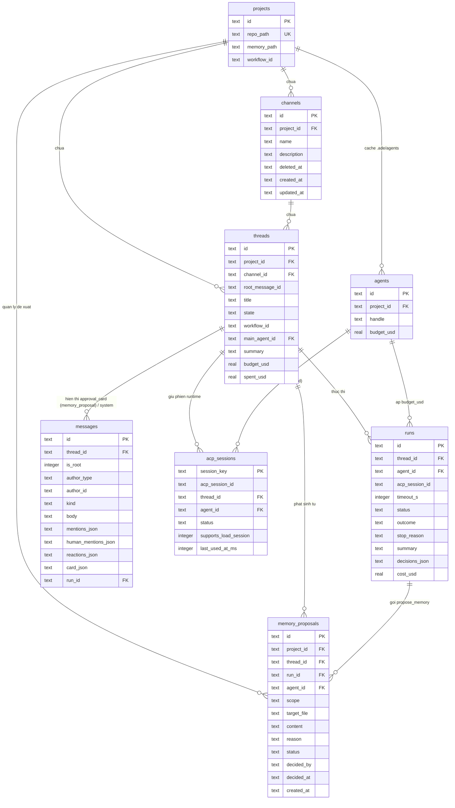
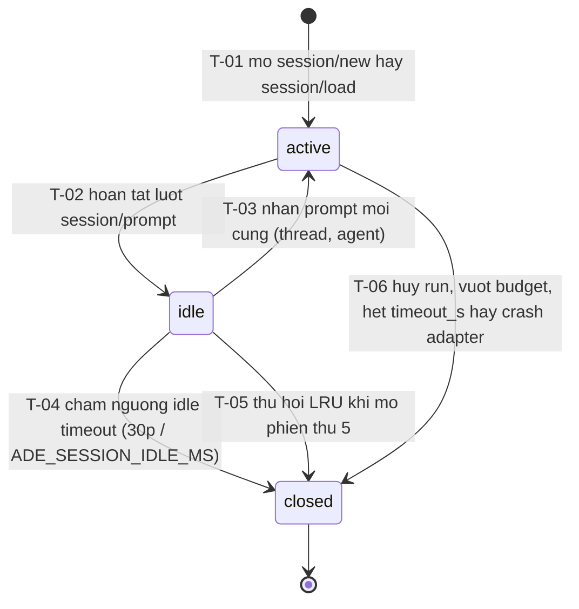

# Module Overview — Memory & Hoàn thiện Vận hành (`memory`)

| Trường | Giá trị |
| --- | --- |
| Loại tài liệu | Overview Module (`memory` — Phase P6) |
| Đường dẫn chốt | `specs/dd/memory/overview.md` |
| Nguồn thiết kế gốc | `docs/spec.md`, `docs/phases.md`, [domain-model.md](../domain-model.md) |
| Schema ORM | `apps/hub/src/db/schema.ts` (SQLite · Drizzle ORM) |
| Schema Zod | `packages/shared/src/schemas/memory.ts`, `packages/shared/src/schemas/ade-config.ts`, `packages/shared/src/schemas/runner.ts` (`NormalizedRunEventSchema`) |
| Ngày tạo | 2026-10-31 |
| Ngày cập nhật | 2026-10-31 |

## Lịch sử sửa đổi

| Ver | Ngày | Tác giả | Thay đổi |
| --- | --- | --- | --- |
| 1.0 | 2026-10-31 | Kiến trúc sư ADE | Phát hành thiết kế chi tiết lần đầu cho module `memory` và vận hành an toàn P6 |
| 1.1 | 2026-10-31 | Kiến trúc sư ADE | Đồng bộ `Run/T-14`, event `run.usage_updated` / `budget.warning`, `approval_card` (`memory_proposal`), thứ tự fallback `ThreadSummaryService`, điều kiện `<skill>` và tách khối Gherkin `AcpSession` |
| 1.2 | 2026-10-31 | Kiến trúc sư ADE | Đồng bộ kiến trúc Prototype v1.2 (`design.md` & `domain-model.md`): Modal Cài đặt dự án (`ade-modal-shell`) cho Tab `Memory` và Tab `Workflows`, Ngăn phản hồi Thread co giãn (`Thread Reply Panel`, `340px..780px`) với Header 2 tầng cho ngân sách thread + khối `threads.summary` + `MemoryProposalCard` (`.ade-gate-card`), và kế thừa workflow từ `projects.workflow_id` (kênh không có `default_workflow`) |
| 1.3 | 2026-10-31 | Kiến trúc sư ADE | Bổ sung bảng `channels`, cột `runs.timeout_s` và các cột `mentions_json`, `human_mentions_json`, `reactions_json` (`'[]'`) của `messages` vào `erDiagram` và `BudgetGuard`, đồng thời mở rộng `AcpSession/T-06` bao phủ `Run/T-15` (`Run Timeout Timer`) |

---

## 1. Phạm vi & Quyết định kiến trúc đã chốt

- **Trong phạm vi**:
  1. Hai tầng ghi nhớ của PoC: **Project Memory** (`.ade/memory/*.md`) có cổng duyệt đề xuất từ agent và **Thread Memory** (`threads.summary`, giới hạn 300–500 từ) tự động cập nhật không dùng LLM ngoài, hiển thị trực tiếp trong Ngăn phản hồi Thread (`Thread Reply Panel`).
  2. Bộ lắp ngữ cảnh **Prompt Assembly** (`PromptAssembler`) cố định 6 khối theo thứ tự chuẩn kèm thuật toán cắt tỉa token tất định.
  3. Bộ kiểm soát ngân sách **BudgetGuard** theo hai cấp (`agents.budget_usd` và `threads.budget_usd`), ghi nhận `run.usage_updated`, phát event `budget.warning` khi còn `<= 20%` hạn mức và dừng cưỡng bức tiến trình run theo `Run/T-14` khi vượt trần.
  4. Bộ quản lý vòng đời phiên ACP **AcpSessionPool** (`active` → `idle` → `closed`, tự đóng sau `30 phút` không hoạt động, trần `4` phiên đồng thời thu hồi theo LRU, khôi phục phiên đóng kèm `threads.summary`), đóng vai trò SSOT duy nhất cho `State machine — AcpSession.status`.
  5. Trình soạn thảo và kiểm tra cấu trúc nghiệp vụ cho `.ade/workflows/*.yaml` trên Tab `Workflows` bên trong Modal Cài đặt dự án (`ade-modal-shell`); mọi thread kế thừa workflow từ `projects.workflow_id` trong `.ade/project.yaml` (bảng `channels` không có trường `default_workflow`).
- **Ngoài phạm vi**: tìm kiếm vector (`pgvector`), tự động trích xuất memory sang bảng riêng bằng LLM nền, workflow kéo thả bằng đồ hoạ, cấu hình workflow riêng theo từng kênh, hạn mức thanh toán đa người dùng (`ADE_MODE=team|vps`).
- **Phạm vi chế độ triển khai (`ADE_MODE=solo`)**: mọi thao tác cấu hình và quyết định duyệt thuộc về chủ dự án cục bộ (`usr_local`, `role = owner`) kết nối từ `localhost` / `127.0.0.1`.
- **Câu hỏi mở**: Không có.

### Ma trận tài liệu con trong module `memory`

| Mã DD | Loại | Đường dẫn chốt | Nội dung |
| --- | --- | --- | --- |
| `UI-MM-01` | UI DD | [specs/dd/memory/mm-01/ui-memory-workflow.md](./mm-01/ui-memory-workflow.md) | Tab `Memory` và Tab `Workflows` trong Modal Cài đặt dự án (`ade-modal-shell`), cùng thanh ngân sách Tầng 2 Header, khối tóm tắt `threads.summary` và thẻ `MemoryProposalCard` (`.ade-gate-card`) trong Ngăn phản hồi Thread (`Thread Reply Panel`) |
| `API-MM-01` | API / MCP DD | [specs/dd/memory/mm-01/api-memory-workflow.md](./mm-01/api-memory-workflow.md) | MCP `propose_memory`, CRUD `.ade/memory/*.md`, duyệt `memory_proposals`, đọc/ghi `.ade/workflows/*.yaml` |
| `E0` | Domain Model | [specs/dd/domain-model.md](../domain-model.md) | State machine `MemoryProposal.status` (`MemoryProposal/T-01..T-03`) và `Run.status` (`Run/T-14`, `Run/T-15`) |

---

## 2. Sơ đồ quan hệ dữ liệu của module (`erDiagram`)



> Ghi chú: `acp_sessions` là bảng trạng thái runtime lưu trong bộ nhớ của `AcpSessionPool` bên phía `packages/runner` (không ghi xuống SQLite); cột tham chiếu đối soát sang lịch sử thực thi là `runs.acp_session_id`.

---

## 3. Hai tầng Memory của PoC

### 3.1. Tầng 1 — Project Memory (`.ade/memory/*.md`)

| Thuộc tính | Quy định bắt buộc |
| --- | --- |
| Nguồn sự thật | Các tệp Markdown `*.md` trong `<repo_path>/.ade/memory/` (mặc định theo `projects.memory_path`). |
| Đọc khi lắp prompt | Runner phải đọc trực tiếp từ thư mục `.ade/memory/*.md` bên trong worktree của thread (`<repo_path>/.ade/wt/<thread_id>/.ade/memory/`) nếu worktree đã khởi tạo, ngược lại đọc từ `<repo_path>/.ade/memory/`, sắp xếp tên tệp tăng dần theo mã ASCII (`A → Z`). |
| Đọc chủ động từ Agent | Agent có grant active trên thread gọi MCP tool `read_memory({ scope: "project", query })` để đọc toàn văn nội dung từng tệp mà không bị cắt ngắn. |
| Ghi từ Agent | Agent không được ghi thẳng vào `.ade/memory/` qua API hệ thống; khi muốn đề xuất bổ sung kiến thức dự án trên một thread thuộc kênh đang hoạt động (`channels.deleted_at IS NULL`), agent phải gọi MCP tool `propose_memory` để khởi tạo bản ghi `memory_proposals` theo `MemoryProposal/T-01` (`status = 'pending'`), tạo bản ghi `messages` có `is_root = 0`, `kind = 'approval_card'`, `mentions_json = '[]'`, `human_mentions_json = '[]'`, `reactions_json = '[]'` và `card_json.cardType = 'memory_proposal'` (khớp `MemoryCardPayloadSchema`) hiển thị dưới dạng thẻ cổng người duyệt `MemoryProposalCard` (`.ade-gate-card`) trong luồng dọc của Ngăn phản hồi Thread (`Thread Reply Panel`), và ghi event `memory.proposed`. |
| Cổng duyệt của chủ dự án | Khi chủ dự án chọn **Duyệt** (`approve`), hệ thống phải chuyển trạng thái theo `MemoryProposal/T-02` sang `'approved'`, ghi nguyên tử nội dung vào `<repo_path>/.ade/memory/<target_file>`, đồng bộ sang các worktree đang mở của dự án và ghi event `memory.resolved(approve)`. Khi chọn **Từ chối** (`reject`), hệ thống phải chuyển theo `MemoryProposal/T-03` sang `'rejected'`, giữ nguyên tệp trên đĩa và ghi event `memory.resolved(reject)`. |
| Sửa trực tiếp từ UI | Chủ dự án sửa nội dung Markdown trên Tab `Memory` bên trong Modal Cài đặt dự án (`ade-modal-shell` của `UI-MM-01`) gọi `PUT /api/projects/:projectId/memory/:fileName` để ghi trực tiếp vào `<repo_path>/.ade/memory/:fileName`. |

### 3.2. Tầng 2 — Thread Memory (`threads.summary`)

`threads.summary` lưu bản tóm tắt cuốn chiếu của thread với mục tiêu độ dài từ **300 đến 500 từ** và trần cứng **500 từ** (đếm từ bằng biểu thức `text.trim().split(/\s+/).filter(Boolean).length`), tuyệt đối không gọi LLM ngoài và không yêu cầu API key trên Hub.

| Quy tắc | Kích hoạt | Hành vi bắt buộc của `ThreadSummaryService` |
| --- | --- | --- |
| Khởi tạo tiền tố khi trống | Khi `threads.summary` đang là `NULL` hay chuỗi rỗng sau `trim` trước lúc nối đoạn ghi nhận đầu tiên | Hệ thống phải khởi tạo tiền tố `Mục tiêu: <threads.title>\n` làm dòng mở đầu của `threads.summary` trước khi ghép đoạn ghi nhận của run. |
| Cập nhật chuẩn từ `report_outcome` | Khi nhận event `run.completed` mà `runs.outcome IN ('done', 'blocked', 'needs_revision')` và `runs.summary` sau `trim` khác rỗng | Hệ thống phải tạo đoạn ghi nhận mới theo khuôn `[@<handle> · <outcome>] <runs.summary>` kèm dòng `Quyết định: <d1>; <d2>` (nếu mảng `decisions_json` có ít nhất 1 phần tử), nối vào cuối `threads.summary`, áp dụng hàm cắt cửa sổ 500 từ, cập nhật cột `threads.summary`, ghi event `thread.summary_updated` với `source = 'report_outcome'` và phát `thread.summary_updated` qua WebSocket `/ws` để cập nhật khối tóm tắt trong Ngăn phản hồi Thread. |
| Fallback tất định khi thiếu `report_outcome` | Khi nhận event `run.completed` mà `runs.outcome = 'unknown'` hay `runs.summary` sau `trim` là chuỗi rỗng | Hệ thống phải trích xuất văn bản phản hồi của `run_id` theo đúng thứ tự ưu tiên: (1) lấy `messages.body` mới nhất có `messages.run_id = run_id` và `messages.kind IN ('text', 'explorer_card')`; (2) nếu không có bản ghi thoả bước (1) hay `body` sau `trim` rỗng thì lấy `card_json.lastMessageText` của bản ghi `messages` có `kind = 'live_card'` gắn với `run_id`; (3) nếu sau `trim` vẫn rỗng thì lấy chuỗi cố định `(không có nội dung phản hồi)`. Tiếp theo, hệ thống phải chuẩn hoá các ký tự trắng liên tiếp thành một dấu cách đơn, đóng gói theo khuôn `[@<handle> · fallback] <fallback_text>`, nối vào cuối `threads.summary`, áp dụng hàm cắt cửa sổ 500 từ, cập nhật cột `threads.summary`, ghi event `thread.summary_updated` với `source = 'fallback_last_message'` và phát `thread.summary_updated` qua WebSocket `/ws`. |
| Quy tắc cắt cửa sổ 500 từ | Khi tổng số từ của chuỗi ghép vượt quá `500` từ | Hệ thống phải giữ nguyên dòng đầu tiên `Mục tiêu: <threads.title>` và cắt bỏ các từ cũ nhất ở phần thân lịch sử từ trên xuống sao cho tổng số từ của toàn bộ `threads.summary` bằng đúng `500` từ (giữ trọn vẹn các đoạn ghi nhận mới nhất ở cuối). |

---

## 4. Quy tắc lắp Prompt chuẩn 6 khối (`PromptAssembler`)

Mỗi khi khởi chạy `session/prompt` (trên driver ACP) hay `query()` (trên driver Claude), `PromptAssembler` phải ghép chuỗi ngữ cảnh gồm đúng **6 khối thẻ XML** theo thứ tự cố định dưới đây, ngăn cách giữa hai khối liền kề bằng đúng hai ký tự xuống dòng (`\n\n`):

| Thứ tự | Thẻ XML | Nội dung bên trong | Chính sách khi vượt trần token |
| --- | --- | --- | --- |
| 1 | `<project_memory>` | Các tệp `.ade/memory/*.md` ghép theo thứ tự tên tệp tăng dần với tiêu đề `### <fileName>\n<content>`. Nếu không có tệp nào thì ghi `(trống)`. | Cắt ở **Bước 2** (chỉ sau khi `<recent_messages>` đã lược hết). |
| 2 | `<thread>` | `Title: <threads.title>\nState: <threads.state>\nSummary:\n<summary_text>` (nếu `threads.summary` sau `trim` khác rỗng thì `<summary_text>` bằng `threads.summary`; ngược lại ghi `(chưa có tóm tắt)`). | **Giữ nguyên 100%** (không bao giờ cắt). |
| 3 | `<recent_messages>` | Tối đa **10** tin nhắn gần nhất (`kind IN ('text', 'explorer_card', 'system')`) theo thứ tự thời gian từ cũ đến mới: `[<created_at>] <author>: <body>`. Với worker có `scope = 'brief'`, khối này ghi `(chế độ brief — dùng ade.get_thread nếu được cấp full)`. | Cắt đầu tiên ở **Bước 1** từ tin cũ nhất đến tin mới nhất. |
| 4 | `<skill>` | Nếu lệnh dispatch có chỉ định skill riêng thì nhúng toàn văn `SKILL.md`; ngược lại nếu agent có gắn skill thì liệt kê `<name>: <description>`; nếu trống cả hai thì ghi `(không chỉ định skill riêng)`. | **Giữ nguyên 100%** (không bao giờ cắt). |
| 5 | `<task>` | Câu lệnh nhiệm vụ truyền vào run từ nguồn kích hoạt (`@mention`, `dispatch`, `delegate`, `resume_main`). | **Giữ nguyên 100%** (không bao giờ cắt). |
| 6 | `<tools_hint>` | Chuỗi hướng dẫn cố định: `Dùng ade.post_progress để báo tiến độ, ade.ask_human để đặt câu hỏi cho người dùng, ade.read_memory và ade.get_thread để đọc thêm ngữ cảnh, và bắt buộc gọi ade.report_outcome trước khi kết thúc run.` | **Giữ nguyên 100%** (không bao giờ cắt). |

### Thuật toán ước lượng và cắt tỉa token tất định

1. **Công thức ước lượng token**: `estimateTokens(text) = Math.ceil(text.length / 4)`. Trần mặc định là `maxTokens = 8000` (cho phép ghi đè qua tham số `maxTokens` khi gọi hàm).
2. **Kiểm tra ban đầu**: Nếu `estimateTokens(fullPrompt) <= maxTokens`, `PromptAssembler` phải trả nguyên văn chuỗi 6 khối mà không sửa đổi bất kỳ ký tự nào.
3. **Bước 1 — Lược bớt `<recent_messages>` từ tin cũ nhất**:
   - Trong khi `estimateTokens(prompt) > maxTokens` và danh sách tin nhắn trong `<recent_messages>` còn ít nhất 1 tin nhắn, `PromptAssembler` phải loại bỏ phần tử đầu mảng (tin nhắn cũ nhất) rồi dựng lại khối `<recent_messages>`.
   - Khi mảng tin nhắn về `0` phần tử, thân khối `<recent_messages>` phải mang giá trị cố định: `[đã lược bớt tin nhắn cũ — dùng ade.get_thread để đọc đầy đủ]`.
4. **Bước 2 — Cắt đuôi từng tệp trong `<project_memory>`**:
   - Nếu sau khi mảng tin nhắn đã về `0` phần tử mà `estimateTokens(prompt) > maxTokens`, `PromptAssembler` phải tính quỹ ký tự còn lại cho thân khối `<project_memory>`:
     `budgetChars = Math.max(0, maxTokens * 4 - otherFiveBlocksAndWrapperLength)`.
   - Duyệt tuần tự các tệp theo thứ tự tên tệp tăng dần (`A → Z`), ký hiệu hậu tố cắt bớt cố định là:
     `\n[đã cắt bớt — dùng ade.read_memory để đọc đầy đủ]`
   - Tệp nào có tổng độ dài `header + content` nhỏ hơn hay bằng `budgetChars` còn lại thì được giữ nguyên và trừ vào `budgetChars`; tệp đầu tiên vượt `budgetChars` sẽ bị cắt đuôi phần `content` sao cho `header + slicedContent + suffix` vừa khít `budgetChars` (nếu `budgetChars` nhỏ hơn độ dài `header + suffix` thì chỉ xuất `### <fileName>\n[đã cắt bớt — dùng ade.read_memory để đọc đầy đủ]`), và mọi tệp kế tiếp cũng chỉ xuất tiêu đề kèm đúng dòng chú thích `[đã cắt bớt — dùng ade.read_memory để đọc đầy đủ]`.

---

## 5. Kiểm soát Ngân sách & Event Sourcing (`BudgetGuard`)

1. **Luồng ghi nhận chi phí giữa chừng run (`run.usage_updated`) và khi kết thúc (`run.end`)**:
   - Khi Runner nhận cập nhật chi phí từ Claude Agent SDK hay adapter ACP trong lúc run đang ở trạng thái `running`, Runner phải gửi thông điệp `run.event` với nhánh thứ 5 `kind = 'usage'` của `NormalizedRunEventSchema` mang dữ liệu `{ cost_usd, tokens_in, tokens_out }` (trong đó `cost_usd` là chi phí luỹ kế hiện tại của `run_id`).
   - Khi nhận `run.event(kind = 'usage')`, Hub chuyển thẳng vào `BudgetGuard` (không gom qua `ProgressAggregator` của `run.progress`) để ghi event append-only `run.usage_updated` (`payload: { run_id, cost_usd, tokens_in, tokens_out }`) vào bảng `events`; projector cập nhật `runs.cost_usd = payload.cost_usd`. Ngoài ra, khi nhận `run.end` có kèm `usage.cost_usd`, `BudgetGuard` cũng cập nhật `runs.cost_usd = usage.cost_usd` và kiểm tra ngưỡng ngân sách trước khi chốt `Run/T-08` hay chuyển sang `Run/T-14`.
   - Khi một run kết thúc qua `run.completed` (`Run/T-08`), `run.failed` (`Run/T-09`, `Run/T-14`, `Run/T-15`) hay `run.cancelled` (`Run/T-10..T-12`), projector gán `runs.cost_usd = COALESCE(payload.cost_usd, runs.cost_usd)` trước rồi cộng `runs.cost_usd` vào `threads.spent_usd`. Nhờ đó khi chạy `scripts/verify/replay-events.ts`, cả `runs.cost_usd` và `threads.spent_usd` (bằng tổng `cost_usd` của các run đã kết thúc trong thread) được dựng lại khớp 100% từ bảng `events`.

| Cấp kiểm soát | Chi phí luỹ kế tức thời (`live_spent_usd`) | Cột hạn mức | Ngưỡng cảnh báo sớm (`remaining_ratio <= 0.20`, đã dùng `>= 80%`) | Ngưỡng dừng cưỡng bức (vượt `100%` — `Run/T-14`) |
| --- | --- | --- | --- | --- |
| Cấp Agent (`scope = 'agent'`) | `runs.cost_usd` | `agents.budget_usd` (`NULL` = không áp trần) | `runs.cost_usd >= 0.8 * agents.budget_usd` và `runs.cost_usd <= agents.budget_usd` | `runs.cost_usd > agents.budget_usd` |
| Cấp Thread (`scope = 'thread'`) | `threads.spent_usd + runs.cost_usd` | `threads.budget_usd` (`NULL` = không áp trần) | `(threads.spent_usd + runs.cost_usd) >= 0.8 * threads.budget_usd` và `(threads.spent_usd + runs.cost_usd) <= threads.budget_usd` | `threads.spent_usd + runs.cost_usd > threads.budget_usd` |

2. **Khi chạm ngưỡng cảnh báo sớm (`remaining_ratio <= 0.20`)**:
   - Với `remaining_ratio = (budget_usd - live_spent_usd) / budget_usd`, khi `0 <= remaining_ratio <= 0.20`, `BudgetGuard` phải ghi event append-only `budget.warning` vào bảng `events` với `payload` gồm `{ scope, run_id, spent_usd: live_spent_usd, budget_usd, remaining_ratio }` (mỗi cấp tối đa 1 lần cho mỗi run/thread) và phát sự kiện `budget.warning` qua WebSocket `/ws`.
3. **Khi vượt ngưỡng `100%` (`Run/T-14`)**:
   - Nếu `(agents.budget_usd IS NOT NULL AND runs.cost_usd > agents.budget_usd)` hay `(threads.budget_usd IS NOT NULL AND threads.spent_usd + runs.cost_usd > threads.budget_usd)`, `BudgetGuard` phải thực thi chuyển trạng thái `Run/T-14` sang `failed`:
     * Gửi lệnh `run.cancel` xuống `RunnerTransport` để dừng tiến trình harness ngay lập tức (đồng thời kích hoạt `AcpSession/T-06` đóng phiên nếu run chạy trên ACP);
     * Nhả khoá ghi của thread và cộng `runs.cost_usd` vào `threads.spent_usd`;
     * Ghi event `run.failed` vào bảng `events` với `stop_reason = 'budget_exceeded'`, `error_code = 'ERR_BUDGET_EXCEEDED'` và `cost_usd`;
     * Tạo bản ghi `messages` có `is_root = 0`, `kind = 'system'`, `mentions_json = '[]'`, `human_mentions_json = '[]'`, `reactions_json = '[]'` nêu rõ lý do `budget_exceeded` cùng số tiền đã tiêu so với hạn mức trong Ngăn phản hồi Thread, ghi event `message.posted` (`is_root: false`, `mentions: []`, `human_mentions: []`) và phát `run.failed` cùng `message.posted` (`is_root: false`, `mentions: []`, `human_mentions: []`) qua WebSocket `/ws`.

---

## 6. Quản lý vòng đời Session ACP (`AcpSessionPool`)

`AcpSessionPool` thuộc `packages/runner` quản lý tập phiên kết nối tới tiến trình adapter ACP (như `codex-acp`) theo khoá `sessionKey = "${threadId}:${agentId}"` và là nguồn sự thật duy nhất (SSOT) cho `State machine — AcpSession.status`:

- **Giới hạn đồng thời**: tối đa **`4`** phiên có trạng thái thuộc `('active', 'idle')` tại cùng một thời điểm (`MAX_ACP_SESSIONS = 4`).
- **Thời gian chờ đóng tự động**: mặc định **`30 phút`** (`1800000` ms). Giá trị này đọc từ biến môi trường `ADE_SESSION_IDLE_MS` (số nguyên dương tính bằng mili-giây) để kiểm thử tự động trong `scripts/verify/session-idle.ts` với giá trị `5000` ms (5 giây).
- **Chính sách thu hồi LRU khi mở phiên thứ 5**: Khi đã có đủ `4` phiên đang mở (`active` hay `idle`) và cần mở phiên cho khoá thứ 5:
  - Nếu có ít nhất 1 phiên ở trạng thái `idle`, `AcpSessionPool` phải chọn phiên `idle` có `last_used_at_ms` nhỏ nhất (cũ nhất), chuyển phiên đó sang `closed` theo `AcpSession/T-05` trước khi mở phiên mới theo `AcpSession/T-01`.
  - Nếu cả `4` phiên đều đang `active`, yêu cầu chạy mới phải xếp hàng chờ đến khi có ít nhất 1 phiên chuyển sang `idle` hay `closed`.
- **Chính sách mở lại khi phiên trước đã `closed`**: Khi người dùng gửi tin nhắn nối tiếp hay rule dispatch lại vào cặp `(threadId, agentId)` mà phiên trước đã ở trạng thái `closed`:
  - Nếu adapter ACP khai báo `capabilities.loadSession === true`, Runner phải gọi phương thức JSON-RPC `session/load` với `acp_session_id` trước đó để khôi phục phiên.
  - Nếu adapter không khai báo `capabilities.loadSession === true` hay lời gọi `session/load` trả lỗi, Runner phải gọi `session/new` để tạo phiên mới và bắt buộc tiêm lại `threads.summary` hiện hành thông qua `PromptAssembler` vào lượt `session/prompt` đầu tiên.

### State machine — `AcpSession.status`

| Trường | Giá trị |
| --- | --- |
| Thực thể | `AcpSession` (bảng trạng thái runtime trong `AcpSessionPool` của `packages/runner`) |
| Cột | `status` — chuỗi cố định `AcpSessionStatusSchema` (`'active' \| 'idle' \| 'closed'`) |
| Trạng thái đầu | `active` (khi khởi tạo qua `session/new` hay khôi phục qua `session/load`) |
| Trạng thái cuối | `closed` |
| Khi bị cấm | HTTP `400` `ERR_INVALID_STATUS` (ném `AdeDomainError('ERR_INVALID_STATUS', 400)` trong tiến trình Runner) |

#### Trạng thái

| Trạng thái | Ý nghĩa nghiệp vụ | Được sửa dữ liệu? |
| --- | --- | --- |
| `active` | Phiên ACP đang thực thi lượt `session/prompt` cho một run đang chạy; không bị thu hồi bởi bộ dọn LRU hay bộ hẹn giờ idle | Có (cập nhật `last_used_at_ms`) |
| `idle` | Lượt `session/prompt` đã hoàn tất, tiến trình adapter vẫn giữ sống để chờ người dùng reply tiếp trong giới hạn `ADE_SESSION_IDLE_MS` | Có (cập nhật hẹn giờ, thu hồi LRU) |
| `closed` | Tiến trình adapter của phiên đã đóng hẳn và giải phóng khỏi bảng `4` slot đồng thời | Không |

#### Sơ đồ



#### Chuyển trạng thái

| ID | Từ | Sự kiện | Guard | Sang | Actor | Side effect | API / job |
| --- | --- | --- | --- | --- | --- | --- | --- |
| T-01 | — | Yêu cầu chạy cho `(thread_id, agent_id)` chưa có phiên mở (kể cả khi phiên cũ đã `closed`) | Số phiên `status IN ('active', 'idle')` `< 4` (sau khi đã thực thi `T-05` nếu pool đầy) | `active` | `AcpSessionPool` | Nếu phiên trước đã `closed` và `supports_load_session = 1` thì gọi `session/load`; ngược lại gọi `session/new` kèm inject `threads.summary`; gán `last_used_at_ms = now()` | `RunnerTransport` (`run.start` / `run.prompt`) |
| T-02 | `active` | Lượt `session/prompt` trả về `stopReason` hợp lệ | Tiến trình adapter còn sống | `idle` | `AcpSessionPool` | Cập nhật `last_used_at_ms = now()`; đặt timer hết hạn sau `idleTimeoutMs` (`ADE_SESSION_IDLE_MS`, mặc định `1800000` ms) | Driver ACP (`run.end`) |
| T-03 | `idle` | Nhận lệnh chạy mới cho cùng `(thread_id, agent_id)` | Tiến trình adapter còn sống | `active` | `AcpSessionPool` | Xoá timer idle đang đếm; cập nhật `last_used_at_ms = now()`; gửi `session/prompt` trên phiên hiện có | `RunnerTransport` (`run.start` / `run.prompt`) |
| T-04 | `idle` | Bộ hẹn giờ idle chạm hạn mức | `now() - last_used_at_ms >= idleTimeoutMs` | `closed` | Idle Timer | Dừng tiến trình adapter ACP; xoá phiên khỏi tập 4 slot đang mở | Timer nền của `AcpSessionPool` |
| T-05 | `idle` | Yêu cầu mở phiên thứ 5 khi đã có 4 phiên mở | Tổng số phiên `active \| idle` bằng `4` và đây là phiên `idle` có `last_used_at_ms` nhỏ nhất | `closed` | `AcpSessionPool` | Huỷ timer idle; dừng tiến trình adapter ACP của phiên cũ nhất để giải phóng 1 slot | `AcpSessionPool.acquire()` |
| T-06 | `active` | Run bị huỷ, dừng cưỡng bức theo `Run/T-14` (`budget_exceeded`), hết hạn `runs.timeout_s` theo `Run/T-15` (`Run Timeout Timer` gửi `run.cancel`) hay tiến trình adapter thoát bất thường | — | `closed` | `AcpSessionPool` / `BudgetGuard` / `Run Timeout Timer` | Kill tiến trình con ACP ngay lập tức; giải phóng slot trong pool | `run.cancel` / `BudgetGuard` / `Run Timeout Timer` |

#### Tiêu chí chấp nhận

```gherkin
Feature: AcpSession — vòng đời phiên ACP trong AcpSessionPool

  Scenario: AC-AcpSession-01 — Mở phiên ACP mới và chuyển sang idle sau khi xong lượt prompt (nguồn: AcpSession/T-01, AcpSession/T-02; nghiệm thu: scripts/verify/session-idle.ts)
    Given `AcpSessionPool` đang trống và `ADE_SESSION_IDLE_MS` được cấu hình là "5000"
    When Runner thực thi một lượt `run.start` cho cặp `("thr_01", "agt_coder")` đến khi nhận `stopReason` là "end_turn"
    Then phiên của `("thr_01", "agt_coder")` chuyển từ "active" sang trạng thái "idle"
    And tổng số phiên đang mở trong `AcpSessionPool` bằng 1

  Scenario: AC-AcpSession-02 — Tái sử dụng phiên idle khi nhận prompt tiếp theo trong thời hạn (nguồn: AcpSession/T-03; nghiệm thu: scripts/verify/session-idle.ts)
    Given phiên "ses_01" của cặp `("thr_01", "agt_coder")` đang ở trạng thái "idle" và chưa quá "5000" ms
    When người dùng gửi tiếp câu lệnh mới vào "thr_01" cho "agt_coder"
    Then "ses_01" chuyển sang trạng thái "active" với cùng `acp_session_id` ban đầu
    And bộ hẹn giờ đóng tự động trước đó của "ses_01" bị huỷ

  Scenario: AC-AcpSession-03 — Tự đóng phiên idle khi chạm ngưỡng ADE_SESSION_IDLE_MS (nguồn: AcpSession/T-04; nghiệm thu: scripts/verify/session-idle.ts)
    Given phiên "ses_01" của cặp `("thr_01", "agt_coder")` đang ở trạng thái "idle" với `ADE_SESSION_IDLE_MS` bằng "5000"
    When bộ hẹn giờ không hoạt động chạm mốc "5000" ms
    Then phiên "ses_01" chuyển sang trạng thái "closed"
    And tiến trình adapter ACP của "ses_01" được đóng và giải phóng khỏi `AcpSessionPool`

  Scenario: AC-AcpSession-04 — Mở lại phiên đã closed bằng session/new kèm threads.summary khi adapter không hỗ trợ session/load (nguồn: AcpSession/T-01; nghiệm thu: scripts/verify/session-idle.ts)
    Given phiên "ses_01" của cặp `("thr_01", "agt_coder")` đang ở trạng thái "closed" và adapter không hỗ trợ `session/load`
    And `threads.summary` của "thr_01" chứa chuỗi "Đã thống nhất kiến trúc JWT"
    When người dùng gửi tin nhắn reply mới vào "thr_01" cho "agt_coder"
    Then `AcpSessionPool` khởi tạo phiên mới ở trạng thái "active" qua `session/new`
    And nội dung `session/prompt` đầu tiên chứa chuỗi "Đã thống nhất kiến trúc JWT"

  Scenario: AC-AcpSession-05 — Mở phiên thứ 5 đóng phiên idle có last_used_at cũ nhất theo LRU (nguồn: AcpSession/T-05; nghiệm thu: scripts/verify/session-idle.ts)
    Given `AcpSessionPool` đang có 4 phiên ở trạng thái "idle" của "thr_01", "thr_02", "thr_03", "thr_04" trong đó "thr_01" có `last_used_at_ms` nhỏ nhất
    When Runner yêu cầu mở phiên thứ 5 cho cặp `("thr_05", "agt_coder")`
    Then phiên của "thr_01" chuyển sang trạng thái "closed"
    And các phiên của "thr_02", "thr_03", "thr_04" vẫn ở trạng thái "idle"
    And phiên của "thr_05" ở trạng thái "active" với tổng số phiên mở bằng 4

  Scenario Outline: AC-AcpSession-06 — Đóng cưỡng bức phiên active khi run bị dừng do vượt ngân sách hay hết hạn timeout_s (nguồn: AcpSession/T-06, Run/T-14, Run/T-15; nghiệm thu: scripts/verify/budget.ts, scripts/verify/session-idle.ts)
    Given phiên "ses_02" của cặp `("thr_02", "agt_coder")` đang ở trạng thái "active"
    When `<actor>` phát lệnh `run.cancel` huỷ tiến trình của run đang chạy trên "ses_02" do `<stopReason>`
    Then "ses_02" chuyển ngay sang trạng thái "closed"
    And tổng số phiên đang mở của cặp `("thr_02", "agt_coder")` bằng 0

    Examples:
      | actor             | stopReason      |
      | BudgetGuard       | budget_exceeded |
      | Run Timeout Timer | timeout         |

  Scenario: AC-AcpSession-07 — Chặn chuyển trạng thái bị cấm từ closed sang idle (nguồn: bị cấm; nghiệm thu: scripts/verify/session-idle.ts)
    Given phiên "ses_03" đang ở trạng thái "closed"
    When gọi hàm chuyển trạng thái của "ses_03" sang "idle"
    Then lời gọi bị từ chối với mã lỗi `ERR_INVALID_STATUS`
    And "ses_03" vẫn giữ trạng thái "closed"
```

---

## 7. Tiêu chí chấp nhận quy tắc nội bộ Module (`MM-OV`)

```gherkin
Feature: MM-OV — Quy tắc lắp ngữ cảnh, tóm tắt thread và kiểm soát ngân sách

  Scenario: AC-MM-OV-01 — PromptAssembler lắp đúng thứ tự 6 khối, điều kiện skill và cắt tỉa tất định khi vượt trần token (nguồn: §4; nghiệm thu: Vitest prompt-assembly.test.ts)
    Given thư mục `.ade/memory/` có hai tệp "architecture.md" và "conventions.md"
    And thread "thr_01" có `summary`, 10 tin nhắn gần nhất, lệnh dispatch chỉ định skill "implement" và một `task`
    When gọi `assemblePrompt` với trần `maxTokens` thấp hơn tổng độ dài ngữ cảnh
    Then đầu ra giữ đúng thứ tự 6 khối `<project_memory>`, `<thread>`, `<recent_messages>`, `<skill>`, `<task>`, `<tools_hint>`
    And các khối `<thread>`, `<skill>`, `<task>`, `<tools_hint>` được giữ nguyên toàn vẹn
    And các tin nhắn cũ nhất trong `<recent_messages>` bị lược trước khi đuôi tệp trong `<project_memory>` bị cắt kèm dòng "[đã cắt bớt — dùng ade.read_memory để đọc đầy đủ]"

  Scenario: AC-MM-OV-02 — ThreadSummaryService khởi tạo tiền tố mục tiêu, cập nhật từ report_outcome và áp dụng thứ tự fallback tất định (nguồn: §3.2; nghiệm thu: scripts/verify/summary.ts)
    Given thread "thr_01" có tiêu đề "Chuẩn hoá bộ nhớ dự án" và `threads.summary` ban đầu đang rỗng, sau đó hoàn tất "run_01" có gọi `report_outcome` (ghi `summary` và `decisions` với `source` là "report_outcome")
    And "run_02" trong "thr_01" không có `messages.kind = 'text'` riêng nhưng `live_card` của "run_02" có `card_json.lastMessageText` là "Đã rà soát xong cấu hình" và chưa gọi `report_outcome`
    When sự kiện `run.completed` của "run_02" được phát với `outcome` là "unknown"
    Then `threads.summary` của "thr_01" bắt đầu bằng dòng "Mục tiêu: Chuẩn hoá bộ nhớ dự án" và chứa cả kết quả "run_01" lẫn chuỗi "Đã rà soát xong cấu hình" của "run_02" với tổng độ dài không vượt quá 500 từ
    And bảng `events` có thêm bản ghi `thread.summary_updated` mang `source` là "fallback_last_message"

  Scenario: AC-MM-OV-03 — BudgetGuard ghi nhận run.usage_updated, dừng tiến trình và chuyển Run/T-14 sang failed khi vượt budget_usd (nguồn: §5, Run/T-14; nghiệm thu: scripts/verify/budget.ts)
    Given agent "@coder" có `budget_usd` bằng 0.50 và đang chạy "run_03" trong thread "thr_01"
    When Runner gửi `run.event` loại "usage" báo cáo `cost_usd` của "run_03" bằng 0.55
    Then bảng `events` ghi nhận `run.usage_updated` và `BudgetGuard` chuyển "run_03" theo `Run/T-14` sang trạng thái "failed" với `stop_reason` là "budget_exceeded"
    And bảng `events` có bản ghi `run.failed` chứa `error_code` là "ERR_BUDGET_EXCEEDED" và `threads.spent_usd` được cộng thêm 0.55
    And thread "thr_01" có thêm tin nhắn `kind` là "system" cảnh báo vượt ngân sách

  Scenario: AC-MM-OV-04 — BudgetGuard ghi event budget.warning khi ngân sách còn từ 20 phần trăm trở xuống (nguồn: §5; nghiệm thu: scripts/verify/budget.ts)
    Given thread "thr_01" có `budget_usd` bằng 1.00 và `spent_usd` đã chốt từ các run trước bằng 0.70
    When Runner gửi `run.event` loại "usage" báo cáo `cost_usd` của run hiện hành bằng 0.15 đưa tổng chi phí tức thời lên 0.85
    Then bảng `events` có thêm bản ghi `budget.warning` với `scope` là "thread", `spent_usd` bằng 0.85, `budget_usd` bằng 1.00 và `remaining_ratio` bằng 0.15, đồng thời phát qua WebSocket `/ws`
    And run đang thực thi vẫn tiếp tục ở trạng thái "running"
```
