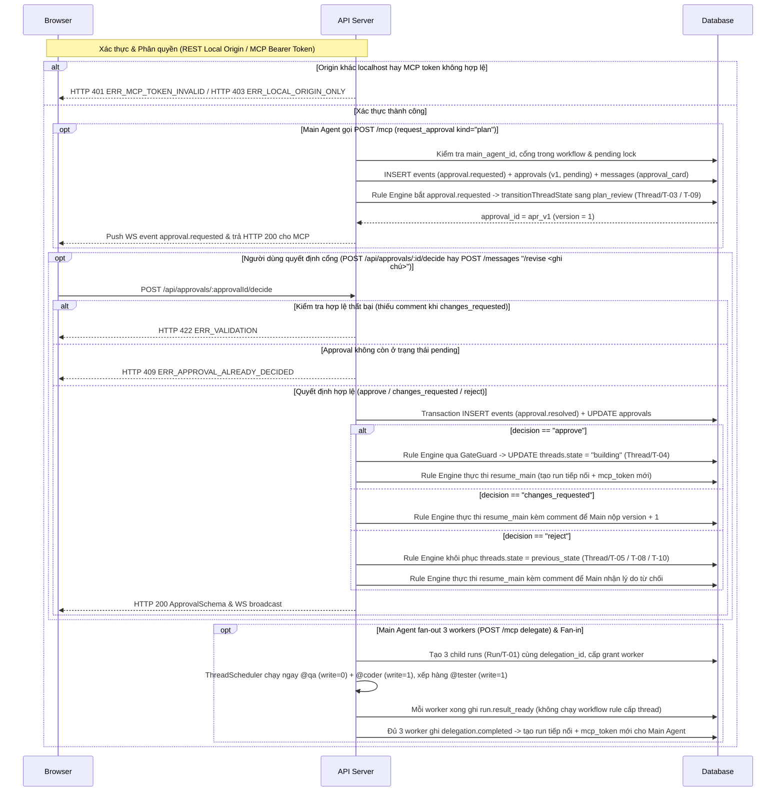

# API-OR-01 — POST /mcp & REST /api/threads/*, /api/approvals/* — Điều phối Đa Agent, Cổng duyệt & Scratchpad

| Trường | Giá trị |
| --- | --- |
| API ID | `API-OR-01` |
| Đường dẫn chốt | `specs/dd/orchestration/or-01/api-orchestration.md` |
| Method | `POST` / `GET` |
| Endpoint | `POST /mcp` · `GET /api/threads/:threadId` · `GET /api/channels/:channelId/threads` *(mở rộng `pendingApproval` ở P4)* · `GET /api/threads/:threadId/approvals` · `POST /api/approvals/:approvalId/decide` · `GET /api/threads/:threadId/scratchpads` · `POST /api/threads/:threadId/messages` |
| Phân quyền | REST `/api/*`: Header `Host` thuộc `{"localhost", "127.0.0.1"}` và (khi có mặt `Origin`) hostname của `Origin` thuộc `{"localhost", "127.0.0.1"}` · actor `usr_local` (`owner`) ở `ADE_MODE=solo` <br/> MCP `POST /mcp`: `Bearer <mcp_token>` gắn `(run_id, thread_id, agent_id)` đang chạy + kiểm tra grant `thread_agents` & `main_agent_id` |
| Zod schema | `McpToolsListOutputSchema`, `McpDelegateInputSchema`, `McpDelegateOutputSchema`, `McpGetResultsInputSchema`, `McpGetResultsOutputSchema`, `McpRequestApprovalInputSchema`, `McpRequestApprovalOutputSchema`, `McpGetRunLogInputSchema`, `McpGetRunLogOutputSchema`, `McpReadScratchpadInputSchema`, `McpWriteScratchpadInputSchema`, `McpScratchpadOutputSchema`, `McpGetThreadInputSchema`, `McpGetThreadOutputSchema`, `McpSetStateInputSchema`, `McpSetStateOutputSchema`, `ChannelIdParamSchema`, `ThreadIdParamSchema`, `ApprovalIdParamSchema`, `PendingApprovalSummarySchema`, `ThreadSchema`, `ThreadListResponseSchema`, `ThreadDetailResponseSchema`, `ApprovalListResponseSchema`, `ApprovalDecideInputSchema`, `ApprovalSchema`, `ScratchpadListResponseSchema`, `CreateMessageInputSchema`, `PostMessageResponseSchema` (`packages/shared`) |
| Hiện trạng BE | BE chưa implement (xây mới ở phase P4) |
| Ngày tạo | 2026-10-31 |
| Ngày cập nhật | 2026-10-31 |

## Lịch sử sửa đổi

| Ver | Ngày | Tác giả | Thay đổi |
| --- | --- | --- | --- |
| 1.0 | 2026-10-31 | — | Phát hành lần đầu cho Phase P4 (`orchestration`) |
| 1.1 | 2026-10-31 | — | Đồng bộ bố cục Slack, Header 2 tầng của Ngăn phản hồi Thread, `ApprovalGateCard` và schema `threads` / `messages` trong `domain-model.md` |
| 1.2 | 2026-10-31 | — | Đồng bộ Quy tắc #6 `AGENTS.md` cho `main_agent_id`, `runs.timeout_s` & `run.queued.timeout_s`, `reactions_json = '[]'`, `human_mentions_json = '["@owner"]'`, `channels.deleted_at IS NULL`, `PostMessageResponseSchema`, `replyCount`, `V-57 max:500`, `Host` + `Origin` và `get_thread.thread_id?` |
| 1.3 | 2026-10-31 | — | Đồng bộ chuỗi phối hợp `@explorer` (`messages.kind = 'explorer_card'` kèm `card_json` trong `get_thread` khi `scope = 'full'`), chuyển quyền `/main @planner`, `/main @spec`, `Clarifier` `ask_human` trước `request_approval` (`plan \| spec \| review`) và bổ sung `AC-API-OR-01-46` |
| 1.4 | 2026-10-31 | — | Bổ sung đặc tả JSON-RPC `tools/list` theo vai trò `main` và `worker` (`S1-03b`, `AC-API-OR-01-47`), đồng bộ `ExplorerCitationSchema[]` cùng `is_root` trong `get_thread` (`S1-15`, `AC-API-OR-01-46`) và mở rộng `pendingApproval` trên `ThreadListResponseSchema` cùng `ThreadDetailResponseSchema` (`S2-03`, `AC-API-OR-01-13`, `AC-API-OR-01-48`) |

---

## 1. Mục đích

- **Actor**: Main Agent và Worker Agent gọi qua ADE MCP Server (`POST /mcp`); người dùng `usr_local` (`role = 'owner'`) gọi qua trình duyệt trên màn hình [UI-OR-01](./ui-orchestration.md).
- **Use case**: Cung cấp tập công cụ MCP (output dạng `snake_case`) để Main Agent đọc lại ngữ cảnh thread (bao gồm cả thẻ khám phá mã nguồn `explorer_card` của `@explorer`), giao việc song song cho Worker có quyền ghi (`@coder`, `@tester`) cùng Worker chỉ đọc (`@qa`, `@reviewer`, `@explorer`), gom kết quả fan-in, xin người dùng duyệt cổng (`plan`, `spec`, `review`) sau bước phỏng vấn `ask_human`, lưu nháp trên scratchpad cô lập; đồng thời cung cấp REST API và cú pháp `@mention` cùng lệnh chat (`/main`, `/approve`, `/revise`) để người dùng đọc trạng thái điều phối thread, đổi Main Agent (`/main @planner`, `/main @spec`, `/main @lead`), quyết định cổng duyệt và đọc scratchpads.
- **Kết quả thành công**: Mọi thay đổi điều phối được ghi append-only vào bảng `events`, đồng bộ sang các bảng projection (`threads`, `runs`, `thread_agents`, `approvals`, `agent_scratchpads`, `messages`), chỉ Rule Engine đổi `threads.state` trong luồng nghiệp vụ, bảo toàn khoá ghi theo thread và không cho vượt cổng khi chưa có quyết định `approved`.
- **Ngoài phạm vi**: API trả lời thẻ xin quyền công cụ của harness (`POST /api/runs/:runId/permissions/:requestId/reply` thuộc P2), công cụ MCP đăng `ExplorerCard` (`post_message` với `kind = 'explorer_card'`), công cụ phỏng vấn làm rõ đa câu hỏi `Clarifier` (`ask_human` mảng `questions[]`) cùng API trả lời câu hỏi (`POST /api/threads/:threadId/questions/:questionId/reply` thuộc `API-TR-01` ở P3), và API duyệt đề xuất ghi nhớ dự án (`propose_memory` thuộc P6).
- **Giả định**: Các cơ sở hạ tầng Event Store, Rule Engine cơ bản, `InProcessRunnerTransport` và xác thực `mcp_token` của P1–P3 đã hoạt động ổn định.
- **Câu hỏi mở**: Không có.

## 2. Request

### 2.1 Headers & Phân quyền

| Header | Áp dụng cho | Bắt buộc | Mô tả |
| --- | --- | --- | --- |
| `Authorization` | `API-1` (`POST /mcp`) | Có | `Bearer <mcp_token>` gắn cứng với `(run_id, thread_id, agent_id)` đang ở trạng thái chạy |
| `Host` | `API-2`, `API-3`, `API-4`, `API-5`, `API-6` (`/api/*`) | Có | Hostname bắt buộc thuộc `{"localhost", "127.0.0.1"}` trong chế độ `ADE_MODE=solo` |
| `Origin` | `API-2`, `API-3`, `API-4`, `API-5`, `API-6` (`/api/*`) | Không | Khi có mặt, hostname của `Origin` bắt buộc thuộc `{"localhost", "127.0.0.1"}` trong chế độ `ADE_MODE=solo` |
| `Content-Type` | `API-1`, `API-4`, `API-6` | Có | `application/json` |

### 2.2 Path & Query params

| Tên | API | Loại | Bắt buộc | Zod | Mô tả |
| --- | --- | --- | --- | --- | --- |
| `:channelId` | `API-2` (`GET /api/channels/:channelId/threads`) | path | Có | `ChannelIdParamSchema` | Định danh kênh (`chn_<ULID>`) |
| `:threadId` | `API-2` (`GET /api/threads/:threadId`), `API-3`, `API-5`, `API-6` | path | Có | `ThreadIdParamSchema` | Định danh thread (`thr_<ULID>`) |
| `:approvalId` | `API-4` | path | Có | `ApprovalIdParamSchema` | Định danh bản ghi cổng duyệt (`apr_<ULID>`) |

### 2.3 Request body

#### `API-1: POST /mcp` (JSON-RPC `tools/list` & `tools/call`)

- Khi `method = "tools/list"` (`params` rỗng `{}` hay vắng mặt), API trả danh sách công cụ theo vai trò hiện hành của người gọi trong `McpToolsListOutputSchema` (`{ tools: [{ name, description, inputSchema }] }`):
  - Với Main Agent hiện hành (`callerGrant.role === 'main'`, `callerRun.role === 'main'` và `threads.main_agent_id === callerRun.agent_id`): trả `8` công cụ nền tảng P3 (`report_outcome`, `post_progress`, `post_message`, `ask_human`, `read_memory`, `get_thread`, `list_skills`, `load_skill`) cộng `6` công cụ P4 (`delegate`, `get_results`, `request_approval`, `get_run_log`, `read_scratchpad`, `write_scratchpad`), tổng cộng `14` công cụ (thành `15` công cụ khi `agents.mcp_allow` chứa `"set_state"`).
  - Với Worker hay Main Agent cũ đã bị hạ quyền sau lệnh `/main` (`callerGrant.role === 'worker'`, `callerRun.role !== 'main'` hay `threads.main_agent_id !== callerRun.agent_id`): trả `8` công cụ nền tảng P3 cộng `2` công cụ sổ nháp (`read_scratchpad`, `write_scratchpad`), tổng cộng `10` công cụ (thành `11` công cụ khi `agents.mcp_allow` chứa `"set_state"`), ẩn hoàn toàn `4` công cụ chỉ dành cho Main Agent (`delegate`, `get_results`, `request_approval`, `get_run_log`).
- Khi `method = "tools/call"`, bảng dưới đây đặc tả các công cụ P4 và phần mở rộng P4:

| Công cụ MCP (`params.name`) | Catalog key | Zod schema cho `params.arguments` | Các trường đầu vào | Output chính (`snake_case`) |
| --- | --- | --- | --- | --- |
| `delegate` | `orchestration.mcp.delegate` | `McpDelegateInputSchema` | `agent`, `task`, `inputs[]?`, `scope`, `expects`, `timeout_s?` | `run_id`, `delegation_id`, `status` |
| `get_results` | `orchestration.mcp.getResults` | `McpGetResultsInputSchema` | `delegation_id?` | `results[]` (`run_id`, `agent`, `status`, `outcome`, `summary`, `decisions`) |
| `request_approval` | `orchestration.mcp.requestApproval` | `McpRequestApprovalInputSchema` | `kind`, `title`, `summary`, `artifacts[]?`, `options[]?` | `approval_id`, `kind`, `version`, `status` |
| `get_run_log` | `orchestration.mcp.getRunLog` | `McpGetRunLogInputSchema` | `run_id`, `limit?` | `run_id`, `entries[]` |
| `read_scratchpad` | — | `McpReadScratchpadInputSchema` | *(trống `{}`)* | `thread_id`, `agent_id`, `content`, `updated_at` |
| `write_scratchpad` | `orchestration.mcp.writeScratchpad` | `McpWriteScratchpadInputSchema` | `content` | `thread_id`, `agent_id`, `content`, `updated_at` |
| `get_thread` *(mở rộng P4)* | `trigger.mcp.getThread` | `McpGetThreadInputSchema` | `include_messages?`, `thread_id?` | `thread_id`, `title`, `state`, `summary`, `scope`, `task`, `messages_hidden`, `messages[]` (`is_root`, `card_json`) |
| `set_state` *(bảo vệ cổng P4)* | `trigger.mcp.setState` | `McpSetStateInputSchema` | `to`, `reason` | `ok`, `state` |

#### `API-4: POST /api/approvals/:approvalId/decide` (`ApprovalDecideInputSchema`, catalog `orchestration.approval.decide`)

| Trường | Loại | Bắt buộc | Quy tắc | Mô tả |
| --- | --- | --- | --- | --- |
| `decision` | string | Có | `required` · `in:approve,changes_requested,reject` | Quyết định của người dùng trên cổng duyệt |
| `comment` | string | Bắt buộc khi `decision = 'changes_requested'`; tùy chọn ở `approve`, `reject` | `nullable` (khi `approve`, `reject`) · `required` · `trim` · `min:1` (khi `changes_requested`) · `max:4000` | Ghi chú yêu cầu sửa hay lý do từ chối gửi lại Main Agent |

#### `API-6: POST /api/threads/:threadId/messages` (`CreateMessageInputSchema`, catalog `chat.message.create` & `orchestration.chat.command`)

| Trường | Loại | Bắt buộc | Quy tắc | Mô tả |
| --- | --- | --- | --- | --- |
| `body` | string | Có | `required` · `trim` · `min:1` · `max:10000` | Tin nhắn thường chứa `@mention` hay lệnh `/main @handle`, `/approve`, `/revise <comment>` |

## 3. Kiểm tra hợp lệ (Validate)

> Mã message và nhãn trường tham chiếu [message.md](../../../message.md). Mỗi dòng chỉ chứa đúng một quy tắc kiểm tra.

| ID | Catalog key | Tên logic | Quy tắc kiểm tra | Mã message | Message |
| --- | --- | --- | --- | --- | --- |
| V-01 | `orchestration.mcp.delegate` | `delegate.agent` (`agent`) | `required` | MSG01 | Agent nhận việc là bắt buộc. |
| V-02 | `orchestration.mcp.delegate` | `delegate.agent` (`agent`) | `regex:^@[a-z0-9]+(?:-[a-z0-9]+)*$` | MSG04 | Định dạng Agent nhận việc không hợp lệ. |
| V-03 | `orchestration.mcp.delegate` | `delegate.agent` (`agent`) | `max:64` | MSG02 | Agent nhận việc không được vượt quá 64 ký tự. |
| V-04 | `orchestration.mcp.delegate` | `delegate.task` (`task`) | `required` | MSG01 | Nhiệm vụ giao việc là bắt buộc. |
| V-05 | `orchestration.mcp.delegate` | `delegate.task` (`task`) | `trim` | — | — |
| V-06 | `orchestration.mcp.delegate` | `delegate.task` (`task`) | `min:1` | MSG01 | Nhiệm vụ giao việc là bắt buộc. |
| V-07 | `orchestration.mcp.delegate` | `delegate.task` (`task`) | `max:8000` | MSG02 | Nhiệm vụ giao việc không được vượt quá 8000 ký tự. |
| V-08 | `orchestration.mcp.delegate` | `delegate.inputs` (`inputs`) | `nullable` | — | — |
| V-09 | `orchestration.mcp.delegate` | `delegate.inputs` (`inputs`) | `array` | MSG04 | Định dạng Dữ liệu đầu vào không hợp lệ. |
| V-10 | `orchestration.mcp.delegate` | `delegate.inputs` (`inputs`) | `max:20` | MSG04 | Định dạng Dữ liệu đầu vào không hợp lệ. |
| V-11 | `orchestration.mcp.delegate` | `delegate.inputs[]` (`inputs`) | `max:2000` | MSG02 | Dữ liệu đầu vào không được vượt quá 2000 ký tự. |
| V-12 | `orchestration.mcp.delegate` | `delegate.scope` (`scope`) | `required` | MSG01 | Phạm vi ngữ cảnh là bắt buộc. |
| V-13 | `orchestration.mcp.delegate` | `delegate.scope` (`scope`) | `in:brief,full` | MSG04 | Định dạng Phạm vi ngữ cảnh không hợp lệ. |
| V-14 | `orchestration.mcp.delegate` | `delegate.expects` (`expects`) | `required` | MSG01 | Kết quả kỳ vọng là bắt buộc. |
| V-15 | `orchestration.mcp.delegate` | `delegate.expects` (`expects`) | `trim` | — | — |
| V-16 | `orchestration.mcp.delegate` | `delegate.expects` (`expects`) | `min:1` | MSG01 | Kết quả kỳ vọng là bắt buộc. |
| V-17 | `orchestration.mcp.delegate` | `delegate.expects` (`expects`) | `max:1000` | MSG02 | Kết quả kỳ vọng không được vượt quá 1000 ký tự. |
| V-18 | `orchestration.mcp.delegate` | `delegate.timeout_s` (`timeoutS`) | `nullable` | — | — |
| V-19 | `orchestration.mcp.delegate` | `delegate.timeout_s` (`timeoutS`) | `integer` | MSG04 | Định dạng Thời gian chờ tối đa (giây) không hợp lệ. |
| V-20 | `orchestration.mcp.delegate` | `delegate.timeout_s` (`timeoutS`) | `min:5` | MSG04 | Định dạng Thời gian chờ tối đa (giây) không hợp lệ. |
| V-21 | `orchestration.mcp.delegate` | `delegate.timeout_s` (`timeoutS`) | `max:3600` | MSG04 | Định dạng Thời gian chờ tối đa (giây) không hợp lệ. |
| V-22 | `orchestration.mcp.getResults` | `get_results.delegation_id` (`delegationId`) | `nullable` | — | — |
| V-23 | `orchestration.mcp.getResults` | `get_results.delegation_id` (`delegationId`) | `regex:^dlg_[0-9A-Za-z]+$` | MSG04 | Định dạng Mã đợt giao việc không hợp lệ. |
| V-24 | `orchestration.mcp.getResults` | `get_results.delegation_id` (`delegationId`) | `max:64` | MSG02 | Mã đợt giao việc không được vượt quá 64 ký tự. |
| V-25 | `orchestration.mcp.requestApproval` | `request_approval.kind` (`kind`) | `required` | MSG01 | Loại cổng duyệt là bắt buộc. |
| V-26 | `orchestration.mcp.requestApproval` | `request_approval.kind` (`kind`) | `in:plan,spec,review` | MSG04 | Định dạng Loại cổng duyệt không hợp lệ. |
| V-27 | `orchestration.mcp.requestApproval` | `request_approval.title` (`title`) | `required` | MSG01 | Tiêu đề là bắt buộc. |
| V-28 | `orchestration.mcp.requestApproval` | `request_approval.title` (`title`) | `trim` | — | — |
| V-29 | `orchestration.mcp.requestApproval` | `request_approval.title` (`title`) | `min:1` | MSG01 | Tiêu đề là bắt buộc. |
| V-30 | `orchestration.mcp.requestApproval` | `request_approval.title` (`title`) | `max:200` | MSG02 | Tiêu đề không được vượt quá 200 ký tự. |
| V-31 | `orchestration.mcp.requestApproval` | `request_approval.summary` (`summary`) | `required` | MSG01 | Bản tóm tắt là bắt buộc. |
| V-32 | `orchestration.mcp.requestApproval` | `request_approval.summary` (`summary`) | `trim` | — | — |
| V-33 | `orchestration.mcp.requestApproval` | `request_approval.summary` (`summary`) | `min:1` | MSG01 | Bản tóm tắt là bắt buộc. |
| V-34 | `orchestration.mcp.requestApproval` | `request_approval.summary` (`summary`) | `max:10000` | MSG02 | Bản tóm tắt không được vượt quá 10000 ký tự. |
| V-35 | `orchestration.mcp.requestApproval` | `request_approval.artifacts` (`artifacts`) | `nullable` | — | — |
| V-36 | `orchestration.mcp.requestApproval` | `request_approval.artifacts` (`artifacts`) | `array` | MSG04 | Định dạng Tài liệu đính kèm không hợp lệ. |
| V-37 | `orchestration.mcp.requestApproval` | `request_approval.artifacts` (`artifacts`) | `max:50` | MSG04 | Định dạng Tài liệu đính kèm không hợp lệ. |
| V-38 | `orchestration.mcp.requestApproval` | `request_approval.artifacts[]` (`artifacts`) | `max:500` | MSG02 | Tài liệu đính kèm không được vượt quá 500 ký tự. |
| V-39 | `orchestration.mcp.requestApproval` | `request_approval.options` (`options`) | `nullable` | — | — |
| V-40 | `orchestration.mcp.requestApproval` | `request_approval.options` (`options`) | `array` | MSG04 | Định dạng Danh sách lựa chọn không hợp lệ. |
| V-41 | `orchestration.mcp.requestApproval` | `request_approval.options[]` (`options`) | `in:approve,changes_requested,reject` | MSG04 | Định dạng Danh sách lựa chọn không hợp lệ. |
| V-42 | `orchestration.mcp.getRunLog` | `get_run_log.run_id` (`runId`) | `required` | MSG01 | Mã phiên chạy là bắt buộc. |
| V-43 | `orchestration.mcp.getRunLog` | `get_run_log.run_id` (`runId`) | `regex:^run_[0-9A-Za-z]+$` | MSG04 | Định dạng Mã phiên chạy không hợp lệ. |
| V-44 | `orchestration.mcp.getRunLog` | `get_run_log.limit` (`limit`) | `nullable` | — | — |
| V-45 | `orchestration.mcp.getRunLog` | `get_run_log.limit` (`limit`) | `integer` | MSG04 | Định dạng Giới hạn số dòng không hợp lệ. |
| V-46 | `orchestration.mcp.getRunLog` | `get_run_log.limit` (`limit`) | `min:1` | MSG04 | Định dạng Giới hạn số dòng không hợp lệ. |
| V-47 | `orchestration.mcp.getRunLog` | `get_run_log.limit` (`limit`) | `max:500` | MSG04 | Định dạng Giới hạn số dòng không hợp lệ. |
| V-48 | `orchestration.mcp.writeScratchpad` | `write_scratchpad.content` (`content`) | `required` | MSG01 | Nội dung là bắt buộc. |
| V-49 | `orchestration.mcp.writeScratchpad` | `write_scratchpad.content` (`content`) | `max:20000` | MSG02 | Nội dung không được vượt quá 20000 ký tự. |
| V-50 | `trigger.mcp.setState` | `set_state.to` (`to`) | `required` | MSG01 | Trạng thái đích là bắt buộc. |
| V-51 | `trigger.mcp.setState` | `set_state.to` (`to`) | `trim` | — | — |
| V-52 | `trigger.mcp.setState` | `set_state.to` (`to`) | `min:1` | MSG01 | Trạng thái đích là bắt buộc. |
| V-53 | `trigger.mcp.setState` | `set_state.to` (`to`) | `max:64` | MSG02 | Trạng thái đích không được vượt quá 64 ký tự. |
| V-54 | `trigger.mcp.setState` | `set_state.reason` (`reasonText`) | `required` | MSG01 | Lý do chuyển trạng thái là bắt buộc. |
| V-55 | `trigger.mcp.setState` | `set_state.reason` (`reasonText`) | `trim` | — | — |
| V-56 | `trigger.mcp.setState` | `set_state.reason` (`reasonText`) | `min:1` | MSG01 | Lý do chuyển trạng thái là bắt buộc. |
| V-57 | `trigger.mcp.setState` | `set_state.reason` (`reasonText`) | `max:500` | MSG02 | Lý do chuyển trạng thái không được vượt quá 500 ký tự. |
| V-58 | `orchestration.approval.decide` | `decide.decision` (`decision`) | `required` | MSG01 | Quyết định là bắt buộc. |
| V-59 | `orchestration.approval.decide` | `decide.decision` (`decision`) | `in:approve,changes_requested,reject` | MSG04 | Định dạng Quyết định không hợp lệ. |
| V-60 | `orchestration.approval.decide` | `decide.comment` khi `decision = 'changes_requested'` (`comment`) | `required` | MSG01 | Ghi chú phản hồi là bắt buộc. |
| V-61 | `orchestration.approval.decide` | `decide.comment` khi `decision = 'changes_requested'` (`comment`) | `trim` | — | — |
| V-62 | `orchestration.approval.decide` | `decide.comment` khi `decision = 'changes_requested'` (`comment`) | `min:1` | MSG01 | Ghi chú phản hồi là bắt buộc. |
| V-63 | `orchestration.approval.decide` | `decide.comment` khi `decision = 'changes_requested'` (`comment`) | `max:4000` | MSG02 | Ghi chú phản hồi không được vượt quá 4000 ký tự. |
| V-64 | `orchestration.approval.decide` | `decide.comment` khi `decision` thuộc `approve`, `reject` (`comment`) | `nullable` | — | — |
| V-65 | `orchestration.approval.decide` | `decide.comment` khi `decision` thuộc `approve`, `reject` (`comment`) | `max:4000` | MSG02 | Ghi chú phản hồi không được vượt quá 4000 ký tự. |
| V-66 | `chat.message.create` | `messages.body` (`body`) | `required` | MSG01 | Nội dung tin nhắn là bắt buộc. |
| V-67 | `chat.message.create` | `messages.body` (`body`) | `trim` | — | — |
| V-68 | `chat.message.create` | `messages.body` (`body`) | `min:1` | MSG01 | Nội dung tin nhắn là bắt buộc. |
| V-69 | `chat.message.create` | `messages.body` (`body`) | `max:10000` | MSG02 | Nội dung tin nhắn không được vượt quá 10000 ký tự. |
| V-70 | `orchestration.chat.command` | Tham số `@handle` sau `/main` (`handle`) | `required` | MSG01 | Handle của agent là bắt buộc. |
| V-71 | `orchestration.chat.command` | Tham số `@handle` sau `/main` (`handle`) | `regex:^@[a-z0-9]+(?:-[a-z0-9]+)*$` | MSG04 | Định dạng Handle của agent không hợp lệ. |
| V-72 | `orchestration.chat.command` | Tham số `@handle` sau `/main` (`handle`) | `max:64` | MSG02 | Handle của agent không được vượt quá 64 ký tự. |
| V-73 | `orchestration.chat.command` | Tham số `<comment>` sau `/revise` (`comment`) | `required` | MSG01 | Ghi chú phản hồi là bắt buộc. |
| V-74 | `orchestration.chat.command` | Tham số `<comment>` sau `/revise` (`comment`) | `trim` | — | — |
| V-75 | `orchestration.chat.command` | Tham số `<comment>` sau `/revise` (`comment`) | `min:1` | MSG01 | Ghi chú phản hồi là bắt buộc. |
| V-76 | `orchestration.chat.command` | Tham số `<comment>` sau `/revise` (`comment`) | `max:4000` | MSG02 | Ghi chú phản hồi không được vượt quá 4000 ký tự. |

## 4. Xử lý phía server

**API-1: POST /mcp**

| ID | Bước | Mô tả |
| --- | --- | --- |
| S1-01 | Xác thực `mcp_token` | Nếu thiếu header `Authorization: Bearer <mcp_token>` hay chữ ký token sai, thì API phải trả HTTP `401` `ERR_MCP_TOKEN_INVALID`. |
| S1-02 | Kiểm tra hiệu lực run của token | Nếu bản ghi `runs` gắn với `mcp_token.run_id` đã ở trạng thái kết thúc (`completed`, `failed`, `cancelled`), thì API phải trả HTTP `401` `ERR_MCP_TOKEN_EXPIRED`. |
| S1-03 | Kiểm tra grant truy cập thread | Khi gọi `get_thread` mà `args.thread_id` có mặt (khác `undefined` và khác `null`) nhưng khác `mcp_token.thread_id`, hay khi truy vấn `thread_agents` theo `(mcp_token.thread_id, mcp_token.agent_id)` không có bản ghi hay có `revoked_at IS NOT NULL`, thì API phải trả HTTP `403` `ERR_GRANT_REQUIRED`. |
| S1-03b | Thực thi JSON-RPC `tools/list` theo vai trò | Khi `method = "tools/list"`, sau khi vượt kiểm tra token và grant ở `S1-01` đến `S1-03`, nếu `callerGrant.role === 'main'`, `callerRun.role === 'main'` và `thread.main_agent_id === callerRun.agent_id`, thì API phải trả HTTP `200` `McpToolsListOutputSchema` gồm `8` công cụ P3 (`report_outcome`, `post_progress`, `post_message`, `ask_human`, `read_memory`, `get_thread`, `list_skills`, `load_skill`) cộng `6` công cụ P4 (`delegate`, `get_results`, `request_approval`, `get_run_log`, `read_scratchpad`, `write_scratchpad`, kèm thêm `set_state` ở nơi `callerAgent.mcp_allow` chứa `"set_state"`); ở trường hợp người gọi là `worker` (`callerGrant.role === 'worker'`, `callerRun.role !== 'main'` hay `thread.main_agent_id !== callerRun.agent_id`), API phải ẩn `4` công cụ điều phối (`delegate`, `get_results`, `request_approval`, `get_run_log`) và chỉ trả `8` công cụ P3 cộng `2` công cụ sổ nháp (`read_scratchpad`, `write_scratchpad`, kèm thêm `set_state` ở nơi `callerAgent.mcp_allow` chứa `"set_state"`). |
| S1-04 | Kiểm tra dữ liệu đầu vào của công cụ | Kiểm tra `params.arguments` theo Zod schema của công cụ tương ứng ở §3 (V-01 đến V-57, cùng các quy tắc `include_messages` và `thread_id` của `McpGetThreadInputSchema`); nếu thất bại, thì API phải trả HTTP `422` `ERR_VALIDATION`. |
| S1-05 | Kiểm tra quyền Main Agent cho nhóm công cụ điều phối | Khi gọi một trong bốn công cụ `delegate`, `get_results`, `request_approval`, `get_run_log`, nếu `callerRun.role !== 'main'` hay `thread.main_agent_id !== callerRun.agent_id`, thì API phải trả HTTP `403` `ERR_MAIN_AGENT_ONLY`. |
| S1-06 | Thực thi `delegate` — kiểm tra dừng động cơ và khóa cổng | Khi gọi `delegate`, nếu `thread.engine_halted === 1`, thì API phải trả HTTP `409` `ERR_CAUSATION_LIMIT_EXCEEDED`; nếu tồn tại bản ghi `approvals` của `thread.id` đang có `status = 'pending'`, thì API phải trả HTTP `409` `ERR_APPROVAL_PENDING_LOCK`. |
| S1-07 | Thực thi `delegate` — kiểm tra agent đích và độ sâu | Tìm agent đích theo `(thread.project_id, args.agent)` có `enabled = 1` (không tìm thấy thì trả HTTP `404` `ERR_NOT_FOUND`); nếu `callerRun.depth + 1 > targetAgent.max_depth`, thì API phải trả HTTP `409` `ERR_LOOP_DEPTH_EXCEEDED`. |
| S1-08 | Thực thi `delegate` — tạo child run, cấp grant và lập lịch | Gắn `delegation_id` đang mở của `callerRun.id` (chưa có thì sinh `dlg_<ULID>` mới); cấp grant worker theo `ThreadAgent/T-01` (khi chưa có), khôi phục theo `ThreadAgent/T-03` (khi đang `revoked`) hay cập nhật `scope = args.scope` theo `ThreadAgent/T-04` (khi đang `active`); tạo child run theo `Run/T-01` với `runs.timeout_s = COALESCE(args.timeout_s, targetAgent.timeout_s)`, ghi các event `mcp.called`, `agent.granted`, `task.delegated` và `run.queued` (trong đó `run.queued.payload` bắt buộc mang trường `timeout_s`), gọi `ThreadScheduler.drain(thread.id)` để chuyển child run sang `running` theo `Run/T-02` khi đủ slot và khoá ghi (bộ đếm hẹn giờ `Run/T-15` chỉ bắt đầu tính từ mốc `runs.started_at` khi run chuyển sang `running`), rồi trả HTTP `200` `McpDelegateOutputSchema` (`{ run_id, delegation_id, status }`). |
| S1-09 | Thực thi `get_results` | Truy vấn danh sách child run của `thread.id` (lọc theo `args.delegation_id` ở nơi tham số này khác rỗng), ghi event `mcp.called` và trả HTTP `200` `McpGetResultsOutputSchema` (`results[].run_id`). |
| S1-10 | Thực thi `request_approval` — kiểm tra cổng trong workflow và khóa đang chờ | Kiểm tra `.ade/workflows/<workflow_id>.yaml` có khai báo state mang `gate: <args.kind>` hay không (nếu không có state nào mang `gate: <args.kind>`, thì API phải trả HTTP `400` `ERR_INVALID_STATUS`); nếu tồn tại bất kỳ bản ghi `approvals` nào của `thread.id` đang có `status = 'pending'` (cùng hay khác `kind`), thì API phải trả HTTP `409` `ERR_APPROVAL_PENDING_LOCK`. |
| S1-11 | Thực thi `request_approval` — tạo bản ghi duyệt và phát sự kiện cho Rule Engine | Tạo bản ghi `approvals` mới theo `Approval/T-01` với `version = COALESCE(MAX(version), 0) + 1`, tạo tin nhắn thẻ `approval_card` (`is_root = 0`, `mentions_json = '[]'`, `human_mentions_json = '[]'`, `reactions_json = '[]'`) trong `messages` kèm sự kiện append-only `message.posted` (`is_root: false`, `mentions: []`, `human_mentions: []`), tạo tin nhắn hệ thống (`is_root = 0`, `kind = 'system'`, `mentions_json = '[]'`, `human_mentions_json = '["@owner"]'`, `reactions_json = '[]'`) nhắc `@owner` (`usr_local`) kèm sự kiện append-only `message.posted` (`is_root: false`, `mentions: []`, `human_mentions: ["@owner"]`), đăng ký hẹn giờ nhắc `4 giờ` (khi đến hạn sẽ ghi `approval.reminded`, đăng tin nhắn hệ thống có `reactions_json = '[]'`, `human_mentions_json = '["@owner"]'` và phát `message.posted` với `is_root: false`, `mentions: []`, `human_mentions: ["@owner"]`), ghi event `mcp.called` và `approval.requested` (MCP không tự sửa `threads.state`); ngay khi nhận `approval.requested`, Rule Engine thực thi `transitionThreadState` chuyển `thread.state` vào state cổng theo `Thread/T-03`, `Thread/T-06`, `Thread/T-09` (khi chưa ở state cổng), rồi API trả HTTP `200` `McpRequestApprovalOutputSchema` (`{ approval_id, kind, version, status }`). |
| S1-12 | Thực thi `get_run_log` | Tìm run theo `(args.run_id, thread.id)` (không tìm thấy thì trả HTTP `404` `ERR_NOT_FOUND`), truy vấn `run_logs` sắp theo `seq ASC` giới hạn bởi `COALESCE(args.limit, 100)`, ghi event `mcp.called` và trả HTTP `200` `McpGetRunLogOutputSchema` (`{ run_id, entries }`). |
| S1-13 | Thực thi `read_scratchpad` | Truy vấn `agent_scratchpads` theo khoá cứng `(mcp_token.thread_id, mcp_token.agent_id)`, ghi event `mcp.called` và trả HTTP `200` `McpScratchpadOutputSchema` (`{ thread_id, agent_id, content, updated_at }`, `content = ""` khi chưa có dòng). |
| S1-14 | Thực thi `write_scratchpad` | Ghi `UPSERT` vào `agent_scratchpads` theo khoá cứng `(mcp_token.thread_id, mcp_token.agent_id)` kèm event `mcp.called` và `scratchpad.updated`, rồi trả HTTP `200` `McpScratchpadOutputSchema`. |
| S1-15 | Thực thi `get_thread` theo `scope` | Sau khi vượt kiểm tra `args.thread_id` và grant ở `S1-03`, nếu `callerGrant.role === 'worker'` và `callerGrant.scope === 'brief'`, thì API phải trả `thread_id`, `title`, `state`, `summary`, `task` của `callerRun`, `scope = 'brief'`, `messages_hidden = true` và mảng `messages = []`; ở trường hợp `callerGrant.role === 'main'` hay `callerGrant.scope === 'full'`, API phải trả `messages_hidden = false` và tối đa `COALESCE(args.include_messages, 20)` phần tử `messages` thuộc đầy đủ 6 giá trị `messages.kind` (`'text'`, `'live_card'`, `'explorer_card'`, `'question_card'`, `'approval_card'`, `'system'`) kèm trường `is_root` (`boolean`, ánh xạ từ `messages.is_root === 1`) và `card_json` đã giải mã JSON (`topic`, `flow_steps`, `citations` theo mảng đối tượng `ExplorerCitationSchema[]` gồm `{ file, start_line, end_line, role, snippet, note? }` đối với `'explorer_card'`) theo `McpGetThreadOutputSchema`. |
| S1-16 | Thực thi `set_state` qua `GateGuard` | Nếu mảng `callerAgent.mcp_allow` không chứa `"set_state"`, thì API phải trả HTTP `403` `ERR_FORBIDDEN_TOOL`; ở nơi chứa `"set_state"`, API phải gọi `transitionThreadState(thread.id, args.to)` (trả HTTP `400` `ERR_INVALID_STATUS` khi `args.to` ngoài workflow, trả HTTP `409` `ERR_GATE_APPROVAL_REQUIRED` khi cổng hiện tại chưa có approval `approved` đúng `kind`, chuyển thành công theo `Thread/T-04`, `Thread/T-07`, `Thread/T-11` khi hợp lệ). |
| S1-17 | Vòng đời kết thúc Run, Fan-in & Đánh thức Main Agent | (1) Khi run `role = 'main'` kết thúc lượt mà `outcome IS NULL` nhưng đã phát `task.delegated` hay `approval.requested`, hệ thống gán `outcome = 'done'` theo `Run/T-08` để không kích hoạt rule `unknown`; (2) Khi run `role = 'worker'` kết thúc (`Run/T-08`, `Run/T-09` do lỗi runtime, `Run/T-10` đến `T-12` do huỷ, `Run/T-14` do vượt ngân sách, `Run/T-15` do quá hạn `runs.timeout_s` giây kể từ `runs.started_at`), hệ thống chỉ đưa vào `FanInCoordinator` ghi `run.result_ready` mà không kích hoạt workflow rules cấp thread; (3) Khi `delegation.completed` hay `resume_main` kích hoạt, hệ thống tạo bản ghi `runs` tiếp nối mới (`Run/T-01` → `Run/T-02`, chốt `runs.timeout_s = mainAgent.timeout_s` và đưa `timeout_s` vào `run.queued.payload`) cho `threads.main_agent_id` kèm `mcp_token` mới trên phiên `acp_session_id` / `resume`. |

**API-2: GET /api/threads/:threadId & GET /api/channels/:channelId/threads (phần mở rộng dữ liệu điều phối P4)**

| ID | Bước | Mô tả |
| --- | --- | --- |
| S2-01 | Kiểm tra phân quyền Localhost | Kiểm tra header `Host` có hostname thuộc `{"localhost", "127.0.0.1"}` và khi có mặt header `Origin` thì hostname của `Origin` thuộc `{"localhost", "127.0.0.1"}`; nếu vi phạm, thì API phải trả HTTP `403` `ERR_LOCAL_ORIGIN_ONLY`. |
| S2-02 | Tải bản ghi thread và kênh | Truy vấn `threads` join `channels` (`channels.deleted_at IS NULL`) và left join `agents` (`main_agent_id`) theo `:threadId` (đối với `GET /api/threads/:threadId`) hay `:channelId` (đối với `GET /api/channels/:channelId/threads`); nếu không tồn tại bản ghi đích hay kênh cha đã xóa mềm (`channels.deleted_at IS NOT NULL`), thì API phải trả HTTP `404` `ERR_NOT_FOUND`. |
| S2-03 | Tải danh sách tin nhắn, runs điều phối, số grant, sổ nháp và tóm tắt cổng `pendingApproval` | Truy vấn bản ghi `approvals` có `status = 'pending'` mới nhất của từng `thread.id` (`ORDER BY version DESC, created_at DESC LIMIT 1`) để ánh xạ trường mở rộng P4 `pendingApproval: { approvalId, kind, version } \| null` (`null` khi không có cổng đang chờ duyệt) trên cả `ThreadSchema` của `GET /api/channels/:channelId/threads` và `ThreadDetailResponseSchema` của `GET /api/threads/:threadId`; đồng thời trên `GET /api/threads/:threadId`, truy vấn `messages` (đếm `replyCount` theo điều kiện `thread_id = :threadId AND is_root = 0 AND kind != 'system'`), danh sách `runs` của `:threadId` (gồm `role`, `task`, `parent_run_id`, `delegation_id`, `status`, `outcome`, `summary`), đếm `activeGrantCount` từ `thread_agents` (`revoked_at IS NULL`) và đếm `COUNT(*)` từ `agent_scratchpads` làm `scratchpadCount`. |
| S2-04 | Trả về | Trả HTTP `200` khớp `ThreadDetailResponseSchema` (với `GET /api/threads/:threadId`) hay `ThreadListResponseSchema` (`{ threads: ThreadSchema[] }` kèm `pendingApproval`, với `GET /api/channels/:channelId/threads`). |

**API-3: GET /api/threads/:threadId/approvals**

| ID | Bước | Mô tả |
| --- | --- | --- |
| S3-01 | Kiểm tra phân quyền Localhost | Kiểm tra header `Host` có hostname thuộc `{"localhost", "127.0.0.1"}` và khi có mặt header `Origin` thì hostname của `Origin` thuộc `{"localhost", "127.0.0.1"}`; nếu vi phạm, thì API phải trả HTTP `403` `ERR_LOCAL_ORIGIN_ONLY`. |
| S3-02 | Kiểm tra tham số `:threadId` và kênh cha | Tải bản ghi `threads` join `channels` theo `:threadId`; nếu không tồn tại thread hay kênh cha có `channels.deleted_at IS NOT NULL`, thì API phải trả HTTP `404` `ERR_NOT_FOUND`. |
| S3-03 | Truy vấn danh sách cổng duyệt và kết quả worker | Truy vấn toàn bộ dòng `approvals` của `:threadId` sắp theo `created_at DESC, version DESC`, ghép kèm danh sách kết quả worker đã hoàn thành trong thread tính tới thời điểm tạo từng approval. |
| S3-04 | Trả về | Trả HTTP `200` khớp `ApprovalListResponseSchema`. |

**API-4: POST /api/approvals/:approvalId/decide**

| ID | Bước | Mô tả |
| --- | --- | --- |
| S4-01 | Kiểm tra phân quyền Localhost | Kiểm tra header `Host` có hostname thuộc `{"localhost", "127.0.0.1"}` và khi có mặt header `Origin` thì hostname của `Origin` thuộc `{"localhost", "127.0.0.1"}`; nếu vi phạm, thì API phải trả HTTP `403` `ERR_LOCAL_ORIGIN_ONLY`. |
| S4-02 | Kiểm tra request body | Kiểm tra body theo `ApprovalDecideInputSchema` (V-58 đến V-65); nếu thất bại, thì API phải trả HTTP `422` `ERR_VALIDATION`. |
| S4-03 | Tải bản ghi approval, thread và kênh cha | Tìm dòng `approvals` join `threads` và `channels` theo `:approvalId`; nếu không tồn tại approval, thread hay kênh cha có `channels.deleted_at IS NOT NULL`, thì API phải trả HTTP `404` `ERR_NOT_FOUND`. |
| S4-04 | Kiểm tra trạng thái hiện tại của approval | Nếu `approval.status !== 'pending'`, thì API phải trả HTTP `409` `ERR_APPROVAL_ALREADY_DECIDED`. |
| S4-05 | Thực thi chuyển trạng thái Approval | Huỷ hẹn giờ nhắc 4 giờ của `:approvalId`; chuyển trạng thái bản ghi `approvals` theo `Approval/T-02` (`approve`), `Approval/T-03` (`changes_requested`), `Approval/T-04` (`reject`), đồng thời cập nhật `card_json` trên dòng `messages` của thẻ duyệt. |
| S4-06 | Ghi event `approval.resolved` và chạy Rule Engine | Ghi event `approval.resolved` vào bảng `events`; Rule Engine thực thi: (a) với `approve`: chuyển `threads.state` sang state sau cổng theo `Thread/T-04`, `Thread/T-07` và gọi `resume_main` (ở nơi cấu hình); (b) với `changes_requested`: giữ nguyên state cổng và gọi `resume_main` kèm `comment`; (c) với `reject`: khôi phục `threads.state = threads.previous_state` theo `Thread/T-05`, `Thread/T-08`, `Thread/T-10` và gọi `resume_main` đánh thức Main Agent nhận lý do từ chối `comment`. |
| S4-07 | Trả về | Trả HTTP `200` khớp `ApprovalSchema`. |

**API-5: GET /api/threads/:threadId/scratchpads**

| ID | Bước | Mô tả |
| --- | --- | --- |
| S5-01 | Kiểm tra phân quyền Localhost | Kiểm tra header `Host` có hostname thuộc `{"localhost", "127.0.0.1"}` và khi có mặt header `Origin` thì hostname của `Origin` thuộc `{"localhost", "127.0.0.1"}`; nếu vi phạm, thì API phải trả HTTP `403` `ERR_LOCAL_ORIGIN_ONLY`. |
| S5-02 | Kiểm tra tham số `:threadId` và kênh cha | Tải bản ghi `threads` join `channels` theo `:threadId`; nếu không tồn tại thread hay kênh cha có `channels.deleted_at IS NOT NULL`, thì API phải trả HTTP `404` `ERR_NOT_FOUND`. |
| S5-03 | Truy vấn danh sách scratchpad | Truy vấn bảng `agent_scratchpads` kết nối `agents` theo `thread_id = :threadId`, sắp theo `updated_at DESC`. |
| S5-04 | Trả về | Trả HTTP `200` khớp `ScratchpadListResponseSchema`. |

**API-6: POST /api/threads/:threadId/messages (nhánh Slash Commands & `@mention` điều phối)**

| ID | Bước | Mô tả |
| --- | --- | --- |
| S6-01 | Kiểm tra phân quyền Localhost | Kiểm tra header `Host` có hostname thuộc `{"localhost", "127.0.0.1"}` và khi có mặt header `Origin` thì hostname của `Origin` thuộc `{"localhost", "127.0.0.1"}`; nếu vi phạm, thì API phải trả HTTP `403` `ERR_LOCAL_ORIGIN_ONLY`. |
| S6-02 | Kiểm tra request, tải thread và kênh cha | Kiểm tra `body` theo V-66 đến V-69 (sai trả HTTP `422` `ERR_VALIDATION`) và tải bản ghi `threads` join `channels` theo `:threadId` (không tồn tại thread hay `channels.deleted_at IS NOT NULL` thì trả HTTP `404` `ERR_NOT_FOUND`). |
| S6-03 | Phân tích cú pháp Slash Command | Khi `body` sau `trim` bắt đầu bằng `/main`, `/approve`, `/revise`, kiểm tra tham số theo V-70 đến V-76; nếu thiếu hay sai định dạng tham số, thì API phải trả HTTP `422` `ERR_VALIDATION`. |
| S6-04 | Thực thi lệnh `/main @handle` — kiểm tra điều kiện agent | Tìm agent theo `(thread.project_id, handle)` (không tồn tại trả HTTP `404` `ERR_NOT_FOUND`); nếu `agent.can_be_main === 0` hay `agent.enabled === 0`, thì API phải trả HTTP `400` `ERR_AGENT_CANNOT_BE_MAIN`. |
| S6-05 | Thực thi lệnh `/main @handle` — cập nhật Main Agent và chuyển hướng fan-in | Lưu tin nhắn người dùng (`is_root = 0`, `reactions_json = '[]'`, phát `message.posted` với `is_root: false`), ghi `command.invoked`, cập nhật `threads.main_agent_id = agent.id`, hạ `thread_agents.role` của main cũ xuống `'worker'` theo `ThreadAgent/T-04`, cấp mới hay nâng grant của main mới lên `role = 'main'`, `scope = 'full'` (`ThreadAgent/T-01`, `ThreadAgent/T-03`, `ThreadAgent/T-04`), chuyển đích nhận kết quả của mọi batch `delegation_id` chưa hoàn thành trong `:threadId` sang `agent.id`, ghi `main.changed`, đăng tin nhắn hệ thống xác nhận (`is_root = 0`, `kind = 'system'`, `mentions_json = '[]'`, `human_mentions_json = '[]'`, `reactions_json = '[]'`, phát sự kiện append-only `message.posted` với `is_root: false`, `mentions: []`, `human_mentions: []`), rồi trả HTTP `201` `PostMessageResponseSchema`. |
| S6-06 | Thực thi lệnh `/approve` và `/revise <comment>` — tìm cổng đang chờ | Tìm bản ghi `approvals` của `:threadId` có `status = 'pending'`; nếu `:threadId` chưa từng có bản ghi `approvals` nào thì trả HTTP `404` `ERR_NOT_FOUND`; nếu mọi bản ghi `approvals` của `:threadId` đều đã khác `'pending'` thì trả HTTP `409` `ERR_APPROVAL_ALREADY_DECIDED`. |
| S6-07 | Thực thi lệnh `/approve` và `/revise <comment>` — gọi hàm quyết định chung | Lưu tin nhắn người dùng (`is_root = 0`, `reactions_json = '[]'`, phát `message.posted` với `is_root: false`), ghi `command.invoked`, gọi hàm miền dùng chung `decideApproval` để thực thi `Approval/T-02` (với `/approve`) hay `Approval/T-03` kèm `comment` (với `/revise`), kích hoạt Rule Engine (`set_state`, `resume_main`) và trả HTTP `201` `PostMessageResponseSchema`. |
| S6-08 | Thực thi tin nhắn thường chứa `@mention` — chọn Main lần đầu và chạy Worker | Lưu tin nhắn người dùng (`is_root = 0`, `reactions_json = '[]'`, phát `message.posted` với `is_root: false` cùng `agent.mentioned` cho mỗi agent đang bật được mention). Khi thread tạo mới không có `@mention` agent hợp lệ thì giữ `threads.main_agent_id = NULL` và không cấp grant theo Quy tắc #6 `AGENTS.md`; khi tin nhắn có `@mention` agent hợp lệ (`enabled = 1`) hay khi rule `dispatch` chạy trên thread đang có `thread.main_agent_id IS NULL`, hệ thống ưu tiên gán `workflow.main_agent` (ở nơi workflow có khai báo và agent đó có `enabled = 1`, `can_be_main = 1`), ngược lại chọn agent đầu tiên được mention có `can_be_main = 1` làm `threads.main_agent_id`, cấp grant `role = 'main'`, `scope = 'full'` (`ThreadAgent/T-01`) và ghi `main.changed`. Sau đó với mỗi agent hợp lệ được mention: (a) nếu `agent.id === threads.main_agent_id`, tạo run `runs.role = 'main'` (`Run/T-01`, chốt `runs.timeout_s = agent.timeout_s` và đưa `timeout_s` vào `run.queued.payload`); (b) nếu `agent.id !== threads.main_agent_id`, cấp hay cập nhật grant `role = 'worker'`, `scope = 'full'` (`ThreadAgent/T-01`, `T-03`, `T-04`) và tạo run `runs.role = 'worker'` (`Run/T-01`, chốt `runs.timeout_s = agent.timeout_s` và đưa `timeout_s` vào `run.queued.payload`) đẩy `run.result_ready` về inbox của `threads.main_agent_id`; cuối cùng trả HTTP `201` `PostMessageResponseSchema`. |

## 5. Response

### 5.1 Thành công

| API | HTTP | Zod schema | Mô tả |
| --- | --- | --- | --- |
| `API-1` (`tools/list`) | `200` | `McpToolsListOutputSchema` | Trả `{ tools: [{ name, description, inputSchema }] }` đã lọc theo vai trò `main` (`14` hay `15` công cụ) và `worker` (`10` hay `11` công cụ) |
| `API-1` (`delegate`) | `200` | `McpDelegateOutputSchema` | Trả `{ run_id, delegation_id, status }` |
| `API-1` (`get_results`) | `200` | `McpGetResultsOutputSchema` | Trả `{ results: [{ run_id, agent, status, outcome, summary, decisions }] }` |
| `API-1` (`request_approval`) | `200` | `McpRequestApprovalOutputSchema` | Trả `{ approval_id, kind, version, status }` |
| `API-1` (`get_run_log`) | `200` | `McpGetRunLogOutputSchema` | Trả `{ run_id, entries }` |
| `API-1` (`read_scratchpad` / `write_scratchpad`) | `200` | `McpScratchpadOutputSchema` | Trả `{ thread_id, agent_id, content, updated_at }` |
| `API-1` (`get_thread`) | `200` | `McpGetThreadOutputSchema` | Trả `{ thread_id, title, state, summary, scope, task, messages_hidden, messages }` |
| `API-1` (`set_state`) | `200` | `McpSetStateOutputSchema` | Trả `{ ok: true, state }` sau khi qua `GateGuard` |
| `API-2` | `200` | `ThreadDetailResponseSchema` / `ThreadListResponseSchema` | Chi tiết thread kèm `mainAgentId`, `mainAgentHandle`, `pendingApproval`, `runs[]`, `scratchpadCount` (với `GET /api/threads/:threadId`) và phong bì `{ threads: ThreadSchema[] }` kèm `pendingApproval` (với `GET /api/channels/:channelId/threads`) |
| `API-3` | `200` | `ApprovalListResponseSchema` | Toàn bộ lịch sử các cổng duyệt và phiên bản của thread |
| `API-4` | `200` | `ApprovalSchema` | Bản ghi cổng duyệt sau khi cập nhật quyết định |
| `API-5` | `200` | `ScratchpadListResponseSchema` | Danh sách scratchpad của các agent trong thread (chỉ đọc) |
| `API-6` | `201` | `PostMessageResponseSchema` | Tin nhắn phản hồi kèm `systemMessage` và danh sách `@mention` điều phối đã thực thi xong |

```json
{
  "run_id": "run_01JBC9P4WRK1",
  "delegation_id": "dlg_01JBC9P4BATCH1",
  "status": "running"
}
```

### 5.2 Lỗi

> Nội dung thông điệp tiếng Việt của từng mã lỗi: xem [message.md](../../../message.md).

| HTTP | Mã lỗi | Điều kiện | Mã message |
| --- | --- | --- | --- |
| `400` | `ERR_AGENT_CANNOT_BE_MAIN` | Lệnh `/main @handle` chọn agent có `can_be_main = 0` hay `enabled = 0` | — |
| `400` | `ERR_INVALID_STATUS` | Gọi chuyển trạng thái sang `toState` không thuộc `workflow.states`, hay gọi `request_approval` với `kind` không được khai báo `gate: <kind>` trong workflow | — |
| `401` | `ERR_MCP_TOKEN_INVALID` | Thiếu hay sai giá trị `Authorization: Bearer <mcp_token>` khi gọi `POST /mcp` | — |
| `401` | `ERR_MCP_TOKEN_EXPIRED` | `mcp_token` thuộc run đã ở trạng thái `completed`, `failed`, `cancelled` | — |
| `403` | `ERR_LOCAL_ORIGIN_ONLY` | Gọi `/api/*` khi header `Host` vắng mặt hay mang hostname ngoài `{"localhost", "127.0.0.1"}`, hay khi có mặt header `Origin` mang hostname ngoài `{"localhost", "127.0.0.1"}` | — |
| `403` | `ERR_GRANT_REQUIRED` | Agent chưa có grant active (`revoked_at IS NULL`) trong `thread_agents` của thread, hay truyền `args.thread_id` lệch khỏi `mcp_token.thread_id` khi gọi `get_thread` | — |
| `403` | `ERR_MAIN_AGENT_ONLY` | Worker hay Main Agent cũ (sau khi đổi `/main`) gọi `delegate`, `get_results`, `request_approval`, `get_run_log` | — |
| `403` | `ERR_FORBIDDEN_TOOL` | Agent gọi MCP `set_state` khi `agents.mcp_allow` không chứa `"set_state"` | — |
| `404` | `ERR_NOT_FOUND` | Không tìm thấy `thread`, `approval`, `run`, `agent`, kênh cha của thread đã xóa mềm (`channels.deleted_at IS NOT NULL`), hay gõ `/approve` khi thread chưa có approval nào | — |
| `409` | `ERR_CAUSATION_LIMIT_EXCEEDED` | Gọi `delegate` trên thread đang bị dừng động cơ (`threads.engine_halted = 1`) | — |
| `409` | `ERR_APPROVAL_PENDING_LOCK` | Main Agent gọi `delegate` hay `request_approval` trong khi thread đang có bất kỳ bản ghi `approval` nào ở trạng thái `pending` | — |
| `409` | `ERR_LOOP_DEPTH_EXCEEDED` | `callerRun.depth + 1` vượt quá `targetAgent.max_depth` (mặc định `3`) | — |
| `409` | `ERR_GATE_APPROVAL_REQUIRED` | Chuyển `threads.state` vượt qua cổng `gate: plan \| spec \| review` khi chưa có bản ghi `approved` mới nhất của đúng `kind` | — |
| `409` | `ERR_APPROVAL_ALREADY_DECIDED` | Quyết định lại một `approval` đã ở trạng thái `approved`, `changes_requested`, `rejected` | — |
| `422` | `ERR_VALIDATION` | Tham số đầu vào không thoả quy tắc §3 (V-01 đến V-76) | `MSG01` / `MSG02` / `MSG04` |

### 5.3 Bản đồ dữ liệu

| Field | Nguồn | Biến đổi | Ghi chú |
| --- | --- | --- | --- |
| `McpDelegateOutput.run_id` | `runs.id` | Chép thẳng (`snake_case`) | Child run mới tạo (`run_<ULID>`) |
| `McpDelegateOutput.delegation_id` | `runs.delegation_id` | Gán batch mở của `callerRun.id` hay tạo `dlg_<ULID>` | Khoá gom nhóm fan-in |
| `McpRequestApprovalOutput.approval_id` | `approvals.id` | Chép thẳng (`snake_case`) | Định danh cổng duyệt (`apr_<ULID>`) |
| `McpGetResultsOutput.results[].run_id` | `runs.id` | Chép thẳng (`snake_case`) | Định danh child run |
| `McpGetResultsOutput.results[].agent` | `agents.handle` qua `runs.agent_id` | Join `agents` | Ví dụ `"@coder"` |
| `McpGetResultsOutput.results[].decisions` | `runs.decisions_json` | `JSON.parse`, mặc định `[]` khi `null` | Mảng chuỗi quyết định |
| `McpGetThreadOutput.scope` | `thread_agents.scope` | `'full'` khi `role = 'main'`, ngược lại lấy `thread_agents.scope` | Cho biết phạm vi áp dụng |
| `McpGetThreadOutput.task` | `runs.task` | `null` nếu là run của Main Agent | Brief nhiệm vụ được giao cho Worker |
| `McpGetThreadOutput.messages_hidden` | Tính toán | `true` khi `role = 'worker'` và `scope = 'brief'`, ngược lại `false` | Không lưu DB |
| `McpGetThreadOutput.messages` | `messages.*` (`id`, `author_type`, `author_id`, `kind`, `body`, `is_root`, `card_json`, `created_at`) | Trả `[]` khi `messages_hidden = true`; khi `false` trả mảng tin nhắn thuộc cả 6 loại `kind` (`'text'`, `'live_card'`, `'explorer_card'`, `'question_card'`, `'approval_card'`, `'system'`) kèm `is_root` (`boolean`, ánh xạ từ `messages.is_root === 1`) và `card_json` đã `JSON.parse` (`ExplorerCitationSchema[]` gồm `{ file, start_line, end_line, role, snippet, note? }` cho `'explorer_card'`, `null` khi cột rỗng) | Cô lập worker `brief`; khớp `API-TR-01` để `@planner`, `@spec`, `@lead` và worker `scope = 'full'` đọc được `citations` của `explorer_card` |
| `ThreadSchema.pendingApproval` / `ThreadDetailResponse.pendingApproval` | `approvals` (`id`, `kind`, `version`, `status`) | Truy vấn bản ghi `approvals` của `thread_id` có `status = 'pending'` mới nhất (`ORDER BY version DESC, created_at DESC LIMIT 1`), ánh xạ thành `{ approvalId, kind, version }` theo `PendingApprovalSummarySchema`; trả `null` khi không có cổng đang chờ | Trường mở rộng P4 (`.nullable().optional()` trên `ThreadSchema` để tương thích ngược P1–P3, luôn có mặt từ P4 trên cả `GET /api/channels/:channelId/threads` và `GET /api/threads/:threadId`) phục vụ `.ade-thread-bar` trên [UI-OR-01](./ui-orchestration.md) |
| `ThreadDetailResponse.rootMessageId` | `threads.root_message_id` | Chép thẳng (`camelCase` cho REST) | Liên kết với tin nhắn gốc trên `Channel Chat Box` |
| `ThreadDetailResponse.channelName` | `channels.name` qua `threads.channel_id` | Join `channels` | Hiển thị nhãn `#<channelName>` trên Topbar của `Ngăn phản hồi Thread` |
| `ThreadDetailResponse.replyCount` | `messages` | `COUNT(*)` theo `thread_id = :threadId AND is_root = 0 AND kind != 'system'` | Tổng số phản hồi trên Topbar của `Ngăn phản hồi Thread` (khớp `ThreadSchema.replyCount` của `API-CH-01`) |
| `ThreadDetailResponse.activeGrantCount` | `thread_agents` | `COUNT(*)` theo `thread_id = :threadId AND revoked_at IS NULL` | Số lượng hiển thị trên `Nút khiên Quyền ({N})` ở Topbar |
| `ThreadDetailResponse.mainAgentId` | `threads.main_agent_id` | Chép thẳng (`camelCase` cho REST) | `null` khi chưa gán |
| `ThreadDetailResponse.mainAgentHandle` | `agents.handle` qua `threads.main_agent_id` | Left join `agents` | Hiển thị chip `.ade-mention--agent` trên Subbar của [UI-OR-01](./ui-orchestration.md) |
| `ThreadDetailResponse.scratchpadCount` | `agent_scratchpads` | `COUNT(*)` theo `thread_id = :threadId` | Bộ đếm trên nút `Sổ nháp ({scratchpadCount})` của `Segmented Switch` |
| `ThreadDetailResponse.runs[]` | `runs.*` + `agents.handle` | Join `agents`, giữ `role`, `task`, `parentRunId`, `delegationId` | Phục vụ hiển thị Worker Sub-cards và điều kiện hiện Subbar của Work Thread |
| `Approval.decidedByHandle` | `users.handle` qua `approvals.decided_by` | Left join `users`, thêm tiền tố `"@"` khi khác `null` | Hiển thị chip `.ade-mention--human` trên `ApprovalGateCard` |
| `Approval.artifacts` | `approvals.artifact_refs_json` | `JSON.parse` thành `string[]` | Đường dẫn tệp trong worktree |
| `Approval.options` | `approvals.options_json` | `JSON.parse`, mặc định `["approve", "changes_requested", "reject"]` | Danh sách hành động trên thẻ |
| `Approval.workerResults` | `runs` + `agents` | Lọc `runs.thread_id = approvals.thread_id`, `runs.role = 'worker'`, `runs.ended_at <= approvals.created_at` | Hiển thị thu gọn trong `ApprovalGateCard` |
| `Scratchpad.agentHandle` | `agents.handle` qua `agent_scratchpads.agent_id` | Join `agents` | Ví dụ `"@lead"`, `"@coder"` |
| `Scratchpad.agentDisplayName` | `agents.display_name` qua `agent_scratchpads.agent_id` | Join `agents` | Hiển thị tiêu đề tab ở chế độ xem `Sổ nháp` trong `Ngăn phản hồi Thread` |

## 6. Database

| Model | Thao tác | Field | Điều kiện / filter | Ghi chú |
| --- | --- | --- | --- | --- |
| `threads` | R | toàn bộ | `id = :threadId` hay `id = mcp_token.thread_id` | Kiểm tra `main_agent_id`, `state`, `previous_state`, `workflow_id`, `engine_halted` |
| `threads` | U | `main_agent_id`, `updated_at` | `id = :threadId` | Khi thực thi `/main @handle`, lần đầu `@mention` agent hợp lệ hay rule `dispatch` lúc `main_agent_id IS NULL` |
| `threads` | U | `state`, `previous_state`, `updated_at` | `id = :threadId` | Chỉ thực thi qua `transitionThreadState` theo `Thread/T-03` đến `Thread/T-11` |
| `thread_agents` | R | `role`, `scope`, `revoked_at` | `thread_id = mcp_token.thread_id AND agent_id = mcp_token.agent_id` | Bắt buộc `revoked_at IS NULL` ở mọi tool đọc |
| `thread_agents` | C | `thread_id`, `agent_id`, `role`, `scope`, `granted_by`, `granted_at`, `revoked_at` | Chưa có bản ghi `(thread_id, agent_id)` | Cấp grant mới theo `ThreadAgent/T-01` |
| `thread_agents` | U | `role`, `scope`, `revoked_at`, `granted_at` | `thread_id = :threadId AND agent_id = :agentId AND revoked_at IS NOT NULL` | Khôi phục grant từ `revoked` sang `active` theo `ThreadAgent/T-03` |
| `thread_agents` | U | `role`, `scope`, `granted_at` | `thread_id = :threadId AND agent_id = :agentId AND revoked_at IS NULL` | Cập nhật `role` hay `scope` trên grant đang `active` theo `ThreadAgent/T-04` |
| `runs` | C | `id`, `project_id`, `thread_id`, `agent_id`, `invoked_by`, `acp_session_id`, `role`, `task`, `delegation_id`, `parent_run_id`, `depth`, `status`, `timeout_s`, `credential_profile`, `skills_snapshot_json` | `depth <= agents.max_depth` và `threads.engine_halted = 0` | Tạo child run hay run tiếp nối của Main Agent ở trạng thái `queued` theo `Run/T-01` (ghi `run.queued` mang trường bắt buộc `timeout_s`) |
| `runs` | U | `status`, `started_at`, `ended_at`, `outcome`, `summary`, `stop_reason` | `id = :runId` | Lập lịch song song theo `Run/T-02` và kết thúc theo `Run/T-08`, `Run/T-09`, `Run/T-10`, `Run/T-11`, `Run/T-12`, `Run/T-14`, `Run/T-15` |
| `run_logs` | R | `seq`, `kind`, `data_json`, `ts` | `run_id = :runId` | Phục vụ MCP `get_run_log` cho Main Agent |
| `approvals` | R | toàn bộ | `thread_id = :threadId` hay `id = :approvalId` | Đọc danh sách lịch sử phiên bản và kiểm tra `GateGuard` |
| `approvals` | C | `id`, `thread_id`, `run_id`, `kind`, `version`, `title`, `summary`, `artifact_refs_json`, `options_json`, `status`, `created_at` | Không có bất kỳ dòng `approvals` nào của `thread_id` đang `pending` | Tạo bản ghi `pending` theo `Approval/T-01` |
| `approvals` | U | `status`, `decided_by`, `comment`, `decided_at`, `reminded_at` | `id = :approvalId AND status = 'pending'` | Chuyển theo `Approval/T-02`, `Approval/T-03`, `Approval/T-04` và gán `reminded_at` sau 4 giờ |
| `agent_scratchpads` | R | `thread_id`, `agent_id`, `content`, `updated_at` | `(thread_id, agent_id)` cho MCP; `thread_id = :threadId` cho REST | Cô lập đọc theo token ở MCP; đếm `scratchpadCount` cho `API-2` |
| `agent_scratchpads` | C | `thread_id`, `agent_id`, `content`, `updated_at` | Khóa chính `(thread_id, agent_id)` chưa tồn tại | `UPSERT` khi gọi MCP `write_scratchpad` |
| `agent_scratchpads` | U | `content`, `updated_at` | `thread_id = mcp_token.thread_id AND agent_id = mcp_token.agent_id` | Cập nhật nội dung nháp của chính agent gọi |
| `channels` | R | `id`, `name`, `deleted_at` | `id = threads.channel_id AND deleted_at IS NULL` | Kiểm tra kênh cha chưa xóa mềm và lấy `channelName` cho Topbar của `Ngăn phản hồi Thread` |
| `users` | R | `id`, `handle` | `id = approvals.decided_by` | Phục vụ `decidedByHandle` cho chip `.ade-mention--human` |
| `messages` | R | toàn bộ | `thread_id = :threadId` | Tải luồng tin nhắn thuộc cả 6 loại `kind` (`'text'`, `'live_card'`, `'explorer_card'`, `'question_card'`, `'approval_card'`, `'system'`) kèm `card_json` cho `API-2` cùng `get_thread` (`scope = 'full'`), và đếm `replyCount` (`thread_id = :threadId AND is_root = 0 AND kind != 'system'`) |
| `messages` | C | `id`, `thread_id`, `is_root`, `author_type`, `author_id`, `kind`, `body`, `mentions_json`, `human_mentions_json`, `reactions_json`, `card_json`, `run_id` | `is_root = 0`, `reactions_json = '[]'` cho mọi phản hồi và thẻ trong thread | Đăng `approval_card`, tin nhắn phản hồi của người dùng và tin nhắn hệ thống (`human_mentions_json = '["@owner"]'` khi nhắc duyệt) |
| `messages` | U | `card_json`, `updated_at` | `id = cardMessageId` | Đồng bộ trạng thái trên `approval_card` sau khi quyết định |
| `events` | C | `id`, `seq`, `type`, `project_id`, `thread_id`, `run_id`, `actor_type`, `actor_id`, `payload`, `causation_id`, `correlation_id`, `ts` | Append-only | Ghi nhận `message.posted`, `agent.mentioned`, `command.invoked`, `main.changed`, `agent.granted`, `task.delegated`, `run.queued`, `run.started`, `run.completed`, `run.failed`, `run.result_ready`, `delegation.completed`, `approval.requested`, `approval.resolved`, `approval.reminded`, `scratchpad.updated`, `thread.state_changed` |

- **Invariant**: (1) Mỗi `thread_id` có tối đa `1` bản ghi `approvals` ở trạng thái `pending` tại một thời điểm; (2) Mỗi `thread_id` có tối đa `1` run có `agents.write = 1` ở trạng thái active (`running`, `waiting_permission`, `waiting_human`) và tối đa `max_parallel_workers` (mặc định `3`) worker active cùng lúc; (3) Không tồn tại đường dẫn nào chuyển `threads.state` rời khỏi state có `gate: <kind>` sang state tiến tới khi bản ghi `approvals` mới nhất của `(thread_id, kind)` chưa có `status = 'approved'`.
- **Transaction**: Mọi thao tác ghi `events` và cập nhật các bảng projection (`threads`, `runs`, `thread_agents`, `approvals`, `agent_scratchpads`, `messages`) trong một bước thực thi được bọc trong cùng một SQLite transaction đồng bộ (`db.transaction(fn)`).
- **Concurrency**: Các quyết định duyệt đồng thời trên cùng `:approvalId` kiểm tra điều kiện `WHERE id = :approvalId AND status = 'pending'`; request đến sau nhận `changes === 0` và nhận HTTP `409` `ERR_APPROVAL_ALREADY_DECIDED`. Khoá ghi `ThreadWriteLock` và bộ đếm `FanInCoordinator` chạy đơn luồng trong vòng lặp sự kiện Node.js của Hub.

## 7. Sơ đồ luồng



---

## 8. Liên quan

| Loại | Tên / ID | Quan hệ |
| --- | --- | --- |
| Màn hình | [UI-OR-01](./ui-orchestration.md) | Giao diện `Ngăn phản hồi Thread` (Header 2 tầng, `Segmented Switch` `Phản hồi \| Sổ nháp`, chip `.ade-mention--agent`), Worker Sub-cards, `ApprovalGateCard` và thanh tóm tắt trên `Channel Chat Box` gọi 6 nhóm API này |
| Overview | [overview.md](../overview.md) | Quy định thuật toán `ThreadScheduler`, `ThreadWriteLock`, `FanInCoordinator`, vòng đời đánh thức Main Agent, `GateGuard` và ma trận cô lập ngữ cảnh |
| Domain | [domain-model.md](../../domain-model.md) | Định nghĩa máy trạng thái `Run/T-01`, `Run/T-02`, `Run/T-08` đến `T-12`, `Run/T-14`, `Run/T-15`, `Thread/T-03` đến `T-11`, `Approval/T-01` đến `T-04`, `ThreadAgent/T-01` đến `T-04` |

## 9. Tiêu chí chấp nhận

```gherkin
Feature: API-OR-01 — API & MCP Điều phối Đa Agent, Cổng duyệt và Scratchpad

  Background:
    Given dự án "prj_01" có workflow "feature" với `main_agent` là "@lead" và `max_parallel_workers` bằng 3
    And các agent trong `.ade/agents/` gồm "@lead" (`can_be_main: true`, `write: false`), "@explorer" (`can_be_main: true`, `write: false`), "@planner" (`can_be_main: true`, `write: false`), "@spec" (`can_be_main: true`, `write: false`), "@architect" (`can_be_main: true`, `write: false`), "@coder" (`can_be_main: false`, `write: true`, `max_depth: 3`), "@tester" (`can_be_main: false`, `write: true`), "@qa" (`can_be_main: false`, `write: false`)
    And thread "thr_01" thuộc "prj_01" có `main_agent_id` trỏ tới "@lead" và `engine_halted` bằng 0

  Scenario: AC-API-OR-01-01 — Main agent giao việc cho 3 worker: chạy song song read-only và tuần tự khoá ghi (nguồn: S1-08, Run/T-01, Run/T-02, ThreadAgent/T-01; nghiệm thu: scripts/verify/parallel.ts)
    Given run "run_main_1" của "@lead" đang chạy trên "thr_01" với `depth` bằng 0 và đã gọi `delegate` cho "@coder" cùng "@tester" vào nhóm "dlg_01"
    When "@lead" gọi `POST /mcp` công cụ "delegate" giao việc cho "@qa" trong cùng lượt chạy "run_main_1"
    Then nhận HTTP 200 với `delegation_id` bằng "dlg_01", trường `run_id` khác rỗng và cả 3 child run đều có `depth` bằng 1, `role` bằng "worker"
    And khung thời gian `[started_at, ended_at]` của "@qa" chồng lấp với khung thời gian chạy của worker ghi
    And khung thời gian `[started_at, ended_at]` của "@coder" và "@tester" không giao nhau

  Scenario: AC-API-OR-01-02 — Permission Guard tự động chặn công cụ ghi tệp của worker chỉ đọc write bằng 0 (nguồn: S1-08; nghiệm thu: scripts/verify/parallel.ts)
    Given child run "run_qa_1" của "@qa" (`write` bằng 0) đang ở trạng thái "running" trên "thr_01"
    When tiến trình harness của "run_qa_1" yêu cầu thực thi công cụ ghi tệp "Write"
    Then Permission Guard trả kết quả từ chối "deny" kèm thông điệp "Agent read-only (write: false)"
    And bảng `messages` của "thr_01" không sinh thêm bản ghi `approval_card` xin quyền công cụ nào

  Scenario: AC-API-OR-01-03 — Fan-in gom đủ 3 kết quả worker, tạo run tiếp nối kèm mcp_token mới cho Main Agent và không kích hoạt nhầm rule unknown (nguồn: S1-08, S1-17, Run/T-01, Run/T-02, Run/T-08; nghiệm thu: scripts/verify/fan-in.ts)
    Given "@lead" đã giao việc cho "@coder", "@tester", "@qa" thuộc nhóm "dlg_01", đã kết thúc lượt "run_main_1" với `outcome` tự gán là "done", và "@coder" cùng "@qa" đã hoàn thành
    When child run của "@tester" báo cáo `report_outcome` và kết thúc run
    Then bảng `events` có đúng 3 bản ghi `run.result_ready`, đúng 1 bản ghi `delegation.completed` cho "dlg_01" và không sinh thẻ `question_card` fallback nào
    And hệ thống tạo đúng 1 bản ghi `runs` tiếp nối mới cho "@lead" kèm `mcp_token` mới để gửi 1 lời gọi `session/prompt` chứa đủ kết quả của "@coder", "@tester", "@qa"

  Scenario: AC-API-OR-01-04 — Child run vượt quá runs.timeout_s kể từ runs.started_at tự động dừng theo Run/T-15 với stop_reason timeout và ghi run.result_ready (nguồn: S1-08, S1-17, Run/T-15; nghiệm thu: scripts/verify/fan-in.ts)
    Given "@lead" đã gọi `delegate` giao việc cho "@coder" với `timeout_s` bằng 5 (được chốt vào `runs.timeout_s` cùng `run.queued.payload.timeout_s`) và child run "run_coder_timeout" đã chuyển sang trạng thái "running" tại mốc `started_at`
    When thời gian chạy kể từ `started_at` của "run_coder_timeout" chạm mốc 5 giây mà chưa kết thúc
    Then "run_coder_timeout" chuyển sang trạng thái "failed" theo `Run/T-15` với `stop_reason` là "timeout", `outcome` là "blocked" và `error_code` trên event `run.failed` là "ERR_RUN_TIMEOUT"
    And bảng `events` ghi nhận bản ghi `run.result_ready` của "run_coder_timeout" với `outcome` bằng "blocked"

  Scenario: AC-API-OR-01-05 — Main agent truy vấn danh sách kết quả worker qua get_results (nguồn: S1-09; nghiệm thu: scripts/verify/fan-in.ts)
    Given nhóm "dlg_01" trên "thr_01" đã có 3 child run hoàn thành
    When "@lead" gọi `POST /mcp` công cụ "get_results" với `delegation_id` là "dlg_01"
    Then nhận HTTP 200 khớp `McpGetResultsOutputSchema` gồm đủ 3 phần tử có trường `run_id`

  Scenario: AC-API-OR-01-06 — Cập nhật scope trên grant đang active của worker theo ThreadAgent/T-04 khi delegate lại (nguồn: S1-08, ThreadAgent/T-04; nghiệm thu: scripts/verify/context-scope.ts)
    Given "@coder" đang có bản ghi `thread_agents` ở trạng thái `active` (`revoked_at` là null) với `scope` bằng "brief" trên "thr_01"
    When "@lead" gọi `POST /mcp` công cụ "delegate" giao việc cho "@coder" với `scope` là "full"
    Then nhận HTTP 200 và bản ghi `thread_agents` của "@coder" trên "thr_01" được cập nhật `scope` thành "full" theo `ThreadAgent/T-04`

  Scenario Outline: AC-API-OR-01-07 — Main agent gọi request_approval để Rule Engine chuyển thread vào state cổng (nguồn: S1-11, Approval/T-01, Thread/T-03, Thread/T-06, Thread/T-09; nghiệm thu: p4-orchestration.spec.ts)
    Given "thr_01" đang ở `state` "<from_state>" và không có bản ghi `approvals` nào đang ở trạng thái "pending"
    When "@lead" gọi `POST /mcp` công cụ "request_approval" với `kind` "<gate_kind>", `title` " Đề xuất v1 ", `summary` " Tóm tắt v1 ", `artifacts` `["docs/out.md"]`
    Then nhận HTTP 200 với trường `approval_id` khác rỗng, `version` bằng 1 và `status` bằng "pending"
    And Rule Engine bắt sự kiện `approval.requested` chuyển `threads.state` của "thr_01" sang "<gate_state>" với `previous_state` bằng "<from_state>"

    Examples:
      | from_state | gate_kind | gate_state  |
      | open       | plan      | plan_review |
      | planning   | plan      | plan_review |
      | building   | review    | review      |

  Scenario: AC-API-OR-01-08 — Yêu cầu sửa trên cổng plan chuyển status sang changes_requested và đánh thức main nộp v2 (nguồn: S4-05, S4-06, Approval/T-01, Approval/T-03; nghiệm thu: p4-orchestration.spec.ts)
    Given "thr_01" đang ở `state` "plan_review" với approval "apr_v1" (`kind` "plan", `version` 1, `status` "pending")
    When người dùng gọi `POST /api/approvals/apr_v1/decide` từ `Origin` "http://localhost:5173" với `decision` "changes_requested" và `comment` "Bổ sung kiểm thử biên"
    Then nhận HTTP 200 với `status` bằng "changes_requested" và `comment` bằng "Bổ sung kiểm thử biên"
    And `threads.state` của "thr_01" giữ nguyên là "plan_review"
    And Rule Engine thực thi `resume_main` tạo run tiếp nối kèm `mcp_token` mới gửi nội dung "Bổ sung kiểm thử biên" cho "@lead" để lần gọi `request_approval` kế tiếp nhận `version` bằng 2

  Scenario: AC-API-OR-01-09 — Duyệt cổng plan qua REST decide kích hoạt Rule Engine chuyển state sang building theo Thread/T-04 (nguồn: S4-05, S4-06, Approval/T-02, Thread/T-04; nghiệm thu: p4-orchestration.spec.ts, scripts/verify/gate.ts)
    Given "thr_01" đang ở `state` "plan_review" có `gate: plan` với approval "apr_plan_2" (`kind` "plan", `version` 2, `status` "pending")
    When người dùng gọi `POST /api/approvals/apr_plan_2/decide` từ `Origin` "http://localhost:5173" với `decision` "approve"
    Then nhận HTTP 200 với `status` bằng "approved"
    And `threads.state` của "thr_01" chuyển sang "building" theo `Thread/T-04` và "@lead" được đánh thức qua `resume_main`

  Scenario: AC-API-OR-01-10 — Duyệt cổng review qua REST decide kích hoạt Rule Engine chuyển state sang done theo Thread/T-07 (nguồn: S4-05, S4-06, Approval/T-02, Thread/T-07; nghiệm thu: p4-orchestration.spec.ts)
    Given "thr_01" đang ở `state` "review" có `gate: review` với approval "apr_rev_1" (`kind` "review", `version` 1, `status` "pending")
    When người dùng gọi `POST /api/approvals/apr_rev_1/decide` từ `Origin` "http://127.0.0.1:5173" với `decision` "approve"
    Then nhận HTTP 200 với `status` bằng "approved"
    And `threads.state` của "thr_01" chuyển sang "done" theo `Thread/T-07`

  Scenario: AC-API-OR-01-11 — Cho phép chuyển state sang building qua MCP set_state sau khi cổng plan đã được approved (nguồn: S1-16, Thread/T-04; nghiệm thu: scripts/verify/gate.ts)
    Given "thr_01" đang ở `state` "plan_review", bản ghi approval mới nhất của `kind` "plan" đã có `status` là "approved" và "@lead" được cấp `"set_state"` trong `mcp_allow`
    When "@lead" gọi `POST /mcp` công cụ "set_state" với `to` là "building" và `reason` "Cổng plan đã duyệt"
    Then nhận HTTP 200 với `ok` là true và `state` bằng "building"
    And `threads.state` của "thr_01" bằng "building"

  Scenario Outline: AC-API-OR-01-12 — Từ chối cổng duyệt khôi phục thread về previous_state và đánh thức Main Agent nhận lý do (nguồn: S4-05, S4-06, Approval/T-04, Thread/T-05, Thread/T-08, Thread/T-10; nghiệm thu: scripts/verify/gate.ts)
    Given "thr_01" đang ở `state` "<gate_state>" với `previous_state` là "<prev_state>" và approval "apr_1" (`kind` "<gate_kind>", `status` "pending")
    When người dùng gọi `POST /api/approvals/apr_1/decide` từ `Origin` "http://localhost:5173" với `decision` "reject" và `comment` "Sai phạm vi yêu cầu"
    Then nhận HTTP 200 với `status` bằng "rejected" và `comment` bằng "Sai phạm vi yêu cầu"
    And `threads.state` của "thr_01" quay về "<prev_state>"
    And Rule Engine thực thi `resume_main` gửi lý do "Sai phạm vi yêu cầu" cho "@lead"

    Examples:
      | gate_state  | prev_state | gate_kind |
      | plan_review | open       | plan      |
      | plan_review | planning   | plan      |
      | review      | building   | review    |

  Scenario: AC-API-OR-01-13 — Đọc chi tiết điều phối và tóm tắt pendingApproval của thread qua GET /api/threads/:threadId (nguồn: S2-02, S2-03, S2-04; nghiệm thu: p4-orchestration.spec.ts)
    Given "thr_01" thuộc kênh chưa xóa mềm "auth-feature" (`chn_01`) có `root_message_id` là "msg_root_01", `main_agent_id` là "@lead", bản ghi approval "apr_plan_v2" (`kind` "plan", `version` 2, `status` "pending"), 4 tin nhắn phản hồi `kind` khác "system" và 1 tin nhắn `kind` là "system", 2 bản ghi trong `agent_scratchpads` và 3 worker runs
    When người dùng gọi `GET /api/threads/thr_01` với `Host` "localhost:5173" và `Origin` "http://localhost:5173"
    Then nhận HTTP 200 khớp `ThreadDetailResponseSchema` với `rootMessageId` bằng "msg_root_01", `channelName` bằng "auth-feature", `replyCount` bằng 4, `mainAgentHandle` bằng "@lead", `pendingApproval` bằng `{"approvalId": "apr_plan_v2", "kind": "plan", "version": 2}`, `scratchpadCount` bằng 2 và mảng `runs` chứa đủ `role`, `parentRunId`, `delegationId`

  Scenario: AC-API-OR-01-14 — Truy vấn danh sách lịch sử các phiên bản cổng duyệt qua GET /api/threads/:threadId/approvals (nguồn: S3-03, S3-04; nghiệm thu: p4-orchestration.spec.ts)
    Given "thr_01" đã có "apr_v1" (`version` 1, `status` "changes_requested") và "apr_v2" (`version` 2, `status` "approved")
    When người dùng gọi `GET /api/threads/thr_01/approvals` từ `Origin` "http://localhost:5173"
    Then nhận HTTP 200 khớp `ApprovalListResponseSchema` chứa đủ "apr_v2" và "apr_v1" theo thứ tự `version` giảm dần

  Scenario: AC-API-OR-01-15 — Chặn chuyển state vượt cổng qua MCP set_state khi approval còn pending (nguồn: S1-16, 409 ERR_GATE_APPROVAL_REQUIRED, chuyển trạng thái bị cấm; nghiệm thu: scripts/verify/gate.ts)
    Given "thr_01" đang ở `state` "plan_review" có `gate: plan`, approval "apr_v1" đang có `status` là "pending" và "@lead" được cấp `"set_state"` trong `mcp_allow`
    When "@lead" gọi `POST /mcp` công cụ "set_state" với `to` là "building" và `reason` "thử vượt cổng"
    Then nhận HTTP 409 `ERR_GATE_APPROVAL_REQUIRED`
    And `threads.state` của "thr_01" vẫn là "plan_review"

  Scenario: AC-API-OR-01-16 — Chặn chuyển state vượt cổng qua Rule Engine khi approval còn pending (nguồn: S1-16, 409 ERR_GATE_APPROVAL_REQUIRED, chuyển trạng thái bị cấm; nghiệm thu: scripts/verify/gate.ts)
    Given "thr_01" đang ở `state` "plan_review" có `gate: plan` và approval "apr_v1" đang có `status` là "pending"
    When Rule Engine thực thi hành động `set_state` sang "building" trên "thr_01"
    Then thao tác bị từ chối với mã lỗi `ERR_GATE_APPROVAL_REQUIRED`
    And `threads.state` của "thr_01" vẫn là "plan_review"

  Scenario: AC-API-OR-01-17 — Chặn gọi MCP set_state khi agent không có quyền trong mcp_allow (nguồn: S1-16, 403 ERR_FORBIDDEN_TOOL; nghiệm thu: scripts/verify/gate.ts)
    Given run của "@lead" có `mcp_allow` không chứa `"set_state"`
    When "@lead" gọi `POST /mcp` công cụ "set_state" với `to` là "building" và `reason` "thử vượt quyền"
    Then nhận HTTP 403 `ERR_FORBIDDEN_TOOL`

  Scenario Outline: AC-API-OR-01-18 — Cô lập ngữ cảnh get_thread theo scope brief và full (nguồn: S1-15; nghiệm thu: scripts/verify/context-scope.ts)
    Given "thr_01" đã có 5 tin nhắn chat và `summary` là "Tóm tắt hiện tại"
    And "<worker>" được giao việc trên "thr_01" với `scope` "<scope>" và `task` "Kiểm tra module"
    When "<worker>" gọi `POST /mcp` công cụ "get_thread"
    Then nhận HTTP 200 có `summary` bằng "Tóm tắt hiện tại", `messages_hidden` bằng <hidden> và số lượng phần tử `messages` bằng <msg_count>

    Examples:
      | worker | scope | hidden | msg_count |
      | @coder | brief | true   | 0         |
      | @qa    | full  | false  | 5         |

  Scenario: AC-API-OR-01-19 — Agent ghi nội dung mới vào scratchpad của chính mình qua write_scratchpad (nguồn: S1-14; nghiệm thu: scripts/verify/context-scope.ts)
    Given child run của "@coder" đang chạy trên "thr_01"
    When "@coder" gọi `POST /mcp` công cụ "write_scratchpad" với `content` là "# Ghi chú riêng của coder"
    Then nhận HTTP 200 khớp `McpScratchpadOutputSchema` với `content` bằng "# Ghi chú riêng của coder"
    And bảng `events` ghi nhận sự kiện `scratchpad.updated` của "@coder"

  Scenario: AC-API-OR-01-20 — Worker đọc read_scratchpad chỉ thấy dữ liệu của chính mình, không đọc được của agent khác (nguồn: S1-13; nghiệm thu: scripts/verify/context-scope.ts)
    Given "@lead" đã ghi scratchpad "Ghi chú bí mật của lead" và "@coder" đã ghi scratchpad "Ghi chú riêng của coder" trên "thr_01"
    When "@coder" gọi `POST /mcp` công cụ "read_scratchpad"
    Then nhận HTTP 200 với `content` bằng "Ghi chú riêng của coder"
    But nội dung trả về không chứa chuỗi "Ghi chú bí mật của lead"

  Scenario: AC-API-OR-01-21 — Người dùng xem toàn bộ scratchpads của các agent trong thread ở chế độ chỉ đọc (nguồn: S5-03, S5-04; nghiệm thu: scripts/verify/context-scope.ts)
    Given "@lead" và "@coder" đều đã lưu scratchpad trên "thr_01"
    When người dùng gọi `GET /api/threads/thr_01/scratchpads` từ `Origin` "http://localhost:5173"
    Then nhận HTTP 200 khớp `ScratchpadListResponseSchema` gồm đủ 2 bản ghi của "@lead" và "@coder"

  Scenario: AC-API-OR-01-22 — Main agent đọc nhật ký chi tiết của worker qua get_run_log (nguồn: S1-12; nghiệm thu: p4-orchestration.spec.ts)
    Given child run "run_worker_1" trên "thr_01" có 3 dòng trong bảng `run_logs`
    When "@lead" gọi `POST /mcp` công cụ "get_run_log" với `run_id` "run_worker_1" và `limit` 2
    Then nhận HTTP 200 với `run_id` bằng "run_worker_1" và `entries` chứa đúng 2 dòng log đầu tiên theo `seq` tăng dần

  Scenario: AC-API-OR-01-23 — Worker bị chặn khi gọi các công cụ chỉ dành cho Main Agent (nguồn: S1-05, 403 ERR_MAIN_AGENT_ONLY; nghiệm thu: scripts/verify/context-scope.ts)
    Given child run "run_worker_1" của "@coder" có `role` là "worker" đang chạy trên "thr_01"
    When "@coder" gọi `POST /mcp` công cụ "get_results"
    Then nhận HTTP 403 `ERR_MAIN_AGENT_ONLY`

  Scenario Outline: AC-API-OR-01-24 — Gán Main Agent lần đầu khi thread đang có main_agent_id là null nhận @mention agent hợp lệ (nguồn: S6-08, ThreadAgent/T-01, Run/T-01; nghiệm thu: p4-orchestration.spec.ts)
    Given thread "thr_no_main" được tạo không có `@mention` nên đang giữ `main_agent_id` là null cùng 0 grant và gắn với workflow có `main_agent` là <workflow_main>
    When người dùng gọi `POST /api/threads/thr_no_main/messages` với `body` là "@architect hãy thiết kế hệ thống"
    Then nhận HTTP 201 khớp `PostMessageResponseSchema`, `threads.main_agent_id` của "thr_no_main" được gán bằng ID của "<expected_main>", bảng `events` có các bản ghi `message.posted`, `agent.mentioned`, `main.changed` và run của "@architect" được tạo với `role` là "<architect_role>"

    Examples:
      | workflow_main | expected_main | architect_role |
      | null          | @architect    | main           |
      | "@lead"       | @lead         | worker         |

  Scenario: AC-API-OR-01-25 — Người dùng @mention trực tiếp một agent khác Main Agent tạo worker run gửi kết quả về inbox Main (nguồn: S6-08, ThreadAgent/T-01, Run/T-01; nghiệm thu: p4-orchestration.spec.ts)
    Given "thr_01" đang có `main_agent_id` là "@lead"
    When người dùng gọi `POST /api/threads/thr_01/messages` với `body` là "@qa kiểm tra gói cài đặt"
    Then nhận HTTP 201 khớp `PostMessageResponseSchema`, run được tạo cho "@qa" có `role` là "worker" và khi run này hoàn tất thì hệ thống ghi `run.result_ready` về inbox của "@lead" mà không đổi `threads.state`

  Scenario: AC-API-OR-01-26 — Đổi Main Agent bằng lệnh /main @architect cập nhật main_agent_id và chuyển hướng fan-in (nguồn: S6-04, S6-05, ThreadAgent/T-03, ThreadAgent/T-04; nghiệm thu: p4-chat-approve.spec.ts)
    Given "@lead" đang là `main_agent_id` của "thr_01", "@architect" từng bị gỡ grant (`revoked_at` khác null) và nhóm worker "dlg_02" đang chạy
    When người dùng gọi `POST /api/threads/thr_01/messages` với `body` là "/main @architect"
    Then nhận HTTP 201 khớp `PostMessageResponseSchema`, grant của "@architect" khôi phục theo `ThreadAgent/T-03` với `role` "main", grant của "@lead" hạ xuống "worker" theo `ThreadAgent/T-04`, `threads.main_agent_id` đổi sang ID của "@architect" và nhóm "dlg_02" chuyển đích nhận fan-in sang "@architect"

  Scenario: AC-API-OR-01-27 — Main Agent cũ mất quyền gọi delegate ngay sau khi người dùng đổi /main (nguồn: S1-05, S6-05, 403 ERR_MAIN_AGENT_ONLY; nghiệm thu: p4-chat-approve.spec.ts)
    Given người dùng đã đổi `main_agent_id` của "thr_01" từ "@lead" sang "@architect" trong khi run cũ của "@lead" vẫn đang chạy
    When run cũ của "@lead" gọi `POST /mcp` công cụ "delegate" giao việc cho "@coder"
    Then nhận HTTP 403 `ERR_MAIN_AGENT_ONLY`

  Scenario: AC-API-OR-01-28 — Lệnh /main từ chối agent không có quyền làm main (nguồn: S6-04, 400 ERR_AGENT_CANNOT_BE_MAIN; nghiệm thu: p4-chat-approve.spec.ts)
    Given "@coder" có `can_be_main` bằng 0
    When người dùng gọi `POST /api/threads/thr_01/messages` với `body` là "/main @coder"
    Then nhận HTTP 400 `ERR_AGENT_CANNOT_BE_MAIN`
    And `threads.main_agent_id` của "thr_01" vẫn là ID của "@lead"

  Scenario: AC-API-OR-01-29 — Duyệt cổng đang chờ bằng lệnh chat /approve thực thi Approval/T-02 (nguồn: S6-06, S6-07, Approval/T-02, Thread/T-04; nghiệm thu: p4-chat-approve.spec.ts)
    Given "thr_01" đang ở `state` "plan_review" với approval "apr_v1" có `status` là "pending"
    When người dùng gọi `POST /api/threads/thr_01/messages` với `body` là "/approve"
    Then nhận HTTP 201, bản ghi "apr_v1" chuyển sang `status` "approved" và `threads.state` chuyển sang "building"

  Scenario: AC-API-OR-01-30 — Yêu cầu sửa cổng đang chờ bằng lệnh chat /revise thực thi Approval/T-03 (nguồn: S6-06, S6-07, Approval/T-03; nghiệm thu: p4-chat-approve.spec.ts)
    Given "thr_01" đang ở `state` "plan_review" với approval "apr_v1" có `status` là "pending"
    When người dùng gọi `POST /api/threads/thr_01/messages` với `body` là "/revise cần thêm test"
    Then nhận HTTP 201, bản ghi "apr_v1" chuyển sang `status` "changes_requested" với `comment` là "cần thêm test"
    And "@lead" được đánh thức qua run tiếp nối mới với ghi chú "cần thêm test"

  Scenario: AC-API-OR-01-31 — Chặn delegate và request_approval mới khi thread đang có bất kỳ cổng nào pending (nguồn: S1-06, S1-10, 409 ERR_APPROVAL_PENDING_LOCK; nghiệm thu: scripts/verify/gate.ts)
    Given "thr_01" đang có approval "apr_v1" (`kind` "plan") ở trạng thái "pending"
    When "@lead" gọi `POST /mcp` công cụ "request_approval" với `kind` "review", `title` "Review sớm", `summary` "Tóm tắt"
    Then nhận HTTP 409 `ERR_APPROVAL_PENDING_LOCK`

  Scenario: AC-API-OR-01-32 — Chặn delegate khi thread đã bị dừng động cơ do vượt giới hạn chuỗi sự kiện (nguồn: S1-06, 409 ERR_CAUSATION_LIMIT_EXCEEDED; nghiệm thu: scripts/verify/gate.ts)
    Given "thr_01" đang có `engine_halted` bằng 1
    When "@lead" gọi `POST /mcp` công cụ "delegate" giao việc cho "@coder"
    Then nhận HTTP 409 `ERR_CAUSATION_LIMIT_EXCEEDED`

  Scenario: AC-API-OR-01-33 — Chặn delegate vượt giới hạn độ sâu max_depth (nguồn: S1-07, 409 ERR_LOOP_DEPTH_EXCEEDED; nghiệm thu: scripts/verify/gate.ts)
    Given run của "@lead" đang có `depth` bằng 3 và "@coder" có `max_depth` bằng 3
    When "@lead" gọi `POST /mcp` công cụ "delegate" giao việc cho "@coder"
    Then nhận HTTP 409 `ERR_LOOP_DEPTH_EXCEEDED`

  Scenario: AC-API-OR-01-34 — Chặn quyết định lại một cổng duyệt đã được quyết định trước đó (nguồn: S4-04, S6-06, 409 ERR_APPROVAL_ALREADY_DECIDED, chuyển trạng thái bị cấm; nghiệm thu: p4-orchestration.spec.ts)
    Given approval "apr_v1" trên "thr_01" đang có `status` là "approved"
    When người dùng gọi `POST /api/approvals/apr_v1/decide` với `decision` là "reject"
    Then nhận HTTP 409 `ERR_APPROVAL_ALREADY_DECIDED`

  Scenario: AC-API-OR-01-35 — Bộ hẹn giờ nhắc một lần sau 4 giờ khi cổng duyệt vẫn ở trạng thái pending (nguồn: S1-11; nghiệm thu: scripts/verify/gate.ts)
    Given approval "apr_v1" trên "thr_01" có `status` là "pending", `reminded_at` là null và đã trôi qua 14400 giây từ `created_at`
    When bộ định thời nhắc duyệt của Hub quét các cổng quá 4 giờ
    Then "apr_v1" được gán `reminded_at` khác null, vẫn giữ `status` là "pending", bảng `messages` có thêm tin nhắn hệ thống (`is_root` bằng 0, `reactions_json` bằng `"[]"`, `human_mentions_json` bằng `"[\"@owner\"]"`) và bảng `events` có bản ghi `approval.reminded` cùng `message.posted`

  Scenario Outline: AC-API-OR-01-36 — Từ chối truy cập REST API khi Host hay Origin không thuộc localhost ở chế độ Solo (nguồn: S2-01, S3-01, S4-01, S5-01, S6-01, 403 ERR_LOCAL_ORIGIN_ONLY; nghiệm thu: scripts/verify/gate.ts)
    Given Hub đang chạy ở chế độ `ADE_MODE=solo`
    When gửi request `GET /api/threads/thr_01/approvals` với header `Host` là "<host>" và header `Origin` là "<origin>"
    Then nhận HTTP 403 `ERR_LOCAL_ORIGIN_ONLY`

    Examples:
      | host               | origin                     |
      | localhost:5173     | https://remote.example.com |
      | remote.example.com | http://localhost:5173      |

  Scenario: AC-API-OR-01-37 — Từ chối lời gọi MCP thiếu hay sai chữ ký token (nguồn: S1-01, 401 ERR_MCP_TOKEN_INVALID; nghiệm thu: scripts/verify/context-scope.ts)
    Given Hub đang mở endpoint `POST /mcp`
    When gửi request `POST /mcp` công cụ "read_scratchpad" với header `Authorization` là "Bearer token_sai"
    Then nhận HTTP 401 `ERR_MCP_TOKEN_INVALID`

  Scenario: AC-API-OR-01-38 — Từ chối lời gọi MCP từ token của run đã kết thúc (nguồn: S1-02, 401 ERR_MCP_TOKEN_EXPIRED; nghiệm thu: scripts/verify/context-scope.ts)
    Given run "run_done" đã chuyển sang trạng thái "completed"
    When gửi request `POST /mcp` công cụ "read_scratchpad" bằng `mcp_token` của "run_done"
    Then nhận HTTP 401 `ERR_MCP_TOKEN_EXPIRED`

  Scenario Outline: AC-API-OR-01-39 — Từ chối lời gọi MCP đọc ngữ cảnh khi agent đã bị gỡ grant hay truyền thread_id lệch khỏi token (nguồn: S1-03, S1-15, 403 ERR_GRANT_REQUIRED; nghiệm thu: scripts/verify/context-scope.ts)
    Given agent "@coder" đang có grant `active` trên "thr_01" và agent "@outsider" có bản ghi `thread_agents` trên "thr_01" với `revoked_at` khác null
    When "<caller>" gọi `POST /mcp` công cụ "<tool>" với payload JSON `<args_json>`
    Then nhận HTTP 403 `ERR_GRANT_REQUIRED`

    Examples:
      | caller    | tool            | args_json                  |
      | @outsider | read_scratchpad | {}                         |
      | @coder    | get_thread      | {"thread_id": "thr_khac"}  |

  Scenario Outline: AC-API-OR-01-40 — Trả 404 ERR_NOT_FOUND khi truy vấn tài nguyên không tồn tại hay thread thuộc kênh đã xóa mềm (nguồn: S2-02, S3-02, S4-03, S5-02, S6-02, 404 ERR_NOT_FOUND; nghiệm thu: scripts/verify/gate.ts)
    Given không tồn tại thread "thr_khong_ton_tai" và thread "thr_deleted_chn" thuộc kênh cha có `channels.deleted_at` khác null
    When gọi `GET /api/threads/<target_thread>/scratchpads` với `Host` "localhost:5173" và `Origin` "http://localhost:5173"
    Then nhận HTTP 404 `ERR_NOT_FOUND`

    Examples:
      | target_thread     |
      | thr_khong_ton_tai |
      | thr_deleted_chn   |

  Scenario Outline: AC-API-OR-01-41 — Trả 400 ERR_INVALID_STATUS khi chuyển sang state ngoài workflow hay xin duyệt cổng không khai báo trong workflow (nguồn: S1-10, S1-16, 400 ERR_INVALID_STATUS; nghiệm thu: scripts/verify/gate.ts)
    Given "@lead" trên "thr_01" có `"set_state"` trong `mcp_allow` và workflow "feature" không khai báo cổng `gate: spec` cũng như không có state "state_la"
    When "@lead" gọi `POST /mcp` công cụ "<tool>" với payload `<args_json>`
    Then nhận HTTP 400 `ERR_INVALID_STATUS`

    Examples:
      | tool             | args_json                                                                     |
      | set_state        | {"to": "state_la", "reason": "thử state ngoài workflow"}                      |
      | request_approval | {"kind": "spec", "title": "Spec v1", "summary": "Workflow không có cổng spec"} |

  Scenario Outline: AC-API-OR-01-42 — Kiểm tra hợp lệ dữ liệu đầu vào của các công cụ MCP điều phối (nguồn: V-01 đến V-57, S1-04, 422 ERR_VALIDATION; nghiệm thu: scripts/verify/context-scope.ts)
    Given run "run_main_1" của "@lead" đang chạy trên "thr_01" và có `"set_state"` trong `mcp_allow`
    When "@lead" gọi `POST /mcp` công cụ "<tool>" với payload JSON `<args_json>`
    Then nhận HTTP 422 `ERR_VALIDATION` kèm mã thông báo "<msg>"

    Examples:
      | tool             | args_json                                                                                             | msg   |
      | delegate         | {"agent": "", "task": "Làm X", "inputs": [], "scope": "brief", "expects": "done"}                     | MSG01 |
      | delegate         | {"agent": "coder", "task": "Làm X", "inputs": [], "scope": "brief", "expects": "done"}                | MSG04 |
      | delegate         | {"agent": "@coder", "task": "   ", "inputs": [], "scope": "brief", "expects": "done"}                 | MSG01 |
      | delegate         | {"agent": "@coder", "task": "Làm X", "inputs": "(mảng 21 phần tử)", "scope": "brief", "expects": "ok"} | MSG04 |
      | delegate         | {"agent": "@coder", "task": "Làm X", "inputs": [], "scope": "all", "expects": "done"}                 | MSG04 |
      | delegate         | {"agent": "@coder", "task": "Làm X", "inputs": [], "scope": "brief", "expects": ""}                   | MSG01 |
      | delegate         | {"agent": "@coder", "task": "Làm X", "inputs": [], "scope": "brief", "expects": "ok", "timeout_s": 2} | MSG04 |
      | get_results      | {"delegation_id": "sai_tien_to"}                                                                      | MSG04 |
      | request_approval | {"kind": "deploy", "title": "Plan", "summary": "Tóm tắt", "artifacts": []}                            | MSG04 |
      | request_approval | {"kind": "plan", "title": "   ", "summary": "Tóm tắt", "artifacts": []}                               | MSG01 |
      | request_approval | {"kind": "plan", "title": "Plan", "summary": "", "artifacts": []}                                     | MSG01 |
      | request_approval | {"kind": "plan", "title": "Plan", "summary": "Tóm tắt", "artifacts": "(mảng 51 phần tử)"}             | MSG04 |
      | request_approval | {"kind": "plan", "title": "Plan", "summary": "Tóm tắt", "options": ["skip"]}                          | MSG04 |
      | get_run_log      | {"run_id": "bad_id"}                                                                                  | MSG04 |
      | get_run_log      | {"run_id": "run_01", "limit": 999}                                                                    | MSG04 |
      | write_scratchpad | {}                                                                                                    | MSG01 |
      | set_state        | {"to": "   ", "reason": "Hợp lệ"}                                                                     | MSG01 |
      | set_state        | {"to": "building", "reason": "   "}                                                                   | MSG01 |
      | set_state        | {"to": "building", "reason": "(501 ký tự 'r')"}                                                       | MSG02 |

  Scenario Outline: AC-API-OR-01-43 — Kiểm tra hợp lệ dữ liệu đầu vào của REST decide và Slash Commands (nguồn: V-58 đến V-76, S4-02, S6-02, S6-03, 422 ERR_VALIDATION; nghiệm thu: p4-chat-approve.spec.ts)
    Given "thr_01" đang có approval "apr_v1" ở trạng thái "pending"
    When người dùng gửi request POST tới "<endpoint>" với body `<body_json>` từ `Origin` "http://localhost:5173"
    Then nhận HTTP 422 `ERR_VALIDATION` kèm mã thông báo "<msg>"

    Examples:
      | endpoint                     | body_json                                              | msg   |
      | /api/approvals/apr_v1/decide | {"decision": "skip"}                                   | MSG04 |
      | /api/approvals/apr_v1/decide | {"decision": "changes_requested", "comment": "   "}    | MSG01 |
      | /api/approvals/apr_v1/decide | {"decision": "reject", "comment": "(4001 ký tự 'a')"}  | MSG02 |
      | /api/threads/thr_01/messages | {"body": "   "}                                        | MSG01 |
      | /api/threads/thr_01/messages | {"body": "/main"}                                      | MSG01 |
      | /api/threads/thr_01/messages | {"body": "/main coder_khong_a_cong"}                   | MSG04 |
      | /api/threads/thr_01/messages | {"body": "/main @(65 ký tự 'a')"}                      | MSG02 |
      | /api/threads/thr_01/messages | {"body": "/revise    "}                                | MSG01 |
      | /api/threads/thr_01/messages | {"body": "/revise (4001 ký tự 'b')"}                   | MSG02 |

  Scenario: AC-API-OR-01-44 — Chuyển trạng thái giữa hai state không gắn gate theo Thread/T-11 qua MCP set_state (nguồn: S1-16, Thread/T-11; nghiệm thu: scripts/verify/gate.ts)
    Given "thr_01" đang ở `state` "open" không khai báo `gate` và "@lead" được cấp `"set_state"` trong `mcp_allow`
    When "@lead" gọi `POST /mcp` công cụ "set_state" với `to` là "planning" và `reason` "Bắt đầu lập kế hoạch"
    Then nhận HTTP 200 với `ok` là true và `state` bằng "planning"
    And `threads.state` của "thr_01" bằng "planning", `previous_state` bằng "open" và bảng `events` ghi nhận `thread.state_changed` theo `Thread/T-11`

  Scenario Outline: AC-API-OR-01-45 — Fan-in gom kết quả run.result_ready mà không đổi state cấp thread khi worker kết thúc do lỗi runtime, huỷ run và vượt ngân sách (nguồn: S1-17, Run/T-09, Run/T-10, Run/T-11, Run/T-12, Run/T-14; nghiệm thu: scripts/verify/fan-in.ts)
    Given child run "run_worker_end" của "@coder" thuộc nhóm "dlg_03" đang ở trạng thái "<from_status>" trên "thr_01" có `state` là "building"
    When "run_worker_end" kết thúc theo "<transition>" sang trạng thái "<to_status>"
    Then bảng `events` ghi nhận `run.result_ready` cho "run_worker_end" và `delegation.completed` cho "dlg_03" để đánh thức "@lead"
    And `threads.state` của "thr_01" vẫn giữ nguyên là "building"

    Examples:
      | from_status        | transition | to_status |
      | running            | Run/T-09   | failed    |
      | running            | Run/T-10   | cancelled |
      | waiting_permission | Run/T-11   | cancelled |
      | waiting_human      | Run/T-12   | cancelled |
      | running            | Run/T-14   | failed    |

  Scenario Outline: AC-API-OR-01-46 — Công cụ get_thread trả về tin nhắn explorer_card kèm is_root và card_json trích dẫn mã nguồn ExplorerCitationSchema cho Main Agent cùng worker scope full, đồng thời ẩn với worker scope brief (nguồn: S1-15, S6-05; nghiệm thu: scripts/verify/context-scope.ts)
    Given "thr_01" đã có bản ghi tin nhắn `kind` là "explorer_card" (`is_root` bằng 0) của "@explorer" mang `card_json` chứa `citations` `[{"file": "apps/hub/src/mcp/orchestration-tools.ts", "start_line": 10, "end_line": 42, "role": "Điều phối fan-out", "snippet": "export function assertDelegatePreconditions() {}"}]`, người dùng đã đổi Main Agent sang "@planner" bằng lệnh `/main @planner` và "@planner" đã giao việc cho "@qa" (`scope` "full") cùng "@coder" (`scope` "brief")
    When "<caller>" gọi `POST /mcp` công cụ "get_thread"
    Then nhận HTTP 200 với `messages_hidden` bằng <hidden> và số phần tử `messages` có `kind` bằng "explorer_card", `is_root` bằng false kèm `card_json.citations[0].file` bằng "apps/hub/src/mcp/orchestration-tools.ts" bằng <explorer_count>

    Examples:
      | caller   | hidden | explorer_count |
      | @planner | false  | 1              |
      | @qa      | false  | 1              |
      | @coder   | true   | 0              |

  Scenario Outline: AC-API-OR-01-47 — JSON-RPC tools/list lọc danh sách công cụ MCP theo vai trò main và worker (nguồn: S1-03b; nghiệm thu: scripts/verify/context-scope.ts)
    Given trên "thr_01" có run đang chạy của "@lead" (`role` "main", `mcp_allow` không chứa `"set_state"`), run đang chạy của "@planner" sau khi đổi Main (`role` "main", `mcp_allow` chứa `"set_state"`) và child run của "@coder" (`role` "worker", `mcp_allow` không chứa `"set_state"`)
    When "<caller>" gửi request JSON-RPC `POST /mcp` với `method` là "tools/list"
    Then nhận HTTP 200 khớp `McpToolsListOutputSchema` với tổng số công cụ bằng <tool_count>, sự có mặt của công cụ "delegate" bằng <has_delegate>, sự có mặt của công cụ "write_scratchpad" bằng true và sự có mặt của công cụ "set_state" bằng <has_set_state>

    Examples:
      | caller   | tool_count | has_delegate | has_set_state |
      | @lead    | 14         | true         | false         |
      | @planner | 15         | true         | true          |
      | @coder   | 10         | false        | false         |

  Scenario: AC-API-OR-01-48 — Đọc danh sách thread của kênh qua GET /api/channels/:channelId/threads trả ThreadListResponseSchema kèm pendingApproval (nguồn: S2-02, S2-03, S2-04; nghiệm thu: p4-orchestration.spec.ts)
    Given kênh chưa xóa mềm "auth-feature" (`chn_01`) có "thr_01" đang chờ duyệt bản ghi approval "apr_plan_v2" (`kind` "plan", `version` 2, `status` "pending") và "thr_02" không có cổng đang chờ duyệt
    When người dùng gọi `GET /api/channels/chn_01/threads` với `Host` "localhost:5173" và `Origin` "http://localhost:5173"
    Then nhận HTTP 200 khớp `ThreadListResponseSchema` trong đó phần tử "thr_01" trong mảng `threads` có `pendingApproval` bằng `{"approvalId": "apr_plan_v2", "kind": "plan", "version": 2}` và phần tử "thr_02" có `pendingApproval` bằng null
```
