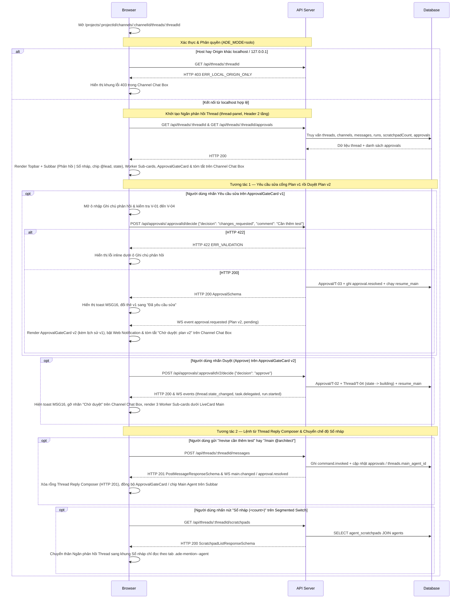

# UI-OR-01 - Điều phối Đa Agent, Cổng duyệt & Sổ nháp trong Ngăn phản hồi Thread (Slack Thread Orchestration, ApprovalGateCard & Scratchpads)

| Trường | Giá trị |
| --- | --- |
| Mã màn hình | `UI-OR-01` |
| Tên màn hình | Điều phối Đa Agent, Cổng duyệt & Sổ nháp trong Ngăn phản hồi Thread |
| Đường dẫn chốt | `specs/dd/orchestration/or-01/ui-orchestration.md` |
| URL | `/projects/:projectId/channels/:channelId/threads/:threadId` |
| Ngày tạo | 2026-10-31 |
| Ngày cập nhật | 2026-10-31 |

## TÓM TẮT

- **Mục tiêu**: Trên bố cục chuẩn Slack (`Project Rail -> Channel Sidebar -> Channel Chat Box + Ngăn phản hồi Thread co giãn độ rộng`), người dùng theo dõi Main Agent điều phối các Worker song song dưới dạng thẻ con thu gọn, nhìn thấy tóm tắt cổng chờ duyệt ngay dưới tin nhắn gốc trên luồng kênh, quyết định các phiên bản cổng `plan` / `spec` / `review` trên `ApprovalGateCard` hay bằng lệnh chat trong `Thread Reply Composer`, và chuyển sang chế độ `Sổ nháp` trên Header 2 tầng để đọc `agent_scratchpads` của từng agent.
- **Actor**: Người dùng cục bộ `usr_local` (`role = 'owner'`) truy cập từ `localhost` hay `127.0.0.1` trong chế độ `ADE_MODE=solo`.
- **Trong phạm vi**: Bố cục Slack mở `Ngăn phản hồi Thread` co giãn độ rộng (`340px–780px`, mặc định `448px`; Tablet `768px–1024px` trượt đè bên phải; Mobile `< 768px` toàn màn hình `100vw`); Header 2 tầng của `Ngăn phản hồi Thread` gồm Tầng 1 `Topbar` (tiêu đề `"Thread"`, `#<channelName>`, tổng số phản hồi, `Nút khiên Quyền ({N})`, `Nút đổi độ rộng ngăn phản hồi` `448px` ↔ `640px`, `Nút đóng ngăn phản hồi` icon `×`) và Tầng 2 `Subbar` chỉ hiện cho Work Thread (`Segmented Switch` `Phản hồi | Sổ nháp ({scratchpadCount})`, chip `.ade-mention--agent` của Main Agent cập nhật khi đổi bằng lệnh `/main @planner`, `/main @spec`, `/main @lead` hay khi gán Main lần đầu qua `@mention`, huy hiệu `threads.state`); tóm tắt cổng duyệt đang `pending` từ trường `pendingApproval` trên thanh tóm tắt `.ade-thread-bar` dưới tin nhắn gốc trong `Channel Chat Box`; danh sách `WorkerSubCardList` thu gọn dưới `LiveCard` của Main Agent (cho cả worker ghi `@coder`, `@tester` và worker chỉ đọc `@qa`, `@reviewer`, `@explorer`); thẻ `ApprovalGateCard` đa phiên bản (`v1`, `v2`) cho cả 3 loại cổng `'plan' | 'spec' | 'review'` hiển thị nhất quán tiêu đề `"Cổng duyệt Plan v<N>"`, `"Cổng duyệt Spec v<N>"`, `"Cổng duyệt Review v<N>"` dùng viền hairline `1px` `--color-human` bao quanh kèm dấu vuông `8x8` `--color-human` (`.ade-gate-mark`); phân biệt ngữ nghĩa `.ade-mention--agent` (icon `bot`) với `.ade-mention--human` (icon `user`); lệnh `/main @handle`, `/approve`, `/revise <ghi chú>` từ `Thread Reply Composer` co giãn chiều cao (mặc định `84px`, kéo `48px–260px`, nút `⇕` chuyển `84px` ↔ `180px`); Web Notification API và chế độ xem `Sổ nháp` chỉ đọc.
- **Ngoài phạm vi**: Thẻ xin quyền công cụ của harness (`PermissionCard` thuộc P2), thẻ giải thích mã nguồn chỉ đọc `ExplorerCard` (`messages.kind = 'explorer_card'`) cùng thẻ phỏng vấn làm rõ đa câu hỏi `Clarifier` (`QuestionCard` mảng `questions[]` gồm `single`, `multi`, `text` kèm tùy chọn `Khác` thuộc `UI-TR-01` ở P3), các hộp thoại chỉnh sửa cấu hình agent cùng workflow YAML (thuộc P5 và P6), và chỉ số ngân sách trên `Subbar` cùng thẻ duyệt đề xuất ghi nhớ dự án (thuộc Phase P6 — module `memory`).
- **Giả định**: Khung vỏ Slack (`Project Rail 64px`, `Channel Sidebar 224px`, `Channel Chat Box 1fr` theo mô hình `1 Tin nhắn gốc = 1 Thread`) ở P1, thành phần `LiveCard` ở P2, `Nút khiên Quyền ({N})`, `ExplorerCard` và `QuestionCard` (`Clarifier`) ở P3 cùng kết nối WebSocket `/ws` đã hoạt động trên URL `/projects/:projectId/channels/:channelId/threads/:threadId`, tuân thủ đầy đủ token trong `design.md`.
- **Câu hỏi mở**: Không có.

## Lịch sử sửa đổi

| Ver | Ngày | Tác giả | Thay đổi |
| --- | --- | --- | --- |
| 1.0 | 2026-10-31 | — | Phát hành lần đầu cho Phase P4 (`orchestration`) |
| 1.1 | 2026-10-31 | — | Đồng bộ bố cục Slack `3 + 1 cột`, Header 2 tầng của `Ngăn phản hồi Thread` (`Segmented Switch` `Phản hồi \| Sổ nháp`, chip `.ade-mention--agent`, huy hiệu `threads.state`), `ApprovalGateCard` viền hairline `1px` + dấu vuông `8x8`, thanh tóm tắt trên `Channel Chat Box` và `Thread Reply Composer` co giãn chiều cao |
| 1.2 | 2026-10-31 | — | Hợp nhất điều kiện hiển thị Work Thread `Subbar` với `UI-TR-01`, `data-testid="thread-panel"`, `PostMessageResponseSchema`, `replyCount`, `channels.deleted_at IS NULL` và kiểm tra `Host` + `Origin` |
| 1.3 | 2026-10-31 | — | Đồng bộ chuỗi phối hợp `@explorer` → `/main @planner`, `/main @spec` → `Clarifier` → `ApprovalGateCard` hiển thị nhất quán `"Cổng duyệt Plan v<N>"`, `"Cổng duyệt Spec v<N>"`, `"Cổng duyệt Review v<N>"` (viền hairline `1px` `--color-human` + dấu vuông `8x8` `.ade-gate-mark`) và bổ sung `AC-UI-OR-01-36` |
| 1.4 | 2026-10-31 | — | Đồng bộ phạm vi `E-18` và `Item 5` với `UI-TR-01/E-28` (nút trên `ExplorerCard` chỉ điền sẵn `Thread Reply Composer`, không tự gửi `/main @planner`), đồng bộ chiều cao `Thread Reply Composer` (mặc định `84px`, nút `⇕` `thread-height-toggle-btn` chuyển `84px` ↔ `180px` khớp `UI-CH-01`) và nguồn `pendingApproval` trên `GET /api/channels/:channelId/threads` cùng `GET /api/threads/:threadId` |

---

## BỐ CỤC

```text
+------+----------------+------------------------------------+---------------------------------------------------+
| RAIL | CHANNEL        | CHANNEL CHAT BOX (1fr)             | NGĂN PHẢN HỒI THREAD (448px, kéo 340px-780px)     |
| 64px | SIDEBAR 224px  | # auth-feature                     | <| [Tầng 1 Topbar - hiện ở mọi Thread]            |
|      |                | Luồng xác thực & phân quyền MCP    |  | Thread #auth-feature 6 phản hồi [Quyền(3)][<>][x]|
| [PG] | Kênh           +------------------------------------+  +------------------------------------------------+
| [+]  | # general      | [CP] Local Owner          16:40    |  | [Tầng 2 Subbar - chỉ hiện ở Work Thread]       |
|      | # auth-feature | [bot @lead] triển khai xác thực    |  | ( [Phản hồi] | Sổ nháp (2) ) [bot @lead][plan_review]|
|      |                | +--------------------------------+ |  +------------------------------------------------+
|      | Đồng nghiệp    | | [CP][LD] 6 phản hồi            | |  | [Chế độ Phản hồi: luồng dọc]                   |
|      | * @owner       | | [plan_review]                  | |  | [LiveCard - bot @lead · Lập kế hoạch & giao việc]|
|      |                | | [Chờ duyệt: plan v2]           | |  |   +-- [bot @coder · Code auth · completed · Mở]|
|      | Bot / Agent    | +--------------------------------+ |  |   +-- [bot @tester · Test auth · running · Đóng]|
|      | * @lead        |                                    |  |   |     - [x] Đọc yêu cầu                      |
|      | * @coder       | [CP] Local Owner          17:05    |  |   |     - [ ] Viết login.test.ts               |
|      | * @tester      | Đồng bộ tài liệu môi trường dev    |  |   +-- [bot @qa · Review auth · completed · Mở] |
|      | * @qa          |   2 phản hồi (thread người-người)  |  |                                                |
|      |                |                                    |  | +-[1px --color-human]------------------------+ |
| [D/L]|                |                                    |  | | [■ 8x8] Cổng duyệt Plan v2    [Chờ duyệt]  | |
| [⚙]  |                | +--------------------------------+ |  | | Kế hoạch triển khai xác thực v2            | |
|      |                | | Nhắn vào #auth-feature         | |  | | Đã bổ sung kiểm thử biên theo góp ý v1.    | |
|      |                | +--------------------------------+ |  | | > Kết quả Worker (3)  [specs/auth-plan.md] | |
|      |                |                                    |  | | > Lịch sử phiên bản trước (1)              | |
|      |                |                                    |  | | [Ô nhập Ghi chú phản hồi]                  | |
|      |                |                                    |  | | [Duyệt (Approve)] [Yêu cầu sửa] [Từ chối]  | |
|      |                |                                    |  | +--------------------------------------------+ |
|      |                |                                    |  | [System] [user @owner] Cổng PLAN v2 chờ duyệt. |
|      |                |                                    |  +==[Thanh kéo cao 48px-260px]====================+
|      |                |                                    |  | Thread Reply Composer (/main, /approve, /revise)|
|      |                |                                    |  | [@] [/]                              [⇕] [Gửi] |
+------+----------------+------------------------------------+---------------------------------------------------+
```

---

## LOGIC

### I. Các phần tử (Items)

| STT | Tên logic | Loại đối tượng | Cột trong DB | Mô tả | Ghi chú |
| --- | --- | --- | --- | --- | --- |
| 1 | Khung vỏ Slack & Thanh kéo độ rộng `Ngăn phản hồi Thread` (`thread-panel`) | Khung bố cục & Thanh kéo dọc | — | Trên Desktop (`>= 1025px`), lưới hiển thị `64px 224px 1fr var(--thread-panel-w, 448px)` với Cột 4 mang `data-testid="thread-panel"` và thanh kéo dọc cạnh trái (`role="separator"`, `aria-orientation="vertical"`, dải `340px–780px`, phím `ArrowLeft` / `ArrowRight` bước `24px`, lưu `localStorage["ade-thread-panel-w"]`); trên Tablet (`768px–1024px`) ngăn trượt đè bên phải (`min(448px, 88vw)`) trên nền `--color-backdrop`; trên Mobile (`< 768px`) ngăn hiển thị toàn màn hình `100vw` | Khớp `data-testid="thread-panel"` của `UI-CH-01`; không gắn huy hiệu số lượng hay workflow cạnh tên kênh trên `Channel Sidebar` |
| 2 | Tầng 1 Header `Ngăn phản hồi Thread` (`Topbar`) | Thanh đầu tầng 1 | `channels.name`, `messages.is_root` | Hiển thị ở mọi Thread: bên trái gồm tiêu đề `"Thread"`, nhãn `#<channelName>` và tổng số phản hồi (`"<replyCount> phản hồi"`); bên phải gồm `Nút khiên Quyền ({N})` (chỉ hiển thị khi thỏa điều kiện Work Thread `(mainAgentId !== null \|\| activeGrantCount > 0 \|\| runs.length > 0 \|\| approvals.length > 0 \|\| state !== 'open')`), `Nút đổi độ rộng ngăn phản hồi` (`448px` ↔ `640px`, ẩn ở `< 768px`) và `Nút đóng ngăn phản hồi` dạng icon `×` (`aria-label="Đóng ngăn Thread"`) | — |
| 3 | Tầng 2 Header `Ngăn phản hồi Thread` (`Subbar`) | Thanh đầu tầng 2 | `threads.main_agent_id`, `threads.state`, `runs.id`, `approvals.id` | Chỉ hiển thị trên Work Thread khi thỏa điều kiện hợp nhất `(mainAgentId !== null \|\| activeGrantCount > 0 \|\| runs.length > 0 \|\| approvals.length > 0 \|\| state !== 'open')` khớp `UI-TR-01`; ẩn hoàn toàn trên thread trao đổi thuần giữa người với người | Tự động hiện ngay khi người dùng `@mention` agent lần đầu biến thread thành Work Thread |
| 4 | Công tắc chuyển chế độ liền khối (`Segmented Switch`) | Nhóm 2 nút chế độ | `agent_scratchpads.thread_id` | Đặt bên trái Tầng 2 (`Subbar`), gồm 2 nút `Phản hồi` và `Sổ nháp (<scratchpadCount>)` (`.ade-seg-group` / `.ade-seg-btn`); mặc định chọn `Phản hồi` | Đồng bộ `<scratchpadCount>` từ `ThreadDetailResponse` và sự kiện WS `scratchpad.updated` |
| 5 | Chip Main Agent hiện tại trên `Subbar` | Chip `.ade-mention--agent` | `threads.main_agent_id` | Đặt bên phải Tầng 2 (`Subbar`), hiển thị `@<handle>` theo chuẩn `.ade-mention--agent`: bo góc `4px` (`--radius-chip`), chữ và viền `--color-agent` trên nền `--color-agent-soft`, font mono `--font-outlier`, kèm icon SVG `bot` `12x12` | Hiển thị nhãn `"Chưa gán Main"` khi Work Thread có `main_agent_id IS NULL`; cập nhật tức thời sang `@planner`, `@spec`, `@lead` khi người dùng gửi lệnh `/main @handle` từ `Thread Reply Composer` hay khi gán Main lần đầu qua `@mention` |
| 6 | Huy hiệu trạng thái Thread trên `Subbar` | Huy hiệu `.ade-chip.ade-mono` | `threads.state` | Đặt bên phải Tầng 2 (`Subbar`), hiển thị `state` hiện tại của workflow (`open`, `planning`, `plan_review`, `building`, `review`, `done`); dùng `--color-human` / `--color-human-soft` khi ở state cổng duyệt, `--color-ok` / `--color-ok-soft` khi `done`, `--color-agent` / `--color-agent-soft` ở các state thực thi | Cập nhật tức thời qua WS event `thread.state_changed` |
| 7 | Tóm tắt cổng chờ duyệt trên `Channel Chat Box` | Thanh tóm tắt `.ade-thread-bar` | `approvals.status`, `approvals.kind`, `approvals.version` | Ngay bên dưới tin nhắn gốc (`messages.is_root = 1`) của thread trên `Channel Chat Box`, thanh tóm tắt đọc trường `thread.pendingApproval` (`{ approvalId, kind, version } \| null`) từ `GET /api/channels/:channelId/threads` và `GET /api/threads/:threadId` để hiển thị tổng số phản hồi, huy hiệu `threads.state` và huy hiệu `"Chờ duyệt: <kind> v<version>"` dùng `--color-human` / `--color-human-soft` khi `pendingApproval` khác `null` | Giúp thành viên nhìn thấy ngay cổng đang chờ duyệt từ luồng kênh mà không phải mở từng thread; nhấn vào mở `Ngăn phản hồi Thread` |
| 8 | Thẻ `LiveCard` của Main Agent | Khối thẻ `.ade-panel` | `runs.*` | Thẻ tiến độ chính của run có `runs.role = 'main'` trong luồng dọc chế độ `Phản hồi` của `Ngăn phản hồi Thread` | Kế thừa cấu trúc `LiveCard` của P2 |
| 9 | Khung danh sách `WorkerSubCardList` | Danh sách lồng | `runs.parent_run_id` | Khối chứa các thẻ con của run có `runs.role = 'worker'` (cả worker ghi `@coder`, `@tester` và worker chỉ đọc `@qa`, `@reviewer`, `@explorer`) đặt bên dưới `LiveCard` của Main Agent cha trong chế độ `Phản hồi` | Nhóm theo `runs.parent_run_id` và sắp theo `runs.created_at ASC` |
| 10 | Dòng tiêu đề Worker Sub-card | Nút thu gọn/mở rộng | `runs.status`, `runs.outcome` | Hiển thị chip `.ade-mention--agent` (icon `bot`) của worker, nhiệm vụ `runs.task`, nhãn trạng thái (`queued`, `running`, `completed`, `failed`) và `runs.outcome` | Mặc định thu gọn (`collapsed = true`); nhấn để đảo trạng thái mở rộng |
| 11 | Khung chi tiết tiến độ Worker | Khối nội dung `.ade-well` | `messages.card_json` | Hiển thị checklist `plan`, các bước `tool_call`, đoạn văn bản cuối và `summary` của worker khi thẻ con được mở rộng | Ẩn khi `collapsed = true` |
| 12 | Khung thẻ `ApprovalGateCard` | Khối thẻ `.ade-panel.ade-gate-card` | `messages.card_json` | Thẻ `messages.kind = 'approval_card'` (`cardType = 'gate'`) hỗ trợ nhất quán cả 3 loại cổng `'plan' \| 'spec' \| 'review'` (trình sau bước phỏng vấn `Clarifier` đối với cổng `spec` và `plan`) trong luồng dọc chế độ `Phản hồi`; dùng viền hairline `1px` (`--rule-hair`) màu `--color-human` bao quanh toàn thẻ kèm dấu vuông `8x8` `--color-human` (`.ade-gate-mark`), đổi viền `1px` sang `--color-ok` khi `approved` và `--color-bad` khi `changes_requested` hay `rejected` | Cấm dùng `border-left: 3px+` hay mã màu cứng ngoài `tokens.css` |
| 13 | Nhãn loại cổng & phiên bản | Nhãn `.ade-mono` | `approvals.kind`, `approvals.version` | Hiển thị cạnh dấu vuông `8x8` theo mẫu nhất quán `"Cổng duyệt Plan v1"`, `"Cổng duyệt Plan v2"`, `"Cổng duyệt Spec v1"`, `"Cổng duyệt Review v1"` bằng font `--font-outlier` (`tabular-nums`) | Ghép từ ánh xạ `plan -> "Plan"`, `spec -> "Spec"`, `review -> "Review"` và `approvals.version` |
| 14 | Nhãn trạng thái & Người quyết định trên `ApprovalGateCard` | Huy hiệu & Chip `.ade-mention--human` | `approvals.status`, `approvals.decided_by` | Hiển thị `"Chờ duyệt"` (`pending`), `"Đã duyệt"` (`approved`), `"Đã yêu cầu sửa"` (`changes_requested`), `"Đã từ chối"` (`rejected`); khi đã quyết định thì hiển thị thêm chip người duyệt theo chuẩn `.ade-mention--human` (viên thuốc tròn `999px`, `--color-human` / `--color-human-soft`, icon SVG `user` `12x12`) | — |
| 15 | Tiêu đề & Tóm tắt cổng duyệt | Nhãn & Khối Markdown | `approvals.title`, `approvals.summary` | Hiển thị tiêu đề `approvals.title` và bản thuyết minh Markdown an toàn từ `approvals.summary` (không kết xuất HTML thô) | — |
| 16 | Mục mở rộng `Kết quả Worker` trong Card | Khối thu gọn | `runs.summary` | Liệt kê chip `.ade-mention--agent`, `outcome` và `summary` của các worker đã chạy trước cổng | Mặc định thu gọn; ẩn khi chưa có worker nào chạy |
| 17 | Danh sách liên kết Artifact | Danh sách chip `.ade-mono` | `approvals.artifact_refs_json` | Hiển thị đường dẫn tệp trong worktree (ví dụ `specs/auth-plan.md`) kèm hành động sao chép đường dẫn | Ẩn khi mảng `artifacts` rỗng |
| 18 | Mục mở rộng `Lịch sử phiên bản trước` | Khối thu gọn | `approvals.version` | Liệt kê các phiên bản nhỏ hơn `version` hiện tại của cùng `kind` (`v1`, `v2`), gồm trạng thái, chip `.ade-mention--human` người góp ý, `comment` và `summary` cũ | Chỉ hiển thị khi `approvals.version > 1` |
| 19 | Nhóm 3 nút quyết định (`Duyệt (Approve)`, `Yêu cầu sửa`, `Từ chối`) | Nhóm nút `.ade-btn` | — | Nút chính `Duyệt (Approve)` (`.ade-btn--primary` gửi `decision = 'approve'`), nút `Yêu cầu sửa` (mở biểu mẫu `changes_requested`) và nút `Từ chối` (mở biểu mẫu `reject`) | Chỉ hiển thị và cho nhấn khi `approvals.status = 'pending'` |
| 20 | Ô nhập `Ghi chú phản hồi` & Nút xác nhận gửi | Ô văn bản `.ade-input` & Nút | `approvals.comment` | Nhập góp ý ở biểu mẫu `Yêu cầu sửa` (nút `"Gửi yêu cầu sửa"`) và lý do ở biểu mẫu `Từ chối` (nút `"Xác nhận từ chối"`); vô hiệu hoá nút trong lúc mutation đang chạy | Bắt buộc nhập khác rỗng khi gửi `changes_requested`; tùy chọn khi gửi `reject` |
| 21 | Tin nhắn hệ thống cảnh báo duyệt & nhắc 4 giờ | Dòng tin nhắn hệ thống | `messages.body`, `messages.human_mentions_json`, `messages.reactions_json` | Tin nhắn `messages.kind = 'system'` (`is_root = 0`, `human_mentions_json = '["@owner"]'`, `reactions_json = '[]'`) trong luồng phản hồi, gắn thẻ `.ade-mention--human.ade-mention--me` (icon `user`) cho `@owner` (`usr_local`) khi có cổng mới và khi nhắc sau 4 giờ | — |
| 22 | Khung nhập phản hồi (`Thread Reply Composer`) | Ô soạn co giãn chiều cao | `messages.body` | Đặt ở đáy chế độ `Phản hồi` của `Ngăn phản hồi Thread`; chiều cao mặc định `84px`, có thanh kéo ngang cạnh trên co giãn chiều cao trong dải `48px–260px`, tự giãn theo dòng nhập và nút icon `⇕` (`thread-height-toggle-btn`, `aria-label="Đổi chiều cao khung nhập"`) chuyển bậc chiều cao giữa `84px` và `180px` khớp `UI-CH-01`; nhận tin nhắn phản hồi, `@mention` (bao gồm cả văn bản đề xuất `@planner` được điền sẵn từ nút trên `ExplorerCard` theo `UI-TR-01/E-28`; popup chia 2 mục `Đồng nghiệp` và `Bot / Agent`) cùng các lệnh `/main @handle`, `/approve`, `/revise <ghi chú>` | Hiển thị popup gợi ý 3 lệnh điều phối khi ký tự đầu tiên là `/` |
| 23 | Chế độ xem `Sổ nháp` chỉ đọc trong `Ngăn phản hồi Thread` | Khung tab & Markdown chỉ đọc | `agent_scratchpads.agent_id`, `agent_scratchpads.content` | Hiển thị thay cho luồng `Phản hồi` ngay bên trong thân `Ngăn phản hồi Thread` khi chọn nút `Sổ nháp (<scratchpadCount>)` trên `Segmented Switch`; gồm thanh chọn tab bằng chip `.ade-mention--agent` (mặc định chọn agent có `updated_at` mới nhất) và vùng hiển thị markdown chỉ đọc kèm `updated_at` | Không có ô sửa và không có nút lưu; khi trống hiện `"Chưa có agent nào ghi scratchpad trong thread này."` |

### II. Kiểm tra hợp lệ (Validate)

> Định dạng mỗi dòng đúng một quy tắc kiểm tra; mã thông báo tham chiếu [message.md](../../../message.md).

| ID | Tên logic | Tên | Quy tắc kiểm tra | Mã message | Message |
| --- | --- | --- | --- | --- | --- |
| V-01 | Ô nhập Ghi chú phản hồi (khi gửi `Yêu cầu sửa`) | Ghi chú phản hồi | `required` | MSG01 | Ghi chú phản hồi là bắt buộc. |
| V-02 | Ô nhập Ghi chú phản hồi (khi gửi `Yêu cầu sửa`) | Ghi chú phản hồi | `trim` | — | — |
| V-03 | Ô nhập Ghi chú phản hồi (khi gửi `Yêu cầu sửa`) | Ghi chú phản hồi | `min:1` | MSG01 | Ghi chú phản hồi là bắt buộc. |
| V-04 | Ô nhập Ghi chú phản hồi (khi gửi `Yêu cầu sửa`) | Ghi chú phản hồi | `max:4000` | MSG02 | Ghi chú phản hồi không được vượt quá 4000 ký tự. |
| V-05 | Ô nhập Ghi chú phản hồi (khi gửi `Từ chối`) | Ghi chú phản hồi | `nullable` | — | — |
| V-06 | Ô nhập Ghi chú phản hồi (khi gửi `Từ chối`) | Ghi chú phản hồi | `max:4000` | MSG02 | Ghi chú phản hồi không được vượt quá 4000 ký tự. |
| V-07 | Khung nhập phản hồi (`Thread Reply Composer`) | Nội dung tin nhắn | `required` | MSG01 | Nội dung tin nhắn là bắt buộc. |
| V-08 | Khung nhập phản hồi (`Thread Reply Composer`) | Nội dung tin nhắn | `trim` | — | — |
| V-09 | Khung nhập phản hồi (`Thread Reply Composer`) | Nội dung tin nhắn | `min:1` | MSG01 | Nội dung tin nhắn là bắt buộc. |
| V-10 | Khung nhập phản hồi (`Thread Reply Composer`) | Nội dung tin nhắn | `max:10000` | MSG02 | Nội dung tin nhắn không được vượt quá 10000 ký tự. |
| V-11 | Tham số `@handle` trong lệnh `/main @handle` | Handle của agent | `required` | MSG01 | Handle của agent là bắt buộc. |
| V-12 | Tham số `@handle` trong lệnh `/main @handle` | Handle của agent | `regex:^@[a-z0-9]+(?:-[a-z0-9]+)*$` | MSG04 | Định dạng Handle của agent không hợp lệ. |
| V-13 | Tham số `@handle` trong lệnh `/main @handle` | Handle của agent | `max:64` | MSG02 | Handle của agent không được vượt quá 64 ký tự. |
| V-14 | Tham số `<ghi chú>` trong lệnh `/revise <ghi chú>` | Ghi chú phản hồi | `required` | MSG01 | Ghi chú phản hồi là bắt buộc. |
| V-15 | Tham số `<ghi chú>` trong lệnh `/revise <ghi chú>` | Ghi chú phản hồi | `trim` | — | — |
| V-16 | Tham số `<ghi chú>` trong lệnh `/revise <ghi chú>` | Ghi chú phản hồi | `min:1` | MSG01 | Ghi chú phản hồi là bắt buộc. |
| V-17 | Tham số `<ghi chú>` trong lệnh `/revise <ghi chú>` | Ghi chú phản hồi | `max:4000` | MSG02 | Ghi chú phản hồi không được vượt quá 4000 ký tự. |

### III. Logic

#### Thông tin màn hình

- **Phân quyền**: Chế độ `ADE_MODE=solo` chỉ chấp nhận kết nối từ `localhost` và `127.0.0.1` với người dùng mặc định `usr_local` (`role = 'owner'`) theo [reference.md](../../../reference.md).
- **Mẫu URL**: `/projects/:projectId/channels/:channelId/threads/:threadId`
- **API chính**:

| STT | Method | Path | Mục đích |
| --- | --- | --- | --- |
| 1 | `GET` | `/api/threads/:threadId` | Tải chi tiết thread (`rootMessageId`, `channelName`, `replyCount`, `activeGrantCount`, `state`, `mainAgentHandle`, `pendingApproval`, `scratchpadCount`, danh sách tin nhắn và các run) |
| 2 | `GET` | `/api/threads/:threadId/approvals` | Tải danh sách các cổng duyệt và toàn bộ lịch sử phiên bản (`v1`, `v2`) của thread |
| 3 | `POST` | `/api/approvals/:approvalId/decide` | Gửi quyết định `approve`, `changes_requested`, `reject` trên `ApprovalGateCard` |
| 4 | `GET` | `/api/threads/:threadId/scratchpads` | Tải danh sách nội dung sổ nháp chỉ đọc của các agent trong thread |
| 5 | `POST` | `/api/threads/:threadId/messages` | Gửi tin nhắn phản hồi và thực thi lệnh điều phối `/main @handle`, `/approve`, `/revise <ghi chú>` từ `Thread Reply Composer` |
| 6 | `GET` | `/api/channels/:channelId/threads` | Tải danh sách thread trên kênh kèm trường mở rộng `pendingApproval` (`{ approvalId, kind, version } \| null`) cho thanh tóm tắt `.ade-thread-bar` |

#### 1. Kiểm tra phân quyền

| ID | Mô tả |
| --- | --- |
| P-01 | Khi người dùng mở màn hình từ `localhost` hay `127.0.0.1` ở chế độ `ADE_MODE=solo`, hệ thống phải cho phép tải màn hình với vai trò `owner` (`usr_local`). |
| P-02 | Nếu API chính trả HTTP `403` `ERR_LOCAL_ORIGIN_ONLY`, thì màn hình phải hiển thị khung lỗi 403 trong vùng `Channel Chat Box` và giữ nguyên `Project Rail` cùng `Channel Sidebar`. |
| P-03 | Trong khi `Segmented Switch` trên Tầng 2 (`Subbar`) đang chọn chế độ `Sổ nháp`, màn hình phải chỉ hiển thị nội dung markdown của `agent_scratchpads` ở chế độ đọc và ẩn toàn bộ điều khiển chỉnh sửa đối với người dùng. |

#### 2. Khởi tạo màn hình

| ID | Mô tả |
| --- | --- |
| I-01 | Khi mở URL `/projects/:projectId/channels/:channelId/threads/:threadId`, màn hình phải mở Cột 4 `Ngăn phản hồi Thread` (`data-testid="thread-panel"`, độ rộng đọc từ `localStorage["ade-thread-panel-w"]` trong dải `340px–780px`, mặc định `448px`) bên phải `Channel Chat Box` và gọi song song `GET /api/threads/:threadId` cùng `GET /api/threads/:threadId/approvals`. |
| I-02 | Khi nhận phản hồi cho Work Thread thỏa điều kiện `(mainAgentId !== null \|\| activeGrantCount > 0 \|\| runs.length > 0 \|\| approvals.length > 0 \|\| state !== 'open')`, màn hình phải hiển thị cả Tầng 1 `Topbar` (`"Thread"`, `#<channelName>`, tổng số phản hồi, `Nút khiên Quyền ({activeGrantCount})`, `Nút đổi độ rộng ngăn phản hồi`, `Nút đóng ×`) và Tầng 2 `Subbar` (`Segmented Switch` `Phản hồi \| Sổ nháp (<scratchpadCount>)`, chip `.ade-mention--agent` của `mainAgentHandle`, huy hiệu `state`). |
| I-03 | Khi luồng phản hồi có các run mang `role = 'worker'`, màn hình phải gom các thẻ Worker Sub-card lồng bên dưới `LiveCard` của `parent_run_id` và đặt trạng thái mặc định là thu gọn (`collapsed = true`). |
| I-04 | Trong khi trường `pendingApproval` của một thread từ `GET /api/channels/:channelId/threads` hay `GET /api/threads/:threadId` khác `null` (tương ứng có bản ghi `approvals` ở trạng thái `pending`), màn hình phải hiển thị huy hiệu `"Chờ duyệt: <kind> v<version>"` dùng màu `--color-human` trên thanh tóm tắt `.ade-thread-bar` dưới tin nhắn gốc của thread đó trong `Channel Chat Box`. |
| I-05 | Khi màn hình khởi tạo và phát hiện có cổng duyệt `pending` trong lúc `Notification.permission === 'default'`, màn hình phải gọi `Notification.requestPermission()` một lần trong phiên trình duyệt. |
| I-06 | Khi kết nối WebSocket `/ws` đang mở, màn hình phải đăng ký lắng nghe các sự kiện của `:threadId` (`main.changed`, `task.delegated`, `run.started`, `run.progress`, `run.completed`, `approval.requested`, `approval.resolved`, `approval.reminded`, `scratchpad.updated`, `thread.state_changed`). |
| I-07 | Khi nhận phản hồi cho thread trao đổi thuần giữa người với người (`mainAgentId === null && activeGrantCount === 0 && runs.length === 0 && approvals.length === 0 && state === 'open'`), màn hình phải hiển thị Tầng 1 `Topbar` đồng thời ẩn cả `Nút khiên Quyền ({activeGrantCount})` và Tầng 2 `Subbar`. |
| I-08 | Khi kết xuất thẻ `ApprovalGateCard`, Worker Sub-card và tin nhắn trong thread, màn hình phải hiển thị mọi `@agent` bằng chip `.ade-mention--agent` (icon `bot`, bo `4px`, font `--font-outlier`), mọi người dùng bằng `.ade-mention--human` (icon `user`, bo `999px`), tiêu đề loại cổng `"Cổng duyệt Plan v<N>"`, `"Cổng duyệt Spec v<N>"`, `"Cổng duyệt Review v<N>"` và viền `ApprovalGateCard` bằng hairline `1px` kèm dấu vuông `8x8` `--color-human`. |

#### 3. Xử lý hành vi sự kiện

> Nội dung thông báo của các mã trong mục này: xem [message.md](../../../message.md).

| ID | Sự kiện | Kích hoạt | Mô tả |
| --- | --- | --- | --- |
| E-01 | Đảo trạng thái thu gọn Worker Sub-card | Khi nhấn vào dòng tiêu đề của một Worker Sub-card | Phải đảo cờ `collapsed` của riêng thẻ con đó để bật/tắt khung hiển thị checklist `plan`, danh sách `tool_call` và `summary` của worker. |
| E-02 | Nhận cổng duyệt mới qua WebSocket | Khi nhận sự kiện WebSocket `approval.requested` trên thread | Phải hiển thị thẻ `ApprovalGateCard` mới ở trạng thái `pending` trong `Ngăn phản hồi Thread`, cập nhật huy hiệu `"Chờ duyệt: <kind> v<version>"` trên thanh tóm tắt dưới tin nhắn gốc trong `Channel Chat Box` và hiển thị tin nhắn hệ thống gắn `.ade-mention--human` cho `@owner`. |
| E-03 | Phát thông báo trình duyệt khi có cổng duyệt | Khi nhận sự kiện WebSocket `approval.requested` trong lúc `Notification.permission === 'granted'` | Phải gọi `new Notification("ADE — Cổng chờ duyệt", { body: "<KIND> v<version>: <title>" })` trên trình duyệt. |
| E-04 | Đảo trạng thái khối Kết quả Worker trên Card | Khi nhấn vào tiêu đề mục `"Kết quả Worker"` trên `ApprovalGateCard` | Phải đảo trạng thái đóng/mở của khối danh sách kết quả worker ngay bên trong thẻ duyệt mà không tải lại trang. |
| E-05 | Đảo trạng thái khối Lịch sử phiên bản trước | Khi nhấn vào tiêu đề mục `"Lịch sử phiên bản trước"` trên `ApprovalGateCard` có `version > 1` | Phải đảo trạng thái đóng/mở của danh sách các phiên bản trước ngay bên trong thẻ duyệt mà không tải lại trang. |
| E-06 | Nhấn nút `Duyệt (Approve)` trên Card | Khi nhấn nút `Duyệt (Approve)` trên `ApprovalGateCard` đang `pending` | Phải vô hiệu hoá 3 nút hành động trên thẻ và gọi `POST /api/approvals/:approvalId/decide` với body `{"decision": "approve"}`. |
| E-07 | Mở biểu mẫu `Yêu cầu sửa` | Khi nhấn nút `Yêu cầu sửa` trên `ApprovalGateCard` đang `pending` | Phải hiển thị ô nhập `Ghi chú phản hồi` kèm nút `Gửi yêu cầu sửa` và đặt con trỏ vào ô nhập. |
| E-08 | Gửi biểu mẫu `Yêu cầu sửa` | Khi nhấn nút `Gửi yêu cầu sửa` trên `ApprovalGateCard` | Phải kiểm tra hợp lệ phía client theo V-01 đến V-04; hợp lệ thì gọi `POST /api/approvals/:approvalId/decide` với `decision = "changes_requested"` và `comment`. |
| E-09 | Mở biểu mẫu xác nhận `Từ chối` | Khi nhấn nút `Từ chối` trên `ApprovalGateCard` đang `pending` | Phải hiển thị ô nhập `Ghi chú phản hồi` kèm nút `Xác nhận từ chối` và đặt con trỏ vào ô nhập. |
| E-10 | Gửi biểu mẫu `Từ chối` | Khi nhấn nút `Xác nhận từ chối` trên `ApprovalGateCard` | Phải kiểm tra hợp lệ phía client theo V-05 đến V-06; hợp lệ thì gọi `POST /api/approvals/:approvalId/decide` với `decision = "reject"` và `comment`. |
| E-11 | Quyết định cổng duyệt thành công từ Card | Khi `POST /api/approvals/:approvalId/decide` trả HTTP `200` | Phải hiển thị toast `MSG16`, cập nhật trạng thái thẻ theo `Approval/T-02`, `Approval/T-03`, `Approval/T-04`, ẩn 3 nút hành động và gỡ huy hiệu `"Chờ duyệt"` trên thanh tóm tắt dưới tin nhắn gốc trong `Channel Chat Box` khi không còn cổng `pending`. |
| E-12 | Lỗi xung đột khi cổng duyệt trên Card đã được quyết định | Nếu `POST /api/approvals/:approvalId/decide` trả HTTP `409` `ERR_APPROVAL_ALREADY_DECIDED` | Thì phải hiển thị toast tiếng Việt từ `translateApiError` và gọi lại `GET /api/threads/:threadId/approvals` để đồng bộ trạng thái thẻ mới nhất. |
| E-13 | Đồng bộ kết quả cổng duyệt qua WebSocket | Khi nhận sự kiện WebSocket `approval.resolved` trên thread | Phải cập nhật nhãn trạng thái kèm `comment` trên `ApprovalGateCard` tương ứng và gỡ huy hiệu `"Chờ duyệt"` trên thanh tóm tắt dưới tin nhắn gốc trong `Channel Chat Box` khi không còn cổng `pending`. |
| E-14 | Đồng bộ trạng thái workflow qua WebSocket | Khi nhận sự kiện WebSocket `thread.state_changed` trên thread | Phải cập nhật huy hiệu `threads.state` trên Tầng 2 (`Subbar`) của `Ngăn phản hồi Thread` và trên thanh tóm tắt dưới tin nhắn gốc trong `Channel Chat Box` sang giá trị `payload.to`. |
| E-15 | Hiển thị thẻ con khi Main Agent giao việc qua WebSocket | Khi nhận sự kiện WebSocket `task.delegated` trên thread | Phải thêm Worker Sub-card mới ở trạng thái thu gọn (`collapsed = true`) vào bên dưới `LiveCard` của `payload.parent_run_id`. |
| E-16 | Hiển thị tin nhắn nhắc hẹn duyệt sau 4 giờ | Khi nhận sự kiện WebSocket `approval.reminded` trên thread | Phải hiển thị tin nhắn hệ thống nhắc duyệt gắn `.ade-mention--human` cho `@owner` trong luồng phản hồi và giữ nguyên huy hiệu `"Chờ duyệt"` trên thanh tóm tắt dưới tin nhắn gốc trong `Channel Chat Box`. |
| E-17 | Gợi ý lệnh điều phối trong `Thread Reply Composer` | Khi người dùng gõ ký tự `/` ở đầu `Thread Reply Composer` | Phải hiển thị danh sách gợi ý 3 lệnh `/main @handle`, `/approve` và `/revise <ghi chú>`. |
| E-18 | Gửi lệnh `/main @handle` từ `Thread Reply Composer` | Khi người dùng gửi chuỗi bắt đầu bằng `/main` trong `Thread Reply Composer` | Phải kiểm tra phía client theo V-07 đến V-13; hợp lệ thì gọi `POST /api/threads/:threadId/messages` để đổi Main Agent. |
| E-19 | Gửi lệnh `/approve` từ `Thread Reply Composer` | Khi người dùng gửi lệnh `/approve` trong `Thread Reply Composer` | Phải kiểm tra phía client theo V-07 đến V-10; hợp lệ thì gọi `POST /api/threads/:threadId/messages` để duyệt cổng `pending` hiện tại theo `Approval/T-02`. |
| E-20 | Gửi lệnh `/revise <ghi chú>` từ `Thread Reply Composer` | Khi người dùng gửi chuỗi bắt đầu bằng `/revise` trong `Thread Reply Composer` | Phải kiểm tra phía client theo V-07 đến V-10 và V-14 đến V-17; hợp lệ thì gọi `POST /api/threads/:threadId/messages` để chuyển cổng `pending` sang `changes_requested` theo `Approval/T-03`. |
| E-21 | Làm rỗng `Thread Reply Composer` sau khi gửi thành công | Khi `POST /api/threads/:threadId/messages` trả HTTP `201` | Phải xóa rỗng nội dung trong `Thread Reply Composer`. |
| E-22 | Cập nhật chip Main Agent qua WebSocket | Khi nhận sự kiện WebSocket `main.changed` trên thread | Phải bật Tầng 2 (`Subbar`) nếu đang ẩn, cập nhật chip `.ade-mention--agent` trên `Subbar` thành `@<newHandle>` và giữ nguyên nội dung đang gõ dở trong `Thread Reply Composer`. |
| E-23 | Lỗi chọn agent không được phép làm Main | Nếu `POST /api/threads/:threadId/messages` trả HTTP `400` `ERR_AGENT_CANNOT_BE_MAIN` | Thì phải hiển thị toast tiếng Việt `"Agent được chọn không có quyền làm main agent."` và giữ nguyên nội dung trong `Thread Reply Composer`. |
| E-24 | Lỗi không tìm thấy hay xung đột khi gửi lệnh điều phối | Nếu `POST /api/threads/:threadId/messages` trả HTTP `404` `ERR_NOT_FOUND` hay HTTP `409` `ERR_APPROVAL_ALREADY_DECIDED` | Thì phải hiển thị toast tiếng Việt từ `translateApiError` và giữ nguyên nội dung trong `Thread Reply Composer`. |
| E-25 | Lỗi kiểm tra hợp lệ từ server | Nếu API mutation trả HTTP `422` `ERR_VALIDATION` | Thì phải hiển thị thông báo lỗi inline bên dưới ô nhập tương ứng từ `details.fieldErrors`. |
| E-26 | Chuyển sang chế độ `Sổ nháp` trên `Segmented Switch` | Khi nhấn nút `Sổ nháp (<scratchpadCount>)` trên Tầng 2 (`Subbar`) | Phải kích hoạt nút `Sổ nháp`, ẩn luồng `Phản hồi`, gọi `GET /api/threads/:threadId/scratchpads` và hiển thị nội dung markdown chỉ đọc của agent đầu tiên ngay trong thân `Ngăn phản hồi Thread`. |
| E-27 | Chuyển tab agent trong chế độ `Sổ nháp` | Khi nhấn vào tab `.ade-mention--agent` của một agent khác trong chế độ `Sổ nháp` | Phải hiển thị nội dung markdown `content` và mốc thời gian `updated_at` của agent được chọn ở chế độ chỉ đọc. |
| E-28 | Tăng bộ đếm trên nút `Sổ nháp` qua WebSocket khi đang ở `Phản hồi` | Khi nhận sự kiện WebSocket `scratchpad.updated` của agent chưa có sổ nháp trước đó trên thread lúc công tắc đang ở chế độ `Phản hồi` | Phải tăng bộ đếm trên nút `"Sổ nháp (<scratchpadCount>)"` thêm `1` mà không tự chuyển khỏi chế độ `Phản hồi`. |
| E-29 | Đồng bộ nội dung khi đang mở chế độ `Sổ nháp` | Khi nhận sự kiện WebSocket `scratchpad.updated` trong lúc công tắc đang ở chế độ `Sổ nháp` | Phải cập nhật ngay nội dung markdown và `updated_at` của agent tương ứng trong khung `Sổ nháp` mà không quay về chế độ `Phản hồi`. |
| E-30 | Quay về chế độ `Phản hồi` trên `Segmented Switch` | Khi nhấn nút `Phản hồi` trên Tầng 2 (`Subbar`) lúc đang ở chế độ `Sổ nháp` | Phải ẩn khung `Sổ nháp` và hiển thị lại luồng phản hồi dọc cùng `Thread Reply Composer`. |
| E-31 | Co giãn độ rộng `Ngăn phản hồi Thread` | Khi kéo thanh phân cách dọc cạnh trái, nhấn phím `ArrowLeft` / `ArrowRight` trên thanh phân cách, hay nhấn `Nút đổi độ rộng ngăn phản hồi` (`448px` ↔ `640px`) trên Tầng 1 (`Topbar`) | Phải giới hạn độ rộng trong dải `340px–780px`, cập nhật biến CSS `--thread-panel-w` và lưu giá trị vào `localStorage["ade-thread-panel-w"]`. |
| E-32 | Co giãn chiều cao `Thread Reply Composer` | Khi kéo thanh phân cách ngang cạnh trên của `Thread Reply Composer` hay nhấn nút icon `⇕` (`thread-height-toggle-btn`, `aria-label="Đổi chiều cao khung nhập"`) | Phải giới hạn chiều cao vùng nhập trong dải `48px–260px` (chiều cao mặc định `84px`; nút `⇕` chuyển giữa `84px` và `180px` khớp `UI-CH-01`). |

#### 4. Xử lý phía server

> Chi tiết schema, bản đồ dữ liệu và thao tác DB xem tại [api-orchestration.md](./api-orchestration.md).

**API-1: GET /api/threads/:threadId & GET /api/channels/:channelId/threads (mở rộng `pendingApproval`)**

| ID | Bước | Mô tả |
| --- | --- | --- |
| S1-01 | Kiểm tra phân quyền | Kiểm tra `Host` có hostname thuộc `{"localhost", "127.0.0.1"}` và khi có mặt `Origin` thì hostname của `Origin` thuộc `{"localhost", "127.0.0.1"}`; nếu vi phạm thì phải trả HTTP `403` `ERR_LOCAL_ORIGIN_ONLY`. |
| S1-02 | Tải dữ liệu thread, kênh, runs, grant, `pendingApproval` & bộ đếm sổ nháp | Truy vấn `threads` join `channels` (`channels.deleted_at IS NULL`), left join `agents`, truy vấn bản ghi `approvals` có `status = 'pending'` mới nhất của từng `thread.id` làm `pendingApproval` (`{ approvalId, kind, version } \| null`), đếm `replyCount` (`messages.thread_id = :threadId AND messages.is_root = 0 AND messages.kind != 'system'`), đếm `activeGrantCount` (`thread_agents.revoked_at IS NULL`), truy vấn `runs` (`role`, `parent_run_id`, `delegation_id`) và đếm `scratchpadCount` từ `agent_scratchpads`; nếu không tìm thấy bản ghi đích hay kênh cha đã xóa mềm (`channels.deleted_at IS NOT NULL`) thì phải trả HTTP `404` `ERR_NOT_FOUND`. |
| S1-03 | Trả về | Trả HTTP `200` `ThreadDetailResponseSchema` (với `GET /api/threads/:threadId`) hay `ThreadListResponseSchema` (`{ threads: ThreadSchema[] }` kèm `pendingApproval`, với `GET /api/channels/:channelId/threads`). |

**API-2: GET /api/threads/:threadId/approvals**

| ID | Bước | Mô tả |
| --- | --- | --- |
| S2-01 | Kiểm tra phân quyền | Kiểm tra `Host` có hostname thuộc `{"localhost", "127.0.0.1"}` và khi có mặt `Origin` thì hostname của `Origin` thuộc `{"localhost", "127.0.0.1"}`; nếu vi phạm thì phải trả HTTP `403` `ERR_LOCAL_ORIGIN_ONLY`. |
| S2-02 | Tải lịch sử cổng duyệt | Kiểm tra tồn tại `:threadId` và kênh cha có `channels.deleted_at IS NULL` (sai trả HTTP `404` `ERR_NOT_FOUND`), truy vấn bảng `approvals` left join `users` sắp theo `created_at DESC, version DESC` kèm kết quả worker. |
| S2-03 | Trả về | Trả HTTP `200` `ApprovalListResponseSchema`. |

**API-3: POST /api/approvals/:approvalId/decide**

| ID | Bước | Mô tả |
| --- | --- | --- |
| S3-01 | Kiểm tra phân quyền | Kiểm tra `Host` có hostname thuộc `{"localhost", "127.0.0.1"}` và khi có mặt `Origin` thì hostname của `Origin` thuộc `{"localhost", "127.0.0.1"}`; nếu vi phạm thì phải trả HTTP `403` `ERR_LOCAL_ORIGIN_ONLY`. |
| S3-02 | Kiểm tra hợp lệ | Kiểm tra `decision` và `comment` theo §II (V-01 đến V-06); nếu thất bại thì phải trả HTTP `422` `ERR_VALIDATION`. |
| S3-03 | Cập nhật quyết định và chạy Rule Engine | Kiểm tra tồn tại `:approvalId` cùng thread và kênh cha có `channels.deleted_at IS NULL` (không tìm thấy hay kênh cha đã xóa mềm trả HTTP `404` `ERR_NOT_FOUND`), kiểm tra `approvals.status = 'pending'` (sai trả HTTP `409` `ERR_APPROVAL_ALREADY_DECIDED`), chuyển theo `Approval/T-02`, `Approval/T-03`, `Approval/T-04`, ghi `approval.resolved` để Rule Engine thực thi `set_state` (`Thread/T-04`, `T-05`, `T-07`, `T-08`, `T-10`) và `resume_main` (tạo run tiếp nối kèm `mcp_token` mới, kể cả khi `reject`). |
| S3-04 | Trả về | Trả HTTP `200` `ApprovalSchema` — màn hình hiện `MSG16`. |

**API-4: GET /api/threads/:threadId/scratchpads**

| ID | Bước | Mô tả |
| --- | --- | --- |
| S4-01 | Kiểm tra phân quyền | Kiểm tra `Host` có hostname thuộc `{"localhost", "127.0.0.1"}` và khi có mặt `Origin` thì hostname của `Origin` thuộc `{"localhost", "127.0.0.1"}`; nếu vi phạm thì phải trả HTTP `403` `ERR_LOCAL_ORIGIN_ONLY`. |
| S4-02 | Tải sổ nháp | Kiểm tra tồn tại `:threadId` và kênh cha có `channels.deleted_at IS NULL` (sai trả HTTP `404` `ERR_NOT_FOUND`), truy vấn `agent_scratchpads` join `agents` theo `updated_at DESC`. |
| S4-03 | Trả về | Trả HTTP `200` `ScratchpadListResponseSchema`. |

**API-5: POST /api/threads/:threadId/messages**

| ID | Bước | Mô tả |
| --- | --- | --- |
| S5-01 | Kiểm tra phân quyền | Kiểm tra `Host` có hostname thuộc `{"localhost", "127.0.0.1"}` và khi có mặt `Origin` thì hostname của `Origin` thuộc `{"localhost", "127.0.0.1"}`; nếu vi phạm thì phải trả HTTP `403` `ERR_LOCAL_ORIGIN_ONLY`. |
| S5-02 | Kiểm tra hợp lệ | Kiểm tra `body` và cú pháp tham số lệnh `/main`, `/approve`, `/revise` theo §II (V-07 đến V-17); nếu thất bại thì phải trả HTTP `422` `ERR_VALIDATION`. |
| S5-03 | Thực thi lệnh điều phối và `@mention` | Kiểm tra tồn tại `:threadId` và kênh cha có `channels.deleted_at IS NULL` (sai trả HTTP `404` `ERR_NOT_FOUND`). Với `/main @handle`: kiểm tra tồn tại agent (`404 ERR_NOT_FOUND`), `can_be_main = 1` (`400 ERR_AGENT_CANNOT_BE_MAIN`), cập nhật `threads.main_agent_id`, hạ role main cũ theo `ThreadAgent/T-04`, cấp grant main mới (`ThreadAgent/T-01`, `T-03`, `T-04`) và chuyển hướng fan-in. Với `/approve` và `/revise`: kiểm tra cổng `pending` (`404 ERR_NOT_FOUND`, `409 ERR_APPROVAL_ALREADY_DECIDED`) rồi thực thi `Approval/T-02` hay `Approval/T-03`. Với `@mention` thường: chọn Main lần đầu từ `workflow.main_agent` hay agent đầu tiên được mention có `can_be_main = 1` khi `main_agent_id IS NULL` và chạy Worker cho các agent khác Main. |
| S5-04 | Trả về | Trả HTTP `201` `PostMessageResponseSchema`. |

### IV. Sơ đồ luồng



---

## TIÊU CHÍ CHẤP NHẬN

```gherkin
Feature: UI-OR-01 — Giao diện Điều phối Đa Agent, Cổng duyệt và Sổ nháp trên Bố cục Slack

  Background:
    Given ứng dụng chạy ở chế độ `ADE_MODE=solo` tại "http://localhost:5173"
    And dự án "prj_01", kênh "chn_01" ("auth-feature"), thread "thr_01" có `root_message_id` là "msg_root_01" và workflow "feature" với `main_agent` là "@lead"
    And người dùng đang mở màn hình "/projects/prj_01/channels/chn_01/threads/thr_01" với `Ngăn phản hồi Thread` đang mở ở chế độ "Phản hồi"

  Scenario: AC-UI-OR-01-01 — Gửi biểu mẫu Yêu cầu sửa trên cổng Plan v1 chuyển thẻ sang Đã yêu cầu sửa và sinh thẻ Plan v2 (nguồn: I-01, I-02, E-08, E-11, Approval/T-03; nghiệm thu: p4-orchestration.spec.ts)
    Given "@lead" đã trình thẻ `ApprovalGateCard` "Cổng duyệt Plan v1" ở trạng thái "pending" trong `Ngăn phản hồi Thread` và người dùng đã mở biểu mẫu "Yêu cầu sửa"
    When người dùng nhấn nút "Gửi yêu cầu sửa" với ghi chú "Cần bổ sung kiểm thử biên"
    Then màn hình hiển thị toast MSG16, thẻ "Cổng duyệt Plan v1" chuyển sang nhãn "Đã yêu cầu sửa" và sau khi "@lead" nộp lại thì xuất hiện thẻ "Cổng duyệt Plan v2"

  Scenario: AC-UI-OR-01-02 — Duyệt cổng Plan v2 chuyển state sang building và hiển thị 3 Worker Sub-cards dưới LiveCard Main (nguồn: I-03, E-06, E-11, Approval/T-02, Thread/T-04; nghiệm thu: p4-orchestration.spec.ts)
    Given thread "thr_01" đang ở trạng thái "plan_review" với thẻ `ApprovalGateCard` "Cổng duyệt Plan v2" ở trạng thái "pending"
    When người dùng nhấn nút "Duyệt (Approve)" trên thẻ "Cổng duyệt Plan v2"
    Then màn hình hiển thị toast MSG16, huy hiệu trạng thái trên Tầng 2 `Subbar` chuyển sang "building" và bên dưới `LiveCard` của "@lead" xuất hiện 3 Worker Sub-cards thu gọn của "@coder", "@tester", "@qa"

  Scenario: AC-UI-OR-01-03 — Duyệt cổng Review v1 hoàn tất luồng điều phối và đưa thread về state done (nguồn: E-06, E-11, Approval/T-02, Thread/T-07; nghiệm thu: p4-orchestration.spec.ts)
    Given 3 worker đã hoàn thành và "@lead" đã trình thẻ `ApprovalGateCard` "Cổng duyệt Review v1" ở trạng thái "pending" tại state "review"
    When người dùng nhấn nút "Duyệt (Approve)" trên thẻ "Cổng duyệt Review v1"
    Then thẻ "Cổng duyệt Review v1" đổi sang nhãn "Đã duyệt", huy hiệu "Chờ duyệt" trên thanh tóm tắt dưới tin nhắn gốc trong `Channel Chat Box` biến mất và huy hiệu trạng thái trên `Subbar` hiển thị "done"

  Scenario: AC-UI-OR-01-04 — Worker Sub-card mặc định thu gọn dưới LiveCard Main và nhấn tiêu đề mở rộng chi tiết (nguồn: I-03, E-01; nghiệm thu: p4-orchestration.spec.ts)
    Given bên dưới `LiveCard` của "@lead" trong `Ngăn phản hồi Thread` đang có 3 Worker Sub-cards của "@coder", "@tester" và "@qa" ở trạng thái thu gọn
    When người dùng nhấn vào dòng tiêu đề Worker Sub-card của "@coder"
    Then khung chi tiết tiến độ của "@coder" mở rộng hiển thị danh sách bước `plan` và `tool_call`
    And 2 Worker Sub-cards của "@tester" và "@qa" vẫn giữ trạng thái thu gọn

  Scenario: AC-UI-OR-01-05 — Cảnh báo chờ duyệt gồm thanh tóm tắt dưới tin nhắn gốc trên Channel Chat Box, tin nhắn hệ thống và Web Notification (nguồn: I-04, I-05, I-06, E-02, E-03; nghiệm thu: p4-orchestration.spec.ts)
    Given trình duyệt đã cấp quyền `Notification.permission` bằng "granted"
    When màn hình nhận sự kiện WebSocket `approval.requested` cho cổng "plan" phiên bản 2 với tiêu đề "Kế hoạch xác thực v2"
    Then thanh tóm tắt dưới tin nhắn gốc "msg_root_01" trên `Channel Chat Box` hiển thị huy hiệu "Chờ duyệt: plan v2", luồng phản hồi hiện tin nhắn hệ thống gắn `.ade-mention--human` cho "@owner" và trình duyệt khởi tạo `Notification` với tiêu đề "ADE — Cổng chờ duyệt"

  Scenario: AC-UI-OR-01-06 — Mở rộng mục Kết quả Worker ngay trong ApprovalGateCard (nguồn: E-04; nghiệm thu: p4-orchestration.spec.ts)
    Given thẻ `ApprovalGateCard` "Cổng duyệt Review v1" đang hiển thị thu gọn mục "Kết quả Worker (3)"
    When người dùng nhấn vào tiêu đề mục "Kết quả Worker (3)" trên thẻ
    Then khối danh sách bên trong thẻ mở rộng hiển thị chip `.ade-mention--agent`, `outcome` và `summary` của cả "@coder", "@tester" và "@qa"

  Scenario: AC-UI-OR-01-07 — Mở rộng mục Lịch sử phiên bản trước trên ApprovalGateCard v2 (nguồn: E-05; nghiệm thu: p4-orchestration.spec.ts)
    Given thẻ `ApprovalGateCard` "Cổng duyệt Plan v2" đang hiển thị thu gọn mục "Lịch sử phiên bản trước (1)"
    When người dùng nhấn vào tiêu đề mục "Lịch sử phiên bản trước (1)" trên thẻ "Cổng duyệt Plan v2"
    Then khối lịch sử bên trong thẻ mở rộng hiển thị dòng "v1 — Đã yêu cầu sửa" kèm ghi chú của người dùng

  Scenario: AC-UI-OR-01-08 — Nhấn nút Yêu cầu sửa trên ApprovalGateCard mở ô nhập Ghi chú phản hồi và đặt con trỏ (nguồn: E-07; nghiệm thu: p4-orchestration.spec.ts)
    Given thẻ `ApprovalGateCard` "Cổng duyệt Plan v1" đang ở trạng thái "pending" và ô nhập Ghi chú phản hồi đang ẩn
    When người dùng nhấn nút "Yêu cầu sửa" trên thẻ "Cổng duyệt Plan v1"
    Then thẻ hiển thị ô nhập "Ghi chú phản hồi" kèm nút "Gửi yêu cầu sửa" và con trỏ đặt tại ô nhập này

  Scenario: AC-UI-OR-01-09 — Nhấn nút Từ chối trên ApprovalGateCard mở biểu mẫu xác nhận từ chối (nguồn: E-09; nghiệm thu: p4-orchestration.spec.ts)
    Given thẻ `ApprovalGateCard` "Cổng duyệt Plan v1" đang ở trạng thái "pending" và ô nhập Ghi chú phản hồi đang ẩn
    When người dùng nhấn nút "Từ chối" trên thẻ "Cổng duyệt Plan v1"
    Then thẻ hiển thị ô nhập "Ghi chú phản hồi" kèm nút "Xác nhận từ chối" và con trỏ đặt tại ô nhập này

  Scenario Outline: AC-UI-OR-01-10 — Gửi biểu mẫu Từ chối cập nhật thẻ sang Đã từ chối và lùi trạng thái thread về previous_state (nguồn: E-10, E-11, S3-03, Approval/T-04, Thread/T-05, Thread/T-08, Thread/T-10; nghiệm thu: p4-orchestration.spec.ts)
    Given thread "thr_01" đang ở trạng thái "<gate_state>" (`previous_state` là "<prev_state>") với thẻ "<card_label>" đang mở biểu mẫu xác nhận từ chối
    When người dùng nhấn nút "Xác nhận từ chối" với ghi chú "Đổi hướng tiếp cận"
    Then màn hình hiển thị toast MSG16, nhãn thẻ chuyển thành "Đã từ chối", huy hiệu "Chờ duyệt" dưới tin nhắn gốc trên `Channel Chat Box` biến mất và huy hiệu trạng thái trên `Subbar` quay về "<prev_state>"

    Examples:
      | gate_state  | prev_state | card_label           |
      | plan_review | planning   | Cổng duyệt Plan v1   |
      | plan_review | open       | Cổng duyệt Plan v1   |
      | review      | building   | Cổng duyệt Review v1 |

  Scenario: AC-UI-OR-01-11 — Hiển thị lỗi xung đột 409 và đồng bộ lại thẻ khi cổng duyệt trên Card đã được quyết định trước đó (nguồn: E-12; nghiệm thu: p4-orchestration.spec.ts)
    Given thẻ `ApprovalGateCard` "Cổng duyệt Plan v1" đang hiển thị nút "Duyệt (Approve)" trên màn hình nhưng bản ghi trong DB đã chuyển sang "approved"
    When người dùng nhấn nút "Duyệt (Approve)" trên thẻ "Cổng duyệt Plan v1"
    Then màn hình hiển thị toast tiếng Việt "Yêu cầu duyệt này đã được quyết định trước đó." và tải lại trạng thái thẻ thành "Đã duyệt"

  Scenario: AC-UI-OR-01-12 — Đồng bộ trạng thái thẻ cổng duyệt và gỡ huy hiệu chờ duyệt trên Channel Chat Box khi nhận sự kiện WebSocket approval.resolved (nguồn: E-13; nghiệm thu: p4-chat-approve.spec.ts)
    Given thẻ `ApprovalGateCard` "Cổng duyệt Plan v1" đang ở trạng thái "pending" và thanh tóm tắt dưới tin nhắn gốc trên `Channel Chat Box` đang hiển thị "Chờ duyệt: plan v1"
    When màn hình nhận sự kiện WebSocket `approval.resolved` của "Cổng duyệt Plan v1" với `decision` là "changes_requested" và `comment` là "cần thêm test"
    Then thẻ "Cổng duyệt Plan v1" cập nhật nhãn thành "Đã yêu cầu sửa" kèm ghi chú "cần thêm test" và huy hiệu "Chờ duyệt: plan v1" trên `Channel Chat Box` biến mất

  Scenario: AC-UI-OR-01-13 — Cập nhật huy hiệu trạng thái workflow trên Subbar và Channel Chat Box khi nhận WebSocket thread.state_changed (nguồn: E-14; nghiệm thu: p4-orchestration.spec.ts)
    Given huy hiệu trạng thái trên Tầng 2 `Subbar` của "thr_01" đang hiển thị "plan_review"
    When màn hình nhận sự kiện WebSocket `thread.state_changed` với `to` là "building"
    Then huy hiệu trạng thái trên Tầng 2 `Subbar` và trên thanh tóm tắt dưới tin nhắn gốc trong `Channel Chat Box` đổi thành "building"

  Scenario: AC-UI-OR-01-14 — Thêm Worker Sub-card thu gọn dưới LiveCard Main khi nhận WebSocket task.delegated (nguồn: E-15; nghiệm thu: p4-orchestration.spec.ts)
    Given luồng phản hồi của "thr_01" đang hiển thị `LiveCard` của run "run_main_1" ("@lead")
    When màn hình nhận sự kiện WebSocket `task.delegated` với `parent_run_id` "run_main_1", worker "@coder" và `task` "Code auth"
    Then bên dưới `LiveCard` của "@lead" xuất hiện thêm Worker Sub-card "@coder" ở trạng thái thu gọn

  Scenario: AC-UI-OR-01-15 — Hiển thị tin nhắn hệ thống nhắc duyệt sau 4 giờ khi nhận WebSocket approval.reminded (nguồn: E-16; nghiệm thu: p4-orchestration.spec.ts)
    Given thẻ `ApprovalGateCard` "Cổng duyệt Plan v1" đang ở trạng thái "pending" và thanh tóm tắt dưới tin nhắn gốc trên `Channel Chat Box` đang có huy hiệu "Chờ duyệt: plan v1"
    When màn hình nhận sự kiện WebSocket `approval.reminded` cho "Cổng duyệt Plan v1"
    Then luồng phản hồi hiển thị tin nhắn hệ thống nhắc duyệt gắn `.ade-mention--human` cho "@owner" và huy hiệu "Chờ duyệt: plan v1" trên `Channel Chat Box` vẫn hiển thị

  Scenario: AC-UI-OR-01-16 — Hiển thị gợi ý 3 lệnh điều phối khi gõ ký tự gạch chéo đầu dòng trong Thread Reply Composer (nguồn: E-17; nghiệm thu: p4-chat-approve.spec.ts)
    Given người dùng đang đặt con trỏ tại `Thread Reply Composer` trống của "thr_01"
    When người dùng gõ ký tự "/"
    Then popup gợi ý phía trên `Thread Reply Composer` hiển thị đủ 3 lệnh "/main @handle", "/approve" và "/revise <ghi chú>"

  Scenario: AC-UI-OR-01-17 — Trả lời cổng duyệt bằng lệnh /revise trong Thread Reply Composer làm rỗng ô nhập và chuyển approval sang changes_requested (nguồn: E-20, E-21, Approval/T-03; nghiệm thu: p4-chat-approve.spec.ts)
    Given thread "thr_01" đang có thẻ `ApprovalGateCard` "Cổng duyệt Plan v1" ở trạng thái "pending"
    When người dùng gửi tin nhắn "/revise cần thêm test" từ `Thread Reply Composer`
    Then `Thread Reply Composer` được làm rỗng, thẻ "Cổng duyệt Plan v1" đổi sang trạng thái "Đã yêu cầu sửa" kèm ghi chú "cần thêm test" và "@lead" nhận đúng ghi chú này để lập "Cổng duyệt Plan v2"

  Scenario: AC-UI-OR-01-18 — Duyệt cổng đang chờ bằng lệnh /approve trong Thread Reply Composer (nguồn: E-19, E-21, Approval/T-02; nghiệm thu: p4-chat-approve.spec.ts)
    Given thread "thr_01" đang ở trạng thái "plan_review" với thẻ `ApprovalGateCard` "Cổng duyệt Plan v2" ở trạng thái "pending"
    When người dùng gửi tin nhắn "/approve" từ `Thread Reply Composer`
    Then `Thread Reply Composer` được làm rỗng, thẻ "Cổng duyệt Plan v2" đổi sang trạng thái "Đã duyệt" và huy hiệu trạng thái trên `Subbar` chuyển sang "building"

  Scenario: AC-UI-OR-01-19 — Đổi chip Main Agent trên Subbar bằng lệnh /main @architect và làm rỗng Thread Reply Composer khi nhận HTTP 201 (nguồn: E-18, E-21, S5-03, ThreadAgent/T-01, ThreadAgent/T-03, ThreadAgent/T-04; nghiệm thu: p4-chat-approve.spec.ts)
    Given Tầng 2 `Subbar` của "thr_01" đang hiển thị chip `.ade-mention--agent` "@lead" và agent "@architect" có `can_be_main` bằng 1
    When người dùng gửi tin nhắn "/main @architect" từ `Thread Reply Composer`
    Then chip `.ade-mention--agent` trên Tầng 2 `Subbar` cập nhật thành "@architect" và `Thread Reply Composer` được làm rỗng

  Scenario: AC-UI-OR-01-20 — Sự kiện WebSocket main.changed cập nhật chip Main Agent trên Subbar nhưng không xóa văn bản đang gõ dở (nguồn: E-22; nghiệm thu: p4-chat-approve.spec.ts)
    Given Tầng 2 `Subbar` đang hiển thị chip "@lead" và người dùng đang gõ dở chuỗi "Đang soạn câu hỏi cho agent" trong `Thread Reply Composer`
    When màn hình nhận sự kiện WebSocket `main.changed` đổi sang "@architect"
    Then chip `.ade-mention--agent` trên Tầng 2 `Subbar` cập nhật thành "@architect" và `Thread Reply Composer` vẫn giữ nguyên chuỗi "Đang soạn câu hỏi cho agent"

  Scenario: AC-UI-OR-01-21 — Hiển thị toast lỗi 400 và giữ nguyên ô nhập khi gõ /main cho worker không có quyền làm main (nguồn: E-23; nghiệm thu: p4-chat-approve.spec.ts)
    Given agent "@coder" có `can_be_main` bằng 0
    When người dùng gửi tin nhắn "/main @coder" từ `Thread Reply Composer`
    Then màn hình hiển thị toast "Agent được chọn không có quyền làm main agent." và `Thread Reply Composer` vẫn giữ chuỗi "/main @coder"

  Scenario Outline: AC-UI-OR-01-22 — Hiển thị toast tiếng Việt và giữ nguyên ô nhập khi lệnh điều phối gặp lỗi 404 hay 409 (nguồn: E-24; nghiệm thu: p4-chat-approve.spec.ts)
    Given API `POST /api/threads/thr_01/messages` trả về HTTP <http_code> với mã lỗi "<err_code>"
    When người dùng gửi tin nhắn "<command_text>" từ `Thread Reply Composer`
    Then màn hình hiển thị toast tiếng Việt "<expected_toast>" và `Thread Reply Composer` vẫn giữ chuỗi "<command_text>"

    Examples:
      | command_text | http_code | err_code                     | expected_toast                                 |
      | /main @ghost | 404       | ERR_NOT_FOUND                | Không tìm thấy dữ liệu yêu cầu.                |
      | /approve     | 409       | ERR_APPROVAL_ALREADY_DECIDED | Yêu cầu duyệt này đã được quyết định trước đó. |

  Scenario: AC-UI-OR-01-23 — Hiển thị lỗi inline bên dưới trường nhập khi API mutation trả HTTP 422 ERR_VALIDATION (nguồn: E-25; nghiệm thu: p4-orchestration.spec.ts)
    Given thẻ `ApprovalGateCard` "Cổng duyệt Plan v1" đang mở ô nhập Ghi chú phản hồi và server trả về HTTP 422 `ERR_VALIDATION` với `details.fieldErrors.comment` là "Ghi chú phản hồi là bắt buộc."
    When phản hồi HTTP 422 từ `POST /api/approvals/:approvalId/decide` trả về trình duyệt
    Then bên dưới ô Ghi chú phản hồi hiển thị dòng lỗi inline "Ghi chú phản hồi là bắt buộc."

  Scenario: AC-UI-OR-01-24 — Chuyển Segmented Switch sang chế độ Sổ nháp hiển thị nội dung chỉ đọc của agent đầu tiên trong Ngăn phản hồi Thread (nguồn: I-02, P-03, E-26; nghiệm thu: p4-orchestration.spec.ts)
    Given `Segmented Switch` trên Tầng 2 `Subbar` đang hiển thị nút "Sổ nháp (2)" với dữ liệu của "@lead" ("# Kế hoạch nháp") và "@coder" ("# Ghi chú triển khai")
    When người dùng nhấn nút "Sổ nháp (2)" trên `Segmented Switch`
    Then thân `Ngăn phản hồi Thread` chuyển sang khung `Sổ nháp`, hiển thị markdown "Kế hoạch nháp" của tab đầu tiên "@lead" và ẩn toàn bộ ô sửa hay nút lưu

  Scenario: AC-UI-OR-01-25 — Chuyển tab agent trong chế độ Sổ nháp hiển thị nội dung markdown chỉ đọc của từng agent (nguồn: P-03, E-27; nghiệm thu: p4-orchestration.spec.ts)
    Given `Ngăn phản hồi Thread` đang ở chế độ `Sổ nháp` có 2 tab "@lead" và "@coder"
    When người dùng nhấn vào tab "@coder" trong chế độ `Sổ nháp`
    Then khung `Sổ nháp` hiển thị nội dung markdown "Ghi chú triển khai" kèm thời gian `updated_at` của "@coder" ở chế độ chỉ đọc

  Scenario: AC-UI-OR-01-26 — Tăng bộ đếm trên nút Sổ nháp khi nhận WebSocket scratchpad.updated lúc đang ở chế độ Phản hồi (nguồn: I-02, E-28; nghiệm thu: p4-orchestration.spec.ts)
    Given `Segmented Switch` đang ở chế độ "Phản hồi" và nút bên cạnh đang hiển thị "Sổ nháp (1)" của "@lead"
    When màn hình nhận sự kiện WebSocket `scratchpad.updated` của agent mới "@coder"
    Then nhãn nút trên `Segmented Switch` cập nhật thành "Sổ nháp (2)" trong khi ngăn vẫn giữ ở chế độ "Phản hồi"

  Scenario: AC-UI-OR-01-27 — Tự động cập nhật nội dung khi nhận sự kiện WebSocket scratchpad.updated lúc đang mở chế độ Sổ nháp (nguồn: E-29; nghiệm thu: p4-orchestration.spec.ts)
    Given người dùng đang mở chế độ `Sổ nháp` tại tab "@coder"
    When màn hình nhận sự kiện WebSocket `scratchpad.updated` của "@coder" với `content` là "# Đã sửa xong auth"
    Then khung nội dung `Sổ nháp` hiển thị ngay tiêu đề "Đã sửa xong auth" mà không quay về chế độ "Phản hồi"

  Scenario: AC-UI-OR-01-28 — Hiển thị khung lỗi 403 trong Channel Chat Box khi API từ chối Origin không phải localhost (nguồn: P-01, P-02; nghiệm thu: p4-orchestration.spec.ts)
    Given API `GET /api/threads/thr_01` trả về HTTP 403 `ERR_LOCAL_ORIGIN_ONLY`
    When màn hình khởi tạo tại "/projects/prj_01/channels/chn_01/threads/thr_01"
    Then vùng `Channel Chat Box` hiển thị khung lỗi 403 và `Project Rail` cùng `Channel Sidebar` vẫn giữ nguyên

  Scenario Outline: AC-UI-OR-01-29 — Kiểm tra hợp lệ phía client trên ô Ghi chú phản hồi của ApprovalGateCard (nguồn: V-01 đến V-06, E-08, E-10; nghiệm thu: p4-orchestration.spec.ts)
    Given thẻ `ApprovalGateCard` "Cổng duyệt Plan v1" đang ở trạng thái "pending" và người dùng đã mở biểu mẫu của hành động "<action>"
    When người dùng nhấn nút xác nhận gửi với chuỗi ghi chú <comment_input>
    Then bên dưới ô Ghi chú phản hồi hiển thị thông báo của mã "<msg>"
    But màn hình không gọi API `POST /api/approvals/:approvalId/decide`

    Examples:
      | action            | comment_input      | msg   |
      | changes_requested | ""                 | MSG01 |
      | changes_requested | "   "              | MSG01 |
      | changes_requested | "(4001 ký tự 'a')" | MSG02 |
      | reject            | "(4001 ký tự 'b')" | MSG02 |

  Scenario Outline: AC-UI-OR-01-30 — Kiểm tra hợp lệ phía client trên Thread Reply Composer và tham số lệnh điều phối (nguồn: V-07 đến V-17, E-18, E-19, E-20; nghiệm thu: p4-chat-approve.spec.ts)
    Given người dùng đang đặt con trỏ tại `Thread Reply Composer` của "thr_01"
    When người dùng nhấn gửi tin nhắn với chuỗi <chat_input>
    Then bên dưới `Thread Reply Composer` hiển thị thông báo của mã "<msg>"
    But màn hình không gọi API `POST /api/threads/thr_01/messages`

    Examples:
      | chat_input                 | msg   |
      | ""                         | MSG01 |
      | "   "                      | MSG01 |
      | "/main"                    | MSG01 |
      | "/main coder_sai"          | MSG04 |
      | "/main @(65 ký tự 'a')"    | MSG02 |
      | "/revise"                  | MSG01 |
      | "/revise    "              | MSG01 |
      | "/revise (4001 ký tự 'a')" | MSG02 |
      | "(10001 ký tự 'x')"        | MSG02 |

  Scenario: AC-UI-OR-01-31 — Ẩn Nút khiên Quyền và Tầng 2 Subbar trên thread-panel đối với thread trao đổi thuần giữa người với người (nguồn: I-02, I-07; nghiệm thu: p4-orchestration.spec.ts)
    Given thread "thr_human" trong kênh "auth-feature" có `mainAgentId` là null, `activeGrantCount` bằng 0, mảng `runs` rỗng, mảng `approvals` rỗng và `state` là "open"
    When người dùng mở màn hình "/projects/prj_01/channels/chn_01/threads/thr_human"
    Then Cột 4 `thread-panel` hiển thị Tầng 1 `Topbar` ("Thread", "#auth-feature", nút đóng icon `×`) đồng thời ẩn hoàn toàn `Nút khiên Quyền` và Tầng 2 `Subbar`

  Scenario: AC-UI-OR-01-32 — Chuyển đổi độ rộng Ngăn phản hồi Thread thread-panel giữa 448px và 640px trên Topbar và lưu vào localStorage (nguồn: I-01, E-31; nghiệm thu: p4-orchestration.spec.ts)
    Given người dùng đang mở màn hình ở độ phân giải Desktop `1280x800` với Cột 4 `thread-panel` có độ rộng mặc định `448px`
    When người dùng nhấn `Nút đổi độ rộng ngăn phản hồi` trên Tầng 1 `Topbar`
    Then độ rộng `thread-panel` đổi thành `640px` và `localStorage["ade-thread-panel-w"]` lưu giá trị "640"

  Scenario: AC-UI-OR-01-33 — Chuyển đổi chiều cao Thread Reply Composer giữa 84px và 180px bằng nút thread-height-toggle-btn trong dải 48px đến 260px (nguồn: E-32; nghiệm thu: p4-chat-approve.spec.ts)
    Given `Thread Reply Composer` đang ở chiều cao mặc định `84px`
    When người dùng nhấn nút chuyển bậc chiều cao `⇕` (`thread-height-toggle-btn`, `aria-label="Đổi chiều cao khung nhập"`) trên thanh công cụ của `Thread Reply Composer`
    Then chiều cao vùng nhập của `Thread Reply Composer` mở rộng lên `180px` nằm trong dải `48px–260px`

  Scenario: AC-UI-OR-01-34 — Phân biệt hiển thị chip .ade-mention--agent, .ade-mention--human và viền hairline 1px kèm dấu vuông 8x8 của ApprovalGateCard (nguồn: I-08; nghiệm thu: p4-orchestration.spec.ts)
    Given thread "thr_01" đang hiển thị thẻ `ApprovalGateCard` "Cổng duyệt Plan v2" đã được duyệt bởi "@owner" kèm kết quả của worker "@coder"
    When trình duyệt kết xuất `Ngăn phản hồi Thread`
    Then thẻ `ApprovalGateCard` có dấu vuông `.ade-gate-mark` kích thước `8x8` và viền `1px` bao quanh (không có `border-left` dày hơn `1px`), định danh "@coder" mang lớp `.ade-mention--agent` kèm icon `bot` và định danh "@owner" mang lớp `.ade-mention--human` kèm icon `user`

  Scenario: AC-UI-OR-01-35 — Nhấn nút Phản hồi trên Segmented Switch quay lại luồng phản hồi dọc và Thread Reply Composer (nguồn: E-30; nghiệm thu: p4-orchestration.spec.ts)
    Given `Ngăn phản hồi Thread` của "thr_01" đang mở ở chế độ `Sổ nháp`
    When người dùng nhấn nút "Phản hồi" trên `Segmented Switch` của Tầng 2 `Subbar`
    Then khung `Sổ nháp` ẩn đi và thân ngăn hiển thị lại luồng phản hồi dọc cùng `Thread Reply Composer`

  Scenario: AC-UI-OR-01-36 — Hiển thị thẻ ApprovalGateCard Cổng duyệt Spec v1 sau bước chuyển Main sang @planner và phỏng vấn Clarifier (nguồn: I-08, E-02, E-18, E-22; nghiệm thu: p4-chat-approve.spec.ts)
    Given thread "thr_01" đã có thẻ `ExplorerCard` của "@explorer", người dùng đã chuyển Main Agent sang "@planner" nên chip `.ade-mention--agent` trên Tầng 2 `Subbar` hiển thị "@planner", và người dùng đã gửi câu trả lời trên thẻ phỏng vấn `Clarifier`
    When màn hình nhận sự kiện WebSocket `approval.requested` cho cổng "spec" phiên bản 1 với tiêu đề "Đặc tả chi tiết luồng xác thực"
    Then trong `Ngăn phản hồi Thread` xuất hiện thẻ `ApprovalGateCard` mang tiêu đề "Cổng duyệt Spec v1" có dấu vuông `.ade-gate-mark` kích thước `8x8` cùng viền hairline `1px` bao quanh (không có `border-left` dày hơn `1px`), chip `.ade-mention--agent` trên Tầng 2 `Subbar` giữ nguyên là "@planner" và thanh tóm tắt dưới tin nhắn gốc trên `Channel Chat Box` hiển thị huy hiệu "Chờ duyệt: spec v1"
```

---

## Màn hình liên quan

| Mã màn hình | Tên | Quan hệ |
| --- | --- | --- |
| `UI-CH-01` | Không gian Chat Slack theo Project / Channel / Thread (`specs/dd/chat/ch-01/ui-chat.md`) | Cung cấp vỏ bố cục `Project Rail -> Channel Sidebar -> Channel Chat Box`, tin nhắn gốc của thread và thanh tóm tắt `.ade-thread-bar` |
| `UI-RN-01` | Thẻ LiveCard & Thẻ Duyệt Quyền Công cụ (`specs/dd/runner/rn-01/ui-run-cards.md`) | Cung cấp thành phần `LiveCard` gốc của Main Agent trong `Ngăn phản hồi Thread` mà `WorkerSubCardList` gắn bên dưới |
| `UI-TR-01` | Nút khiên Quyền đọc Thread, Workflow State, ExplorerCard & QuestionCard (`specs/dd/trigger/tr-01/ui-workflow-cards.md`) | Dùng chung `Nút khiên Quyền ({N})` trên Tầng 1 `Topbar`, huy hiệu `threads.state` trên Tầng 2 `Subbar`, thẻ giải thích mã nguồn `ExplorerCard` (`@explorer`) và thẻ phỏng vấn đa câu hỏi `Clarifier` (`QuestionCard`) trước cổng duyệt |
| `API-OR-01` | API & MCP Điều phối Đa Agent ([api-orchestration.md](./api-orchestration.md)) | Cung cấp toàn bộ REST API, Slash Commands và sự kiện WebSocket cho màn hình này |
