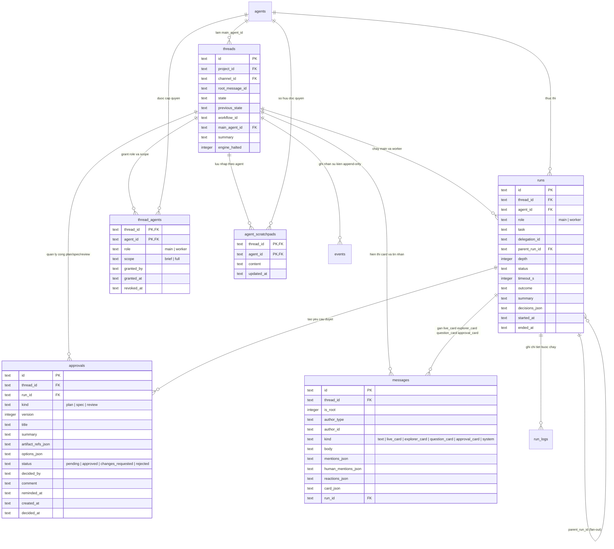
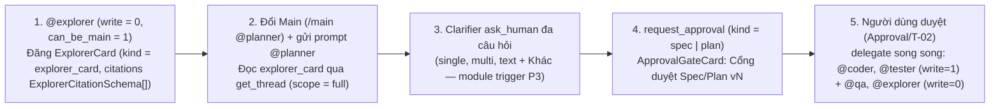
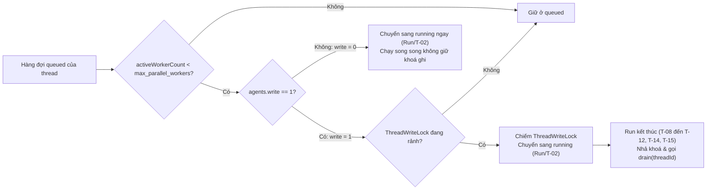

# Module Overview — Điều phối Đa Agent, Cổng duyệt & Scratchpad (`orchestration`)

| Trường | Giá trị |
| --- | --- |
| Loại tài liệu | Module Overview (Cross-cutting Decisions & State Coordination) |
| Module | `orchestration` (Phase P4) |
| Đường dẫn chốt | `specs/dd/orchestration/overview.md` |
| Domain gốc | [domain-model.md](../domain-model.md) |
| Nguồn thiết kế gốc | `docs/spec.md` (§ Điều phối trong thread), `docs/phases.md` (§ P4) |
| Ngày tạo | 2026-10-31 |
| Ngày cập nhật | 2026-10-31 |

## 1. Ranh giới module & Quyết định kiến trúc đã chốt

### 1.1 Mục tiêu và ranh giới

- **Trong phạm vi module `orchestration` (P4)**:
  1. Cơ chế giữ `threads.main_agent_id = NULL` trên thread mới chưa có `@mention` agent (tuân thủ Quy tắc #6 `AGENTS.md`), gán Main Agent mặc định từ `workflow.main_agent` (hay chọn agent đầu tiên được mention có `enabled = 1` và `can_be_main = 1`, bao gồm cả agent khám phá chỉ đọc `@explorer`, khi workflow không khai báo `main_agent`) khi thread lần đầu có `@mention` agent hợp lệ hay khi rule `dispatch` khởi chạy agent lúc `main_agent_id IS NULL`, `@mention` trực tiếp Worker, và đổi Main Agent bằng lệnh `/main @handle` (`/main @planner`, `/main @spec`, `/main @lead`).
  2. Giao việc song song (fan-out) qua công cụ MCP `delegate` cho cả worker có quyền ghi (`@coder`, `@tester`) và worker chỉ đọc (`@qa`, `@reviewer`, `@explorer`), sinh child run có `parent_run_id` và `depth + 1`, gom nhóm theo `delegation_id`, trả output MCP dạng `snake_case` (`run_id`, `delegation_id`).
  3. Bộ lập lịch song song (`ThreadScheduler`) giới hạn `max_parallel_workers` (mặc định `3`) kết hợp khoá ghi theo thread (`ThreadWriteLock`) và bảo vệ chỉ đọc tự động cho agent có `write = 0`.
  4. Gom kết quả (fan-in) qua `run.result_ready` và `delegation.completed`, đánh thức Main Agent bằng một bản ghi `runs` tiếp nối mới kèm `mcp_token` mới trên cùng phiên chạy (`session/prompt` / `resume`).
  5. Cổng duyệt công việc của người dùng (`gate: plan | spec | review`) trên bảng `approvals` có đánh số `version` tăng dần, thẻ `ApprovalGateCard` hiển thị nhất quán tiêu đề `"Cổng duyệt Plan v<N>"`, `"Cổng duyệt Spec v<N>"`, `"Cổng duyệt Review v<N>"` (viền hairline `1px` `--color-human` bao quanh kèm dấu vuông `8x8` `.ade-gate-mark`), tóm tắt cổng chờ duyệt (`pendingApproval`) trên thanh tóm tắt dưới tin nhắn gốc của thread trong `Channel Chat Box`, thông báo trình duyệt, lệnh chat `/approve` và `/revise <ghi chú>` từ `Thread Reply Composer`, nhắc hẹn một lần sau `4 giờ`, cùng hành động rule `resume_main` (kể cả khi `reject`).
  6. Cô lập ngữ cảnh worker theo `scope` (`brief` so với `full`, trả `messages_hidden`; khi `scope = 'full'` hay `role = 'main'` thì trả đầy đủ 6 loại `messages.kind` gồm cả `'explorer_card'` kèm `card_json`) và bộ nhớ làm việc riêng `agent_scratchpads` cho từng cặp `(thread_id, agent_id)`, hiển thị chỉ đọc ở chế độ `Sổ nháp` của `Ngăn phản hồi Thread`.
- **Ngoài phạm vi module `orchestration` (P4)**:
  1. Duyệt quyền thực thi lệnh của harness (`run.permission_requested` thuộc module `runner` ở P2).
  2. Công cụ đăng thẻ giải thích mã nguồn `ExplorerCard` (`post_message` với `kind = 'explorer_card'`, mảng `citations` kiểu `ExplorerCitationSchema[]` gồm `{ file, start_line, end_line, role, snippet, note? }`, cùng hành động điền sẵn câu lệnh `@planner` vào ô nhập phản hồi theo `UI-TR-01/E-28`) và công cụ phỏng vấn làm rõ đa câu hỏi không khóa cổng chuyển trạng thái (`ask_human` với mảng `questions[]` gồm `single`, `multi`, `text` kèm tùy chọn `Khác` — `Clarifier`) thuộc module `trigger` ở P3; module `orchestration` ở P4 thực thi lệnh đổi quyền `/main @planner`, `/main @spec`, cung cấp kết quả `explorer_card` qua `get_thread` (`scope = 'full'`), quản lý cổng duyệt `spec | plan | review` và điều phối worker song song sau khi cổng được duyệt.
  3. Duyệt đề xuất ghi nhớ dự án (`propose_memory` thuộc module `memory` ở P6).
  4. Tách worktree riêng cho từng worker và trộn nhánh tự động (ngoài phạm vi MVP).
- **Câu hỏi mở**: Không có.

### 1.2 Ma trận tài liệu con (Sub-DD)

| Mã DD | Loại | Đường dẫn chốt | Phạm vi đặc tả |
| --- | --- | --- | --- |
| — | Overview | `specs/dd/orchestration/overview.md` | Quyết định kiến trúc điều phối, lập lịch song song, khoá ghi, fan-in, vòng đời đánh thức Main Agent, bảo vệ cổng duyệt và cô lập ngữ cảnh |
| `API-OR-01` | API & MCP | [api-orchestration.md](./or-01/api-orchestration.md) | 6 tool MCP điều phối (`snake_case`), lọc `get_thread` theo `scope`, REST API đọc điều phối thread, duyệt cổng, xem scratchpads, `@mention` điều phối và slash commands `/main`, `/approve`, `/revise` |
| `UI-OR-01` | UI | [ui-orchestration.md](./or-01/ui-orchestration.md) | Bố cục Slack với Header 2 tầng của `Ngăn phản hồi Thread` (`Segmented Switch` `Phản hồi \| Sổ nháp`, chip `.ade-mention--agent` của Main Agent, huy hiệu `threads.state`), danh sách Worker Sub-cards thu gọn, thẻ `ApprovalGateCard` đa phiên bản, tóm tắt cổng chờ duyệt dưới tin nhắn gốc trên `Channel Chat Box`, Web Notification và chế độ xem `Sổ nháp` chỉ đọc |

### 1.3 Chế độ triển khai & Phạm vi xác thực (`ADE_MODE=solo`)

| Kênh | Cơ chế kiểm tra | Phản hồi khi vi phạm |
| --- | --- | --- |
| REST `/api/*` & WS `/ws` | Kiểm tra header `Host` có hostname thuộc `{"localhost", "127.0.0.1"}` và khi có mặt header `Origin` thì hostname của `Origin` thuộc `{"localhost", "127.0.0.1"}`; gán cố định người dùng `usr_local` (`role = 'owner'`). | Trả HTTP `403` `ERR_LOCAL_ORIGIN_ONLY`. |
| MCP `POST /mcp` (mọi tool) | Kiểm tra `Authorization: Bearer <mcp_token>` gắn cứng với `(run_id, thread_id, agent_id)` đang chạy. | Thiếu hay sai chữ ký trả HTTP `401` `ERR_MCP_TOKEN_INVALID`; run đã kết thúc trả HTTP `401` `ERR_MCP_TOKEN_EXPIRED`. |
| MCP công cụ đọc ngữ cảnh | Kiểm tra `args.thread_id` (khi được truyền vào `get_thread`) khớp `mcp_token.thread_id` và bản ghi `thread_agents` của `(mcp_token.thread_id, mcp_token.agent_id)` có `revoked_at IS NULL`. | Trả HTTP `403` `ERR_GRANT_REQUIRED`. |
| MCP công cụ điều phối (`delegate`, `request_approval`, `get_results`, `get_run_log`) | Kiểm tra đồng thời `runs.role = 'main'` và `threads.main_agent_id = runs.agent_id`. | Trả HTTP `403` `ERR_MAIN_AGENT_ONLY`. |

---

## 2. Sơ đồ quan hệ dữ liệu của module (`erDiagram`)

---

## 3. Chọn & Đổi Main Agent

### 3.1 Quy tắc chọn Main Agent lần đầu & `@mention` trực tiếp

1. Khi tạo thread mới (`POST /api/channels/:channelId/threads`) mà tin nhắn gốc không chứa `@mention` agent hợp lệ:
   - Hệ thống phải giữ `threads.main_agent_id = NULL` và không tự động cấp grant `ThreadAgent/T-01`, bảo toàn thread trao đổi thuần giữa người với người và tuân thủ Quy tắc #6 `AGENTS.md` (agent chỉ đọc được thread sau khi được mention).
2. Khi thread đang có `threads.main_agent_id IS NULL` lần đầu nhận `@mention` agent hợp lệ (`enabled = 1`) tại `POST /api/channels/:channelId/threads` hay `POST /api/threads/:threadId/messages`, hay khi rule `dispatch` khởi chạy agent trên thread đang có `threads.main_agent_id IS NULL`:
   - Ở nơi cấu hình `.ade/workflows/<workflow_id>.yaml` có khai báo `main_agent` (ví dụ `main_agent: "@lead"`) và bản ghi `agents` tương ứng có `enabled = 1` cùng `can_be_main = 1`, hệ thống phải gán `threads.main_agent_id = workflowMainAgent.id`, cấp grant theo `ThreadAgent/T-01` (`role = 'main'`, `scope = 'full'`, `granted_by = 'system'`) và ghi event `main.changed` (`previous_agent_id = null`, `new_agent_id = workflowMainAgent.id`, `changed_by = 'system'`).
   - Ở nơi workflow không khai báo `main_agent` (hay agent cấu hình trong `main_agent` không khả dụng), hệ thống phải chọn agent đầu tiên được mention (hay agent được `dispatch`) thỏa mãn `agents.enabled = 1` và `agents.can_be_main = 1` làm `threads.main_agent_id`, cấp grant theo `ThreadAgent/T-01` (`role = 'main'`, `scope = 'full'`, `granted_by = 'usr_local'`), ghi event `main.changed` và khởi tạo run của agent đó với `runs.role = 'main'`.
3. Khi người dùng `@mention` trực tiếp một agent hợp lệ khác `threads.main_agent_id` (bao gồm agent có `can_be_main = 0`):
   - Hệ thống phải tạo mới (`ThreadAgent/T-01`), khôi phục (`ThreadAgent/T-03`) hay cập nhật (`ThreadAgent/T-04`) bản ghi `thread_agents` của agent đó với `role = 'worker'`, `scope = 'full'`.
   - Hệ thống phải tạo run với `runs.role = 'worker'`; khi run này kết thúc, hệ thống phải ghi `run.result_ready` đẩy kết quả về inbox của `threads.main_agent_id` thay vì kích hoạt workflow rules cấp thread.

### 3.2 Quy tắc đổi Main Agent bằng lệnh `/main @handle`

1. Khi người dùng gửi lệnh `/main @handle` trong thread:
   - Nếu không tồn tại agent có `handle` khớp trong project, thì hệ thống phải trả HTTP `404` `ERR_NOT_FOUND`.
   - Nếu agent được chọn có `can_be_main = 0` hay `enabled = 0`, thì hệ thống phải trả HTTP `400` `ERR_AGENT_CANNOT_BE_MAIN`.
2. Khi agent hợp lệ:
   - Hệ thống phải ghi event `command.invoked` (`name = 'main'`, `args = '@handle'`).
   - Hệ thống phải cập nhật `threads.main_agent_id = newAgent.id` và ghi event `main.changed` (`previous_agent_id`, `new_agent_id`, `changed_by = 'usr_local'`).
   - Nếu `previous_agent_id` khác `null` và khác `newAgent.id`, thì hệ thống phải hạ cột `thread_agents.role` của main cũ xuống `'worker'` theo `ThreadAgent/T-04` để chặn ngay lập tức mọi lời gọi `delegate`, `request_approval`, `get_results`, `get_run_log` từ run của main cũ bằng mã lỗi HTTP `403` `ERR_MAIN_AGENT_ONLY`.
   - Hệ thống phải cấp mới (`ThreadAgent/T-01`), khôi phục (`ThreadAgent/T-03`) hay nâng cấp (`ThreadAgent/T-04`) bản ghi `thread_agents` của `newAgent.id` lên `role = 'main'`, `scope = 'full'`.
   - Trong khi thread có các nhóm `delegation_id` chưa phát `delegation.completed`, hệ thống phải chuyển đích nhận fan-in của toàn bộ các nhóm `delegation_id` đó sang `newAgent.id`.

### 3.3 Chuỗi phối hợp đội ngũ chuẩn trên Thread (`@explorer` → `Clarifier` → Cổng duyệt `Spec`/`Plan` → Worker song song)

1. **Bước 1 — Khám phá & giải thích mã nguồn chỉ đọc (`@explorer`)**:
   - Khi người dùng `@mention` trực tiếp `@explorer` (`can_be_main = 1`, `write = 0`) trên thread chưa gán `main_agent_id` mà workflow không ép cứng `main_agent`, hệ thống phải gán `@explorer` làm Main Agent tạm thời để đọc kho mã nguồn và đăng `ExplorerCard` (`messages.kind = 'explorer_card'`, lưu `topic`, `flow_steps` và mảng đối tượng trích dẫn `citations` kiểu `ExplorerCitationSchema[]` gồm `{ file, start_line, end_line, role, snippet, note? }` trong `messages.card_json`).
   - Khi Main Agent hiện tại (`@lead`, `@planner`, `@spec`) gọi `delegate` giao việc cho `@explorer` (`agents.write = 0`), hệ thống phải chạy `@explorer` như một worker chỉ đọc song song mà không chiếm `ThreadWriteLock`, đồng thời Permission Guard tự động từ chối mọi công cụ ghi đĩa.
2. **Bước 2 — Chuyển quyền Main & phỏng vấn làm rõ đa câu hỏi (`Clarifier` — `@planner`, `@spec`, `@lead`)**:
   - Theo `UI-TR-01/E-28`, nút `"Nhờ @planner lập phương án từ kết quả này"` trên `ExplorerCard` chỉ điền sẵn văn bản mở đầu bằng `@planner` dẫn chiếu chủ đề tra cứu vào `Thread Reply Composer` và đặt tiêu điểm bàn phím chứ không tự động gửi `/main @planner` hay tự gọi `POST /api/threads/:threadId/messages`.
   - Khi `threads.main_agent_id` đang thuộc về `@explorer` (hay một agent khác), người dùng thực hiện hai bước tách biệt: gửi lệnh `/main @planner` (hay `/main @spec`, `/main @lead`) trước để chuyển `threads.main_agent_id`, cập nhật chip `.ade-mention--agent` trên `Subbar` và nâng grant lên `role = 'main'`, `scope = 'full'`; sau đó gửi tin nhắn `@planner` đã điền sẵn từ `ExplorerCard` để khởi chạy run với `runs.role = 'main'`. Ở trường hợp `threads.main_agent_id` đang là `NULL` (workflow không ép `main_agent`) và `@planner` có `can_be_main = 1`, việc người dùng gửi tin nhắn `@planner` đã điền sẵn từ `ExplorerCard` tự động gán luôn `threads.main_agent_id` cho `@planner` và khởi chạy run với `runs.role = 'main'` theo `API-OR-01/S6-08`.
   - Khi Main Agent (`@planner`, `@spec`, `@lead`) gọi `get_thread`, hệ thống phải trả đầy đủ các tin nhắn `messages.kind = 'explorer_card'` kèm `is_root` (`boolean`) và `card_json` (`topic`, `flow_steps`, `citations` kiểu `ExplorerCitationSchema[]`) đã đăng trước đó trên cùng thread; trước khi trình cổng duyệt, Main Agent gọi công cụ `ask_human` đa câu hỏi (`questions[]`: `single` chọn 1, `multi` chọn nhiều, `text` tự điền kèm tùy chọn `Khác` thuộc module `trigger` P3) để làm rõ các quyết định nghiệp vụ với người dùng rồi mới gọi `request_approval` với `kind = 'spec'` hay `kind = 'plan'`.
3. **Bước 3 — Duyệt cổng (`Approval/T-02`) & Fan-out song song**:
   - Trong khi bản ghi `approvals` của cổng `spec`, `plan`, `review` đang ở trạng thái `pending` trên thẻ `ApprovalGateCard` (`"Cổng duyệt Spec v<N>"`, `"Cổng duyệt Plan v<N>"`, `"Cổng duyệt Review v<N>"`), hệ thống phải chặn mọi lời gọi `delegate` mới bằng mã lỗi HTTP `409` `ERR_APPROVAL_PENDING_LOCK`.
   - Khi người dùng duyệt cổng (`Approval/T-02` chuyển `approvals.status = 'approved'`), Rule Engine phải chuyển `threads.state` qua cổng và thực thi `resume_main` để Main Agent gọi `delegate` song song cho các worker có quyền ghi (`@coder`, `@tester` xếp hàng tuần tự qua `ThreadWriteLock`) cùng các worker chỉ đọc (`@qa`, `@reviewer`, `@explorer` chạy đồng thời không giữ khóa ghi).

---

## 4. Fan-out (`delegate`), Bộ lập lịch song song & Khoá ghi theo thread

### 4.1 Gom nhóm `delegation_id` trong Fan-out

1. Khi Main Agent gọi công cụ MCP `delegate` trong một lượt chạy `mainRun`:
   - Nếu `threads.engine_halted = 1`, thì hệ thống phải từ chối với HTTP `409` `ERR_CAUSATION_LIMIT_EXCEEDED`.
   - Nếu tồn tại bất kỳ bản ghi `approvals` nào của `thread_id` có `status = 'pending'`, thì hệ thống phải từ chối với HTTP `409` `ERR_APPROVAL_PENDING_LOCK`.
   - Nếu `mainRun.id` chưa có nhóm `delegation_id` nào ở trạng thái mở (`sealed = false`), thì hệ thống phải sinh định danh mới `dlg_<ULID>` và mở batch cho `mainRun.id`; nếu đã có sẵn batch mở thì gắn chung vào `delegation_id` đó.
2. Mỗi lời gọi `delegate` hợp lệ phải trả output MCP dạng `snake_case` `{ run_id, delegation_id, status }` và thực hiện:
   - Tạo child run mới theo `Run/T-01` với `status = 'queued'`, `role = 'worker'`, `parent_run_id = mainRun.id`, `depth = mainRun.depth + 1`, `task = input.task`, `delegation_id`, `timeout_s = COALESCE(input.timeout_s, targetAgent.timeout_s)` và ghi event `run.queued` có trường bắt buộc `timeout_s` trong `payload`; bộ đếm hẹn giờ `Run/T-15` chỉ bắt đầu tính từ `runs.started_at` khi child run chuyển sang `running` theo `Run/T-02`.
   - Cấp grant mới (`ThreadAgent/T-01`), khôi phục từ `revoked` (`ThreadAgent/T-03`) hay cập nhật `scope = input.scope` trên grant đang `active` (`ThreadAgent/T-04`), ghi event `agent.granted`.
   - Ghi event `task.delegated` vào bảng `events`.

### 4.2 Bộ lập lịch `ThreadScheduler` & Khoá ghi `ThreadWriteLock`

| Thành phần | Quy tắc định lượng | Hành vi thực thi |
| --- | --- | --- |
| Giới hạn worker đồng thời | `max_parallel_workers` trong `.ade/workflows/<workflow_id>.yaml`, mặc định bằng `3` trên mỗi `thread_id`. | Đếm `activeWorkerCount` là số dòng `runs` cùng `thread_id` có `role = 'worker'` và `status IN ('running', 'waiting_permission', 'waiting_human')`. Chỉ khởi chạy worker mới khi `activeWorkerCount < max_parallel_workers`. |
| Worker chỉ đọc (`agents.write = 0`, ví dụ `@explorer`, `@qa`, `@reviewer`) | Không yêu cầu `ThreadWriteLock`. | Khi `activeWorkerCount < max_parallel_workers`, hệ thống phải chuyển ngay run sang `running` theo `Run/T-02`, cho phép chạy chồng thời gian với các worker `write = 0` khác và với tối đa `1` run `write = 1` đang giữ khoá ghi. |
| Worker có quyền ghi (`agents.write = 1`) | Tối đa `1` run có `agents.write = 1` active trên mỗi `thread_id` tại mọi thời điểm. | Khi `ThreadWriteLock` của `thread_id` đang bị giữ bởi run khác, hệ thống phải giữ run `write = 1` mới ở trạng thái `queued` theo thứ tự FIFO `created_at ASC`. Khi run giữ khoá kết thúc (`Run/T-08`, `Run/T-09`, `Run/T-10`, `Run/T-11`, `Run/T-12`, `Run/T-14`, `Run/T-15`), hệ thống phải nhả khoá ngay trong cùng chu kỳ sự kiện và gọi `ThreadScheduler.drain(threadId)` để cấp khoá cho run tiếp theo. |
| Permission Guard chỉ đọc (`write = 0`) | Áp dụng cho mọi run của agent có `agents.write = 0` trên cả driver Claude và driver ACP. | Nếu run có `agents.write = 0` yêu cầu gọi công cụ ghi và sửa tệp (`Write`, `Edit`, `MultiEdit`, `NotebookEdit`, `DeleteFile`, `fs/write_text_file`, `Bash` ghi đĩa), thì Permission Guard của Runner phải trả kết quả từ chối tự động (`deny`) kèm thông điệp `"Agent read-only (write: false)"` và không sinh bản ghi `approval_card` xin quyền trên giao diện. |

---

## 5. Gom kết quả Fan-in, Vòng đời Đánh thức Main Agent & Phối hợp Rule Engine P3

### 5.1 Niêm phong batch & Gom kết quả (`delegation.completed`)

1. **Niêm phong đợt giao việc (`sealBatch`)**:
   - Khi lượt chạy `mainRun` đã phát ít nhất một `task.delegated` kết thúc lượt (`run.completed`, `run.failed`, `run.cancelled`), `FanInCoordinator` phải đánh dấu batch `delegation_id` là `sealed = true` để đảm bảo không gửi tổng hợp sớm khi Main Agent đang gọi dở các lệnh `delegate` kế tiếp.
2. **Ghi nhận từng worker hoàn tất (`run.result_ready`)**:
   - Khi một child run thuộc `delegation_id` chuyển sang trạng thái cuối (`completed`, `failed`, `cancelled`), hệ thống phải ghi một event `run.result_ready` vào bảng `events` chứa `delegation_id`, `child_run_id`, `agent` (`handle`), `outcome` và `summary`.
   - Khi child run có `runs.timeout_s IS NOT NULL` (từ `delegate.timeout_s` hay kế thừa mặc định `agents.timeout_s`) chưa kết thúc sau `runs.timeout_s` giây kể từ mốc `runs.started_at` (lúc chuyển sang `running` theo `Run/T-02`), hệ thống phải dừng child run theo `Run/T-15` với `stop_reason = 'timeout'`, `outcome = 'blocked'`, `error_code = 'ERR_RUN_TIMEOUT'` và ghi `run.result_ready`.
3. **Kích hoạt tổng hợp một lần duy nhất (`delegation.completed`)**:
   - Trong khi batch chưa `sealed` hay còn ít nhất một child run cùng `delegation_id` ở trạng thái `queued`, `running`, `waiting_permission`, `waiting_human`, hệ thống không được đánh thức Main Agent.
   - Khi `sealed = true` và toàn bộ child run của `delegation_id` đều đã ở trạng thái cuối (`completed`, `failed`, `cancelled`), hệ thống phải ghi đúng một event `delegation.completed` và đánh thức Main Agent hiện tại (`threads.main_agent_id`) đúng một lần duy nhất với danh sách đầy đủ kết quả của mọi child run trong batch.

### 5.2 Vòng đời tạo Run tiếp nối & Làm mới `mcp_token` khi đánh thức Main Agent

1. Khi hệ thống đánh thức Main Agent hiện tại (`threads.main_agent_id`) do sự kiện `delegation.completed` hay do thực thi hành động rule `resume_main`:
   - Hệ thống phải tạo một bản ghi `runs` tiếp nối mới cho `threads.main_agent_id` theo `Run/T-01` → `Run/T-02` với `role = 'main'`, `depth = 0`, tái sử dụng `acp_session_id` (với driver ACP `session/prompt`) và tham số `resume` (với driver Claude) của cặp `(thread_id, main_agent_id)` khi phiên chưa bị đóng do quá hạn nghỉ.
   - Nếu phiên của Main Agent đã bị đóng do quá thời gian nghỉ, thì Runner phải mở phiên mới và nạp lại `threads.summary` cùng nội dung đánh thức vào prompt.
   - Hệ thống phải phát hành `mcp_token` mới gắn với `newRun.id` đang ở trạng thái `running` và cập nhật ánh xạ xác thực của phiên chạy sang `newRun.id` trước khi gửi `session/prompt`, đảm bảo mọi lời gọi MCP kế tiếp của Main Agent không bao giờ gặp lỗi HTTP `401` `ERR_MCP_TOKEN_EXPIRED` từ run cũ.

### 5.3 Hai quy tắc phối hợp với Rule Engine của Phase P3

1. **Ngầm định `outcome = 'done'` cho lượt Main Agent chờ Fan-in và chờ Cổng duyệt**:
   - Khi một run có `runs.role = 'main'` kết thúc lượt (`run.end` với `stop_reason = 'end_turn'`) mà chưa gọi `report_outcome` (`runs.outcome IS NULL`), nếu trong vòng đời của chính `run.id` đó đã phát ít nhất một sự kiện `task.delegated` hay `approval.requested`, thì hệ thống phải gán `runs.outcome = 'done'` trước khi phát `run.completed` theo `Run/T-08`. Quy tắc này ngăn chặn việc kích hoạt nhầm rule fallback `when: { outcome: unknown } -> ask_human` trong lúc Main Agent đang hợp lệ chờ kết quả worker hay chờ người dùng duyệt cổng.
2. **Cách ly sự kiện kết thúc của Worker khỏi Workflow Rules cấp thread**:
   - Sự kiện `run.completed`, `run.failed`, `run.cancelled` của các run có `runs.role = 'worker'` chỉ được chuyển vào `FanInCoordinator` để ghi `run.result_ready` vào inbox của Main Agent; bộ lọc của `RuleEngine` không khớp các sự kiện kết thúc của `role = 'worker'` với các workflow rules `on: run.completed` cấp thread.

---

## 6. Cổng duyệt của người (`gate: plan | spec | review`) & Rule Action `resume_main`

### 6.1 Phân biệt hai cơ chế duyệt trong ADE

| Tiêu chí | Duyệt cổng công việc (`Gate Approval` — P4) | Duyệt quyền công cụ (`Tool Permission` — P2) |
| --- | --- | --- |
| Nguồn phát sinh | Main Agent gọi công cụ MCP `request_approval` | Harness phát yêu cầu qua `canUseTool` và ACP `session/request_permission` |
| Loại (`kind`) | `plan`, `spec`, `review` | Tên công cụ kỹ thuật (`Bash`, `Write`, `Edit`) |
| Bảng lưu trữ | Bảng `approvals` (có cột `version` tăng dần `1, 2, 3`) + `messages` (`kind = 'approval_card'`) | Bảng `events` (`run.permission_requested`) + `messages` (`kind = 'approval_card'`) |
| Ảnh hưởng `threads.state` | Bắt buộc phải có `status = 'approved'` mới được vượt qua state có `gate: <kind>` | Không đổi `threads.state` |
| Trạng thái Run trong lúc chờ | Lượt chạy hiện tại của Main Agent kết thúc với `outcome = 'done'`; đánh thức bằng run tiếp nối mới qua `resume_main` sau khi người dùng quyết định | Tiến trình harness đang giữ kết nối tạm dừng (`waiting_permission`) |

### 6.2 Quy tắc bảo vệ cổng duyệt (`GateGuard`) & Chuyển trạng thái qua Rule Engine

1. **Chỉ Rule Engine đổi `threads.state` trong luồng nghiệp vụ (Quy tắc #4 `AGENTS.md`)**:
   - Công cụ MCP `request_approval` không tự sửa trực tiếp cột `threads.state`. Khi Main Agent gọi `request_approval`, MCP kiểm tra workflow hiện tại có khai báo state mang `gate: <kind>` hay không (nếu không tồn tại state cổng cho `<kind>` thì trả HTTP `400` `ERR_INVALID_STATUS`), kiểm tra thread không có bất kỳ bản ghi `approvals` nào đang ở trạng thái `pending` (cùng hay khác `kind`; nếu đang có thì trả HTTP `409` `ERR_APPROVAL_PENDING_LOCK`), tạo bản ghi `approvals` theo `Approval/T-01` và ghi event `approval.requested`.
   - Ngay khi nhận event `approval.requested`, **Rule Engine** thực thi chuyển `threads.state` sang state mang `gate: <kind>` theo `Thread/T-03`, `Thread/T-06`, `Thread/T-09` (khi `threads.state` hiện tại chưa ở state cổng đó).
2. **Bảo vệ cứng trong `transitionThreadState(threadId, toState)` (Quy tắc #5 `AGENTS.md`)**:
   - Mọi thao tác đổi `threads.state` (từ Rule Engine `set_state` và từ MCP `set_state` khi agent có `"set_state"` trong `mcp_allow`) đều bắt buộc đi qua hàm duy nhất `transitionThreadState(threadId, toState)` theo `Thread/T-01` đến `Thread/T-11` trong [domain-model.md](../domain-model.md).
   - Nếu `toState` không tồn tại trong tập `states` của `.ade/workflows/<workflow_id>.yaml`, thì `transitionThreadState` phải từ chối với HTTP `400` `ERR_INVALID_STATUS`.
   - Nếu `threads.state` hiện tại khai báo `gate: <kind>` (`plan`, `spec`, `review`) và `toState` khác `threads.previous_state`, thì hệ thống phải truy vấn bản ghi `approvals` có `version` lớn nhất của cặp `(thread_id, kind)`; nếu chưa có bản ghi nào hay bản ghi mới nhất có `status` khác `'approved'`, thì hệ thống phải từ chối chuyển trạng thái với HTTP `409` `ERR_GATE_APPROVAL_REQUIRED`.
3. **Khóa giao việc và xin duyệt chồng chéo**:
   - Trong khi tồn tại bất kỳ bản ghi `approvals` nào của `thread_id` có `status = 'pending'`, mọi lời gọi MCP `delegate` và `request_approval` mới trên thread đó phải bị từ chối với HTTP `409` `ERR_APPROVAL_PENDING_LOCK`.

### 6.3 Vòng đời phiên bản duyệt & Nhắc hẹn 4 giờ

1. **Tăng phiên bản (`Approval/T-01`)**: Khi Main Agent gọi `request_approval` cho `kind`, hệ thống tính `version = COALESCE(MAX(version), 0) + 1` trên `(thread_id, kind)`. Sau khi người dùng chọn `changes_requested` ở `v1` (`Approval/T-03`), lần gọi `request_approval` tiếp theo cùng `kind` tạo bản ghi mới với `version = 2` và giữ nguyên bản ghi `v1` để đối chiếu lịch sử.
2. **Ba quyết định của người dùng**:
   - `approve` (`Approval/T-02`): Cập nhật `status = 'approved'`, ghi `approval.resolved` với `decision = 'approve'`; Rule Engine khớp rule để gọi `set_state` sang state kế tiếp (`Thread/T-04`, `Thread/T-07`) và gọi `resume_main` (ở nơi workflow có cấu hình).
   - `changes_requested` (`Approval/T-03`): Yêu cầu `comment` khác rỗng; cập nhật `status = 'changes_requested'`, giữ nguyên `threads.state` ở state cổng, ghi `approval.resolved` với `decision = 'changes_requested'` để Rule Engine gọi `resume_main` gửi nguyên văn `comment` cho Main Agent lập phiên bản kế tiếp.
   - `reject` (`Approval/T-04`): Cập nhật `status = 'rejected'`, ghi `approval.resolved` với `decision = 'reject'` kèm `comment`; Rule Engine khôi phục `threads.state = threads.previous_state` (`Thread/T-05`, `Thread/T-08`, `Thread/T-10`) đồng thời thực thi `resume_main` đánh thức Main Agent nhận lý do từ chối.
3. **Rule action `resume_main`**:
   - Cú pháp trong workflow YAML: `- resume_main: "<mẫu thông điệp>"`.
   - Khi thực thi, Rule Engine nội suy các biến `{{payload.comment}}`, `{{payload.kind}}`, `{{payload.version}}` rồi tạo bản ghi `runs` tiếp nối mới kèm `mcp_token` mới (§5.2) để gửi `session/prompt` cho `threads.main_agent_id`.
4. **Nhắc hẹn một lần sau 4 giờ (`ApprovalReminderScheduler`)**:
   - Approval không tự hết hạn.
   - Khi một bản ghi `approvals` ở trạng thái `pending` đạt thời gian chờ `>= 14400` giây (`4 giờ`) kể từ `created_at` và `reminded_at IS NULL`, bộ định thời phải gán `reminded_at = now()`, ghi event `approval.reminded`, đăng một tin nhắn hệ thống (`messages.is_root = 0`, `messages.kind = 'system'`, `mentions_json = '[]'`, `human_mentions_json = '["@owner"]'`, `reactions_json = '[]'`) mention `@owner` (`usr_local`) vào luồng phản hồi của thread và phát sự kiện append-only `message.posted` (`is_root: false`, `mentions: []`, `human_mentions: ["@owner"]`).

---

## 7. Cô lập ngữ cảnh (`scope: brief | full`) & `agent_scratchpads`

| Loại dữ liệu | Main Agent (`role = 'main'`) | Worker `scope = 'brief'` | Worker `scope = 'full'` | Người dùng (`usr_local`) |
| --- | --- | --- | --- | --- |
| Thông tin cơ bản thread (`title`, `state`, `summary`) | Đọc toàn bộ | Đọc toàn bộ | Đọc toàn bộ | Đọc toàn bộ |
| Nhiệm vụ được giao (`runs.task` & `inputs`) | Toàn bộ yêu cầu gốc | Đọc `runs.task` + `inputs` do Main truyền vào | Đọc `runs.task` + `inputs` do Main truyền vào | Đọc toàn bộ |
| Lịch sử tin nhắn chat (`messages` thuộc cả 6 loại `kind`: `'text'`, `'live_card'`, `'explorer_card'`, `'question_card'`, `'approval_card'`, `'system'` kèm `card_json`) qua prompt & MCP `get_thread` | Nhận đầy đủ tin nhắn kèm `card_json` (`messages_hidden = false`), đọc được cả `citations` của `explorer_card` | Ẩn lịch sử tin nhắn (`messages = []`, `messages_hidden = true`) | Nhận đầy đủ tin nhắn kèm `card_json` (`messages_hidden = false`), đọc được cả `citations` của `explorer_card` | Xem toàn bộ |
| Kết quả các run khác (`get_results`) | Đọc toàn bộ qua MCP `get_results` | Bị chặn HTTP `403` `ERR_MAIN_AGENT_ONLY` | Bị chặn HTTP `403` `ERR_MAIN_AGENT_ONLY` | Xem trên thẻ UI |
| Nhật ký chi tiết run (`get_run_log`) | Đọc theo yêu cầu qua MCP `get_run_log` | Bị chặn HTTP `403` `ERR_MAIN_AGENT_ONLY` | Bị chặn HTTP `403` `ERR_MAIN_AGENT_ONLY` | Xem trên Live Card |
| Bộ nhớ nháp (`agent_scratchpads`) | Chỉ đọc/ghi dòng `(thread_id, self_agent_id)` | Chỉ đọc/ghi dòng `(thread_id, self_agent_id)` | Chỉ đọc/ghi dòng `(thread_id, self_agent_id)` | Xem toàn bộ ở chế độ chỉ đọc (`GET /api/threads/:threadId/scratchpads`) |
| Project Memory (`.ade/memory/*.md`) | Đọc toàn bộ | Đọc toàn bộ | Đọc toàn bộ | Đọc và duyệt sửa |

**Bất biến bảo mật của `agent_scratchpads`**: Hai công cụ MCP `read_scratchpad` và `write_scratchpad` không nhận trường `agent_id` hay `thread_id` từ tham số đầu vào của model, mà trích xuất trực tiếp cặp khoá `(mcp_token.thread_id, mcp_token.agent_id)` đã ký trong phiên chạy. Nhờ vậy một worker không có đường dẫn tham số nào để đọc hay ghi đè scratchpad của agent khác.
