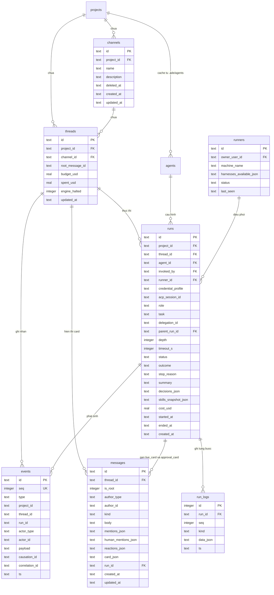

# Overview Module `runner` — Local Runner, Driver Harness & Cô lập Hồ sơ ADE

| Trường | Giá trị |
| --- | --- |
| Loại tài liệu | Overview Module (`runner`) |
| Đường dẫn chốt | `specs/dd/runner/overview.md` |
| Nguồn thiết kế gốc | `docs/spec.md`, `docs/phases.md`, `AGENTS.md`, `design.md`, `specs/dd/domain-model.md` |
| Schema ORM | `apps/hub/src/db/schema.ts` (`projects`, `channels`, `threads`, `agents`, `runners`, `runs`, `run_logs`, `messages`, `events`) |
| Schema Zod | `packages/shared/src/schemas/runner.ts` |
| Ngày tạo | 2026-10-31 |
| Ngày cập nhật | 2026-10-31 |

## 1. Mục tiêu, Ranh giới Module & Giả định Đầu vào

### 1.1 Mục tiêu và ranh giới

- **Mục tiêu**: Điều phối vòng đời thực thi agent từ sự kiện `@mention` sang phiên chạy thật trên hai họ driver (`ClaudeSdkDriver` dùng Claude Agent SDK và `CodexAcpDriver` dùng giao thức ACP qua stdio), chuẩn hoá toàn bộ tín hiệu tiến độ thành cùng một định dạng `NormalizedRunEventSchema`, quản lý Git worktree tách biệt theo từng thread và bảo đảm cô lập tuyệt đối hồ sơ cấu hình của ADE khỏi môi trường cá nhân của lập trình viên.
- **Trong phạm vi Phase P2**:
  - Giao thức `RunnerTransport` với bản cài đặt `InProcessRunnerTransport` chạy cùng tiến trình Hub ở `ADE_MODE=solo`, giữ nguyên hợp đồng 8 loại thông điệp để sẵn sàng chuyển sang WebSocket ở `ADE_MODE=team` và `ADE_MODE=vps`.
  - Chuẩn hoá sự kiện tiến độ và bộ gộp `run.progress` chu kỳ `1000 ms` (ghi chi tiết từng bước vào `run_logs`, ghi bản gộp vào `events`, cập nhật tại chỗ trên đúng 1 `live_card` cho mỗi run bắt đầu từ `Run/T-02`).
  - Quản lý Git worktree theo thread tại `<repo_path>/.ade/wt/<thread_id>` kèm khoá ghi độc quyền theo thread cho các agent có `agents.write = 1`.
  - Hai driver thực thi thật (`ClaudeSdkDriver`, `CodexAcpDriver`) và hai fake harness cho kiểm thử tự động (`FakeClaudeDriver`, `ade-fake-agent`).
  - Luồng xin quyền công cụ hai chiều (`permission.request` ↔ `permission.reply`) hiển thị qua thẻ `approval_card` phân loại `tool_permission`.
  - Quản lý và kiểm tra hợp lệ 3 `credential_profile`: `sub-claude`, `sub-chatgpt`, `api-key`.
- **Ngoài phạm vi Phase P2**:
  - Rule engine đọc `.ade/workflows/*.yaml`, ADE MCP Server `/mcp` (`report_outcome`, `post_progress`, `ask_human`, `get_thread`, `read_memory`), kiểm tra grant `thread_agents` trên MCP và hook `PreToolUse` chặn lệnh nguy hiểm (triển khai ở Phase P3).
  - Điều phối `delegate` đa worker tối đa 3 luồng song song, fan-in kết quả và cổng duyệt công việc `plan` / `spec` / `review` (triển khai ở Phase P4).
  - Đóng tự động phiên ACP sau `30 phút` không hoạt động và giới hạn pool LRU tối đa `4` phiên đồng thời (triển khai ở Phase P6; máy trạng thái chính thức `AcpSession.status` được định nghĩa duy nhất tại [specs/dd/memory/overview.md](specs/dd/memory/overview.md)).

### 1.2 Giả định đầu vào từ Spike P0 (Bắt buộc)

Thiết kế chi tiết của module `runner` ở Phase P2 dựa trên giả định cả **4 câu hỏi spike của Phase P0** đều đạt kết quả kiểm chứng thực tế:

| Mã Spike | Giả định đầu vào đã kiểm chứng ở P0 | Hành động bắt buộc khi thực tế khác giả định |
| --- | --- | --- |
| `SPK-01` | Claude Agent SDK khi truyền `settingSources: []`, `CLAUDE_CONFIG_DIR=~/.ade/harness/claude`, `CLAUDE_CODE_DISABLE_AUTO_MEMORY=1` và `strictMcpConfig: true` không nạp `~/.claude/CLAUDE.md`, không nạp skill cá nhân trong `~/.claude/skills/` và chỉ nạp đúng các skill nằm trong plugin tạm của run. | Mở Change Request (CR) cập nhật `specs/dd/runner/overview.md` (bổ sung cô lập biến môi trường `HOME` riêng cho tiến trình con của SDK) trước khi viết code P2. |
| `SPK-02` | Tiến trình Codex khi đặt `CODEX_HOME=~/.ade/harness/codex` và khai báo các khối `[[skills.config]] enabled = false` trong `config.toml` tắt hoàn toàn toàn bộ skill cá nhân tại `~/.agents/skills`, đồng thời nạp đầy đủ skill đặt trong `<worktree>/.agents/skills/`. | Mở CR cập nhật `specs/dd/runner/overview.md` (chuyển sang cô lập biến môi trường `HOME` riêng cho tiến trình `codex-acp`) trước khi viết code P2. |
| `SPK-03` | Phiên đăng nhập gói thuê bao cá nhân (`sub-claude` lưu tại `~/.ade/harness/claude` và `sub-chatgpt` lưu tại `~/.ade/harness/codex`) xác thực thành công và tách rời hoàn toàn khỏi phiên đăng nhập CLI hàng ngày của lập trình viên. | Mở CR cập nhật cơ chế khởi tạo thư mục xác thực trong `specs/dd/runner/overview.md` trước khi viết code P2. |
| `SPK-04` | Adapter `codex-acp` giao tiếp qua stdio JSON-RPC phát đầy đủ thông báo `session/update` (`plan`, `tool_call`, `tool_call_update`, `agent_message_chunk`) và yêu cầu hai chiều `session/request_permission`, nhận phản hồi chọn phương án và tiếp tục thực thi lệnh. | Mở CR cập nhật `specs/dd/runner/overview.md` để đổi cài đặt bên dưới của driver Codex sang Codex SDK trước khi viết code P2. |

### 1.3 Ma trận tài liệu con (Sub-DD) trong module `runner`

| Mã DD | Loại | Đường dẫn chốt | Nội dung |
| --- | --- | --- | --- |
| `API-RN-01` | API + Dispatcher Job | [specs/dd/runner/rn-01/api-runs.md](specs/dd/runner/rn-01/api-runs.md) | REST endpoints truy vấn danh sách run theo thread và theo dự án (`GET /api/threads/:threadId/runs`, `GET /api/projects/:projectId/runs`), phản hồi quyền công cụ, huỷ run, các khung tin WebSocket P2 và luồng sự kiện nội bộ `agent.mentioned` ↔ `RunnerTransport` |
| `UI-RN-01` | Giao diện (Cards trong Ngăn Thread) | [specs/dd/runner/rn-01/ui-run-cards.md](specs/dd/runner/rn-01/ui-run-cards.md) | Hiển thị Live Card cập nhật tại chỗ và Tool Permission Approval Card trong luồng phản hồi dọc của Ngăn Thread (`thread-panel`), đồng bộ dòng tóm tắt trên thanh phản hồi nội tuyến (`thread-reply-bar-<threadId>`) tại Khung trò chuyện Kênh và chấm trạng thái đang chạy của agent tại nhóm `Bot / Agent` thuộc Cột 2 |
| `E0` | Domain Model dùng chung | [specs/dd/domain-model.md](specs/dd/domain-model.md) | Định nghĩa bảng `runners`, `runs`, `run_logs`, `events` và State Machine `Run.status`, `Runner.status` |

---

## 2. Sơ đồ Quan hệ Dữ liệu của Module `runner` (`erDiagram`)



---

## 3. Giao thức `RunnerTransport` & Hợp đồng Thông điệp

Ở chế độ `ADE_MODE=solo`, Hub và Local Runner cùng nằm trong một tiến trình Node.js và giao tiếp qua `InProcessRunnerTransport` (truyền bản sao đối tượng đã kiểm tra qua `RunnerMessageSchema`, không qua socket mạng). Khi mở rộng sang `ADE_MODE=team` hay `ADE_MODE=vps`, hệ thống thay bằng `WsRunnerTransport` mà không đổi bất kỳ trường nào trong hợp đồng dưới đây.

| Chiều gửi | `type` | Tên Zod Schema (`packages/shared`) | Trường bắt buộc trong thông điệp | Ý nghĩa nghiệp vụ |
| --- | --- | --- | --- | --- |
| Runner → Hub | `runner.hello` | `RunnerHelloMessageSchema` | `runnerId`, `machineName`, `harnessesAvailable`, `version` | Đăng ký runner sẵn sàng nhận việc và danh sách harness khả dụng trên máy (`claude-code`, `codex`) |
| Hub → Runner | `run.start` | `RunStartMessageSchema` | `runId`, `projectId`, `threadId`, `repoPath`, `defaultBranch`, `useRepoInstructions`, `agent`, `skills`, `prompt`, `context`, `mcpUrl` (`string \| null`), `mcpToken` (`string \| null`), `resumeSessionId` (`string \| null`) | Yêu cầu runner chuẩn bị worktree, hồ sơ cô lập và khởi chạy phiên agent; ở Phase P2 khi chưa bật `/mcp` (P3), Hub gửi `mcpUrl = null` và `mcpToken = null` |
| Hub → Runner | `run.prompt` | `RunPromptMessageSchema` | `runId`, `text` | Gửi tiếp câu lệnh bổ sung vào phiên agent đang mở của `(thread_id, agent_id)` |
| Hub → Runner | `run.cancel` | `RunCancelMessageSchema` | `runId`, `reason` | Yêu cầu dừng tức thời phiên thực thi driver của `runId` |
| Runner → Hub | `run.event` | `RunEventMessageSchema` | `runId`, `ts`, `acpSessionId`, `event` (`NormalizedRunEventSchema`) | Đẩy một đơn vị cập nhật tiến độ đã chuẩn hoá từ driver lên Hub |
| Runner → Hub | `permission.request` | `PermissionRequestMessageSchema` | `runId`, `requestId`, `tool`, `args`, `displayCommand`, `options` (`{ id: string; label: string; decision: "allow" \| "deny" }[]`) | Tạm dừng thực thi công cụ để xin người dùng cho phép hay từ chối qua đúng 2 phương án đã chuẩn hoá |
| Hub → Runner | `permission.reply` | `PermissionReplyMessageSchema` | `runId`, `requestId`, `optionId`, `decision` | Trả quyết định `allow` hay `deny` kèm `optionId` đã chọn của người dùng xuống driver đang tạm dừng |
| Runner → Hub | `run.end` | `RunEndMessageSchema` | `runId`, `stopReason`, `errorCode`, `errorMessage`, `acpSessionId`, `usage` | Báo phiên thực thi kết thúc kèm lý do dừng và số liệu token / chi phí USD |

---

## 4. Chuẩn hoá `NormalizedRunEventSchema` & Bộ gộp `run.progress` `1000 ms`

### 4.1 Bảng ánh xạ chuẩn hoá từ hai họ driver

Mọi tín hiệu phát sinh từ `ClaudeSdkDriver` và `CodexAcpDriver` đều phải quy đổi về đúng 5 nhánh của `NormalizedRunEventSchema` trước khi gửi vào `run.event`:

| `event.kind` | Nguồn ở `ClaudeSdkDriver` (Agent SDK) | Nguồn ở `CodexAcpDriver` (ACP `session/update`) | Cấu trúc `event.data` | Biểu diễn trên `LiveCardPayloadSchema` / Hub |
| --- | --- | --- | --- | --- |
| `plan` | Tool call `TodoWrite` từ SDK message stream | `sessionUpdate = "plan"` (`entries`) | `{ items: { id: string; text: string; status: "pending" \| "in_progress" \| "completed" }[] }` | Thay thế danh sách checklist tiến độ của Live Card |
| `tool_call` | Khối `tool_use` (`running`) và `tool_result` (`completed` / `failed`) | `sessionUpdate = "tool_call"` và `"tool_call_update"` | `{ callId: string; tool: string; summary: string; status: "running" \| "completed" \| "failed" }` | Chèn dòng mới khi chưa có `callId`; cập nhật tại chỗ dòng log thu gọn khi đã có `callId` (ví dụ `"Write docs/spec.md ✓"`) |
| `message_chunk` | Sự kiện `stream_event` (`text_delta`) và khối `assistant` text | `sessionUpdate = "agent_message_chunk"` | `{ textDelta: string }` | Nối dồn chuỗi vào trường `lastMessageText` (giữ tối đa `4000` ký tự cuối để hiển thị trên thẻ) |
| `step` | Bước kịch bản từ `FakeClaudeDriver` | Bước kịch bản từ `ade-fake-agent` (và MCP `post_progress` ở P3) | `{ text: string; step: number \| null; percent: number \| null }` | Thêm dòng bước thực thi vào danh sách hoạt động của Live Card |
| `usage` | Sự kiện usage từ Claude Agent SDK | Cập nhật usage từ adapter ACP / fake scenario (kích hoạt ở P6) | `{ cost_usd: number; tokens_in: number; tokens_out: number }` | Chuyển thẳng vào `BudgetGuard` (P6) để ghi `run.usage_updated`, không gom vào `ProgressAggregator` |

### 4.2 Quy tắc lưu trữ hai tầng và gộp `1000 ms`

1. **Tầng chi tiết (`run_logs`)**: Khi Hub nhận bất kỳ thông điệp `run.event` nào từ `RunnerTransport` cho một run chưa bị huỷ, Hub phải ghi ngay lập tức 1 dòng vào bảng `run_logs` với `seq` tăng tuần tự bắt đầu từ `1` trong phạm vi `run_id` đó. Không làm rơi bất kỳ chunk hay tool call nào.
2. **Tầng sự kiện nghiệp vụ (`events` + `messages`)**:
   - Riêng `event.kind = 'usage'` được chuyển thẳng sang `BudgetGuard` (mô tả tại [specs/dd/memory/overview.md](specs/dd/memory/overview.md)) để ghi `run.usage_updated` và kiểm tra trần ngân sách tức thời.
   - Với 4 nhánh tiến độ (`plan`, `tool_call`, `message_chunk`, `step`), bộ `ProgressAggregator` gom các `run.event` của cùng `run_id` trong cửa sổ định thời `1000 ms`.
   - Khi hết cửa sổ `1000 ms` mà có ít nhất 1 thay đổi chưa phát, Hub phải ghi đúng 1 bản ghi `events` có `type = 'run.progress'` chứa bản chụp tích luỹ mới nhất, cập nhật cột `messages.card_json` của bản ghi `live_card` gắn với `run_id` và phát thông điệp WebSocket `message.updated`.
   - Trước khi ghi bất kỳ sự kiện chuyển trạng thái nào của run (`run.permission_requested`, `run.completed`, `run.failed`, `run.cancelled`), Hub phải gọi `flush(runId)` ngay lập tức để mọi bước tiến độ trước đó xuất hiện đầy đủ trên `events` và `live_card` đúng thứ tự nhân quả.

---

## 5. Quản lý Git Worktree theo Thread & Khoá Ghi

### 5.1 Quy trình chuẩn bị Worktree

| Bước | Điều kiện | Hành động của `WorktreeManager` | Bảo đảm độ sạch Git |
| --- | --- | --- | --- |
| 1 | Trước khi spawn driver cho `threadId` trên repo `<repo_path>` | Khi chuẩn bị môi trường cho `threadId`, `WorktreeManager` phải kiểm tra sự tồn tại của thư mục `<repo_path>/.ade/wt/<threadId>/` và ghi dòng `.ade/wt/` vào `<repo_path>/.git/info/exclude` nếu dòng này chưa tồn tại. | Không chạm tới file `.gitignore` của dự án. |
| 2 | Thư mục worktree chưa tồn tại, đồng thời `agent.write === false` và `agent.harness === 'claude-code'` (ví dụ `@explorer`, `@planner`, `@spec`) | Khi thư mục worktree chưa tồn tại và agent thuộc họ `claude-code` chỉ đọc (`write = false`), `WorktreeManager` phải không chạy `git worktree add` mà trả thẳng `cwd = <repo_path>` để agent chạy chỉ đọc trực tiếp trên kho mã nguồn, không tạo worktree ghi thừa (skill của Claude nạp qua `~/.ade/runs/<run_id>/plugin/`, không ghi vào repo). | `0` tệp và `0` nhánh thừa phát sinh trên đĩa. |
| 3 | Thư mục worktree chưa tồn tại, đồng thời (`agent.write === true` hay `agent.harness === 'codex'`) và nhánh `ade/<threadId>` chưa có | Khi thư mục worktree chưa tồn tại và nhánh `ade/<threadId>` chưa có đối với agent được ghi (`write = true`) hay agent thuộc họ `codex`, `WorktreeManager` phải chạy lệnh `git worktree add -b ade/<threadId> <repo_path>/.ade/wt/<threadId> <default_branch>` (driver Codex luôn dùng worktree riêng để cô lập `<worktree>/.agents/skills/`). | Không chạm tới file `.gitignore` đã được version control của dự án. |
| 4 | Thư mục worktree chưa tồn tại, đồng thời (`agent.write === true` hay `agent.harness === 'codex'`) nhưng nhánh `ade/<threadId>` đã có | Khi thư mục worktree chưa tồn tại nhưng nhánh `ade/<threadId>` đã có đối với agent được ghi (`write = true`) hay agent thuộc họ `codex`, `WorktreeManager` phải chạy lệnh `git worktree add <repo_path>/.ade/wt/<threadId> ade/<threadId>`. | Tái sử dụng đúng nhánh công việc của thread. |
| 5 | Thư mục worktree đã tồn tại hợp lệ (cả khi `agent.write === true` lẫn `agent.write === false`) | Khi thư mục `<repo_path>/.ade/wt/<threadId>` đã tồn tại hợp lệ, `WorktreeManager` phải giữ nguyên và trả về đường dẫn đó để mọi agent chạy sau (kể cả `@explorer` hay `@qa` chỉ đọc) nhìn thấy đúng trạng thái sửa file mới nhất của thread. | `git status --porcelain` tại `<repo_path>` không xuất hiện `.ade/wt` hay `.agents/skills`. |

### 5.2 Quy tắc khoá ghi theo Thread & Chế độ Chỉ đọc (`write = 0`)

- Mỗi định nghĩa agent phải khai báo thuộc tính `write` (`1` = được ghi file, `0` = chỉ đọc, ví dụ `@explorer`, `@planner`, `@spec`, `@qa`).
- Khi `agents.write = 0`, `ClaudeSdkDriver` phải truyền `disallowedTools: ["Write", "Edit", "MultiEdit", "NotebookEdit"]` và trả ngay `{ behavior: "deny", message: "Agent chỉ đọc (write = false) không được phép sửa tệp tin." }` trong `canUseTool` đối với các công cụ sửa tệp mà **không** phát `permission.request` lên Hub; còn `CodexAcpDriver` phải sinh `sandbox_mode = "read-only"` trong `config.toml` (khi `agents.write = 1` thì phải sinh `sandbox_mode = "workspace-write"`) để đảm bảo bất biến `0 file sửa`.
- Tại mọi thời điểm trong cùng một `thread_id`, hệ thống chỉ được cho phép tối đa **1** run có `agents.write = 1` ở trạng thái đang giữ khoá ghi (`running`, `waiting_permission`, `waiting_human`).
- Khi một run mới có `agents.write = 1` được tạo trong lúc khoá ghi của `thread_id` đang bận, Hub phải giữ run mới ở trạng thái `queued` (`Run/T-01`, chưa tạo `live_card`) cho tới khi run giữ khoá chuyển sang trạng thái kết thúc (`completed`, `failed`, `cancelled`) và giải phóng khoá.
- Khi một run mới có `agents.write = 0` được tạo, Hub phải cho phép điều phối ngay mà không bị chặn bởi khoá ghi của thread.

---

## 6. Cô lập Hồ sơ ADE, Chuẩn hoá Quyền Tool & Credential Profiles

### 6.1 Đối chiếu cơ chế cô lập hai Driver (Quy tắc bất biến #1 & #2)

Runner tuyệt đối không ghi dữ liệu của ADE vào `~/.claude`, `~/.codex`, `~/.agents` của lập trình viên và không để cấu hình cá nhân rò rỉ vào phiên chạy của agent:

| Hạng mục cô lập | `ClaudeSdkDriver` (`harness = "claude-code"`) | `CodexAcpDriver` (`harness = "codex"`) |
| --- | --- | --- |
| Cách khởi chạy | Gọi trực tiếp `query({ prompt, options })` của `@anthropic-ai/claude-agent-sdk` trong tiến trình runner | Spawn tiến trình con `codex-acp` (khi bật `ADE_TEST=1` thì spawn `ade-fake-agent`) giao tiếp JSON-RPC 2.0 qua `stdin` / `stdout` |
| Thư mục cấu hình riêng | Truyền env `CLAUDE_CONFIG_DIR = ~/.ade/harness/claude` và `CLAUDE_CODE_DISABLE_AUTO_MEMORY = "1"` | Truyền env `CODEX_HOME = ~/.ade/harness/codex` |
| Chặn cấu hình & MCP cá nhân | Truyền `strictMcpConfig: true`; đặt `settingSources: []` khi `projects.use_repo_instructions = 0`, đặt `settingSources: ["project"]` khi `projects.use_repo_instructions = 1` | Sinh tự động `~/.ade/harness/codex/config.toml` trước mỗi run; chỉ đọc danh sách tên thư mục con của `~/.agents/skills` (nếu thư mục tồn tại) để ghi các khối `[[skills.config]]` với `path = "<abs_personal_skill_dir>"` và `enabled = false` |
| Nạp skill của riêng Agent | Tạo thư mục tạm `~/.ade/runs/<run_id>/plugin/` gồm `.claude-plugin/plugin.json` và `skills/<name>/SKILL.md`; truyền `plugins: [{ type: "local", path }]` và `skills: <danh sách tên skill>`; xoá toàn bộ `~/.ade/runs/<run_id>/` khi run kết thúc | Sao chép từng skill đã gắn cho agent vào `<worktree>/.agents/skills/<name>/SKILL.md`; phân giải `<git-common-dir>` và `<worktree-git-dir>` để ghi `.agents/skills/` vào `info/exclude` trước khi chạy, giúp `git status --porcelain` ở cả worktree và repo gốc luôn sạch |
| Nạp ADE MCP Server | Khi `mcpUrl !== null && mcpToken !== null`, truyền `options.mcpServers.ade` (`type: "http"`, `url: mcpUrl`, `headers: { Authorization: "Bearer " + mcpToken }`); khi `mcpUrl === null` (mặc định ở Phase P2), truyền `options.mcpServers = {}` | Khi `mcpUrl !== null && mcpToken !== null`, ghi khối `[mcp_servers.ade]` trong `config.toml` và đưa phần tử `"ade"` vào mảng `mcpServers` của `session/new`; khi `mcpUrl === null` (mặc định ở Phase P2), không sinh khối `[mcp_servers.ade]` và truyền `mcpServers: []` trong `session/new` |
| Duyệt quyền công cụ | Đăng ký callback `canUseTool(toolName, input)` phát `permission.request` lên Hub với 2 phương án chuẩn hoá, tạm dừng Promise đến khi nhận `permission.reply` rồi trả `{ behavior: "allow", updatedInput }` hay `{ behavior: "deny", message }` | Bắt JSON-RPC request `session/request_permission` từ `codex-acp`, ánh xạ sang 2 phương án chuẩn hoá trong `permission.request`, khi nhận `permission.reply` trả JSON-RPC result chứa đúng `optionId` gốc về `codex-acp` |

### 6.2 Chuẩn hoá `options[]` của `permission.request` giữa hai họ Driver

Mọi thông điệp `permission.request` gửi từ Runner lên Hub đều có trường `options` là mảng gồm đúng 2 phần tử tuân theo cấu trúc `{ id: string; label: string; decision: "allow" | "deny" }`:

| Driver | Dữ liệu gốc từ Harness | Quy tắc sinh mảng `options` chuẩn hoá gửi lên Hub | Giá trị trả lại Harness khi nhận `permission.reply` |
| --- | --- | --- | --- |
| `ClaudeSdkDriver` | Callback `canUseTool(toolName, input)` không truyền sẵn danh sách option ID | Sinh cố định `[{ id: "allow", label: "Cho phép", decision: "allow" }, { id: "deny", label: "Từ chối", decision: "deny" }]` | `decision === "allow"` trả `{ behavior: "allow", updatedInput: input }`; `decision === "deny"` trả `{ behavior: "deny", message: "Người dùng đã từ chối cấp quyền thực thi công cụ." }` |
| `CodexAcpDriver` | Mảng `params.options` của ACP gồm các phần tử có `optionId` và `kind` (`"allow_once"`, `"allow_always"`, `"reject_once"`, `"reject_always"`) | Nhóm `"allow_once"` / `"allow_always"` ánh xạ sang `decision = "allow"`; nhóm `"reject_once"` / `"reject_always"` ánh xạ sang `decision = "deny"`. Chọn phần tử `"allow_once"` đầu tiên (nếu vắng thì lấy phần tử `"allow"` đầu tiên) gán `label = "Cho phép"` và phần tử `"reject_once"` đầu tiên (nếu vắng thì lấy phần tử `"deny"` đầu tiên) gán `label = "Từ chối"`, giữ nguyên `id = optionId` gốc của ACP | Ghi JSON-RPC result `{ outcome: { outcome: "selected", optionId: reply.optionId } }` vào `stdin` của `codex-acp` |

### 6.3 Ma trận Credential Profiles

Hub chỉ lưu chuỗi định danh `credential_profile` trong bảng `agents` và `runs`, tuyệt đối không lưu access token hay session cookie của gói thuê bao:

| `credential_profile` | Harness tương thích | `ADE_MODE=solo` | `ADE_MODE=team` | `ADE_MODE=vps` | Nguồn xác thực tại thời điểm chạy |
| --- | --- | --- | --- | --- | --- |
| `sub-claude` | `claude-code` | Cho phép | Cho phép (chỉ trên runner của `invoked_by`) | Chặn với mã lỗi `ERR_CREDENTIAL_MODE_MISMATCH` | Thông tin đăng nhập lưu sẵn bên trong `~/.ade/harness/claude` của máy dev; xoá `ANTHROPIC_API_KEY` khỏi env tiến trình con |
| `sub-chatgpt` | `codex` | Cho phép | Cho phép (chỉ trên runner của `invoked_by`) | Chặn với mã lỗi `ERR_CREDENTIAL_MODE_MISMATCH` | Thông tin Sign in with ChatGPT lưu sẵn bên trong `~/.ade/harness/codex` của máy dev; xoá `OPENAI_API_KEY` khỏi env tiến trình con |
| `api-key` | `claude-code`, `codex` | Cho phép | Cho phép | Cho phép | Với Claude nạp `ADE_ANTHROPIC_API_KEY` sang `ANTHROPIC_API_KEY`; với Codex nạp `ADE_OPENAI_API_KEY` sang `OPENAI_API_KEY` ngay trên tiến trình runner |

---

## 7. Máy Trạng Thái & Quy tắc Quản lý Tiến trình Phiên chạy

### 7.1 Tham chiếu State Machine dùng chung

- **`Run.status` (`Run/T-01..T-15`)**: Định nghĩa đầy đủ tại [specs/dd/domain-model.md](specs/dd/domain-model.md). Trong Phase P2, module `runner` hiện thực trực tiếp các chuyển trạng thái `Run/T-01` (`queued`), `Run/T-02` (`running`), `Run/T-03` (`queued` → `cancelled`), `Run/T-04` (`running` → `waiting_permission`), `Run/T-05` (`waiting_permission` → `running`), `Run/T-08` (`running` → `completed`), `Run/T-09` (`running` → `failed` do lỗi runtime), `Run/T-10` (`running` → `cancelled`), `Run/T-11` (`waiting_permission` → `cancelled`) và `Run/T-14` (`running` → `failed` do vượt hạn mức ngân sách). Bốn chuyển trạng thái `Run/T-06`, `Run/T-07`, `Run/T-12`, `Run/T-13` gắn với `waiting_human` được kích hoạt ở Phase P3 khi bổ sung MCP tool `ask_human`, còn `Run/T-15` (`running` → `failed` do hết hạn `timeout_s`) được kích hoạt ở Phase P4.
- **`Runner.status` (`Runner/T-01..T-04`)**: Định nghĩa đầy đủ tại [specs/dd/domain-model.md](specs/dd/domain-model.md), quản lý vòng đời `online` ↔ `offline` và làm mới `last_seen` của Local Runner qua `runner.hello` và tín hiệu đóng kết nối.
- **`AcpSession.status`**: Định nghĩa duy nhất tại [specs/dd/memory/overview.md](specs/dd/memory/overview.md) (bao gồm cơ chế tự động đóng sau `30 phút` idle và giới hạn pool LRU tối đa `4` phiên đồng thời ở Phase P6).

### 7.2 Quy tắc quản lý tiến trình và phiên theo cặp `(thread_id, agent_id)` ở Phase P2

1. **Giữ phiên sống sau lượt chạy thành công**: Khi lệnh `session/prompt` của `CodexAcpDriver` trả về `stopReason = "end_turn"` và tiến trình con còn sống (`exitCode === null`), driver phải giữ tiến trình mở trong bảng phiên theo khoá `(thread_id, agent_id)` để tái sử dụng cho lượt gọi kế tiếp và phát `run.end(stopReason = "end_turn")` lên Hub (`Run/T-08`). Với `ClaudeSdkDriver`, driver phải lưu cặp `(session_id, cwd)` theo khoá `(thread_id, agent_id)` và chỉ truyền `resume: session_id` ở lượt gọi kế tiếp khi `cwd` của lượt hiện tại trùng khớp `cwd` của lượt trước (nếu `cwd` đổi từ `<repo_path>` sang `<repo_path>/.ade/wt/<threadId>` sau khi một agent được ghi tạo worktree, driver phải khởi tạo phiên mới với `resume = undefined`).
2. **Dừng tiến trình khi nhận `run.cancel` (không phát `run.end` lỗi)**: Khi nhận thông điệp `run.cancel` từ Hub, với `ClaudeSdkDriver` thì huỷ tức thời `AbortController`, với `CodexAcpDriver` thì gửi `SIGTERM` rồi gửi `SIGKILL` sau `2000 ms` nếu tiến trình chưa thoát, đồng thời **không** phát thông điệp `run.end` báo lỗi lên Hub vì Hub đã chủ động chuyển trạng thái run sang `'cancelled'` (`Run/T-10`, `Run/T-11`).
3. **Phát `run.end(stopReason = "error")` khi lỗi khởi tạo hay thoát khác `0`**: Nếu quá trình bắt tay `initialize` / `session/new` thất bại hay tiến trình con thoát đột ngột với mã khác `0` trong lúc run đang chạy mà không do `run.cancel`, driver phải xoá phiên khỏi bảng phiên và phát `run.end(stopReason = "error")` lên Hub để kích hoạt chuyển trạng thái `Run/T-09` (`failed`).

---

## 8. Tiêu chí chấp nhận tích hợp Driver thật (`@real`)

```gherkin
Feature: RN-OV-01 — Cô lập hồ sơ ADE và thực thi trọn vòng hai họ driver thật trên máy lập trình viên

  Scenario: AC-RN-OV-01 — Cô lập tuyệt đối cấu hình và skill cá nhân trên cả hai driver thật (nguồn: SPK-01, SPK-02, §6.1; nghiệm thu: real:isolation)
    Given thư mục giả lập cá nhân chứa `~/.claude/CLAUDE.md`, `~/.claude/skills/canary-claude-skill/SKILL.md` và `~/.agents/skills/canary-codex-skill/SKILL.md` mang chuỗi `"CANARY_SECRET_PERSONAL_DO_NOT_LEAK_9941"`
    When chạy kiểm tra tích hợp `@real` gọi `ClaudeSdkDriver` và `CodexAcpDriver` với `mcpUrl` bằng `null` và yêu cầu liệt kê mọi hướng dẫn và skill nhìn thấy
    Then phản hồi và danh sách skill khởi tạo của cả hai driver đều không chứa `"CANARY_SECRET_PERSONAL_DO_NOT_LEAK_9941"`, `"canary-claude-skill"` hay `"canary-codex-skill"`

  Scenario: AC-RN-OV-02 — Mention agent Claude thật và agent Codex thật hoàn tất run.completed kèm Live Card (nguồn: SPK-03, SPK-04, §3, §6.1; nghiệm thu: real:hello)
    Given máy lập trình viên đã đăng nhập hồ sơ `~/.ade/harness/claude` (`"sub-claude"`) và `~/.ade/harness/codex` (`"sub-chatgpt"`) trên kho Git mẫu
    When gửi tin nhắn `"@claude @codex Chào ngắn gọn 1 câu bằng tiếng Việt."` vào thread mẫu
    Then cả hai phiên chạy đều kết thúc với sự kiện `run.completed`, `runs.status` bằng `"completed"` và mỗi run có đúng 1 bản ghi `messages` mang `kind` bằng `"live_card"`
```
