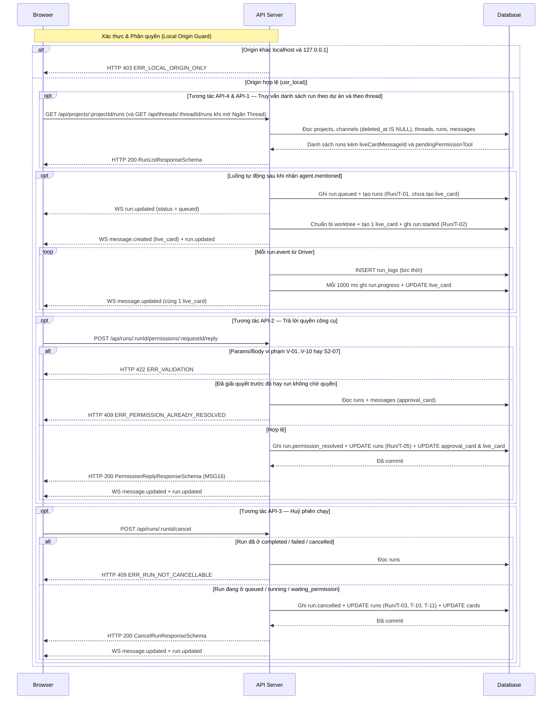

# API-RN-01 — GET / POST /api/threads/:threadId/runs, /api/projects/:projectId/runs & /api/runs/:runId — Quản lý Phiên chạy Agent & Duyệt quyền Tool

| Trường | Giá trị |
| --- | --- |
| API ID | `API-RN-01` |
| Đường dẫn chốt | `specs/dd/runner/rn-01/api-runs.md` |
| Method | `GET` / `POST` |
| Endpoint | `GET /api/threads/:threadId/runs` · `POST /api/runs/:runId/permissions/:requestId/reply` · `POST /api/runs/:runId/cancel` · `GET /api/projects/:projectId/runs` |
| Phân quyền | Local Origin Guard (`Origin` / `Host` thuộc `localhost` hay `127.0.0.1` ở `ADE_MODE=solo`) · Actor mặc định `usr_local` (`role = owner`) |
| Zod schema | `ThreadRunsParamsSchema`, `ProjectRunsParamsSchema`, `PermissionReplyParamsSchema`, `PermissionReplyBodySchema`, `CancelRunParamsSchema`, `RunListResponseSchema`, `PermissionReplyResponseSchema`, `CancelRunResponseSchema`, `WsRunnerServerEventSchema` (`packages/shared/src/schemas/runner.ts`) |
| Hiện trạng BE | `BE chưa implement (xây mới ở phase P2)` |
| Ngày tạo | 2026-10-31 |
| Ngày cập nhật | 2026-10-31 |

## Lịch sử sửa đổi

| Ver | Ngày | Tác giả | Thay đổi |
| --- | --- | --- | --- |
| 1.0 | 2026-10-31 | cuongph | Phát hành lần đầu cho Phase P2 |
| 1.1 | 2026-10-31 | cuongph | Đồng bộ các cột phản hồi của bảng `messages` (`is_root = 0`, `human_mentions_json`, `reactions_json`), payload `message.posted` và cộng dồn `threads.spent_usd` theo `domain-model.md` |
| 1.2 | 2026-10-31 | cuongph | Bổ sung `API-4` (`GET /api/projects/:projectId/runs`), trường `pendingPermissionTool`, bảng khung tin WebSocket P2, lọc xoá mềm `channels.deleted_at IS NULL` và làm tường minh guard ngân sách `Run/T-08`, `Run/T-14` cùng `Run/T-01` |

---

## 1. Mục đích

- **Actor**: Người dùng cục bộ `usr_local` (`owner`) tương tác từ màn hình `UI-RN-01` ([specs/dd/runner/rn-01/ui-run-cards.md](specs/dd/runner/rn-01/ui-run-cards.md)), cùng bộ điều phối nội bộ `RunDispatcher` lắng nghe sự kiện `agent.mentioned` và `InProcessRunnerTransport`.
- **Use case**: Truy vấn danh sách phiên chạy agent theo thread (`API-1`) và theo dự án (`API-4`), gửi quyết định cho phép hay từ chối yêu cầu quyền công cụ của harness (`API-2`), huỷ phiên chạy đang chờ hay đang thực thi (`API-3`), và tự động điều phối vòng đời run từ sự kiện `@mention` kèm đẩy cập nhật trực tiếp qua WebSocket `/ws`.
- **Kết quả thành công**: Mỗi lượt `@mention` hợp lệ trên thread thuộc kênh hoạt động (`channels.deleted_at IS NULL`) tạo 1 bản ghi `runs` ở `Run/T-01` (`queued`), khi có runner trực tuyến và thoả khoá ghi chuyển sang `Run/T-02` (`running`) kèm tạo đúng 1 bản ghi `messages` (`kind = 'live_card'`), mọi quyết định quyền công cụ chuyển tiếp xuống driver theo `Run/T-05`, mọi lệnh huỷ dừng tiến trình driver theo `Run/T-03` / `Run/T-10` / `Run/T-11`, và bảng `events` lưu đầy đủ chuỗi sự kiện append-only.
- **Ngoài phạm vi**: Không thực thi rule engine YAML, không bao gồm ADE MCP endpoint `/mcp` (`report_outcome`, `ask_human`), không bao gồm cổng duyệt công việc `POST /api/approvals/:approvalId/decide` (thuộc P3 và P4), và không bao gồm bộ hẹn giờ `timeout_s` tự động dừng run theo `Run/T-15` (thuộc P4).
- **Giả định**: Bốn câu hỏi spike của Phase P0 đã đạt theo mục §1.2 của [specs/dd/runner/overview.md](specs/dd/runner/overview.md); dự án đã đăng ký có thư mục Git hợp lệ tại `projects.repo_path`.
- **Câu hỏi mở**: Không có

---

## 2. Request

### 2.1 Headers & Phân quyền

| Header | Bắt buộc | Mô tả |
| --- | --- | --- |
| `Origin` / `Host` | Có | Ở `ADE_MODE=solo`, giá trị hostname bắt buộc là `localhost` hay `127.0.0.1`; vi phạm bị chặn bởi HTTP 403 `ERR_LOCAL_ORIGIN_ONLY` |
| `Content-Type` | Có (với `API-2`) | `application/json` khi gửi body cho `POST /api/runs/:runId/permissions/:requestId/reply` |

### 2.2 Path & Query params

| Endpoint | Tên | Loại | Bắt buộc | Zod Schema (`packages/shared`) | Mô tả |
| --- | --- | --- | --- | --- | --- |
| `API-1` | `:threadId` | path | Có | `ThreadRunsParamsSchema` | ID của thread khớp `^thr_[a-zA-Z0-9_-]{2,32}$` (`V-07`) |
| `API-2` | `:runId` | path | Có | `PermissionReplyParamsSchema` | ID của phiên chạy khớp `^run_[a-zA-Z0-9_-]{2,32}$` (`V-08`) |
| `API-2` | `:requestId` | path | Có | `PermissionReplyParamsSchema` | ID yêu cầu quyền công cụ khớp `^req_[a-zA-Z0-9_-]{2,32}$` (`V-09`) |
| `API-3` | `:runId` | path | Có | `CancelRunParamsSchema` | ID của phiên chạy cần huỷ khớp `^run_[a-zA-Z0-9_-]{2,32}$` (`V-08`) |
| `API-4` | `:projectId` | path | Có | `ProjectRunsParamsSchema` | ID của dự án khớp `^prj_[a-zA-Z0-9_-]{2,32}$` (`V-10`) |

### 2.3 Request body

- **`API-1` (`GET /api/threads/:threadId/runs`)**: Không có request body.
- **`API-2` (`POST /api/runs/:runId/permissions/:requestId/reply`)** — Zod schema: `PermissionReplyBodySchema` (catalog key: `runner.permission.reply`):

| Trường | Loại | Bắt buộc | Quy tắc | Mô tả |
| --- | --- | --- | --- | --- |
| `optionId` | `string` | Có | `trim` · `required` · `min:1` · `max:64` | Mã phương án người dùng đã chọn trong danh sách `options` của thẻ quyền công cụ |
| `decision` | `string` | Có | `required` · `in:allow,deny` | Quyết định cấp quyền (`"allow"` cho phép thực thi; `"deny"` từ chối thực thi) |

- **`API-3` (`POST /api/runs/:runId/cancel`)**: Không yêu cầu request body (chấp nhận body rỗng `{}`).
- **`API-4` (`GET /api/projects/:projectId/runs`)**: Không có request body.

---

## 3. Kiểm tra hợp lệ (Validate)

Các quy tắc `V-01..V-06` áp cho body của `API-2` qua `VALIDATION_CATALOG["runner.permission.reply"]`; các quy tắc `V-07..V-10` áp cho path params của `API-1`, `API-2`, `API-3`, `API-4` (tham chiếu mã message tại `specs/message.md`):

| ID | Tên logic | Quy tắc kiểm tra | Mã message | Message |
| --- | --- | --- | --- | --- |
| V-01 | `optionId` (Lựa chọn) | `trim` | — | — |
| V-02 | `optionId` (Lựa chọn) | `required` | `MSG01` | Lựa chọn là bắt buộc. |
| V-03 | `optionId` (Lựa chọn) | `min:1` | `MSG01` | Lựa chọn là bắt buộc. |
| V-04 | `optionId` (Lựa chọn) | `max:64` | `MSG02` | Lựa chọn không được vượt quá 64 ký tự. |
| V-05 | `decision` (Quyết định) | `required` | `MSG01` | Quyết định là bắt buộc. |
| V-06 | `decision` (Quyết định) | `in:allow,deny` | `MSG04` | Định dạng Quyết định không hợp lệ. |
| V-07 | `:threadId` (Mã thread) | `regex:^thr_[a-zA-Z0-9_-]{2,32}$` | `MSG04` | Định dạng Mã thread không hợp lệ. |
| V-08 | `:runId` (Mã phiên chạy) | `regex:^run_[a-zA-Z0-9_-]{2,32}$` | `MSG04` | Định dạng Mã phiên chạy không hợp lệ. |
| V-09 | `:requestId` (Mã yêu cầu quyền) | `regex:^req_[a-zA-Z0-9_-]{2,32}$` | `MSG04` | Định dạng Mã yêu cầu quyền không hợp lệ. |
| V-10 | `:projectId` (Mã dự án) | `regex:^prj_[a-zA-Z0-9_-]{2,32}$` | `MSG04` | Định dạng Mã dự án không hợp lệ. |

---

## 4. Xử lý phía server

**API-1: GET /api/threads/:threadId/runs**

| ID | Bước | Mô tả |
| --- | --- | --- |
| S1-01 | Kiểm tra phân quyền | Nếu header `Origin` / `Host` không thuộc `localhost` hay `127.0.0.1`, thì API phải trả HTTP 403 `ERR_LOCAL_ORIGIN_ONLY`. |
| S1-02 | Kiểm tra params | Kiểm tra `:threadId` theo `ThreadRunsParamsSchema` (`V-07`); nếu sai định dạng, thì API phải trả HTTP 422 `ERR_VALIDATION` kèm mã `MSG04`. |
| S1-03 | Tải bản ghi thread thuộc kênh hoạt động | Truy vấn bảng `threads` kết hợp `INNER JOIN channels ON channels.id = threads.channel_id` theo `threads.id = :threadId` và `channels.deleted_at IS NULL`; nếu không tồn tại bản ghi thoả điều kiện, thì API phải trả HTTP 404 `ERR_NOT_FOUND`. |
| S1-04 | Truy vấn và trả về | Truy vấn danh sách `runs` có `thread_id = :threadId` kết hợp `agents`, `runners` cùng hai trường dẫn xuất `liveCardMessageId` và `pendingPermissionTool` sắp theo `runs.created_at` tăng dần, rồi trả HTTP 200 kèm payload khớp `RunListResponseSchema`. |

**API-2: POST /api/runs/:runId/permissions/:requestId/reply**

| ID | Bước | Mô tả |
| --- | --- | --- |
| S2-01 | Kiểm tra phân quyền | Nếu header `Origin` / `Host` không thuộc `localhost` hay `127.0.0.1`, thì API phải trả HTTP 403 `ERR_LOCAL_ORIGIN_ONLY`. |
| S2-02 | Kiểm tra request | Kiểm tra params theo `PermissionReplyParamsSchema` (`V-08`, `V-09`) và body theo `PermissionReplyBodySchema` (`V-01..V-06`); nếu thất bại, thì API phải trả HTTP 422 `ERR_VALIDATION`. |
| S2-03 | Tải bản ghi run thuộc kênh hoạt động | Truy vấn bảng `runs` kết hợp `INNER JOIN threads ON threads.id = runs.thread_id` và `INNER JOIN channels ON channels.id = threads.channel_id` theo `runs.id = :runId` và `channels.deleted_at IS NULL`; nếu không tồn tại bản ghi thoả điều kiện, thì API phải trả HTTP 404 `ERR_NOT_FOUND`. |
| S2-04 | Tải thẻ quyền công cụ | Truy vấn bảng `messages` có `run_id = :runId`, `kind = 'approval_card'` và `json_extract(card_json, '$.requestId') = :requestId`; nếu không tồn tại bản ghi, thì API phải trả HTTP 404 `ERR_NOT_FOUND`. |
| S2-05 | Kiểm tra trạng thái đã giải quyết | Nếu `json_extract(card_json, '$.status')` khác `'pending'`, thì API phải trả HTTP 409 `ERR_PERMISSION_ALREADY_RESOLVED`. |
| S2-06 | Kiểm tra trạng thái chờ quyền của run | Nếu `runs.status` khác `'waiting_permission'`, thì API phải trả HTTP 409 `ERR_PERMISSION_ALREADY_RESOLVED`. |
| S2-07 | Kiểm tra khớp phương án trong thẻ | Đối chiếu `(optionId, decision)` với mảng `options` trong `card_json`; nếu không tồn tại phần tử có `id = optionId` và `decision` trùng khớp, thì API phải trả HTTP 422 `ERR_VALIDATION` kèm lỗi trường `optionId` mang mã `MSG04`. |
| S2-08 | Cập nhật trạng thái và chuyển tiếp xuống driver | Chuyển trạng thái run theo `Run/T-05` (`waiting_permission` → `running`), ghi event `run.permission_resolved` vào `events`, cập nhật `messages.card_json` (`status = 'allowed'` khi `decision = 'allow'`; `status = 'denied'` khi `decision = 'deny'`), cập nhật `live_card` sang `status = 'running'`, phát WebSocket `message.updated` và `run.updated`, gửi thông điệp `permission.reply` qua `RunnerTransport`, rồi trả HTTP 200 kèm payload khớp `PermissionReplyResponseSchema` (`MSG16`). |

**API-3: POST /api/runs/:runId/cancel**

| ID | Bước | Mô tả |
| --- | --- | --- |
| S3-01 | Kiểm tra phân quyền | Nếu header `Origin` / `Host` không thuộc `localhost` hay `127.0.0.1`, thì API phải trả HTTP 403 `ERR_LOCAL_ORIGIN_ONLY`. |
| S3-02 | Kiểm tra params | Kiểm tra `:runId` theo `CancelRunParamsSchema` (`V-08`); nếu sai định dạng, thì API phải trả HTTP 422 `ERR_VALIDATION` kèm mã `MSG04`. |
| S3-03 | Tải bản ghi run thuộc kênh hoạt động | Truy vấn bảng `runs` kết hợp `INNER JOIN threads ON threads.id = runs.thread_id` và `INNER JOIN channels ON channels.id = threads.channel_id` theo `runs.id = :runId` và `channels.deleted_at IS NULL`; nếu không tồn tại bản ghi thoả điều kiện, thì API phải trả HTTP 404 `ERR_NOT_FOUND`. |
| S3-04 | Kiểm tra trạng thái không thể huỷ | Nếu `runs.status` thuộc `('completed', 'failed', 'cancelled')`, thì API phải trả HTTP 409 `ERR_RUN_NOT_CANCELLABLE`. |
| S3-05 | Huỷ run đang xếp hàng | Khi `runs.status = 'queued'`, hệ thống phải chuyển trạng thái theo `Run/T-03` sang `'cancelled'` và ghi `run.cancelled` vào `events`. |
| S3-06 | Huỷ run đang thực thi | Khi `runs.status = 'running'`, hệ thống phải flush bộ gộp `run.progress`, chuyển trạng thái theo `Run/T-10` sang `'cancelled'` (cộng dồn `runs.cost_usd` đã phát sinh vào `threads.spent_usd`), cập nhật `live_card` của run sang `status = 'cancelled'`, gửi `run.cancel` xuống `RunnerTransport` và nhả khoá ghi của thread. |
| S3-07 | Huỷ run đang chờ quyền công cụ | Khi `runs.status = 'waiting_permission'`, hệ thống phải flush bộ gộp `run.progress`, chuyển trạng thái theo `Run/T-11` sang `'cancelled'` (cộng dồn `runs.cost_usd` đã phát sinh vào `threads.spent_usd`), cập nhật thẻ `approval_card` đang `pending` của run sang `status = 'cancelled'`, cập nhật `live_card` của run sang `status = 'cancelled'`, gửi `run.cancel` xuống `RunnerTransport` và nhả khoá ghi của thread. |
| S3-08 | Phát sự kiện và trả về | Phát thông điệp WebSocket `message.updated` và `run.updated`, kích hoạt `RunDispatcher` kiểm tra run `queued` kế tiếp trong thread, rồi trả HTTP 200 kèm payload khớp `CancelRunResponseSchema`. |

**API-4: GET /api/projects/:projectId/runs**

| ID | Bước | Mô tả |
| --- | --- | --- |
| S4-01 | Kiểm tra phân quyền | Nếu header `Origin` / `Host` không thuộc `localhost` hay `127.0.0.1`, thì API phải trả HTTP 403 `ERR_LOCAL_ORIGIN_ONLY`. |
| S4-02 | Kiểm tra params | Kiểm tra `:projectId` theo `ProjectRunsParamsSchema` (`V-10`); nếu sai định dạng, thì API phải trả HTTP 422 `ERR_VALIDATION` kèm mã `MSG04`. |
| S4-03 | Tải bản ghi dự án | Truy vấn bảng `projects` theo `projects.id = :projectId`; nếu không tồn tại bản ghi, thì API phải trả HTTP 404 `ERR_NOT_FOUND`. |
| S4-04 | Truy vấn và trả về | Truy vấn danh sách `runs` kết hợp `INNER JOIN threads ON threads.id = runs.thread_id`, `INNER JOIN channels ON channels.id = threads.channel_id`, `agents`, `runners` cùng hai trường dẫn xuất `liveCardMessageId` và `pendingPermissionTool` theo điều kiện `runs.project_id = :projectId` và `channels.deleted_at IS NULL` sắp theo `runs.created_at` tăng dần, rồi trả HTTP 200 kèm payload khớp `RunListResponseSchema`. |

**Luồng sự kiện nội bộ P2: `RunDispatcher` & `RunnerTransport` (không trả HTTP trực tiếp)**

| ID | Bước | Mô tả |
| --- | --- | --- |
| S5-01 | Đăng ký runner lần đầu | Khi nhận `runner.hello` cho `runnerId` chưa có trong bảng `runners`, Hub phải chuyển theo `Runner/T-01` sang `'online'`, ghi event `runner.connected` và quét khởi chạy các run đang `'queued'`. |
| S5-02 | Kết nối lại hay làm mới runner | Khi nhận `runner.hello` cho `runnerId` đã có trong bảng `runners`, Hub phải chuyển theo `Runner/T-03` (từ `'offline'`) hay `Runner/T-04` (làm mới khi đang `'online'`) về `'online'`, cập nhật `last_seen` cùng `harnesses_available_json`, ghi event `runner.connected` và quét khởi chạy các run đang `'queued'`. |
| S5-03 | Ngắt kết nối runner | Khi `RunnerTransport` báo đóng kết nối cho `runnerId` đang `'online'`, Hub phải chuyển theo `Runner/T-02` sang `'offline'` và ghi event `runner.disconnected`; nếu gọi ngắt kết nối trên runner đã `'offline'`, hàm chuyển trạng thái phải trả lỗi `ERR_INVALID_STATUS`. |
| S5-04 | Kiểm tra `credential_profile` khi nhận `agent.mentioned` | Khi nhận event `agent.mentioned` cho agent có `enabled = 1` trong thread thuộc kênh hoạt động (`channels.deleted_at IS NULL`), nếu `ADE_MODE = 'vps'` mà `agents.credential_profile` bắt đầu bằng `'sub-'` hay giá trị profile không thuộc `('sub-claude', 'sub-chatgpt', 'api-key')`, thì `RunDispatcher` phải chặn trước `Run/T-01` với mã nội bộ `ERR_CREDENTIAL_MODE_MISMATCH` và append event `message.posted` (`kind = 'system'`, `body`, `is_root = false`, `mentions = []`, `human_mentions = []`) vào `events` kèm phát `message.posted` qua `/ws`. |
| S5-05 | Kiểm tra tồn tại runner hỗ trợ `harness` | Khi `credential_profile` hợp lệ nhưng bảng `runners` chưa có bất kỳ runner nào đăng ký `agents.harness` trong `harnesses_available_json`, `RunDispatcher` phải chặn trước `Run/T-01` với mã nội bộ `ERR_RUNNER_UNAVAILABLE` và append event `message.posted` (`kind = 'system'`, `body`, `is_root = false`, `mentions = []`, `human_mentions = []`) vào `events` kèm phát `message.posted` qua `/ws`. |
| S5-06 | Đưa run vào hàng đợi theo `Run/T-01` | Khi vượt qua `S5-04`, `S5-05` và thoả điều kiện kênh cha chưa xoá mềm (`channels.deleted_at IS NULL`) cùng hai guard của `Run/T-01` (`threads.engine_halted = 0` và `0 <= agents.max_depth` ứng với `depth = 0`), `RunDispatcher` phải chuyển theo `Run/T-01` ghi event `run.queued` (`depth = 0`, `timeout_s = agents.timeout_s`, chụp `skills_snapshot_json`), tạo bản ghi `runs` ở trạng thái `'queued'` (chưa tạo `live_card`) và đẩy `run.updated` qua `/ws`. |
| S5-07 | Giữ run ở `queued` khi runner tạm `offline` | Khi vừa tạo run ở `'queued'` theo `S5-06` nhưng tại thời điểm đó mọi runner hỗ trợ `agents.harness` đều có `status = 'offline'`, `RunDispatcher` phải giữ nguyên run ở `'queued'` và append event `message.posted` (`kind = 'system'`, `body`, `is_root = false`, `mentions = []`, `human_mentions = []`, báo đang chờ runner trực tuyến) vào `events` kèm phát `message.posted` qua `/ws`. |
| S5-08 | Bắt đầu chạy run và tạo thẻ `live_card` duy nhất | Khi có runner `'online'` hỗ trợ `agents.harness` và thoả điều kiện khoá ghi của thread (`agents.write = 0` hay chưa có run khác trong cùng `thread_id` giữ khoá ghi), `RunDispatcher` phải tạo đúng 1 bản ghi `messages` (`is_root = 0`, `kind = 'live_card'`, `run_id = runs.id`, `card_json.status = 'running'`), chuyển trạng thái run theo `Run/T-02` (`queued` → `running`) bằng cách ghi event `run.started` (kèm `live_card_message_id` và `acp_session_id = null` nếu driver chưa cấp phiên ngay lúc bắt đầu), gửi `run.start` (`mcpUrl = null`, `mcpToken = null` ở P2) xuống `RunnerTransport` và đẩy `message.created`, `run.updated` qua `/ws`. |
| S5-09 | Ghi nhận tiến độ và gộp `1000 ms` | Khi nhận `run.event`, nếu `runs.status = 'cancelled'` thì Hub phải bỏ qua thông điệp đến trễ; ngược lại chèn ngay 1 bản ghi vào `run_logs`, cập nhật `runs.acp_session_id` nếu mới phát sinh, tích luỹ vào `ProgressAggregator` và mỗi `1000 ms` ghi 1 bản ghi `run.progress` vào `events`, cập nhật tại chỗ `messages.card_json` của cùng 1 `live_card` rồi đẩy `message.updated` qua `/ws`. |
| S5-10 | Tạm dừng xin quyền công cụ | Khi nhận `permission.request` từ driver cho run đang `'running'`, Hub phải flush `ProgressAggregator`, chuyển trạng thái run theo `Run/T-04` (`running` → `waiting_permission`), tạo 1 bản ghi `messages` (`is_root = 0`, `kind = 'approval_card'`, `run_id = runs.id`, `card_json.status = 'pending'`), cập nhật `live_card` sang `status = 'waiting_permission'` và đẩy `message.created`, `message.updated`, `run.updated` qua `/ws`. |
| S5-11 | Kết thúc run thành công | Khi nhận `run.end` cho run chưa bị `'cancelled'` có `stopReason = 'end_turn'` đồng thời thoả cả hai guard ngân sách `(agents.budget_usd IS NULL OR runs.cost_usd <= agents.budget_usd)` và `(threads.budget_usd IS NULL OR threads.spent_usd + runs.cost_usd <= threads.budget_usd)` (với `runs.cost_usd = COALESCE(usage.costUsd, runs.cost_usd)`), Hub phải flush `ProgressAggregator`, chuyển trạng thái run theo `Run/T-08` (`running` → `completed`, gán `outcome = 'unknown'` khi `outcome IS NULL`, cộng dồn `runs.cost_usd` vào `threads.spent_usd`), cập nhật `live_card`, nhả khoá ghi của thread, đẩy `message.updated` + `run.updated` và kích hoạt `RunDispatcher` lấy run `'queued'` kế tiếp trong cùng thread. |
| S5-12 | Kết thúc run do vượt hạn mức ngân sách | Khi nhận `run.end` cho run chưa bị `'cancelled'` mà `stopReason = 'budget_exceeded'` hay thoả điều kiện `(agents.budget_usd IS NOT NULL AND runs.cost_usd > agents.budget_usd)` hay `(threads.budget_usd IS NOT NULL AND threads.spent_usd + runs.cost_usd > threads.budget_usd)` (với `runs.cost_usd = COALESCE(usage.costUsd, runs.cost_usd)`), Hub phải flush `ProgressAggregator`, chuyển trạng thái run theo `Run/T-14` (`running` → `failed`, `stop_reason = 'budget_exceeded'`, `error_code = 'ERR_BUDGET_EXCEEDED'`, cộng dồn `runs.cost_usd` vào `threads.spent_usd`), cập nhật `live_card`, nhả khoá ghi của thread, đẩy `message.updated` + `run.updated` và kích hoạt `RunDispatcher` lấy run `'queued'` kế tiếp trong cùng thread. |
| S5-13 | Kết thúc run do lỗi runtime của driver | Khi nhận `run.end` cho run chưa bị `'cancelled'` không vi phạm trần ngân sách ở `S5-12` và có `stopReason = 'error'`, Hub phải flush `ProgressAggregator`, chuyển trạng thái run theo `Run/T-09` (`running` → `failed`, `stop_reason = 'error'`, `error_code = COALESCE(errorCode, 'ERR_DRIVER_EXECUTION')`, cộng dồn `runs.cost_usd` vào `threads.spent_usd`), cập nhật `live_card`, nhả khoá ghi của thread, đẩy `message.updated` + `run.updated` và kích hoạt `RunDispatcher` lấy run `'queued'` kế tiếp trong cùng thread. |

**Bảng mã lỗi sự kiện nội bộ của `RunDispatcher` (ghi vào `events`, không trả qua HTTP response trực tiếp):**

| Mã lỗi nội bộ | Bước phát sinh | Cách ghi nhận vào Event Store |
| --- | --- | --- |
| `ERR_CREDENTIAL_MODE_MISMATCH` | `S5-04` | Append `message.posted` (`kind = 'system'`) chứa mã lỗi và thông điệp tiếng Việt từ `specs/message.md` |
| `ERR_RUNNER_UNAVAILABLE` | `S5-05` | Append `message.posted` (`kind = 'system'`) chứa mã lỗi và thông điệp tiếng Việt từ `specs/message.md` |
| `ERR_BUDGET_EXCEEDED` | `S5-12` | Ghi trong `payload.error_code` của event `run.failed` (`Run/T-14`) và `card_json.errorCode` của `live_card` |
| `ERR_DRIVER_EXECUTION` | `S5-13` | Ghi mặc định trong `payload.error_code` của event `run.failed` (`Run/T-09`) và `card_json.errorCode` của `live_card` khi driver lỗi runtime |

---

## 5. Response

### 5.1 Thành công

| Endpoint | HTTP | Zod Schema (`packages/shared`) | Mô tả |
| --- | --- | --- | --- |
| `API-1` | `200` | `RunListResponseSchema` | Danh sách phiên chạy trong thread theo thứ tự thời gian tạo |
| `API-2` | `200` | `PermissionReplyResponseSchema` | Xác nhận đã ghi nhận quyết định quyền công cụ (`MSG16`) |
| `API-3` | `200` | `CancelRunResponseSchema` | Xác nhận đã huỷ phiên chạy thành công |
| `API-4` | `200` | `RunListResponseSchema` | Danh sách phiên chạy của dự án (loại trừ kênh đã xoá mềm) theo thứ tự thời gian tạo |

Ví dụ JSON cho `API-1` và `API-4` (`RunListResponseSchema`):

```json
{
  "runs": [
    {
      "id": "run_01JBCDEF0123456789ABCDEFGH",
      "projectId": "prj_01JBCDEF0123456789ABCDEFGH",
      "threadId": "thr_01JBCDEF0123456789ABCDEFGH",
      "agentId": "agt_01JBCDEF0123456789ABCDEFGH",
      "agentHandle": "@coder",
      "agentDisplayName": "Coder",
      "harness": "codex",
      "runnerId": "rnr_local",
      "runnerMachineName": "Cuong-MBP",
      "invokedBy": "usr_local",
      "credentialProfile": "sub-chatgpt",
      "acpSessionId": "ses_01JBCDEF0123456789ABCDEFGH",
      "role": "worker",
      "depth": 0,
      "timeoutS": 600,
      "status": "running",
      "outcome": null,
      "stopReason": null,
      "costUsd": 0.012,
      "liveCardMessageId": "msg_01JBCDEF0123456789ABCDEFGH",
      "pendingPermissionTool": null,
      "startedAt": "2026-10-31T06:30:01.120Z",
      "endedAt": null,
      "createdAt": "2026-10-31T06:30:00.950Z"
    }
  ]
}
```

Ví dụ JSON cho `API-2` (`PermissionReplyResponseSchema`):

```json
{
  "runId": "run_01JBCDEF0123456789ABCDEFGH",
  "requestId": "req_01JBCDEF0123456789ABCDEFGH",
  "optionId": "allow_once",
  "decision": "allow",
  "runStatus": "running",
  "cardStatus": "allowed",
  "messageCode": "MSG16"
}
```

Ví dụ JSON cho `API-3` (`CancelRunResponseSchema`):

```json
{
  "runId": "run_01JBCDEF0123456789ABCDEFGH",
  "status": "cancelled",
  "endedAt": "2026-10-31T06:31:10.000Z"
}
```

#### Bảng khung tin WebSocket mở rộng ở Phase P2 (`WsRunnerServerEventSchema` → hợp nhất vào `WsServerEventSchema` trên `/ws`)

| `type` | Các trường trong `data` | Thời điểm phát |
| --- | --- | --- |
| `message.created` | `eventId: string`, `seq: number`, `projectId: string`, `channelId: string`, `threadId: string`, `messageId: string`, `runId: string`, `kind: "live_card" \| "approval_card"`, `body: string`, `card: LiveCardPayload \| PermissionCardPayload` | Phát khi tạo bản ghi `messages` mới cho `live_card` (`Run/T-02`) và `approval_card` (`Run/T-04`) |
| `message.updated` | `eventId: string`, `seq: number`, `projectId: string`, `channelId: string`, `threadId: string`, `messageId: string`, `runId: string`, `kind: "live_card" \| "approval_card"`, `card: LiveCardPayload \| PermissionCardPayload` | Phát khi cập nhật tại chỗ `messages.card_json` của `live_card` (chu kỳ `1000 ms`, đổi trạng thái, kết thúc) và `approval_card` (`Run/T-05`, `Run/T-11`) |
| `run.updated` | `eventId: string`, `seq: number`, `projectId: string`, `channelId: string`, `threadId: string`, `run: Run` | Phát sau mọi chuyển trạng thái của `runs` (`Run/T-01`, `Run/T-02`, `Run/T-03`, `Run/T-04`, `Run/T-05`, `Run/T-08`, `Run/T-09`, `Run/T-10`, `Run/T-11`, `Run/T-14`) để đồng bộ tập `runs` cấp dự án và cấp thread |

### 5.2 Lỗi

Nội dung thông điệp tiếng Việt của từng mã lỗi HTTP đối chiếu tại `specs/message.md`:

| HTTP | Mã lỗi | Điều kiện | Mã message |
| --- | --- | --- | --- |
| `400` | `ERR_INVALID_STATUS` | Gọi hàm chuyển trạng thái `Run` hay `Runner` nằm ngoài bảng chuyển hợp lệ của State Machine | — |
| `403` | `ERR_LOCAL_ORIGIN_ONLY` | Header `Origin` / `Host` không thuộc `localhost` hay `127.0.0.1` ở `ADE_MODE=solo` | — |
| `404` | `ERR_NOT_FOUND` | Không tìm thấy `projectId`, `threadId`, `runId` hay `requestId` trong SQLite, hay kênh cha của thread đã xoá mềm (`channels.deleted_at IS NOT NULL`) | — |
| `409` | `ERR_PERMISSION_ALREADY_RESOLVED` | Thẻ xin quyền `:requestId` đã có quyết định trước đó (`status != 'pending'`) hay `runs.status != 'waiting_permission'` | — |
| `409` | `ERR_RUN_NOT_CANCELLABLE` | Gọi `POST /api/runs/:runId/cancel` trên run đã ở trạng thái cuối (`completed`, `failed`, `cancelled`) | — |
| `422` | `ERR_VALIDATION` | Path params (`V-07..V-10`) hay body (`V-01..V-06`, `S2-07`) không vượt qua kiểm tra hợp lệ | `MSG01` / `MSG02` / `MSG04` |
| `500` | `ERR_INTERNAL_ERROR` | Lỗi hệ thống bất ngờ ngoài dự kiến tại tầng lưu trữ hay vận chuyển | — |

### 5.3 Bản đồ dữ liệu

Các trường chép thẳng 1-1 cùng tên từ cột của bảng `runs` tuân theo `RunSchema`; bảng dưới đặc tả đầy đủ mọi trường kết hợp, dẫn xuất và biến đổi:

| Field | Nguồn | Biến đổi | Ghi chú |
| --- | --- | --- | --- |
| `runs[].agentHandle` | `agents.handle` qua `runs.agent_id` | Chép nguyên chuỗi `@<slug>` | Join `INNER JOIN agents ON agents.id = runs.agent_id` |
| `runs[].agentDisplayName` | `agents.display_name` qua `runs.agent_id` | Chép nguyên chuỗi | Join bảng `agents` |
| `runs[].harness` | `agents.harness` qua `runs.agent_id` | `"claude-code"` \| `"codex"` | Join bảng `agents` |
| `runs[].runnerMachineName` | `runners.machine_name` qua `runs.runner_id` | `null` nếu `runs.runner_id IS NULL` | Join `LEFT JOIN runners ON runners.id = runs.runner_id` |
| `runs[].liveCardMessageId` | `messages.id` qua `messages.run_id = runs.id` | Lấy bản ghi có `messages.kind = 'live_card'`; trả `null` khi run đang ở `queued` chưa qua `Run/T-02` | Quan hệ tối đa 1-1 giữa `runs` và thẻ `live_card` |
| `runs[].pendingPermissionTool` | `messages.card_json` (`$.tool`) qua `messages.run_id = runs.id` | Lấy `json_extract(card_json, '$.tool')` của bản ghi có `messages.kind = 'approval_card'` và `json_extract(card_json, '$.status') = 'pending'`; trả `null` khi không có yêu cầu quyền đang chờ | Phục vụ hiển thị `<agentHandle>: Chờ cấp quyền <pendingPermissionTool>` trên thanh phản hồi nội tuyến |
| `runStatus` (`API-2`) | `runs.status` | Giá trị sau khi áp dụng `Run/T-05` (`"running"`) | Đọc từ projection sau commit event |
| `cardStatus` (`API-2`) | `messages.card_json` (`$.status`) | `"allowed"` khi `decision = "allow"`; `"denied"` khi `decision = "deny"` | Parse từ JSON cột `messages.card_json` |
| `messageCode` (`API-2`) | Hằng số hệ thống | Gán hằng `"MSG16"` | Dùng cho toast thành công trên UI |

---

## 6. Database

| Model | Thao tác | Field | Điều kiện / filter | Ghi chú |
| --- | --- | --- | --- | --- |
| `projects` | `R` | `id`, `repo_path`, `default_branch`, `use_repo_instructions` | `id = :projectId` (`API-4`) hay `id = runs.project_id` (`S5-08`) | Kiểm tra tồn tại dự án ở `API-4` và đọc cấu hình kho Git khi khởi chạy run |
| `channels` | `R` | `id`, `project_id`, `deleted_at` | `id = threads.channel_id AND deleted_at IS NULL` | Loại trừ các thread và run thuộc kênh đã xoá mềm ở `API-1`, `API-2`, `API-3`, `API-4` và `RunDispatcher` |
| `threads` | `R` | `id`, `project_id`, `channel_id`, `budget_usd`, `spent_usd`, `engine_halted` | `id = :threadId` (`API-1`) hay `id = runs.thread_id` | Kiểm tra tồn tại ở `API-1` và kiểm tra guard `Run/T-01`, `Run/T-08`, `Run/T-14` |
| `threads` | `U` | `spent_usd`, `updated_at` | `id = runs.thread_id` | Cộng dồn `runs.cost_usd` vào `threads.spent_usd` khi phiên chạy kết thúc theo `Run/T-08`, `Run/T-09`, `Run/T-10`, `Run/T-11`, `Run/T-14` |
| `agents` | `R` | `id`, `handle`, `display_name`, `harness`, `credential_profile`, `write`, `enabled`, `max_depth`, `budget_usd`, `timeout_s` | `project_id = threads.project_id` | Đọc cấu hình cache từ `.ade/agents/*.yaml` |
| `runners` | `C` | `id`, `owner_user_id`, `machine_name`, `harnesses_available_json`, `status`, `last_seen` | Khi nhận `runner.hello` lần đầu | Projection từ `runner.connected` → `Runner/T-01` |
| `runners` | `U` | `status`, `harnesses_available_json`, `last_seen` | `id = runnerId` | Projection từ `runner.connected` / `runner.disconnected` → `Runner/T-02`, `Runner/T-03`, `Runner/T-04` |
| `runs` | `R` | toàn bộ cột | `thread_id = :threadId` (`API-1`), `id = :runId` (`API-2`, `API-3`) hay `project_id = :projectId` (`API-4`) kèm `channels.deleted_at IS NULL` | Kết hợp `threads`, `channels`, `agents`, `runners` khi trả danh sách |
| `runs` | `C` | `id`, `project_id`, `thread_id`, `agent_id`, `invoked_by`, `credential_profile`, `role`, `depth`, `timeout_s`, `status`, `skills_snapshot_json`, `cost_usd`, `created_at` | Khi `RunDispatcher` tiếp nhận `agent.mentioned` | Projection từ `run.queued` → `Run/T-01` |
| `runs` | `U` | `status`, `runner_id`, `acp_session_id`, `outcome`, `stop_reason`, `summary`, `decisions_json`, `cost_usd`, `started_at`, `ended_at` | `id = :runId` | Projection đồng bộ từ `events` → `Run/T-02`, `Run/T-03`, `Run/T-04`, `Run/T-05`, `Run/T-08`, `Run/T-09`, `Run/T-10`, `Run/T-11`, `Run/T-14` |
| `run_logs` | `C` | `run_id`, `seq`, `kind`, `data_json`, `ts` | Ghi ngay trên mỗi `run.event` nhận từ driver | Lưu chi tiết tần suất cao, không đi qua bảng `events` |
| `messages` | `C` | `id`, `thread_id`, `is_root`, `author_type`, `author_id`, `kind`, `body`, `mentions_json`, `human_mentions_json`, `reactions_json`, `card_json`, `run_id`, `created_at`, `updated_at` | Tạo 1 `live_card` (`is_root = 0`) ở `Run/T-02`, 1 `approval_card` (`is_root = 0`) trên mỗi `Run/T-04`, và `system` message (`is_root = 0`) từ projection của `message.posted` ở `S5-04`, `S5-05`, `S5-07` | Mỗi `run_id` đã bắt đầu chạy có đúng 1 dòng `kind = 'live_card'` nằm trong luồng phản hồi của thread |
| `messages` | `U` | `card_json`, `updated_at` | `run_id = :runId AND kind = 'live_card'` hay `id = cardMessageId` | Cập nhật tại chỗ Live Card (mỗi `1000 ms`, khi đổi trạng thái, khi kết thúc) và cập nhật Permission Card ở `Run/T-05`, `Run/T-11` |
| `events` | `C` | `id`, `seq`, `type`, `project_id`, `thread_id`, `run_id`, `actor_type`, `actor_id`, `payload`, `causation_id`, `correlation_id`, `ts` | Append-only cho `message.posted`, `runner.connected`, `runner.disconnected`, `run.queued`, `run.started`, `run.progress`, `run.permission_requested`, `run.permission_resolved`, `run.completed`, `run.failed`, `run.cancelled` | Nguồn sự thật duy nhất (Quy tắc bất biến #3); cấm `UPDATE` và `DELETE` |

- **Invariant**: (1) Với mỗi `run_id` đã chuyển qua `Run/T-02`, câu truy vấn `SELECT COUNT(*) FROM messages WHERE run_id = :runId AND kind = 'live_card'` luôn bằng `1` (khi đang ở `queued` chưa qua `Run/T-02` thì bằng `0`). (2) Tại mọi thời điểm trong cùng `thread_id`, số bản ghi `runs` kết hợp `agents.write = 1` đang có `runs.status IN ('running', 'waiting_permission', 'waiting_human')` tối đa bằng `1`.
- **Transaction**: Mọi bước ghi `events` và cập nhật các bảng projection (`runs`, `runners`, `messages`, `threads`) phải thực thi nguyên tử bên trong một SQLite transaction (`db.transaction(fn)`) của `EventStore.append()`.
- **Concurrency**: Chống bấm đúp trên `API-2` và `API-3` bằng kiểm tra trạng thái bên trong cùng transaction đồng bộ của `better-sqlite3`; request đến sau thấy trạng thái đã đổi sẽ nhận ngay HTTP 409 (`ERR_PERMISSION_ALREADY_RESOLVED` trên `API-2` và `ERR_RUN_NOT_CANCELLABLE` trên `API-3`).

---

## 7. Sơ đồ luồng



---

## 8. Liên quan

| Loại | Tên / ID | Quan hệ |
| --- | --- | --- |
| Màn hình | `UI-RN-01` ([specs/dd/runner/rn-01/ui-run-cards.md](specs/dd/runner/rn-01/ui-run-cards.md)) | Hiển thị Live Card, Permission Card và gọi `API-1`, `API-2`, `API-3`, `API-4` |
| DD Overview | [specs/dd/runner/overview.md](specs/dd/runner/overview.md) | Quy định giao thức `RunnerTransport`, bộ gộp `1000 ms`, Git worktree và cô lập hồ sơ |
| Domain Model | [specs/dd/domain-model.md](specs/dd/domain-model.md) | Định nghĩa State Machine `Run/T-01..T-15` và `Runner/T-01..T-04` |
| DD cùng luồng | `API-CH-01` ([specs/dd/chat/ch-01/api-chat.md](specs/dd/chat/ch-01/api-chat.md)) | Sinh sự kiện `agent.mentioned` khi người dùng gửi tin nhắn có `@handle` và quản lý xoá mềm `channels.deleted_at` |

---

## 9. Tiêu chí chấp nhận

> Ghi chú nghiệm thu: Bên cạnh các spec Playwright và script trong `docs/phases.md`, bộ kiểm thử hợp đồng `apps/hub/src/__tests__/api-runs.test.ts` được đăng ký chính thức vào cả lệnh `pnpm accept:p2` và `pnpm accept:all`.

```gherkin
Feature: API-RN-01 — Quản lý phiên chạy agent, gộp tiến độ Live Card và duyệt quyền công cụ

  Background:
    Given Hub đang chạy ở chế độ `ADE_MODE="solo"` trên `"http://127.0.0.1:4310"`
    And dự án `"prj_01"` trỏ tới kho Git mẫu hợp lệ và có kênh `"chn_01"` (`deleted_at` bằng `null`), thread `"thr_01"`
    And Local Runner `"rnr_local"` đã đăng ký trực tuyến với hai harness `"claude-code"` và `"codex"`

  Scenario Outline: AC-API-RN-01-01 — Chuyển trạng thái kết nối của Local Runner theo thông điệp transport (nguồn: S5-01, S5-02, S5-03, Runner/T-01, Runner/T-02, Runner/T-03, Runner/T-04; nghiệm thu: e2e/p2-live-card.spec.ts)
    Given trạng thái ban đầu của runner `"rnr_test"` trong bảng `runners` là `"<initialStatus>"`
    When Hub tiếp nhận sự kiện transport `"<transportSignal>"` của `"rnr_test"`
    Then bản ghi `"rnr_test"` trong bảng `runners` có `status` bằng `"<nextStatus>"`
    And bảng `events` ghi thêm đúng 1 bản ghi có `type` bằng `"<eventType>"`

    Examples:
      | initialStatus | transportSignal | nextStatus | eventType           |
      | none          | runner.hello    | online     | runner.connected    |
      | online        | runner.hello    | online     | runner.connected    |
      | online        | disconnect      | offline    | runner.disconnected |
      | offline       | runner.hello    | online     | runner.connected    |

  Scenario: AC-API-RN-01-02 — Mention agent khởi tạo run, tạo đúng 1 Live Card ở Run/T-02, gom 5 bước và hoàn thành (nguồn: S1-04, S5-06, S5-08, S5-09, S5-11, Run/T-01, Run/T-02, Run/T-08; nghiệm thu: e2e/p2-live-card.spec.ts)
    Given agent `"@fake"` dùng kịch bản 5 bước tiến độ và không gọi `report_outcome`
    When sự kiện `agent.mentioned` cho `"@fake"` được phát trong thread `"thr_01"`
    Then sau khi phiên chạy kết thúc, gọi `GET /api/threads/thr_01/runs` trả HTTP 200 với 1 run có `status` bằng `"completed"`, `outcome` bằng `"unknown"` và `pendingPermissionTool` bằng `null`
    And bảng `run_logs` của run đó có đủ 5 bản ghi chi tiết theo thứ tự `seq` từ 1 đến 5
    And bảng `messages` trong `"thr_01"` chỉ có đúng 1 dòng `kind` bằng `"live_card"` cho `run_id` đó (được ghi nhận trong `payload.live_card_message_id` của `run.started`)

  Scenario Outline: AC-API-RN-01-03 — Trả về 404 khi truy vấn hay thao tác trên thread và run không tồn tại hay thuộc kênh đã xoá mềm (nguồn: S1-03, S2-03, S3-03, 404 ERR_NOT_FOUND; nghiệm thu: apps/hub/src/__tests__/api-runs.test.ts)
    Given kênh `"chn_del"` trong dự án `"prj_01"` đã xoá mềm (`deleted_at` bằng `"2026-10-31T07:00:00.000Z"`) và chứa thread `"thr_del"` kèm run `"run_del"` đang chờ yêu cầu quyền `"req_del"`
    When gọi `<method>` tới đường dẫn `"<targetPath>"` kèm body `<bodyJson>`
    Then nhận HTTP 404 với `code` bằng `"ERR_NOT_FOUND"`

    Examples:
      | method | targetPath                                        | bodyJson                                   |
      | GET    | /api/threads/thr_01J00000000000000000000000/runs   | {}                                         |
      | GET    | /api/threads/thr_del/runs                         | {}                                         |
      | POST   | /api/runs/run_del/permissions/req_del/reply       | {"optionId": "allow", "decision": "allow"} |
      | POST   | /api/runs/run_del/cancel                          | {}                                         |

  Scenario: AC-API-RN-01-04 — Chặn truy cập từ Origin khác localhost ở chế độ Solo (nguồn: S1-01, S2-01, S3-01, S4-01, 403 ERR_LOCAL_ORIGIN_ONLY; nghiệm thu: apps/hub/src/__tests__/api-runs.test.ts)
    When gọi `GET /api/threads/thr_01/runs` kèm header `Origin: "https://evil.example.com"`
    Then nhận HTTP 403 với `code` bằng `"ERR_LOCAL_ORIGIN_ONLY"`

  Scenario: AC-API-RN-01-05 — Người dùng cho phép quyền công cụ giúp run tiếp tục chạy tới hoàn thành (nguồn: S2-08, S5-10, Run/T-04, Run/T-05; nghiệm thu: e2e/p2-permission.spec.ts)
    Given run `"run_perm_allow"` đang ở trạng thái `"waiting_permission"` với yêu cầu `"req_01"` cho lệnh `"npm test"` và phương án `"allow"` (`decision` là `"allow"`)
    When gọi `POST /api/runs/run_perm_allow/permissions/req_01/reply` với body `{"optionId": "allow", "decision": "allow"}`
    Then nhận HTTP 200 với `runStatus` bằng `"running"`, `cardStatus` bằng `"allowed"` và `messageCode` bằng `"MSG16"`
    And bảng `events` có bản ghi `run.permission_resolved` với `payload.decision` bằng `"allow"`
    And driver nhận được `permission.reply` với `"allow"` để chạy tiếp tới `"completed"`

  Scenario: AC-API-RN-01-06 — Người dùng từ chối quyền công cụ ghi nhận denied trên thẻ và báo xuống driver (nguồn: S2-08, Run/T-05; nghiệm thu: e2e/p2-permission.spec.ts)
    Given run `"run_perm_deny"` đang ở trạng thái `"waiting_permission"` với yêu cầu `"req_02"` cho lệnh `"npm test"` và phương án `"deny"` (`decision` là `"deny"`)
    When gọi `POST /api/runs/run_perm_deny/permissions/req_02/reply` với body `{"optionId": "deny", "decision": "deny"}`
    Then nhận HTTP 200 với `runStatus` bằng `"running"` và `cardStatus` bằng `"denied"`
    And bảng `events` có bản ghi `run.permission_resolved` với `payload.decision` bằng `"deny"`

  Scenario: AC-API-RN-01-07 — Từ chối trả lời lại yêu cầu quyền đã được giải quyết trước đó (nguồn: S2-05, S2-06, 409 ERR_PERMISSION_ALREADY_RESOLVED; nghiệm thu: e2e/p2-permission.spec.ts)
    Given yêu cầu quyền `"req_01"` của run `"run_perm_allow"` đã có `card_json.status` bằng `"allowed"`
    When gọi lại `POST /api/runs/run_perm_allow/permissions/req_01/reply` với body `{"optionId": "deny", "decision": "deny"}`
    Then nhận HTTP 409 với `code` bằng `"ERR_PERMISSION_ALREADY_RESOLVED"`

  Scenario: AC-API-RN-01-08 — Trả về 404 khi trả lời quyền công cụ với runId hay requestId không tồn tại (nguồn: S2-03, S2-04, 404 ERR_NOT_FOUND; nghiệm thu: apps/hub/src/__tests__/api-runs.test.ts)
    When gọi `POST /api/runs/run_perm_allow/permissions/req_khong_ton_tai/reply` với body `{"optionId": "allow", "decision": "allow"}`
    Then nhận HTTP 404 với `code` bằng `"ERR_NOT_FOUND"`

  Scenario Outline: AC-API-RN-01-09 — Kiểm tra hợp lệ dữ liệu body và khớp phương án thẻ khi phản hồi quyền công cụ (nguồn: S2-02, S2-07, V-01, V-02, V-03, V-04, V-05, V-06, 422 ERR_VALIDATION; nghiệm thu: apps/hub/src/__tests__/api-runs.test.ts)
    Given run `"run_perm_val"` đang ở trạng thái `"waiting_permission"` với yêu cầu `"req_val"` có hai phương án `"allow"` (`"allow"`) và `"deny"` (`"deny"`)
    When gọi `POST /api/runs/run_perm_val/permissions/req_val/reply` với `optionId` là `"<optionId>"` và `decision` là `"<decision>"`
    Then nhận HTTP 422 với `code` bằng `"ERR_VALIDATION"` và mã thông báo trường `"<msg>"`
    And `"run_perm_val"` giữ nguyên trạng thái `"waiting_permission"`

    Examples:
      | optionId                                                             | decision | msg   |
      |                                                                      | allow    | MSG01 |
      |     	                                                                | allow    | MSG01 |
      | opt_01234567890123456789012345678901234567890123456789012345678901234 | allow    | MSG02 |
      | allow                                                                |          | MSG01 |
      | allow                                                                | maybe    | MSG04 |
      | opt_khong_ton_tai                                                    | allow    | MSG04 |

  Scenario Outline: AC-API-RN-01-10 — Huỷ thành công run đang ở trạng thái chưa kết thúc và cập nhật các thẻ sang cancelled (nguồn: S3-05, S3-06, S3-07, S3-08, Run/T-03, Run/T-10, Run/T-11; nghiệm thu: apps/hub/src/__tests__/api-runs.test.ts)
    Given phiên chạy `"<runId>"` trong thread `"thr_01"` đang có `status` bằng `"<initialStatus>"`
    When gọi `POST /api/runs/<runId>/cancel`
    Then nhận HTTP 200 với `status` bằng `"cancelled"`
    And bảng `events` có bản ghi `run.cancelled` cho `"<runId>"`

    Examples:
      | runId  | initialStatus      |
      | run_q1 | queued             |
      | run_r1 | running            |
      | run_wp | waiting_permission |

  Scenario: AC-API-RN-01-11 — Chặn huỷ run đã ở trạng thái kết thúc (nguồn: S3-04, bị cấm, 409 ERR_RUN_NOT_CANCELLABLE; nghiệm thu: apps/hub/src/__tests__/api-runs.test.ts)
    Given run `"run_done"` đang ở trạng thái `"completed"`
    When gọi `POST /api/runs/run_done/cancel`
    Then nhận HTTP 409 với `code` bằng `"ERR_RUN_NOT_CANCELLABLE"`
    And `"run_done"` giữ nguyên trạng thái `"completed"`

  Scenario: AC-API-RN-01-12 — Chặn chuyển trạng thái bất hợp lệ trong State Machine của Run (nguồn: bị cấm, 400 ERR_INVALID_STATUS; nghiệm thu: apps/hub/src/__tests__/api-runs.test.ts)
    Given run `"run_q_only"` đang ở trạng thái `"queued"` (chưa chuyển qua `"running"`)
    When gọi hàm chuyển trạng thái của `"run_q_only"` trực tiếp sang `"completed"`
    Then hàm ném lỗi có `code` bằng `"ERR_INVALID_STATUS"` (HTTP 400) và `"run_q_only"` vẫn ở `"queued"`

  Scenario: AC-API-RN-01-13 — Hai họ driver Claude và ACP sinh ra cùng cấu trúc dữ liệu Live Card đồng nhất (nguồn: S5-09, S5-11; nghiệm thu: e2e/p2-two-drivers.spec.ts)
    Given thread `"thr_01"` có agent `"@claude_bot"` (`harness` `"claude-code"`, `write` bằng `0`) và `"@codex_bot"` (`harness` `"codex"`, `write` bằng `0`) cùng chạy kịch bản gồm 1 mục `plan`, 1 lời gọi `tool_call` `Read` và 1 đoạn `message_chunk`
    When người dùng gửi một tin nhắn `"@claude_bot @codex_bot kiểm tra"` vào thread `"thr_01"`
    Then cả hai bản ghi `messages` (`kind` `"live_card"`) sau khi hoàn tất đều khớp `LiveCardPayloadSchema` với cùng các trường `plan`, `toolCalls`, `steps`, `lastMessageText`, `status`

  Scenario: AC-API-RN-01-14 — Tạo worktree theo thread và loại trừ skill Codex khỏi git status (nguồn: S5-08; nghiệm thu: scripts/verify/worktree.ts)
    Given agent `"@codex_bot"` có gắn skill `"implement"` được cấu hình trong dự án `"prj_01"`
    When sự kiện `agent.mentioned` cho `"@codex_bot"` chạy xong trong thread `"thr_wt"`
    Then thư mục `<repo_path>/.ade/wt/thr_wt` và tệp `<repo_path>/.ade/wt/thr_wt/.agents/skills/implement/SKILL.md` tồn tại trên đĩa
    And kết quả chạy `git status --porcelain` tại repo gốc và tại worktree đều rỗng (không chứa `.agents/skills` hay `.ade/wt`)

  Scenario: AC-API-RN-01-15 — Chặn credential_profile gói thuê bao cá nhân ở chế độ VPS và ghi message.posted cảnh báo (nguồn: S5-04, ERR_CREDENTIAL_MODE_MISMATCH; nghiệm thu: apps/hub/src/__tests__/api-runs.test.ts)
    Given cấu hình `RunDispatcher` đặt `ADE_MODE="vps"` với agent `"@coder"` dùng `credential_profile` là `"sub-chatgpt"`
    When sự kiện `agent.mentioned` cho `"@coder"` được đưa vào `RunDispatcher` trong thread `"thr_01"`
    Then không có bản ghi `runs` nào được tạo cho `"@coder"`
    And bảng `events` ghi thêm bản ghi `message.posted` có `payload.kind` bằng `"system"` chứa mã `"ERR_CREDENTIAL_MODE_MISMATCH"`

  Scenario: AC-API-RN-01-16 — Giữ run ở trạng thái queued kèm thông báo chờ khi mọi runner hỗ trợ harness đang offline (nguồn: S5-06, S5-07, Run/T-01; nghiệm thu: apps/hub/src/__tests__/api-runs.test.ts)
    Given bản ghi `"rnr_local"` hỗ trợ `"codex"` trong bảng `runners` đang có `status` bằng `"offline"`
    When sự kiện `agent.mentioned` cho `"@coder"` (`harness` `"codex"`) được chuyển vào `RunDispatcher` trong thread `"thr_01"`
    Then bản ghi run mới được tạo ở trạng thái `"queued"` (chưa chuyển sang `"failed"` và chưa tạo `"live_card"`)
    And bảng `events` ghi thêm bản ghi `message.posted` có `payload.kind` bằng `"system"` thông báo chờ runner kết nối lại

  Scenario Outline: AC-API-RN-01-17 — Chuyển phiên chạy sang failed khi driver báo lỗi runtime hay khi vượt hạn mức ngân sách agent và thread (nguồn: S5-12, S5-13, Run/T-09, Run/T-14, ERR_BUDGET_EXCEEDED, ERR_DRIVER_EXECUTION; nghiệm thu: apps/hub/src/__tests__/api-runs.test.ts)
    Given agent có `budget_usd` bằng `<agentBudgetUsd>` đang chạy run `"<runId>"` ở trạng thái `"running"` trong thread có `budget_usd` bằng `<threadBudgetUsd>` và `spent_usd` bằng `<threadSpentUsd>`
    When driver gửi `run.end` với `stopReason` bằng `"<driverStop>"`, `errorCode` bằng `"<driverErr>"` và `usage.costUsd` bằng `<costUsd>`
    Then `"<runId>"` chuyển sang trạng thái `"failed"` với `stop_reason` bằng `"<expectedStop>"`
    And bảng `events` ghi bản ghi `run.failed` có `payload.error_code` bằng `"<expectedCode>"`

    Examples:
      | runId                  | agentBudgetUsd | threadBudgetUsd | threadSpentUsd | driverStop | driverErr            | costUsd | expectedStop    | expectedCode         |
      | run_runtime_err        | 0.50           | 1.00            | 0.00           | error      | ERR_DRIVER_EXECUTION | 0.01    | error           | ERR_DRIVER_EXECUTION |
      | run_over_agent_budget  | 0.05           | 1.00            | 0.00           | end_turn   |                      | 0.09    | budget_exceeded | ERR_BUDGET_EXCEEDED  |
      | run_over_thread_budget | 0.50           | 0.10            | 0.08           | end_turn   |                      | 0.04    | budget_exceeded | ERR_BUDGET_EXCEEDED  |

  Scenario: AC-API-RN-01-18 — Chặn trước Run/T-01 với ERR_RUNNER_UNAVAILABLE khi chưa có runner nào đăng ký hỗ trợ harness của agent (nguồn: S5-05, ERR_RUNNER_UNAVAILABLE; nghiệm thu: apps/hub/src/__tests__/api-runs.test.ts)
    Given bảng `runners` chỉ có duy nhất `"rnr_claude_only"` hỗ trợ `["claude-code"]` (không có runner nào hỗ trợ `"codex"`)
    When sự kiện `agent.mentioned` cho `"@coder"` (`harness` `"codex"`) được đưa vào `RunDispatcher` trong thread `"thr_01"`
    Then không có bản ghi `runs` nào được tạo cho `"@coder"`
    And bảng `events` ghi thêm bản ghi `message.posted` có `payload.kind` bằng `"system"` chứa mã `"ERR_RUNNER_UNAVAILABLE"`

  Scenario Outline: AC-API-RN-01-19 — Trả về HTTP 422 khi path params sai biểu thức chính quy V-07, V-08, V-09, V-10 (nguồn: S1-02, S2-02, S3-02, S4-02, V-07, V-08, V-09, V-10, 422 ERR_VALIDATION; nghiệm thu: apps/hub/src/__tests__/api-runs.test.ts)
    When gọi `<method>` tới đường dẫn `"<invalidPath>"` kèm body `<bodyJson>`
    Then nhận HTTP 422 với `code` bằng `"ERR_VALIDATION"` và mã thông báo `"MSG04"`

    Examples:
      | method | invalidPath                                   | bodyJson                                   |
      | GET    | /api/threads/sai_dinh_dang/runs               | {}                                         |
      | POST   | /api/runs/bad_id/permissions/req_01/reply     | {"optionId": "allow", "decision": "allow"} |
      | POST   | /api/runs/run_01/permissions/bad_req/reply    | {"optionId": "allow", "decision": "allow"} |
      | POST   | /api/runs/x/cancel                            | {}                                         |
      | GET    | /api/projects/sai_prj/runs                    | {}                                         |

  Scenario: AC-API-RN-01-20 — Trả về HTTP 404 khi gọi huỷ trên runId không tồn tại (nguồn: S3-03, 404 ERR_NOT_FOUND; nghiệm thu: apps/hub/src/__tests__/api-runs.test.ts)
    When gọi `POST /api/runs/run_khong_ton_tai_99/cancel`
    Then nhận HTTP 404 với `code` bằng `"ERR_NOT_FOUND"`

  Scenario: AC-API-RN-01-21 — Thực thi tuần tự theo khoá ghi của thread đối với các agent có write bằng 1 (nguồn: S5-06, S5-08, S5-11, Run/T-01, Run/T-02, Run/T-08; nghiệm thu: apps/hub/src/__tests__/api-runs.test.ts)
    Given hai agent `"@writer_a"` và `"@writer_b"` đều có `write` bằng `1` trong dự án `"prj_01"`, và `"@writer_a"` đang chạy run `"run_wa"` (`"running"`) trong thread `"thr_01"`
    When sự kiện `agent.mentioned` cho `"@writer_b"` được phát trong cùng thread `"thr_01"`
    Then run `"run_wb"` của `"@writer_b"` giữ ở trạng thái `"queued"` trong suốt thời gian `"run_wa"` đang `"running"` và tự động chuyển sang `"running"` ngay khi `"run_wa"` kết thúc `"completed"`

  Scenario: AC-API-RN-01-22 — Trả về HTTP 500 ERR_INTERNAL_ERROR khi tầng lưu trữ phát sinh lỗi hệ thống bất ngờ (nguồn: 500 ERR_INTERNAL_ERROR; nghiệm thu: apps/hub/src/__tests__/api-runs.test.ts)
    Given kết nối SQLite của `RunDispatcher` gặp ngoại lệ truy vấn không mong đợi
    When gọi `GET /api/threads/thr_01/runs`
    Then nhận HTTP 500 với `code` bằng `"ERR_INTERNAL_ERROR"` và `message` bằng `"Lỗi hệ thống nội bộ."`

  Scenario Outline: AC-API-RN-01-23 — Truy vấn danh sách run cấp dự án qua API-4 trả kèm pendingPermissionTool, loại trừ kênh xoá mềm và trả 404 khi dự án không tồn tại (nguồn: S4-03, S4-04, 404 ERR_NOT_FOUND; nghiệm thu: apps/hub/src/__tests__/api-runs.test.ts)
    Given dự án `"prj_01"` có run `"run_act"` đang `"waiting_permission"` cho công cụ `"Bash"` trong kênh hoạt động `"chn_01"`, và có run `"run_soft_del"` trong kênh đã xoá mềm `"chn_del"` (`deleted_at` khác `null`)
    When gọi `GET /api/projects/<projectId>/runs`
    Then nhận HTTP `<expectedStatus>` và kết quả thoả `"<expectedCheck>"`

    Examples:
      | projectId                    | expectedStatus | expectedCheck                                                                       |
      | prj_01                       | 200            | chỉ chứa run_act với pendingPermissionTool bằng Bash và không chứa run_soft_del     |
      | prj_01J000000000000000000000 | 404            | code bằng ERR_NOT_FOUND                                                             |

  Scenario Outline: AC-API-RN-01-24 — Chế độ chỉ đọc và khoá ghi điều phối đúng cwd, sandbox_mode, disallowedTools và phiên resume theo trạng thái worktree (nguồn: overview.md §5.1, §5.2, §7.2; nghiệm thu: scripts/verify/worktree.ts)
    Given dự án `"prj_01"` có agent `"<agentHandle>"` (`harness` `"<harness>"`, `write` bằng `<write>`) trên thread `"thr_ro"` ở trạng thái worktree trước đó là `"<wtBefore>"` và phiên trước đó lưu tại `"<prevSessionCwd>"`
    When sự kiện `agent.mentioned` cho `"<agentHandle>"` được điều phối trong thread `"thr_ro"`
    Then driver khởi chạy với `cwd` bằng `"<expectedCwd>"`, cấu hình chế độ ghi thoả `"<expectedWritePolicy>"` và tuỳ chọn khôi phục phiên là `"<expectedResume>"`

    Examples:
      | agentHandle | harness     | write | wtBefore | prevSessionCwd | expectedCwd                | expectedWritePolicy                                                                                     | expectedResume  |
      | @explorer   | claude-code | 0     | absent   | none           | <repo_path>                | không tạo .ade/wt/thr_ro, truyền disallowedTools sửa tệp và canUseTool trả deny không phát permission   | undefined       |
      | @explorer   | claude-code | 0     | present  | <repo_path>    | <repo_path>/.ade/wt/thr_ro | giữ nguyên .ade/wt/thr_ro, truyền disallowedTools sửa tệp và canUseTool trả deny không phát permission | undefined       |
      | @qa_codex   | codex       | 0     | absent   | none           | <repo_path>/.ade/wt/thr_ro | tạo .ade/wt/thr_ro và sinh sandbox_mode = "read-only" trong config.toml                                 | acp_new_session |
      | @coder      | codex       | 1     | absent   | none           | <repo_path>/.ade/wt/thr_ro | tạo .ade/wt/thr_ro và sinh sandbox_mode = "workspace-write" trong config.toml                           | acp_new_session |
```
