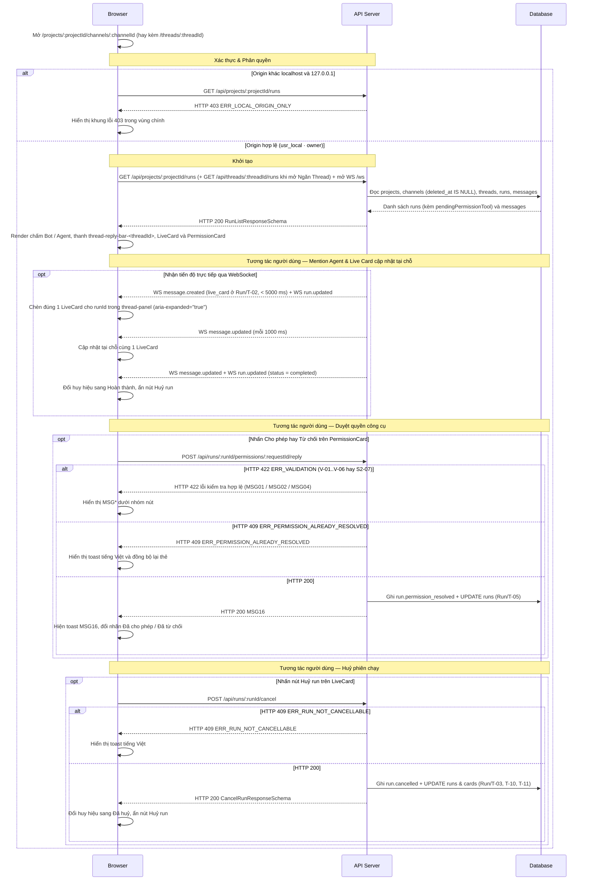

# UI-RN-01 - Thẻ Tiến độ Trực tiếp & Thẻ Duyệt Quyền Tool (Live Card & Tool Permission Card)

| Trường | Giá trị |
| --- | --- |
| Mã màn hình | `UI-RN-01` |
| Tên màn hình | Thẻ Tiến độ Trực tiếp & Thẻ Duyệt Quyền Tool (Live Card & Tool Permission Card) |
| Đường dẫn chốt | `specs/dd/runner/rn-01/ui-run-cards.md` |
| URL | `/projects/:projectId/channels/:channelId` · `/projects/:projectId/channels/:channelId/threads/:threadId` |
| Ngày tạo | 2026-10-31 |
| Ngày cập nhật | 2026-10-31 |

## TÓM TẮT

- **Mục tiêu**: Hiển thị trực tiếp tiến độ thực thi từng bước của agent trên một thẻ Live Card duy nhất cho mỗi run và cho phép người dùng quyết định Cho phép hay Từ chối yêu cầu quyền công cụ của harness ngay trong luồng phản hồi dọc của Ngăn Thread (`[data-testid="thread-panel"]`), đồng thời đồng bộ tóm tắt trạng thái run lên thanh phản hồi nội tuyến của tin nhắn gốc tại Khung trò chuyện Kênh và chấm trạng thái đang chạy tại nhóm `Bot / Agent` ở Cột 2.
- **Actor**: Người dùng cục bộ `usr_local` (`role = owner`, đồng thời là `runs.invoked_by` ở chế độ `ADE_MODE=solo`).
- **Trong phạm vi**: Hiển thị `LiveCard` trong vòng `< 5000 ms` kể từ lúc gửi `@mention` khi run bước vào `Run/T-02` bên trong Ngăn Thread (`[data-testid="thread-panel"]`, rộng `340px–780px`, mặc định `448px`), cập nhật tại chỗ checklist `plan`, vùng cuộn nhật ký `tool_call` / `step` cao tối đa `240px`, đoạn văn bản cuối `message_chunk`, trạng thái kết thúc (`completed`, `failed`, `cancelled`), nút `Huỷ run`, thẻ Duyệt Quyền Tool (`approval_card` phân loại `tool_permission`, viền mảnh `1px` `--color-human` kèm dấu vuông `8x8` `.ade-gate-mark`) với hai nút `Cho phép` / `Từ chối`, nhãn `BOT` và chip `.ade-mention--agent` phân tách rõ với người dùng, dòng tóm tắt tiến độ trực tiếp trên thanh `.ade-thread-bar` (`[data-testid="thread-reply-bar-<threadId>"]`) ở Khung trò chuyện Kênh (kể cả khi đang ở URL kênh chưa mở Ngăn Thread và `replyCount = 0`), và chấm trạng thái `.ade-presence--running` ở danh sách `Bot / Agent` thuộc Cột 2.
- **Ngoài phạm vi**: Thanh Project Rail `64px`, quản lý kênh, danh sách tin nhắn gốc và ô soạn tin nhắn `@mention` (thuộc `UI-CH-01`), thẻ câu hỏi `question_card` của `ask_human` (thuộc `UI-TR-01` ở P3), và thẻ cổng duyệt công việc `plan` / `spec` / `review` có đánh số version (thuộc `UI-OR-01` ở P4).
- **Giả định**: Không gian chat kiểu Slack của `UI-CH-01` (`Cột 1 Project Rail 64px → Cột 2 Kênh & Đội ngũ 224px → Cột 3 Khung trò chuyện Kênh flex: 1 + Cột 4 Ngăn Thread co giãn 340px–780px`) đã mở sẵn kết nối WebSocket chung tới `/ws` và uỷ quyền hiển thị các phần tử `messages` có `kind = 'live_card'` và `kind = 'approval_card'` (`cardType = 'tool_permission'`) bên dưới tin nhắn gốc (`is_root = 1`) trong Ngăn Thread cho `UI-RN-01`.
- **Câu hỏi mở**: Không có

## Lịch sử sửa đổi

| Ver | Ngày | Tác giả | Thay đổi |
| --- | --- | --- | --- |
| 1.0 | 2026-10-31 | cuongph | Phát hành lần đầu cho Phase P2 |
| 1.1 | 2026-10-31 | cuongph | Đồng bộ bố cục Slack 3+1 cột (Ngăn Thread, thanh tóm tắt phản hồi trên kênh, chấm trạng thái agent ở Sidebar) và hệ thống token Hallmark (`design.md`) |
| 1.2 | 2026-10-31 | cuongph | Phủ cả URL kênh `/projects/:projectId/channels/:channelId`, tích hợp `API-4` (`GET /api/projects/:projectId/runs`) cùng `pendingPermissionTool`, đồng bộ `data-testid="thread-panel"`, nhãn `Bot / Agent`, nút `[⇔][×]`, `[Gửi]` và dải khung nhìn responsive với `UI-CH-01` |

---

## BỐ CỤC

Màn hình tuân theo khung không gian làm việc 3+1 cột kiểu Slack đã chốt tại `design.md` và [specs/dd/chat/ch-01/ui-chat.md](specs/dd/chat/ch-01/ui-chat.md) trên cả hai mẫu URL `/projects/:projectId/channels/:channelId` và `/projects/:projectId/channels/:channelId/threads/:threadId`:

- **Đáp ứng kích thước khung nhìn**:
  - `>= 1025px`: Cột 1 (`64px`) + Cột 2 (`224px`) + Cột 3 (`flex: 1`) + Cột 4 (`448px` mặc định khi mở, kéo vách dọc `thread-panel-resizer` trong dải `340px–780px`).
  - `768px–1024px`: Cột 1 (`64px`) + Cột 2 (`200px`) + Cột 3 (`flex: 1`); khi mở Cột 4 thì Cột 4 trượt đè bên phải (`position: fixed`, `width: min(448px, 88vw)`) trên nền mờ `--color-backdrop`.
  - `< 768px`: Cột 3 phủ toàn màn hình, Cột 1 + Cột 2 chuyển thành ngăn kéo bên trái mở qua nút `mobile-sidebar-btn`; khi mở Cột 4 thì Cột 4 hiển thị toàn màn hình (`100vw`).

`LiveCard` và `PermissionCard` kết xuất trong luồng phản hồi dọc (`[data-testid="message-list"]`) của **Ngăn Thread** (`[data-testid="thread-panel"]`) ngay bên dưới tin nhắn gốc (`messages.is_root = 1`). Cả `ClaudeSdkDriver` và `CodexAcpDriver` đều kết xuất cùng một cấu trúc DOM `LiveCard` duy nhất không phân biệt họ driver, tuân thủ toàn bộ token ngữ nghĩa trong `design.md` (không dùng viền trái `border-left` từ `3px` trở lên, không dùng mã màu cứng ngoài `tokens.css`):

```text
+------+--------------------+------------------------------------+----------------------------------------------------+
| Cột 1| Cột 2: Kênh & Đội  | Cột 3: Khung trò chuyện Kênh       | Cột 4: Ngăn Thread (340px–780px, mặc định 448px)   |
| 64px | (224px / 200px)    | (flex: 1, min 380px)               | [data-testid="thread-panel"]                       |
+------+--------------------+------------------------------------+----------------------------------------------------+
| [AR] | ade-runner  ● Live | # general               [👤🤖 3][⚙] | ‖ Thread · #general · 2 phản hồi            [⇔][×] |
|      |--------------------|------------------------------------| ‖--------------------------------------------------|
| [ + ]| Kênh           [+] | [CP] usr_local · 13:19 (is_root=1) | ‖ [CP] usr_local · 13:19 (tin nhắn gốc is_root=1)  |
|      | # general      (●) | Nhờ [bot @coder] kiểm thử module   | ‖ Nhờ [bot @coder] kiểm thử module                 |
|      |                    | +--------------------------------+ | ‖ ---- 2 phản hồi -------------------------------- |
|      | Đồng nghiệp        | | thread-reply-bar-<threadId>    | | ‖ [CD] Coder [BOT] @coder · 13:19                  |
|      | ● Local Owner      | | [CP][CD] 2 phản hồi            | | ‖ +----------------------------------------------+ |
|      |                    | | @coder: Chờ cấp quyền Bash     | | ‖ | [Live Card] data-testid="live-card"          | |
|      | Bot / Agent        | | (thread-run-summary)           | | ‖ | [BOT] [bot @coder] · chạy cho usr_local      | |
|      | [CD(*)] @coder     | +--------------------------------+ | ‖ | · runner MBP      [Chờ cấp quyền] [Huỷ run]  | |
|      |   (*) chấm chạy    |                                    | ‖ | Kế hoạch: [x] Đọc yêu cầu  [~] Chạy kiểm thử | |
|      |   (--color-agent)  |                                    | ‖ | [Thu gọn (2 bước)] aria-expanded="true"      | |
|      | [LD(o)] @lead      |                                    | ‖ |   max-height:240px [live-card-steps]         | |
|      |                    |                                    | ‖ |   - Write src/index.ts ✓                     | |
|      |                    |                                    | ‖ | Phản hồi gần nhất: Đã tạo tệp kiểm thử.      | |
|      |                    |                                    | ‖ | Hoàn thành · $0.0120 · 4.2s (tabular-nums)   | |
|      |                    |                                    | ‖ +----------------------------------------------+ |
|      |                    |                                    | ‖ +----------------------------------------------+ |
|      |                    |                                    | ‖ | [Permission Card] 1px viền --color-human     | |
|      |                    |                                    | ‖ | [■] Yêu cầu quyền thực thi công cụ · @coder  | |
|      |                    |                                    | ‖ |   8x8 .ade-gate-mark         [Chờ quyết định]| |
|      |                    |                                    | ‖ | Công cụ: Bash  | Lệnh: Bash: npm test        | |
|      |                    |                                    | ‖ | [ Cho phép ]  [ Từ chối ]                    | |
|      |                    |                                    | ‖ +----------------------------------------------+ |
| [☀/☾]|                    | [Nhắn tin vào #general      ][Gửi] | ‖ [Trả lời trong thread (composer-input)    ][Gửi] |
+------+--------------------+------------------------------------+----------------------------------------------------+
```

---

## LOGIC

### I. Các phần tử (Items)

| STT | Tên logic | Loại đối tượng | Cột trong DB | Mô tả | Ghi chú |
| --- | --- | --- | --- | --- | --- |
| 1 | Khung thẻ Live Card | Khung chứa (`article`) | `messages.id`, `messages.run_id`, `messages.is_root` | Khung hiển thị duy nhất (`.ade-panel`, viền mảnh `1px` `--color-rule`, nền `--color-paper-2`) đại diện cho 1 phiên chạy agent bên trong luồng phản hồi dọc của Ngăn Thread (`[data-testid="thread-panel"]`, `messages.is_root = 0`); dòng tác giả phản hồi của agent mang nhãn `BOT` (`.ade-chip--agent.ade-mono`, `data-testid="agent-bot-badge"`) | Thuộc tính `data-testid="live-card"`, `data-run-id={runId}`; dùng chung cho cả Claude và ACP |
| 2 | Nhãn định danh phiên chạy | Nhãn | `agents.handle`, `runs.invoked_by`, `runners.machine_name` | Hiển thị chip agent `.ade-mention--agent` (bo góc `4px` `--radius-chip`, mực và viền `1px` `--color-agent` trên nền `--color-agent-soft`, phông `--font-outlier` đậm `600`, kèm biểu tượng SVG `bot` `12x12` ở đầu) nối với thông tin phiên: khi `runnerMachineName` khác `null` hiển thị `@handle · chạy cho <invokedBy> · runner <machineName>`; khi `runnerMachineName` bằng `null` (ở trạng thái `queued`) hiển thị `@handle · chạy cho <invokedBy> · chờ runner` | Lấy từ `messages.card_json` kết hợp `GET /api/projects/:projectId/runs` và `GET /api/threads/:threadId/runs` |
| 3 | Huy hiệu trạng thái Live Card | Huy hiệu (`badge`) | `runs.status`, `messages.card_json` | Hiển thị nhãn tiếng Việt của `status` bằng lớp `.ade-chip`: `Đang chờ` (`queued`, `.ade-chip--agent`), `Đang chạy` (`running`, `.ade-chip--agent`), `Chờ cấp quyền` (`waiting_permission`, `.ade-chip--human`), `Chờ phản hồi` (`waiting_human`, `.ade-chip--human`), `Hoàn thành` (`completed`, `.ade-chip--ok`), `Thất bại` (`failed`, `.ade-chip--bad`), `Đã huỷ` (`cancelled`, `.ade-chip`) | `data-testid="live-card-status"`, `data-status={status}` |
| 4 | Nút Huỷ run | Nút | — | Gửi yêu cầu dừng phiên chạy hiện tại (`.ade-btn.ade-btn--sm.ade-btn--danger`) | Chỉ hiển thị khi `status` thuộc `queued`, `running`, `waiting_permission`; ẩn ở `completed`, `failed`, `cancelled` |
| 5 | Khu vực Checklist kế hoạch | Danh sách | `messages.card_json` (`$.plan`) | Hiển thị từng mục kế hoạch bằng phông `.ade-mono` với biểu tượng `[ ]` (`pending`), `[~]` (`in_progress`), `[x]` (`completed`) | `data-testid="live-card-plan"`; ẩn khối này khi mảng `plan` rỗng |
| 6 | Nút Đóng/Mở nhật ký bước | Nút chuyển đổi | — | Đảo trạng thái đóng/mở danh sách các dòng `toolCalls` và `steps` (`.ade-btn.ade-btn--sm`) | `data-testid="live-card-toggle-steps"`, `aria-expanded="true"` \| `"false"`; mặc định đang mở (`aria-expanded="true"`) |
| 7 | Danh sách công cụ và bước tiến độ | Danh sách cuộn | `messages.card_json` (`$.toolCalls`, `$.steps`) | Hiển thị toàn bộ dòng tóm tắt cho mỗi công cụ và bước thực thi trong vùng lõm `.ade-well.ade-mono` cuộn dọc có chiều cao tối đa `240px` | `data-testid="live-card-steps"`; giữ đúng thứ tự phát sinh khi `aria-expanded="true"`, gỡ khỏi DOM khi `aria-expanded="false"` |
| 8 | Vùng đoạn văn bản cuối | Khối văn bản | `messages.card_json` (`$.lastMessageText`) | Hiển thị đoạn phản hồi văn bản tích luỹ gần nhất từ `message_chunk` | `data-testid="live-card-message"`; ẩn khi chuỗi rỗng |
| 9 | Dòng chân thẻ kết quả & chi phí | Nhãn | `runs.outcome`, `runs.cost_usd`, `runs.started_at`, `runs.ended_at` | Hiển thị trạng thái hoàn tất, mã lỗi (nếu `failed`), chi phí USD 4 chữ số thập phân và thời lượng chạy bằng phông `--font-outlier` (`.ade-mono`, `tabular-nums slashed-zero`) | `data-testid="live-card-footer"`; hiển thị khi run bước vào trạng thái kết thúc |
| 10 | Khung thẻ Duyệt Quyền Tool | Khung chứa (`article`) | `messages.id`, `messages.run_id`, `messages.card_json`, `messages.is_root` | Cổng quyết định của con người bên trong Ngăn Thread (`[data-testid="thread-panel"]`, `messages.is_root = 0`), dùng `.ade-panel.ade-gate-card` có viền mảnh `1px` bao quanh cả 4 cạnh theo `data-gate-status`: `--color-human` khi `pending`, `--color-ok` khi `allowed`, `--color-bad` khi `denied`, `--color-rule` khi `cancelled`; không dùng thanh viền trái `border-left` từ `3px` trở lên | Kết xuất khi `messages.kind = 'approval_card'` và `card_json.cardType = 'tool_permission'`; `data-testid="permission-card"` |
| 11 | Tiêu đề thẻ quyền công cụ | Nhãn | `messages.card_json` (`$.agentHandle`) | Hiển thị dấu vuông đặc `8x8` `--color-human` (`.ade-gate-mark`, `data-testid="permission-gate-mark"`) đặt trước nhãn `Yêu cầu quyền thực thi công cụ ·` và chip `.ade-mention--agent` của `<agentHandle>` | — |
| 12 | Huy hiệu trạng thái quyền công cụ | Huy hiệu (`badge`) | `messages.card_json` (`$.status`) | Hiển thị bằng `.ade-chip`: `Chờ quyết định` (`pending`, `.ade-chip--human`), `Đã cho phép` (`allowed`, `.ade-chip--ok`), `Đã từ chối` (`denied`, `.ade-chip--bad`), `Đã huỷ` (`cancelled`, `.ade-chip`) | `data-testid="permission-card-status"` |
| 13 | Nhãn Tên công cụ | Nhãn | `messages.card_json` (`$.tool`) | Hiển thị tên công cụ harness yêu cầu bằng `.ade-mono` (ví dụ `Bash`, `Write`, `Edit`) | `data-testid="permission-tool-name"` |
| 14 | Hộp Tham số lệnh | Khối mã (`pre`) | `messages.card_json` (`$.displayCommand`, `$.args`) | Hiển thị chuỗi tóm tắt lệnh cần duyệt trong khối `.ade-well.ade-mono` (ví dụ `Bash: npm test`) | `data-testid="permission-command"` |
| 15 | Nút Cho phép | Nút | — | Gửi quyết định `decision = "allow"` cùng `optionId` của phương án cho phép (`.ade-btn.ade-btn--sm.ade-btn--primary`) | `data-testid="permission-approve-btn"`; chỉ hiển thị khi `card_json.status = 'pending'` |
| 16 | Nút Từ chối | Nút | — | Gửi quyết định `decision = "deny"` cùng `optionId` của phương án từ chối (`.ade-btn.ade-btn--sm`) | `data-testid="permission-deny-btn"`; chỉ hiển thị khi `card_json.status = 'pending'` |
| 17 | Nhãn thông báo lỗi kiểm tra | Nhãn lỗi inline | — | Hiển thị chuỗi thông báo lỗi `MSG*` bằng màu `--color-bad` bên dưới nhóm nút nếu kiểm tra hợp lệ thất bại | `data-testid="permission-validation-error"`; ẩn mặc định |
| 18 | Dòng tóm tắt run trên thanh phản hồi kênh | Nhãn inline | `runs.status`, `messages.card_json` | Hiển thị tóm tắt trực tiếp của run đang hoạt động gần nhất ngay bên trong thanh phản hồi nội tuyến `.ade-thread-bar` (`data-testid="thread-reply-bar-<threadId>"`) dưới tin nhắn gốc (`messages.is_root = 1`) ở Cột 3 dựa trên `runs.status` và trường dẫn xuất `runs.pendingPermissionTool`: `<agentHandle>: Đang chờ` (`queued`), `<agentHandle>: Đang chạy` (`running`), `<agentHandle>: Chờ cấp quyền <pendingPermissionTool>` (`waiting_permission` khi `pendingPermissionTool` khác `null`; còn khi `pendingPermissionTool` bằng `null` thì hiển thị `<agentHandle>: Chờ cấp quyền`). Thanh `.ade-thread-bar` dưới tin nhắn gốc được kết xuất khi `replyCount > 0` và cả khi `replyCount = 0` nhưng thread có ít nhất `1` run thuộc `('queued', 'running', 'waiting_permission')` | `data-testid="thread-run-summary"`; ẩn khi thread không có run nào thuộc `queued`, `running`, `waiting_permission` |
| 19 | Chấm trạng thái đang chạy của Agent ở Sidebar | Chấm chỉ báo (`span`) | `agents.handle`, `runs.status` | Chuyển chấm hiện diện cạnh avatar của agent trong danh sách `Bot / Agent` tại Cột 2 sang lớp `.ade-presence--running` (màu `--color-agent`) khi agent có ít nhất `1` run thuộc `queued`, `running`, `waiting_permission` trong tập run của dự án, và trả về `.ade-presence--online` khi toàn bộ run của agent đã kết thúc | `data-testid="sidebar-agent-dot-<slug>"` (với `<slug>` là `handle` bỏ dấu `@`) |

### II. Kiểm tra hợp lệ (Validate)

Áp dụng khi gửi phản hồi trên thẻ Duyệt Quyền Tool thông qua `VALIDATION_CATALOG["runner.permission.reply"]` (tham chiếu `specs/message.md`):

| ID | Tên logic | Tên | Quy tắc kiểm tra | Mã message | Message |
| --- | --- | --- | --- | --- | --- |
| V-01 | `optionId` | Lựa chọn | `trim` | — | — |
| V-02 | `optionId` | Lựa chọn | `required` | `MSG01` | Lựa chọn là bắt buộc. |
| V-03 | `optionId` | Lựa chọn | `min:1` | `MSG01` | Lựa chọn là bắt buộc. |
| V-04 | `optionId` | Lựa chọn | `max:64` | `MSG02` | Lựa chọn không được vượt quá 64 ký tự. |
| V-05 | `decision` | Quyết định | `required` | `MSG01` | Quyết định là bắt buộc. |
| V-06 | `decision` | Quyết định | `in:allow,deny` | `MSG04` | Định dạng Quyết định không hợp lệ. |

### III. Logic

#### Thông tin màn hình

- **Phân quyền**: Chế độ `ADE_MODE=solo` chỉ chấp nhận truy cập từ `localhost` / `127.0.0.1` với actor mặc định `usr_local` (`role = owner`); chỉ `runs.invoked_by` và `owner` được thao tác nút `Cho phép`, `Từ chối` và `Huỷ run`.
- **Mẫu URL**: `/projects/:projectId/channels/:channelId` · `/projects/:projectId/channels/:channelId/threads/:threadId`
- **API chính**:

| STT | Method | Path | Mục đích |
| --- | --- | --- | --- |
| 1 | `GET` | `/api/threads/:threadId/runs` | Tải danh sách phiên chạy và siêu dữ liệu runner/agent của thread đang mở trong Ngăn Thread |
| 2 | `POST` | `/api/runs/:runId/permissions/:requestId/reply` | Gửi quyết định `allow` hay `deny` cho yêu cầu quyền công cụ |
| 3 | `POST` | `/api/runs/:runId/cancel` | Huỷ phiên chạy đang ở trạng thái chưa kết thúc |
| 4 | `GET` | `/api/projects/:projectId/runs` | Tải danh sách phiên chạy cấp dự án (loại trừ kênh đã xoá mềm) để đồng bộ chấm trạng thái nhóm `Bot / Agent` ở Cột 2 và thanh phản hồi nội tuyến ở Cột 3 |

#### 1. Kiểm tra phân quyền

| ID | Mô tả |
| --- | --- |
| P-01 | Khi mở màn hình từ `localhost` hay `127.0.0.1` ở `ADE_MODE=solo`, hệ thống phải gán người dùng hiện tại là `usr_local` (`role = owner`) và cho phép xem toàn bộ thẻ trong Ngăn Thread cùng trạng thái run trên kênh. |
| P-02 | Nếu API trả HTTP 403 `ERR_LOCAL_ORIGIN_ONLY`, thì màn hình phải hiển thị khung lỗi 403 trong vùng nội dung chính và giữ nguyên Cột 1 cùng Cột 2 bên trái. |
| P-03 | Trong khi người dùng đang xem không phải là `runs.invoked_by` và không có `role = owner` (dự phòng cấu trúc phân quyền chung với `ADE_MODE=team`), màn hình phải ẩn các nút `Cho phép`, `Từ chối` và `Huỷ run`. |

#### 2. Khởi tạo màn hình

| ID | Mô tả |
| --- | --- |
| I-01 | Khi vào URL `/projects/:projectId/channels/:channelId` hay `/projects/:projectId/channels/:channelId/threads/:threadId`, màn hình phải gọi `GET /api/projects/:projectId/runs` để khởi tạo tập phiên chạy cấp dự án cho nhóm `Bot / Agent` ở Cột 2 và các thanh `[data-testid="thread-reply-bar-<threadId>"]` ở Cột 3. |
| I-02 | Khi danh sách phản hồi bên dưới tin nhắn gốc (`messages.is_root = 1`) trong Ngăn Thread (`[data-testid="thread-panel"]`) chứa bản ghi `kind = 'live_card'`, màn hình phải kết xuất đúng 1 phần tử `LiveCard` cho mỗi `run_id` kèm nhãn `BOT` và chip `.ade-mention--agent` với `aria-expanded="true"` mặc định trên nút `[data-testid="live-card-toggle-steps"]`. |
| I-03 | Khi danh sách phản hồi trong Ngăn Thread (`[data-testid="thread-panel"]`) chứa bản ghi có `kind = 'approval_card'` và `card_json.cardType = 'tool_permission'`, màn hình phải kết xuất phần tử `PermissionCard` khớp `PermissionCardPayloadSchema` với khung `.ade-gate-card` viền mảnh `1px` `--color-human` và dấu vuông `8x8` `.ade-gate-mark`. |
| I-04 | Khi kết nối WebSocket chung `/ws` đang mở, màn hình phải đăng ký lắng nghe các khung tin `message.created`, `message.updated` và `run.updated` có `data.projectId` khớp `:projectId` hiện tại (kèm lọc `data.threadId` khớp `:threadId` cho Ngăn Thread khi đang mở) để đồng bộ trực tiếp Ngăn Thread (`[data-testid="thread-panel"]`), thanh `.ade-thread-bar` ở Cột 3 và chấm trạng thái ở nhóm `Bot / Agent` thuộc Cột 2 mà không tải lại trang. |
| I-05 | Khi vào URL có tham số `:threadId` (`/projects/:projectId/channels/:channelId/threads/:threadId`), màn hình phải mở Ngăn Thread (`[data-testid="thread-panel"]`, rộng mặc định `448px`, kéo co giãn trong dải `340px–780px` trên khung nhìn `>= 1025px`) và gọi `GET /api/threads/:threadId/runs` song song với danh sách tin nhắn của thread. |
| I-06 | Khi kết quả `GET /api/threads/:threadId/runs` chứa bản ghi đang có `status = 'queued'` và `liveCardMessageId === null`, màn hình phải kết xuất thẻ `LiveCard` hàng đợi ở cuối luồng phản hồi của Ngăn Thread theo `run.id`. |

#### 3. Xử lý hành vi sự kiện

> Nội dung message của các mã trong mục này: xem `specs/message.md`.

| ID | Sự kiện | Kích hoạt | Mô tả |
| --- | --- | --- | --- |
| E-01 | Xuất hiện và hợp nhất Live Card theo vòng đời run | Khi nhận sự kiện WebSocket `run.updated` (`status = 'queued'`, `liveCardMessageId = null` ở `Run/T-01`) hay `message.created` có `kind = 'live_card'` lúc run bước vào `Run/T-02` (trong vòng `< 5000 ms` kể từ lúc gửi `@mention`) cho `threadId` đang mở | Màn hình phải hiển thị đúng 1 phần tử `LiveCard` gắn `data-run-id={runId}` ở cuối luồng phản hồi trong Ngăn Thread (`[data-testid="thread-panel"]`, nếu thẻ hàng đợi của `runId` đã có mặt từ `Run/T-01` thì hợp nhất trực tiếp sang dữ liệu `messages.card_json` của `Run/T-02` mà không nhân đôi phần tử). |
| E-02 | Cập nhật tiến độ tại chỗ trên Live Card | Khi nhận sự kiện WebSocket `message.updated` cho bản ghi `kind = 'live_card'` đã có trong Ngăn Thread | Màn hình phải cập nhật tại chỗ nội dung `plan`, `toolCalls`, `steps`, `lastMessageText` và `status` của đúng phần tử `LiveCard` đó mà không tạo thêm thẻ tin nhắn mới. |
| E-03 | Đóng / mở chi tiết bước trên Live Card | Khi người dùng nhấn nút `[data-testid="live-card-toggle-steps"]` trên một `LiveCard` | Màn hình phải đảo thuộc tính `aria-expanded` giữa `"true"` và `"false"` trên nút đó: khi `"true"` hiển thị vùng cuộn `[data-testid="live-card-steps"]` cao tối đa `240px`, khi `"false"` gỡ `[data-testid="live-card-steps"]` khỏi DOM của riêng thẻ đó. |
| E-04 | Nhấn nút Huỷ run | Khi người dùng nhấn nút `Huỷ run` trên `LiveCard` đang có `status` thuộc `('queued', 'running', 'waiting_permission')` | Màn hình phải vô hiệu hoá nút `Huỷ run` ngay lập tức và gọi `POST /api/runs/:runId/cancel`. |
| E-05 | Huỷ run thành công | Khi `POST /api/runs/:runId/cancel` trả HTTP 200 | Màn hình phải đổi huy hiệu trạng thái của `LiveCard` sang `Đã huỷ` (`cancelled` theo `Run/T-03`, `Run/T-10`, `Run/T-11`), ẩn nút `Huỷ run`, và nếu run có `PermissionCard` đang `pending` thì đổi huy hiệu thẻ đó sang `Đã huỷ` kèm ẩn hai nút hành động. |
| E-06 | Huỷ run thất bại do đã kết thúc | Nếu `POST /api/runs/:runId/cancel` trả HTTP 409 `ERR_RUN_NOT_CANCELLABLE` | Màn hình phải hiển thị toast tiếng Việt từ `translateApiError` (`Run đã kết thúc nên không thể huỷ.`) và tải lại `GET /api/threads/:threadId/runs`. |
| E-07 | Xuất hiện thẻ Duyệt Quyền Tool | Khi nhận sự kiện WebSocket `message.created` có `kind = 'approval_card'` và `card_json.cardType = 'tool_permission'` cho `threadId` đang mở | Màn hình phải hiển thị `PermissionCard` (`.ade-gate-card` viền `1px` `--color-human` và dấu vuông `.ade-gate-mark`) ở trạng thái `Chờ quyết định` (`Run/T-04`) kèm tên công cụ, hộp lệnh và hai nút `Cho phép`, `Từ chối` đang bật trong Ngăn Thread (`[data-testid="thread-panel"]`). |
| E-08 | Nhấn nút Cho phép quyền công cụ | Khi người dùng nhấn nút `Cho phép` trên `PermissionCard` đang ở trạng thái `pending` | Màn hình phải kiểm tra hợp lệ payload theo `V-01..V-06`, vô hiệu hoá cả hai nút trên thẻ và gọi `POST /api/runs/:runId/permissions/:requestId/reply` với `decision = "allow"` cùng `optionId` của phương án cho phép. |
| E-09 | Cho phép quyền công cụ thành công | Khi `POST /api/runs/:runId/permissions/:requestId/reply` với `decision = "allow"` trả HTTP 200 | Màn hình phải hiển thị toast `MSG16`, đổi huy hiệu trên `PermissionCard` sang `Đã cho phép` (`allowed`, viền thẻ chuyển sang `--color-ok` theo `Run/T-05`) và ẩn hai nút hành động. |
| E-10 | Nhấn nút Từ chối quyền công cụ | Khi người dùng nhấn nút `Từ chối` trên `PermissionCard` đang ở trạng thái `pending` | Màn hình phải kiểm tra hợp lệ payload theo `V-01..V-06`, vô hiệu hoá cả hai nút trên thẻ và gọi `POST /api/runs/:runId/permissions/:requestId/reply` với `decision = "deny"` cùng `optionId` của phương án từ chối. |
| E-11 | Từ chối quyền công cụ thành công | Khi `POST /api/runs/:runId/permissions/:requestId/reply` với `decision = "deny"` trả HTTP 200 | Màn hình phải hiển thị toast `MSG16`, đổi huy hiệu trên `PermissionCard` sang `Đã từ chối` (`denied`, viền thẻ chuyển sang `--color-bad` theo `Run/T-05`) và ẩn hai nút hành động. |
| E-12 | Phản hồi quyền bị trùng lặp | Nếu `POST /api/runs/:runId/permissions/:requestId/reply` trả HTTP 409 `ERR_PERMISSION_ALREADY_RESOLVED` | Màn hình phải hiển thị toast tiếng Việt từ `translateApiError` (`Yêu cầu cấp quyền này đã được xử lý trước đó.`) và đồng bộ lại trạng thái thẻ. |
| E-13 | Lỗi kiểm tra hợp lệ khi phản hồi quyền | Nếu kiểm tra phía client (`V-01..V-06`) thất bại hay API trả HTTP 422 `ERR_VALIDATION` | Màn hình phải hiển thị thông báo lỗi `MSG*` tại `[data-testid="permission-validation-error"]` bên dưới nhóm nút của `PermissionCard` và bật lại hai nút khi thẻ còn `pending`. |
| E-14 | Phiên chạy kết thúc thành công | Khi nhận `message.updated` của `LiveCard` có `card_json.status = 'completed'` | Màn hình phải đổi huy hiệu trạng thái của `LiveCard` sang `Hoàn thành` (`Run/T-08`), ẩn nút `Huỷ run` và hiển thị thời lượng cùng chi phí USD ở chân thẻ. |
| E-15 | Phiên chạy kết thúc thất bại | Khi nhận `message.updated` của `LiveCard` có `card_json.status = 'failed'` | Màn hình phải đổi huy hiệu trạng thái của `LiveCard` sang `Thất bại` (`Run/T-09`, `Run/T-14`), ẩn nút `Huỷ run` và hiển thị mã nguyên nhân lỗi ở chân thẻ. |
| E-16 | Đồng bộ thanh tóm tắt phản hồi kênh và chấm trạng thái Agent ở Sidebar | Khi tập `runs` của dự án thay đổi qua `GET /api/projects/:projectId/runs`, `GET /api/threads/:threadId/runs` hay sự kiện WebSocket `run.updated` / `message.updated` | Màn hình phải kết xuất thanh `[data-testid="thread-reply-bar-<threadId>"]` dưới tin nhắn gốc ở Cột 3 khi `replyCount > 0` và cả khi `replyCount = 0` nhưng thread có run hoạt động, cập nhật `[data-testid="thread-run-summary"]` theo `runs.status` và `runs.pendingPermissionTool` (ẩn `[data-testid="thread-run-summary"]` khi thread không còn run thuộc `queued`, `running`, `waiting_permission`), đồng thời bật lớp `.ade-presence--running` trên `[data-testid="sidebar-agent-dot-<slug>"]` ở nhóm `Bot / Agent` thuộc Cột 2 khi và chỉ khi agent đó đang có run hoạt động. |

#### 4. Xử lý phía server

> Chi tiết hợp đồng dữ liệu và bảng thao tác SQLite: xem [specs/dd/runner/rn-01/api-runs.md](specs/dd/runner/rn-01/api-runs.md).

**API-1: GET /api/threads/:threadId/runs**

| ID | Bước | Mô tả |
| --- | --- | --- |
| S1-01 | Kiểm tra phân quyền | Nếu header `Origin` / `Host` không thuộc `localhost` hay `127.0.0.1`, thì API phải trả HTTP 403 `ERR_LOCAL_ORIGIN_ONLY`. |
| S1-02 | Kiểm tra params | Kiểm tra `:threadId` theo `ThreadRunsParamsSchema` (`API-RN-01/V-07`); nếu sai định dạng, thì API phải trả HTTP 422 `ERR_VALIDATION` kèm mã `MSG04`. |
| S1-03 | Tải bản ghi thread thuộc kênh hoạt động | Truy vấn `threads` kết hợp `channels` theo `threads.id = :threadId` và `channels.deleted_at IS NULL`; nếu không tìm thấy, thì API phải trả HTTP 404 `ERR_NOT_FOUND`. |
| S1-04 | Truy vấn và trả về | Truy vấn danh sách `runs` kết hợp `agents`, `runners`, `liveCardMessageId` và `pendingPermissionTool` sắp theo `created_at` tăng dần, rồi trả HTTP 200 `RunListResponseSchema`. |

**API-2: POST /api/runs/:runId/permissions/:requestId/reply**

| ID | Bước | Mô tả |
| --- | --- | --- |
| S2-01 | Kiểm tra phân quyền | Nếu header `Origin` / `Host` không thuộc `localhost` hay `127.0.0.1`, thì API phải trả HTTP 403 `ERR_LOCAL_ORIGIN_ONLY`. |
| S2-02 | Kiểm tra request | Kiểm tra `:runId`, `:requestId` theo `PermissionReplyParamsSchema` (`API-RN-01/V-08`, `API-RN-01/V-09`) và body theo §II (`V-01..V-06`); nếu thất bại, thì API phải trả HTTP 422 `ERR_VALIDATION`. |
| S2-03 | Tải bản ghi run thuộc kênh hoạt động | Tìm `runs` kết hợp `threads` và `channels` theo `runs.id = :runId` và `channels.deleted_at IS NULL`; nếu không tồn tại, thì API phải trả HTTP 404 `ERR_NOT_FOUND`. |
| S2-04 | Tải thẻ quyền công cụ | Tìm `messages` (`kind = 'approval_card'`) theo `run_id = :runId` và `json_extract(card_json, '$.requestId') = :requestId`; nếu không tồn tại, thì API phải trả HTTP 404 `ERR_NOT_FOUND`. |
| S2-05 | Kiểm tra trạng thái đã giải quyết | Nếu `card_json.status != 'pending'`, thì API phải trả HTTP 409 `ERR_PERMISSION_ALREADY_RESOLVED`. |
| S2-06 | Kiểm tra trạng thái chờ quyền của run | Nếu `runs.status != 'waiting_permission'`, thì API phải trả HTTP 409 `ERR_PERMISSION_ALREADY_RESOLVED`. |
| S2-07 | Kiểm tra khớp phương án trong thẻ | Đối chiếu `(optionId, decision)` với mảng `card_json.options`; nếu không khớp phần tử nào, thì API phải trả HTTP 422 `ERR_VALIDATION` kèm lỗi trường `optionId` mang mã `MSG04`. |
| S2-08 | Cập nhật trạng thái và chuyển tiếp xuống driver | Chuyển trạng thái theo `Run/T-05`, ghi `run.permission_resolved` vào `events`, cập nhật `messages.card_json` của cả `approval_card` và `live_card`, phát WebSocket `message.updated` và `run.updated`, đẩy `permission.reply` xuống driver và trả HTTP 200 — `MSG16`. |

**API-3: POST /api/runs/:runId/cancel**

| ID | Bước | Mô tả |
| --- | --- | --- |
| S3-01 | Kiểm tra phân quyền | Nếu header `Origin` / `Host` không thuộc `localhost` hay `127.0.0.1`, thì API phải trả HTTP 403 `ERR_LOCAL_ORIGIN_ONLY`. |
| S3-02 | Kiểm tra params | Kiểm tra `:runId` theo `CancelRunParamsSchema` (`API-RN-01/V-08`); nếu sai định dạng, thì API phải trả HTTP 422 `ERR_VALIDATION` kèm mã `MSG04`. |
| S3-03 | Tải bản ghi run thuộc kênh hoạt động | Tìm `runs` kết hợp `threads` và `channels` theo `runs.id = :runId` và `channels.deleted_at IS NULL`; nếu không tồn tại, thì API phải trả HTTP 404 `ERR_NOT_FOUND`. |
| S3-04 | Kiểm tra trạng thái không thể huỷ | Nếu `runs.status` thuộc `('completed', 'failed', 'cancelled')`, thì API phải trả HTTP 409 `ERR_RUN_NOT_CANCELLABLE`. |
| S3-05 | Huỷ run đang xếp hàng | Khi `runs.status = 'queued'`, chuyển trạng thái theo `Run/T-03` sang `'cancelled'` và ghi `run.cancelled` vào `events`. |
| S3-06 | Huỷ run đang thực thi | Khi `runs.status = 'running'`, flush `run.progress`, chuyển trạng thái theo `Run/T-10` sang `'cancelled'`, cập nhật `live_card` sang `'cancelled'` và gửi `run.cancel` xuống driver. |
| S3-07 | Huỷ run đang chờ quyền công cụ | Khi `runs.status = 'waiting_permission'`, flush `run.progress`, chuyển trạng thái theo `Run/T-11` sang `'cancelled'`, cập nhật cả `approval_card` đang `pending` và `live_card` sang `'cancelled'`, rồi gửi `run.cancel` xuống driver. |
| S3-08 | Phát sự kiện và trả về | Phát WebSocket `message.updated` và `run.updated`, kích hoạt kiểm tra run `'queued'` kế tiếp trong thread, rồi trả HTTP 200 `CancelRunResponseSchema`. |

**API-4: GET /api/projects/:projectId/runs**

| ID | Bước | Mô tả |
| --- | --- | --- |
| S4-01 | Kiểm tra phân quyền | Nếu header `Origin` / `Host` không thuộc `localhost` hay `127.0.0.1`, thì API phải trả HTTP 403 `ERR_LOCAL_ORIGIN_ONLY`. |
| S4-02 | Kiểm tra params | Kiểm tra `:projectId` theo `ProjectRunsParamsSchema` (`API-RN-01/V-10`); nếu sai định dạng, thì API phải trả HTTP 422 `ERR_VALIDATION` kèm mã `MSG04`. |
| S4-03 | Tải bản ghi dự án | Tìm bản ghi `projects` theo `:projectId`; nếu không tồn tại, thì API phải trả HTTP 404 `ERR_NOT_FOUND`. |
| S4-04 | Truy vấn và trả về | Truy vấn danh sách `runs` kết hợp `threads`, `channels` (`channels.deleted_at IS NULL`), `agents`, `runners` cùng `liveCardMessageId` và `pendingPermissionTool` sắp theo `created_at` tăng dần, rồi trả HTTP 200 `RunListResponseSchema`. |

### IV. Sơ đồ luồng



---

## TIÊU CHÍ CHẤP NHẬN

> Ghi chú nghiệm thu: Bên cạnh các spec Playwright trong `docs/phases.md`, bộ kiểm thử thành phần `apps/web/src/components/cards/__tests__/run-cards.test.tsx` được đăng ký chính thức vào cả lệnh `pnpm accept:p2` và `pnpm accept:all`.

```gherkin
Feature: UI-RN-01 — Hiển thị Live Card cập nhật tại chỗ và thẻ Duyệt Quyền Tool trong thread

  Background:
    Given người dùng `"usr_local"` đang mở ứng dụng trên `"http://127.0.0.1:4310"` cho dự án `"prj_01"`, kênh `"chn_01"`

  Scenario: AC-UI-RN-01-01 — Live Card xuất hiện dưới 5000 ms trong Ngăn Thread, đồng bộ thanh tóm tắt kênh cùng chấm Sidebar và chuyển sang Hoàn thành (nguồn: I-01, I-02, I-04, I-05, E-01, E-02, E-14, E-16, S1-04, S4-04, Run/T-02, Run/T-08; nghiệm thu: e2e/p2-live-card.spec.ts)
    Given người dùng đang mở `"/projects/prj_01/channels/chn_01/threads/thr_01"` và agent `"@fake"` được cấu hình kịch bản fake 5 bước tiến độ trong dự án `"prj_01"`
    When người dùng gửi phản hồi `"@fake thực hiện kịch bản 5 bước"` qua `[data-testid="composer-input"]` và `[data-testid="send-message-btn"]` trong Ngăn Thread của `"thr_01"`
    Then phần tử `[data-testid="live-card"]` xuất hiện bên trong `[data-testid="thread-panel"]` trong thời gian nhỏ hơn `5000` ms kèm `[data-testid="thread-run-summary"]` trên thanh `[data-testid="thread-reply-bar-thr_01"]` và lớp `.ade-presence--running` trên `[data-testid="sidebar-agent-dot-fake"]` ở nhóm `Bot / Agent`
    And số lượng phần tử `[data-testid="live-card"]` của run đó trong suốt quá trình chạy và sau khi xong luôn bằng `1`
    And thẻ hiển thị đủ 5 bước trong `[data-testid="live-card-steps"]` rồi đổi `[data-testid="live-card-status"]` sang `"Hoàn thành"`, ẩn nút `"Huỷ run"`, ẩn `[data-testid="thread-run-summary"]` và gỡ lớp `.ade-presence--running` khỏi `[data-testid="sidebar-agent-dot-fake"]`

  Scenario: AC-UI-RN-01-02 — Đóng và mở vùng cuộn danh sách nhật ký bước trên Live Card (nguồn: I-02, E-03; nghiệm thu: e2e/p2-live-card.spec.ts)
    Given Ngăn Thread của `"thr_01"` đang có một `[data-testid="live-card"]` chứa 5 bước tiến độ với nút `[data-testid="live-card-toggle-steps"]` mang `aria-expanded` bằng `"true"` và vùng cuộn `[data-testid="live-card-steps"]` cao tối đa `"240px"` đang hiển thị
    When người dùng nhấn nút `[data-testid="live-card-toggle-steps"]` trên thẻ đó
    Then nút `[data-testid="live-card-toggle-steps"]` đổi `aria-expanded` thành `"false"` và phần tử `[data-testid="live-card-steps"]` được gỡ khỏi DOM của thẻ

  Scenario: AC-UI-RN-01-03 — Nhấn Cho phép trên thẻ Duyệt Quyền Tool gửi optionId allow giúp agent chạy tiếp tới hoàn thành (nguồn: I-03, E-07, E-08, E-09, S2-08, Run/T-04, Run/T-05, Run/T-08; nghiệm thu: e2e/p2-permission.spec.ts)
    Given agent `"@fake_perm"` đang tạm dừng ở yêu cầu quyền công cụ `"Bash: npm test"` và hiển thị `[data-testid="permission-card"]` trong `[data-testid="thread-panel"]` ở trạng thái `"Chờ quyết định"` với phương án `"allow"` (`"Cho phép"`)
    When người dùng nhấn nút `[data-testid="permission-approve-btn"]` (`"Cho phép"`)
    Then màn hình hiển thị toast `"Đã gửi phản hồi duyệt."` (`MSG16`)
    And `[data-testid="permission-card-status"]` đổi thành `"Đã cho phép"` đồng thời hai nút `"Cho phép"` và `"Từ chối"` biến mất
    And `[data-testid="live-card-status"]` của phiên chạy đi tiếp và kết thúc ở `"Hoàn thành"`

  Scenario: AC-UI-RN-01-04 — Nhấn Từ chối trên thẻ Duyệt Quyền Tool gửi optionId deny và ghi rõ Đã từ chối (nguồn: E-07, E-10, E-11, S2-08, Run/T-04, Run/T-05; nghiệm thu: e2e/p2-permission.spec.ts)
    Given agent `"@fake_perm"` đang hiển thị `[data-testid="permission-card"]` trong `[data-testid="thread-panel"]` cho lệnh `"Bash: npm test"` ở trạng thái `"Chờ quyết định"` với phương án `"deny"` (`"Từ chối"`)
    When người dùng nhấn nút `[data-testid="permission-deny-btn"]` (`"Từ chối"`)
    Then màn hình hiển thị toast `"Đã gửi phản hồi duyệt."` (`MSG16`)
    And `[data-testid="permission-card-status"]` ghi rõ `"Đã từ chối"` đồng thời hai nút `"Cho phép"` và `"Từ chối"` biến mất

  Scenario: AC-UI-RN-01-05 — Hai họ driver Claude và ACP kết xuất Live Card cùng định dạng giao diện đồng nhất (nguồn: I-02, E-01, E-02, E-14; nghiệm thu: e2e/p2-two-drivers.spec.ts)
    Given dự án `"prj_01"` có `"@claude_fake"` (`harness` `"claude-code"`, `write` bằng `0`) và `"@codex_fake"` (`harness` `"codex"`, `write` bằng `0`) cùng chạy kịch bản 3 bước gồm 1 mục kế hoạch `plan`, 1 lời gọi công cụ `Read` và 1 đoạn văn bản phản hồi
    When người dùng gửi phản hồi `"@claude_fake @codex_fake chạy song song"` trong Ngăn Thread (`[data-testid="thread-panel"]`) của `"thr_01"`
    Then Ngăn Thread hiển thị 2 phần tử `[data-testid="live-card"]` có cùng tập thuộc tính cấu trúc (`live-card-status`, `live-card-plan`, `live-card-steps`, `live-card-message`) không có nhánh hiển thị riêng theo driver

  Scenario Outline: AC-UI-RN-01-06 — Nhấn nút Huỷ run dừng phiên chạy chưa kết thúc và đổi huy hiệu sang Đã huỷ (nguồn: E-04, E-05, S3-05, S3-06, S3-07, S3-08, Run/T-03, Run/T-10, Run/T-11; nghiệm thu: e2e/p2-live-card.spec.ts)
    Given phiên chạy `"<runId>"` đang hiển thị `[data-testid="live-card"]` với trạng thái `"<initialLabel>"` (`"<initialStatus>"`)
    When người dùng nhấn nút `"Huỷ run"` trên thẻ của `"<runId>"`
    Then `[data-testid="live-card-status"]` đổi sang `"Đã huỷ"` và nút `"Huỷ run"` không còn hiển thị

    Examples:
      | runId    | initialStatus      | initialLabel   |
      | run_q_ui | queued             | Đang chờ       |
      | run_r_ui | running            | Đang chạy      |
      | run_w_ui | waiting_permission | Chờ cấp quyền  |

  Scenario: AC-UI-RN-01-07 — Hiển thị toast tiếng Việt khi bấm Huỷ trên run vừa kết thúc ở phía server (nguồn: E-06, S3-04; nghiệm thu: e2e/p2-live-card.spec.ts)
    Given thẻ của `"run_just_done"` trên giao diện chưa nhận sự kiện kết thúc và server trả HTTP 409 `ERR_RUN_NOT_CANCELLABLE`
    When người dùng nhấn nút `"Huỷ run"` trên thẻ đó
    Then màn hình hiển thị toast `"Run đã kết thúc nên không thể huỷ."` và đồng bộ trạng thái thẻ về `"Hoàn thành"`

  Scenario: AC-UI-RN-01-08 — Hiển thị toast tiếng Việt khi trả lời thẻ quyền công cụ đã có quyết định trước đó (nguồn: E-12, S2-05, S2-06; nghiệm thu: e2e/p2-permission.spec.ts)
    Given thẻ `[data-testid="permission-card"]` của `"req_dup"` nhận phản hồi HTTP 409 `ERR_PERMISSION_ALREADY_RESOLVED` từ server
    When người dùng nhấn nút `[data-testid="permission-approve-btn"]`
    Then màn hình hiển thị toast `"Yêu cầu cấp quyền này đã được xử lý trước đó."` và cập nhật lại trạng thái thẻ

  Scenario Outline: AC-UI-RN-01-09 — Kiểm tra hợp lệ payload phản hồi quyền công cụ ở cả phía client và phía server (nguồn: V-01, V-02, V-03, V-04, V-05, V-06, S2-02, S2-07, E-13; nghiệm thu: e2e/p2-permission.spec.ts)
    Given thẻ `PermissionCard` có hai phương án hợp lệ `"allow"` (`"allow"`) và `"deny"` (`"deny"`), và nhận đầu vào `optionId` là `"<optionId>"` cùng `decision` là `"<decision>"`
    When kích hoạt gửi phản hồi trên `PermissionCard`
    Then phần tử `[data-testid="permission-validation-error"]` hiển thị mã thông báo lỗi `<msg>` bên dưới nhóm nút hành động
    But không chuyển trạng thái thẻ sang `"Đã cho phép"` hay `"Đã từ chối"`

    Examples:
      | optionId                                                             | decision | msg   |
      |                                                                      | allow    | MSG01 |
      |                                                                   	 | allow    | MSG01 |
      | opt_01234567890123456789012345678901234567890123456789012345678901234 | allow    | MSG02 |
      | allow                                                                |          | MSG01 |
      | allow                                                                | invalid  | MSG04 |
      | opt_khong_ton_tai                                                    | allow    | MSG04 |

  Scenario Outline: AC-UI-RN-01-10 — Hiển thị trạng thái Thất bại và mã lỗi trên Live Card khi run gặp lỗi runtime hay vượt ngân sách (nguồn: E-15, Run/T-09, Run/T-14; nghiệm thu: e2e/p2-live-card.spec.ts)
    Given phiên chạy `"<runId>"` đang hiển thị `[data-testid="live-card"]` ở trạng thái `"Đang chạy"`
    When trình duyệt nhận sự kiện WebSocket `message.updated` với `card_json.status` bằng `"failed"` và `errorCode` bằng `"<errorCode>"`
    Then `[data-testid="live-card-status"]` hiển thị `"Thất bại"`, ẩn nút `"Huỷ run"` và `[data-testid="live-card-footer"]` hiển thị chuỗi `"<errorCode>"`

    Examples:
      | runId          | errorCode            |
      | run_err_driver | ERR_DRIVER_EXECUTION |
      | run_err_budget | ERR_BUDGET_EXCEEDED  |

  Scenario: AC-UI-RN-01-11 — Hiển thị khung lỗi 403 khi API từ chối Origin không hợp lệ (nguồn: P-01, P-02, S1-01, S4-01; nghiệm thu: e2e/p2-live-card.spec.ts)
    Given API `GET /api/projects/prj_01/runs` và `GET /api/threads/thr_01/runs` trả về HTTP 403 với mã `"ERR_LOCAL_ORIGIN_ONLY"`
    When màn hình khởi tạo tại `"/projects/prj_01/channels/chn_01/threads/thr_01"`
    Then vùng nội dung chính hiển thị khung lỗi 403 kèm thông điệp `"ADE ở chế độ Solo chỉ cho phép truy cập từ localhost."`

  Scenario: AC-UI-RN-01-12 — Ẩn nút thao tác với người xem không có quyền và hiển thị dấu hiệu phân tách ngữ nghĩa Hallmark trên thẻ (nguồn: P-03, I-02, I-03, I-06; nghiệm thu: apps/web/src/components/cards/__tests__/run-cards.test.tsx)
    Given ngữ cảnh người xem trong bộ kiểm thử đơn vị có `userId` là `"usr_guest"`, `role` là `"member"` và `runs.invoked_by` là `"usr_local"`
    When kết xuất `LiveCard` đang ở trạng thái `"queued"` (`runnerMachineName` bằng `null`) và `PermissionCard` đang chờ quyết định
    Then `LiveCard` hiển thị nhãn `BOT` (`[data-testid="agent-bot-badge"]`), chip `.ade-mention--agent` kèm chuỗi `"· chờ runner"`, còn `PermissionCard` mang lớp `.ade-gate-card` với dấu vuông `[data-testid="permission-gate-mark"]`
    And nút `"Huỷ run"`, nút `"Cho phép"` và nút `"Từ chối"` đều không hiển thị trên DOM

  Scenario: AC-UI-RN-01-13 — Hiển thị thanh phản hồi kênh kèm pendingPermissionTool và chấm chạy ở nhóm Bot / Agent ngay trên URL kênh khi chưa mở Ngăn Thread (nguồn: I-01, I-04, E-16, S4-04; nghiệm thu: apps/web/src/components/cards/__tests__/run-cards.test.tsx)
    Given tin nhắn gốc của `"thr_01"` có `replyCount` bằng `0` nhưng `GET /api/projects/prj_01/runs` trả về 1 run của `"@fake_perm"` có `status` bằng `"waiting_permission"` và `pendingPermissionTool` bằng `"Bash"`
    When người dùng mở màn hình kênh `"/projects/prj_01/channels/chn_01"` mà chưa mở `[data-testid="thread-panel"]`
    Then dưới tin nhắn gốc của `"thr_01"` hiển thị thanh `[data-testid="thread-reply-bar-thr_01"]` kèm `[data-testid="thread-run-summary"]` có nội dung `"@fake_perm: Chờ cấp quyền Bash"` và `[data-testid="sidebar-agent-dot-fake_perm"]` mang lớp `.ade-presence--running`
```

---

## Màn hình liên quan

| Mã màn hình | Tên | Quan hệ |
| --- | --- | --- |
| `UI-CH-01` | Không gian Chat kiểu Slack — Project Rail, Channel Sidebar, Khung trò chuyện Kênh & Ngăn Thread ([specs/dd/chat/ch-01/ui-chat.md](specs/dd/chat/ch-01/ui-chat.md)) | Màn hình cha chứa Ngăn Thread (`[data-testid="thread-panel"]`) nơi nhúng `LiveCard` và `PermissionCard`, thanh `[data-testid="thread-reply-bar-<threadId>"]` và nhóm `Bot / Agent` ở Cột 2 |
| `API-RN-01` | Quản lý Phiên chạy Agent & Duyệt quyền Tool ([specs/dd/runner/rn-01/api-runs.md](specs/dd/runner/rn-01/api-runs.md)) | Cung cấp `API-1`, `API-2`, `API-3`, `API-4` và các khung tin WebSocket cho `UI-RN-01` |
| `UI-TR-01` | Thẻ Hỏi Người dùng & Badge Trạng thái Workflow ([specs/dd/trigger/tr-01/ui-workflow-cards.md](specs/dd/trigger/tr-01/ui-workflow-cards.md)) | Hiển thị cùng Ngăn Thread ở Phase P3 cho `question_card` |
| `UI-OR-01` | Thẻ Cổng Duyệt Plan / Spec / Review & Card Worker Con ([specs/dd/orchestration/or-01/ui-orchestration.md](specs/dd/orchestration/or-01/ui-orchestration.md)) | Tách biệt rõ với thẻ duyệt quyền công cụ của `UI-RN-01` ở Phase P4 |
| `UI-ST-02` | Modal Cài đặt Dự án — Tab Agents, Skills & Harness ([specs/dd/settings/st-02/ui-settings.md](specs/dd/settings/st-02/ui-settings.md)) | Quản lý cấu hình `.ade/agents/*.yaml` và kiểm tra trạng thái đăng nhập harness ở Phase P5 |
