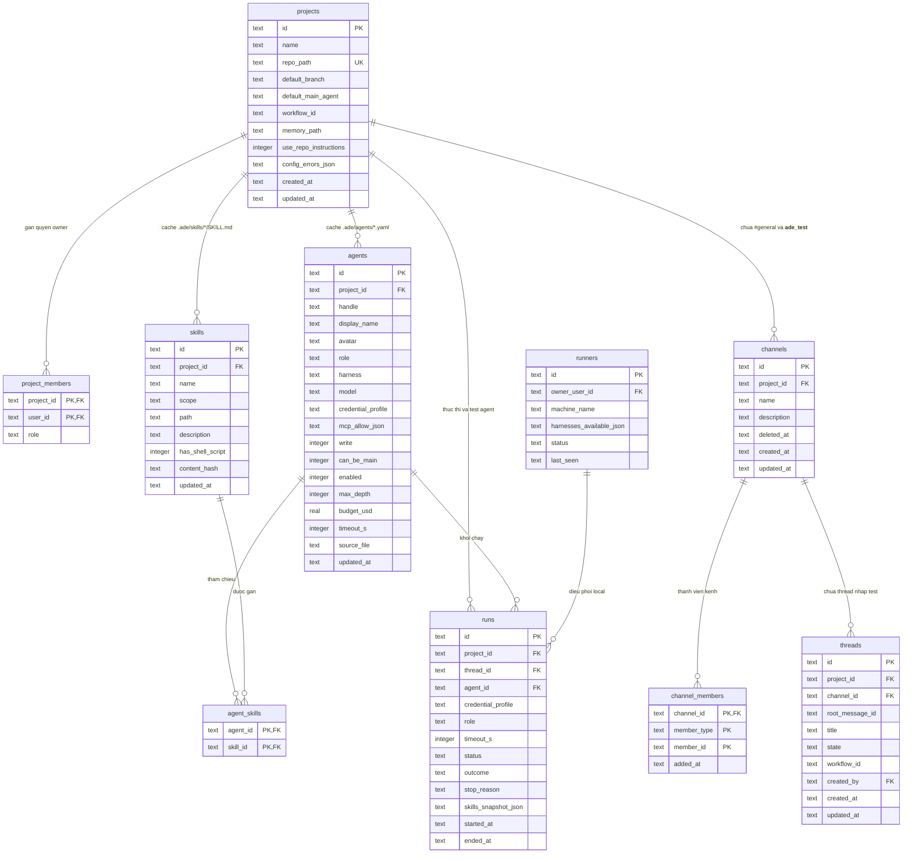
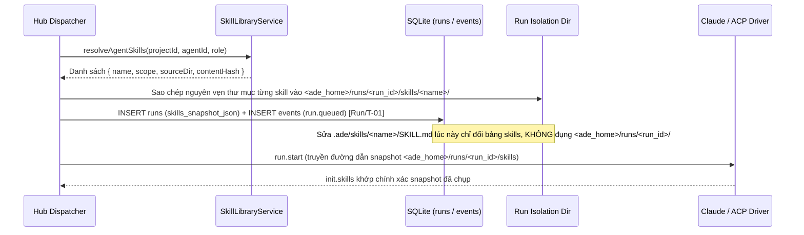

# Overview — Module `settings` (Cấu hình Dự án, Agent, Skill & Kiểm tra Harness)

| Trường | Giá trị |
| --- | --- |
| Module | `settings` (Phase P5) |
| Loại tài liệu | Thiết kế tổng quan module (Module Overview DD) |
| Đường dẫn chốt | `specs/dd/settings/overview.md` |
| Domain Model gốc | [specs/dd/domain-model.md](../domain-model.md) |
| Nguồn thiết kế gốc | `docs/spec.md`, `docs/phases.md`, `AGENTS.md` |
| Ngày tạo | 2026-10-31 |
| Ngày cập nhật | 2026-10-31 |

## 1. Phạm vi & Ranh giới Module

- **Mục tiêu**: Cung cấp cơ chế quản lý cấu hình dự án, định nghĩa agent, thư viện skill hai cấp (`global` và `project`), phát hiện harness trên máy local và chạy thử agent cô lập hoàn toàn qua giao diện Web mà vẫn giữ thư mục `.ade/` trong kho mã nguồn làm nguồn sự thật duy nhất.
- **Trong phạm vi (Phase P5)**:
  - Modal Tạo Dự Án 3 bước (`UI-ST-01`: `.ade-modal-shell`, `max-width: 720px`, toàn màn hình ở màn hình `< 768px`, `role="dialog"`, `aria-modal="true"`) hiển thị trên lớp phủ `--color-backdrop` đè lên nền Không gian Chat, mở từ nút icon `+` (`aria-label="Tạo dự án mới"`, `data-testid="add-project-btn"`) trên `Project Rail` hay liên kết sâu `/projects/new`; góc phải header chỉ có duy nhất nút đóng icon `×` (`aria-label="Đóng"`, `data-testid="close-project-wizard-btn"`).
  - Modal Cài Đặt Dự Án 6 tab (`UI-ST-02`: `.ade-modal-shell`, `max-width: 1040px`, `max-height: 88vh`, toàn màn hình ở màn hình `< 768px`, `role="dialog"`, `aria-modal="true"`) hiển thị trên lớp phủ `--color-backdrop` đè lên nền Không gian Chat, mở từ nút icon bánh răng tối giản `⚙` (`aria-label="Cài đặt dự án"`, `data-testid="project-settings-btn"`) ở đáy `Project Rail` hay liên kết sâu `/projects/:projectId/settings?tab=general|agents|skills|workflows|memory|harnesses` (Phase P5 hoàn thiện 4 tab `General`, `Agents`, `Skills`, `Harnesses` và hiển thị 2 tab `Workflows (P6)`, `Memory (P6)` ở trạng thái khóa; góc phải header chỉ có duy nhất nút đóng icon `×` `aria-label="Đóng"`, `data-testid="close-project-settings-btn"`).
  - Bộ API cấu hình và kiểm tra (`API-ST-01`), bộ đồng bộ hai chiều `.ade/` ↔ SQLite kèm `chokidar` watcher và sự kiện WebSocket `project.config_updated`.
  - Thư viện skill hai cấp (`~/.ade/skills/` và `.ade/skills/`), hai skill hệ thống (`ade-basics`, `ade-orchestrate`), quét cảnh báo shell script và import từ 4 nguồn (`folder`, `zip`, `git`, `copy_global`).
  - Bất biến chụp ảnh tĩnh `runs.skills_snapshot_json` và sao chép tệp skill cô lập theo từng `run_id` lúc bắt đầu run.
  - Công tắc `use_repo_instructions` điều khiển `settingSources` của driver Claude và cơ chế `Test agent` chạy thử cô lập 3 bước.
- **Ngoài phạm vi**:
  - Tab `Memory` (xem/sửa `.ade/memory/*.md`, duyệt `propose_memory`) và Tab `Workflow` (trình soạn `.ade/workflows/*.yaml`) thuộc module `memory` ở Phase P6 (`specs/dd/memory/overview.md`, `specs/dd/memory/mm-01/ui-memory-workflow.md`, `specs/dd/memory/mm-01/api-memory-workflow.md`).
  - Chợ chia sẻ skill trực tuyến (skill marketplace), kéo thả sơ đồ workflow, đăng nhập OAuth trực tiếp trên trình duyệt để lấy token của Claude hay Codex.
- **Câu hỏi mở**: Không có.

### Ma trận tài liệu con trong Module `settings`

| Mã DD | Loại | Tên tài liệu | Đường dẫn chốt | Nghiệm thu (`docs/phases.md`) |
| --- | --- | --- | --- | --- |
| `API-ST-01` | API | Hợp đồng REST quản lý Project, Agent, Skill, Harness & Test Agent | [specs/dd/settings/st-01/api-settings.md](./st-01/api-settings.md) | `e2e/p5-wizard.spec.ts`, `e2e/p5-agent-form.spec.ts`, `e2e/p5-skill-editor.spec.ts`, `e2e/p5-test-agent.spec.ts`, `scripts/verify/config-roundtrip.ts`, `scripts/verify/skill-snapshot.ts`, `pnpm real:skill-isolation` (`scripts/real/skill-isolation.ts`) |
| `UI-ST-01` | UI | Modal Tạo Dự Án Mới trên nền Không gian Chat (`/projects/new`) | [specs/dd/settings/st-01/ui-wizard.md](./st-01/ui-wizard.md) | `e2e/p5-wizard.spec.ts` |
| `UI-ST-02` | UI | Modal Cài Đặt Dự Án — Chung, Agent, Skill & Harnesses (`/projects/:projectId/settings?tab=<tab>`) | [specs/dd/settings/st-02/ui-settings.md](./st-02/ui-settings.md) | `e2e/p5-agent-form.spec.ts`, `e2e/p5-skill-editor.spec.ts`, `e2e/p5-test-agent.spec.ts`, `scripts/verify/config-roundtrip.ts` |

---

## 2. Chế độ triển khai & Phân quyền (`ADE_MODE=solo`)

| Quy tắc | Mô tả bắt buộc |
| --- | --- |
| Local Origin Guard | Toàn bộ HTTP endpoint thuộc `API-ST-01` và kênh WebSocket `/ws` chỉ chấp nhận kết nối có `Origin` / `Host` thuộc `localhost` hoặc `127.0.0.1`; vi phạm phải trả HTTP `403` `ERR_LOCAL_ORIGIN_ONLY`. |
| Actor mặc định | Mọi thao tác đọc/ghi cấu hình ở `ADE_MODE=solo` được thực thi dưới danh nghĩa `usr_local` (`project_members.role = 'owner'`). |
| Cô lập thông tin đăng nhập Harness | Hub và Web UI chỉ đọc/ghi tên `credential_profile` (`sub-claude`, `sub-chatgpt`, `api-key`) và trạng thái boolean `loggedIn`; hệ thống không đọc giá trị access token/refresh token từ `~/.ade/harness/*` để gửi qua API hay lưu vào SQLite. |

---

## 3. Mô hình dữ liệu của Module (`erDiagram`)

Module `settings` đọc/ghi trực tiếp thư mục `.ade/` trên đĩa và duy trì bộ nhớ đệm đồng bộ trong SQLite gồm các bảng `projects`, `project_members`, `channels`, `channel_members`, `agents`, `skills`, `agent_skills`, kết hợp với `threads`, `runners` và `runs` từ [specs/dd/domain-model.md](../domain-model.md) (bảng `channels` không có cột `default_workflow`; workflow mặc định cấp dự án lưu tại `projects.workflow_id` ánh xạ từ khóa `default_workflow` của `.ade/project.yaml`):



### Liên kết Máy trạng thái (State Machines)

Module `settings` không tạo thực thể có cột `status` mới mà tái sử dụng các máy trạng thái đã chốt trong [specs/dd/domain-model.md](../domain-model.md):

| Thực thể | Các chuyển trạng thái dùng trong P5 | Mục đích trong Module `settings` |
| --- | --- | --- |
| `Thread` | `Thread/T-01` (`— → open`) | Khởi tạo thread nháp ẩn trong kênh hệ thống `__ade_test__` khi chạy `Test agent`. |
| `ThreadAgent` | `ThreadAgent/T-01` (`— → active`) | Cấp quyền đọc ngữ cảnh tạm thời cho agent được kiểm tra để xác minh bước 3 (`mcpConnected`). |
| `Run` | `Run/T-01` (`— → queued`), `Run/T-02` (`queued → running`), `Run/T-08` (`running → completed`), `Run/T-09` (`running → failed`), `Run/T-15` (`running → failed`) | Chụp `runs.skills_snapshot_json` kèm `timeout_s = 30` ở `Run/T-01` và điều phối vòng đời run kiểm tra của `Test agent` (phân biệt lỗi bước kiểm tra / runtime driver `Run/T-09` với quá hạn 30 giây `Run/T-15`). |

---

## 4. Năm quyết định kiến trúc cốt lõi của Module `settings`

### 4.1. Đồng bộ hai chiều không lệch giữa `.ade/` và bộ nhớ đệm SQLite

| Chiều đồng bộ | Quy trình thực thi bắt buộc | Ràng buộc thời gian & toàn vẹn |
| --- | --- | --- |
| Ghi qua API (`API → .ade/ → SQLite → WS`) | 1. Kiểm tra dữ liệu đầu vào bằng Zod schema trong `packages/shared`.<br/>2. Serialize thành nội dung YAML chuẩn hóa (thứ tự khóa cố định, thụt lề 2 dấu cách cho `project.yaml` và `agents/*.yaml`) và Markdown kèm YAML frontmatter (cho `SKILL.md`).<br/>3. Tính `sha256` nội dung và đăng ký vào bảng băm chống lặp watcher (`recentSelfWrites`), ghi ra tệp tạm `<target>.tmp.<ulid>` rồi `fs.rename` nguyên tử sang đường dẫn đích trong `.ade/`.<br/>4. Cập nhật các bảng `projects`, `agents`, `skills`, `agent_skills` trong cùng một transaction SQLite.<br/>5. Phát sự kiện WebSocket `project.config_updated` (`{ type: "project.config_updated", data: { projectId, agents, configErrors } }`) tới mọi kết nối `/ws`. | Đọc lại tệp YAML bằng YAML parser khớp 100% các trường đã gửi qua API (`e2e/p5-agent-form.spec.ts`, `scripts/verify/config-roundtrip.ts`). |
| Sửa tay trên đĩa (`.ade/ → Watcher → SQLite → WS`) | 1. Bộ theo dõi `chokidar` giám sát `<repo_path>/.ade/{project.yaml,agents/*.yaml,skills/*/SKILL.md,workflows/*.yaml}` và `~/.ade/skills/*/SKILL.md` với độ trễ gom sự kiện (debounce) `150 ms`.<br/>2. Nếu `sha256` tệp trùng mục trong `recentSelfWrites` (TTL `3000 ms`) thì bỏ qua lần nạp thừa.<br/>3. Parse tệp thay đổi bằng `ProjectYamlSchema` / `AgentYamlSchema` / `SkillFrontmatterSchema` / `WorkflowYamlSchema`.<br/>4. Tệp hợp lệ: cập nhật lại dòng tương ứng trong `projects`, `agents`, `skills`, `agent_skills` và xóa lỗi cũ của tệp đó khỏi `projects.config_errors_json`.<br/>5. Tệp sai cú pháp hoặc sai schema: ghi `{ file, field, message }` vào `projects.config_errors_json`, giữ nguyên các agent và skill hợp lệ khác.<br/>6. Phát sự kiện WebSocket `{ type: "project.config_updated", data: { projectId, agents, configErrors } }`. | Tổng độ trễ từ lúc đóng tệp trên đĩa đến khi client nhận `project.config_updated` và API trả dữ liệu mới phải nhỏ hơn `2000 ms` (`scripts/verify/config-roundtrip.ts`). |

**Quy ước ánh xạ định danh tệp và bảng khóa chuẩn hóa**:
- `.ade/project.yaml` (`ProjectYamlSchema`): khi serialize chứa đúng 6 khóa theo thứ tự cố định: `name` (`projects.name`), `default_branch` (`projects.default_branch`), `default_main_agent` (`projects.default_main_agent`), `default_workflow` (`projects.workflow_id` ↔ `ProjectSettingsResponse.project.defaultWorkflow`; khi đọc trên đĩa, `ProjectYamlSchema` chấp nhận khóa chuẩn `default_workflow` cùng các bí danh tương thích `workflow` và `workflow_id`, mặc định `"feature"`), `use_repo_instructions` (`projects.use_repo_instructions`), `memory_path` (`projects.memory_path`, bảo toàn giá trị hiện có của dự án hoặc mặc định `".ade/memory/"`).
- `.ade/agents/<slug>.yaml` (`AgentYamlSchema`): mỗi agent một tệp riêng, trong đó `<slug>` là phần sau ký tự `@` của `handle` (khớp biểu thức `^[a-z0-9]+(?:-[a-z0-9]+)*$`). Khóa chính `agents.id` được phân giải tất định theo công thức `COALESCE(yaml.id, "agt_" + projectId + "_" + slug)` thống nhất với `AdeConfigLoader`: khi tạo mới (`API-2`, `API-4`) hoặc đọc tệp viết tay không có khóa `id`, hệ thống sinh `agents.id = "agt_" + projectId + "_" + slug`; khi đổi `handle` ở `API-5` từ `@old` sang `@new` (làm `:agentId !== "agt_" + projectId + "_" + new_slug`), hệ thống ghi bảo toàn khóa `id: <agentId>` ở đầu `.ade/agents/new.yaml` thành công rồi mới xóa `.ade/agents/old.yaml` để không bao giờ làm đứt khóa ngoại lịch sử (`runs.agent_id`, `thread_agents.agent_id`, `channel_members.member_id`) khi quét lại `.ade/` hoặc khởi động lại Hub. Thứ tự khóa chuẩn hóa của `.ade/agents/<slug>.yaml`:

| STT | Khóa YAML (`.ade/agents/<slug>.yaml`) | Trường API (`UpsertAgentInput` / `AgentConfigResponse`) | Cột SQLite (`agents` / `agent_skills`) | Kiểu & mặc định khi serialize |
| --- | --- | --- | --- | --- |
| 0 | `id` *(tùy chọn)* | `id` (chỉ ở `AgentConfigResponse` / `:agentId`) | `agents.id` | `string` (`^agt_[a-zA-Z0-9_-]+$`); mặc định lược bỏ khi `agents.id === "agt_" + projectId + "_" + slug`, bắt buộc ghi khi `handle` đã từng đổi tên để giữ cố định `agents.id` |
| 1 | `handle` | `handle` | `agents.handle` | `string` (`^@[a-z0-9]+(?:-[a-z0-9]+)*$`) |
| 2 | `display_name` | `displayName` | `agents.display_name` | `string` (`1..80` ký tự) |
| 3 | `avatar` | `avatar` | `agents.avatar` | `string \| null` (mặc định `null`) |
| 4 | `role` | `role` | `agents.role` | `string` (`1..4000` ký tự) |
| 5 | `harness` | `harness` | `agents.harness` | `"claude-code" \| "codex"` |
| 6 | `model` | `model` | `agents.model` | `string \| null` (mặc định `null`) |
| 7 | `credential` | `credentialProfile` | `agents.credential_profile` | `"sub-claude" \| "sub-chatgpt" \| "api-key"` |
| 8 | `skills` | `skills` | `agent_skills.skill_id` | `string[]` (`"<name>"` / `"global:<name>"`) |
| 9 | `mcp_allow` | `mcpAllow` | `agents.mcp_allow_json` | `string[]` (serialize JSON ở cột SQLite) |
| 10 | `write` | `write` | `agents.write` | `boolean` (`0` / `1` ở cột SQLite) |
| 11 | `can_be_main` | `canBeMain` | `agents.can_be_main` | `boolean` (`0` / `1` ở cột SQLite) |
| 12 | `enabled` | `enabled` | `agents.enabled` | `boolean` (`0` / `1` ở cột SQLite, mặc định `true`) |
| 13 | `max_depth` | `maxDepth` | `agents.max_depth` | `integer` (`1..10`, mặc định `3`) |
| 14 | `budget_usd` | `budgetUsd` | `agents.budget_usd` | `number \| null` (`0.01..1000` / `null`) |
| 15 | `timeout_s` | `timeoutS` | `agents.timeout_s` | `integer` (`10..7200`, mặc định `600`) |

**Ba bộ mẫu khởi tạo dự án (`templateId`) và mẫu hình quyền cho agent chỉ đọc làm Main Agent**:

| `templateId` | Tên hiển thị ở Wizard | `default_main_agent` | Danh sách `.ade/agents/*.yaml` được sinh | Danh sách `.ade/skills/*/SKILL.md` khởi đầu |
| --- | --- | --- | --- | --- |
| `lead_coder_tester_qa` | Khuyên dùng — Đội ngũ đầy đủ (6 agent) | `"@lead"` | 6 tệp: `@lead` (`Tech Lead`, `claude-code`, `sub-claude`, `skills: ["brainstorm", "plan", "delegate"]`, `write: false`, `can_be_main: true`), `@explorer` (`Codebase Explorer`, `claude-code`, `sub-claude`, `skills: ["explore", "brainstorm"]`, `write: false`, `can_be_main: true`), `@planner` (`Spec & Planner`, `claude-code`, `sub-claude`, `skills: ["brainstorm", "spec", "plan"]`, `write: false`, `can_be_main: true`), `@coder` (`Coder`, `codex`, `sub-chatgpt`, `skills: ["implement", "write-tests"]`, `write: true`, `can_be_main: false`), `@tester` (`Tester`, `claude-code`, `sub-claude`, `skills: ["write-tests"]`, `write: true`, `can_be_main: false`), `@qa` (`QA Reviewer`, `claude-code`, `sub-claude`, `skills: ["code-review"]`, `write: false`, `can_be_main: false`) | 8 skill: `explore`, `brainstorm`, `spec`, `plan`, `delegate`, `implement`, `write-tests`, `code-review` |
| `planner_coder` | Gọn nhẹ — Explorer + Planner + Coder (3 agent) | `"@planner"` | 3 tệp: `@explorer` (`Codebase Explorer`, `claude-code`, `sub-claude`, `skills: ["explore", "brainstorm"]`, `write: false`, `can_be_main: true`), `@planner` (`Spec & Planner`, `claude-code`, `sub-claude`, `skills: ["brainstorm", "spec", "plan"]`, `write: false`, `can_be_main: true`), `@coder` (`Coder`, `codex`, `sub-chatgpt`, `skills: ["implement", "write-tests"]`, `write: true`, `can_be_main: false`) | 6 skill: `explore`, `brainstorm`, `spec`, `plan`, `implement`, `write-tests` |
| `empty` | Dự án trống (0 agent) | `null` | 0 tệp agent (chỉ khởi tạo `.ade/project.yaml` và `.ade/workflows/feature.yaml`) | 0 skill dự án |

- **Mẫu hình `write = false` kết hợp `can_be_main = true` (`canBeMain = true`)**: Các agent chuyên tra cứu chỉ đọc kèm trích dẫn `file:line` (`@explorer`), phỏng vấn người dùng làm rõ yêu cầu (`Clarifier` qua `ask_human`) và lập kế hoạch (`@planner`), cùng điều phối luồng việc (`@lead`) đều đặt `write: false` để không bao giờ giữ khóa ghi worktree của thread mà vẫn đặt `can_be_main: true` để người dùng @mention mở đầu thread cho tác vụ hỏi đáp codebase hay làm rõ bài toán trước khi giao việc ghi tệp cho `@coder` và `@tester`.

### 4.2. Thư viện Skill hai cấp, phân giải tên và Skill hệ thống

| Khía cạnh | Quy tắc đã chốt |
| --- | --- |
| Định dạng chuẩn Agent Skills | Mỗi skill nằm tại một thư mục `<skillName>/` chứa tệp `SKILL.md` bắt đầu bằng khối YAML frontmatter cặp thẻ `---` có tối thiểu hai trường: `name` (khớp chính xác tên thư mục `<skillName>` và biểu thức `^[a-z0-9]+(?:-[a-z0-9]+)*$`) và `description` (`1..500` ký tự). |
| Cấp Global (`scope = 'global'`) | Đặt tại `$ADE_HOME/skills/<skillName>/SKILL.md` (mặc định `~/.ade/skills/<skillName>/SKILL.md` khi biến môi trường `ADE_HOME` không đặt); lưu vào bảng `skills` với `project_id = NULL`, `scope = 'global'`. Dùng lại qua mọi dự án trên máy. |
| Cấp Project (`scope = 'project'`) | Đặt tại `<repo_path>/.ade/skills/<skillName>/SKILL.md`; lưu vào bảng `skills` với `project_id = <prj_id>`, `scope = 'project'`. Đi theo lịch sử Git của dự án. |
| Quy tắc ưu tiên khi phân giải | Trong mảng `skills` của `.ade/agents/<slug>.yaml`:<br/>1. Chuỗi có tiền tố `"global:<name>"`: chỉ tra trong thư viện `global`; không tồn tại thì báo thiếu skill.<br/>2. Chuỗi `"<name>"` (không tiền tố): tra trong `.ade/skills/<name>/SKILL.md` trước; nếu tồn tại thì bản `project` thắng hoàn toàn bản `global` trùng tên; nếu không tồn tại bản `project` thì tra tiếp trong `~/.ade/skills/<name>/SKILL.md`. |
| Hai Skill hệ thống tự động nạp | Runtime của `packages/runner` đóng gói sẵn hai skill hệ thống (không ghi vào `.ade/agents/*.yaml`):<br/>- `ade-basics`: tự động nạp cho mọi run (hướng dẫn gọi `report_outcome`, `post_progress`, `ask_human`, `read_memory`).<br/>- `ade-orchestrate`: tự động nạp thêm khi `runs.role = 'main'` (hướng dẫn gọi `delegate`, `get_results`, `request_approval`, `write_scratchpad`). |
| Quét cảnh báo Shell Script | Khi tạo, cập nhật, import hoặc quét watcher một skill, Hub kiểm tra hai dấu hiệu: (a) trong thư mục skill có tệp phần mở rộng `.sh`, `.bash`, `.zsh` hoặc tệp bắt đầu bằng dòng `#!`; (b) trong `SKILL.md` có khối mã fenced ```` ```sh ````, ```` ```bash ````, ```` ```zsh ````, ```` ```shell ````. Nếu có ít nhất một dấu hiệu thì đặt `skills.has_shell_script = 1` và trả mảng `shellWarnings` để UI hiển thị cảnh báo thực thi lệnh hệ thống. |
| Cảnh báo vượt ngưỡng số lượng Skill | Khi một agent được gắn nhiều hơn `8` skill người dùng (`skills.length > 8`), giao diện Form Agent hiển thị khung cảnh báo chú ý dùng cặp token `--color-human` / `--color-human-soft` (`role="status"`) nhắc việc mô tả của mọi skill được đưa vào ngữ cảnh mỗi lượt gọi và làm tăng chi phí token. |

### 4.3. Bất biến `runs.skills_snapshot_json` và cô lập tệp Skill theo Run



1. **Cách tính `content_hash`**: Với mỗi thư mục skill, Hub duyệt tất cả tệp bên trong theo thứ tự từ điển của đường dẫn tương đối (chuẩn hóa dấu gạch chéo `/`), ghép `<relative_path>\0<raw_bytes>\0` và băm `SHA-256` dạng chuỗi hex 64 ký tự (`sha256:<hex>`).
2. **Chụp bất biến lúc khởi tạo Run (`Run/T-01`)**:
   - Ngay khi Dispatcher tạo bản ghi `runs` (`status = 'queued'`), hệ thống ghi mảng JSON theo `SkillSnapshotItemSchema` (`{ name, scope: "project" | "global" | "system", contentHash }[]`) vào cột `runs.skills_snapshot_json` và đưa cùng danh sách này vào `events.payload.skills_snapshot` của sự kiện `run.queued`.
   - Đồng thời, nội dung vật lý của toàn bộ các skill trong snapshot được sao chép sang thư mục riêng biệt `<ade_home>/runs/<run_id>/skills/<name>/`.
3. **Nạp vào từng Driver từ thư mục cô lập**:
   - **Driver Claude (`claude-code`)**: Tạo cấu trúc plugin tạm tại `<ade_home>/runs/<run_id>/plugin/` chứa các skill từ snapshot, gọi Agent SDK với `plugins: [{ type: "local", path: "<ade_home>/runs/<run_id>/plugin" }]` và `skills: snapshot.map(s => s.name)`. Agent `@coder` không nhìn thấy bất kỳ skill nào chỉ gắn cho `@qa` và không nhìn thấy `~/.claude/skills` cá nhân (`pnpm real:skill-isolation` · `scripts/real/skill-isolation.ts`).
   - **Driver ACP (`codex`)**: Sao chép các skill từ `<ade_home>/runs/<run_id>/skills/` vào `<worktree>/.agents/skills/` và đảm bảo `.git/info/exclude` chứa dòng `.agents/skills/`.
   - **MCP Fallback (`list_skills`, `load_skill`)**: Đọc trực tiếp từ `runs.skills_snapshot_json` và thư mục `<ade_home>/runs/<run_id>/skills/` của đúng `run_id` gắn trên `mcp_token`.
4. **Tính bất biến xuyên suốt vòng đời Run**:
   - Cột `runs.skills_snapshot_json` là chỉ-ghi-một-lần (write-once); không có câu lệnh `UPDATE runs SET skills_snapshot_json = <gia_tri>` nào trong toàn hệ thống.
   - Khi người dùng sửa `SKILL.md` qua UI hoặc sửa trên đĩa trong lúc `run_1` đang ở trạng thái `queued`, `running`, `waiting_permission`, hoặc `waiting_human`: `run_1` giữ nguyên `skills_snapshot_json` và các tệp trong `<ade_home>/runs/<run_1>/skills/` với hash cũ; `run_2` tạo sau thời điểm lưu sẽ nhận `contentHash` mới (`scripts/verify/skill-snapshot.ts`).
   - Thư mục `<ade_home>/runs/<run_id>/` chỉ được dọn sau khi run đã chuyển vào trạng thái cuối (`completed`, `failed`, `cancelled`).

### 4.4. Công tắc `use_repo_instructions` ("Dùng hướng dẫn của repo")

| Giá trị trong `.ade/project.yaml` | Giá trị cột `projects.use_repo_instructions` | Tham số `settingSources` truyền vào Driver Claude | Hành vi quan sát được |
| --- | --- | --- | --- |
| `false` (mặc định khi tạo project) | `0` | `settingSources: []` | Driver Claude bỏ qua `CLAUDE.md`, `.claude/settings.json` và `.claude/skills` trong repo cũng như trong `~/.claude` cá nhân; chỉ nạp role + project memory + skill do ADE cấp. |
| `true` | `1` | `settingSources: ["project"]` | Driver Claude đọc thêm `CLAUDE.md` và cấu hình cấp dự án trong worktree của repo được quản lý, trong khi vẫn cô lập hoàn toàn `~/.claude` cá nhân nhờ `CLAUDE_CONFIG_DIR` riêng và `CLAUDE_CODE_DISABLE_AUTO_MEMORY=1`. |

### 4.5. Cơ chế `Test agent` kiểm tra 3 bước tuần tự trong Thread nháp ẩn

Khi người dùng bấm nút **Test agent** trên Tab `Agents` (`POST /api/projects/:projectId/agents/:agentId/test`):

1. **Kiểm tra điều kiện & tạo ngữ cảnh nháp ẩn tuân thủ Event Sourcing**:
   - Hub kiểm tra `agents.enabled = 1` theo đúng Guard của `ThreadAgent/T-01` (nếu `agents.enabled = 0` thì từ chối ngay với HTTP `400` `ERR_INVALID_STATUS`) và kiểm tra runner local đang ở trạng thái `online` (`503` `ERR_RUNNER_UNAVAILABLE`).
   - Hub tìm kênh hệ thống đang hoạt động có `name = "__ade_test__" AND deleted_at IS NULL` trong `project_id`; nếu chưa tồn tại thì phát sự kiện `channel.created` với payload `{ channel_id, project_id, name: "__ade_test__", description: "", member_user_ids: ["usr_local"], member_agent_ids: [agentId] }` (chiếu đồng bộ vào `channels` với `description = ""`, `deleted_at = NULL` và `channel_members`), còn nếu kênh đang hoạt động đã có mà `agentId` chưa thuộc `channel_members` thì phát sự kiện `channel.updated` với payload `{ channel_id, project_id, name: "__ade_test__", description, member_user_ids, member_agent_ids }` bổ sung `agentId` vào `member_agent_ids` (chiếu đồng bộ vào `channels.updated_at` và `channel_members`). Khi xóa một agent khỏi dự án (`API-6`), mọi kênh đang hoạt động (`deleted_at IS NULL`) chứa agent đó trong `channel_members` cũng phát sự kiện `channel.updated` loại bỏ `agentId` để phát lại 100% từ bảng `events` luôn nhất quán. Các API liệt kê kênh chat của người dùng lọc bỏ mọi kênh có tiền tố `"__ade_"`.
   - Hub sinh trước `root_message_id` (`msg_<ulid>`), phát **trước** sự kiện `thread.created` (`Thread/T-01`, mang sẵn `root_message_id`, chiếu đồng bộ vào `threads`) rồi mới phát sự kiện `message.posted` cho tin nhắn gốc chẩn đoán (`is_root = true`, chiếu đồng bộ vào `messages` mà không vi phạm khóa ngoại `messages.thread_id REFERENCES threads(id)` khi phát lại theo `seq`), tiếp đó phát `agent.granted` (`ThreadAgent/T-01`, `role = 'worker'`, `scope = 'brief'`) cấp quyền đọc thread nháp cho `agentId`, và phát `run.queued` (`Run/T-01`, chốt cứng `timeout_s = 30` ở cả `runs.timeout_s` và `run.queued.payload.timeout_s`) chụp `skills_snapshot_json` hiện tại của agent.
2. **Thực thi 3 bước kiểm tra tuần tự** (thời gian chờ tối đa `timeout_s = 30` giây):
   - **Bước 1 — `harnessBoot` (Khởi động Harness)**: Runner khởi chạy driver tương ứng (`claude-code` hoặc `codex`) bằng `credential_profile` của agent (`Run/T-02`). Đạt (`pass`) khi driver khởi tạo session thành công (`init` message từ Agent SDK khi `harness = 'claude-code'`, phản hồi `session/new` từ ACP khi `harness = 'codex'`). Nếu thất bại, dừng ngay và đánh dấu bước 2, bước 3 là `fail`.
   - **Bước 2 — `skillsLoaded` (Nạp danh sách Skill)**: Đối chiếu tập tên skill thực tế nạp vào session (`init.skills` trên driver `claude-code` / `FakeClaudeDriver`, và danh sách thư mục `SKILL.md` hợp lệ đã nạp tại `<worktree>/.agents/skills/` trên driver `codex`) với tập kỳ vọng (các skill gắn cho agent + `ade-basics`). Đạt (`pass`) khi mọi skill kỳ vọng đều có mặt đầy đủ.
   - **Bước 3 — `mcpConnected` (Kết nối ADE MCP)**: Tiến trình Runner/driver trực tiếp thực hiện lời gọi probe HTTP `POST /mcp` (gọi tool `get_thread` với `thread_id` của thread nháp) đính kèm `Authorization: Bearer <mcp_token>` của phiên thử để xác minh tất định đường kết nối, xác thực token và quyền đọc grant mà không phụ thuộc vào quyết định gọi tool ngẫu nhiên của mô hình ngôn ngữ. Đạt (`pass`) khi ADE MCP Server xác thực `mcp_token` + grant thành công, ghi sự kiện `mcp.called` (`tool = 'get_thread'`) và trả HTTP `200`.
3. **Kết thúc và dọn dẹp**:
   - Nếu cả 3 bước đều `pass` trong vòng `30` giây, run chuyển `Run/T-08` (`completed`, `stop_reason = 'end_turn'`); nếu phiên thử vượt quá giới hạn `timeout_s = 30` giây, run chuyển `Run/T-15` (`failed`, `outcome = 'blocked'`, `stop_reason = 'timeout'`, sự kiện `run.failed` mang `error_code = 'ERR_RUN_TIMEOUT'`); nếu có bước kiểm tra trả `fail` hay tiến trình driver gặp lỗi runtime trong vòng `30` giây, run chuyển `Run/T-09` (`failed`, `stop_reason = 'error'`, sự kiện `run.failed` mang `error_code = 'ERR_DRIVER_EXECUTION'`).
   - Trong khối `finally`, Runner thu hồi `mcp_token`, đóng tiến trình session thử, xóa worktree `.ade/wt/<test_thread_id>` và thư mục `<ade_home>/runs/<test_run_id>/`, rồi trả `TestAgentResultSchema` về giao diện để hiển thị kết quả từng bước (`e2e/p5-test-agent.spec.ts`).
