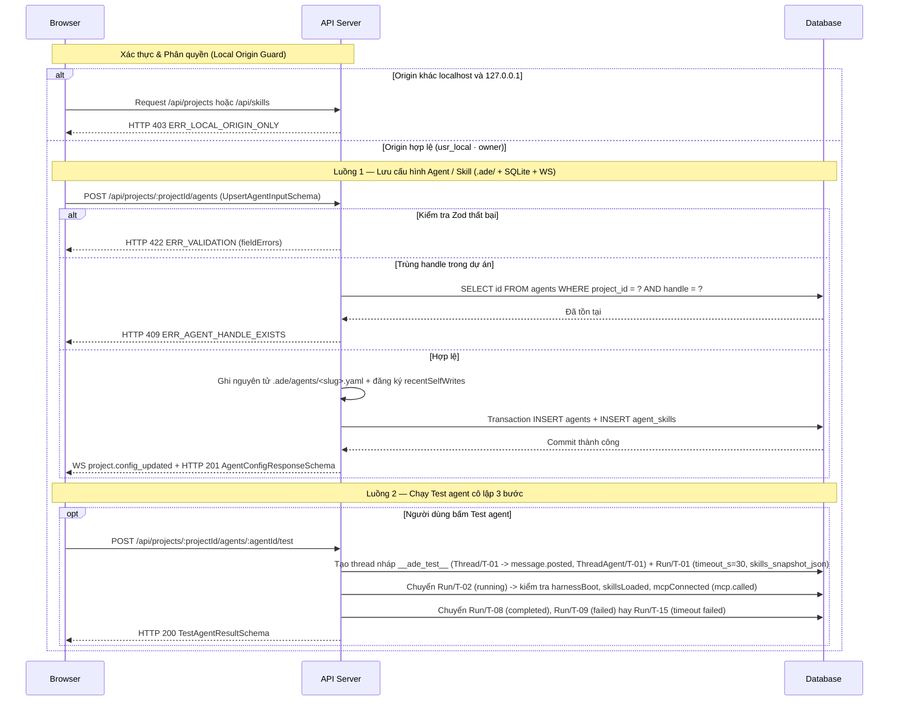

# API-ST-01 — REST `/api/projects`, `/api/skills`, `/api/harnesses` — Quản lý Cấu hình Dự án, Agent, Skill & Kiểm tra Harness

| Trường | Giá trị |
| --- | --- |
| API ID | `API-ST-01` |
| Đường dẫn chốt | `specs/dd/settings/st-01/api-settings.md` |
| Method | `GET` / `POST` / `PUT` / `PATCH` / `DELETE` |
| Endpoint | `/api/projects/validate-repo`, `/api/projects`, `/api/projects/:projectId/settings`, `/api/projects/:projectId/general`, `/api/projects/:projectId/agents`, `/api/projects/:projectId/agents/:agentId`, `/api/projects/:projectId/agents/:agentId/test`, `/api/skills`, `/api/projects/:projectId/skills`, `/api/projects/:projectId/skills/:skillName`, `/api/projects/:projectId/skills/import`, `/api/harnesses` |
| Phân quyền | Local Origin Guard (`Origin` / `Host` thuộc `localhost` hoặc `127.0.0.1` ở `ADE_MODE=solo`) · Actor `usr_local` (`role = owner`) |
| Zod schema | `ProjectIdParamSchema`, `AgentIdParamSchema`, `SkillNameParamSchema`, `ValidateRepoInputSchema`, `ValidateRepoResponseSchema`, `CreateProjectWizardInputSchema`, `ProjectSettingsResponseSchema`, `UpdateProjectGeneralInputSchema`, `UpsertAgentInputSchema`, `AgentConfigResponseSchema`, `DeleteAgentResponseSchema`, `TestAgentResultSchema`, `SkillListQuerySchema`, `SkillListResponseSchema`, `CreateSkillInputSchema`, `UpdateSkillInputSchema`, `SkillDetailResponseSchema`, `DeleteSkillResponseSchema`, `ImportSkillInputSchema`, `ImportSkillResponseSchema`, `HarnessListResponseSchema` (`packages/shared`) |
| Hiện trạng BE | BE chưa implement (xây mới ở phase P5) |
| Ngày tạo | 2026-10-31 |
| Ngày cập nhật | 2026-10-31 |

## Lịch sử sửa đổi

| Ver | Ngày | Tác giả | Thay đổi |
| --- | --- | --- | --- |
| 1.0 | 2026-10-31 | cuongph | Phát hành lần đầu cho Phase P5 (`settings`) |
| 1.1 | 2026-10-31 | cuongph | Đồng bộ loại bỏ cột `channels.default_workflow`, bổ sung `channel_members` và `threads.root_message_id` theo `domain-model.md` |
| 1.2 | 2026-10-31 | cuongph | Đồng bộ sự kiện `channel.updated` khi thêm/gỡ agent khỏi kênh đang hoạt động, thứ tự `thread.created` trước `message.posted`, `timeout_s = 30` kèm `Run/T-15` và khung WebSocket `project.config_updated` |
| 1.3 | 2026-10-31 | cuongph | Bổ sung agent `@explorer` (tra cứu chỉ đọc kèm trích dẫn `file:line`) và `@planner` (phỏng vấn làm rõ yêu cầu `Clarifier` qua `ask_human` và lập kế hoạch) vào bộ mẫu khởi tạo `lead_coder_tester_qa` (6 agent, 8 skill) và `planner_coder` (3 agent, 6 skill) |

---

## 1. Mục đích

- **Actor**: Giao diện Web SPA (`UI-ST-01`, `UI-ST-02`) và các kịch bản kiểm tra nghiệm thu gọi từ `localhost` / `127.0.0.1` dưới vai trò `usr_local` (`owner`).
- **Use case**: Kiểm tra kho Git local, khởi tạo dự án qua trình thuật sĩ 3 bước, đọc/ghi cấu hình chung, quản lý vòng đời định nghĩa agent và thư viện skill hai cấp (`global` + `project`), phát hiện harness khả dụng và chạy thử agent cô lập 3 bước.
- **Kết quả thành công**: Các tệp YAML và `SKILL.md` trong `.ade/` được ghi chuẩn hóa trên đĩa, bộ nhớ đệm SQLite (`projects`, `agents`, `skills`, `agent_skills`) đồng bộ tức thời, sự kiện `project.config_updated` phát qua WebSocket `/ws`, và mọi run thực thi/run thử chụp cố định `runs.skills_snapshot_json`.
- **Ngoài phạm vi**: Đọc/ghi tệp `.ade/memory/*.md`, duyệt `memory_proposals` và chỉnh sửa nội dung `.ade/workflows/*.yaml` (thuộc `API-MM-01` tại `specs/dd/memory/mm-01/api-memory-workflow.md` ở Phase P6); hủy run đang chạy (thuộc `API-RN-01`); nhận hoặc lưu trữ token đăng nhập của Claude Code hay Codex.
- **Giả định**: Tiến trình Hub có quyền đọc/ghi hệ thống tệp tại `repoPath` do người dùng chọn và tại thư mục dữ liệu ADE (`~/.ade/` hoặc `$ADE_HOME`).
- **Câu hỏi mở**: Không có.

## 2. Request

### 2.1 Headers & Phân quyền

| Header | Bắt buộc | Mô tả |
| --- | --- | --- |
| `Origin` / `Host` | Có | Phải thuộc `localhost` hoặc `127.0.0.1` (kèm cổng bất kỳ) ở chế độ `ADE_MODE=solo`; khác miền local bị chặn với HTTP `403` `ERR_LOCAL_ORIGIN_ONLY`. |
| `Content-Type` | Có (với `POST` / `PUT` / `PATCH` có body) | `application/json` |

### 2.2 Danh mục Endpoint & Path / Query params

| Mã | Method | Endpoint | Request Schema (`packages/shared`) | Response Schema (`packages/shared`) |
| --- | --- | --- | --- | --- |
| `API-1` | `POST` | `/api/projects/validate-repo` | `ValidateRepoInputSchema` | `ValidateRepoResponseSchema` |
| `API-2` | `POST` | `/api/projects` | `CreateProjectWizardInputSchema` | `ProjectSettingsResponseSchema` |
| `API-3` | `PATCH` | `/api/projects/:projectId/general` | `UpdateProjectGeneralInputSchema` | `ProjectSettingsResponseSchema` |
| `API-4` | `POST` | `/api/projects/:projectId/agents` | `UpsertAgentInputSchema` | `AgentConfigResponseSchema` |
| `API-5` | `PUT` | `/api/projects/:projectId/agents/:agentId` | `UpsertAgentInputSchema` | `AgentConfigResponseSchema` |
| `API-6` | `DELETE` | `/api/projects/:projectId/agents/:agentId` | Không có | `DeleteAgentResponseSchema` |
| `API-7` | `POST` | `/api/projects/:projectId/agents/:agentId/test` | Không có | `TestAgentResultSchema` |
| `API-8` | `GET` | `/api/skills` | `SkillListQuerySchema` (query) | `SkillListResponseSchema` |
| `API-9` | `POST` | `/api/projects/:projectId/skills` | `CreateSkillInputSchema` | `SkillDetailResponseSchema` |
| `API-10` | `PUT` | `/api/projects/:projectId/skills/:skillName` | `UpdateSkillInputSchema` | `SkillDetailResponseSchema` |
| `API-11` | `DELETE` | `/api/projects/:projectId/skills/:skillName` | Không có | `DeleteSkillResponseSchema` |
| `API-12` | `POST` | `/api/projects/:projectId/skills/import` | `ImportSkillInputSchema` | `ImportSkillResponseSchema` |
| `API-13` | `GET` | `/api/harnesses` | Không có | `HarnessListResponseSchema` |
| `API-14` | `GET` | `/api/projects/:projectId/settings` | Không có | `ProjectSettingsResponseSchema` |

| Tên | Loại | Bắt buộc | Zod | Mô tả |
| --- | --- | --- | --- | --- |
| `:projectId` | path | Có (API-3..7, 9..12, 14) | `ProjectIdParamSchema` | ID dự án khớp `^prj_[a-zA-Z0-9_-]+$` |
| `:agentId` | path | Có (API-5..7) | `AgentIdParamSchema` | ID agent khớp `^agt_[a-zA-Z0-9_-]+$` |
| `:skillName` | path | Có (API-10..11) | `SkillNameParamSchema` | Tên thư mục skill trong `.ade/skills/` khớp `^[a-z0-9]+(?:-[a-z0-9]+)*$` |
| `projectId` | query | Không (API-8) | `SkillListQuerySchema` | Khi truyền `projectId`, trả cả skill `project` của dự án đó kèm `usedByAgents`; khi bỏ trống, chỉ trả skill `global` |

### 2.3 Request body

| Endpoint | Trường | Loại | Bắt buộc | Quy tắc | Mô tả |
| --- | --- | --- | --- | --- | --- |
| `API-1` (`ValidateRepoInputSchema`) | `repoPath` | `string` | Có | `V-01`, `V-02` | Đường dẫn tuyệt đối trên máy tới thư mục kho Git |
| `API-2` (`CreateProjectWizardInputSchema`) | `projectName` | `string` | Có | `V-03`, `V-04` | Tên hiển thị của dự án |
| `API-2` | `repoPath` | `string` | Có | `V-01`, `V-02` | Đường dẫn tuyệt đối tới kho Git |
| `API-2` | `defaultBranch` | `string` | Có | `V-05`, `V-06` | Nhánh Git mặc định của dự án |
| `API-2` | `templateId` | `string` | Có | `V-07` | Mã bộ mẫu agent khởi tạo (`lead_coder_tester_qa`, `planner_coder`, `empty`) |
| `API-2` | `useRepoInstructions` | `boolean` | Có | `V-08` | Cờ cho phép driver Claude đọc `CLAUDE.md` của repo |
| `API-3` (`UpdateProjectGeneralInputSchema`) | `projectName` | `string` | Có | `V-03`, `V-04` | Tên dự án ghi vào `.ade/project.yaml` |
| `API-3` | `defaultBranch` | `string` | Có | `V-05`, `V-06` | Nhánh mặc định ghi vào `.ade/project.yaml` |
| `API-3` | `defaultMainAgent` | `string \| null` | Không | `V-09`, `V-10` | Handle main agent mặc định (ví dụ `"@lead"`) hoặc `null` |
| `API-3` | `defaultWorkflow` | `string` | Có | `V-11`, `V-12` | Định danh tệp workflow mặc định không kèm đuôi `.yaml` (ví dụ `"feature"`) |
| `API-3` | `useRepoInstructions` | `boolean` | Có | `V-08` | Cờ `use_repo_instructions` trong `.ade/project.yaml` |
| `API-4`, `API-5` (`UpsertAgentInputSchema`) | `handle` | `string` | Có | `V-13`, `V-14`, `V-15` | Định danh `@<slug>` duy nhất trong dự án |
| `API-4`, `API-5` | `displayName` | `string` | Có | `V-16`, `V-17` | Tên hiển thị trên thẻ chat |
| `API-4`, `API-5` | `avatar` | `string \| null` | Không | `V-18`, `V-19` | Ký tự biểu tượng hoặc mã màu avatar |
| `API-4`, `API-5` | `role` | `string` | Có | `V-20`, `V-21` | Mô tả vai trò làm system prompt của agent |
| `API-4`, `API-5` | `harness` | `string` | Có | `V-22` | Tên harness (`claude-code` hoặc `codex`) |
| `API-4`, `API-5` | `model` | `string \| null` | Không | `V-23`, `V-24` | Tên model cụ thể; `null` để dùng model mặc định của harness |
| `API-4`, `API-5` | `credentialProfile` | `string` | Có | `V-25` | Tên hồ sơ xác thực (`sub-claude`, `sub-chatgpt`, `api-key`) |
| `API-4`, `API-5` | `skills` | `string[]` | Có | `V-26` | Danh sách tên skill gắn cho agent (`"<name>"` hoặc `"global:<name>"`) |
| `API-4`, `API-5` | `write` | `boolean` | Có | `V-27` | Quyền giữ khóa ghi worktree của thread |
| `API-4`, `API-5` | `canBeMain` | `boolean` | Có | `V-28` | Cho phép agent làm main agent điều phối |
| `API-4`, `API-5` | `enabled` | `boolean` | Có | `V-29` | Cho phép gọi agent trong thread |
| `API-4`, `API-5` | `maxDepth` | `number` | Có | `V-30`, `V-31`, `V-32` | Độ sâu gọi lồng tối đa (`1..10`) |
| `API-4`, `API-5` | `budgetUsd` | `number \| null` | Không | `V-33`, `V-34`, `V-35`, `V-36` | Hạn mức chi phí USD mỗi run; `null` là không giới hạn riêng |
| `API-4`, `API-5` | `timeoutS` | `number` | Có | `V-37`, `V-38`, `V-39` | Thời gian thực thi tối đa tính bằng giây (`10..7200`) |
| `API-4`, `API-5` | `mcpAllow` | `string[]` | Có | `V-40` | Danh sách tool MCP đặc biệt được cấp thêm |
| `API-9` (`CreateSkillInputSchema`) | `skillName` | `string` | Có | `V-41`, `V-42`, `V-43` | Tên skill tạo mới trong `.ade/skills/<skillName>/` |
| `API-9` (`CreateSkillInputSchema`) | `skillContent` | `string` | Có | `V-44`, `V-45`, `V-46`, `V-47` | Toàn bộ nội dung `SKILL.md` chứa YAML frontmatter `name`, `description` |
| `API-10` (`UpdateSkillInputSchema`) | `skillContent` | `string` | Có | `V-44`, `V-45`, `V-46`, `V-47` | Nội dung `SKILL.md` cập nhật cho `:skillName` |
| `API-12` (`ImportSkillInputSchema`) | `mode` | `string` | Có | `V-48` | Nguồn nhập: `folder`, `zip`, `git`, `copy_global` |
| `API-12` | `sourcePath` | `string \| null` | Có khi `mode = "folder"` | `V-49`, `V-50`, `V-57` | Đường dẫn thư mục nguồn trên máy (bắt buộc khi `mode = "folder"`; tùy chọn làm thư mục con khi `mode = "git"`) |
| `API-12` | `zipBase64` | `string \| null` | Có khi `mode = "zip"` | `V-54`, `V-55`, `V-58` | Chuỗi Base64 của tệp nén `.zip` (bắt buộc khi `mode = "zip"`) |
| `API-12` | `gitUrl` | `string \| null` | Có khi `mode = "git"` | `V-51`, `V-52`, `V-59` | Địa chỉ kho Git chứa skill (bắt buộc khi `mode = "git"`) |
| `API-12` | `skillName` | `string \| null` | Có khi `mode = "copy_global"` | `V-56`, `V-42`, `V-43`, `V-60` | Tên skill nguồn trong `~/.ade/skills/` (bắt buộc khi `mode = "copy_global"`; tùy chọn làm tên đích ở các chế độ khác) |
| `API-12` | `overwrite` | `boolean` | Có | `V-53` | Cho phép ghi đè nếu `.ade/skills/<name>/` đã tồn tại |

## 3. Kiểm tra hợp lệ (Validate)

> Toàn bộ quy tắc dưới đây đăng ký trong `VALIDATION_CATALOG` (`packages/shared/src/validation-catalog.ts`) theo các khóa `settings.project.create`, `settings.project.update`, `settings.agent.upsert`, `settings.skill.upsert`, `settings.skill.import`. Tham chiếu [message.md](../../../message.md).

| ID | Tên logic | Quy tắc kiểm tra | Mã message | Message |
| --- | --- | --- | --- | --- |
| V-01 | Đường dẫn kho mã nguồn (`repoPath`) | `required` | `MSG01` | Đường dẫn kho mã nguồn là bắt buộc. |
| V-02 | Đường dẫn kho mã nguồn (`repoPath`) | `max:1024` | `MSG02` | Đường dẫn kho mã nguồn không được vượt quá 1024 ký tự. |
| V-03 | Tên dự án (`projectName`) | `required` | `MSG01` | Tên dự án là bắt buộc. |
| V-04 | Tên dự án (`projectName`) | `max:100` | `MSG02` | Tên dự án không được vượt quá 100 ký tự. |
| V-05 | Nhánh mặc định (`defaultBranch`) | `required` | `MSG01` | Nhánh mặc định là bắt buộc. |
| V-06 | Nhánh mặc định (`defaultBranch`) | `max:100` | `MSG02` | Nhánh mặc định không được vượt quá 100 ký tự. |
| V-07 | Bộ mẫu agent (`templateId`) | `in:lead_coder_tester_qa,planner_coder,empty` | `MSG04` | Định dạng Bộ mẫu agent không hợp lệ. |
| V-08 | Dùng hướng dẫn của kho mã nguồn (`useRepoInstructions`) | `boolean` | `MSG04` | Định dạng Dùng hướng dẫn của kho mã nguồn không hợp lệ. |
| V-09 | Main agent mặc định (`defaultMainAgent`) | `nullable` | `—` | — |
| V-10 | Main agent mặc định (`defaultMainAgent`) | `regex:^@[a-z0-9]+(?:-[a-z0-9]+)*$` | `MSG04` | Định dạng Main agent mặc định không hợp lệ. |
| V-11 | Workflow mặc định (`defaultWorkflow`) | `required` | `MSG01` | Workflow mặc định là bắt buộc. |
| V-12 | Workflow mặc định (`defaultWorkflow`) | `regex:^[a-z0-9]+(?:-[a-z0-9]+)*$` | `MSG04` | Định dạng Workflow mặc định không hợp lệ. |
| V-13 | Handle của agent (`handle`) | `required` | `MSG01` | Handle của agent là bắt buộc. |
| V-14 | Handle của agent (`handle`) | `max:33` | `MSG02` | Handle của agent không được vượt quá 33 ký tự. |
| V-15 | Handle của agent (`handle`) | `regex:^@[a-z0-9]+(?:-[a-z0-9]+)*$` | `MSG04` | Định dạng Handle của agent không hợp lệ. |
| V-16 | Tên hiển thị (`displayName`) | `required` | `MSG01` | Tên hiển thị là bắt buộc. |
| V-17 | Tên hiển thị (`displayName`) | `max:80` | `MSG02` | Tên hiển thị không được vượt quá 80 ký tự. |
| V-18 | Avatar (`avatar`) | `nullable` | `—` | — |
| V-19 | Avatar (`avatar`) | `max:16` | `MSG02` | Avatar không được vượt quá 16 ký tự. |
| V-20 | Mô tả vai trò (`role`) | `required` | `MSG01` | Mô tả vai trò là bắt buộc. |
| V-21 | Mô tả vai trò (`role`) | `max:4000` | `MSG02` | Mô tả vai trò không được vượt quá 4000 ký tự. |
| V-22 | Harness (`harness`) | `in:claude-code,codex` | `MSG04` | Định dạng Harness không hợp lệ. |
| V-23 | Model (`model`) | `nullable` | `—` | — |
| V-24 | Model (`model`) | `max:100` | `MSG02` | Model không được vượt quá 100 ký tự. |
| V-25 | Hồ sơ xác thực (`credentialProfile`) | `in:sub-claude,sub-chatgpt,api-key` | `MSG04` | Định dạng Hồ sơ xác thực không hợp lệ. |
| V-26 | Danh sách skill (`skills[*]`) | `regex:^(?:global:)?[a-z0-9]+(?:-[a-z0-9]+)*$` | `MSG04` | Định dạng Danh sách skill không hợp lệ. |
| V-27 | Quyền ghi (`write`) | `boolean` | `MSG04` | Định dạng Quyền ghi không hợp lệ. |
| V-28 | Quyền main agent (`canBeMain`) | `boolean` | `MSG04` | Định dạng Quyền main agent không hợp lệ. |
| V-29 | Trạng thái bật (`enabled`) | `boolean` | `MSG04` | Định dạng Trạng thái bật không hợp lệ. |
| V-30 | Độ sâu gọi tối đa (`maxDepth`) | `integer` | `MSG04` | Định dạng Độ sâu gọi tối đa không hợp lệ. |
| V-31 | Độ sâu gọi tối đa (`maxDepth`) | `min:1` | `MSG04` | Định dạng Độ sâu gọi tối đa không hợp lệ. |
| V-32 | Độ sâu gọi tối đa (`maxDepth`) | `max:10` | `MSG04` | Định dạng Độ sâu gọi tối đa không hợp lệ. |
| V-33 | Ngân sách (USD) (`budgetUsd`) | `nullable` | `—` | — |
| V-34 | Ngân sách (USD) (`budgetUsd`) | `number` | `MSG04` | Định dạng Ngân sách (USD) không hợp lệ. |
| V-35 | Ngân sách (USD) (`budgetUsd`) | `min:0.01` | `MSG04` | Định dạng Ngân sách (USD) không hợp lệ. |
| V-36 | Ngân sách (USD) (`budgetUsd`) | `max:1000` | `MSG04` | Định dạng Ngân sách (USD) không hợp lệ. |
| V-37 | Thời gian chờ tối đa (giây) (`timeoutS`) | `integer` | `MSG04` | Định dạng Thời gian chờ tối đa (giây) không hợp lệ. |
| V-38 | Thời gian chờ tối đa (giây) (`timeoutS`) | `min:10` | `MSG04` | Định dạng Thời gian chờ tối đa (giây) không hợp lệ. |
| V-39 | Thời gian chờ tối đa (giây) (`timeoutS`) | `max:7200` | `MSG04` | Định dạng Thời gian chờ tối đa (giây) không hợp lệ. |
| V-40 | Danh sách công cụ MCP (`mcpAllow[*]`) | `in:report_outcome,post_progress,post_message,ask_human,read_memory,propose_memory,get_thread,delegate,get_results,request_approval,get_run_log,read_scratchpad,write_scratchpad,list_skills,load_skill,set_state` | `MSG04` | Định dạng Danh sách công cụ MCP không hợp lệ. |
| V-41 | Tên skill (`skillName`) | `required` | `MSG01` | Tên skill là bắt buộc. |
| V-42 | Tên skill (`skillName`) | `max:64` | `MSG02` | Tên skill không được vượt quá 64 ký tự. |
| V-43 | Tên skill (`skillName`) | `regex:^[a-z0-9]+(?:-[a-z0-9]+)*$` | `MSG08` | Tên skill chỉ được gồm chữ thường, số và dấu gạch ngang (không chứa khoảng trắng, dấu ngoặc, dấu phẩy). |
| V-44 | Nội dung SKILL.md (`skillContent`) | `required` | `MSG01` | Nội dung SKILL.md là bắt buộc. |
| V-45 | Nội dung SKILL.md (`skillContent`) | `max:65536` | `MSG02` | Nội dung SKILL.md không được vượt quá 65536 ký tự. |
| V-46 | Mô tả frontmatter (`description`) | `required` | `MSG01` | Mô tả là bắt buộc. |
| V-47 | Mô tả frontmatter (`description`) | `max:500` | `MSG02` | Mô tả không được vượt quá 500 ký tự. |
| V-48 | Chế độ nhập (`mode`) | `in:folder,zip,git,copy_global` | `MSG04` | Định dạng Chế độ nhập không hợp lệ. |
| V-49 | Đường dẫn nguồn (`sourcePath`) | `nullable` | `—` | — |
| V-50 | Đường dẫn nguồn (`sourcePath`) | `max:1024` | `MSG02` | Đường dẫn nguồn không được vượt quá 1024 ký tự. |
| V-51 | Địa chỉ Git (`gitUrl`) | `nullable` | `—` | — |
| V-52 | Địa chỉ Git (`gitUrl`) | `regex:^(?:https?://\|git@\|file://).+$` | `MSG04` | Định dạng Địa chỉ Git không hợp lệ. |
| V-53 | Ghi đè (`overwrite`) | `boolean` | `MSG04` | Định dạng Ghi đè không hợp lệ. |
| V-54 | Tệp nén ZIP (`zipBase64`) | `nullable` | `—` | — |
| V-55 | Tệp nén ZIP (`zipBase64`) | `max:10485760` | `MSG02` | Tệp nén ZIP không được vượt quá 10485760 ký tự. |
| V-56 | Tên skill nguồn/đích (`skillName` ở import) | `nullable` | `—` | — |
| V-57 | Đường dẫn nguồn (`sourcePath` khi `mode = "folder"`) | `required` | `MSG01` | Đường dẫn nguồn là bắt buộc. |
| V-58 | Tệp nén ZIP (`zipBase64` khi `mode = "zip"`) | `required` | `MSG01` | Tệp nén ZIP là bắt buộc. |
| V-59 | Địa chỉ Git (`gitUrl` khi `mode = "git"`) | `required` | `MSG01` | Địa chỉ Git là bắt buộc. |
| V-60 | Tên skill (`skillName` khi `mode = "copy_global"`) | `required` | `MSG01` | Tên skill là bắt buộc. |

## 4. Xử lý phía server

**API-1: POST /api/projects/validate-repo**

| ID | Bước | Mô tả |
| --- | --- | --- |
| S1-01 | Kiểm tra phân quyền | Nếu header `Origin` / `Host` khác `localhost` và `127.0.0.1` ở `ADE_MODE=solo`, thì API phải trả HTTP `403` `ERR_LOCAL_ORIGIN_ONLY`. |
| S1-02 | Kiểm tra request | Nếu body không khớp `ValidateRepoInputSchema` (`V-01`, `V-02`), thì API phải trả HTTP `422` `ERR_VALIDATION`. |
| S1-03 | Kiểm tra kho Git | Nếu `repoPath` không tồn tại trên đĩa hoặc lệnh `git -C <repoPath> rev-parse --is-inside-work-tree` thất bại, thì API phải trả HTTP `400` `ERR_PROJECT_PATH_INVALID`. |
| S1-04 | Kiểm tra trùng dự án | Nếu bảng `projects` đã có dòng mang `repo_path` bằng đường dẫn chuẩn hóa `fs.realpathSync(repoPath)`, thì API phải trả HTTP `409` `ERR_PROJECT_ALREADY_EXISTS`. |
| S1-05 | Đọc thông tin nhánh & hướng dẫn | Khi kho Git hợp lệ và chưa đăng ký, API phải đọc danh sách nhánh local, nhánh hiện tại (`HEAD`), trạng thái tồn tại `.ade/project.yaml` và trạng thái tồn tại `CLAUDE.md` hoặc `AGENTS.md`, rồi trả HTTP `200` `ValidateRepoResponseSchema`. |

**API-2: POST /api/projects**

| ID | Bước | Mô tả |
| --- | --- | --- |
| S2-01 | Kiểm tra phân quyền | Nếu header `Origin` / `Host` khác `localhost` và `127.0.0.1` ở `ADE_MODE=solo`, thì API phải trả HTTP `403` `ERR_LOCAL_ORIGIN_ONLY`. |
| S2-02 | Kiểm tra request | Nếu body không khớp `CreateProjectWizardInputSchema` (`V-01`..`V-08`), thì API phải trả HTTP `422` `ERR_VALIDATION`. |
| S2-03 | Kiểm tra kho Git | Nếu `repoPath` không tồn tại trên đĩa hoặc không phải kho Git hợp lệ, thì API phải trả HTTP `400` `ERR_PROJECT_PATH_INVALID`. |
| S2-04 | Kiểm tra trùng dự án | Nếu bảng `projects` đã có bản ghi trùng `fs.realpathSync(repoPath)`, thì API phải trả HTTP `409` `ERR_PROJECT_ALREADY_EXISTS`. |
| S2-05 | Khởi tạo cây `.ade/` trên đĩa | Khi `repoPath` hợp lệ, server phải tạo `.ade/project.yaml` (6 khóa chuẩn gồm `name`, `default_branch`, `default_main_agent`, `default_workflow: "feature"`, `use_repo_instructions = body.useRepoInstructions`, `memory_path: ".ade/memory/"`), `.ade/workflows/feature.yaml` (chỉ tạo mới khi tệp chưa tồn tại), `.ade/memory/` và bộ tệp `.ade/agents/*.yaml` cùng `.ade/skills/*/SKILL.md` theo `templateId` (`lead_coder_tester_qa`: `default_main_agent = "@lead"`, 6 agent `@lead`, `@explorer`, `@planner`, `@coder`, `@tester`, `@qa` kèm 8 skill `explore`, `brainstorm`, `spec`, `plan`, `delegate`, `implement`, `write-tests`, `code-review`; `planner_coder`: `default_main_agent = "@planner"`, 3 agent `@explorer`, `@planner`, `@coder` kèm 6 skill `explore`, `brainstorm`, `spec`, `plan`, `implement`, `write-tests`; `empty`: `default_main_agent = null`, 0 agent và 0 skill), đồng thời đăng ký `sha256` vào `recentSelfWrites`. |
| S2-06 | Ghi DB & Event Sourcing | Trong một transaction SQLite, server phải ghi sự kiện append-only `project.registered` (`{ project_id, name, repo_path, workflow_id: "feature" }`, chiếu đồng bộ vào `projects` và `project_members` với `('usr_local', 'owner')`), đồng bộ cache `agents` (sinh khóa chính tất định `agents.id = "agt_" + projectId + "_" + slug` khớp `AdeConfigLoader`), `skills`, `agent_skills`, ghi sự kiện `channel.created` cho kênh mặc định `#general` (`{ channel_id, project_id, name: "general", description: "", member_user_ids: ["usr_local"], member_agent_ids: <enabled_agent_ids> }`, chiếu đồng bộ vào `channels` với `description = ""`, `deleted_at = NULL` và `channel_members` gồm `usr_local` cùng toàn bộ agent đang bật của dự án), đồng thời kích hoạt `chokidar` watcher cho dự án mới. |
| S2-07 | Trả về | API phải phát sự kiện WebSocket `project.config_updated` (`{ type: "project.config_updated", data: { projectId, agents, configErrors } }`) và trả HTTP `201` `ProjectSettingsResponseSchema`. |

**API-3: PATCH /api/projects/:projectId/general**

| ID | Bước | Mô tả |
| --- | --- | --- |
| S3-01 | Kiểm tra phân quyền | Nếu header `Origin` / `Host` khác `localhost` và `127.0.0.1` ở `ADE_MODE=solo`, thì API phải trả HTTP `403` `ERR_LOCAL_ORIGIN_ONLY`. |
| S3-02 | Kiểm tra request | Nếu params/body không khớp `ProjectIdParamSchema` và `UpdateProjectGeneralInputSchema` (`V-03`..`V-06`, `V-08`..`V-12`), thì API phải trả HTTP `422` `ERR_VALIDATION`. |
| S3-03 | Tải dự án | Nếu không tìm thấy bản ghi trong bảng `projects` theo `:projectId`, thì API phải trả HTTP `404` `ERR_NOT_FOUND`. |
| S3-04 | Kiểm tra main agent mặc định | Nếu `defaultMainAgent` khác `null` và trong dự án không có agent khớp `handle` hoặc agent đó có `can_be_main = 0` hoặc `enabled = 0`, thì API phải trả HTTP `400` `ERR_AGENT_CANNOT_BE_MAIN`. |
| S3-05 | Kiểm tra workflow mặc định | Nếu tệp `<repo_path>/.ade/workflows/<defaultWorkflow>.yaml` không tồn tại hoặc không parse khớp `WorkflowYamlSchema`, thì API phải trả HTTP `422` `ERR_WORKFLOW_INVALID`. |
| S3-06 | Ghi `.ade/project.yaml` & cập nhật cache | Server phải ghi nguyên tử `.ade/project.yaml` (serialize đủ 6 khóa chuẩn và bảo toàn `memory_path` hiện có của dự án, mặc định `".ade/memory/"`), cập nhật bảng `projects` (`name`, `default_branch`, `default_main_agent`, `workflow_id`, `use_repo_instructions`, `updated_at`), phát sự kiện WebSocket `project.config_updated` (`{ type: "project.config_updated", data: { projectId, agents, configErrors } }`) và trả HTTP `200` `ProjectSettingsResponseSchema`. |

**API-4: POST /api/projects/:projectId/agents**

| ID | Bước | Mô tả |
| --- | --- | --- |
| S4-01 | Kiểm tra phân quyền | Nếu header `Origin` / `Host` khác `localhost` và `127.0.0.1` ở `ADE_MODE=solo`, thì API phải trả HTTP `403` `ERR_LOCAL_ORIGIN_ONLY`. |
| S4-02 | Kiểm tra request | Nếu params/body không khớp `ProjectIdParamSchema` và `UpsertAgentInputSchema` (`V-13`..`V-40`), thì API phải trả HTTP `422` `ERR_VALIDATION`. |
| S4-03 | Tải dự án | Nếu không tìm thấy `:projectId` trong bảng `projects`, thì API phải trả HTTP `404` `ERR_NOT_FOUND`. |
| S4-04 | Kiểm tra chế độ credential | Nếu `ADE_MODE = 'vps'` mà `credentialProfile` bắt đầu bằng `"sub-"` hoặc cặp `(harness, credentialProfile)` không tương thích (`claude-code` đi với `sub-chatgpt`, hoặc `codex` đi với `sub-claude`), thì API phải trả HTTP `400` `ERR_CREDENTIAL_MODE_MISMATCH`. |
| S4-05 | Kiểm tra trùng handle | Nếu trong bảng `agents` của `:projectId` hoặc trên đĩa `.ade/agents/<slug>.yaml` đã tồn tại `handle`, thì API phải trả HTTP `409` `ERR_AGENT_HANDLE_EXISTS`. |
| S4-06 | Kiểm tra sự tồn tại của skill gắn kèm | Nếu bất kỳ phần tử nào trong `body.skills` không phân giải được tới skill hợp lệ trong `.ade/skills/` hoặc `~/.ade/skills/`, thì API phải trả HTTP `404` `ERR_NOT_FOUND`. |
| S4-07 | Ghi tệp YAML & đồng bộ cache | Server phải sinh khóa chính tất định `agentId = "agt_" + projectId + "_" + slug` (`slug = handle.slice(1)`, khớp `AdeConfigLoader`), serialize cấu hình agent ra `.ade/agents/<slug>.yaml`, ghi dòng mới vào `agents` và `agent_skills` trong một transaction SQLite, phát sự kiện WebSocket `project.config_updated` (`{ type: "project.config_updated", data: { projectId, agents, configErrors } }`) và trả HTTP `201` `AgentConfigResponseSchema`. |

**API-5: PUT /api/projects/:projectId/agents/:agentId**

| ID | Bước | Mô tả |
| --- | --- | --- |
| S5-01 | Kiểm tra phân quyền | Nếu header `Origin` / `Host` khác `localhost` và `127.0.0.1` ở `ADE_MODE=solo`, thì API phải trả HTTP `403` `ERR_LOCAL_ORIGIN_ONLY`. |
| S5-02 | Kiểm tra request | Nếu params/body không khớp `ProjectIdParamSchema`, `AgentIdParamSchema` và `UpsertAgentInputSchema` (`V-13`..`V-40`), thì API phải trả HTTP `422` `ERR_VALIDATION`. |
| S5-03 | Tải dự án & agent | Nếu không tìm thấy `:projectId` hoặc không tìm thấy `:agentId` thuộc `:projectId`, thì API phải trả HTTP `404` `ERR_NOT_FOUND`. |
| S5-04 | Kiểm tra chế độ credential | Nếu cặp `(harness, credentialProfile)` không hợp lệ hoặc vi phạm chế độ triển khai, thì API phải trả HTTP `400` `ERR_CREDENTIAL_MODE_MISMATCH`. |
| S5-05 | Kiểm tra trùng handle khi đổi tên | Nếu `body.handle` khác `agent.handle` hiện tại và trùng với một agent khác trong cùng `:projectId`, thì API phải trả HTTP `409` `ERR_AGENT_HANDLE_EXISTS`. |
| S5-06 | Kiểm tra sự tồn tại của skill gắn kèm | Nếu phần tử trong `body.skills` không tồn tại ở cả thư viện `project` lẫn `global`, thì API phải trả HTTP `404` `ERR_NOT_FOUND`. |
| S5-07 | Ghi `.ade/agents/<slug>.yaml` & cập nhật cache | Server phải ghi nguyên tử `.ade/agents/<new_slug>.yaml` (nếu `:agentId !== "agt_" + projectId + "_" + new_slug` thì ghi bảo toàn khóa `id: :agentId` vào YAML để `AdeConfigLoader` và watcher luôn giữ cố định khóa chính `:agentId` qua các lần nạp lại; nếu đổi `handle` thì xóa tệp `.ade/agents/<old_slug>.yaml`, đồng thời nếu `projects.default_main_agent` đang trỏ tới handle cũ thì ghi lại `.ade/project.yaml` và cập nhật `projects.default_main_agent` sang handle mới), cập nhật bảng `agents` và thay mới các dòng `agent_skills` của `:agentId`, phát WebSocket `project.config_updated` (`{ type: "project.config_updated", data: { projectId, agents, configErrors } }`) và trả HTTP `200` `AgentConfigResponseSchema`. |

**API-6: DELETE /api/projects/:projectId/agents/:agentId**

| ID | Bước | Mô tả |
| --- | --- | --- |
| S6-01 | Kiểm tra phân quyền | Nếu header `Origin` / `Host` khác `localhost` và `127.0.0.1` ở `ADE_MODE=solo`, thì API phải trả HTTP `403` `ERR_LOCAL_ORIGIN_ONLY`. |
| S6-02 | Kiểm tra params & tải dự án + agent | Nếu params không khớp `ProjectIdParamSchema` và `AgentIdParamSchema`, thì API phải trả HTTP `422` `ERR_VALIDATION`; nếu không tìm thấy `:projectId` hoặc không tìm thấy `:agentId` thuộc `:projectId`, thì API phải trả HTTP `404` `ERR_NOT_FOUND`. |
| S6-03 | Xóa tệp YAML, gỡ thành viên kênh & đồng bộ cache | Server phải xóa tệp `<repo_path>/.ade/agents/<slug>.yaml` trên đĩa (nếu `projects.default_main_agent` đang bằng `agent.handle` thì ghi lại `.ade/project.yaml` bảo toàn `memory_path` với `default_main_agent: null` và đặt `projects.default_main_agent = NULL`), đồng thời trong cùng một transaction SQLite với mỗi kênh đang hoạt động (`deleted_at IS NULL`) của `:projectId` mà bảng `channel_members` có `:agentId` thì ghi sự kiện append-only `channel.updated` (`{ channel_id, project_id, name, description, member_user_ids, member_agent_ids }` đã loại `:agentId`) và chiếu đồng bộ vào `channels.updated_at` cùng `channel_members`, tiếp đó xóa các dòng liên kết trong `agent_skills` và dòng agent trong `agents`, phát WebSocket `project.config_updated` (`{ type: "project.config_updated", data: { projectId, agents, configErrors } }`) và trả HTTP `200` `DeleteAgentResponseSchema`. |

**API-7: POST /api/projects/:projectId/agents/:agentId/test**

| ID | Bước | Mô tả |
| --- | --- | --- |
| S7-01 | Kiểm tra phân quyền | Nếu header `Origin` / `Host` khác `localhost` và `127.0.0.1` ở `ADE_MODE=solo`, thì API phải trả HTTP `403` `ERR_LOCAL_ORIGIN_ONLY`. |
| S7-02 | Kiểm tra params & tải dự án + agent | Nếu params không khớp `ProjectIdParamSchema` và `AgentIdParamSchema`, thì API phải trả HTTP `422` `ERR_VALIDATION`; nếu không tìm thấy `:projectId` hoặc không tìm thấy `:agentId` thuộc `:projectId`, thì API phải trả HTTP `404` `ERR_NOT_FOUND`. |
| S7-03 | Kiểm tra trạng thái kích hoạt của Agent | Nếu `agents.enabled = 0` (vi phạm Guard `Agent tồn tại và enabled = 1` của `ThreadAgent/T-01`), thì API phải trả HTTP `400` `ERR_INVALID_STATUS`. |
| S7-04 | Kiểm tra trạng thái Runner | Nếu trong bảng `runners` không có bản ghi nào ở trạng thái `status = 'online'`, thì API phải trả HTTP `503` `ERR_RUNNER_UNAVAILABLE`. |
| S7-05 | Khởi tạo ngữ cảnh nháp ẩn & chụp snapshot | Server phải tìm kênh ẩn đang hoạt động `name = "__ade_test__" AND deleted_at IS NULL` thuộc `:projectId` (chưa có thì phát `channel.created` với `{ channel_id, project_id, name: "__ade_test__", description: "", member_user_ids: ["usr_local"], member_agent_ids: [agentId] }` chiếu vào `channels` với `deleted_at = NULL` và `channel_members`; nếu đã có mà thiếu `agentId` trong `channel_members` thì phát `channel.updated` với `{ channel_id, project_id, name: "__ade_test__", description, member_user_ids, member_agent_ids }` bổ sung `agentId` chiếu vào `channels.updated_at` và `channel_members`), sinh trước `root_message_id`, ghi **trước** sự kiện `thread.created` theo `Thread/T-01` (`threads` mang sẵn `root_message_id`) rồi mới ghi `message.posted` cho tin nhắn gốc chẩn đoán (`is_root = true` vào `messages`), cấp quyền đọc qua `ThreadAgent/T-01` (`agent.granted`), chụp bất biến `runs.skills_snapshot_json` kèm sao chép skill ra `<ade_home>/runs/<run_id>/skills/` và tạo run theo `Run/T-01` (`run.queued` chốt cứng `timeout_s = 30` ở cả `runs.timeout_s` và `run.queued.payload.timeout_s`). |
| S7-06 | Thực thi kiểm tra 3 bước tuần tự | Runner phải chuyển run sang `running` theo `Run/T-02` (`run.started`) với giới hạn thời gian `timeout_s = 30` giây và kiểm tra lần lượt: (1) `harnessBoot` — khởi tạo phiên driver với `use_repo_instructions` của dự án; (2) `skillsLoaded` — đối chiếu danh sách skill nạp thực tế khớp snapshot của agent; (3) `mcpConnected` — tiến trình Runner/driver trực tiếp thực hiện lời gọi probe HTTP `POST /mcp` (gọi tool `get_thread` trên thread nháp) bằng `mcp_token` của phiên thử để xác minh tất định xác thực, grant và kết nối, đồng thời ghi nhận sự kiện `mcp.called`. |
| S7-07 | Đóng run, dọn tài nguyên tạm & trả về | Nếu cả 3 bước đạt `pass` trong vòng `30` giây thì server chuyển run theo `Run/T-08` (`completed`, `stop_reason = 'end_turn'`); nếu thời gian thực thi vượt quá `timeout_s = 30` giây thì chuyển run theo `Run/T-15` (`failed`, `outcome = 'blocked'`, `stop_reason = 'timeout'`, sự kiện `run.failed` mang `error_code = 'ERR_RUN_TIMEOUT'`); nếu có bước `fail` hay tiến trình driver gặp lỗi runtime trong vòng `30` giây thì chuyển run theo `Run/T-09` (`failed`, `stop_reason = 'error'`, sự kiện `run.failed` mang `error_code = 'ERR_DRIVER_EXECUTION'`); tiếp đó xóa worktree `.ade/wt/<test_thread_id>` cùng thư mục `<ade_home>/runs/<run_id>/`, rồi trả HTTP `200` `TestAgentResultSchema`. |

**API-8: GET /api/skills**

| ID | Bước | Mô tả |
| --- | --- | --- |
| S8-01 | Kiểm tra phân quyền | Nếu header `Origin` / `Host` khác `localhost` và `127.0.0.1` ở `ADE_MODE=solo`, thì API phải trả HTTP `403` `ERR_LOCAL_ORIGIN_ONLY`. |
| S8-02 | Kiểm tra query | Nếu query không khớp `SkillListQuerySchema`, thì API phải trả HTTP `422` `ERR_VALIDATION`. |
| S8-03 | Kiểm tra dự án (khi truyền `projectId`) | Nếu có `query.projectId` mà không tìm thấy trong bảng `projects`, thì API phải trả HTTP `404` `ERR_NOT_FOUND`. |
| S8-04 | Tập hợp danh sách skill hai cấp | Server phải đọc danh sách skill `global` (`~/.ade/skills/*/SKILL.md`) và skill `project` (`<repo_path>/.ade/skills/*/SKILL.md` nếu truyền `projectId`), tính `usedByAgents` (danh sách `handle` đang gắn skill đó) và cờ `overriddenByProject`, rồi trả HTTP `200` `SkillListResponseSchema`. |

**API-9: POST /api/projects/:projectId/skills**

| ID | Bước | Mô tả |
| --- | --- | --- |
| S9-01 | Kiểm tra phân quyền | Nếu header `Origin` / `Host` khác `localhost` và `127.0.0.1` ở `ADE_MODE=solo`, thì API phải trả HTTP `403` `ERR_LOCAL_ORIGIN_ONLY`. |
| S9-02 | Kiểm tra request | Nếu params/body không khớp `ProjectIdParamSchema` và `CreateSkillInputSchema` (`V-41`..`V-45`), thì API phải trả HTTP `422` `ERR_VALIDATION` (trong đó lỗi tên skill sai quy tắc `V-43` gắn mã `MSG08`). |
| S9-03 | Tải dự án | Nếu không tìm thấy `:projectId` trong bảng `projects`, thì API phải trả HTTP `404` `ERR_NOT_FOUND`. |
| S9-04 | Kiểm tra trùng tên skill | Nếu thư mục `<repo_path>/.ade/skills/<skillName>/` đã tồn tại, thì API phải trả HTTP `409` `ERR_SKILL_NAME_EXISTS`. |
| S9-05 | Kiểm tra YAML frontmatter | Nếu `skillContent` thiếu khối YAML frontmatter mở đầu, sai cú pháp YAML, hoặc `frontmatter.name !== body.skillName`, thì API phải trả HTTP `422` `ERR_ADE_CONFIG_INVALID`; nếu `frontmatter.description` vi phạm `V-46` hoặc `V-47`, thì API phải trả HTTP `422` `ERR_VALIDATION`. |
| S9-06 | Quét shell, ghi `SKILL.md` & cập nhật cache | Server phải quét cảnh báo shell script (`hasShellScript`, `shellWarnings`), ghi nguyên tử `<repo_path>/.ade/skills/<skillName>/SKILL.md`, tính `content_hash`, ghi bản ghi mới vào bảng `skills` (`scope = 'project'`), phát WebSocket `project.config_updated` (`{ type: "project.config_updated", data: { projectId, agents, configErrors } }`) và trả HTTP `201` `SkillDetailResponseSchema`. |

**API-10: PUT /api/projects/:projectId/skills/:skillName**

| ID | Bước | Mô tả |
| --- | --- | --- |
| S10-01 | Kiểm tra phân quyền | Nếu header `Origin` / `Host` khác `localhost` và `127.0.0.1` ở `ADE_MODE=solo`, thì API phải trả HTTP `403` `ERR_LOCAL_ORIGIN_ONLY`. |
| S10-02 | Kiểm tra request | Nếu params/body không khớp `ProjectIdParamSchema`, `SkillNameParamSchema` (`V-41`..`V-43`) và `UpdateSkillInputSchema` (`V-44`, `V-45`), thì API phải trả HTTP `422` `ERR_VALIDATION`. |
| S10-03 | Tải dự án & skill | Nếu không tìm thấy `:projectId` hoặc không tồn tại tệp `<repo_path>/.ade/skills/:skillName/SKILL.md`, thì API phải trả HTTP `404` `ERR_NOT_FOUND`. |
| S10-04 | Kiểm tra YAML frontmatter | Nếu `skillContent` thiếu khối YAML frontmatter hợp lệ hoặc `frontmatter.name !== :skillName`, thì API phải trả HTTP `422` `ERR_ADE_CONFIG_INVALID`; nếu `frontmatter.description` vi phạm `V-46` hoặc `V-47`, thì API phải trả HTTP `422` `ERR_VALIDATION`. |
| S10-05 | Ghi đè `SKILL.md` mà không chạm snapshot đang chạy | Server phải ghi nguyên tử `<repo_path>/.ade/skills/:skillName/SKILL.md`, tính lại `content_hash` và `has_shell_script` trong bảng `skills` (giữ nguyên bất biến `runs.skills_snapshot_json` của mọi run đã tạo trước đó), phát WebSocket `project.config_updated` (`{ type: "project.config_updated", data: { projectId, agents, configErrors } }`) và trả HTTP `200` `SkillDetailResponseSchema`. |

**API-11: DELETE /api/projects/:projectId/skills/:skillName**

| ID | Bước | Mô tả |
| --- | --- | --- |
| S11-01 | Kiểm tra phân quyền | Nếu header `Origin` / `Host` khác `localhost` và `127.0.0.1` ở `ADE_MODE=solo`, thì API phải trả HTTP `403` `ERR_LOCAL_ORIGIN_ONLY`. |
| S11-02 | Kiểm tra params & tải dự án + skill | Nếu params không khớp `ProjectIdParamSchema` và `SkillNameParamSchema`, thì API phải trả HTTP `422` `ERR_VALIDATION`; nếu không tìm thấy `:projectId` hoặc không tồn tại skill `project` mang tên `:skillName`, thì API phải trả HTTP `404` `ERR_NOT_FOUND`. |
| S11-03 | Kiểm tra ràng buộc đang gắn cho agent | Nếu có ít nhất một agent thuộc `:projectId` đang khai báo `:skillName` trong danh sách `skills` của `.ade/agents/*.yaml`, thì API phải trả HTTP `409` `ERR_SKILL_IN_USE`. |
| S11-04 | Xóa thư mục skill & cập nhật cache | Server phải xóa thư mục `<repo_path>/.ade/skills/:skillName/`, xóa dòng tương ứng trong bảng `skills`, phát WebSocket `project.config_updated` (`{ type: "project.config_updated", data: { projectId, agents, configErrors } }`) và trả HTTP `200` `DeleteSkillResponseSchema`. |

**API-12: POST /api/projects/:projectId/skills/import**

| ID | Bước | Mô tả |
| --- | --- | --- |
| S12-01 | Kiểm tra phân quyền | Nếu header `Origin` / `Host` khác `localhost` và `127.0.0.1` ở `ADE_MODE=solo`, thì API phải trả HTTP `403` `ERR_LOCAL_ORIGIN_ONLY`. |
| S12-02 | Kiểm tra request | Nếu params/body không khớp `ProjectIdParamSchema` và `ImportSkillInputSchema` (`V-42`, `V-43`, `V-48`..`V-60`, bao gồm kiểm tra bắt buộc có điều kiện theo `mode`: `folder` yêu cầu `sourcePath` `V-57`, `zip` yêu cầu `zipBase64` `V-58`, `git` yêu cầu `gitUrl` `V-59`, `copy_global` yêu cầu `skillName` `V-60`), thì API phải trả HTTP `422` `ERR_VALIDATION`. |
| S12-03 | Tải dự án | Nếu không tìm thấy `:projectId` trong bảng `projects`, thì API phải trả HTTP `404` `ERR_NOT_FOUND`. |
| S12-04 | Thu thập thư mục nguồn theo `mode` | Nếu `mode = "copy_global"` mà `~/.ade/skills/<skillName>/SKILL.md` không tồn tại, thì API phải trả HTTP `404` `ERR_NOT_FOUND`; nếu ở các chế độ `folder`, `zip` (có kiểm tra chống zip-slip vượt thư mục gốc), `git` (`git clone --depth 1`) mà nguồn không đọc được hoặc không chứa `SKILL.md` hợp lệ, thì API phải trả HTTP `422` `ERR_ADE_CONFIG_INVALID`. |
| S12-05 | Kiểm tra tên & frontmatter của skill được nhập | Nếu tên skill đích (`body.skillName` hoặc `frontmatter.name`) vi phạm `V-42`, `V-43` hoặc `frontmatter.description` vi phạm `V-46`, `V-47`, thì API phải trả HTTP `422` `ERR_VALIDATION`; nếu `frontmatter.name` không khớp tên skill đích sau khi chuẩn hóa, thì server phải cập nhật `frontmatter.name` khớp tên đích khi `body.skillName` được chỉ định tường minh. |
| S12-06 | Kiểm tra trùng tên đích | Nếu `<repo_path>/.ade/skills/<targetName>/` đã tồn tại và `body.overwrite === false`, thì API phải trả HTTP `409` `ERR_SKILL_NAME_EXISTS`. |
| S12-07 | Sao chép vào `.ade/skills/` & cập nhật cache | Server phải sao chép toàn bộ tệp của skill vào `<repo_path>/.ade/skills/<targetName>/` (loại bỏ thư mục `.git` nếu có), quét `hasShellScript`, tính `content_hash`, upsert bảng `skills`, phát WebSocket `project.config_updated` (`{ type: "project.config_updated", data: { projectId, agents, configErrors } }`) và trả HTTP `201` `ImportSkillResponseSchema`. |

**API-13: GET /api/harnesses**

| ID | Bước | Mô tả |
| --- | --- | --- |
| S13-01 | Kiểm tra phân quyền | Nếu header `Origin` / `Host` khác `localhost` và `127.0.0.1` ở `ADE_MODE=solo`, thì API phải trả HTTP `403` `ERR_LOCAL_ORIGIN_ONLY`. |
| S13-02 | Dò tìm Harness chỉ đọc & kiểm tra hồ sơ cô lập | Server phải dò phiên bản CLI/SDK của `claude-code` và `codex` trên máy, kiểm tra sự tồn tại của thông tin đăng nhập hợp lệ bên trong `~/.ade/harness/claude` và `~/.ade/harness/codex` (cùng trạng thái biến môi trường API key) mà không đọc giá trị token ra bộ nhớ phản hồi, đọc trạng thái hiện có từ bảng `runners` mà không thực hiện bất kỳ thao tác ghi hay cập nhật nào lên bảng `runners`, rồi trả HTTP `200` `HarnessListResponseSchema`. |

**API-14: GET /api/projects/:projectId/settings**

| ID | Bước | Mô tả |
| --- | --- | --- |
| S14-01 | Kiểm tra phân quyền | Nếu header `Origin` / `Host` khác `localhost` và `127.0.0.1` ở `ADE_MODE=solo`, thì API phải trả HTTP `403` `ERR_LOCAL_ORIGIN_ONLY`. |
| S14-02 | Kiểm tra params & tải dự án | Nếu `:projectId` không khớp `ProjectIdParamSchema`, thì API phải trả HTTP `422` `ERR_VALIDATION`; nếu không tìm thấy `:projectId` trong bảng `projects`, thì API phải trả HTTP `404` `ERR_NOT_FOUND`. |
| S14-03 | Đọc cấu hình tổng hợp | Server phải đọc dòng `projects`, danh sách `agents` kèm mảng tên `skills` từ `.ade/agents/*.yaml` (qua cache SQLite đã đồng bộ), danh sách nhánh từ Git của `repo_path` và danh sách tên tệp trong `.ade/workflows/*.yaml`, rồi trả HTTP `200` `ProjectSettingsResponseSchema`. |

## 5. Response

### 5.1 Thành công

| Endpoint | HTTP | Zod schema | Mô tả |
| --- | --- | --- | --- |
| `API-1` | `200` | `ValidateRepoResponseSchema` | Kho Git hợp lệ và chưa được đăng ký |
| `API-2` | `201` | `ProjectSettingsResponseSchema` | Đã khởi tạo `.ade/` và đăng ký dự án mới |
| `API-3` | `200` | `ProjectSettingsResponseSchema` | Đã cập nhật `.ade/project.yaml` |
| `API-4` | `201` | `AgentConfigResponseSchema` | Đã tạo tệp `.ade/agents/<slug>.yaml` |
| `API-5` | `200` | `AgentConfigResponseSchema` | Đã cập nhật tệp `.ade/agents/<slug>.yaml` |
| `API-6` | `200` | `DeleteAgentResponseSchema` | Đã xóa tệp `.ade/agents/<slug>.yaml` |
| `API-7` | `200` | `TestAgentResultSchema` | Kết quả chạy thử agent 3 bước (`harnessBoot`, `skillsLoaded`, `mcpConnected`) |
| `API-8` | `200` | `SkillListResponseSchema` | Danh sách skill `project` và `global` |
| `API-9` | `201` | `SkillDetailResponseSchema` | Đã tạo `.ade/skills/<skillName>/SKILL.md` |
| `API-10` | `200` | `SkillDetailResponseSchema` | Đã cập nhật `.ade/skills/:skillName/SKILL.md` |
| `API-11` | `200` | `DeleteSkillResponseSchema` | Đã xóa `.ade/skills/:skillName/` |
| `API-12` | `201` | `ImportSkillResponseSchema` | Đã nhập skill vào `.ade/skills/` |
| `API-13` | `200` | `HarnessListResponseSchema` | Danh sách trạng thái các harness trên máy local |
| `API-14` | `200` | `ProjectSettingsResponseSchema` | Toàn bộ cấu hình dự án và danh sách agent |

Ví dụ phản hồi `TestAgentResultSchema` (`API-7`, HTTP `200`):

```json
{
  "ok": true,
  "runId": "run_01JBM7K3N4P8Q9R0S1T2U3V4W5",
  "durationMs": 420,
  "checks": {
    "harnessBoot": {
      "status": "pass",
      "detail": "claude-code 1.0.24 khởi động thành công với hồ sơ sub-claude"
    },
    "skillsLoaded": {
      "status": "pass",
      "expected": ["ade-basics", "implement", "write-tests"],
      "loaded": ["ade-basics", "implement", "write-tests"],
      "detail": "Đã nạp đủ 3/3 skill từ snapshot cô lập"
    },
    "mcpConnected": {
      "status": "pass",
      "toolCalled": "get_thread",
      "detail": "ADE MCP phản hồi HTTP 200 cho get_thread"
    }
  }
}
```

Ví dụ phản hồi `HarnessListResponseSchema` (`API-13`, HTTP `200`):

```json
{
  "harnesses": [
    {
      "id": "claude-code",
      "displayName": "Claude Code (Agent SDK)",
      "detected": true,
      "version": "1.0.24",
      "configDir": "/Users/dev/.ade/harness/claude",
      "loggedIn": true,
      "availableProfiles": ["sub-claude", "api-key"],
      "supportedModels": ["claude-sonnet-4-5", "claude-opus-4-1"]
    },
    {
      "id": "codex",
      "displayName": "Codex (ACP)",
      "detected": true,
      "version": "0.42.0",
      "configDir": "/Users/dev/.ade/harness/codex",
      "loggedIn": true,
      "availableProfiles": ["sub-chatgpt", "api-key"],
      "supportedModels": ["gpt-5-codex", "o4-mini"]
    }
  ]
}
```

### 5.2 Lỗi

| HTTP | Mã lỗi | Điều kiện | Mã message |
| --- | --- | --- | --- |
| `403` | `ERR_LOCAL_ORIGIN_ONLY` | Request gửi từ `Origin` / `Host` khác `localhost` và `127.0.0.1` ở `ADE_MODE=solo` | — |
| `422` | `ERR_VALIDATION` | Request params, query, body hoặc `frontmatter.description`/`skillName` vi phạm quy tắc ở §3 | `MSG01`, `MSG02`, `MSG04`, `MSG08` |
| `404` | `ERR_NOT_FOUND` | Không tìm thấy `projectId`, `agentId`, `skillName` hoặc skill gắn kèm không tồn tại | — |
| `400` | `ERR_PROJECT_PATH_INVALID` | `repoPath` không tồn tại trên đĩa hoặc thư mục không chứa kho Git hợp lệ (`.git`) | `MSG06` |
| `409` | `ERR_PROJECT_ALREADY_EXISTS` | Đã có dự án trong bảng `projects` quản lý cùng đường dẫn thực `realpath(repoPath)` | — |
| `422` | `ERR_ADE_CONFIG_INVALID` | Nội dung `SKILL.md` thiếu YAML frontmatter, sai cú pháp YAML, sai `frontmatter.name`, hoặc nguồn import không chứa `SKILL.md` hợp lệ | `MSG07` |
| `422` | `ERR_WORKFLOW_INVALID` | `defaultWorkflow` trỏ tới tệp workflow không tồn tại hoặc sai cấu trúc trong `.ade/workflows/` | — |
| `400` | `ERR_AGENT_CANNOT_BE_MAIN` | `defaultMainAgent` trỏ tới agent không tồn tại, có `can_be_main = 0`, hoặc có `enabled = 0` | — |
| `409` | `ERR_AGENT_HANDLE_EXISTS` | Tạo hoặc đổi tên agent trùng `handle` với agent đã có trong cùng dự án | — |
| `400` | `ERR_CREDENTIAL_MODE_MISMATCH` | Dùng hồ sơ `sub-*` ở chế độ `ADE_MODE=vps` hoặc ghép sai cặp `(harness, credentialProfile)` | — |
| `503` | `ERR_RUNNER_UNAVAILABLE` | Bấm `Test agent` khi không có runner nào ở trạng thái `online` | — |
| `400` | `ERR_INVALID_STATUS` | Gọi `Test agent` trên agent đang bị tắt (`agents.enabled = 0`), vi phạm Guard của `ThreadAgent/T-01` | — |
| `409` | `ERR_SKILL_NAME_EXISTS` | Tạo mới hoặc import skill trùng tên thư mục đã có trong `.ade/skills/` khi `overwrite = false` | — |
| `409` | `ERR_SKILL_IN_USE` | Xóa skill dự án đang được tham chiếu trong `.ade/agents/*.yaml` | — |

### 5.3 Bản đồ dữ liệu

| Field | Nguồn | Biến đổi | Ghi chú |
| --- | --- | --- | --- |
| `ValidateRepoResponse.normalizedPath` | Hệ thống tệp (`repoPath`) | `fs.realpathSync(repoPath)` | Chuẩn hóa symlink trước khi so trùng |
| `ValidateRepoResponse.suggestedName` | Hệ thống tệp (`repoPath`) | `path.basename(normalizedPath)` | Gợi ý điền ô `Tên dự án` ở Wizard Bước 1 |
| `ValidateRepoResponse.branches` | Kho Git (`git branch --format=%(refname:short)`) | Mảng tên nhánh; nếu kho vừa `git init` chưa có commit thì trả `[symbolicRefHead]` | Phục vụ combobox `Nhánh mặc định` |
| `ValidateRepoResponse.hasRepoInstructions` | Hệ thống tệp | `true` nếu tồn tại `CLAUDE.md` hoặc `AGENTS.md` ở gốc repo | Hiển thị chú thích cạnh công tắc `useRepoInstructions` |
| `ProjectSettingsResponse.project.defaultWorkflow` | `projects.workflow_id` (cache từ khóa `default_workflow` hoặc bí danh tương thích `workflow` / `workflow_id` trong `.ade/project.yaml`) | Giữ nguyên chuỗi định danh workflow không kèm đuôi `.yaml` | Đồng bộ hai chiều giữa `.ade/project.yaml: default_workflow` (bảo toàn kèm `memory_path`), `projects.workflow_id` và trường API `defaultWorkflow` |
| `ProjectSettingsResponse.project.useRepoInstructions` | `projects.use_repo_instructions` (cache từ `.ade/project.yaml`) | `Boolean(use_repo_instructions === 1)` | Chuyển từ `INTEGER 0/1` sang `boolean` |
| `ProjectSettingsResponse.project.configErrors` | `projects.config_errors_json` | `JSON.parse(config_errors_json)` | Mảng `{ file, field, message }[]` |
| `ProjectSettingsResponse.availableWorkflows` | `<repo_path>/.ade/workflows/*.yaml` | Cắt hậu tố `.yaml` từ tên tệp | Phục vụ dropdown `Workflow mặc định` |
| `ProjectSettingsResponse.availableBranches` | Kho Git tại `projects.repo_path` | Danh sách nhánh local hiện có | Phục vụ dropdown `Nhánh mặc định` |
| `AgentConfigResponse.mcpAllow` | `agents.mcp_allow_json` (cache từ `.ade/agents/<slug>.yaml`) | `JSON.parse(mcp_allow_json)` | Mảng chuỗi tên công cụ MCP |
| `AgentConfigResponse.skills` | `.ade/agents/<slug>.yaml` + bảng `agent_skills` | Giữ nguyên định danh khai báo (`"<name>"` hoặc `"global:<name>"`) | Giữ nguyên tiền tố `global:` nếu người dùng chọn bản global tường minh |
| `AgentConfigResponse.write` / `canBeMain` / `enabled` | `agents.write` / `agents.can_be_main` / `agents.enabled` | `Boolean(col === 1)` | Chuyển từ `INTEGER 0/1` sang `boolean` |
| `SkillItem.hasShellScript` | `skills.has_shell_script` | `Boolean(has_shell_script === 1)` | Quét tự động từ tệp shell và khối fenced shell |
| `SkillItem.shellWarnings` | Bộ quét `scanSkillShellWarnings(skillDir)` | Mảng mô tả dòng/tệp chứa lệnh shell | Rỗng `[]` khi `hasShellScript = false` |
| `SkillItem.usedByAgents` | `agent_skills` join `agents` theo `projectId` | Mảng `agents.handle` sắp theo bảng chữ cái | Chỉ tính trong phạm vi `query.projectId` |
| `SkillItem.overriddenByProject` | So khớp tập `skills` có `scope = 'global'` với `scope = 'project'` | `true` nếu `scope === 'global'` và tồn tại skill `project` trùng `name` | Phản ánh quy tắc `project` thắng `global` |
| `SkillItem.content` | Tệp `SKILL.md` tại `skills.path` | Đọc UTF-8 trực tiếp từ đĩa | Nạp vào trình soạn `SKILL.md` |
| `TestAgentResult.ok` | Kết quả 3 bước kiểm tra | `harnessBoot.status === 'pass' && skillsLoaded.status === 'pass' && mcpConnected.status === 'pass'` | Không lưu cột riêng; tính từ 3 bước |
| `HarnessStatus.loggedIn` | `~/.ade/harness/claude` và `~/.ade/harness/codex` | Kiểm tra sự tồn tại và tính hợp lệ cấu trúc tệp phiên đăng nhập (không trích xuất chuỗi token) | Tuân thủ bất biến bảo mật số 1 |
| `events.payload` (`channel.created` ở `API-2`, `API-7` và `channel.updated` ở `API-6`, `API-7`) | Tham số kênh `#general` / `__ade_test__` và danh sách thành viên hiện hành | `{ channel_id, project_id, name, description, member_user_ids, member_agent_ids }` | Chiếu đồng bộ vào `channels` (`deleted_at = NULL`, `updated_at`, không có cột `default_workflow`) và `channel_members` |
| `events.payload` (`thread.created` ở `API-7`) | `root_message_id` sinh trước (`msg_<ulid>`) + cấu hình dự án | `{ thread_id, channel_id, title, initial_state: "open", workflow_id, root_message_id }` | Chuyển trạng thái `Thread/T-01` ghi vào `threads` **trước** khi ghi `message.posted` (`is_root = true`) vào `messages` |
| `runs.timeout_s` / `events.payload.timeout_s` (`run.queued` ở `API-7`) | Hằng số thời gian chờ kiểm tra chẩn đoán | `30` (giây) | Chốt cứng `30` vào `runs.timeout_s` và `run.queued.payload.timeout_s`; vượt hạn kích hoạt `Run/T-15` (`ERR_RUN_TIMEOUT`) |

## 6. Database

| Model | Thao tác | Field | Điều kiện / filter | Ghi chú |
| --- | --- | --- | --- | --- |
| `projects` | `R` | toàn bộ | `id = :projectId` hoặc `repo_path = normalizedPath` | Dùng ở `API-1..12`, `API-14` |
| `projects` | `C` | `id`, `name`, `repo_path`, `default_branch`, `default_main_agent`, `workflow_id`, `memory_path`, `use_repo_instructions`, `config_errors_json`, `created_at`, `updated_at` | `API-2` sau khi ghi `.ade/project.yaml` | `memory_path = '.ade/memory/'` |
| `projects` | `U` | `name`, `default_branch`, `default_main_agent`, `workflow_id`, `use_repo_instructions`, `config_errors_json`, `updated_at` | `id = :projectId` | Dùng ở `API-3`, `API-5`, `API-6` và bộ nạp lại của watcher |
| `project_members` | `C` | `project_id`, `user_id`, `role` | `API-2` | Gán `('usr_local', 'owner')` từ sự kiện `project.registered` |
| `channels` | `R` | `id`, `project_id`, `name`, `description`, `deleted_at` | `project_id = :projectId AND deleted_at IS NULL` | Dùng ở `API-6` (tìm kênh hoạt động chứa `:agentId`) và `API-7` (tra kênh `name = '__ade_test__' AND deleted_at IS NULL`) |
| `channels` | `C` | `id`, `project_id`, `name`, `description`, `deleted_at`, `created_at`, `updated_at` | `API-2` (`#general`) và `API-7` (`__ade_test__` khi chưa có kênh đang hoạt động) | `description = ""`, `deleted_at = NULL`; projection đồng bộ từ sự kiện `channel.created` |
| `channels` | `U` | `updated_at` | `id = channel_id AND deleted_at IS NULL` | Dùng ở `API-6` và `API-7` khi chiếu sự kiện `channel.updated` |
| `channel_members` | `R` | `channel_id`, `member_type`, `member_id` | `channel_id = :channelId` | Dùng ở `API-6` và `API-7` để dựng danh sách `member_user_ids`, `member_agent_ids` cho sự kiện `channel.updated` |
| `channel_members` | `C` | `channel_id`, `member_type`, `member_id`, `added_at` | `API-2` (`#general`: `usr_local` + các agent `enabled = 1`) và `API-7` (`__ade_test__`: `usr_local` + `:agentId`) | Projection đồng bộ từ sự kiện `channel.created` / `channel.updated` |
| `channel_members` | `D` | — | `channel_id = :channelId AND member_type = 'agent' AND member_id = :agentId` | Dùng ở `API-6` khi gỡ `:agentId` khỏi các kênh đang hoạt động qua sự kiện `channel.updated` |
| `agents` | `R` | toàn bộ | `project_id = :projectId` (và `id = :agentId` khi thao tác đơn chiếc) | Dùng ở `API-3..8`, `API-11`, `API-14` |
| `agents` | `C` | `id`, `project_id`, `handle`, `display_name`, `avatar`, `role`, `harness`, `model`, `credential_profile`, `mcp_allow_json`, `write`, `can_be_main`, `enabled`, `max_depth`, `budget_usd`, `timeout_s`, `source_file`, `updated_at` | `API-2`, `API-4` và watcher | Cache của `.ade/agents/<slug>.yaml` với khóa chính tất định `id = COALESCE(yaml.id, "agt_" + projectId + "_" + slug)` |
| `agents` | `U` | toàn bộ cấu hình agent + `source_file`, `updated_at` | `id = :agentId AND project_id = :projectId` | Dùng ở `API-5` (ghi bảo toàn khóa `id: :agentId` vào YAML nếu `handle` đổi tên để không đổi khóa chính) và watcher |
| `agents` | `D` | — | `id = :agentId AND project_id = :projectId` | Dùng ở `API-6` và khi tệp `.yaml` bị xóa trên đĩa |
| `skills` | `R` | toàn bộ | `scope = 'global' OR project_id = :projectId` | Dùng ở `API-4`, `API-5`, `API-7`, `API-8`, `API-10`, `API-11`, `API-14` |
| `skills` | `C` | `id`, `project_id`, `name`, `scope`, `path`, `description`, `has_shell_script`, `content_hash`, `updated_at` | `API-2`, `API-9`, `API-12` và watcher | Cache của `.ade/skills/*/SKILL.md` và `~/.ade/skills/*/SKILL.md` |
| `skills` | `U` | `description`, `has_shell_script`, `content_hash`, `updated_at` | `project_id = :projectId AND name = :skillName` | Dùng ở `API-10`, `API-12` (`overwrite = true`) và watcher |
| `skills` | `D` | — | `project_id = :projectId AND name = :skillName` | Dùng ở `API-11` khi không có dòng tham chiếu trong `agent_skills` |
| `agent_skills` | `D` | — | `agent_id = :agentId` | Xóa liên kết cũ trước khi ghi lại ở `API-5`, `API-6` |
| `agent_skills` | `C` | `agent_id`, `skill_id` | `API-2`, `API-4`, `API-5` và watcher | Ánh xạ theo quy tắc phân giải `project` thắng `global` |
| `runners` | `R` | `status`, `harnesses_available_json`, `last_seen` | `id = 'rnr_local'` | Chỉ đọc ở `API-7` (kiểm tra `status = 'online'`) và `API-13`; mọi cập nhật bảng `runners` chỉ diễn ra qua sự kiện của `RunnerTransport` (`Runner/T-01..T-04`) |
| `threads` | `C` | `id`, `project_id`, `channel_id`, `root_message_id`, `title`, `state`, `workflow_id`, `created_by`, `created_at`, `updated_at` | `API-7` trong kênh `__ade_test__` | Chuyển trạng thái theo `Thread/T-01` (`— → open`), gắn `root_message_id` sinh trước; ghi **trước** `messages` để thỏa khóa ngoại `messages.thread_id` |
| `messages` | `C` | `id`, `thread_id`, `author_type`, `author_id`, `kind`, `body`, `is_root`, `mentions_json`, `human_mentions_json`, `created_at`, `updated_at` | `API-7` (tin nhắn gốc chẩn đoán `is_root = 1` trong kênh `__ade_test__`) | Projection đồng bộ từ sự kiện `message.posted` ngay sau `thread.created` |
| `thread_agents` | `C` | `thread_id`, `agent_id`, `role`, `scope`, `granted_by`, `granted_at`, `revoked_at` | `API-7` cho thread nháp | Chuyển trạng thái theo `ThreadAgent/T-01` (`— → active`) |
| `runs` | `C` | `id`, `project_id`, `thread_id`, `agent_id`, `invoked_by`, `runner_id`, `credential_profile`, `role`, `task`, `depth`, `timeout_s`, `status`, `skills_snapshot_json`, `created_at` | `API-7` (`timeout_s = 30`) và Dispatcher chung | Chuyển trạng thái theo `Run/T-01` (`— → queued`); `skills_snapshot_json` chỉ ghi một lần |
| `runs` | `U` | `status`, `acp_session_id`, `started_at`, `ended_at`, `stop_reason`, `outcome`, `cost_usd` | `id = run_id` trong `API-7` | Chuyển trạng thái theo `Run/T-02` (`queued → running`), `Run/T-08` (`running → completed`), `Run/T-09` (`running → failed`, `stop_reason = 'error'`) và `Run/T-15` (`running → failed`, `outcome = 'blocked'`, `stop_reason = 'timeout'`); tuyệt đối không cập nhật cột `skills_snapshot_json` |
| `events` | `C` | `id`, `seq`, `type`, `project_id`, `thread_id`, `run_id`, `actor_type`, `actor_id`, `payload`, `causation_id`, `correlation_id`, `ts` | Append-only ở `API-2` (`project.registered`, `channel.created`), `API-6` (`channel.updated` khi gỡ agent khỏi kênh hoạt động) và `API-7` (`channel.created` / `channel.updated`, `thread.created`, `message.posted`, `agent.granted`, `run.queued`, `run.started`, `mcp.called`, `run.completed` / `run.failed`) | Nguồn sự thật duy nhất của các bảng projection động |

- **Invariant**:
  1. Thư mục `.ade/` trên đĩa là nguồn sự thật của cấu hình: mọi thao tác ghi ở `API-2..6`, `API-9..12` phải ghi tệp trong `.ade/` thành công trước khi commit cập nhật vào SQLite.
  2. Cột `runs.skills_snapshot_json` không bao giờ thay đổi sau `Run/T-01`, kể cả khi `API-10`, `API-11`, `API-12` hoặc thao tác sửa tay trên đĩa làm đổi `skills.content_hash` trong lúc run đang chạy.
  3. Cặp `(project_id, handle)` trong `agents` và cặp `(project_id, name)` trong `skills` (`scope = 'project'`) là duy nhất.
- **Transaction**: Toàn bộ cập nhật các bảng SQLite và ghi dòng `events` của mỗi request được bọc trong một transaction `db.transaction(fn)` đồng bộ của `better-sqlite3`.
- **Concurrency**: Ghi tệp `.ade/` thực hiện nguyên tử qua tệp tạm cùng thư mục đích rồi `fs.renameSync`; các ghi đồng thời vào cùng tệp tuân theo thứ tự tuần tự cuối-thắng (last-write-wins) và được đồng bộ qua `recentSelfWrites` + `chokidar` watcher.

## 7. Sơ đồ luồng



---

## 8. Liên quan

| Loại | Tên / ID | Quan hệ |
| --- | --- | --- |
| Màn hình | `UI-ST-01` ([specs/dd/settings/st-01/ui-wizard.md](./ui-wizard.md)) | Modal Tạo Dự Án gọi `API-1`, `API-2`, `API-13` |
| Màn hình | `UI-ST-02` ([specs/dd/settings/st-02/ui-settings.md](../st-02/ui-settings.md)) | Modal Cài Đặt Dự Án gọi `API-3..14` trên 4 tab `General`, `Agents`, `Skills`, `Harnesses` |
| Overview | [specs/dd/settings/overview.md](../overview.md) | Quy định kiến trúc đồng bộ `.ade/`, skill hai cấp và bất biến `skills_snapshot_json` |
| Domain Model | [specs/dd/domain-model.md](../../domain-model.md) | Định nghĩa `erDiagram` và các máy trạng thái `Thread`, `ThreadAgent`, `Run` |

## 9. Tiêu chí chấp nhận

```gherkin
Feature: API-ST-01 — Hợp đồng REST quản lý Cấu hình Dự án, Agent, Skill & Kiểm tra Harness

  Background:
    Given Hub đang chạy ở chế độ "ADE_MODE=solo" với runner "rnr_local" ở trạng thái "online"
    And kho Git mẫu đã khởi tạo tại "/tmp/ade-test-repo" có nhánh "main"

  Scenario: AC-API-ST-01-01 — Chặn truy cập từ Origin ngoài localhost ở chế độ Solo (nguồn: S1-01, 403 ERR_LOCAL_ORIGIN_ONLY; nghiệm thu: scripts/verify/config-roundtrip.ts)
    Given request mang header Origin là "https://evil.example.com"
    When gửi `GET /api/harnesses`
    Then nhận HTTP 403 với mã lỗi "ERR_LOCAL_ORIGIN_ONLY"

  Scenario: AC-API-ST-01-02 — Kiểm tra kho Git hợp lệ trả danh sách nhánh và gợi ý tên dự án (nguồn: S1-05; nghiệm thu: e2e/p5-wizard.spec.ts)
    Given bảng `projects` chưa có bản ghi nào mang `repo_path` là "/tmp/ade-test-repo"
    When gửi `POST /api/projects/validate-repo` với body `{"repoPath": "/tmp/ade-test-repo"}`
    Then nhận HTTP 200 khớp `ValidateRepoResponseSchema` với `suggestedName` là "ade-test-repo" và `branches` chứa "main"

  Scenario: AC-API-ST-01-03 — Báo lỗi khi đường dẫn kho mã nguồn không phải kho Git (nguồn: S1-03, 400 ERR_PROJECT_PATH_INVALID; nghiệm thu: e2e/p5-wizard.spec.ts)
    Given thư mục "/tmp/not-a-git-folder" tồn tại nhưng không có thư mục ".git"
    When gửi `POST /api/projects/validate-repo` với body `{"repoPath": "/tmp/not-a-git-folder"}`
    Then nhận HTTP 400 với mã lỗi "ERR_PROJECT_PATH_INVALID"

  Scenario: AC-API-ST-01-04 — Báo lỗi khi đăng ký trùng kho Git đã có trong Hub (nguồn: S1-04, S2-04, 409 ERR_PROJECT_ALREADY_EXISTS; nghiệm thu: e2e/p5-wizard.spec.ts)
    Given dự án "prj_01" đã đăng ký với `repo_path` là "/tmp/ade-test-repo"
    When gửi `POST /api/projects/validate-repo` với body `{"repoPath": "/tmp/ade-test-repo"}`
    Then nhận HTTP 409 với mã lỗi "ERR_PROJECT_ALREADY_EXISTS"

  Scenario Outline: AC-API-ST-01-05 — Tạo dự án mới từ Wizard sinh đầy đủ .ade/ và ghi sự kiện project.registered (nguồn: S2-05, S2-06, S2-07; nghiệm thu: e2e/p5-wizard.spec.ts)
    Given kho "/tmp/ade-test-repo" chưa có thư mục ".ade"
    When gửi `POST /api/projects` với body `{"projectName": "Demo App", "repoPath": "/tmp/ade-test-repo", "defaultBranch": "main", "templateId": "<templateId>", "useRepoInstructions": false}`
    Then nhận HTTP 201 khớp `ProjectSettingsResponseSchema`
    And tệp "/tmp/ade-test-repo/.ade/project.yaml" tồn tại với `name` bằng "Demo App", `default_main_agent` bằng `<defaultMain>` và `use_repo_instructions` bằng false
    And thư mục "/tmp/ade-test-repo/.ade/agents" có `<agentCount>` tệp `<agentFiles>` và thư mục "/tmp/ade-test-repo/.ade/skills" có `<skillCount>` thư mục skill khởi đầu
    And bảng `channels` có kênh "general" mang `description` bằng "" kèm bảng `channel_members` gắn "usr_local" và `<agentCount>` agent mẫu
    And bảng `events` có bản ghi `project.registered` và `channel.created`

    Examples:
      | templateId           | defaultMain | agentCount | agentFiles                                                               | skillCount |
      | lead_coder_tester_qa | "@lead"     | 6          | lead.yaml, explorer.yaml, planner.yaml, coder.yaml, tester.yaml, qa.yaml | 8          |
      | planner_coder        | "@planner"  | 3          | explorer.yaml, planner.yaml, coder.yaml                                  | 6          |
      | empty                | null        | 0          | (không có tệp agent)                                                     | 0          |

  Scenario Outline: AC-API-ST-01-06 — Kiểm tra hợp lệ các trường tạo dự án ở API-1 và API-2 (nguồn: V-01, V-02, V-03, V-04, V-05, V-06, V-07, V-08; nghiệm thu: e2e/p5-wizard.spec.ts)
    When gửi `POST /api/projects` với trường `<field>` mang giá trị `<invalidValue>`
    Then nhận HTTP 422 với mã lỗi "ERR_VALIDATION" và `details.fieldErrors.<field>` chứa mã `<msg>`

    Examples:
      | field               | invalidValue        | msg   |
      | repoPath            | ""                  | MSG01 |
      | repoPath            | "<chuỗi 1025 ký tự>"| MSG02 |
      | projectName         | ""                  | MSG01 |
      | projectName         | "<chuỗi 101 ký tự>" | MSG02 |
      | defaultBranch       | ""                  | MSG01 |
      | defaultBranch       | "<chuỗi 101 ký tự>" | MSG02 |
      | templateId          | "invalid_tpl"       | MSG04 |
      | useRepoInstructions | "not_bool"          | MSG04 |

  Scenario: AC-API-ST-01-07 — Cập nhật cấu hình chung và bật công tắc use_repo_instructions ghi đúng vào .ade/project.yaml (nguồn: S3-06; nghiệm thu: scripts/verify/config-roundtrip.ts)
    Given dự án "prj_01" có agent "@lead" với `can_be_main` bằng 1 và `enabled` bằng 1 cùng workflow "feature"
    When gửi `PATCH /api/projects/prj_01/general` với body `{"projectName": "Demo App v2", "defaultBranch": "main", "defaultMainAgent": "@lead", "defaultWorkflow": "feature", "useRepoInstructions": true}`
    Then nhận HTTP 200 với `project.useRepoInstructions` bằng true và `project.defaultWorkflow` bằng "feature"
    And đọc tệp ".ade/project.yaml" thấy `name` bằng "Demo App v2", `default_workflow` bằng "feature" và `use_repo_instructions` bằng true
    And bản ghi `projects` của "prj_01" có `name` bằng "Demo App v2", `workflow_id` bằng "feature" và `use_repo_instructions` bằng 1

  Scenario: AC-API-ST-01-08 — Từ chối gán defaultMainAgent cho agent không có quyền làm main (nguồn: S3-04, 400 ERR_AGENT_CANNOT_BE_MAIN; nghiệm thu: scripts/verify/config-roundtrip.ts)
    Given dự án "prj_01" có agent "@coder" với `can_be_main` bằng 0
    When gửi `PATCH /api/projects/prj_01/general` với `defaultMainAgent` là "@coder"
    Then nhận HTTP 400 với mã lỗi "ERR_AGENT_CANNOT_BE_MAIN"

  Scenario: AC-API-ST-01-09 — Từ chối gán defaultWorkflow không tồn tại trong .ade/workflows (nguồn: S3-05, 422 ERR_WORKFLOW_INVALID; nghiệm thu: scripts/verify/config-roundtrip.ts)
    Given dự án "prj_01" không có tệp ".ade/workflows/missing-flow.yaml"
    When gửi `PATCH /api/projects/prj_01/general` với `defaultWorkflow` là "missing-flow"
    Then nhận HTTP 422 với mã lỗi "ERR_WORKFLOW_INVALID"

  Scenario Outline: AC-API-ST-01-10 — Kiểm tra hợp lệ defaultMainAgent và defaultWorkflow ở API-3 (nguồn: V-09, V-10, V-11, V-12; nghiệm thu: scripts/verify/config-roundtrip.ts)
    Given dự án "prj_01" đã tồn tại
    When gửi `PATCH /api/projects/prj_01/general` với trường `<field>` mang giá trị `<invalidValue>`
    Then nhận HTTP 422 với mã lỗi "ERR_VALIDATION" và `details.fieldErrors.<field>` chứa mã `<msg>`

    Examples:
      | field            | invalidValue | msg   |
      | defaultMainAgent | "lead"       | MSG04 |
      | defaultWorkflow  | ""           | MSG01 |
      | defaultWorkflow  | "Flow Sai"   | MSG04 |

  Scenario: AC-API-ST-01-11 — Thêm agent mới ghi tệp .ade/agents/coder.yaml và đồng bộ hai chiều với watcher (nguồn: S4-07; nghiệm thu: e2e/p5-agent-form.spec.ts, scripts/verify/config-roundtrip.ts)
    Given dự án "prj_01" có sẵn hai skill "implement" và "write-tests" nhưng chưa có agent "@coder"
    When gửi `POST /api/projects/prj_01/agents` với `handle` "@coder", `displayName` "Coder", `harness` "codex", `credentialProfile` "sub-chatgpt", `skills` `["implement", "write-tests"]`, `write` true, `canBeMain` false, `enabled` true, `maxDepth` 3, `budgetUsd` 5, `timeoutS` 600, `mcpAllow` `[]`
    Then nhận HTTP 201 khớp `AgentConfigResponseSchema`
    And parse tệp ".ade/agents/coder.yaml" khớp chính xác `handle` "@coder", `harness` "codex" và `skills` `["implement", "write-tests"]`

  Scenario: AC-API-ST-01-12 — Chặn tạo hoặc đổi tên agent trùng handle trong dự án (nguồn: S4-05, S5-05, 409 ERR_AGENT_HANDLE_EXISTS; nghiệm thu: e2e/p5-agent-form.spec.ts)
    Given dự án "prj_01" đã có agent "@coder"
    When gửi `POST /api/projects/prj_01/agents` với `handle` là "@coder"
    Then nhận HTTP 409 với mã lỗi "ERR_AGENT_HANDLE_EXISTS"

  Scenario: AC-API-ST-01-13 — Chặn ghép sai cặp harness và credentialProfile (nguồn: S4-04, S5-04, 400 ERR_CREDENTIAL_MODE_MISMATCH; nghiệm thu: e2e/p5-agent-form.spec.ts)
    Given dự án "prj_01" chưa có agent "@worker"
    When gửi `POST /api/projects/prj_01/agents` với `harness` là "claude-code" và `credentialProfile` là "sub-chatgpt"
    Then nhận HTTP 400 với mã lỗi "ERR_CREDENTIAL_MODE_MISMATCH"

  Scenario: AC-API-ST-01-14 — Cập nhật cấu hình agent qua API-5 ghi đúng vào tệp .ade/agents/coder.yaml (nguồn: S5-07; nghiệm thu: scripts/verify/config-roundtrip.ts)
    Given dự án "prj_01" có agent "agt_coder" ứng với ".ade/agents/coder.yaml"
    When gửi `PUT /api/projects/prj_01/agents/agt_coder` đổi `role` thành "Chuyên gia viết mã TypeScript"
    Then nhận HTTP 200 khớp `AgentConfigResponseSchema`
    And tệp ".ade/agents/coder.yaml" có trường `role` bằng "Chuyên gia viết mã TypeScript"
    And bản ghi `agents` của "agt_coder" có `role` bằng "Chuyên gia viết mã TypeScript"

  Scenario: AC-API-ST-01-15 — Xóa agent xóa tệp YAML trên đĩa, gỡ khỏi defaultMainAgent và phát channel.updated gỡ khỏi các kênh đang hoạt động (nguồn: S6-03; nghiệm thu: e2e/p5-agent-form.spec.ts)
    Given dự án "prj_01" có `defaultMainAgent` là "@lead" ứng với bản ghi "agt_lead" và kênh đang hoạt động "general" (`deleted_at` là null) đang chứa "agt_lead" trong `channel_members`
    When gửi `DELETE /api/projects/prj_01/agents/agt_lead`
    Then nhận HTTP 200 khớp `DeleteAgentResponseSchema`
    And tệp ".ade/agents/lead.yaml" không còn tồn tại trên đĩa
    And tệp ".ade/project.yaml" có `default_main_agent` bằng null
    And bảng `channel_members` của kênh "general" không còn chứa "agt_lead" và bảng `events` có bản ghi `channel.updated` loại bỏ "agt_lead" khỏi `member_agent_ids`

  Scenario Outline: AC-API-ST-01-16 — Kiểm tra hợp lệ toàn bộ các trường của UpsertAgentInputSchema (nguồn: V-13, V-14, V-15, V-16, V-17, V-18, V-19, V-20, V-21, V-22, V-23, V-24, V-25, V-26, V-27, V-28, V-29, V-30, V-31, V-32, V-33, V-34, V-35, V-36, V-37, V-38, V-39, V-40; nghiệm thu: e2e/p5-agent-form.spec.ts)
    Given dự án "prj_01" đã tồn tại
    When gửi `POST /api/projects/prj_01/agents` với trường `<field>` mang giá trị `<invalidValue>`
    Then nhận HTTP 422 với mã lỗi "ERR_VALIDATION" và `details.fieldErrors.<field>` chứa mã `<msg>`

    Examples:
      | field             | invalidValue          | msg   |
      | handle            | ""                    | MSG01 |
      | handle            | "@quá-dài-trên-33-ký-tự-1234567890" | MSG02 |
      | handle            | "coder_sai"           | MSG04 |
      | displayName       | ""                    | MSG01 |
      | displayName       | "<chuỗi 81 ký tự>"    | MSG02 |
      | avatar            | "<chuỗi 17 ký tự>"    | MSG02 |
      | role              | ""                    | MSG01 |
      | role              | "<chuỗi 4001 ký tự>"  | MSG02 |
      | harness           | "unknown-cli"         | MSG04 |
      | model             | "<chuỗi 101 ký tự>"   | MSG02 |
      | credentialProfile | "bad-profile"         | MSG04 |
      | skills            | ["tên có dấu cách"]   | MSG04 |
      | write             | "yes"                 | MSG04 |
      | canBeMain         | "no"                  | MSG04 |
      | enabled           | 1                     | MSG04 |
      | maxDepth          | 0                     | MSG04 |
      | maxDepth          | 11                    | MSG04 |
      | budgetUsd         | 0                     | MSG04 |
      | budgetUsd         | 1001                  | MSG04 |
      | timeoutS          | 5                     | MSG04 |
      | timeoutS          | 7201                  | MSG04 |
      | mcpAllow          | ["drop_database"]     | MSG04 |

  Scenario: AC-API-ST-01-17 — Chạy Test agent thành công cả 3 bước trong thread nháp ẩn với thread.created ghi trước message.posted và timeout_s bằng 30 (nguồn: S7-05, S7-06, S7-07, Thread/T-01, ThreadAgent/T-01, Run/T-01, Run/T-02, Run/T-08; nghiệm thu: e2e/p5-test-agent.spec.ts, scripts/real/skill-isolation.ts)
    Given dự án "prj_01" có agent "agt_coder" đang có `enabled` bằng 1 và gắn 2 skill "implement", "write-tests"
    When gửi `POST /api/projects/prj_01/agents/agt_coder/test`
    Then nhận HTTP 200 khớp `TestAgentResultSchema` với `ok` bằng true
    And `checks.harnessBoot.status`, `checks.skillsLoaded.status` và `checks.mcpConnected.status` đều bằng "pass"
    And `checks.skillsLoaded.loaded` chứa đủ "ade-basics", "implement" và "write-tests"
    And trong bảng `events`, sự kiện `thread.created` của thread nháp có `seq` nhỏ hơn sự kiện `message.posted` của tin nhắn gốc `is_root` bằng true
    And bản ghi `runs` của `runId` có `timeout_s` bằng 30, trạng thái "completed" và cột `skills_snapshot_json` khác rỗng

  Scenario: AC-API-ST-01-18 — Chạy Test agent khi driver khởi động lỗi ghi nhận Run/T-09 failed với ERR_DRIVER_EXECUTION (nguồn: S7-06, S7-07, Run/T-09; nghiệm thu: e2e/p5-test-agent.spec.ts)
    Given dự án "prj_01" có agent "agt_broken" đang có `enabled` bằng 1 và gắn kịch bản fake mô phỏng lỗi khởi động harness
    When gửi `POST /api/projects/prj_01/agents/agt_broken/test`
    Then nhận HTTP 200 với `ok` bằng false và `checks.harnessBoot.status` bằng "fail"
    And bản ghi `runs` của `runId` có trạng thái "failed" với `stop_reason` bằng "error" và sự kiện `run.failed` mang `error_code` bằng "ERR_DRIVER_EXECUTION"

  Scenario: AC-API-ST-01-19 — Chạy Test agent khi không có runner online trả HTTP 503 (nguồn: S7-04, 503 ERR_RUNNER_UNAVAILABLE; nghiệm thu: e2e/p5-test-agent.spec.ts)
    Given runner "rnr_local" đang có `status` là "offline" và agent "agt_coder" có `enabled` bằng 1
    When gửi `POST /api/projects/prj_01/agents/agt_coder/test`
    Then nhận HTTP 503 với mã lỗi "ERR_RUNNER_UNAVAILABLE"

  Scenario: AC-API-ST-01-20 — Chặn chạy Test agent trên agent đang bị tắt theo Guard của ThreadAgent/T-01 (nguồn: S7-03, ThreadAgent/bị cấm, 400 ERR_INVALID_STATUS; nghiệm thu: e2e/p5-test-agent.spec.ts)
    Given dự án "prj_01" có agent "agt_disabled" đang có `enabled` bằng 0
    When gửi `POST /api/projects/prj_01/agents/agt_disabled/test`
    Then nhận HTTP 400 với mã lỗi "ERR_INVALID_STATUS"
    And bảng `thread_agents` và `runs` không phát sinh bản ghi mới cho "agt_disabled"

  Scenario: AC-API-ST-01-21 — Liệt kê skill hai cấp đánh dấu bản global bị project ghi đè và cờ shell script (nguồn: S8-04; nghiệm thu: e2e/p5-skill-editor.spec.ts)
    Given thư mục "~/.ade/skills/code-review/SKILL.md" và "/tmp/ade-test-repo/.ade/skills/code-review/SKILL.md" cùng tồn tại
    And agent "@qa" của "prj_01" đang gắn skill "code-review"
    When gửi `GET /api/skills?projectId=prj_01`
    Then nhận HTTP 200 chứa bản `project` có `usedByAgents` là `["@qa"]` và bản `global` có `overriddenByProject` bằng true

  Scenario: AC-API-ST-01-22 — Tạo mới skill hợp lệ ghi SKILL.md và phát hiện cảnh báo shell script (nguồn: S9-06; nghiệm thu: e2e/p5-skill-editor.spec.ts)
    Given dự án "prj_01" chưa có skill "deploy-check"
    When gửi `POST /api/projects/prj_01/skills` với `skillName` là "deploy-check" và `skillContent` có frontmatter `name: deploy-check`, `description: Kiểm tra triển khai` kèm khối mã `bash`
    Then nhận HTTP 201 với `hasShellScript` bằng true
    And tệp "/tmp/ade-test-repo/.ade/skills/deploy-check/SKILL.md" tồn tại trên đĩa

  Scenario Outline: AC-API-ST-01-23 — Chặn lưu skill có tên sai định dạng MSG08 hoặc nội dung/mô tả không hợp lệ (nguồn: V-41, V-42, V-43, V-44, V-45, V-46, V-47; nghiệm thu: e2e/p5-skill-editor.spec.ts)
    Given dự án "prj_01" đã tồn tại
    When gửi `POST /api/projects/prj_01/skills` với `skillName` là `<skillName>` và `skillContent` là `<skillContent>`
    Then nhận HTTP 422 với mã lỗi "ERR_VALIDATION" chứa mã thông báo `<msg>`

    Examples:
      | skillName          | skillContent                                                      | msg   |
      |                    | ---\nname: a\ndescription: mô tả\n---\nNội dung                   | MSG01 |
      | ten co khoang trang| ---\nname: ten co khoang trang\ndescription: mô tả\n---\nNội dung | MSG08 |
      | ten(ngoac),phay    | ---\nname: ten\ndescription: mô tả\n---\nNội dung                 | MSG08 |
      | valid-name         |                                                                   | MSG01 |
      | valid-name         | ---\nname: valid-name\ndescription: ""\n---\nNội dung             | MSG01 |

  Scenario: AC-API-ST-01-24 — Chặn tạo skill trùng tên trong dự án (nguồn: S9-04, 409 ERR_SKILL_NAME_EXISTS; nghiệm thu: e2e/p5-skill-editor.spec.ts)
    Given dự án "prj_01" đã có ".ade/skills/implement/SKILL.md"
    When gửi `POST /api/projects/prj_01/skills` với `skillName` là "implement"
    Then nhận HTTP 409 với mã lỗi "ERR_SKILL_NAME_EXISTS"

  Scenario: AC-API-ST-01-25 — Chặn lưu SKILL.md thiếu khối YAML frontmatter chuẩn (nguồn: S9-05, S10-04, 422 ERR_ADE_CONFIG_INVALID; nghiệm thu: e2e/p5-skill-editor.spec.ts)
    Given dự án "prj_01" chưa có skill "broken-md"
    When gửi `POST /api/projects/prj_01/skills` với `skillName` là "broken-md" và `skillContent` là "# Không có frontmatter"
    Then nhận HTTP 422 với mã lỗi "ERR_ADE_CONFIG_INVALID"

  Scenario: AC-API-ST-01-26 — Sửa nội dung SKILL.md không làm đổi skills_snapshot_json của run đang chạy (nguồn: S10-05; nghiệm thu: scripts/verify/skill-snapshot.ts)
    Given run "run_active" của "@coder" đang ở trạng thái "running" với `skills_snapshot_json` ghi nhận hash "sha256:old" cho skill "implement"
    When gửi `PUT /api/projects/prj_01/skills/implement` với nội dung `SKILL.md` mới
    Then nhận HTTP 200 với `contentHash` mới khác "sha256:old"
    And cột `skills_snapshot_json` của "run_active" vẫn giữ nguyên "sha256:old"
    And run mới "run_next" tạo sau đó cho "@coder" ghi nhận `contentHash` mới trong `skills_snapshot_json`

  Scenario: AC-API-ST-01-27 — Chặn xóa skill đang được gắn cho agent trong dự án (nguồn: S11-03, 409 ERR_SKILL_IN_USE; nghiệm thu: e2e/p5-skill-editor.spec.ts)
    Given agent "@coder" của "prj_01" đang gắn skill "implement"
    When gửi `DELETE /api/projects/prj_01/skills/implement`
    Then nhận HTTP 409 với mã lỗi "ERR_SKILL_IN_USE"
    And tệp "/tmp/ade-test-repo/.ade/skills/implement/SKILL.md" vẫn còn nguyên trên đĩa

  Scenario: AC-API-ST-01-28 — Xóa thành công skill dự án không gắn cho agent nào (nguồn: S11-04; nghiệm thu: e2e/p5-skill-editor.spec.ts)
    Given skill "unused-skill" thuộc "prj_01" không nằm trong `skills` của bất kỳ agent nào
    When gửi `DELETE /api/projects/prj_01/skills/unused-skill`
    Then nhận HTTP 200 khớp `DeleteSkillResponseSchema`
    And thư mục "/tmp/ade-test-repo/.ade/skills/unused-skill" không còn tồn tại

  Scenario Outline: AC-API-ST-01-29 — Nhập skill thành công từ đủ 4 nguồn folder, zip, git và copy_global (nguồn: S12-04, S12-05, S12-06, S12-07; nghiệm thu: e2e/p5-skill-editor.spec.ts)
    Given nguồn skill hợp lệ cho chế độ `<mode>` đã chuẩn bị sẵn trên hệ thống tệp local với tên đích `<expectedSkill>`
    When gửi `POST /api/projects/prj_01/skills/import` với body `<payload>`
    Then nhận HTTP 201 khớp `ImportSkillResponseSchema`
    And tệp "/tmp/ade-test-repo/.ade/skills/<expectedSkill>/SKILL.md" tồn tại hợp lệ trên đĩa

    Examples:
      | mode         | payload                                                                                   | expectedSkill  |
      | folder       | {"mode": "folder", "sourcePath": "/tmp/src-folder-skill", "overwrite": false}             | folder-skill   |
      | zip          | {"mode": "zip", "zipBase64": "<base64-zip-hop-le>", "overwrite": false}                   | zip-skill      |
      | git          | {"mode": "git", "gitUrl": "file:///tmp/skill-git-repo", "overwrite": false}               | git-skill      |
      | copy_global  | {"mode": "copy_global", "skillName": "global-tdd", "overwrite": false}                    | global-tdd     |

  Scenario Outline: AC-API-ST-01-30 — Kiểm tra hợp lệ các trường và điều kiện bắt buộc theo mode của ImportSkillInputSchema (nguồn: V-48, V-49, V-50, V-51, V-52, V-53, V-54, V-55, V-56, V-57, V-58, V-59, V-60; nghiệm thu: e2e/p5-skill-editor.spec.ts)
    Given dự án "prj_01" đã tồn tại
    When gửi `POST /api/projects/prj_01/skills/import` với body `<invalidPayload>`
    Then nhận HTTP 422 với mã lỗi "ERR_VALIDATION" và `details.fieldErrors.<field>` chứa mã `<msg>`

    Examples:
      | field      | invalidPayload                                                                 | msg   |
      | mode       | {"mode": "ftp", "overwrite": false}                                            | MSG04 |
      | sourcePath | {"mode": "folder", "sourcePath": null, "overwrite": false}                     | MSG01 |
      | sourcePath | {"mode": "folder", "sourcePath": "<chuỗi 1025 ký tự>", "overwrite": false}     | MSG02 |
      | zipBase64  | {"mode": "zip", "zipBase64": null, "overwrite": false}                         | MSG01 |
      | zipBase64  | {"mode": "zip", "zipBase64": "<chuỗi 10485761 ký tự>", "overwrite": false}     | MSG02 |
      | gitUrl     | {"mode": "git", "gitUrl": null, "overwrite": false}                            | MSG01 |
      | gitUrl     | {"mode": "git", "gitUrl": "not-a-git-url", "overwrite": false}                 | MSG04 |
      | skillName  | {"mode": "copy_global", "skillName": null, "overwrite": false}                 | MSG01 |
      | skillName  | {"mode": "copy_global", "skillName": "ten co khoang trang", "overwrite": false}| MSG08 |
      | overwrite  | {"mode": "folder", "sourcePath": "/tmp/a", "overwrite": "yes"}                 | MSG04 |

  Scenario: AC-API-ST-01-31 — Trả HTTP 404 khi thao tác trên tài nguyên không tồn tại (nguồn: S3-03, S4-03, S4-06, S5-03, S6-02, S7-02, S8-03, S9-03, S10-03, S11-02, S12-03, S14-02, 404 ERR_NOT_FOUND; nghiệm thu: scripts/verify/config-roundtrip.ts)
    When gửi `GET /api/projects/prj_missing/settings`
    Then nhận HTTP 404 với mã lỗi "ERR_NOT_FOUND"

  Scenario: AC-API-ST-01-32 — Dò danh sách Harness chỉ đọc trên máy trả phiên bản và trạng thái đăng nhập không lộ token (nguồn: S13-02; nghiệm thu: e2e/p5-wizard.spec.ts)
    When gửi `GET /api/harnesses`
    Then nhận HTTP 200 khớp `HarnessListResponseSchema` chứa mục "claude-code" và "codex"
    And JSON phản hồi không chứa bất kỳ khóa `token`, `apiKey` hay `accessToken` nào
    And bảng `runners` không bị ghi đè ngoài luồng sự kiện `RunnerTransport`

  Scenario: AC-API-ST-01-33 — Sửa tay tệp .ade/agents/coder.yaml trên đĩa kích hoạt watcher đồng bộ dưới 2000 ms (nguồn: S14-03; nghiệm thu: scripts/verify/config-roundtrip.ts)
    Given dự án "prj_01" đang chạy `chokidar` watcher trên "/tmp/ade-test-repo/.ade/agents/coder.yaml"
    When người dùng sửa trực tiếp trường `role` trong tệp ".ade/agents/coder.yaml" trên đĩa thành "Sửa từ đĩa"
    Then kênh WebSocket `/ws` phát sự kiện `project.config_updated` cho "prj_01" trong dưới 2000 ms
    And bản ghi `agents` của "@coder" trong SQLite có `role` bằng "Sửa từ đĩa"

  Scenario: AC-API-ST-01-34 — Đọc cấu hình tổng hợp dự án qua API-14 trả khớp dữ liệu từ .ade/ (nguồn: S14-03; nghiệm thu: scripts/verify/config-roundtrip.ts)
    Given dự án "prj_01" có `.ade/project.yaml` mang `default_workflow` là "feature" và `.ade/agents/coder.yaml` mang `role` là "Sửa từ đĩa"
    When gửi `GET /api/projects/prj_01/settings`
    Then nhận HTTP 200 khớp `ProjectSettingsResponseSchema` với `project.defaultWorkflow` bằng "feature"
    And phần tử "@coder" trong mảng `agents` của phản hồi có `role` bằng "Sửa từ đĩa"

  Scenario: AC-API-ST-01-35 — Chặn import skill khi nguồn nhập không chứa tệp SKILL.md hợp lệ (nguồn: S12-04, 422 ERR_ADE_CONFIG_INVALID; nghiệm thu: e2e/p5-skill-editor.spec.ts)
    Given thư mục "/tmp/empty-skill-dir" tồn tại nhưng không chứa tệp "SKILL.md"
    When gửi `POST /api/projects/prj_01/skills/import` với body `{"mode": "folder", "sourcePath": "/tmp/empty-skill-dir", "overwrite": false}`
    Then nhận HTTP 422 với mã lỗi "ERR_ADE_CONFIG_INVALID"

  Scenario: AC-API-ST-01-36 — Chạy Test agent vượt quá giới hạn 30 giây chuyển trạng thái Run/T-15 timeout (nguồn: S7-06, S7-07, Run/T-15; nghiệm thu: e2e/p5-test-agent.spec.ts)
    Given dự án "prj_01" có agent "agt_slow" đang có `enabled` bằng 1 và kịch bản fake vượt quá giới hạn `timeout_s` bằng 30 giây
    When gửi `POST /api/projects/prj_01/agents/agt_slow/test`
    Then nhận HTTP 200 khớp `TestAgentResultSchema` với `ok` bằng false
    And bản ghi `runs` của `runId` có trạng thái "failed", `outcome` bằng "blocked" và `stop_reason` bằng "timeout"
    And sự kiện `run.failed` trong bảng `events` của `runId` có `error_code` bằng "ERR_RUN_TIMEOUT"
```
