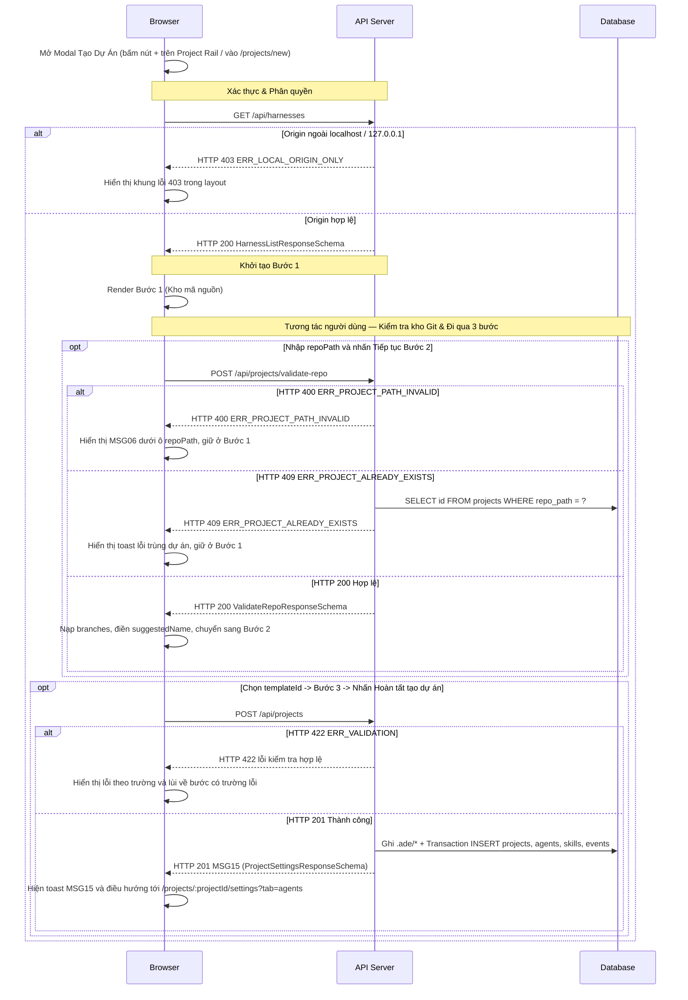

# UI-ST-01 - Modal Tạo Dự Án Mới (Create Project Wizard Modal)

| Trường | Giá trị |
| --- | --- |
| Mã màn hình | `UI-ST-01` |
| Tên màn hình | Modal Tạo Dự Án Mới (Create Project Wizard Modal) |
| Đường dẫn chốt | `specs/dd/settings/st-01/ui-wizard.md` |
| URL | `/projects/new` |
| Ngày tạo | 2026-10-31 |
| Ngày cập nhật | 2026-10-31 |

## TÓM TẮT

- **Mục tiêu**: Cho phép người dùng đăng ký một kho mã nguồn Git trên máy local vào ADE ngay trên Modal Tạo Dự Án 3 bước (`ade-modal-shell`, chiều rộng tối đa `720px`, toàn màn hình ở màn hình di động `< 768px`, `role="dialog"`, `aria-modal="true"`) đặt trên lớp phủ `--color-backdrop` đè lên nền Không gian Chat mà không xóa trắng màn hình thành trang độc lập, tự động sinh cấu hình `.ade/` khởi đầu và chuyển thẳng sang Modal Cài Đặt Dự Án tại tab `Agents`.
- **Actor**: Chủ dự án local (`usr_local`, vai trò `owner`) truy cập trên `localhost` hoặc `127.0.0.1` ở chế độ `ADE_MODE=solo`.
- **Trong phạm vi**: Mở Modal Tạo Dự Án khi nhấn nút icon `+` (`aria-label="Tạo dự án mới"`, `data-testid="add-project-btn"`) trên `Project Rail` hay điều hướng trực tiếp tới `/projects/new`; kiểm tra tính hợp lệ của `repoPath` (`POST /api/projects/validate-repo`), điền tên dự án, chọn nhánh mặc định và công tắc `Dùng hướng dẫn của repo`, chọn 1 trong 3 bộ mẫu agent, xem trạng thái sẵn sàng của Harness (`GET /api/harnesses`), gửi tạo dự án (`POST /api/projects`), chuyển tiếp sang `/projects/:projectId/settings?tab=agents` và đóng Modal bằng nút icon `×` (`aria-label="Đóng"`, `data-testid="close-project-wizard-btn"`) ở góc phải header hay phím `Escape`.
- **Ngoài phạm vi**: Chạy `git init` hộ người dùng trên thư mục chưa khởi tạo Git, sao chép kho từ máy chủ Git từ xa, hoặc tùy biến từng trường chi tiết của từng agent ngay trong trình thuật sĩ (thực hiện tại `UI-ST-02` sau khi tạo xong).
- **Giả định**: Thư mục kho mã nguồn do người dùng nhập đã tồn tại trên hệ thống tệp local của máy chạy Hub.
- **Câu hỏi mở**: Không có.

## Lịch sử sửa đổi

| Ver | Ngày | Tác giả | Thay đổi |
| --- | --- | --- | --- |
| 1.0 | 2026-10-31 | cuongph | Phát hành lần đầu cho Phase P5 (`settings`) |
| 1.1 | 2026-10-31 | cuongph | Đồng bộ kiến trúc Modal Tạo Dự Án (`ade-modal-shell`) đè lên nền Không gian Chat, góc phải header chỉ đặt nút đóng icon `×` (`aria-label="Đóng"`) và khôi phục URL kênh/thread đang mở theo Prototype |
| 1.2 | 2026-10-31 | cuongph | Đồng bộ `data-testid="add-project-btn"` với `UI-CH-01`, dùng token ngữ nghĩa `--color-human` / `--color-human-soft` cho khung cảnh báo chú ý và khớp tiêu đề `Feature` Gherkin |
| 1.3 | 2026-10-31 | cuongph | Bổ sung agent `@explorer` và `@planner` vào bộ mẫu Bước 2: `lead_coder_tester_qa` (Khuyên dùng — Đội ngũ đầy đủ, 6 agent, 8 skill) và `planner_coder` (Gọn nhẹ — Explorer + Planner + Coder, 3 agent, 6 skill) |

---

## BỐ CỤC

```text
+------------------------------------------------------------------------------------------------------+
| [Project Rail] | [Nền Không gian Chat phủ lớp mờ --color-backdrop]                                   |
|  [PRJ]         |   +--- Modal Tạo Dự Án (.ade-modal-shell · max-width: 720px · role="dialog") -----+ |
|  [ + ]         |   | Tạo dự án mới                                                           [ × ] | |
|                |   | (1) Kho mã nguồn  ─────>  (2) Mẫu Agent  ─────>  (3) Kiểm tra Harness         | |
|                |   +-------------------------------------------------------------------------------+ |
|                |   | [BƯỚC 1: KHO MÃ NGUỒN]                                                        | |
|                |   | Đường dẫn kho mã nguồn *                                                      | |
|                |   | [ /Users/dev/my-app                                   ] [Kiểm tra kho Git]    | |
|                |   | Trạng thái: [Kho Git hợp lệ · Phát hiện CLAUDE.md]                            | |
|                |   |                                                                               | |
|                |   | Tên dự án *                        Nhánh mặc định *                           | |
|                |   | [ my-app                        ]  [ main                           v ]       | |
|                |   |                                                                               | |
|                |   | [ ] Dùng hướng dẫn của repo (CLAUDE.md / .claude/ của dự án)                  | |
|                |   |                                                           [Tiếp tục Bước 2 ->]| |
|                |   +-------------------------------------------------------------------------------+ |
|                |   | [BƯỚC 2: CHỌN BỘ MẪU AGENT KHỞI ĐẦU]                                          | |
|                |   | (o) Khuyên dùng — Đội ngũ đầy đủ (6 agent)                                    | |
|                |   |     Sinh @lead, @explorer, @planner, @tester, @qa (Claude) và @coder (Codex)  | |
|                |   | ( ) Gọn nhẹ — Explorer + Planner + Coder (3 agent)                            | |
|                |   |     Sinh @explorer (Claude), @planner (Claude), @coder (Codex)                | |
|                |   | ( ) Dự án trống (0 agent)                                                     | |
|                |   |     Chỉ tạo .ade/project.yaml và workflow feature, tự thêm agent sau          | |
|                |   | [<- Quay lại]                                             [Tiếp tục Bước 3 ->]| |
|                |   +-------------------------------------------------------------------------------+ |
|                |   | [BƯỚC 3: KIỂM TRA HARNESS TRÊN MÁY]                      [Làm mới trạng thái] | |
|  [ ⚙ ]         |   | | Harness     | Phiên bản | Hồ sơ ADE              | Đăng nhập | Profile    | | |
|                |   | | claude-code | 1.0.24    | ~/.ade/harness/claude  | Đã login  | sub-claude | | |
|                |   | | codex       | 0.42.0    | ~/.ade/harness/codex   | Đã login  | sub-chatgpt| | |
|                |   | [<- Quay lại]                                          [Hoàn tất tạo dự án]   | |
|                |   +-------------------------------------------------------------------------------+ |
+------------------------------------------------------------------------------------------------------+
```

---

## LOGIC

### I. Các phần tử (Items)

| STT | Tên logic | Loại đối tượng | Cột trong DB | Mô tả | Ghi chú |
| --- | --- | --- | --- | --- | --- |
| 1 | Khung Modal Tạo Dự Án (`ade-modal-shell`) | Hộp thoại Modal | — | Khung hộp thoại `role="dialog"`, `aria-modal="true"`, `max-width: 720px` (toàn màn hình ở màn hình `< 768px`) đặt trên lớp phủ `--color-backdrop` đè lên nền Không gian Chat, hiển thị tiêu đề `"Tạo dự án mới"` ở thanh đầu | `data-testid="project-wizard"` |
| 2 | Nút Đóng Modal icon `×` | Nút icon | — | Nút `.ade-icon-btn` mang ký hiệu `×` (`aria-label="Đóng"`) là nút duy nhất ở góc phải header của Modal (không đặt chữ `"Hủy"` trên header) | `data-testid="close-project-wizard-btn"`; hiển thị xuyên suốt 3 bước |
| 3 | Thanh bước (Stepper) | Thanh trạng thái | — | Hiển thị 3 bước: `1. Kho mã nguồn`, `2. Mẫu Agent`, `3. Kiểm tra Harness` | Đánh dấu đậm bước đang mở |
| 4 | Ô nhập Đường dẫn kho mã nguồn (`repoPath`) | Ô nhập | `projects.repo_path` | Nhập đường dẫn tuyệt đối tới thư mục kho Git trên máy local | Hiển thị ở Bước 1; bắt buộc |
| 5 | Nút Kiểm tra kho Git | Nút | — | Kích hoạt gọi `POST /api/projects/validate-repo` để xác minh kho Git và nạp danh sách nhánh | Hiển thị ở Bước 1 cạnh ô `repoPath` |
| 6 | Huy hiệu trạng thái kho Git | Nhãn trạng thái | — | Hiển thị `"Kho Git hợp lệ"` cùng chú thích có/không phát hiện `CLAUDE.md` sau khi kiểm tra đạt | Ẩn cho tới khi `API-1` trả HTTP `200` |
| 7 | Ô nhập Tên dự án (`projectName`) | Ô nhập | `projects.name` | Tên hiển thị của dự án; tự điền gợi ý từ `suggestedName` nếu đang rỗng | Hiển thị ở Bước 1; ghi vào `.ade/project.yaml` |
| 8 | Hộp chọn Nhánh mặc định (`defaultBranch`) | Combobox | `projects.default_branch` | Cho phép chọn nhánh từ danh sách `branches` trả về bởi `API-1` và cho phép gõ tay tên nhánh (mặc định `"main"`) | Hiển thị ở Bước 1; ghi vào `.ade/project.yaml` |
| 9 | Công tắc Dùng hướng dẫn của kho mã nguồn (`useRepoInstructions`) | Công tắc bật/tắt | `projects.use_repo_instructions` | Bật (`true`) để driver Claude dùng `settingSources: ["project"]`; tắt (`false`, mặc định) để dùng `settingSources: []` | Hiển thị ở Bước 1; ghi vào `.ade/project.yaml` |
| 10 | Nút Tiếp tục Bước 2 | Nút | — | Kiểm tra hợp lệ Bước 1 + kho Git rồi chuyển sang Bước 2 | Hiển thị ở cuối Bước 1 |
| 11 | Nhóm thẻ chọn Bộ mẫu agent (`templateId`) | Radio card | — | Chọn 1 trong 3 giá trị: `lead_coder_tester_qa` (`Khuyên dùng — Đội ngũ đầy đủ`, 6 agent + 8 skill), `planner_coder` (`Gọn nhẹ — Explorer + Planner + Coder`, 3 agent + 6 skill), `empty` (`Dự án trống`, 0 agent) | Hiển thị ở Bước 2; mặc định chọn `lead_coder_tester_qa` |
| 12 | Khung xem trước danh sách Agent mẫu | Danh sách chỉ đọc | `agents.handle` | Liệt kê `handle`, `displayName`, `harness`, vai trò và chế độ quyền (`write = false, canBeMain = true` cho `@lead`, `@explorer`, `@planner`; `write = true` cho `@coder`, `@tester`; chỉ đọc cho `@qa`) của các agent sẽ được tạo theo `templateId` đang chọn | Hiển thị ở Bước 2; `data-testid="wizard-template-preview"` |
| 13 | Nút Quay lại | Nút | — | Giảm `currentStep` đi `1` đơn vị và giữ nguyên toàn bộ dữ liệu đã nhập trên biểu mẫu | Hiển thị ở Bước 2 và Bước 3 |
| 14 | Nút Tiếp tục Bước 3 | Nút | — | Chuyển từ Bước 2 sang Bước 3 | Hiển thị ở cuối Bước 2 |
| 15 | Bảng trạng thái Harness | Bảng dữ liệu | `runners.harnesses_available_json` | Hiển thị `displayName`, `version`, `configDir`, trạng thái `loggedIn` và `availableProfiles` của `claude-code`, `codex` | Hiển thị ở Bước 3; chỉ đọc |
| 16 | Khung cảnh báo thiếu Harness | Khung cảnh báo chú ý | — | Khung cảnh báo chú ý dùng cặp token `--color-human` / `--color-human-soft` (`role="status"`) nhắc người dùng nếu một agent trong mẫu đã chọn yêu cầu harness đang có `detected = false` hay `loggedIn = false` | Chỉ cảnh báo, không khóa nút tạo dự án |
| 17 | Nút Làm mới trạng thái | Nút | — | Gọi lại `GET /api/harnesses` để cập nhật phiên bản và trạng thái đăng nhập | Hiển thị ở góc trên Bước 3 |
| 18 | Nút Hoàn tất tạo dự án | Nút | — | Gửi `POST /api/projects` để sinh `.ade/` và đăng ký dự án | Hiển thị ở cuối Bước 3 |

### II. Kiểm tra hợp lệ (Validate)

> Toàn bộ quy tắc kiểm tra phía client dùng chung `collectRules("settings.project.create")` trong `packages/shared/src/validation-catalog.ts`. Tham chiếu [message.md](../../../message.md).

| ID | Tên logic | Tên | Quy tắc kiểm tra | Mã message | Message |
| --- | --- | --- | --- | --- | --- |
| V-01 | Đường dẫn kho mã nguồn | `repoPath` | `required` | `MSG01` | Đường dẫn kho mã nguồn là bắt buộc. |
| V-02 | Đường dẫn kho mã nguồn | `repoPath` | `max:1024` | `MSG02` | Đường dẫn kho mã nguồn không được vượt quá 1024 ký tự. |
| V-03 | Tên dự án | `projectName` | `required` | `MSG01` | Tên dự án là bắt buộc. |
| V-04 | Tên dự án | `projectName` | `max:100` | `MSG02` | Tên dự án không được vượt quá 100 ký tự. |
| V-05 | Nhánh mặc định | `defaultBranch` | `required` | `MSG01` | Nhánh mặc định là bắt buộc. |
| V-06 | Nhánh mặc định | `defaultBranch` | `max:100` | `MSG02` | Nhánh mặc định không được vượt quá 100 ký tự. |
| V-07 | Bộ mẫu agent | `templateId` | `in:lead_coder_tester_qa,planner_coder,empty` | `MSG04` | Định dạng Bộ mẫu agent không hợp lệ. |
| V-08 | Dùng hướng dẫn của kho mã nguồn | `useRepoInstructions` | `boolean` | `MSG04` | Định dạng Dùng hướng dẫn của kho mã nguồn không hợp lệ. |

### III. Logic

#### Thông tin màn hình
- **Phân quyền**: Local Origin Guard (`Origin` / `Host` thuộc `localhost` hoặc `127.0.0.1` ở `ADE_MODE=solo`) · Actor `usr_local` (`role = owner`).
- **Mẫu URL**: `/projects/new`
- **API chính** (chi tiết tại [specs/dd/settings/st-01/api-settings.md](./api-settings.md)):

| STT | Method | Path | Mục đích |
| --- | --- | --- | --- |
| 1 | `POST` | `/api/projects/validate-repo` | Kiểm tra kho Git hợp lệ, chưa trùng lặp và lấy danh sách nhánh (`API-ST-01/API-1`) |
| 2 | `GET` | `/api/harnesses` | Tải danh sách harness khả dụng và trạng thái đăng nhập ở Bước 3 (`API-ST-01/API-13`) |
| 3 | `POST` | `/api/projects` | Sinh cây cấu hình `.ade/` và đăng ký dự án mới (`API-ST-01/API-2`) |

#### 1. Kiểm tra phân quyền

| ID | Mô tả |
| --- | --- |
| P-01 | Khi mở Modal Tạo Dự Án tại `/projects/new` từ `localhost` hoặc `127.0.0.1` ở chế độ `ADE_MODE=solo`, màn hình phải gán ngữ cảnh người dùng `usr_local` (`role = owner`) và hiển thị Modal Tạo Dự Án đè lên nền Không gian Chat. |
| P-02 | Nếu lời gọi khởi tạo `GET /api/harnesses` trả HTTP `403` `ERR_LOCAL_ORIGIN_ONLY`, thì màn hình phải hiển thị khung lỗi 403 trong layout và ẩn toàn bộ các bước của Modal Tạo Dự Án. |

#### 2. Khởi tạo màn hình

| ID | Mô tả |
| --- | --- |
| I-01 | Khi người dùng nhấn nút icon `+` (`aria-label="Tạo dự án mới"`, `data-testid="add-project-btn"`) trên `Project Rail` hay truy cập trực tiếp `/projects/new`, ứng dụng phải hiển thị Modal Tạo Dự Án (`role="dialog"`, `aria-modal="true"`) đè lên nền Không gian Chat ở Bước 1 (`currentStep = 1`) với `repoPath = ""`, `projectName = ""`, `defaultBranch = "main"`, `useRepoInstructions = false` và `templateId = "lead_coder_tester_qa"`. |
| I-02 | Khi vừa mở Modal Tạo Dự Án, ứng dụng phải gọi nền `GET /api/harnesses` để chuẩn bị sẵn dữ liệu cho Bước 3. |

#### 3. Xử lý hành vi sự kiện

> Nội dung message của các mã trong mục này: xem [message.md](../../../message.md).

| ID | Sự kiện | Kích hoạt | Mô tả |
| --- | --- | --- | --- |
| E-01 | Bấm Kiểm tra kho Git | Khi nhấn nút `Kiểm tra kho Git` ở Bước 1 | Phải kiểm tra `V-01`, `V-02` trên `repoPath`; nếu đạt thì gọi `POST /api/projects/validate-repo` với `{ repoPath }`. |
| E-02 | Kho Git hợp lệ (từ nút Kiểm tra) | Khi `POST /api/projects/validate-repo` trả HTTP `200` sau sự kiện `E-01` | Phải hiển thị huy hiệu `"Kho Git hợp lệ"`, nạp `branches` vào hộp chọn `Nhánh mặc định` và tự điền `suggestedName` vào ô `Tên dự án` nếu ô `Tên dự án` đang trống. |
| E-03 | Đường dẫn không phải kho Git | Nếu `POST /api/projects/validate-repo` hoặc `POST /api/projects` trả HTTP `400` `ERR_PROJECT_PATH_INVALID` | Phải hiển thị lỗi `MSG06` (`"Đường dẫn Đường dẫn kho mã nguồn không tồn tại hoặc không phải kho Git hợp lệ."`) ngay dưới ô `repoPath` và giữ màn hình ở Bước 1. |
| E-04 | Kho Git đã tồn tại trong ADE | Nếu `POST /api/projects/validate-repo` hoặc `POST /api/projects` trả HTTP `409` `ERR_PROJECT_ALREADY_EXISTS` | Phải hiển thị toast tiếng Việt `"Kho mã nguồn này đã được thêm vào ADE."` qua `translateApiError` và giữ màn hình ở Bước 1. |
| E-05 | Bấm Tiếp tục Bước 2 | Khi nhấn nút `Tiếp tục Bước 2` ở Bước 1 | Phải kiểm tra `V-01`..`V-06` phía client; nếu hợp lệ và `repoPath` hiện tại chưa được xác nhận qua `API-1` thì phải gọi `POST /api/projects/validate-repo` trước, chỉ khi `API-1` đạt HTTP `200` mới chuyển `currentStep = 2`. |
| E-06 | Chọn bộ mẫu Agent | Khi nhấn chọn một thẻ trong nhóm `templateId` ở Bước 2 | Phải cập nhật `templateId` và làm mới khung xem trước danh sách agent sẽ được sinh ra trong `.ade/agents/`. |
| E-07 | Bấm Tiếp tục Bước 3 | Khi nhấn nút `Tiếp tục Bước 3` ở Bước 2 | Phải kiểm tra `V-07` trên `templateId`, chuyển `currentStep = 3` và hiển thị khung cảnh báo chú ý dùng cặp token `--color-human` / `--color-human-soft` (`role="status"`) đối với các harness của bộ mẫu đã chọn có `detected = false` hay `loggedIn = false`. |
| E-08 | Bấm Quay lại | Khi nhấn nút `Quay lại` ở Bước 2 hoặc Bước 3 | Phải giảm `currentStep` đi `1` và giữ nguyên toàn bộ giá trị đã nhập trên trình thuật sĩ. |
| E-09 | Bấm Làm mới trạng thái Harness | Khi nhấn nút `Làm mới trạng thái` ở Bước 3 | Phải gọi lại `GET /api/harnesses` và cập nhật bảng trạng thái Harness trên Bước 3. |
| E-10 | Bấm Hoàn tất tạo dự án | Khi nhấn nút `Hoàn tất tạo dự án` ở Bước 3 | Phải vô hiệu hóa nút bấm để chống gửi đúp và gọi `POST /api/projects` với `{ projectName, repoPath, defaultBranch, templateId, useRepoInstructions }`. |
| E-11 | Tạo dự án thành công | Khi `POST /api/projects` trả HTTP `201` | Phải hiển thị toast `MSG15` (`"Đã tạo thành công."`), làm mới danh sách dự án trên `Project Rail` và chuyển sang Modal Cài Đặt Dự Án tại `/projects/:projectId/settings?tab=agents`. |
| E-12 | Lỗi kiểm tra hợp lệ từ server | Nếu `POST /api/projects` trả HTTP `422` `ERR_VALIDATION` | Phải gắn thông báo lỗi dưới từng trường theo `details.fieldErrors`, mở khóa nút `Hoàn tất tạo dự án` và đưa `currentStep` về bước chứa trường bị lỗi. |
| E-13 | Đóng Modal Tạo Dự Án (khi đã có dự án) | Khi người dùng nhấn nút đóng icon `×` (`aria-label="Đóng"`) ở góc phải header hay nhấn phím `Escape` trong lúc Hub đã có dự án | Phải đóng Modal Tạo Dự Án mà không ghi bất kỳ tệp nào vào `repoPath` và khôi phục URL về kênh/thread đang mở trước đó (nếu truy cập trực tiếp từ `/projects/new` thì điều hướng về `/projects/:firstProjectId/channels/:firstChannelId`). |
| E-14 | Giữ mở Modal khi Hub chưa có dự án nào | Khi người dùng nhấn nút đóng icon `×` (`aria-label="Đóng"`) hay nhấn phím `Escape` trong lúc danh sách dự án của Hub đang rỗng | Phải giữ mở Modal Tạo Dự Án ở bước hiện tại và giữ nguyên URL `/projects/new` để hoàn tất khởi tạo dự án đầu tiên. |

#### 4. Xử lý phía server

> Chi tiết đầy đủ luồng thực thi server và bảng DB nằm tại [specs/dd/settings/st-01/api-settings.md](./api-settings.md).

**API-1: POST /api/projects/validate-repo**

| ID | Bước | Mô tả |
| --- | --- | --- |
| S1-01 | Kiểm tra phân quyền | Kiểm tra Local Origin Guard; nếu vi phạm thì phải trả HTTP `403` `ERR_LOCAL_ORIGIN_ONLY`. |
| S1-02 | Kiểm tra đầu vào | Kiểm tra `repoPath` theo `V-01`, `V-02`; nếu thất bại thì phải trả HTTP `422` `ERR_VALIDATION`. |
| S1-03 | Kiểm tra kho Git & trùng lặp | Nếu không phải kho Git hợp lệ thì trả HTTP `400` `ERR_PROJECT_PATH_INVALID`; nếu trùng `projects.repo_path` thì trả HTTP `409` `ERR_PROJECT_ALREADY_EXISTS`; nếu đạt thì trả HTTP `200` `ValidateRepoResponseSchema`. |

**API-2: GET /api/harnesses**

| ID | Bước | Mô tả |
| --- | --- | --- |
| S2-01 | Kiểm tra phân quyền | Kiểm tra Local Origin Guard; nếu vi phạm thì phải trả HTTP `403` `ERR_LOCAL_ORIGIN_ONLY`. |
| S2-02 | Dò trạng thái Harness | Kiểm tra phiên bản và hồ sơ `~/.ade/harness/*` của `claude-code`, `codex`, rồi trả HTTP `200` `HarnessListResponseSchema`. |

**API-3: POST /api/projects**

| ID | Bước | Mô tả |
| --- | --- | --- |
| S3-01 | Kiểm tra phân quyền & đầu vào | Kiểm tra Local Origin Guard (`403`) và kiểm tra `CreateProjectWizardInputSchema` (`V-01`..`V-08`, sai trả `422` `ERR_VALIDATION`). |
| S3-02 | Kiểm tra kho Git & trùng lặp | Kiểm tra lại kho Git (`400` `ERR_PROJECT_PATH_INVALID`) và tính duy nhất của `repo_path` (`409` `ERR_PROJECT_ALREADY_EXISTS`). |
| S3-03 | Khởi tạo `.ade/` & ghi DB | Ghi `.ade/project.yaml`, `.ade/agents/*.yaml`, `.ade/skills/*/SKILL.md`, `.ade/workflows/feature.yaml`; ghi `projects`, `project_members`, `channels` (`description = ""`), `channel_members`, cache `agents`/`skills` và sự kiện `project.registered` + `channel.created`; trả HTTP `201` `ProjectSettingsResponseSchema`. |

### IV. Sơ đồ luồng



---

## TIÊU CHÍ CHẤP NHẬN

```gherkin
Feature: UI-ST-01 — Modal Tạo Dự Án Mới

  Background:
    Given người dùng đang mở màn hình "/projects/new" trên "http://127.0.0.1:5173"
    And kho Git trống hợp lệ đã được tạo tại "/tmp/sample-repo" với nhánh "main"

  Scenario: AC-UI-ST-01-01 — Mở Modal Tạo Dự Án đè lên nền Không gian Chat và kiểm tra kho Git hợp lệ tự điền tên dự án (nguồn: P-01, I-01, I-02, E-01, E-02; nghiệm thu: e2e/p5-wizard.spec.ts)
    Given Modal Tạo Dự Án `role="dialog"` đang hiển thị trên lớp phủ `--color-backdrop` với duy nhất nút đóng icon `×` ở góc phải header, kho "/tmp/sample-repo" chưa được đăng ký, ô Tên dự án đang rỗng và ô Đường dẫn kho mã nguồn có giá trị "/tmp/sample-repo"
    When người dùng nhấn nút "Kiểm tra kho Git"
    Then hiển thị huy hiệu "Kho Git hợp lệ"
    And ô Tên dự án tự điền giá trị "sample-repo"
    And hộp chọn Nhánh mặc định chứa nhánh "main"

  Scenario: AC-UI-ST-01-02 — Hoàn tất tạo dự án ở Bước 3 sinh cấu hình .ade/ và điều hướng vào tab Agents (nguồn: E-05, E-06, E-07, E-10, E-11; nghiệm thu: e2e/p5-wizard.spec.ts)
    Given người dùng đã xác nhận kho "/tmp/sample-repo" ở Bước 1, chọn mẫu "lead_coder_tester_qa" ở Bước 2 và đang ở Bước 3
    When người dùng nhấn nút "Hoàn tất tạo dự án"
    Then hiển thị toast MSG15 "Đã tạo thành công."
    And trình duyệt điều hướng tới URL khớp "/projects/prj_" kèm "?tab=agents"
    And tệp "/tmp/sample-repo/.ade/project.yaml", 6 tệp agent mẫu ("lead.yaml", "explorer.yaml", "planner.yaml", "coder.yaml", "tester.yaml", "qa.yaml") và 8 thư mục skill khởi đầu được tạo trên đĩa

  Scenario: AC-UI-ST-01-03 — Chặn truy cập khi API trả HTTP 403 ERR_LOCAL_ORIGIN_ONLY (nguồn: P-02; nghiệm thu: e2e/p5-wizard.spec.ts)
    Given lời gọi khởi tạo `GET /api/harnesses` trả HTTP 403 với mã lỗi "ERR_LOCAL_ORIGIN_ONLY"
    When màn hình "/projects/new" hoàn tất tải lần đầu
    Then màn hình hiển thị khung lỗi 403 và ẩn biểu mẫu Bước 1

  Scenario: AC-UI-ST-01-04 — Hiển thị lỗi MSG06 dưới ô repoPath khi thư mục không phải kho Git (nguồn: E-03; nghiệm thu: e2e/p5-wizard.spec.ts)
    Given thư mục "/tmp/plain-dir" tồn tại nhưng chưa khởi tạo ".git" và ô Đường dẫn kho mã nguồn có giá trị "/tmp/plain-dir"
    When người dùng nhấn nút "Kiểm tra kho Git"
    Then hiển thị thông báo MSG06 dưới ô Đường dẫn kho mã nguồn
    And trình thuật sĩ vẫn ở Bước 1

  Scenario: AC-UI-ST-01-05 — Hiển thị toast lỗi khi kho mã nguồn đã được đăng ký trước đó (nguồn: E-04; nghiệm thu: e2e/p5-wizard.spec.ts)
    Given dự án "prj_existing" đã quản lý đường dẫn "/tmp/sample-repo" và ô Đường dẫn kho mã nguồn có giá trị "/tmp/sample-repo"
    When người dùng nhấn nút "Kiểm tra kho Git"
    Then hiển thị toast "Kho mã nguồn này đã được thêm vào ADE."
    And trình thuật sĩ vẫn ở Bước 1

  Scenario Outline: AC-UI-ST-01-06 — Kiểm tra hợp lệ các trường ở Bước 1 trước khi chuyển bước (nguồn: V-01, V-02, V-03, V-04, V-05, V-06, E-05; nghiệm thu: e2e/p5-wizard.spec.ts)
    Given ô Đường dẫn kho mã nguồn mang giá trị `<repoPath>`, ô Tên dự án mang giá trị `<projectName>` và ô Nhánh mặc định mang giá trị `<defaultBranch>`
    When người dùng nhấn nút "Tiếp tục Bước 2"
    Then hiển thị thông báo mã `<msg>` dưới trường bị lỗi
    But không chuyển sang Bước 2

    Examples:
      | repoPath            | projectName         | defaultBranch       | msg   |
      |                     | Demo                | main                | MSG01 |
      | <chuỗi 1025 ký tự>  | Demo                | main                | MSG02 |
      | /tmp/sample-repo    |                     | main                | MSG01 |
      | /tmp/sample-repo    | <chuỗi 101 ký tự>   | main                | MSG02 |
      | /tmp/sample-repo    | Demo                |                     | MSG01 |
      | /tmp/sample-repo    | Demo                | <chuỗi 101 ký tự>   | MSG02 |

  Scenario: AC-UI-ST-01-07 — Nút Quay lại giữ nguyên toàn bộ dữ liệu đã chọn giữa các bước (nguồn: E-08; nghiệm thu: e2e/p5-wizard.spec.ts)
    Given người dùng đang ở Bước 3 với Tên dự án "Dự án Alpha" và mẫu "planner_coder"
    When người dùng nhấn nút "Quay lại"
    Then màn hình hiển thị Bước 2 và thẻ mẫu "planner_coder" vẫn đang được chọn

  Scenario: AC-UI-ST-01-08 — Nút Làm mới trạng thái ở Bước 3 tải lại danh sách Harness (nguồn: E-09; nghiệm thu: e2e/p5-wizard.spec.ts)
    Given người dùng đang ở Bước 3 của trình thuật sĩ
    When người dùng nhấn nút "Làm mới trạng thái"
    Then ứng dụng gọi lại `GET /api/harnesses` và cập nhật bảng trạng thái Harness

  Scenario: AC-UI-ST-01-09 — Nhấn nút đóng icon × đóng Modal Tạo Dự Án và khôi phục URL kênh đang mở không tạo thư mục .ade (nguồn: E-13; nghiệm thu: e2e/p5-wizard.spec.ts)
    Given dự án "prj_01" có kênh "chn_general" đang mở tại "/projects/prj_01/channels/chn_general", người dùng đã nhấn nút "Tạo dự án mới" (`data-testid="add-project-btn"`) trên Project Rail để mở Modal tại "/projects/new" và nhập "/tmp/sample-repo" ở Bước 1
    When người dùng nhấn nút "Đóng" ở góc phải header của Modal Tạo Dự Án
    Then Modal Tạo Dự Án đóng lại và trình duyệt khôi phục URL về "/projects/prj_01/channels/chn_general"
    And thư mục "/tmp/sample-repo/.ade" không tồn tại trên đĩa

  Scenario: AC-UI-ST-01-10 — Chọn thẻ bộ mẫu Agent ở Bước 2 cập nhật khung xem trước danh sách agent sẽ sinh (nguồn: E-06; nghiệm thu: e2e/p5-wizard.spec.ts)
    Given người dùng đang ở Bước 2 với thẻ mẫu mặc định "lead_coder_tester_qa" hiển thị 6 agent xem trước ("@lead", "@explorer", "@planner", "@coder", "@tester", "@qa")
    When người dùng nhấn chọn thẻ mẫu "planner_coder"
    Then thẻ mẫu "planner_coder" chuyển sang trạng thái đang chọn
    And khung xem trước danh sách Agent mẫu cập nhật hiển thị đúng 3 agent "@explorer", "@planner" và "@coder"

  Scenario: AC-UI-ST-01-11 — Chuyển sang Bước 3 hiển thị khung cảnh báo chú ý khi thiếu hoặc chưa đăng nhập Harness (nguồn: E-07; nghiệm thu: e2e/p5-wizard.spec.ts)
    Given người dùng đang ở Bước 2 với mẫu "lead_coder_tester_qa" và dữ liệu `GET /api/harnesses` báo "codex" có `loggedIn` bằng false
    When người dùng nhấn nút "Tiếp tục Bước 3"
    Then trình thuật sĩ chuyển sang Bước 3
    And khung cảnh báo chú ý (`role="status"`) hiển thị nhắc harness "codex" chưa đăng nhập trong hồ sơ ADE nhưng nút "Hoàn tất tạo dự án" vẫn mở khóa

  Scenario Outline: AC-UI-ST-01-12 — Nhận HTTP 422 từ POST /api/projects lùi currentStep về bước chứa trường bị lỗi (nguồn: V-07, V-08, E-12; nghiệm thu: e2e/p5-wizard.spec.ts)
    Given người dùng đang ở Bước 3 và API `POST /api/projects` trả HTTP 422 `ERR_VALIDATION` với `details.fieldErrors.<field>` mang thông báo mã `<msg>`
    When người dùng nhấn nút "Hoàn tất tạo dự án"
    Then trình thuật sĩ lùi `currentStep` về Bước `<expectedStep>`
    And hiển thị thông báo mã `<msg>` dưới trường `<field>` và mở khóa lại nút "Hoàn tất tạo dự án"

    Examples:
      | field               | msg   | expectedStep |
      | templateId          | MSG04 | 2            |
      | useRepoInstructions | MSG04 | 1            |
      | projectName         | MSG01 | 1            |

  Scenario: AC-UI-ST-01-13 — Giữ mở Modal Tạo Dự Án khi nhấn phím Escape trong lúc Hub chưa có dự án nào (nguồn: E-14; nghiệm thu: e2e/p5-wizard.spec.ts)
    Given danh sách dự án của Hub đang rỗng và người dùng đang mở "/projects/new" ở Bước 1
    When người dùng nhấn phím "Escape"
    Then Modal Tạo Dự Án vẫn hiển thị ở Bước 1 và URL giữ nguyên "/projects/new"
```

---

## Màn hình liên quan

| Mã màn hình | Tên | Quan hệ |
| --- | --- | --- |
| `UI-ST-02` | Modal Cài Đặt Dự Án ([specs/dd/settings/st-02/ui-settings.md](../st-02/ui-settings.md)) | Đích điều hướng `/projects/:projectId/settings?tab=agents` ngay sau khi hoàn tất Bước 3 |
| `UI-CH-01` | Không gian Chat Dự án (`specs/dd/chat/ch-01/ui-chat.md`) | Mở Modal Tạo Dự Án đè lên nền Không gian Chat từ nút icon `+` (`aria-label="Tạo dự án mới"`, `data-testid="add-project-btn"`) trên `Project Rail` |
