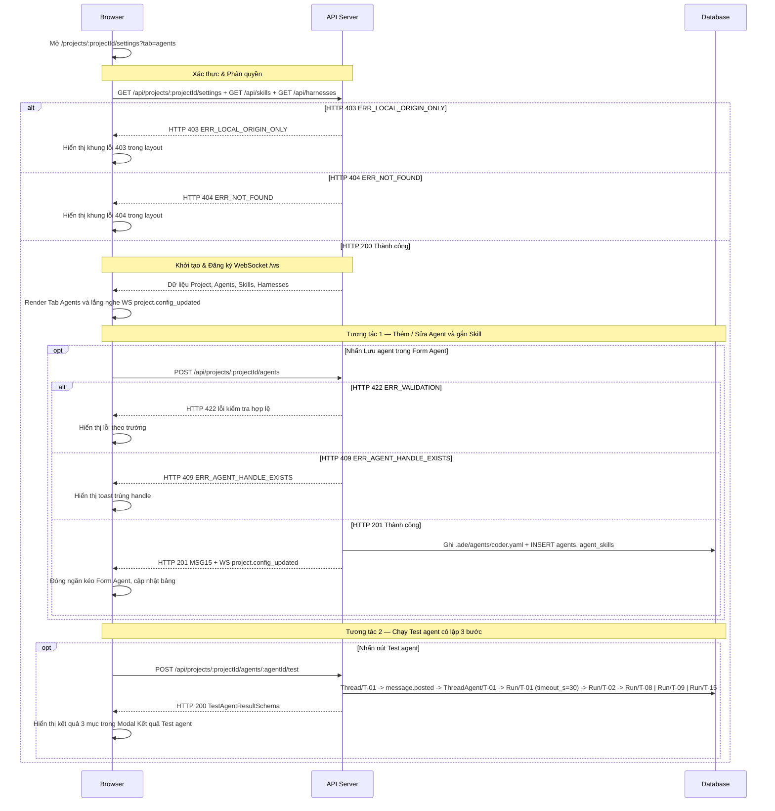

# UI-ST-02 - Modal Cài Đặt Dự Án — Chung, Agent, Skill & Harnesses (Project Settings Modal)

| Trường | Giá trị |
| --- | --- |
| Mã màn hình | `UI-ST-02` |
| Tên màn hình | Modal Cài Đặt Dự Án — Chung, Agent, Skill & Harnesses (Project Settings Modal) |
| Đường dẫn chốt | `specs/dd/settings/st-02/ui-settings.md` |
| URL | `/projects/:projectId/settings` |
| Ngày tạo | 2026-10-31 |
| Ngày cập nhật | 2026-10-31 |

## TÓM TẮT

- **Mục tiêu**: Cho phép người dùng cấu hình toàn diện một dự án ADE ngay trên Modal Cài Đặt Dự Án 6 tab (`ade-modal-shell`, chiều rộng tối đa `1040px`, chiều cao tối đa `88vh`, toàn màn hình ở màn hình di động `< 768px`, `role="dialog"`, `aria-modal="true"`) đặt trên lớp phủ `--color-backdrop` đè lên nền Không gian Chat, tự động ghi chuẩn hóa xuống thư mục `.ade/` trên đĩa, nhận cập nhật tức thời từ file watcher và chạy thử agent cô lập ngay trên giao diện.
- **Actor**: Chủ dự án local (`usr_local`, vai trò `owner`) truy cập trên `localhost` hoặc `127.0.0.1` ở chế độ `ADE_MODE=solo`.
- **Trong phạm vi**: Mở Modal Cài Đặt Dự Án từ nút icon bánh răng tối giản `⚙` (`aria-label="Cài đặt dự án"`, `data-testid="project-settings-btn"`) ở đáy `Project Rail` hay liên kết sâu `/projects/:projectId/settings?tab=general|agents|skills|harnesses` (chuẩn hóa `?tab=harness` thành `?tab=harnesses`, và chuẩn hóa `?tab=` bỏ trống, thuộc tab khóa Phase P6 `workflows`/`workflow`/`memory` hay giá trị không hợp lệ về `?tab=general`); Tab `General` (tên dự án, nhánh mặc định, main agent mặc định, workflow mặc định, công tắc `Dùng hướng dẫn của repo`); Tab `Agents` (thêm, sửa, nhân bản, bật/tắt `enabled`, xóa, hiển thị `@handle` bằng chip kỹ thuật `.ade-mention--agent`, gắn skill, tạo skill tại chỗ, cảnh báo vượt `8` skill, chạy `Test agent` 3 bước); Tab `Skills` (danh sách skill `Project` và `Global`, trình soạn `SKILL.md` có kiểm tra `MSG08` và cảnh báo shell script, xóa, import từ `Thư mục`/`Tệp ZIP`/`Git URL`/`Sao chép từ Global`); Tab `Harnesses` (bảng chỉ đọc phiên bản, trạng thái đăng nhập hồ sơ ADE và `credential_profile`); đóng Modal bằng nút icon `×` (`aria-label="Đóng"`, `data-testid="close-project-settings-btn"`) hay phím `Escape` (ưu tiên đóng lớp hộp thoại con / ngăn con trên cùng trước); tự động làm mới giao diện trong dưới `2000 ms` khi nhận sự kiện WebSocket `project.config_updated`.
- **Ngoài phạm vi**: Nội dung Tab `Memory` (soạn `.ade/memory/*.md`, duyệt `propose_memory`) và Tab `Workflows` (trình soạn `.ade/workflows/*.yaml`) thuộc tài liệu `UI-MM-01` (`specs/dd/memory/mm-01/ui-memory-workflow.md`) ở Phase P6; đổi đường dẫn `repoPath` của dự án đã tạo; nhập hay truyền token đăng nhập của Claude/Codex qua trình duyệt.
- **Giả định**: Dự án `:projectId` đã được đăng ký qua `UI-ST-01` hay bộ đọc `.ade/` khi khởi động Hub.
- **Câu hỏi mở**: Không có.

## Lịch sử sửa đổi

| Ver | Ngày | Tác giả | Thay đổi |
| --- | --- | --- | --- |
| 1.0 | 2026-10-31 | cuongph | Phát hành lần đầu cho Phase P5 (`settings`) |
| 1.1 | 2026-10-31 | cuongph | Đồng bộ kiến trúc Modal Cài Đặt Dự Án 6 tab (`ade-modal-shell`) đè lên nền Không gian Chat, nút đóng icon `×` duy nhất ở góc phải header, chip kỹ thuật `.ade-mention--agent` cho `@handle` và đồng bộ hai chiều `?tab=` theo Prototype |
| 1.2 | 2026-10-31 | cuongph | Đồng bộ `project-settings-btn`, khung WebSocket `project.config_updated`, token cảnh báo ngữ nghĩa, chuẩn hóa `?tab=` ở Phase P5 và thứ tự ưu tiên phím `Escape` khi đang mở hộp thoại/ngăn con |
| 1.3 | 2026-10-31 | cuongph | Minh họa `@explorer` và `@planner` trên bảng Agents cùng quy ước cấu hình quyền `write = false`, `canBeMain = true` cho agent chỉ đọc làm Main Agent |

---

## BỐ CỤC

```text
+--------------------------------------------------------------------------------------------------------+
| [Project Rail] | [Nền Không gian Chat phủ lớp mờ --color-backdrop]                                     |
|  [PRJ]         |   +--- Modal Cài Đặt Dự Án (.ade-modal-shell · 1040px × 88vh · role="dialog") ------+ |
|  [ + ]         |   | Cấu hình dự án: Demo App                                                  [ × ] | |
|                |   | [Dải cảnh báo lỗi .ade/ (.ade-panel--bad, role="alert"): coder.yaml sai trường] | |
|                |   | [General] [Agents] [Skills] [Workflows (P6)] [Memory (P6)] [Harnesses]          | |
|                |   +---------------------------------------------------------------------------------+ |
|                |   | TAB 1 — GENERAL (?tab=general)                                                  | |
|                |   |   Tên dự án *          [ Demo App                   ]                           | |
|                |   |   Đường dẫn kho Git    [ /Users/dev/demo-app        ] (chỉ đọc)                 | |
|                |   |   Nhánh mặc định *     [ main                     v ]                           | |
|                |   |   Main agent mặc định  [ @lead                    v ]                           | |
|                |   |   Workflow mặc định *  [ feature                  v ]                           | |
|                |   |   [x] Dùng hướng dẫn của repo (nạp CLAUDE.md và .claude/ của dự án cho Claude)  | |
|                |   |                                                             [Lưu thay đổi]      | |
|                |   +---------------------------------------------------------------------------------+ |
|                |   | TAB 2 — AGENTS (?tab=agents)                                 [+ Thêm agent]     | |
|                |   |   | Avt | Handle (.ade-mention--agent) | Tên               | Harness     | Bật || |
|                |   |   | L   | [bot @lead]                  | Tech Lead         | claude-code | [x] || |
|                |   |   | E   | [bot @explorer]              | Codebase Explorer | claude-code | [x] || |
|                |   |   | P   | [bot @planner]               | Spec & Planner    | claude-code | [x] || |
|                |   |   | C   | [bot @coder]                 | Coder             | codex       | [x] || |
|                |   |   |     └─ Thao tác dòng: [Test agent] [Nhân bản] [Sửa] [Xóa]                   | |
|                |   |   +-- Ngăn kéo Form Cấu hình Agent -----------------------------------+ [ × ] + | |
|                |   |   | Handle * [@coder]  Tên hiển thị * [Coder]  Avatar [C]                     | | |
|                |   |   | Mô tả vai trò * [Viết code theo spec đã duyệt]                            | | |
|                |   |   | Harness * [codex v]  Model [gpt-5-codex v]  Hồ sơ xác thực * [sub-chatgpt]| | |
|                |   |   | Skills: [implement x] [global:write-tests x] [+ Skill]                    | | |
|                |   |   | [Khung cảnh báo chú ý (role="status") khi > 8 skill: tăng chi phí token]  | | |
|                |   |   | Quyền: [x] Ghi worktree (write)  [ ] Được làm Main (can_be_main)          | | |
|                |   |   | Giới hạn: max_depth [3]   budget_usd [5.00]   timeout_s [600]  [Lưu agent]| | |
|                |   |   +---------------------------------------------------------------------------+ | |
|                |   |   +-- Modal Kết quả Test agent ---------------------------------------+ [ × ] + | |
|                |   |   | 1. Khởi động Harness : [ĐẠT] claude-code 1.0.24 khởi động thành công      | | |
|                |   |   | 2. Nạp danh sách Skill: [ĐẠT] Đã nạp đủ: ade-basics, implement            | | |
|                |   |   | 3. Kết nối ADE MCP   : [ĐẠT] get_thread trả HTTP 200               [Đóng] | | |
|                |   |   +---------------------------------------------------------------------------+ | |
|                |   +---------------------------------------------------------------------------------+ |
|                |   | TAB 3 — SKILLS (?tab=skills)               [+ Tạo skill mới] [Import skill]     | |
|                |   |   Nhóm Project (.ade/skills): implement, deploy-sh ([Sửa] [Xóa])                | |
|                |   |   Nhóm Global (~/.ade/skills): write-tests ([Xem] [Sao chép vào dự án])         | |
|                |   |   Trình soạn SKILL.md + Modal Import Skill (header góc phải chỉ có icon [ × ])  | |
|                |   +---------------------------------------------------------------------------------+ |
|  [ ⚙ ]         |   | TAB 6 — HARNESSES (?tab=harnesses)                          [Làm mới trạng thái]| |
|                |   |   | Harness     | Phiên bản | Thư mục hồ sơ cô lập  | Trạng thái   | Profile  | | |
|                |   |   | claude-code | 1.0.24    | ~/.ade/harness/claude | Đã đăng nhập | sub-claude | |
|                |   |   | codex       | 0.42.0    | ~/.ade/harness/codex  | Đã đăng nhập | sub-chatgpt| |
|                |   +---------------------------------------------------------------------------------+ |
+--------------------------------------------------------------------------------------------------------+
```

---

## LOGIC

### I. Các phần tử (Items)

| STT | Tên logic | Loại đối tượng | Cột trong DB | Mô tả | Ghi chú |
| --- | --- | --- | --- | --- | --- |
| 1 | Khung Modal Cài Đặt Dự Án & Nút Đóng icon `×` | Hộp thoại Modal + Nút icon | `projects.name` | Khung hộp thoại `.ade-modal-shell` (`role="dialog"`, `aria-modal="true"`, `max-width: 1040px`, `max-height: 88vh`, toàn màn hình ở màn hình `< 768px`) đặt trên lớp phủ `--color-backdrop` đè lên nền Không gian Chat; thanh đầu hiển thị tên dự án bên trái và góc phải chỉ đặt duy nhất nút đóng icon `×` (`.ade-icon-btn`, `aria-label="Đóng"`, không đặt chữ `"Hủy"`) | `data-testid="project-settings-page"` và `data-testid="close-project-settings-btn"` |
| 2 | Dải cảnh báo lỗi cấu hình `.ade/` | Dải cảnh báo lỗi cấu hình | `projects.config_errors_json` | Dải cảnh báo `.ade-panel--bad` dùng cặp token `--color-bad` / `--color-bad-soft` (`role="alert"`) liệt kê tên tệp và trường bị sai cú pháp/schema trong `.ade/` | Chỉ hiển thị khi mảng `configErrors` khác rỗng |
| 3 | Thanh chuyển Tab (`General`, `Agents`, `Skills`, `Workflows`, `Memory`, `Harnesses`) | Thanh tab | — | Đồng bộ hai chiều với tham số `?tab=` trên URL (`general`, `agents`, `skills`, `harnesses`; chuẩn hóa bí danh `?tab=harness` thành `?tab=harnesses`, và chuẩn hóa `?tab=` bỏ trống, thuộc tab khóa Phase P6 `workflows`/`workflow`/`memory` hay giá trị lạ về `?tab=general`); 2 tab `Workflows (P6)` và `Memory (P6)` hiển thị ở trạng thái `disabled` trong Phase P5 | 4 tab hoạt động thuộc `UI-ST-02`; 2 tab `Workflows` và `Memory` mở khóa tại `UI-MM-01` ở Phase P6 |
| 4 | Ô nhập Tên dự án (`projectName`) | Ô nhập | `projects.name` | Sửa tên hiển thị dự án | Tab `General`; ghi vào `.ade/project.yaml` |
| 5 | Ô Đường dẫn kho Git (`repoPath`) | Ô chỉ đọc | `projects.repo_path` | Hiển thị đường dẫn tuyệt đối tới kho mã nguồn | Tab `General`; vô hiệu hóa chỉnh sửa |
| 6 | Hộp chọn Nhánh mặc định (`defaultBranch`) | Dropdown | `projects.default_branch` | Chọn nhánh từ `availableBranches` của kho Git | Tab `General`; ghi vào `.ade/project.yaml` |
| 7 | Hộp chọn Main agent mặc định (`defaultMainAgent`) | Dropdown | `projects.default_main_agent` | Chỉ liệt kê các agent có `canBeMain = true` và `enabled = true` (ví dụ `@lead`, `@explorer`, `@planner`), kèm tùy chọn `"Tự động theo mention đầu tiên"` (`null`) | Tab `General`; ghi vào `.ade/project.yaml` |
| 8 | Hộp chọn Workflow mặc định (`defaultWorkflow`) | Dropdown | `projects.workflow_id` | Liệt kê tên các workflow từ `.ade/workflows/*.yaml` | Tab `General`; ghi vào `.ade/project.yaml` |
| 9 | Công tắc Dùng hướng dẫn của repo (`useRepoInstructions`) | Công tắc bật/tắt | `projects.use_repo_instructions` | Bật (`true`) để driver Claude dùng `settingSources: ["project"]`; tắt (`false`) để dùng `settingSources: []` | Tab `General`; ghi vào `.ade/project.yaml` |
| 10 | Nút Lưu thay đổi (General) | Nút | — | Gửi `PATCH /api/projects/:projectId/general` | Tab `General` |
| 11 | Nút `+ Thêm agent` | Nút | — | Mở ngăn kéo Form cấu hình Agent ở chế độ tạo mới | Tab `Agents` |
| 12 | Bảng danh sách Agent | Bảng dữ liệu | `agents.id` | Hiển thị từng agent gồm `avatar`, chip kỹ thuật `@handle` dùng lớp `.ade-mention--agent` (`border-radius: var(--radius-chip)` `4px`, chữ và viền `--color-agent` trên nền `--color-agent-soft`, phông `--font-outlier` monospace kèm icon SVG `bot` `12x12` phía trước), `displayName`, `harness`, `model`, số lượng skill đang gắn, công tắc `enabled`, và cụm nút hành động | Tab `Agents` |
| 13 | Công tắc Bật/Tắt Agent (`enabled`) | Công tắc trên dòng | `agents.enabled` | Cho phép bật/tắt tức thời trạng thái hoạt động của agent | Tab `Agents`; gọi `PUT /api/projects/:projectId/agents/:agentId` |
| 14 | Nút `Test agent` | Nút trên dòng | — | Mở modal kiểm tra và gọi `POST /api/projects/:projectId/agents/:agentId/test`; khóa `disabled` khi `agents.enabled = false` | Tab `Agents` |
| 15 | Nút `Nhân bản` | Nút trên dòng | — | Mở Form cấu hình Agent điền sẵn bản sao của agent hiện tại với `handle = "@<slug>-copy"` | Tab `Agents` |
| 16 | Nút `Sửa` / Nút `Xóa` Agent | Nút trên dòng | — | Nút `Sửa` mở ngăn kéo Form Agent chế độ cập nhật; nút `Xóa` mở hộp thoại xác nhận xóa `.ade/agents/<slug>.yaml` | Tab `Agents` |
| 17 | Ô nhập Handle (`handle`) | Ô nhập | `agents.handle` | Định danh `@<slug>` duy nhất trong dự án | Form Agent; tự thêm tiền tố `@` nếu người dùng gõ thiếu |
| 18 | Ô nhập Tên hiển thị (`displayName`) & Avatar (`avatar`) | Ô nhập | `agents.display_name`, `agents.avatar` | Tên hiển thị và ký hiệu đại diện của agent | Form Agent |
| 19 | Ô nhập Mô tả vai trò (`role`) | Ô văn bản nhiều dòng | `agents.role` | Nội dung hướng dẫn vai trò (system prompt) của agent | Form Agent |
| 20 | Hộp chọn Harness (`harness`) | Dropdown | `agents.harness` | Chỉ cho phép chọn các harness có `detected = true` từ `GET /api/harnesses` (`claude-code`, `codex`) | Form Agent |
| 21 | Hộp chọn Model (`model`) | Combobox | `agents.model` | Lọc danh sách `supportedModels` theo `harness` đang chọn, kèm tùy chọn `"Mặc định của harness"` (`null`) | Form Agent |
| 22 | Hộp chọn Hồ sơ xác thực (`credentialProfile`) | Dropdown | `agents.credential_profile` | Lọc theo `availableProfiles` của `harness` đang chọn (`sub-claude`, `sub-chatgpt`, `api-key`) | Form Agent |
| 23 | Danh sách thẻ Skill đã gắn (`skills`) & Nút `+ Skill` | Nhóm chip + Hộp thoại con | `agent_skills.skill_id` | Hiển thị các skill gắn cho agent; nút `+ Skill` mở danh sách chọn từ hai nhóm `Project` và `Global` kèm hộp thoại con `Tạo skill mới tại chỗ` (có nút đóng icon `×` `aria-label="Đóng"`) | Form Agent; chọn skill từ nhóm `Global` luôn ghi `"global:<name>"`, chọn từ nhóm `Project` luôn ghi `"<name>"` |
| 24 | Khung cảnh báo vượt ngưỡng Skill | Khung cảnh báo chú ý | — | Khung cảnh báo chú ý dùng cặp token `--color-human` / `--color-human-soft` (`role="status"`) hiển thị thông điệp cảnh báo khi `skills.length > 8` | Form Agent; ẩn khi `skills.length <= 8` |
| 25 | Nhóm quyền Agent (`write`, `canBeMain`, `mcpAllow`) | Checkbox + Đa chọn | `agents.write`, `agents.can_be_main`, `agents.mcp_allow_json` | Cấu hình quyền ghi worktree (`write`), quyền làm main agent (`canBeMain`) và các tool MCP đặc biệt; cho phép kết hợp độc lập `write = false` với `canBeMain = true` cho các agent chỉ đọc dùng để tra cứu mã nguồn kèm trích dẫn `file:line` (`@explorer`), phỏng vấn làm rõ yêu cầu `Clarifier` qua `ask_human` và lập kế hoạch (`@planner`) cùng điều phối (`@lead`) | Form Agent |
| 26 | Nhóm giới hạn (`maxDepth`, `budgetUsd`, `timeoutS`) | Ô nhập số | `agents.max_depth`, `agents.budget_usd`, `agents.timeout_s` | Cấu hình độ sâu gọi tối đa (mặc định `3`), ngân sách USD và thời gian chờ tối đa (mặc định `600` giây) | Form Agent |
| 27 | Nút `Lưu agent` & Nút Đóng ngăn kéo icon `×` | Nút + Nút icon | — | Góc phải đầu ngăn kéo Form Agent có nút đóng icon `×` (`aria-label="Đóng"`); nút `Lưu agent` gửi `POST /api/projects/:projectId/agents` ở chế độ tạo mới / nhân bản và gửi `PUT /api/projects/:projectId/agents/:agentId` ở chế độ sửa | Form Agent |
| 28 | Modal `Kết quả Test agent` | Hộp thoại | `runs.status` | Hộp thoại con có góc phải header chỉ đặt nút đóng icon `×` (`.ade-icon-btn`, `aria-label="Đóng"`, không đặt chữ `"Hủy"` trên header), hiển thị trạng thái kiểm tra 3 bước: `1. Khởi động Harness` (`harnessBoot`), `2. Nạp danh sách Skill` (`skillsLoaded`), `3. Kết nối ADE MCP` (`mcpConnected`) kèm chi tiết và nút `Đóng` ở chân hộp thoại | Tab `Agents` |
| 29 | Danh sách Skill Dự án & Toàn cục | Hai bảng phân nhóm | `skills.id` | Nhóm 1: `.ade/skills/` của dự án; Nhóm 2: `~/.ade/skills/` toàn cục; mỗi dòng hiện `name`, `description`, huy hiệu `Chứa script shell`, huy hiệu `Bị ghi đè bởi Project` và danh sách `usedByAgents` | Tab `Skills` |
| 30 | Nút `+ Tạo skill mới` | Nút | — | Mở trình soạn `SKILL.md` ở chế độ tạo mới kèm nội dung template chuẩn Agent Skills | Tab `Skills` |
| 31 | Nút `Import skill` | Nút | — | Mở Modal Import Skill với 4 chế độ nhập | Tab `Skills` |
| 32 | Nút `Sửa` / Nút `Xóa` Skill dự án | Nút trên dòng | — | Nút `Sửa` mở trình soạn `SKILL.md` điền sẵn `content` và khóa chỉ đọc ô `skillName`; nút `Xóa` mở hộp xác nhận xóa thư mục skill trong `.ade/skills/` | Chỉ hiện trên dòng thuộc nhóm `Project` |
| 33 | Nút `Xem` Skill toàn cục | Nút trên dòng | — | Mở khung xem `SKILL.md` ở chế độ chỉ đọc hiển thị `content` của skill toàn cục và ẩn nút `Lưu skill` | Chỉ hiện trên dòng thuộc nhóm `Global` |
| 34 | Nút `Sao chép vào dự án` | Nút trên dòng | — | Gọi `POST /api/projects/:projectId/skills/import` (`mode = "copy_global"`) để chép bản `Global` vào `.ade/skills/` | Chỉ hiện trên dòng thuộc nhóm `Global` |
| 35 | Ô nhập Tên skill (`skillName`) | Ô nhập | `skills.name` | Nhập định danh thư mục skill khi tạo mới; khóa chỉ đọc khi sửa skill dự án hoặc xem skill toàn cục | Trình soạn `SKILL.md` |
| 36 | Ô soạn Nội dung `SKILL.md` (`skillContent`) & Nút `Chèn mẫu chuẩn` | Trình soạn mã | `skills.description`, `skills.content_hash` | Soạn toàn bộ nội dung `SKILL.md` gồm YAML frontmatter (`name`, `description`) và phần thân Markdown | Trình soạn `SKILL.md` (dùng lại trong hộp thoại tạo tại chỗ từ Form Agent) |
| 37 | Khung cảnh báo Shell Script | Khung cảnh báo chú ý | `skills.has_shell_script` | Khung cảnh báo chú ý dùng cặp token `--color-human` / `--color-human-soft` (`role="status"`) hiển thị ngay trong trình soạn khi phát hiện khối mã `sh`/`bash`/`zsh`/`shell` hay dòng `#!`, nhắc mọi lệnh shell vẫn phải đi qua cổng xin quyền của harness | Trình soạn `SKILL.md` |
| 38 | Nút `Lưu skill` | Nút | — | Kiểm tra `MSG08` và YAML frontmatter rồi gửi `POST` khi tạo mới và gửi `PUT` khi cập nhật `/api/projects/:projectId/skills` | Trình soạn `SKILL.md`; ẩn ở chế độ xem chỉ đọc |
| 39 | Modal `Import Skill` | Hộp thoại | — | Hộp thoại con có góc phải header chỉ đặt nút đóng icon `×` (`.ade-icon-btn`, `aria-label="Đóng"`, không đặt chữ `"Hủy"` trên header), chứa 4 chế độ nhập: `Thư mục` (`sourcePath`), `Tệp ZIP` (chọn tệp `.zip` đọc thành `zipBase64`), `Git URL` (`gitUrl` + `sourcePath` tùy chọn), `Sao chép từ Global` (chọn `skillName`), hộp kiểm `Ghi đè nếu đã tồn tại` (`overwrite`) và nút `Thực hiện Import` | Tab `Skills` |
| 40 | Bảng trạng thái Harness & Nút `Làm mới trạng thái` | Bảng chỉ đọc + Nút | `runners.harnesses_available_json` | Hiển thị `displayName`, `version`, đường dẫn hồ sơ cô lập `configDir`, trạng thái `loggedIn` và danh sách `availableProfiles` | Tab `Harnesses` |

### II. Kiểm tra hợp lệ (Validate)

> Toàn bộ quy tắc dưới đây tra cứu qua `VALIDATION_CATALOG` (`packages/shared/src/validation-catalog.ts`). Mỗi dòng chỉ mang đúng một rule token. Tham chiếu [message.md](../../../message.md).

| ID | Tên logic | Tên | Quy tắc kiểm tra | Mã message | Message |
| --- | --- | --- | --- | --- | --- |
| V-01 | Tên dự án | `projectName` | `required` | `MSG01` | Tên dự án là bắt buộc. |
| V-02 | Tên dự án | `projectName` | `max:100` | `MSG02` | Tên dự án không được vượt quá 100 ký tự. |
| V-03 | Nhánh mặc định | `defaultBranch` | `required` | `MSG01` | Nhánh mặc định là bắt buộc. |
| V-04 | Nhánh mặc định | `defaultBranch` | `max:100` | `MSG02` | Nhánh mặc định không được vượt quá 100 ký tự. |
| V-05 | Main agent mặc định | `defaultMainAgent` | `nullable` | `—` | — |
| V-06 | Main agent mặc định | `defaultMainAgent` | `regex:^@[a-z0-9]+(?:-[a-z0-9]+)*$` | `MSG04` | Định dạng Main agent mặc định không hợp lệ. |
| V-07 | Workflow mặc định | `defaultWorkflow` | `required` | `MSG01` | Workflow mặc định là bắt buộc. |
| V-08 | Workflow mặc định | `defaultWorkflow` | `regex:^[a-z0-9]+(?:-[a-z0-9]+)*$` | `MSG04` | Định dạng Workflow mặc định không hợp lệ. |
| V-09 | Dùng hướng dẫn của kho mã nguồn | `useRepoInstructions` | `boolean` | `MSG04` | Định dạng Dùng hướng dẫn của kho mã nguồn không hợp lệ. |
| V-10 | Handle của agent | `handle` | `required` | `MSG01` | Handle của agent là bắt buộc. |
| V-11 | Handle của agent | `handle` | `max:33` | `MSG02` | Handle của agent không được vượt quá 33 ký tự. |
| V-12 | Handle của agent | `handle` | `regex:^@[a-z0-9]+(?:-[a-z0-9]+)*$` | `MSG04` | Định dạng Handle của agent không hợp lệ. |
| V-13 | Tên hiển thị | `displayName` | `required` | `MSG01` | Tên hiển thị là bắt buộc. |
| V-14 | Tên hiển thị | `displayName` | `max:80` | `MSG02` | Tên hiển thị không được vượt quá 80 ký tự. |
| V-15 | Avatar | `avatar` | `nullable` | `—` | — |
| V-16 | Avatar | `avatar` | `max:16` | `MSG02` | Avatar không được vượt quá 16 ký tự. |
| V-17 | Mô tả vai trò | `role` | `required` | `MSG01` | Mô tả vai trò là bắt buộc. |
| V-18 | Mô tả vai trò | `role` | `max:4000` | `MSG02` | Mô tả vai trò không được vượt quá 4000 ký tự. |
| V-19 | Harness | `harness` | `in:claude-code,codex` | `MSG04` | Định dạng Harness không hợp lệ. |
| V-20 | Model | `model` | `nullable` | `—` | — |
| V-21 | Model | `model` | `max:100` | `MSG02` | Model không được vượt quá 100 ký tự. |
| V-22 | Hồ sơ xác thực | `credentialProfile` | `in:sub-claude,sub-chatgpt,api-key` | `MSG04` | Định dạng Hồ sơ xác thực không hợp lệ. |
| V-23 | Danh sách skill | `skills[*]` | `regex:^(?:global:)?[a-z0-9]+(?:-[a-z0-9]+)*$` | `MSG04` | Định dạng Danh sách skill không hợp lệ. |
| V-24 | Độ sâu gọi tối đa | `maxDepth` | `integer` | `MSG04` | Định dạng Độ sâu gọi tối đa không hợp lệ. |
| V-25 | Độ sâu gọi tối đa | `maxDepth` | `min:1` | `MSG04` | Định dạng Độ sâu gọi tối đa không hợp lệ. |
| V-26 | Độ sâu gọi tối đa | `maxDepth` | `max:10` | `MSG04` | Định dạng Độ sâu gọi tối đa không hợp lệ. |
| V-27 | Ngân sách (USD) | `budgetUsd` | `nullable` | `—` | — |
| V-28 | Ngân sách (USD) | `budgetUsd` | `number` | `MSG04` | Định dạng Ngân sách (USD) không hợp lệ. |
| V-29 | Ngân sách (USD) | `budgetUsd` | `min:0.01` | `MSG04` | Định dạng Ngân sách (USD) không hợp lệ. |
| V-30 | Ngân sách (USD) | `budgetUsd` | `max:1000` | `MSG04` | Định dạng Ngân sách (USD) không hợp lệ. |
| V-31 | Thời gian chờ tối đa (giây) | `timeoutS` | `integer` | `MSG04` | Định dạng Thời gian chờ tối đa (giây) không hợp lệ. |
| V-32 | Thời gian chờ tối đa (giây) | `timeoutS` | `min:10` | `MSG04` | Định dạng Thời gian chờ tối đa (giây) không hợp lệ. |
| V-33 | Thời gian chờ tối đa (giây) | `timeoutS` | `max:7200` | `MSG04` | Định dạng Thời gian chờ tối đa (giây) không hợp lệ. |
| V-34 | Tên skill | `skillName` | `required` | `MSG01` | Tên skill là bắt buộc. |
| V-35 | Tên skill | `skillName` | `max:64` | `MSG02` | Tên skill không được vượt quá 64 ký tự. |
| V-36 | Tên skill | `skillName` | `regex:^[a-z0-9]+(?:-[a-z0-9]+)*$` | `MSG08` | Tên skill chỉ được gồm chữ thường, số và dấu gạch ngang (không chứa khoảng trắng, dấu ngoặc, dấu phẩy). |
| V-37 | Nội dung SKILL.md | `skillContent` | `required` | `MSG01` | Nội dung SKILL.md là bắt buộc. |
| V-38 | Nội dung SKILL.md | `skillContent` | `max:65536` | `MSG02` | Nội dung SKILL.md không được vượt quá 65536 ký tự. |
| V-39 | Mô tả frontmatter | `description` | `required` | `MSG01` | Mô tả là bắt buộc. |
| V-40 | Mô tả frontmatter | `description` | `max:500` | `MSG02` | Mô tả không được vượt quá 500 ký tự. |
| V-41 | Chế độ nhập | `mode` | `in:folder,zip,git,copy_global` | `MSG04` | Định dạng Chế độ nhập không hợp lệ. |
| V-42 | Đường dẫn nguồn | `sourcePath` | `nullable` | `—` | — |
| V-43 | Đường dẫn nguồn | `sourcePath` | `max:1024` | `MSG02` | Đường dẫn nguồn không được vượt quá 1024 ký tự. |
| V-44 | Địa chỉ Git | `gitUrl` | `nullable` | `—` | — |
| V-45 | Địa chỉ Git | `gitUrl` | `regex:^(?:https?://\|git@\|file://).+$` | `MSG04` | Định dạng Địa chỉ Git không hợp lệ. |
| V-46 | Tệp nén ZIP | `zipBase64` | `nullable` | `—` | — |
| V-47 | Tệp nén ZIP | `zipBase64` | `max:10485760` | `MSG02` | Tệp nén ZIP không được vượt quá 10485760 ký tự. |
| V-48 | Tên skill nguồn/đích (Import) | `skillName` | `nullable` | `—` | — |
| V-49 | Tên skill nguồn/đích (Import) | `skillName` | `max:64` | `MSG02` | Tên skill không được vượt quá 64 ký tự. |
| V-50 | Tên skill nguồn/đích (Import) | `skillName` | `regex:^[a-z0-9]+(?:-[a-z0-9]+)*$` | `MSG08` | Tên skill chỉ được gồm chữ thường, số và dấu gạch ngang (không chứa khoảng trắng, dấu ngoặc, dấu phẩy). |
| V-51 | Ghi đè | `overwrite` | `boolean` | `MSG04` | Định dạng Ghi đè không hợp lệ. |
| V-52 | Đường dẫn nguồn (tab Thư mục) | `sourcePath` | `required` | `MSG01` | Đường dẫn nguồn là bắt buộc. |
| V-53 | Tệp nén ZIP (tab Tệp ZIP) | `zipBase64` | `required` | `MSG01` | Tệp nén ZIP là bắt buộc. |
| V-54 | Địa chỉ Git (tab Git URL) | `gitUrl` | `required` | `MSG01` | Địa chỉ Git là bắt buộc. |
| V-55 | Tên skill (tab Sao chép từ Global) | `skillName` | `required` | `MSG01` | Tên skill là bắt buộc. |

### III. Logic

#### Thông tin màn hình
- **Phân quyền**: Local Origin Guard (`Origin` / `Host` thuộc `localhost` hoặc `127.0.0.1` ở `ADE_MODE=solo`) · Actor `usr_local` (`role = owner`).
- **Mẫu URL**: `/projects/:projectId/settings?tab=general|agents|skills|harnesses` (chuẩn hóa bí danh `?tab=harness` thành `?tab=harnesses`; hai tab `workflows` và `memory` hiển thị khóa ở Phase P5 và mở khóa tại `UI-MM-01` ở Phase P6).
- **API chính** (chi tiết tại [specs/dd/settings/st-01/api-settings.md](../st-01/api-settings.md)):

| STT | Method | Path | Mục đích |
| --- | --- | --- | --- |
| 1 | `GET` | `/api/projects/:projectId/settings` | Tải cấu hình dự án, danh sách agent, nhánh Git và workflow (`API-ST-01/API-14`) |
| 2 | `PATCH` | `/api/projects/:projectId/general` | Lưu cấu hình Tab `General` vào `.ade/project.yaml` (`API-ST-01/API-3`) |
| 3 | `POST` | `/api/projects/:projectId/agents` | Tạo mới hoặc nhân bản agent vào `.ade/agents/<slug>.yaml` (`API-ST-01/API-4`) |
| 4 | `PUT` | `/api/projects/:projectId/agents/:agentId` | Cập nhật cấu hình agent hoặc công tắc `enabled` (`API-ST-01/API-5`) |
| 5 | `DELETE` | `/api/projects/:projectId/agents/:agentId` | Xóa tệp cấu hình agent khỏi `.ade/agents/` (`API-ST-01/API-6`) |
| 6 | `POST` | `/api/projects/:projectId/agents/:agentId/test` | Chạy `Test agent` cô lập 3 bước (`API-ST-01/API-7`) |
| 7 | `GET` | `/api/skills` | Tải thư viện skill `Project` và `Global` (`API-ST-01/API-8`) |
| 8 | `POST` | `/api/projects/:projectId/skills` | Tạo mới tệp `.ade/skills/<skillName>/SKILL.md` (`API-ST-01/API-9`) |
| 9 | `PUT` | `/api/projects/:projectId/skills/:skillName` | Cập nhật tệp `.ade/skills/:skillName/SKILL.md` (`API-ST-01/API-10`) |
| 10 | `DELETE` | `/api/projects/:projectId/skills/:skillName` | Xóa thư mục skill khỏi `.ade/skills/` (`API-ST-01/API-11`) |
| 11 | `POST` | `/api/projects/:projectId/skills/import` | Nhập skill từ thư mục, tệp ZIP, Git URL hoặc từ Global (`API-ST-01/API-12`) |
| 12 | `GET` | `/api/harnesses` | Tải danh sách harness khả dụng, phiên bản và trạng thái đăng nhập (`API-ST-01/API-13`) |

#### 1. Kiểm tra phân quyền

| ID | Mô tả |
| --- | --- |
| P-01 | Khi mở Modal Cài Đặt Dự Án tại `/projects/:projectId/settings` từ `localhost` hoặc `127.0.0.1` ở `ADE_MODE=solo`, màn hình phải gán ngữ cảnh `usr_local` (`role = owner`) và cho phép thao tác trên cả 4 tab hoạt động. |
| P-02 | Nếu lời gọi `GET /api/projects/:projectId/settings` trả HTTP `403` `ERR_LOCAL_ORIGIN_ONLY`, thì màn hình phải hiển thị khung lỗi 403 trong layout và ẩn vùng nội dung các tab. |

#### 2. Khởi tạo màn hình

| ID | Mô tả |
| --- | --- |
| I-01 | Khi người dùng nhấn nút bánh răng `⚙` (`aria-label="Cài đặt dự án"`, `data-testid="project-settings-btn"`) ở đáy `Project Rail` hay truy cập trực tiếp `/projects/:projectId/settings`, ứng dụng phải hiển thị Modal Cài Đặt Dự Án (`role="dialog"`, `aria-modal="true"`) đè lên nền Không gian Chat và chuẩn hóa tham số `?tab=` trong Phase P5 (`replace: true`): nếu `?tab=` thuộc `general`, `agents`, `skills`, `harnesses` thì mở đúng tab đó; nếu `?tab=harness` thì mở tab `Harnesses` và chuẩn hóa URL thành `?tab=harnesses`; nếu `?tab=` bị bỏ trống, thuộc tab khóa Phase P6 (`workflows`, `workflow`, `memory`) hay mang giá trị không xác định thì mở tab `General` và chuẩn hóa URL thành `?tab=general` (Phase P6 `UI-MM-01` mở khóa `memory` và `workflows`). |
| I-02 | Khi mở Modal Cài Đặt Dự Án, ứng dụng phải gọi đồng thời `GET /api/projects/:projectId/settings`, `GET /api/skills?projectId=:projectId` và `GET /api/harnesses`. |
| I-03 | Nếu `GET /api/projects/:projectId/settings` trả HTTP `404` `ERR_NOT_FOUND`, thì màn hình phải hiển thị khung lỗi 404 trong layout. |
| I-04 | Trong khi mảng `project.configErrors` có phần tử, Modal phải hiển thị dải cảnh báo lỗi cấu hình `.ade-panel--bad` dùng cặp token `--color-bad` / `--color-bad-soft` (`role="alert"`) liệt kê từng `file`, `field` và `message` ngay phía trên thanh tab mà vẫn cho phép dùng các agent hợp lệ còn lại. |
| I-05 | Modal phải đăng ký lắng nghe kênh WebSocket `/ws` cho sự kiện `project.config_updated`. |

#### 3. Xử lý hành vi sự kiện

> Nội dung message của các mã trong mục này: xem [message.md](../../../message.md).

| ID | Sự kiện | Kích hoạt | Mô tả |
| --- | --- | --- | --- |
| E-01 | Chuyển tab cấu hình | Khi nhấn vào tiêu đề một trong 4 tab đang hoạt động (`General`, `Agents`, `Skills`, `Harnesses`) trên thanh tab của Modal Cài Đặt Dự Án | Phải cập nhật đồng bộ tham số `?tab=<ten_tab>` trên URL (`general`, `agents`, `skills`, `harnesses`) và hiển thị khung nội dung của tab tương ứng (2 tab `Workflows (P6)` và `Memory (P6)` hiển thị ở trạng thái `disabled` trong Phase P5). |
| E-02 | Đồng bộ từ File Watcher | Khi nhận sự kiện WebSocket `project.config_updated` có `data.projectId` khớp `:projectId` | Phải gọi làm mới hai truy vấn `["project-settings", projectId]` và `["skills", projectId]` để cập nhật giao diện trong dưới `2000 ms`. |
| E-03 | Lưu cấu hình Tab General | Khi nhấn nút `Lưu thay đổi` trên Tab `General` và biểu mẫu vượt qua `V-01`..`V-09` | Phải gọi `PATCH /api/projects/:projectId/general` với dữ liệu biểu mẫu hiện tại. |
| E-04 | Lưu Tab General thành công | Khi `PATCH /api/projects/:projectId/general` trả HTTP `200` | Phải hiển thị toast `MSG14` (`"Đã lưu thay đổi."`) và cập nhật lại dữ liệu biểu mẫu theo phản hồi. |
| E-05 | Lưu Tab General lỗi main agent | Nếu `PATCH /api/projects/:projectId/general` trả HTTP `400` `ERR_AGENT_CANNOT_BE_MAIN` | Phải hiển thị toast `"Agent được chọn không có quyền làm main agent."` qua `translateApiError`. |
| E-06 | Mở form thêm mới Agent | Khi nhấn nút `+ Thêm agent` trên Tab `Agents` | Phải mở ngăn kéo Form Agent trống với giá trị mặc định `harness = "claude-code"`, `credentialProfile = "sub-claude"`, `write = false`, `canBeMain = false`, `enabled = true`, `maxDepth = 3`, `timeoutS = 600`. |
| E-07 | Mở form nhân bản Agent | Khi nhấn nút `Nhân bản` trên dòng của một agent | Phải mở ngăn kéo Form Agent chế độ tạo mới sao chép cấu hình của agent đó với `handle = "@<slug>-copy"` và `displayName = "<displayName> (Bản sao)"`. |
| E-08 | Mở form sửa Agent | Khi nhấn nút `Sửa` trên dòng của một agent | Phải mở ngăn kéo Form Agent chế độ cập nhật điền sẵn toàn bộ trường hiện tại của agent đó. |
| E-09 | Đổi Harness trong Form Agent | Khi người dùng đổi giá trị hộp chọn `Harness` trong Form Agent | Phải lọc lại danh sách `Model` và đặt `Hồ sơ xác thực` mặc định khớp harness vừa chọn (`claude-code` gán `sub-claude`, `codex` gán `sub-chatgpt`). |
| E-10 | Hiển thị cảnh báo khi gắn trên 8 Skill | Trong khi danh sách `skills` trong Form Agent có `skills.length > 8` | Phải hiển thị khung cảnh báo chú ý dùng cặp token `--color-human` / `--color-human-soft` (`role="status"`) nhắc việc gắn quá 8 skill làm tăng tiêu thụ token ngữ cảnh mỗi lượt gọi. |
| E-11 | Tạo Skill mới tại chỗ từ Form Agent | Khi gửi biểu mẫu trong hộp thoại `Tạo skill mới tại chỗ` từ popover `+ Skill` và nhận HTTP `201` | Phải tự động gắn tên skill vừa tạo vào mảng `skills` của Form Agent đang mở. |
| E-12 | Gửi lưu Agent mới / nhân bản | Khi nhấn nút `Lưu agent` ở chế độ tạo mới và biểu mẫu vượt qua `V-10`..`V-33` | Phải gọi `POST /api/projects/:projectId/agents`. |
| E-13 | Lưu Agent mới thành công | Khi `POST /api/projects/:projectId/agents` trả HTTP `201` | Phải đóng ngăn kéo Form Agent, hiển thị toast `MSG15` (`"Đã tạo thành công."`) và cập nhật bảng danh sách Agent. |
| E-14 | Gửi cập nhật Agent | Khi nhấn nút `Lưu agent` ở chế độ sửa và biểu mẫu vượt qua `V-10`..`V-33` | Phải gọi `PUT /api/projects/:projectId/agents/:agentId` rồi đóng ngăn kéo và hiển thị toast `MSG14` khi nhận HTTP `200`. |
| E-15 | Trùng Handle khi lưu Agent | Nếu API lưu agent trả HTTP `409` `ERR_AGENT_HANDLE_EXISTS` | Phải hiển thị toast `"Handle của agent đã tồn tại trong dự án."` và giữ nguyên dữ liệu đang nhập trong Form Agent. |
| E-16 | Bật/tắt trực tiếp công tắc `enabled` | Khi gạt công tắc `Bật` trên một dòng trong bảng Agent | Phải gọi `PUT /api/projects/:projectId/agents/:agentId` với giá trị `enabled` đảo ngược và hiển thị toast `MSG14` khi nhận HTTP `200`. |
| E-17 | Xóa Agent | Khi xác nhận hộp thoại xóa của một agent trên Tab `Agents` | Phải gọi `DELETE /api/projects/:projectId/agents/:agentId` và xóa dòng agent khỏi bảng khi nhận HTTP `200`. |
| E-18 | Chạy Test agent | Khi nhấn nút `Test agent` trên dòng của một agent đang bật (`enabled = true`) | Phải mở Modal `Kết quả Test agent` ở trạng thái đang kiểm tra 3 mục và gọi `POST /api/projects/:projectId/agents/:agentId/test`. |
| E-19 | Hiển thị kết quả Test agent | Khi `POST /api/projects/:projectId/agents/:agentId/test` trả HTTP `200` | Phải hiển thị trạng thái kết quả cùng chuỗi `detail` cho đủ 3 mục: `1. Khởi động Harness`, `2. Nạp danh sách Skill` và `3. Kết nối ADE MCP`. |
| E-20 | Test agent gặp lỗi từ server | Nếu `POST /api/projects/:projectId/agents/:agentId/test` trả HTTP `503` `ERR_RUNNER_UNAVAILABLE` (cũng như lỗi `400` `ERR_INVALID_STATUS`) | Phải đóng Modal `Kết quả Test agent` để kết thúc trạng thái chờ và hiển thị toast tiếng Việt tương ứng qua `translateApiError`. |
| E-21 | Mở trình soạn tạo mới Skill | Khi nhấn nút `+ Tạo skill mới` trên Tab `Skills` | Phải mở trình soạn `SKILL.md` trống tên và điền sẵn nội dung template YAML frontmatter chuẩn (`name`, `description` và tiêu đề Markdown). |
| E-22 | Cảnh báo trực tiếp Shell Script trong Editor | Trong khi nội dung ô `skillContent` chứa khối mã fenced `sh`/`bash`/`zsh`/`shell` hay dòng `#!` | Phải hiển thị khung cảnh báo chú ý dùng cặp token `--color-human` / `--color-human-soft` (`role="status"`) bên dưới trình soạn thông báo skill có chứa lệnh shell. |
| E-23 | Chặn lưu Skill sai định dạng tên phía Client | Nếu nhấn `Lưu skill` mà `skillName` vi phạm `V-36` | Phải hiển thị `MSG08` ngay dưới ô `Tên skill` và chặn gửi request lên server. |
| E-24 | Lưu Skill mới / cập nhật thành công | Khi nhấn `Lưu skill` với dữ liệu vượt qua `V-34`..`V-40` và API trả HTTP `201` / `200` | Phải hiển thị toast thành công (`MSG15` với `201`, `MSG14` với `200`) và làm mới danh sách skill hai cấp. |
| E-25 | Trùng tên Skill hoặc lỗi Frontmatter | Nếu API lưu/import skill trả HTTP `409` `ERR_SKILL_NAME_EXISTS` hoặc HTTP `422` `ERR_ADE_CONFIG_INVALID` | Phải hiển thị toast tiếng Việt tương ứng qua `translateApiError` và giữ nguyên nội dung trong trình soạn. |
| E-26 | Xóa Skill dự án bị chặn do đang dùng | Nếu `DELETE /api/projects/:projectId/skills/:skillName` trả HTTP `409` `ERR_SKILL_IN_USE` | Phải hiển thị toast `"Không thể xóa skill đang được gắn cho agent."` và giữ nguyên dòng skill trong bảng. |
| E-27 | Xóa Skill dự án thành công | Khi xác nhận xóa một skill dự án chưa gắn cho agent nào và nhận HTTP `200` | Phải xóa dòng skill khỏi nhóm `Project` và hiển thị toast `MSG14`. |
| E-28 | Import Skill & Sao chép từ Global | Khi gửi biểu mẫu hợp lệ (`V-41`..`V-55`) trong Modal `Import Skill` hoặc nhấn nút `Sao chép vào dự án` và nhận HTTP `201` | Phải đóng modal, hiển thị toast `MSG15` và cập nhật nhóm `Project`. |
| E-29 | Làm mới Tab Harnesses | Khi nhấn nút `Làm mới trạng thái` trên Tab `Harnesses` | Phải gọi lại `GET /api/harnesses` và cập nhật bảng chỉ đọc trạng thái các harness. |
| E-30 | Lỗi kiểm tra hợp lệ 422 từ Server | Nếu bất kỳ API ghi nào trên màn hình trả HTTP `422` `ERR_VALIDATION` | Phải gắn thông báo lỗi tương ứng dưới từng trường theo `details.fieldErrors`. |
| E-31 | Mở trình soạn sửa Skill dự án | Khi nhấn nút `Sửa` trên dòng của một skill thuộc nhóm `Project` trên Tab `Skills` | Phải mở trình soạn `SKILL.md` điền sẵn `content` hiện tại, khóa chỉ đọc ô `skillName` và hiển thị nút `Lưu skill` ở chế độ cập nhật. |
| E-32 | Xem chỉ đọc Skill toàn cục | Khi nhấn nút `Xem` trên dòng của một skill thuộc nhóm `Global` trên Tab `Skills` | Phải mở khung xem `SKILL.md` ở chế độ chỉ đọc hiển thị toàn bộ `content` của skill toàn cục và ẩn nút `Lưu skill`. |
| E-33 | Đóng Modal Cài Đặt Dự Án | Khi người dùng nhấn nút đóng icon `×` (`aria-label="Đóng"`, `data-testid="close-project-settings-btn"`) ở góc phải header của Modal Cài Đặt Dự Án hay nhấn phím `Escape` trong lúc không có hộp thoại con / ngăn con nào (`Modal Kết quả Test agent`, `Modal Import Skill`, hộp thoại `Tạo skill mới tại chỗ`, ngăn kéo `Form Agent`) đang mở | Phải đóng Modal Cài Đặt Dự Án và khôi phục URL trình duyệt về kênh/thread đang mở trước đó của dự án (nếu truy cập trực tiếp từ liên kết sâu thì điều hướng về `/projects/:projectId/channels/:firstChannelId`). |
| E-34 | Đóng lớp hộp thoại con / ngăn con trên Modal Cài Đặt Dự Án | Khi người dùng nhấn phím `Escape` hay nhấn nút đóng icon `×` (`aria-label="Đóng"`) của lớp con trong lúc một hộp thoại con / ngăn con (`Modal Kết quả Test agent`, `Modal Import Skill`, hộp thoại `Tạo skill mới tại chỗ`, ngăn kéo `Form Agent`) đang mở | Phải chỉ đóng lớp hộp thoại con / ngăn con đang nằm trên cùng và giữ nguyên Modal Cài Đặt Dự Án đang mở ở tab hiện tại. |

#### 4. Xử lý phía server

> Chi tiết đầy đủ luồng thực thi server, bản đồ dữ liệu và bảng DB nằm tại [specs/dd/settings/st-01/api-settings.md](../st-01/api-settings.md).

**API-1: GET /api/projects/:projectId/settings**

| ID | Bước | Mô tả |
| --- | --- | --- |
| S1-01 | Kiểm tra phân quyền & tải dữ liệu | Kiểm tra Local Origin Guard (`403` `ERR_LOCAL_ORIGIN_ONLY`); tìm `:projectId` (`404` `ERR_NOT_FOUND`); trả HTTP `200` `ProjectSettingsResponseSchema`. |

**API-2: PATCH /api/projects/:projectId/general**

| ID | Bước | Mô tả |
| --- | --- | --- |
| S2-01 | Kiểm tra đầu vào & ràng buộc | Kiểm tra `UpdateProjectGeneralInputSchema` (`422`), kiểm tra `:projectId` (`404`), kiểm tra `defaultMainAgent` (`400` `ERR_AGENT_CANNOT_BE_MAIN`) và `defaultWorkflow` (`422` `ERR_WORKFLOW_INVALID`). |
| S2-02 | Ghi `.ade/project.yaml` | Ghi nguyên tử `.ade/project.yaml`, cập nhật `projects`, phát WS `project.config_updated` và trả HTTP `200`. |

**API-3: POST /api/projects/:projectId/agents**

| ID | Bước | Mô tả |
| --- | --- | --- |
| S3-01 | Kiểm tra đầu vào & khóa duy nhất | Kiểm tra `UpsertAgentInputSchema` (`422`), kiểm tra `:projectId` (`404`), kiểm tra `(harness, credentialProfile)` (`400` `ERR_CREDENTIAL_MODE_MISMATCH`), kiểm tra trùng `handle` (`409` `ERR_AGENT_HANDLE_EXISTS`) và kiểm tra skill tồn tại (`404`). |
| S3-02 | Ghi `.ade/agents/<slug>.yaml` | Serialize YAML ra đĩa, ghi `agents` + `agent_skills`, phát WS `project.config_updated` và trả HTTP `201`. |

**API-4: PUT /api/projects/:projectId/agents/:agentId**

| ID | Bước | Mô tả |
| --- | --- | --- |
| S4-01 | Kiểm tra & cập nhật tệp YAML | Kiểm tra `UpsertAgentInputSchema` (`422`), tìm agent (`404`), kiểm tra trùng `handle` mới (`409` `ERR_AGENT_HANDLE_EXISTS`), ghi `.ade/agents/<slug>.yaml`, cập nhật `agents` + `agent_skills`, phát WS `project.config_updated` và trả HTTP `200`. |

**API-5: DELETE /api/projects/:projectId/agents/:agentId**

| ID | Bước | Mô tả |
| --- | --- | --- |
| S5-01 | Xóa tệp YAML, gỡ khỏi kênh & cập nhật cache | Tìm agent (`404` `ERR_NOT_FOUND`), xóa `.ade/agents/<slug>.yaml`, cập nhật `default_main_agent = null` nếu trùng, phát sự kiện `channel.updated` gỡ `:agentId` khỏi mọi kênh đang hoạt động (`deleted_at IS NULL`) của dự án, xóa dòng `agent_skills` + `agents`, phát WS `project.config_updated` và trả HTTP `200`. |

**API-6: POST /api/projects/:projectId/agents/:agentId/test**

| ID | Bước | Mô tả |
| --- | --- | --- |
| S6-01 | Kiểm tra tài nguyên, trạng thái Agent & Runner | Tìm project/agent (`404` `ERR_NOT_FOUND`); kiểm tra `agents.enabled = 1` (`400` `ERR_INVALID_STATUS`); kiểm tra runner local `online` (`503` `ERR_RUNNER_UNAVAILABLE`). |
| S6-02 | Chạy thử cô lập 3 bước | Đảm bảo kênh ẩn `__ade_test__` (`deleted_at IS NULL`, `description = ""`, phát `channel.created` / `channel.updated`), ghi `thread.created` (`Thread/T-01` gắn `root_message_id` sinh trước) trước `message.posted` (`is_root = 1`) và `agent.granted` (`ThreadAgent/T-01`), chụp `skills_snapshot_json` kèm `timeout_s = 30` (`Run/T-01`), chạy driver (`Run/T-02`) kiểm tra `harnessBoot` → `skillsLoaded` → `mcpConnected` (probe HTTP `POST /mcp` gọi `get_thread`), chuyển trạng thái kết thúc (`Run/T-08` khi cả 3 bước đạt, `Run/T-15` khi vượt 30 giây, `Run/T-09` khi có bước lỗi hay lỗi runtime driver), dọn worktree tạm và trả HTTP `200` `TestAgentResultSchema`. |

**API-7: GET /api/skills**

| ID | Bước | Mô tả |
| --- | --- | --- |
| S7-01 | Đọc thư viện hai cấp | Đọc danh sách skill `project` và `global` kèm `usedByAgents`, `hasShellScript`, `overriddenByProject` và trả HTTP `200` `SkillListResponseSchema`. |

**API-8: POST /api/projects/:projectId/skills**

| ID | Bước | Mô tả |
| --- | --- | --- |
| S8-01 | Kiểm tra & tạo `SKILL.md` | Kiểm tra `skillName` theo `MSG08` (`422` `ERR_VALIDATION`), kiểm tra trùng tên (`409` `ERR_SKILL_NAME_EXISTS`), kiểm tra frontmatter (`422` `ERR_ADE_CONFIG_INVALID`), quét shell script, ghi `.ade/skills/<skillName>/SKILL.md`, cập nhật `skills`, phát WS `project.config_updated` và trả HTTP `201`. |

**API-9: PUT /api/projects/:projectId/skills/:skillName**

| ID | Bước | Mô tả |
| --- | --- | --- |
| S9-01 | Kiểm tra & cập nhật `SKILL.md` | Tìm skill (`404`), kiểm tra frontmatter (`422`), ghi lại `.ade/skills/:skillName/SKILL.md`, cập nhật `skills` (không sửa `runs.skills_snapshot_json` của run đang chạy), phát WS `project.config_updated` và trả HTTP `200`. |

**API-10: DELETE /api/projects/:projectId/skills/:skillName**

| ID | Bước | Mô tả |
| --- | --- | --- |
| S10-01 | Kiểm tra đang gắn & xóa | Tìm skill (`404`); nếu đang được gắn cho agent thì trả HTTP `409` `ERR_SKILL_IN_USE`; ngược lại xóa `.ade/skills/:skillName/`, xóa dòng `skills`, phát WS `project.config_updated` và trả HTTP `200`. |

**API-11: POST /api/projects/:projectId/skills/import**

| ID | Bước | Mô tả |
| --- | --- | --- |
| S11-01 | Nhập từ 4 nguồn | Kiểm tra `ImportSkillInputSchema` bao gồm điều kiện bắt buộc theo `mode` (`422` `ERR_VALIDATION`), thu thập skill từ `folder` / `zip` / `git` / `copy_global` (`404` `ERR_NOT_FOUND` khi thiếu bản global, `422` `ERR_ADE_CONFIG_INVALID` khi nguồn không chứa `SKILL.md` hợp lệ), kiểm tra `overwrite` (`409` `ERR_SKILL_NAME_EXISTS`), chép vào `.ade/skills/`, cập nhật `skills`, phát WS `project.config_updated` và trả HTTP `201`. |

**API-12: GET /api/harnesses**

| ID | Bước | Mô tả |
| --- | --- | --- |
| S12-01 | Dò Harness chỉ đọc trên máy | Kiểm tra phiên bản và trạng thái đăng nhập trong `~/.ade/harness/*` của `claude-code`, `codex` (chỉ đọc, không cập nhật bảng `runners`), rồi trả HTTP `200` `HarnessListResponseSchema`. |

### IV. Sơ đồ luồng



---

## TIÊU CHÍ CHẤP NHẬN

```gherkin
Feature: UI-ST-02 — Modal Cài Đặt Dự Án (General, Agents, Skills, Harnesses)

  Background:
    Given dự án "prj_01" có kho Git tại "/tmp/ade-repo" với hai skill "implement", "write-tests"
    And người dùng đang mở Modal Cài Đặt Dự Án tại "/projects/prj_01/settings" trên "http://127.0.0.1:5173"

  Scenario: AC-UI-ST-02-01 — Khởi tạo Modal mặc định tab General đè lên nền Không gian Chat, khóa 2 tab P6 và chuyển tab cập nhật URL (nguồn: P-01, I-01, I-02, E-01; nghiệm thu: e2e/p5-agent-form.spec.ts)
    Given Modal Cài Đặt Dự Án `role="dialog"` vừa tải xong ở tab mặc định "general" với hai tab "Workflows (P6)" và "Memory (P6)" ở trạng thái disabled
    When người dùng nhấn vào tiêu đề tab "Agents"
    Then thanh địa chỉ cập nhật thành "/projects/prj_01/settings?tab=agents"
    And bảng danh sách Agent hiển thị trong Modal và hai tab "Workflows (P6)", "Memory (P6)" vẫn giữ trạng thái disabled

  Scenario: AC-UI-ST-02-02 — Chặn truy cập khi API trả HTTP 403 ERR_LOCAL_ORIGIN_ONLY (nguồn: P-02; nghiệm thu: scripts/verify/config-roundtrip.ts)
    Given lời gọi `GET /api/projects/prj_01/settings` trả HTTP 403 với mã lỗi "ERR_LOCAL_ORIGIN_ONLY"
    When màn hình "/projects/prj_01/settings" hoàn tất tải lần đầu
    Then màn hình hiển thị khung lỗi 403 trong layout và ẩn vùng nội dung các tab

  Scenario: AC-UI-ST-02-03 — Hiển thị khung lỗi 404 khi dự án không tồn tại (nguồn: I-03; nghiệm thu: scripts/verify/config-roundtrip.ts)
    Given dự án "prj_404" không tồn tại trong SQLite
    When người dùng truy cập "/projects/prj_404/settings"
    Then màn hình hiển thị khung lỗi 404 trong layout

  Scenario: AC-UI-ST-02-04 — Tự động làm mới giao diện dưới 2000 ms khi sửa tệp YAML trên đĩa và hiển thị dải cảnh báo lỗi cấu hình .ade/ (nguồn: I-04, I-05, E-02; nghiệm thu: scripts/verify/config-roundtrip.ts)
    Given màn hình "/projects/prj_01/settings?tab=agents" đang mở và có một tệp "broken.yaml" sai schema được ghi nhận trong `configErrors`
    When tệp "/tmp/ade-repo/.ade/agents/coder.yaml" được sửa trên đĩa đổi `display_name` thành "Coder V2"
    Then giao diện nhận sự kiện WebSocket `project.config_updated` và hiển thị "Coder V2" trong dưới 2000 ms
    And dải cảnh báo lỗi cấu hình `.ade-panel--bad` (`role="alert"`) hiển thị tên tệp "broken.yaml" mà vẫn cho phép thao tác trên dòng "Coder V2"

  Scenario: AC-UI-ST-02-05 — Lưu cấu hình Tab General và bật công tắc Dùng hướng dẫn của repo (nguồn: E-03, E-04; nghiệm thu: scripts/verify/config-roundtrip.ts)
    Given người dùng đang ở "/projects/prj_01/settings?tab=general" với Tên dự án "ADE Core" và công tắc "Dùng hướng dẫn của repo" ở trạng thái bật
    When người dùng nhấn nút "Lưu thay đổi"
    Then hiển thị toast MSG14 "Đã lưu thay đổi."
    And tệp "/tmp/ade-repo/.ade/project.yaml" có `name` là "ADE Core" và `use_repo_instructions` là true

  Scenario: AC-UI-ST-02-06 — Báo lỗi khi lưu Tab General với main agent không đủ quyền (nguồn: E-05; nghiệm thu: scripts/verify/config-roundtrip.ts)
    Given `PATCH /api/projects/prj_01/general` trả HTTP 400 với mã lỗi "ERR_AGENT_CANNOT_BE_MAIN"
    When người dùng nhấn nút "Lưu thay đổi" trên Tab "General"
    Then hiển thị toast "Agent được chọn không có quyền làm main agent."

  Scenario Outline: AC-UI-ST-02-07 — Kiểm tra hợp lệ các trường trên Tab General (nguồn: V-01, V-02, V-03, V-04, V-05, V-06, V-07, V-08, V-09, E-30; nghiệm thu: scripts/verify/config-roundtrip.ts)
    Given người dùng đang ở "/projects/prj_01/settings?tab=general" với trường `<field>` mang giá trị `<invalidValue>`
    When người dùng nhấn nút "Lưu thay đổi"
    Then hiển thị thông báo mã `<msg>` dưới trường `<field>`
    But không ghi đè tệp ".ade/project.yaml"

    Examples:
      | field            | invalidValue        | msg   |
      | projectName      |                     | MSG01 |
      | projectName      | <chuỗi 101 ký tự>   | MSG02 |
      | defaultBranch    |                     | MSG01 |
      | defaultBranch    | <chuỗi 101 ký tự>   | MSG02 |
      | defaultMainAgent | lead_khong_a_cong   | MSG04 |
      | defaultWorkflow  |                     | MSG01 |
      | defaultWorkflow  | Flow Sai            | MSG04 |

  Scenario: AC-UI-ST-02-08 — Thêm @coder qua Form Agent hiển thị chip kỹ thuật .ade-mention--agent và khớp YAML trên đĩa (nguồn: E-06, E-09, E-12, E-13; nghiệm thu: e2e/p5-agent-form.spec.ts)
    Given người dùng đã mở "+ Thêm agent", nhập Handle "@coder", Tên hiển thị "Coder", Mô tả vai trò "Viết code theo spec", chọn Harness "codex" (tự gán Hồ sơ xác thực "sub-chatgpt"), chọn skill "implement" từ nhóm Project và chọn skill "write-tests" từ nhóm Global
    When người dùng nhấn nút "Lưu agent"
    Then hiển thị toast MSG15 "Đã tạo thành công." và dòng "@coder" trong bảng Agent hiển thị định danh bằng chip kỹ thuật `.ade-mention--agent` kèm icon `bot`
    And parse tệp "/tmp/ade-repo/.ade/agents/coder.yaml" có `handle` là "@coder", `harness` là "codex", `credential` là "sub-chatgpt" và `skills` là `["implement", "global:write-tests"]`

  Scenario: AC-UI-ST-02-09 — Bật/tắt trực tiếp công tắc enabled trên dòng của bảng Agent (nguồn: E-16; nghiệm thu: e2e/p5-agent-form.spec.ts)
    Given bảng Agent đang có dòng "@coder" với `enabled` là true
    When người dùng gạt công tắc Bật của dòng "@coder" sang tắt
    Then hiển thị toast MSG14 "Đã lưu thay đổi."
    And tệp "/tmp/ade-repo/.ade/agents/coder.yaml" cập nhật `enabled` bằng false

  Scenario: AC-UI-ST-02-10 — Nhân bản Agent điền sẵn handle bản sao và báo lỗi khi trùng handle (nguồn: E-07, E-15; nghiệm thu: e2e/p5-agent-form.spec.ts)
    Given người dùng đã nhấn "Nhân bản" trên "@coder" (Form Agent điền sẵn "@coder-copy") rồi sửa ô Handle thành "@coder"
    When người dùng nhấn nút "Lưu agent"
    Then hiển thị toast "Handle của agent đã tồn tại trong dự án."
    And ngăn kéo Form Agent vẫn mở giữ nguyên dữ liệu đã nhập

  Scenario: AC-UI-ST-02-11 — Xóa Agent xóa dòng khỏi bảng và xóa tệp YAML trên đĩa (nguồn: E-17; nghiệm thu: e2e/p5-agent-form.spec.ts)
    Given người dùng đã mở hộp thoại xác nhận xóa cho dòng "@coder"
    When người dùng nhấn xác nhận xóa
    Then dòng "@coder" biến mất khỏi bảng Agent
    And tệp "/tmp/ade-repo/.ade/agents/coder.yaml" không còn tồn tại trên đĩa

  Scenario: AC-UI-ST-02-12 — Tạo skill mới tại chỗ từ Form Agent và hiển thị khung cảnh báo chú ý khi vượt 8 skill (nguồn: E-10, E-11; nghiệm thu: e2e/p5-agent-form.spec.ts)
    Given Form Agent của "@coder" đang gắn sẵn 8 skill hợp lệ và hộp thoại "Tạo skill mới tại chỗ" đã điền skill hợp lệ "extra-check"
    When người dùng nhấn lưu trong hộp thoại tạo skill tại chỗ
    Then chip "extra-check" tự động gắn vào danh sách `skills` nâng tổng số lên 9
    And khung cảnh báo chú ý (`role="status"`) vượt ngưỡng 8 skill hiển thị bên dưới danh sách skill

  Scenario Outline: AC-UI-ST-02-13 — Kiểm tra hợp lệ các trường trong Form Agent (nguồn: V-10, V-11, V-12, V-13, V-14, V-15, V-16, V-17, V-18, V-19, V-20, V-21, V-22, V-23, V-24, V-25, V-26, V-27, V-28, V-29, V-30, V-31, V-32, V-33, E-30; nghiệm thu: e2e/p5-agent-form.spec.ts)
    Given ngăn kéo Form Agent đang mở với các trường hợp lệ trừ trường `<field>` mang giá trị `<invalidValue>`
    When người dùng nhấn nút "Lưu agent"
    Then hiển thị thông báo mã `<msg>` dưới trường `<field>`
    But không tạo tệp trong ".ade/agents/"

    Examples:
      | field             | invalidValue                       | msg   |
      | handle            |                                    | MSG01 |
      | handle            | @ten-handle-qua-33-ky-tu-123456789 | MSG02 |
      | handle            | @ten co dau cach                   | MSG04 |
      | displayName       |                                    | MSG01 |
      | displayName       | <chuỗi 81 ký tự>                   | MSG02 |
      | avatar            | <chuỗi 17 ký tự>                   | MSG02 |
      | role              |                                    | MSG01 |
      | role              | <chuỗi 4001 ký tự>                 | MSG02 |
      | harness           | invalid                            | MSG04 |
      | model             | <chuỗi 101 ký tự>                  | MSG02 |
      | credentialProfile | invalid                            | MSG04 |
      | skills            | ["tên sai"]                        | MSG04 |
      | maxDepth          | 0                                  | MSG04 |
      | budgetUsd         | -1                                 | MSG04 |
      | timeoutS          | 3                                  | MSG04 |

  Scenario: AC-UI-ST-02-14 — Bấm Test agent mở modal hiển thị đủ 3 mục kiểm tra đạt (nguồn: E-18, E-19; nghiệm thu: e2e/p5-test-agent.spec.ts)
    Given người dùng đang ở "/projects/prj_01/settings?tab=agents" với agent "@coder" gắn 2 skill "implement", "write-tests" và runner đang online
    When người dùng nhấn nút "Test agent" trên dòng "@coder"
    Then Modal "Kết quả Test agent" mở ra và hiển thị trạng thái "Đạt" cho đủ 3 mục: "1. Khởi động Harness", "2. Nạp danh sách Skill" và "3. Kết nối ADE MCP"

  Scenario: AC-UI-ST-02-15 — Bấm Test agent khi Runner offline hiển thị toast báo lỗi 503 (nguồn: E-20; nghiệm thu: e2e/p5-test-agent.spec.ts)
    Given runner "rnr_local" đang ở trạng thái "offline"
    When người dùng nhấn nút "Test agent" trên dòng "@coder"
    Then hiển thị toast "Runner hoặc harness chưa sẵn sàng để khởi chạy agent."

  Scenario: AC-UI-ST-02-16 — Chặn lưu skill có tên chứa khoảng trắng bằng MSG08 (nguồn: V-34, V-35, V-36, E-21, E-23; nghiệm thu: e2e/p5-skill-editor.spec.ts)
    Given người dùng đã mở "+ Tạo skill mới" trên "/projects/prj_01/settings?tab=skills" và điền Tên skill là "my invalid skill"
    When người dùng nhấn nút "Lưu skill"
    Then hiển thị thông báo MSG08 "Tên skill chỉ được gồm chữ thường, số và dấu gạch ngang (không chứa khoảng trắng, dấu ngoặc, dấu phẩy)." dưới ô Tên skill
    But không gửi request lên API

  Scenario: AC-UI-ST-02-17 — Lưu skill hợp lệ có khối lệnh shell hiển thị khung cảnh báo chú ý và tạo SKILL.md (nguồn: V-37, V-38, V-39, V-40, E-22, E-24; nghiệm thu: e2e/p5-skill-editor.spec.ts)
    Given trình soạn "+ Tạo skill mới" đang mở với Tên skill là "clean-arch" và nội dung `SKILL.md` hợp lệ chứa khối mã fenced `bash`
    When người dùng nhấn nút "Lưu skill"
    Then khung cảnh báo chú ý (`role="status"`) về lệnh shell hiển thị trong trình soạn, xuất hiện toast MSG15 "Đã tạo thành công."
    And tệp "/tmp/ade-repo/.ade/skills/clean-arch/SKILL.md" tồn tại trên đĩa

  Scenario: AC-UI-ST-02-18 — Báo toast lỗi khi tạo trùng tên skill hoặc sai frontmatter (nguồn: E-25; nghiệm thu: e2e/p5-skill-editor.spec.ts)
    Given dự án "prj_01" đã có skill "implement" và người dùng điền Tên skill "implement" trong trình soạn tạo mới
    When người dùng nhấn nút "Lưu skill"
    Then hiển thị toast "Tên skill đã tồn tại trong thư viện." và giữ nguyên nội dung trong trình soạn

  Scenario: AC-UI-ST-02-19 — Chặn xóa skill đang gắn cho agent bằng thông báo ERR_SKILL_IN_USE (nguồn: E-26; nghiệm thu: e2e/p5-skill-editor.spec.ts)
    Given trên Tab "Skills", skill "implement" đang gắn cho "@coder" và hộp xác nhận xóa "implement" đang mở
    When người dùng nhấn xác nhận xóa
    Then hiển thị toast "Không thể xóa skill đang được gắn cho agent."
    And dòng "implement" vẫn còn trong nhóm Project

  Scenario: AC-UI-ST-02-20 — Xóa thành công skill dự án chưa gắn cho agent nào (nguồn: E-27; nghiệm thu: e2e/p5-skill-editor.spec.ts)
    Given trên Tab "Skills", skill "unused-doc" không gắn cho agent nào và hộp xác nhận xóa "unused-doc" đang mở
    When người dùng nhấn xác nhận xóa
    Then dòng "unused-doc" biến mất khỏi nhóm Project và hiển thị toast MSG14

  Scenario Outline: AC-UI-ST-02-21 — Import skill từ 4 nguồn và kiểm tra hợp lệ biểu mẫu Import (nguồn: V-41, V-42, V-43, V-44, V-45, V-46, V-47, V-48, V-49, V-50, V-51, V-52, V-53, V-54, V-55, E-28; nghiệm thu: e2e/p5-skill-editor.spec.ts)
    Given Modal "Import Skill" đang mở trên "/projects/prj_01/settings?tab=skills" với chế độ `<mode>` và dữ liệu nhập `<input>`
    When người dùng nhấn nút "Thực hiện Import"
    Then giao diện hiển thị `<expectedOutcome>`

    Examples:
      | mode        | input                        | expectedOutcome                                   |
      | folder      | /tmp/valid-folder-skill      | toast MSG15 và skill "folder-skill" vào Project   |
      | zip         | valid-skill-archive.zip      | toast MSG15 và skill "zip-skill" vào Project      |
      | git         | file:///tmp/valid-git-skill  | toast MSG15 và skill "git-skill" vào Project      |
      | copy_global | global-review                | toast MSG15 và skill "global-review" vào Project  |
      | folder      |                              | lỗi MSG01 dưới ô Đường dẫn nguồn                  |
      | folder      | <chuỗi 1025 ký tự>           | lỗi MSG02 dưới ô Đường dẫn nguồn                  |
      | zip         |                              | lỗi MSG01 dưới ô Tệp nén ZIP                      |
      | zip         | <tệp ZIP vượt 10MB>          | lỗi MSG02 dưới ô Tệp nén ZIP                      |
      | git         |                              | lỗi MSG01 dưới ô Địa chỉ Git                      |
      | git         | invalid-git-address          | lỗi MSG04 dưới ô Địa chỉ Git                      |
      | copy_global |                              | lỗi MSG01 dưới ô Tên skill                        |
      | copy_global | ten co khoang trang          | lỗi MSG08 dưới ô Tên skill                        |

  Scenario: AC-UI-ST-02-22 — Xem bảng chỉ đọc trên Tab Harnesses và làm mới trạng thái đăng nhập (nguồn: E-29; nghiệm thu: e2e/p5-agent-form.spec.ts)
    Given người dùng đang mở "/projects/prj_01/settings?tab=harnesses"
    When người dùng nhấn nút "Làm mới trạng thái"
    Then ứng dụng gọi lại `GET /api/harnesses` và hiển thị bảng chỉ đọc gồm phiên bản, thư mục `~/.ade/harness/*`, trạng thái đăng nhập và các `credential_profile` khả dụng

  Scenario: AC-UI-ST-02-23 — Mở sửa Agent qua ngăn kéo Form Agent và lưu thay đổi nhận toast MSG14 (nguồn: E-08, E-14; nghiệm thu: e2e/p5-agent-form.spec.ts)
    Given trên "/projects/prj_01/settings?tab=agents", người dùng đã nhấn nút "Sửa" trên dòng "@coder" để mở ngăn kéo điền sẵn dữ liệu hiện tại rồi đổi Tên hiển thị thành "Senior Coder"
    When người dùng nhấn nút "Lưu agent"
    Then ngăn kéo Form Agent đóng lại và hiển thị toast MSG14 "Đã lưu thay đổi."
    And tệp "/tmp/ade-repo/.ade/agents/coder.yaml" cập nhật `display_name` bằng "Senior Coder"

  Scenario: AC-UI-ST-02-24 — Mở sửa Skill dự án khóa chỉ đọc skillName và cập nhật SKILL.md nhận toast MSG14 (nguồn: E-31, E-24; nghiệm thu: e2e/p5-skill-editor.spec.ts)
    Given trên "/projects/prj_01/settings?tab=skills", người dùng đã nhấn nút "Sửa" trên dòng skill dự án "implement" (ô Tên skill khóa chỉ đọc) và đổi mô tả trong `SKILL.md` thành "Triển khai mã nguồn chuẩn"
    When người dùng nhấn nút "Lưu skill"
    Then hiển thị toast MSG14 "Đã lưu thay đổi."
    And tệp "/tmp/ade-repo/.ade/skills/implement/SKILL.md" cập nhật mô tả "Triển khai mã nguồn chuẩn"

  Scenario: AC-UI-ST-02-25 — Xem chỉ đọc Skill toàn cục trên nhóm Global ẩn nút Lưu skill (nguồn: E-32; nghiệm thu: e2e/p5-skill-editor.spec.ts)
    Given trên "/projects/prj_01/settings?tab=skills", nhóm Global có dòng skill "global-review"
    When người dùng nhấn nút "Xem" trên dòng "global-review"
    Then khung xem `SKILL.md` mở ở chế độ chỉ đọc hiển thị nội dung của "global-review" và ẩn nút "Lưu skill"

  Scenario: AC-UI-ST-02-26 — Hiển thị toast lỗi khi lưu SKILL.md sai cấu trúc YAML frontmatter (nguồn: E-25; nghiệm thu: e2e/p5-skill-editor.spec.ts)
    Given trình soạn "+ Tạo skill mới" đang mở với Tên skill là "broken-frontmatter" và nội dung `SKILL.md` thiếu khối YAML frontmatter "---" mở đầu
    When người dùng nhấn nút "Lưu skill"
    Then hiển thị toast "Tệp cấu hình trong .ade/ không hợp lệ." và giữ nguyên nội dung trong trình soạn

  Scenario Outline: AC-UI-ST-02-27 — Kiểm tra hợp lệ skillName, skillContent và description trong trình soạn SKILL.md (nguồn: V-34, V-35, V-36, V-37, V-38, V-39, V-40, E-23, E-30; nghiệm thu: e2e/p5-skill-editor.spec.ts)
    Given trình soạn "+ Tạo skill mới" trên "/projects/prj_01/settings?tab=skills" có ô Tên skill là `<skillName>` và nội dung `SKILL.md` là `<skillContent>`
    When người dùng nhấn nút "Lưu skill"
    Then hiển thị thông báo mã `<msg>` dưới trường `<targetField>`
    But không tạo tệp mới trong ".ade/skills/"

    Examples:
      | skillName           | skillContent                                                          | targetField  | msg   |
      |                     | ---\nname: demo\ndescription: Mô tả chuẩn\n---\nHướng dẫn             | skillName    | MSG01 |
      | <chuỗi 65 ký tự a>  | ---\nname: demo\ndescription: Mô tả chuẩn\n---\nHướng dẫn             | skillName    | MSG02 |
      | ten co khoang trang | ---\nname: demo\ndescription: Mô tả chuẩn\n---\nHướng dẫn             | skillName    | MSG08 |
      | valid-skill         |                                                                       | skillContent | MSG01 |
      | valid-skill         | <chuỗi 65537 ký tự>                                                   | skillContent | MSG02 |
      | valid-skill         | ---\nname: valid-skill\ndescription: ""\n---\nHướng dẫn               | description  | MSG01 |
      | valid-skill         | ---\nname: valid-skill\ndescription: <chuỗi 501 ký tự>\n---\nHướng dẫn| description  | MSG02 |

  Scenario: AC-UI-ST-02-28 — Mở Modal Cài Đặt Dự Án từ nút bánh răng trên Project Rail và đóng bằng nút × khôi phục URL kênh đang mở (nguồn: E-33; nghiệm thu: e2e/p5-agent-form.spec.ts)
    Given người dùng đang mở kênh "/projects/prj_01/channels/chn_general" và đã nhấn nút "Cài đặt dự án" (`data-testid="project-settings-btn"`) trên Project Rail để mở Modal tại "/projects/prj_01/settings?tab=general"
    When người dùng nhấn nút "Đóng" (`data-testid="close-project-settings-btn"`) ở góc phải header của Modal Cài Đặt Dự Án
    Then Modal Cài Đặt Dự Án đóng lại và URL trình duyệt khôi phục về "/projects/prj_01/channels/chn_general"

  Scenario Outline: AC-UI-ST-02-29 — Chuẩn hóa tham số ?tab= khi truy cập liên kết sâu trong Phase P5 (nguồn: I-01; nghiệm thu: e2e/p5-agent-form.spec.ts)
    Given dự án "prj_01" đã tồn tại trong Hub
    When người dùng điều hướng trực tiếp tới `<inputUrl>`
    Then Modal Cài Đặt Dự Án mở tab `<expectedTabLabel>` và chuẩn hóa URL trình duyệt thành `<normalizedUrl>`

    Examples:
      | inputUrl                                      | expectedTabLabel | normalizedUrl                                 |
      | /projects/prj_01/settings                     | General          | /projects/prj_01/settings?tab=general         |
      | /projects/prj_01/settings?tab=memory          | General          | /projects/prj_01/settings?tab=general         |
      | /projects/prj_01/settings?tab=workflows       | General          | /projects/prj_01/settings?tab=general         |
      | /projects/prj_01/settings?tab=workflow        | General          | /projects/prj_01/settings?tab=general         |
      | /projects/prj_01/settings?tab=invalid         | General          | /projects/prj_01/settings?tab=general         |
      | /projects/prj_01/settings?tab=harness         | Harnesses        | /projects/prj_01/settings?tab=harnesses       |

  Scenario: AC-UI-ST-02-30 — Nhấn phím Escape khi hộp thoại con hoặc ngăn con đang mở chỉ đóng lớp con và giữ nguyên Modal Cài Đặt Dự Án (nguồn: E-34; nghiệm thu: e2e/p5-agent-form.spec.ts, e2e/p5-test-agent.spec.ts)
    Given người dùng đang mở Modal Cài Đặt Dự Án tại "/projects/prj_01/settings?tab=agents" và ngăn kéo "Form Agent" (cùng "Modal Kết quả Test agent" khi chạy thử) đang mở chồng bên trên
    When người dùng nhấn phím "Escape"
    Then chỉ lớp hộp thoại con hoặc ngăn con đang nằm trên cùng đóng lại
    And Modal Cài Đặt Dự Án vẫn mở tại "/projects/prj_01/settings?tab=agents"
```

---

## Màn hình liên quan

| Mã màn hình | Tên | Quan hệ |
| --- | --- | --- |
| `UI-ST-01` | Modal Tạo Dự Án Mới ([specs/dd/settings/st-01/ui-wizard.md](../st-01/ui-wizard.md)) | Chuyển tiếp thẳng sang Modal Cài Đặt Dự Án tại `/projects/:projectId/settings?tab=agents` sau khi tạo dự án |
| `UI-MM-01` | Cấu hình Memory & Workflow (`specs/dd/memory/mm-01/ui-memory-workflow.md`) | Mở khóa 2 tab còn lại (`Memory` và `Workflows`) trong cùng Modal Cài Đặt Dự Án ở Phase P6 |
| `UI-CH-01` | Không gian Chat Dự án (`specs/dd/chat/ch-01/ui-chat.md`) | Mở Modal Cài Đặt Dự Án đè lên nền Không gian Chat từ nút icon bánh răng tối giản `⚙` (`aria-label="Cài đặt dự án"`, `data-testid="project-settings-btn"`) ở đáy `Project Rail` |
