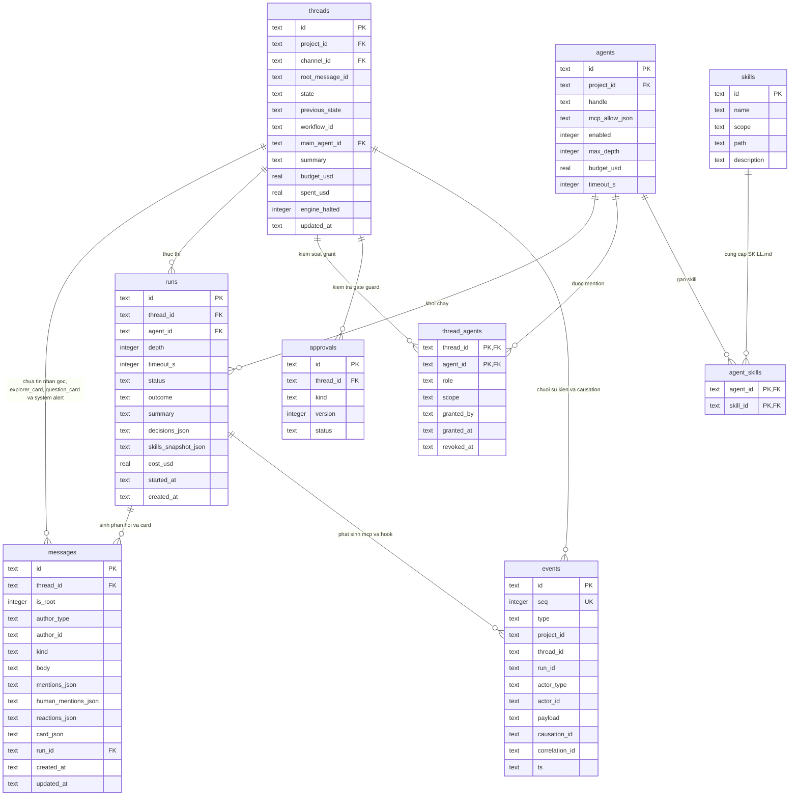
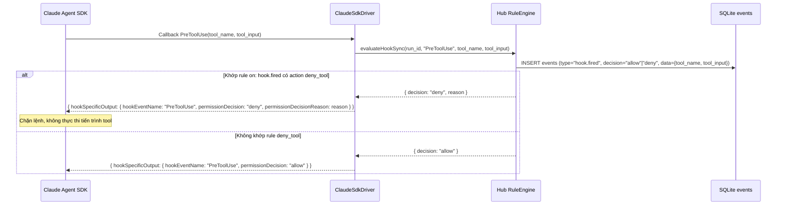
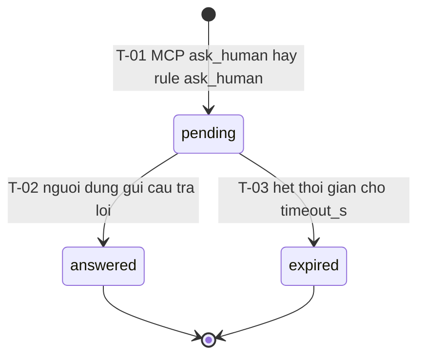

# Overview Module `trigger` — Rule Engine, ADE MCP, Grant & Hook Policy

| Trường | Giá trị |
| --- | --- |
| Mã tài liệu | `OV-TR-01` |
| Module | `trigger` (Phase P3) |
| Loại tài liệu | Quyết định xuyên cắt & Máy trạng thái của module |
| Đường dẫn chốt | `specs/dd/trigger/overview.md` |
| Tài liệu nền tảng | [domain-model.md](specs/dd/domain-model.md), [reference.md](specs/reference.md), [message.md](specs/message.md), [design.md](design.md) |
| Schema ORM | `apps/hub/src/db/schema.ts` (SQLite · Drizzle ORM) |
| Schema Zod | `WorkflowYamlSchema`, `ExplorerCitationSchema`, `ExplorerInsightInputSchema`, `ExplorerCardPayloadSchema`, `ClarifierOptionSchema`, `ClarifierQuestionSchema`, `QuestionAnswerItemSchema`, `Mcp*Schema`, `QuestionCardPayloadSchema` (`packages/shared`) |
| Ngày tạo | 2026-10-31 |
| Ngày cập nhật | 2026-10-31 |

## Lịch sử sửa đổi

| Ver | Ngày | Tác giả | Thay đổi |
| --- | --- | --- | --- |
| 1.0 | 2026-10-31 | — | Phát hành lần đầu cho Phase P3 |
| 1.1 | 2026-10-31 | — | Đồng bộ vòng 1 spec-review: chuẩn hóa `question.timed_out`, `Run/T-13`, `Run/T-14`, `Thread/T-11`, tách `question.answered` khỏi `approval.resolved`, cố định ranh giới `engine.halted` và cấu trúc `hook.fired.payload.data` |
| 1.2 | 2026-10-31 | — | Đồng bộ giao diện Slack 3+1 cột (`design.md`) và `domain-model.md`: Header 2 tầng của `Ngăn phản hồi Thread`, `GrantsPopover` dùng nút đóng icon `×` và chip `.ade-mention--agent`, `QuestionCard` viền `1px` `--color-human` kèm dấu vuông `8x8`, huy hiệu chờ trả lời trên thanh tóm tắt tin nhắn gốc của kênh, và chuẩn hóa các cột `root_message_id`, `is_root`, `mentions_json`, `human_mentions_json`, `reactions_json` |
| 1.3 | 2026-10-31 | — | Bổ sung `ExplorerCard` (`messages.kind = 'explorer_card'` qua MCP `post_message` cho agent chỉ đọc như `@explorer`) kèm huy hiệu chỉ đọc trên thanh tóm tắt kênh, và mở rộng `QuestionCard` hỗ trợ phỏng vấn đa câu hỏi `Clarifier` (`questions[]` kiểu `single` / `multi` / `text` kèm mục `Khác` và mảng `answers[]` trên MCP `ask_human` cùng `API-2`) |

---

## 1. Mục tiêu, Ranh giới Module & Ma trận Sub-DD

### 1.1 Ranh giới nghiệp vụ

- **Trong phạm vi module `trigger` (P3)**:
  - Bộ đọc và thực thi `.ade/workflows/<workflow_id>.yaml` (`RuleEngine`): đánh giá `on` + `when`, nội suy template `{{payload.*}}` / `{{run.*}}` / `{{thread.*}}`, thực thi 6 action (`dispatch`, `set_state`, `post_message`, `ask_human`, `deny_tool`, `run_script`) theo chu trình bất biến 4 bước. Kênh chat không khai báo workflow riêng; mọi thread kế thừa `projects.workflow_id` lưu vào `threads.workflow_id`.
  - Bộ bảo vệ chống vòng lặp (`LoopGuard`): chặn tạo run theo `runs.depth > agents.max_depth` (mặc định `3`) kèm đăng tin nhắn cảnh báo hệ thống (`messages.kind = 'system'`, `is_root = 0`); dừng Rule Engine theo độ dài chuỗi `causation_id > 20` trên cùng thread (`threads.engine_halted = 1`, phát `engine.halted` với `reason = 'causation_limit'`); dừng run đang chạy theo hạn mức `budget_usd` (`Run/T-14`) kèm đăng tin nhắn cảnh báo hệ thống (`messages.kind = 'system'`, `is_root = 0`).
  - Máy chủ ADE MCP (`POST /mcp` theo giao thức Streamable HTTP) kèm dịch vụ cấp phát và xác thực `mcp_token` ngắn hạn khóa cứng theo bộ ba `(run_id, thread_id, agent_id)`: bao gồm `post_message` hỗ trợ `kind = 'explorer_card'` xuất thẻ giải thích mã nguồn có trích dẫn `file:start_line-end_line` cho agent chỉ đọc như `@explorer`, và `ask_human` hỗ trợ cả câu hỏi đơn lẫn mảng phỏng vấn đa câu hỏi `Clarifier` (`questions[]` kiểu `single` / `multi` / `text` kèm `allow_other`, `suggestions[]` và trả về `answers[]`).
  - Thực thi quyền đọc ngữ cảnh thread theo mention (`thread_agents` — `ThreadAgent/T-01..T-04`).
  - Hook `PreToolUse` dạng callback đồng bộ trong `ClaudeSdkDriver` để đối chiếu rule `on: hook.fired` có `deny_tool` ngay trước khi lệnh tool thực thi.
  - Giao diện trong `Ngăn phản hồi Thread` co giãn (`340px..780px`, mặc định `448px`) thuộc khung Slack 3+1 cột: Header 2 tầng (Tầng 1 Topbar hiển thị trên mọi thread kèm `Nút khiên Quyền ({activeCount})`, nút đổi độ rộng `448px ↔ 640px` và nút đóng icon `×`; Tầng 2 Subbar chỉ hiển thị khi thread có agent tham gia hay `threads.state <> 'open'`, chứa `Badge trạng thái Thread`), `GrantsPopover` có nút đóng icon `×` và chip `.ade-mention--agent`, `Banner Dừng Rule Engine`, dòng tin nhắn phản hồi từ Agent có huy hiệu `BOT`, `ExplorerCard` (`.ade-explorer-card`, viền hairline `1px` `--color-agent` bao quanh, huy hiệu `"Chỉ đọc · 0 file sửa"`, khung `Trace`, bước luồng xử lý, trích dẫn mã nguồn thu gọn và nút chuyển giao sang `@planner`), và `QuestionCard` kiêm `Clarifier` đa câu hỏi (`.ade-gate-card` / `.ade-clarify-card`, viền hairline `1px` `--color-human` kèm dấu vuông `8x8`, huy hiệu tiến độ `"Đã trả lời X/N"`, khối lựa chọn radio/checkbox/text kèm mục `"Khác"`) đồng bộ với thanh tóm tắt dưới tin nhắn gốc của `Channel Chat Box`.
- **Ngoài phạm vi module `trigger` (P3)**:
  - Giao việc song song fan-out/fan-in (`delegate`, `get_results`, `get_run_log`, `read_scratchpad`, `write_scratchpad`), cổng duyệt có đánh số phiên bản (`request_approval`, bảng `approvals`, sự kiện `approval.requested` / `approval.resolved`), lệnh chat `/main`, `/approve`, `/revise` và action `resume_main` thuộc module `orchestration` (`specs/dd/orchestration/`).
  - Đề xuất ghi tệp bộ nhớ dự án (`propose_memory`) và trình soạn thảo trực quan Workflow YAML thuộc module `memory` (`specs/dd/memory/`).
- **Câu hỏi mở**: Không có.

### 1.2 Phạm vi cô lập dữ liệu (`ADE_MODE=solo`)

| Cấp cô lập | Khóa định danh | Quy tắc bắt buộc |
| --- | --- | --- |
| Giao diện Web & REST `/api/*` | `usr_local` (`role = owner`) | Hệ thống chỉ chấp nhận request có `Origin` / `Host` thuộc `localhost` hay `127.0.0.1`; vi phạm trả HTTP 403 `ERR_LOCAL_ORIGIN_ONLY`. |
| Phiên MCP (`POST /mcp`) | `mcp_token` → `(run_id, thread_id, agent_id)` | Mỗi run được cấp riêng một `mcp_token`; agent không truyền tay `agent_id` giả mạo và không truy cập được dữ liệu của `thread_id` khác với `mcp_token.thread_id`. |
| Ngữ cảnh đọc Thread | `(thread_id, agent_id)` trong `thread_agents` | Mọi tool đọc ngữ cảnh (`get_thread`, `read_memory`) bắt buộc kiểm tra bản ghi `thread_agents` có `revoked_at IS NULL`; vi phạm trả HTTP 403 `ERR_GRANT_REQUIRED`. |

### 1.3 Ma trận Sub-DD

| Mã DD | Loại | Đường dẫn chốt | Nội dung |
| --- | --- | --- | --- |
| `OV-TR-01` | Overview | `specs/dd/trigger/overview.md` | Kiến trúc Rule Engine, Loop Guard, MCP Token, Grant, Hook `PreToolUse` và máy trạng thái `Question` |
| `API-TR-01` | API / MCP | [specs/dd/trigger/tr-01/api-mcp-trigger.md](specs/dd/trigger/tr-01/api-mcp-trigger.md) | Đặc tả `POST /mcp` (9 MCP tool gồm `post_message` hỗ trợ `explorer_card` và `ask_human` hỗ trợ đa câu hỏi `Clarifier`), `POST /api/threads/:threadId/questions/:questionId/reply`, `DELETE /api/threads/:threadId/agents/:agentId`, `GET /api/threads/:threadId/agents` |
| `UI-TR-01` | UI | [specs/dd/trigger/tr-01/ui-workflow-cards.md](specs/dd/trigger/tr-01/ui-workflow-cards.md) | Đặc tả Header 2 tầng của `Ngăn phản hồi Thread`, `Badge trạng thái Thread`, `GrantsPopover`, `Banner Dừng Rule Engine`, tin nhắn phản hồi `BOT`, `ExplorerCard` và `QuestionCard` kiêm `Clarifier` đa câu hỏi |

---

## 2. Sơ đồ quan hệ dữ liệu của Module `trigger` (`erDiagram`)



---

## 3. Thiết kế Rule Engine & Cấu trúc Workflow YAML

### 3.1 Cấu trúc `.ade/workflows/<workflow_id>.yaml`

Tệp cấu hình workflow nằm trong kho mã nguồn của người dùng tại `.ade/workflows/<workflow_id>.yaml` và được kiểm tra bằng `WorkflowYamlSchema` (`packages/shared/src/schemas/ade-config.ts`).

| Trường YAML | Kiểu dữ liệu | Bắt buộc | Quy tắc ngữ nghĩa |
| --- | --- | --- | --- |
| `workflow` | `string` | Có | Định danh workflow khớp tên tệp (ví dụ `"feature"`). |
| `initial` | `string` | Có | Tên trạng thái khởi tạo của thread mới; bắt buộc phải thuộc tập khóa của `states`. Vi phạm trả `ERR_WORKFLOW_INVALID`. |
| `states` | `string[]` \| `Record<string, { gate?: 'plan' \| 'spec' \| 'review' }>` | Có | Danh sách tên state dạng mảng (mặc định không gắn cổng) hay bản đồ cấu hình từng state kèm thuộc tính `gate`. Tối thiểu 1 phần tử. |
| `main_agent` | `string` | Không | Handle của main agent mặc định (ví dụ `"@lead"`). |
| `max_parallel_workers` | `number` | Không | Giới hạn worker chạy song song trong thread (mặc định `3`). |
| `agents` | `Record<string, WorkflowAgentOverride>` | Không | Ghi đè cấu hình cục bộ theo workflow (`harness`, `skills`, `write`). |
| `rules` | `WorkflowRule[]` | Có | Mảng các quy tắc phản ứng theo thứ tự khai báo từ trên xuống dưới; mỗi phần tử có `on`, `when` (tùy chọn) và `do` (tối thiểu 1 action). |

### 3.2 Ngữ cảnh đánh giá `RuleEvalContext` & Nội suy Template

Khi đánh giá một bản ghi `event`, `RuleEngine` dựng đối tượng `RuleEvalContext` bất biến từ `event`, bản ghi `threads` hiện tại và bản ghi `runs` gắn với `event.run_id` (khi có):

| Đường dẫn tra cứu | Nguồn dữ liệu | Giá trị khi thiếu nguồn |
| --- | --- | --- |
| `payload.<path>` | Trường lồng bên trong `JSON.parse(event.payload)` | `undefined` |
| `event.<field>` | Trường trên envelope (`id`, `type`, `project_id`, `thread_id`, `run_id`, `causation_id`, `correlation_id`) | `undefined` |
| `thread.<field>` | Bản ghi `threads` hiện tại (`id`, `state`, `previous_state`, `workflow_id`, `summary`) | `undefined` |
| `run.<field>` | Bản ghi `runs` gắn với `event.run_id` (`id`, `agent` là `agents.handle`, `agent_id`, `status`, `outcome`, `summary`, `stop_reason`, `depth`, `cost_usd`) | `undefined` |
| `state` | Bí danh trực tiếp của `thread.state` | `undefined` |
| `agent` | `payload.agent` nếu khác `undefined`, ngược lại lấy `run.agent` | `undefined` |
| `outcome` | `payload.outcome` nếu khác `undefined`, ngược lại lấy `run.outcome` | `undefined` |
| `answer` | Bí danh trực tiếp của `payload.answer` (dùng trong rule `on: question.answered`) | `undefined` |
| `option_id` | Bí danh trực tiếp của `payload.option_id` (dùng trong rule `on: question.answered`) | `undefined` |
| `decision` | Bí danh trực tiếp của `payload.decision` | `undefined` |
| `kind` | Bí danh trực tiếp của `payload.kind` | `undefined` |
| `to` / `from` | Bí danh trực tiếp của `payload.to` / `payload.from` | `undefined` |
| `hook_name` | Bí danh trực tiếp của `payload.hook_name` | `undefined` |
| `data.<path>` | Bí danh trực tiếp của `payload.data.<path>` trên sự kiện `hook.fired`, trong đó `payload.data` hợp nhất trường `tool_name` cùng toàn bộ khóa cấp một của `tool_input` (ví dụ `"data.command"` trỏ tới `tool_input.command`) | `undefined` |

**Quy tắc nội suy chuỗi template ``**:
- Mọi chuỗi tham số trong `do` (gồm `dispatch.agent`, `dispatch.prompt`, `post_message.text`, `ask_human.text`, `deny_tool.reason`, `run_script.command`) phải được quét biểu thức `\{\{\s*([a-zA-Z0-9_.]+)\s*\}\}`.
- Nếu đường dẫn khớp giá trị kiểu chuỗi, số hay boolean trong `RuleEvalContext`, hệ thống phải thay thế bằng `String(value)`.
- Nếu giá trị tại đường dẫn là `null` hay `undefined`, hệ thống phải thay thế bằng chuỗi rỗng `""`.

### 3.3 Các toán tử điều kiện trong `when`

Một khối `when` là bản đồ `Record<string, ConditionValue>`. Rule chỉ khớp khi **tất cả** các khóa trong `when` đều trả `true` (phép hội `AND`). Nếu rule không khai báo `when`, điều kiện mặc định là `true`.

| Dạng khai báo `ConditionValue` | Ví dụ trong YAML | Quy tắc đánh giá đơn định |
| --- | --- | --- |
| Giá trị đơn (`string` \| `number` \| `boolean`) | `when: { state: plan_review, answer: approve }` | Giải đường dẫn khóa (hỗ trợ dấu chấm phân cấp) trên `RuleEvalContext` thành `actual`; trả `true` khi và chỉ khi `actual === expected`. |
| Mảng tập hợp (`Array<string \| number \| boolean>`) | `when: { outcome: [blocked, needs_revision, unknown] }` | Giải đường dẫn khóa thành `actual`; trả `true` khi và chỉ khi `expected.includes(actual)`. |
| Biểu thức chính quy (`{ matches: string }`) | `when: { hook_name: PreToolUse, "data.command": { matches: "rm -rf\|DROP TABLE" } }` | Giải đường dẫn khóa thành `actual`; nếu `actual === null` hay `actual === undefined` thì trả `false`, ngược lại trả kết quả `new RegExp(expected.matches).test(String(actual))`. |

### 3.4 Bảng đặc tả 6 Action trong P3

| Action | Tham số YAML | Kiểm tra Guard | Hành vi thực thi & Side effect | Event sinh ra (`causation_id = triggerEvent.id`) |
| --- | --- | --- | --- | --- |
| `dispatch` | `{ agent: string, skill?: string, prompt?: string }` | Agent tồn tại, `enabled = 1`; vượt qua cả 3 chốt chặn của `LoopGuard` (§4) | Nội suy `agent` và `prompt`; cấp hay cập nhật grant theo `ThreadAgent/T-01`, `ThreadAgent/T-03`, `ThreadAgent/T-04`; tạo bản ghi `runs` ở trạng thái `queued` theo `Run/T-01` với `runs.timeout_s = agents.timeout_s`; ghi trường bắt buộc `timeout_s` (bằng `agents.timeout_s`), tham số `skill` (khi khai báo trong `dispatch`) cùng `skills_snapshot` vào `payload` của `run.queued` | `agent.granted` (khi mới/cấp lại/đổi scope), `run.queued` |
| `set_state` | `<state_name>` hay `{ to: string, reason?: string }` | Gọi `transitionThreadState`: `to` thuộc `workflow.states`; nếu state hiện tại có `gate: <kind>` và `to !== previous_state` thì bản ghi `approvals` mới nhất của `(thread_id, kind)` phải có `status = 'approved'` | Cập nhật `threads.previous_state = threads.state`, `threads.state = to`, `threads.updated_at = now()` theo `Thread/T-02..T-11` | `thread.state_changed` |
| `post_message` | `{ text: string, kind?: 'text' \| 'system' }` | `text` sau nội suy có độ dài `>= 1` | Phân tích `@mention` của agent (`mentions`) và đồng nghiệp (`human_mentions`); tạo bản ghi phản hồi trong `messages` (`is_root = 0`, `author_type = 'system'`, `author_id = 'sys_rule_engine'`, `mentions_json`, `human_mentions_json`, `reactions_json = '[]'`, `card_json = NULL`); nếu có `@handle` agent đang bật thì phát kèm sự kiện mention | `message.posted` (`is_root: false`, `mentions`, `human_mentions`, `card: null`), `agent.mentioned` (khi có `@handle` agent hợp lệ) |
| `ask_human` | `{ text: string, options?: string[] }` | `text` sau nội suy có độ dài `>= 1` | Sinh `question_id` (`qst_<ULID>`), tạo bản ghi phản hồi trong `messages` có `is_root = 0`, `kind = 'question_card'`, `body = text` (đồng bộ với `card_json.question`), `mentions_json = '[]'`, `human_mentions_json = '[]'`, `reactions_json = '[]'`, `run_id = NULL`, `card_json.source = 'rule'`, `card_json.agent_handle = null`, `card_json.questions = []`, `card_json.answers = []`, `card_json.status = 'pending'` theo `Question/T-01` | `question.asked` (`run_id: null`, `questions: []`, `timeout_s: null`) |
| `deny_tool` | `{ reason: string }` | Chỉ có hiệu lực trong đánh giá đồng bộ của `hook.fired` (`evaluateHookSync`) | Nội suy `reason`; gán quyết định chặn `{ decision: 'deny', reason }` trả thẳng về callback `PreToolUse` của driver; không thực thi lặp lại ở Bước 3 | Ghi vào kết quả `hook.fired` (`decision = 'deny'`) |
| `run_script` | `{ command: string, timeout_s?: number }` | `command` sau nội suy không rỗng; `timeout_s` mặc định `30` giây (tối đa `120` giây) | Chạy tiến trình con trong `cwd` là worktree của thread (dùng `repo_path` khi chưa có worktree); thu `exit_code`, `stdout`, `stderr` (cắt tối đa `4096` byte) | `hook.fired` (`hook_name = 'run_script'`) |

### 3.5 Chu trình bất biến 4 bước thực thi Event

Mọi sự kiện đi vào `apps/hub` đều bắt buộc đi qua đúng 4 bước theo thứ tự cố định:

1. **Bước 1 — Ghi `events` append-only**: Chèn bản ghi mới vào bảng `events` với `seq` nguyên dương tăng tuần tự trong giao dịch SQLite. Tuyệt đối không `UPDATE` hay `DELETE` bảng `events`.
2. **Bước 2 — Cập nhật Projection đồng bộ**: Chiếu sự kiện vừa ghi sang các bảng trạng thái hiện hành (`threads`, `messages`, `runs`, `thread_agents`) trong cùng giao dịch SQLite, rồi phát sự kiện tới các kết nối WebSocket `/ws` của `project_id` / `thread_id`.
3. **Bước 3 — Khớp Rule theo thứ tự khai báo**: Nếu `event.thread_id !== null` và `threads.engine_halted = 0` và `LoopGuard.checkCausationChain(event)` không vi phạm ngưỡng, hệ thống đọc workflow YAML của `threads.workflow_id` và duyệt tuần tự `rules[0..N-1]` để chọn mọi rule thỏa `rule.on === event.type` và `evaluateWhen(rule.when, ctx) === true`. Đối với sự kiện `hook.fired` đã được callback đồng bộ `evaluateHookSync` đánh giá trước lúc ghi bảng `events`, Bước 3 bỏ qua các action `deny_tool` để không thực thi lặp lại.
4. **Bước 4 — Sinh Event con gắn `causation_id`**: Thực thi lần lượt các action trong mảng `rule.do`. Nếu một action trong `rule.do` bị Guard từ chối (`ERR_GATE_APPROVAL_REQUIRED`, `ERR_LOOP_DEPTH_EXCEEDED`, `ERR_BUDGET_EXCEEDED`, `ERR_INVALID_STATUS`), hệ thống phải dừng ngay toàn bộ các action còn lại trong cùng `rule.do` đó, tạo bản ghi phản hồi trong `messages` có `is_root = 0`, `kind = 'system'`, `mentions_json = '[]'`, `human_mentions_json = '[]'`, `reactions_json = '[]'`, `card_json = NULL` và phát sự kiện `message.posted` kèm `is_root: false`, `mentions: []`, `human_mentions: []`, `card: null` để hiển thị thông điệp cảnh báo tiếng Việt tương ứng. Mỗi sự kiện con sinh ra được gán `causation_id = event.id` và `correlation_id = event.correlation_id ?? event.thread_id`, sau đó đưa vào hàng đợi `InMemoryEventBus` để lặp lại từ Bước 1.

---

## 4. Ba chốt chặn chống Loop (`LoopGuard`)

| Chốt chặn | Ngưỡng quy định | Thời điểm kiểm tra | Phản ứng bắt buộc khi chạm ngưỡng |
| --- | --- | --- | --- |
| **a. Giới hạn độ sâu gọi Agent (`max_depth`)** | `nextDepth > agents.max_depth` (mặc định `agents.max_depth = 3`). Công thức tính `nextDepth`: run gốc do `actor_type = 'human'` trực tiếp kích hoạt (chuỗi tổ tiên `causation_id` không có `run_id`) có `depth = 0`; mỗi khi một run cha kích hoạt run con (qua `dispatch` từ sự kiện của run cha hay do agent đăng message chứa `@mention`), `nextDepth = parentRun.depth + 1`. Khi `nextDepth > agents.max_depth` (dừng sau run có `depth = 3`, chặn từ `nextDepth = 4`), hệ thống từ chối tạo run. | Ngay trước khi `Dispatcher` tạo run mới (từ `dispatch` của rule hay mention từ message của agent) | Không tạo bản ghi `runs`; tạo bản ghi phản hồi trong `messages` có `is_root = 0`, `kind = 'system'`, `mentions_json = '[]'`, `human_mentions_json = '[]'`, `reactions_json = '[]'`, `card_json = NULL` và phát sự kiện `message.posted` kèm `is_root: false`, `mentions: []`, `human_mentions: []`, `card: null` báo chạm giới hạn `max_depth`; giữ nguyên `threads.engine_halted = 0` (không phát sự kiện `engine.halted`); trả lỗi nội bộ `ERR_LOOP_DEPTH_EXCEEDED`. |
| **b. Giới hạn chuỗi nhân quả (`causation_limit`)** | Độ dài chuỗi tổ tiên liên tiếp theo khóa `causation_id` trong cùng `thread_id` vượt quá `20` sự kiện (`chainLength > 20`). | Ở đầu Bước 3 của `RuleEngine` trước khi khớp bất kỳ rule nào cho sự kiện mang `causation_id !== null` | Cập nhật `threads.engine_halted = 1`; ghi event `engine.halted` với `payload = { thread_id, reason: 'causation_limit', count: chainLength }`; tạo bản ghi phản hồi trong `messages` có `is_root = 0`, `kind = 'system'`, `mentions_json = '[]'`, `human_mentions_json = '[]'`, `reactions_json = '[]'`, `card_json = NULL` và phát sự kiện `message.posted` kèm `is_root: false`, `mentions: []`, `human_mentions: []`, `card: null` cảnh báo dừng Rule Engine chờ người dùng; hủy toàn bộ lượt khớp rule hiện tại và từ chối mọi `dispatch` tự động kế tiếp với mã `ERR_CAUSATION_LIMIT_EXCEEDED`. |
| **c. Giới hạn ngân sách (`budget_usd`)** | Trường hợp 1: `agents.budget_usd !== null` và `runs.cost_usd > agents.budget_usd`. Trường hợp 2: `threads.budget_usd !== null` và `threads.spent_usd >= threads.budget_usd` (trước khi `dispatch`) hay `threads.spent_usd + delta > threads.budget_usd` (khi run đang chạy). | Trước khi `Dispatcher` tạo run mới và mỗi khi nhận `run.event` / `run.end` có cập nhật `usage.cost_usd` | Ở nơi run đang chạy vượt ngân sách: gửi `run.cancel` xuống driver, chuyển run sang `failed` theo `Run/T-14` (`run.failed` với `stop_reason = 'budget_exceeded'`, `error_code = 'ERR_BUDGET_EXCEEDED'`). Ở cả hai thời điểm (đang chạy lẫn trước lúc `dispatch`): tạo bản ghi phản hồi trong `messages` có `is_root = 0`, `kind = 'system'`, `mentions_json = '[]'`, `human_mentions_json = '[]'`, `reactions_json = '[]'`, `card_json = NULL` và phát sự kiện `message.posted` kèm `is_root: false`, `mentions: []`, `human_mentions: []`, `card: null` cảnh báo vượt ngân sách, giữ nguyên `threads.engine_halted = 0` (không phát sự kiện `engine.halted`) và trả mã `ERR_BUDGET_EXCEEDED`. |

---

## 5. Cơ chế `mcp_token`, Thực thi Grant & Hook `PreToolUse`

### 5.1 Vòng đời `mcp_token` ngắn hạn (`McpTokenService`)

1. **Cấu trúc & Ký số**: Khi `Runner` chuẩn bị phát `run.start` cho `run_id`, `McpTokenService` trên Hub sinh token định dạng `<base64url(payloadJson)>.<base64url(hmacSha256)>` dùng khóa bí mật 256-bit lưu trong bộ nhớ tiến trình Hub. Nội dung `payloadJson` gồm:
   - `run_id`: ID của run (`run_<ULID>`)
   - `thread_id`: ID của thread chứa run (`thr_<ULID>`)
   - `project_id`: ID của project (`prj_<ULID>`)
   - `agent_id`: ID của agent thực thi (`agt_<ULID>`)
   - `iat`: Unix timestamp giây lúc cấp
   - `exp`: `iat + max(runs.timeout_s, 3600)`
2. **Cách Runner truyền vào Harness**:
   - `ClaudeSdkDriver`: truyền vào tham số `mcpServers` của hàm `query()` với cấu hình `{ ade: { type: 'http', url: 'http://127.0.0.1:<port>/mcp', headers: { Authorization: 'Bearer ' + mcpToken } } }` kết hợp `strictMcpConfig: true`.
   - `AcpDriver` (`codex-acp` và `ade-fake-agent`): truyền trong trường `mcpServers` của lời gọi JSON-RPC `session/new` (kèm header `Authorization: Bearer <mcp_token>`) và ghi mục `[mcp_servers.ade]` tương ứng vào `CODEX_HOME/config.toml` của phiên chạy.
3. **Thu hồi tức thời theo trạng thái Run**: Mọi request đến `POST /mcp` phải kiểm tra chữ ký HMAC trước (sai chữ ký hay thiếu header trả HTTP 401 `ERR_MCP_TOKEN_INVALID`), sau đó kiểm tra hạn `exp` và đọc bảng `runs` theo `payload.run_id`. Nếu `now > exp` hay `runs.status` thuộc `('completed', 'failed', 'cancelled')`, server bắt buộc trả HTTP 401 `ERR_MCP_TOKEN_EXPIRED`.

### 5.2 Kiểm soát Grant đọc ngữ cảnh theo Mention (`thread_agents`)

- Agent hoàn toàn không có quyền đọc dữ liệu của một thread cho đến khi xuất hiện sự kiện mention hợp lệ hay lệnh `delegate` từ main agent tạo dòng `thread_agents` (`ThreadAgent/T-01`).
- Khi một agent đang có grant `active` tiếp tục được `@mention` hay `delegate` với `scope` mới, hệ thống thực thi `ThreadAgent/T-04`.
- Nếu agent đã bị người dùng thu hồi quyền (`DELETE /api/threads/:threadId/agents/:agentId` → `ThreadAgent/T-02`, `revoked_at IS NOT NULL`), mọi lời gọi `get_thread` và `read_memory` trên thread đó đều bị từ chối ngay với HTTP 403 `ERR_GRANT_REQUIRED`.
- Khi người dùng `@mention` lại agent đó trong tin nhắn mới, hệ thống thực thi `ThreadAgent/T-03`, đặt lại `revoked_at = NULL`, cập nhật `granted_at` và phát `agent.granted`.

### 5.3 Hook `PreToolUse` đồng bộ trong `ClaudeSdkDriver`

Khi `ClaudeSdkDriver` gọi `evaluateHookSync(run_id, "PreToolUse", tool_name, tool_input)`, Hub dựng đối tượng `data` bằng phép gộp `Object.assign({ tool_name }, tool_input)` (gồm khóa `tool_name` và toàn bộ các khóa cấp một của `tool_input`, nhờ đó `"data.command"` trỏ trực tiếp tới `tool_input.command`). Hub đánh giá đồng bộ các rule `on: hook.fired` để tính ra `decision` (`"allow"` hay `"deny"`), ghi bản ghi append-only `hook.fired` với `payload = { run_id, hook_name: "PreToolUse", decision, data }` vào bảng `events` rồi trả ngay quyết định về callback `PreToolUse`. Ở Bước 3 kế tiếp của `RuleEngine`, các action `deny_tool` trên sự kiện `hook.fired` này không chạy lặp lại.



---

## 6. Các máy trạng thái sử dụng trong Module `trigger`

Module `trigger` tham chiếu trực tiếp ba máy trạng thái dùng chung tại [domain-model.md](specs/dd/domain-model.md):
- `Run.status`: `Run/T-01` (xếp hàng run mới), `Run/T-06` (`running` → `waiting_human` khi gọi `ask_human`), `Run/T-07` (`waiting_human` → `running` khi người dùng gửi câu trả lời), `Run/T-08` (`running` → `completed`, tự gán `outcome = 'unknown'` khi agent không gọi `report_outcome`), `Run/T-13` (`waiting_human` → `running` khi hết thời gian chờ `timeout_s` của `ask_human`), `Run/T-14` (`running` → `failed` khi vượt hạn mức `budget_usd`).
- `Thread.state`: `Thread/T-01..T-11` qua hàm bảo vệ cổng `transitionThreadState` (trong đó các workflow P3 không khai báo `gate` trên state nguồn chuyển tiếp qua `Thread/T-11` dựa trên sự kiện `question.answered`).
- `ThreadAgent`: `ThreadAgent/T-01` (cấp grant lần đầu), `ThreadAgent/T-02` (thu hồi grant), `ThreadAgent/T-03` (cấp lại grant sau khi đã thu hồi), `ThreadAgent/T-04` (cập nhật grant khi đang `active`).

Ngoài ra, module `trigger` quản lý máy trạng thái riêng của thẻ câu hỏi `Question` (lưu trong `messages.card_json` với `messages.kind = 'question_card'` và `messages.is_root = 0`):

### State machine — `Question.status`

| Trường | Giá trị |
| --- | --- |
| Thực thể | `Question` (lưu trong `messages.card_json` của bản ghi phản hồi `messages` có `is_root = 0`, `kind = 'question_card'`, định danh `qst_<ULID>`) |
| Cột | `card_json.status` — chuỗi cố định `QuestionStatusSchema` (`pending` \| `answered` \| `expired`) |
| Trạng thái đầu | `pending` (khi tạo bởi MCP `ask_human` hay rule action `ask_human`) |
| Trạng thái cuối | `answered`, `expired` |
| Khi bị cấm | HTTP `409` `ERR_QUESTION_ALREADY_RESOLVED` |

#### Trạng thái

| Trạng thái | Ý nghĩa nghiệp vụ | Được sửa dữ liệu? |
| --- | --- | --- |
| `pending` | Câu hỏi đơn hay bảng phỏng vấn đa câu hỏi (`Clarifier`) đang mở trong `Ngăn phản hồi Thread` chờ người dùng chọn phương án hay nhập câu trả lời | Có (nhận câu trả lời hay đánh dấu hết hạn) |
| `answered` | Người dùng đã gửi phản hồi hợp lệ; đã ghi nhận `answer`, `selected_option_id`, `answers`, `answered_by` và `answered_at` | Không |
| `expired` | Đã quá thời gian `timeout_s` của MCP `ask_human` mà chưa nhận câu trả lời | Không |

#### Sơ đồ



#### Chuyển trạng thái

| ID | Từ | Sự kiện | Guard | Sang | Actor | Side effect | API / job |
| --- | --- | --- | --- | --- | --- | --- | --- |
| T-01 | — | Thực thi MCP `ask_human` hay rule `ask_human` | Câu hỏi không rỗng (`questions[]` hợp lệ khi có truyền) | `pending` | Agent / Rule Engine | Tạo bản ghi phản hồi `messages` (`is_root = 0`, `kind = 'question_card'`, `card_json.questions = questions ?? []`, `card_json.answers = []`); ghi event `question.asked` (`payload` gồm `question_id`, `run_id`, `question`, `options`, `questions`, `timeout_s`, `card_message_id`, trong đó `timeout_s` bằng `null` khi phát từ Rule và bằng số giây khi phát từ MCP `ask_human`); ở nơi gọi từ MCP thì lưu `card_json.agent_handle` và chuyển kèm `Run/T-06` | `POST /mcp` (`ask_human`) / `RuleEngine` |
| T-02 | `pending` | Người dùng gửi câu trả lời | `card_json.status = 'pending'`; dữ liệu `answer` hay mảng `answers` hợp lệ theo `trigger.question.reply` | `answered` | Người dùng (`usr_local`) | Cập nhật `card_json` (`status = 'answered'`, `answer`, `selected_option_id`, `answers`, `answered_by`, `answered_at`); ghi duy nhất event `question.answered` (`payload` gồm `question_id`, `run_id`, `answer`, `option_id`, `answers`, `answered_by`; không sinh `approval.resolved`); ở nơi gắn run chờ thì chuyển `Run/T-07` | `POST /api/threads/:threadId/questions/:questionId/reply` |
| T-03 | `pending` | Bộ đếm thời gian chạm `timeout_s` | `card_json.status = 'pending'` và `card_json.source = 'mcp'` | `expired` | Timer của Hub | Ghi event append-only `question.timed_out` (`payload` gồm `question_id`, `run_id`, `timeout_s`); cập nhật `card_json.status = 'expired'`; chuyển run về `running` theo `Run/T-13`; trả HTTP 408 `ERR_QUESTION_TIMEOUT` cho lời gọi MCP | Timer nội bộ của `ask_human` |

#### Tiêu chí chấp nhận

```gherkin
Feature: Question — vòng đời trạng thái thẻ câu hỏi người dùng

  Scenario: AC-Question-01 — Trả lời thẻ câu hỏi đang chờ chuyển trạng thái sang answered (nguồn: Question/T-01, Question/T-02; nghiệm thu: e2e/p3-workflow.spec.ts)
    Given thread "thr_01" có thẻ câu hỏi "qst_01" đang ở trạng thái "pending"
    When người dùng gửi `POST /api/threads/thr_01/questions/qst_01/reply` với `answer` là "approve"
    Then thẻ câu hỏi "qst_01" có `card_json.status` bằng "answered"
    And bảng `events` có bản ghi `question.answered` với `payload.question_id` bằng "qst_01"

  Scenario: AC-Question-02 — Chặn trả lời lại thẻ câu hỏi đã đóng hay hết hạn (nguồn: bị cấm; nghiệm thu: e2e/p3-workflow.spec.ts)
    Given thread "thr_01" có thẻ câu hỏi "qst_02" đang ở trạng thái "expired"
    When người dùng gửi `POST /api/threads/thr_01/questions/qst_02/reply` với `answer` là "đồng ý"
    Then nhận HTTP 409 `ERR_QUESTION_ALREADY_RESOLVED`
    And thẻ câu hỏi "qst_02" vẫn giữ `card_json.status` bằng "expired"

  Scenario: AC-Question-03 — Hết thời gian chờ timeout_s chuyển thẻ sang expired và ghi sự kiện question.timed_out (nguồn: Question/T-03, Run/T-13; nghiệm thu: scripts/verify/mcp-contract.ts)
    Given run "run_01" đang chờ câu trả lời trên thẻ "qst_03" ở trạng thái "pending" với `timeout_s` bằng 1
    When bộ đếm thời gian của "qst_03" chạm mốc 1 giây mà chưa có phản hồi
    Then thẻ câu hỏi "qst_03" có `card_json.status` bằng "expired"
    And bảng `events` có bản ghi `question.timed_out` với `payload.question_id` bằng "qst_03" và `payload.timeout_s` bằng 1
    And "run_01" chuyển về trạng thái "running"
```
