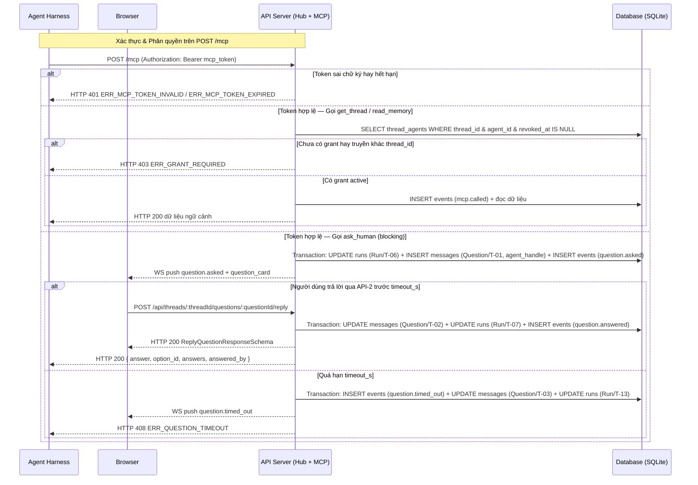

# API-TR-01 — POST /mcp & Thread Trigger APIs — ADE MCP Server, Trả lời Câu hỏi & Quản lý Grant

| Trường | Giá trị |
| --- | --- |
| API ID | `API-TR-01` |
| Đường dẫn chốt | `specs/dd/trigger/tr-01/api-mcp-trigger.md` |
| Method | `POST` · `DELETE` · `GET` |
| Endpoint | `POST /mcp` · `POST /api/threads/:threadId/questions/:questionId/reply` · `DELETE /api/threads/:threadId/agents/:agentId` · `GET /api/threads/:threadId/agents` |
| Phân quyền | `POST /mcp`: `Bearer <mcp_token>` gắn `(run_id, thread_id, agent_id)` · `/api/*`: Localhost Origin (`usr_local`, `role = owner` ở `ADE_MODE=solo`) |
| Zod schema | `McpOkOutputSchema`, `McpReportOutcomeInputSchema`, `McpReportOutcomeOutputSchema`, `McpPostProgressInputSchema`, `ExplorerCitationSchema`, `ExplorerInsightInputSchema`, `ExplorerCardPayloadSchema`, `McpPostMessageInputSchema`, `McpPostMessageOutputSchema`, `ClarifierOptionSchema`, `ClarifierQuestionSchema`, `QuestionAnswerItemSchema`, `McpAskHumanInputSchema`, `McpAskHumanOutputSchema`, `McpReadMemoryInputSchema`, `McpReadMemoryOutputSchema`, `McpGetThreadInputSchema`, `McpGetThreadOutputSchema`, `McpListSkillsInputSchema`, `McpListSkillsOutputSchema`, `McpLoadSkillInputSchema`, `McpLoadSkillOutputSchema`, `McpSetStateInputSchema`, `McpSetStateOutputSchema`, `QuestionStatusSchema`, `QuestionCardPayloadSchema`, `ThreadParamSchema`, `ThreadQuestionParamSchema`, `ReplyQuestionInputSchema`, `ReplyQuestionResponseSchema`, `ThreadAgentParamSchema`, `ThreadAgentListResponseSchema`, `RevokeThreadAgentResponseSchema` (`packages/shared`) |
| Hiện trạng code | BE chưa implement (xây mới ở phase P3) |
| Ngày tạo | 2026-10-31 |
| Ngày cập nhật | 2026-10-31 |

## Lịch sử sửa đổi

| Ver | Ngày | Tác giả | Thay đổi |
| --- | --- | --- | --- |
| 1.0 | 2026-10-31 | — | Phát hành lần đầu cho Phase P3 |
| 1.1 | 2026-10-31 | — | Đồng bộ vòng 1 spec-review: chuẩn hóa catalog keys và nhãn `FIELD_LABELS`, thêm rule `array` và validate `thread_id`, ẩn `set_state` trong `tools/list` khi thiếu `mcp_allow`, bổ sung `run.outcome_reported` và `question.timed_out`, tách `question.answered` khỏi `approval.resolved`, phủ đủ AC §9 |
| 1.2 | 2026-10-31 | — | Đồng bộ mô hình Slack `1 Tin nhắn gốc = 1 Thread` (`domain-model.md`) và phân tách Human vs Bot/Agent (`design.md`): chuẩn hóa `is_root = 0`, `mentions_json`, `human_mentions_json`, `reactions_json` khi tạo bản ghi `messages` từ `post_message` / `ask_human` / `system` và đầy đủ các trường bắt buộc trong `message.posted.payload`; bổ sung `is_root` trong `McpGetThreadOutputSchema` |
| 1.3 | 2026-10-31 | — | Bổ sung `kind = 'explorer_card'` kèm `explorer` (`ExplorerInsightInputSchema`) trên MCP `post_message` cho agent chỉ đọc như `@explorer`, và mở rộng `ask_human` cùng `API-2` hỗ trợ phỏng vấn đa câu hỏi `Clarifier` (`questions[]` kiểu `single` / `multi` / `text` kèm `allow_other`, `suggestions[]` và mảng trả lời `answers[]`) (`V-66..V-84`, `S1-06b`, `S2-05b`, `AC-API-TR-01-34..38`) |

---

## 1. Mục đích

- **Actor**: Tiến trình harness của Agent (`ClaudeSdkDriver`, `AcpDriver`, `FakeClaudeDriver`, `ade-fake-agent`) gọi `POST /mcp` bằng `mcp_token`; người dùng local (`usr_local`) trên màn hình `UI-TR-01` gọi các REST API `/api/threads/:threadId/*`.
- **Use case**: Cung cấp giao diện MCP Streamable HTTP để agent báo kết quả thực thi, đăng tiến độ, gửi tin nhắn văn bản hay thẻ giải thích mã nguồn `ExplorerCard` (`kind = 'explorer_card'`), hỏi người dùng theo chế độ 1 câu hỏi đơn hay bảng phỏng vấn đa câu hỏi `Clarifier` (`questions[]`), đọc ngữ cảnh theo grant và nạp skill fallback; đồng thời cho phép người dùng trả lời thẻ câu hỏi và quản lý quyền truy cập ngữ cảnh của agent trong thread.
- **Kết quả thành công**: Mọi thay đổi được ghi vào bảng `events` append-only, cập nhật đồng bộ các bảng projection (`runs`, `threads`, `messages`, `thread_agents`), kích hoạt `RuleEngine` theo thứ tự khai báo và phát thông báo realtime qua `/ws`.
- **Ngoài phạm vi**: Các MCP tool điều phối nhiều worker và cổng duyệt có phiên bản (`delegate`, `get_results`, `request_approval`, `get_run_log`, `read_scratchpad`, `write_scratchpad`) thuộc `specs/dd/orchestration/`; MCP tool `propose_memory` thuộc `specs/dd/memory/`.
- **Giả định**: Ở `ADE_MODE=solo`, Hub và Local Runner cùng lắng nghe trên giao diện loopback `127.0.0.1`.
- **Câu hỏi mở**: Không có.

---

## 2. Request

### 2.1 Headers & Phân quyền

| Endpoint | Header | Bắt buộc | Mô tả |
| --- | --- | --- | --- |
| `POST /mcp` | `Authorization` | Có | `Bearer <mcp_token>` do `McpTokenService` cấp riêng cho từng `run_id` |
| `POST /mcp` | `Content-Type` | Có | `application/json` (gói tin JSON-RPC 2.0 theo MCP Streamable HTTP) |
| `POST /mcp` | `Accept` | Không | `application/json, text/event-stream` |
| `/api/threads/:threadId/*` | `Origin` / `Host` | Có | Bắt buộc thuộc `localhost` hay `127.0.0.1` ở `ADE_MODE=solo` |
| `POST /api/threads/:threadId/questions/:questionId/reply` | `Content-Type` | Có | `application/json` |

### 2.2 Path & Query params

| Endpoint | Tên | Loại | Bắt buộc | Zod | Mô tả |
| --- | --- | --- | --- | --- | --- |
| `POST /mcp` | — | — | — | — | Không sử dụng path/query param |
| `API-2` | `:threadId` | path | Có | `ThreadQuestionParamSchema` | ID của thread (`thr_<ULID>`) |
| `API-2` | `:questionId` | path | Có | `ThreadQuestionParamSchema` | ID của thẻ câu hỏi (`qst_<ULID>`) |
| `API-3` | `:threadId` | path | Có | `ThreadAgentParamSchema` | ID của thread (`thr_<ULID>`) |
| `API-3` | `:agentId` | path | Có | `ThreadAgentParamSchema` | ID của agent cần gỡ quyền (`agt_<ULID>`) |
| `API-4` | `:threadId` | path | Có | `ThreadParamSchema` | ID của thread cần lấy danh sách grant (`thr_<ULID>`) |

### 2.3 Request body & Danh mục MCP Tool (`packages/shared/src/schemas/mcp.ts`)

**Khung JSON-RPC của `API-1: POST /mcp`**:
- Phương thức `tools/list`: mặc định chỉ trả danh sách định nghĩa 8 tool chuẩn (`report_outcome`, `post_progress`, `post_message`, `ask_human`, `read_memory`, `get_thread`, `list_skills`, `load_skill`); chỉ trả kèm định nghĩa tool thứ 9 `set_state` khi mảng `agents.mcp_allow_json` của `token.agent_id` có chứa chuỗi `"set_state"`.
- Phương thức `tools/call`: nhận đối tượng JSON gồm trường `name` và đối tượng `arguments`, kiểm tra `arguments` bằng Zod schema tương ứng của từng tool:

| STT | Tên MCP Tool / Endpoint | Zod Input Schema | Trường chính & Kiểu | Catalog Key (`VALIDATION_CATALOG`) | Mô tả |
| --- | --- | --- | --- | --- | --- |
| 1 | `report_outcome` | `McpReportOutcomeInputSchema` | `status`: `'done' \| 'blocked' \| 'needs_revision'` (bắt buộc) · `summary`: `string` (bắt buộc) · `decisions`: `string[]` (mặc định `[]`) | `trigger.mcp.reportOutcome` | Ghi nhận kết quả cuối cùng của run cho Rule Engine |
| 2 | `post_progress` | `McpPostProgressInputSchema` | `text`: `string` (bắt buộc) · `step`: `string?` · `percent`: `number?` (`0..100`) | `trigger.mcp.postProgress` | Gửi dòng tiến độ cập nhật vào `live_card` của run |
| 3 | `post_message` | `McpPostMessageInputSchema` | `text`: `string` (bắt buộc) · `kind`: `'note' \| 'result' \| 'explorer_card'` (mặc định `'note'`) · `explorer`: `ExplorerInsightInputSchema?` (bắt buộc khi `kind = 'explorer_card'`) | `trigger.mcp.postMessage` | Đăng tin nhắn văn bản hay thẻ giải thích mã nguồn `ExplorerCard` của agent vào luồng chat |
| 4 | `ask_human` | `McpAskHumanInputSchema` | `question`: `string` (bắt buộc) · `options`: `string[]?` · `questions`: `ClarifierQuestionSchema[]?` (`1..10` câu hỏi kiểu `'single' \| 'multi' \| 'text'`) · `timeout_s`: `number?` (mặc định `1800`) | `trigger.mcp.askHuman` | Tạo `question_card` (1 câu hỏi đơn hay đa câu hỏi `Clarifier`) và giữ request mở chờ người dùng trả lời |
| 5 | `read_memory` | `McpReadMemoryInputSchema` | `scope`: `'project' \| 'thread'` (bắt buộc) · `query`: `string?` · `thread_id`: `string?` | `trigger.mcp.readMemory` | Đọc `.ade/memory/*.md` hay `threads.summary` (kiểm tra grant) |
| 6 | `get_thread` | `McpGetThreadInputSchema` | `include_messages`: `number?` (mặc định `20`) · `thread_id`: `string?` | `trigger.mcp.getThread` | Đọc tiêu đề, state, summary và tin nhắn của thread (kiểm tra grant) |
| 7 | `list_skills` | `McpListSkillsInputSchema` | `{}` (không có tham số) | — | Liệt kê các skill đã gắn cho agent của run hiện tại |
| 8 | `load_skill` | `McpLoadSkillInputSchema` | `name`: `string` (bắt buộc) | `trigger.mcp.loadSkill` | Tải toàn bộ nội dung `SKILL.md` và đường dẫn tệp skill |
| 9 | `set_state` | `McpSetStateInputSchema` | `to`: `string` (bắt buộc) · `reason`: `string` (bắt buộc) | `trigger.mcp.setState` | Chuyển state của thread khi agent có `"set_state"` trong `mcp_allow` |
| 10 | `API-2: POST /api/threads/:threadId/questions/:questionId/reply` | `ReplyQuestionInputSchema` | `answer`: `string?` (bắt buộc ở chế độ câu hỏi đơn; tự tổng hợp ở chế độ đa câu hỏi khi bỏ qua) · `optionId`: `string?` · `answers`: `QuestionAnswerItemSchema[]?` (bắt buộc ở chế độ đa câu hỏi `Clarifier`) | `trigger.question.reply` | Người dùng gửi câu trả lời đơn hay mảng câu trả lời `Clarifier` cho thẻ câu hỏi đang chờ |
| 11 | `API-3: DELETE /api/threads/:threadId/agents/:agentId` | Không có body | — | — | Gỡ quyền truy cập ngữ cảnh của agent khỏi thread |
| 12 | `API-4: GET /api/threads/:threadId/agents` | Không có body | — | — | Lấy danh sách các agent đang có grant `active` trong thread |

**Các Zod schema thành phần trong `packages/shared/src/schemas/mcp.ts`**:

| Tên Zod Schema | Cấu trúc & Ràng buộc |
| --- | --- |
| `ExplorerCitationSchema` | `file` (`string`, `trim`, `1..512` ký tự) · `start_line` (`integer >= 1`) · `end_line` (`integer >= start_line`) · `role` (`string`, `trim`, `1..120` ký tự) · `snippet` (`string`, `1..8000` ký tự) · `note?` (`string \| null`, tối đa `500` ký tự) |
| `ExplorerInsightInputSchema` | `topic` (`string`, `trim`, `1..200` ký tự) · `flow_steps` (`string[]`, `1..12` phần tử, mỗi phần tử `trim` `1..1000` ký tự) · `trace_steps?` (`string[] \| null`, tối đa `30` phần tử, mỗi phần tử `1..500` ký tự, mặc định `[]`) · `citations` (`ExplorerCitationSchema[]`, `1..20` phần tử) |
| `ExplorerCardPayloadSchema` | `cardType: 'explorer'` · `agent_handle` (`string`) · `topic` (`string`) · `flow_steps` (`string[]`) · `trace_steps` (`string[]`) · `citations` (`ExplorerCitationSchema[]`) · `cost_usd` (`number`) · `duration_ms` (`integer >= 0`) |
| `ClarifierOptionSchema` | `id` (`string`, `trim`, `1..100` ký tự) · `label` (`string`, `trim`, `1..300` ký tự) · `hint?` (`string \| null`, tối đa `300` ký tự) · `recommended?` (`boolean`, mặc định `false`) |
| `ClarifierQuestionSchema` | `id` (`string`, `trim`, `1..64` ký tự, duy nhất trong mảng `questions`) · `type` (`'single' \| 'multi' \| 'text'`) · `prompt` (`string`, `trim`, `1..500` ký tự) · `options?` (`ClarifierOptionSchema[]`, bắt buộc `2..12` phần tử khi `type` là `'single'` hay `'multi'`) · `allow_other?` (`boolean`, mặc định `true` cho `'single'`/`'multi'`, `false` cho `'text'`) · `suggestions?` (`string[]`, tối đa `6` phần tử, mỗi phần tử `1..200` ký tự) · `required?` (`boolean`, mặc định `true`) |
| `QuestionAnswerItemSchema` | `question_id` (`string`, `trim`, `1..64` ký tự) · `selected_option_ids?` (`string[]`, chứa `"__other__"` khi chọn mục `"Khác"`) · `other_text?` (`string \| null`, `trim`, tối đa `1000` ký tự; bắt buộc `min:1` mã `MSG01` khi `selected_option_ids` chứa `"__other__"`) · `text?` (`string \| null`, `trim`, tối đa `2000` ký tự cho câu `type = 'text'`) |

---

## 3. Kiểm tra hợp lệ (Validate)

Nhãn tiếng Việt ở cột **Tên logic** ánh xạ 1–1 theo bảng `FIELD_LABELS` trong [message.md](specs/message.md). Đối với `trigger.question.reply`, hai quy tắc `V-61` và `V-62` trên `answer` áp dụng khi request không gửi mảng `answers` có ít nhất 1 phần tử (chế độ câu hỏi đơn); khi gửi mảng `answers` cho chế độ đa câu hỏi `Clarifier`, `answer` được phép bỏ qua để server tự tổng hợp tại `S2-06`, và quy tắc `V-84` (`min:1` trên `answers[].other_text`) áp dụng khi `selected_option_ids` chứa `"__other__"`:

| ID | Catalog Key | Trường JSON (`FIELD_LABELS` key) | Tên logic | Quy tắc kiểm tra | Mã message | Message |
| --- | --- | --- | --- | --- | --- | --- |
| V-01 | `trigger.mcp.reportOutcome` | `status` (`status`) | Trạng thái | `required` | MSG01 | Trạng thái là bắt buộc. |
| V-02 | `trigger.mcp.reportOutcome` | `status` (`status`) | Trạng thái | `in:done,blocked,needs_revision` | MSG04 | Định dạng Trạng thái không hợp lệ. |
| V-03 | `trigger.mcp.reportOutcome` | `summary` (`summary`) | Bản tóm tắt | `trim` | — | — |
| V-04 | `trigger.mcp.reportOutcome` | `summary` (`summary`) | Bản tóm tắt | `required` | MSG01 | Bản tóm tắt là bắt buộc. |
| V-05 | `trigger.mcp.reportOutcome` | `summary` (`summary`) | Bản tóm tắt | `min:1` | MSG01 | Bản tóm tắt là bắt buộc. |
| V-06 | `trigger.mcp.reportOutcome` | `summary` (`summary`) | Bản tóm tắt | `max:4000` | MSG02 | Bản tóm tắt không được vượt quá 4000 ký tự. |
| V-07 | `trigger.mcp.reportOutcome` | `decisions` (`decisions`) | Danh sách quyết định | `nullable` | — | — |
| V-08 | `trigger.mcp.reportOutcome` | `decisions` (`decisions`) | Danh sách quyết định | `array` | MSG04 | Định dạng Danh sách quyết định không hợp lệ. |
| V-09 | `trigger.mcp.postProgress` | `text` (`text`) | Nội dung | `trim` | — | — |
| V-10 | `trigger.mcp.postProgress` | `text` (`text`) | Nội dung | `required` | MSG01 | Nội dung là bắt buộc. |
| V-11 | `trigger.mcp.postProgress` | `text` (`text`) | Nội dung | `min:1` | MSG01 | Nội dung là bắt buộc. |
| V-12 | `trigger.mcp.postProgress` | `text` (`text`) | Nội dung | `max:1000` | MSG02 | Nội dung không được vượt quá 1000 ký tự. |
| V-13 | `trigger.mcp.postProgress` | `step` (`step`) | Bước thực hiện | `nullable` | — | — |
| V-14 | `trigger.mcp.postProgress` | `step` (`step`) | Bước thực hiện | `max:200` | MSG02 | Bước thực hiện không được vượt quá 200 ký tự. |
| V-15 | `trigger.mcp.postProgress` | `percent` (`percent`) | Phần trăm tiến độ | `nullable` | — | — |
| V-16 | `trigger.mcp.postProgress` | `percent` (`percent`) | Phần trăm tiến độ | `integer` | MSG04 | Định dạng Phần trăm tiến độ không hợp lệ. |
| V-17 | `trigger.mcp.postProgress` | `percent` (`percent`) | Phần trăm tiến độ | `min:0` | MSG04 | Định dạng Phần trăm tiến độ không hợp lệ. |
| V-18 | `trigger.mcp.postProgress` | `percent` (`percent`) | Phần trăm tiến độ | `max:100` | MSG04 | Định dạng Phần trăm tiến độ không hợp lệ. |
| V-19 | `trigger.mcp.postMessage` | `text` (`text`) | Nội dung | `trim` | — | — |
| V-20 | `trigger.mcp.postMessage` | `text` (`text`) | Nội dung | `required` | MSG01 | Nội dung là bắt buộc. |
| V-21 | `trigger.mcp.postMessage` | `text` (`text`) | Nội dung | `min:1` | MSG01 | Nội dung là bắt buộc. |
| V-22 | `trigger.mcp.postMessage` | `text` (`text`) | Nội dung | `max:10000` | MSG02 | Nội dung không được vượt quá 10000 ký tự. |
| V-23 | `trigger.mcp.postMessage` | `kind` (`kind`) | Loại cổng duyệt | `nullable` | — | — |
| V-24 | `trigger.mcp.postMessage` | `kind` (`kind`) | Loại cổng duyệt | `in:note,result,explorer_card` | MSG04 | Định dạng Loại cổng duyệt không hợp lệ. |
| V-25 | `trigger.mcp.askHuman` | `question` (`question`) | Câu hỏi | `trim` | — | — |
| V-26 | `trigger.mcp.askHuman` | `question` (`question`) | Câu hỏi | `required` | MSG01 | Câu hỏi là bắt buộc. |
| V-27 | `trigger.mcp.askHuman` | `question` (`question`) | Câu hỏi | `min:1` | MSG01 | Câu hỏi là bắt buộc. |
| V-28 | `trigger.mcp.askHuman` | `question` (`question`) | Câu hỏi | `max:2000` | MSG02 | Câu hỏi không được vượt quá 2000 ký tự. |
| V-29 | `trigger.mcp.askHuman` | `options` (`options`) | Danh sách lựa chọn | `nullable` | — | — |
| V-30 | `trigger.mcp.askHuman` | `options` (`options`) | Danh sách lựa chọn | `array` | MSG04 | Định dạng Danh sách lựa chọn không hợp lệ. |
| V-31 | `trigger.mcp.askHuman` | `timeout_s` (`timeoutS`) | Thời gian chờ tối đa (giây) | `nullable` | — | — |
| V-32 | `trigger.mcp.askHuman` | `timeout_s` (`timeoutS`) | Thời gian chờ tối đa (giây) | `integer` | MSG04 | Định dạng Thời gian chờ tối đa (giây) không hợp lệ. |
| V-33 | `trigger.mcp.askHuman` | `timeout_s` (`timeoutS`) | Thời gian chờ tối đa (giây) | `min:1` | MSG04 | Định dạng Thời gian chờ tối đa (giây) không hợp lệ. |
| V-34 | `trigger.mcp.askHuman` | `timeout_s` (`timeoutS`) | Thời gian chờ tối đa (giây) | `max:7200` | MSG04 | Định dạng Thời gian chờ tối đa (giây) không hợp lệ. |
| V-35 | `trigger.mcp.readMemory` | `scope` (`scope`) | Phạm vi ngữ cảnh | `required` | MSG01 | Phạm vi ngữ cảnh là bắt buộc. |
| V-36 | `trigger.mcp.readMemory` | `scope` (`scope`) | Phạm vi ngữ cảnh | `in:project,thread` | MSG04 | Định dạng Phạm vi ngữ cảnh không hợp lệ. |
| V-37 | `trigger.mcp.readMemory` | `query` (`query`) | Từ khóa truy vấn | `nullable` | — | — |
| V-38 | `trigger.mcp.readMemory` | `query` (`query`) | Từ khóa truy vấn | `max:200` | MSG02 | Từ khóa truy vấn không được vượt quá 200 ký tự. |
| V-39 | `trigger.mcp.readMemory` | `thread_id` (`threadId`) | Mã thread | `nullable` | — | — |
| V-40 | `trigger.mcp.readMemory` | `thread_id` (`threadId`) | Mã thread | `trim` | — | — |
| V-41 | `trigger.mcp.readMemory` | `thread_id` (`threadId`) | Mã thread | `max:64` | MSG02 | Mã thread không được vượt quá 64 ký tự. |
| V-42 | `trigger.mcp.getThread` | `include_messages` (`includeMessages`) | Số lượng tin nhắn đính kèm | `nullable` | — | — |
| V-43 | `trigger.mcp.getThread` | `include_messages` (`includeMessages`) | Số lượng tin nhắn đính kèm | `integer` | MSG04 | Định dạng Số lượng tin nhắn đính kèm không hợp lệ. |
| V-44 | `trigger.mcp.getThread` | `include_messages` (`includeMessages`) | Số lượng tin nhắn đính kèm | `min:0` | MSG04 | Định dạng Số lượng tin nhắn đính kèm không hợp lệ. |
| V-45 | `trigger.mcp.getThread` | `include_messages` (`includeMessages`) | Số lượng tin nhắn đính kèm | `max:200` | MSG04 | Định dạng Số lượng tin nhắn đính kèm không hợp lệ. |
| V-46 | `trigger.mcp.getThread` | `thread_id` (`threadId`) | Mã thread | `nullable` | — | — |
| V-47 | `trigger.mcp.getThread` | `thread_id` (`threadId`) | Mã thread | `trim` | — | — |
| V-48 | `trigger.mcp.getThread` | `thread_id` (`threadId`) | Mã thread | `max:64` | MSG02 | Mã thread không được vượt quá 64 ký tự. |
| V-49 | `trigger.mcp.loadSkill` | `name` (`skillName`) | Tên skill | `trim` | — | — |
| V-50 | `trigger.mcp.loadSkill` | `name` (`skillName`) | Tên skill | `required` | MSG01 | Tên skill là bắt buộc. |
| V-51 | `trigger.mcp.loadSkill` | `name` (`skillName`) | Tên skill | `regex:^[a-z0-9]+(?:-[a-z0-9]+)*$` | MSG08 | Tên skill chỉ được gồm chữ thường, số và dấu gạch ngang (không chứa khoảng trắng, dấu ngoặc, dấu phẩy). |
| V-52 | `trigger.mcp.setState` | `to` (`to`) | Trạng thái đích | `trim` | — | — |
| V-53 | `trigger.mcp.setState` | `to` (`to`) | Trạng thái đích | `required` | MSG01 | Trạng thái đích là bắt buộc. |
| V-54 | `trigger.mcp.setState` | `to` (`to`) | Trạng thái đích | `min:1` | MSG01 | Trạng thái đích là bắt buộc. |
| V-55 | `trigger.mcp.setState` | `to` (`to`) | Trạng thái đích | `max:64` | MSG02 | Trạng thái đích không được vượt quá 64 ký tự. |
| V-56 | `trigger.mcp.setState` | `reason` (`reasonText`) | Lý do chuyển trạng thái | `trim` | — | — |
| V-57 | `trigger.mcp.setState` | `reason` (`reasonText`) | Lý do chuyển trạng thái | `required` | MSG01 | Lý do chuyển trạng thái là bắt buộc. |
| V-58 | `trigger.mcp.setState` | `reason` (`reasonText`) | Lý do chuyển trạng thái | `min:1` | MSG01 | Lý do chuyển trạng thái là bắt buộc. |
| V-59 | `trigger.mcp.setState` | `reason` (`reasonText`) | Lý do chuyển trạng thái | `max:500` | MSG02 | Lý do chuyển trạng thái không được vượt quá 500 ký tự. |
| V-60 | `trigger.question.reply` | `answer` (`answer`) | Câu trả lời | `trim` | — | — |
| V-61 | `trigger.question.reply` | `answer` (`answer`) | Câu trả lời | `required` | MSG01 | Câu trả lời là bắt buộc. |
| V-62 | `trigger.question.reply` | `answer` (`answer`) | Câu trả lời | `min:1` | MSG01 | Câu trả lời là bắt buộc. |
| V-63 | `trigger.question.reply` | `answer` (`answer`) | Câu trả lời | `max:2000` | MSG02 | Câu trả lời không được vượt quá 2000 ký tự. |
| V-64 | `trigger.question.reply` | `optionId` (`optionId`) | Lựa chọn | `nullable` | — | — |
| V-65 | `trigger.question.reply` | `optionId` (`optionId`) | Lựa chọn | `max:100` | MSG02 | Lựa chọn không được vượt quá 100 ký tự. |
| V-66 | `trigger.mcp.postMessage` | `explorer` (`explorer`) | Thẻ giải thích mã nguồn | `nullable` | — | — |
| V-67 | `trigger.mcp.postMessage` | `explorer.topic` (`topic`) | Chủ đề giải thích | `trim` | — | — |
| V-68 | `trigger.mcp.postMessage` | `explorer.topic` (`topic`) | Chủ đề giải thích | `required` | MSG01 | Chủ đề giải thích là bắt buộc. |
| V-69 | `trigger.mcp.postMessage` | `explorer.topic` (`topic`) | Chủ đề giải thích | `min:1` | MSG01 | Chủ đề giải thích là bắt buộc. |
| V-70 | `trigger.mcp.postMessage` | `explorer.topic` (`topic`) | Chủ đề giải thích | `max:200` | MSG02 | Chủ đề giải thích không được vượt quá 200 ký tự. |
| V-71 | `trigger.mcp.postMessage` | `explorer.flow_steps` (`flowSteps`) | Các bước luồng xử lý | `required` | MSG01 | Các bước luồng xử lý là bắt buộc. |
| V-72 | `trigger.mcp.postMessage` | `explorer.flow_steps` (`flowSteps`) | Các bước luồng xử lý | `array` | MSG04 | Định dạng Các bước luồng xử lý không hợp lệ. |
| V-73 | `trigger.mcp.postMessage` | `explorer.trace_steps` (`traceSteps`) | Nhật ký tra cứu | `nullable` | — | — |
| V-74 | `trigger.mcp.postMessage` | `explorer.trace_steps` (`traceSteps`) | Nhật ký tra cứu | `array` | MSG04 | Định dạng Nhật ký tra cứu không hợp lệ. |
| V-75 | `trigger.mcp.postMessage` | `explorer.citations` (`citations`) | Danh sách trích dẫn mã nguồn | `required` | MSG01 | Danh sách trích dẫn mã nguồn là bắt buộc. |
| V-76 | `trigger.mcp.postMessage` | `explorer.citations` (`citations`) | Danh sách trích dẫn mã nguồn | `array` | MSG04 | Định dạng Danh sách trích dẫn mã nguồn không hợp lệ. |
| V-77 | `trigger.mcp.askHuman` | `questions` (`questions`) | Danh sách câu hỏi làm rõ | `nullable` | — | — |
| V-78 | `trigger.mcp.askHuman` | `questions` (`questions`) | Danh sách câu hỏi làm rõ | `array` | MSG04 | Định dạng Danh sách câu hỏi làm rõ không hợp lệ. |
| V-79 | `trigger.question.reply` | `answers` (`answers`) | Danh sách câu trả lời | `nullable` | — | — |
| V-80 | `trigger.question.reply` | `answers` (`answers`) | Danh sách câu trả lời | `array` | MSG04 | Định dạng Danh sách câu trả lời không hợp lệ. |
| V-81 | `trigger.question.reply` | `answers[].other_text` (`otherText`) | Câu trả lời khác | `nullable` | — | — |
| V-82 | `trigger.question.reply` | `answers[].other_text` (`otherText`) | Câu trả lời khác | `trim` | — | — |
| V-83 | `trigger.question.reply` | `answers[].other_text` (`otherText`) | Câu trả lời khác | `max:1000` | MSG02 | Câu trả lời khác không được vượt quá 1000 ký tự. |
| V-84 | `trigger.question.reply` | `answers[].other_text` (`otherText`) | Câu trả lời khác | `min:1` | MSG01 | Câu trả lời khác là bắt buộc. |

---

## 4. Xử lý phía server

**API-1: POST /mcp**

| ID | Bước | Mô tả |
| --- | --- | --- |
| S1-01 | Xác thực chữ ký `mcp_token` | Nếu thiếu header `Authorization: Bearer <token>` hay chữ ký HMAC-SHA256 của token sai, thì server phải trả HTTP 401 `ERR_MCP_TOKEN_INVALID`. |
| S1-02 | Kiểm tra hiệu lực `mcp_token` và trạng thái Run | Hệ thống đọc bản ghi `runs` theo `token.run_id`; nếu `now > token.exp` hay không tìm thấy run hay `runs.status` thuộc `('completed', 'failed', 'cancelled')`, thì server phải trả HTTP 401 `ERR_MCP_TOKEN_EXPIRED`. |
| S1-03a | Phản hồi danh sách tool cho `tools/list` | Khi nhận phương thức `tools/list`, server đọc `agents.mcp_allow_json` của `token.agent_id`, trả danh sách 8 tool chuẩn (`report_outcome`..`load_skill`) và chỉ đính kèm tool `set_state` khi `mcp_allow_json` chứa `"set_state"`. |
| S1-03b | Kiểm tra hợp lệ tham số tool cho `tools/call` | Khi nhận phương thức `tools/call`, server kiểm tra `arguments` theo Zod schema của tool tương ứng tại §2.3 và §3 (`V-01..V-59`, `V-66..V-78`, bao gồm yêu cầu `explorer` bắt buộc có mặt với mã `MSG01` khi `kind = 'explorer_card'`, mảng `flow_steps` `1..12` phần tử, `citations` `1..20` phần tử có `end_line >= start_line`, và mảng `questions` `1..10` phần tử có `id` duy nhất kèm `options` `2..12` phần tử khi `type` là `'single'` hay `'multi'`); nếu thất bại thì server phải trả HTTP 422 `ERR_VALIDATION`. |
| S1-04 | Thực thi `report_outcome` | Khi tool là `report_outcome`, server phải ghi bản ghi `mcp.called` và bản ghi append-only `run.outcome_reported` (`payload: { run_id, status, summary, decisions }`) vào bảng `events`, cập nhật projection `runs.outcome = status`, `runs.summary = summary`, `runs.decisions_json = JSON.stringify(decisions)` và trả HTTP 200 `McpReportOutcomeOutputSchema`. |
| S1-05 | Thực thi `post_progress` | Khi tool là `post_progress`, server phải ghi bản ghi `run_logs`, ghi event `mcp.called` và `run.progress` (`kind = 'step'`), cập nhật `live_card` của run và trả HTTP 200 `McpOkOutputSchema`. |
| S1-06 | Thực thi `post_message` văn bản | Khi tool là `post_message` với `arguments.kind` bằng `'note'` hay `'result'` (mặc định `'note'`), server phải phân tích `@mention` agent (`mentions`) và `@mention` đồng nghiệp (`human_mentions`) trong `arguments.text`, tạo bản ghi phản hồi trong bảng `messages` (`is_root = 0`, `author_type = 'agent'`, `author_id = token.agent_id`, `kind = 'text'`, `mentions_json = JSON.stringify(mentions)`, `human_mentions_json = JSON.stringify(human_mentions)`, `reactions_json = '[]'`, `card_json = JSON.stringify({ messageKind: arguments.kind ?? 'note' })`, `run_id = token.run_id`), ghi `mcp.called` cùng `message.posted` (`payload` gồm `message_id`, `kind: 'text'`, `body`, `is_root: false`, `mentions`, `human_mentions`, `card: { messageKind: arguments.kind ?? 'note' }`, `messageKind: arguments.kind ?? 'note'`, kèm `agent.mentioned` khi có `@handle` agent đang bật) và trả HTTP 200 `McpPostMessageOutputSchema`. |
| S1-06b | Thực thi `post_message` thẻ giải thích mã nguồn (`explorer_card`) | Khi tool là `post_message` với `arguments.kind = 'explorer_card'`, server phải phân tích `@mention` agent (`mentions`) và `@mention` đồng nghiệp (`human_mentions`) trong `arguments.text`, dựng `card` theo `ExplorerCardPayloadSchema` (`cardType = 'explorer'`, `agent_handle = agents.handle`, `topic`, `flow_steps`, `trace_steps = explorer.trace_steps ?? []`, `citations`, `cost_usd = runs.cost_usd`, `duration_ms = max(0, nowMs - Date.parse(runs.started_at ?? runs.created_at))`), tạo bản ghi phản hồi trong bảng `messages` (`is_root = 0`, `author_type = 'agent'`, `author_id = token.agent_id`, `kind = 'explorer_card'`, `body = arguments.text`, `mentions_json = JSON.stringify(mentions)`, `human_mentions_json = JSON.stringify(human_mentions)`, `reactions_json = '[]'`, `card_json = JSON.stringify(card)`, `run_id = token.run_id`), ghi `mcp.called` cùng `message.posted` (`payload` gồm `message_id`, `kind: 'explorer_card'`, `body`, `is_root: false`, `mentions`, `human_mentions`, `card`, kèm `agent.mentioned` khi có `@handle` agent đang bật) và trả HTTP 200 `McpPostMessageOutputSchema`. |
| S1-07a | Mở câu hỏi `ask_human` | Khi tool là `ask_human`, server phải chuyển run sang `waiting_human` theo `Run/T-06`, tạo bản ghi phản hồi trong `messages` (`is_root = 0`, `kind = 'question_card'`, `body = arguments.question`, `mentions_json = '[]'`, `human_mentions_json = '[]'`, `reactions_json = '[]'`) ở trạng thái `pending` theo `Question/T-01` với `card_json.agent_handle` bằng `agents.handle` của `token.agent_id`, `card_json.options = arguments.options ?? []`, `card_json.questions = arguments.questions ?? []` và `card_json.answers = []`, ghi `mcp.called` cùng `question.asked` (`payload` gồm `question_id`, `run_id`, `question`, `options`, `questions`, `timeout_s`, `card_message_id`) và giữ kết nối HTTP mở tối đa `timeout_s` giây (mặc định `1800` giây). |
| S1-07b | Hoàn tất `ask_human` khi có câu trả lời | Khi người dùng trả lời kịp hạn qua `API-2`, server phải trả HTTP 200 `McpAskHumanOutputSchema` (`{ answer, option_id, answers, answered_by }`) trên kết nối MCP đang giữ mở. |
| S1-07c | Hết thời gian chờ `ask_human` | Nếu hết `timeout_s` giây mà chưa có phản hồi, thì server phải ghi event append-only `question.timed_out` (`payload: { question_id, run_id, timeout_s }`) vào bảng `events`, chuyển thẻ câu hỏi sang `expired` theo `Question/T-03`, chuyển run về `running` theo `Run/T-13`, phát `question.timed_out` qua `/ws` và trả HTTP 408 `ERR_QUESTION_TIMEOUT`. |
| S1-08a | Kiểm tra Grant cho `read_memory` | Nếu tool là `read_memory` mà `arguments.thread_id` được truyền (khác `undefined` và khác `null`) và khác `token.thread_id`, hay không tồn tại bản ghi `thread_agents` của `(token.thread_id, token.agent_id)` có `revoked_at IS NULL`, thì server phải trả HTTP 403 `ERR_GRANT_REQUIRED`. |
| S1-08b | Thực thi `read_memory` | Khi tool là `read_memory` và kiểm tra Grant tại `S1-08a` đạt, server phải ghi `mcp.called` và trả danh sách mục bộ nhớ khớp `scope` cùng `query` theo `McpReadMemoryOutputSchema`. |
| S1-09a | Kiểm tra Grant cho `get_thread` | Nếu tool là `get_thread` mà `arguments.thread_id` được truyền (khác `undefined` và khác `null`) và khác `token.thread_id`, hay không tồn tại bản ghi `thread_agents` của `(token.thread_id, token.agent_id)` có `revoked_at IS NULL`, thì server phải trả HTTP 403 `ERR_GRANT_REQUIRED`. |
| S1-09b | Thực thi `get_thread` | Khi tool là `get_thread` và kiểm tra Grant tại `S1-09a` đạt, server phải ghi `mcp.called` và trả dữ liệu thread kèm tối đa `include_messages` tin nhắn theo `McpGetThreadOutputSchema`. |
| S1-10 | Thực thi `list_skills` | Khi tool là `list_skills`, server phải đọc danh sách skill đã gắn cho `token.agent_id` từ `runs.skills_snapshot_json` (khi rỗng thì đọc từ bảng `agent_skills` nối `skills`), ghi `mcp.called` và trả HTTP 200 `McpListSkillsOutputSchema`. |
| S1-11a | Kiểm tra phạm vi skill trong `load_skill` | Nếu tool là `load_skill` mà `name` không thuộc tập skill đã gắn cho `token.agent_id`, thì server phải trả HTTP 404 `ERR_NOT_FOUND`. |
| S1-11b | Thực thi `load_skill` | Khi tool là `load_skill` và `name` thuộc tập skill đã gắn cho `token.agent_id`, server phải đọc tệp `SKILL.md` trên đĩa, ghi `mcp.called` và trả HTTP 200 `McpLoadSkillOutputSchema`. |
| S1-12a | Kiểm tra quyền `mcp_allow` cho `set_state` | Nếu tool là `set_state` mà mảng `agents.mcp_allow_json` của `token.agent_id` không chứa `"set_state"`, thì server phải trả HTTP 403 `ERR_FORBIDDEN_TOOL`. |
| S1-12b | Kiểm tra tên state trong `set_state` | Nếu tool là `set_state` đã qua `S1-12a` mà giá trị `to` không tồn tại trong `workflow.states`, thì server phải trả HTTP 400 `ERR_INVALID_STATUS`. |
| S1-12c | Kiểm tra Gate Guard trong `set_state` | Nếu tool là `set_state` đã qua `S1-12b` mà state hiện tại có `gate: <kind>` (`to !== previous_state`) chưa có bản ghi `approvals` mới nhất trạng thái `approved`, thì server phải trả HTTP 409 `ERR_GATE_APPROVAL_REQUIRED`. |
| S1-12d | Thực thi `set_state` thành công | Khi tool là `set_state` đã vượt qua `S1-12a..S1-12c`, server phải chuyển state theo `Thread/T-02..T-11`, ghi `mcp.called` cùng `thread.state_changed` và trả HTTP 200 `McpSetStateOutputSchema`. |

**API-2: POST /api/threads/:threadId/questions/:questionId/reply**

| ID | Bước | Mô tả |
| --- | --- | --- |
| S2-01 | Kiểm tra phân quyền Localhost | Nếu request có `Origin` hay `Host` khác `localhost` / `127.0.0.1` ở `ADE_MODE=solo`, thì server phải trả HTTP 403 `ERR_LOCAL_ORIGIN_ONLY`. |
| S2-02 | Kiểm tra hợp lệ body | Server kiểm tra body theo `ReplyQuestionInputSchema` (`V-60..V-65`, `V-79..V-84`, trong đó `answer` bắt buộc theo `V-61..V-62` khi không gửi mảng `answers` có ít nhất 1 phần tử, và `answers[].other_text` bắt buộc thỏa `V-84` mã `MSG01` khi `selected_option_ids` chứa `"__other__"`); nếu thất bại thì server phải trả HTTP 422 `ERR_VALIDATION` kèm `details.fieldErrors` (`answer` ở chế độ câu hỏi đơn, `answers.<index>.other_text` cho ô `"Khác"`). |
| S2-03 | Tải Thread và Question Card | Server tìm `threads` theo `:threadId` nối kênh cha `channels` có `channels.deleted_at IS NULL` và tìm `messages` thuộc `:threadId` có `kind = 'question_card'` và `card_json.question_id = :questionId`; nếu thread không tồn tại, kênh cha đã bị xóa mềm hay không tìm thấy thẻ câu hỏi thì server phải trả HTTP 404 `ERR_NOT_FOUND`. |
| S2-04 | Kiểm tra trạng thái Question Card | Nếu `card_json.status` khác `'pending'`, thì server phải trả HTTP 409 `ERR_QUESTION_ALREADY_RESOLVED`. |
| S2-05 | Kiểm tra phương án ở chế độ câu hỏi đơn | Nếu `card_json.questions` rỗng mà (`answer` rỗng sau `trim` hay `card_json.options` là mảng không rỗng và `optionId` được gửi lên khác `null` nhưng không nằm trong `card_json.options`), thì server phải trả HTTP 422 `ERR_VALIDATION`. |
| S2-05b | Kiểm tra mảng câu trả lời ở chế độ đa câu hỏi `Clarifier` | Nếu `card_json.questions` có ít nhất 1 phần tử mà `answers` rỗng, có hai phần tử trùng `question_id` trong mảng `answers`, có `question_id` không thuộc `card_json.questions`, có câu `type = 'single'` mang `selected_option_ids.length > 1` (kể cả khi `required = false`), thiếu đáp án hợp lệ cho câu hỏi có `required !== false` (`single` chọn đúng 1 mục, `multi` chọn ít nhất 1 mục, `text` có `text` sau `trim` dài `1..2000` ký tự), hay chứa mã lựa chọn ngoài `options[].id` của câu hỏi (trừ `"__other__"` khi `allow_other !== false`), thì server phải trả HTTP 422 `ERR_VALIDATION` kèm khóa lỗi `details.fieldErrors["answers.<question_id>"]`. |
| S2-06 | Cập nhật thẻ và ghi Event | Trong giao dịch SQLite, server chuẩn hóa `answers` (bằng `[]` ở chế độ câu hỏi đơn) và `answer` (khi chế độ đa câu hỏi không gửi sẵn `answer` thì tổng hợp tuần tự `"<index + 1>. <prompt>: <tóm tắt đáp án>"` ngăn cách bằng ký tự xuống dòng, cắt tối đa `2000` ký tự), chuyển thẻ câu hỏi sang `answered` theo `Question/T-02`, cập nhật `messages.card_json` (`answer`, `selected_option_id`, `answers`, `answered_by`, `answered_at`) và ghi duy nhất bản ghi `question.answered` (`payload: { question_id, run_id, answer, option_id, answers, answered_by }`) vào bảng `events` (không tự sinh `approval.resolved`). |
| S2-07 | Đánh thức Run chờ MCP `ask_human` | Ở nơi `card_json.run_id` khác `null` và bản ghi `runs` tương ứng đang ở trạng thái `waiting_human`, server phải chuyển run về `running` theo `Run/T-07` và giải phóng Promise đang chờ của `S1-07a` kèm `{ answer, option_id, answers, answered_by }`. |
| S2-08 | Chạy Rule Engine đồng bộ và trả về | Sau khi `RuleEngine` đánh giá xong các rule `on: question.answered` trên `:threadId`, server đọc `threads.state` hiện hành và trả HTTP 200 `ReplyQuestionResponseSchema`. |

**API-3: DELETE /api/threads/:threadId/agents/:agentId**

| ID | Bước | Mô tả |
| --- | --- | --- |
| S3-01 | Kiểm tra phân quyền Localhost | Nếu request có `Origin` hay `Host` khác `localhost` / `127.0.0.1` ở `ADE_MODE=solo`, thì server phải trả HTTP 403 `ERR_LOCAL_ORIGIN_ONLY`. |
| S3-02 | Tải Thread và bản ghi Grant | Server tìm `threads` theo `:threadId` nối kênh cha `channels` có `channels.deleted_at IS NULL` và tìm bản ghi `thread_agents` theo `(:threadId, :agentId)`; nếu thread không tồn tại, kênh cha đã bị xóa mềm hay không tìm thấy bản ghi grant thì server phải trả HTTP 404 `ERR_NOT_FOUND`. |
| S3-03 | Kiểm tra trạng thái Grant | Nếu bản ghi `thread_agents` đã có `revoked_at IS NOT NULL`, thì server phải trả HTTP 400 `ERR_INVALID_STATUS`. |
| S3-04 | Thực thi gỡ quyền | Trong giao dịch SQLite, server phải chuyển trạng thái grant sang `revoked` theo `ThreadAgent/T-02` (`revoked_at = now()`) và ghi bản ghi `agent.revoked` vào bảng `events`. |
| S3-05 | Trả về | Server phát sự kiện `agent.revoked` qua `/ws` và trả HTTP 200 `RevokeThreadAgentResponseSchema`. |

**API-4: GET /api/threads/:threadId/agents**

| ID | Bước | Mô tả |
| --- | --- | --- |
| S4-01 | Kiểm tra phân quyền Localhost | Nếu request có `Origin` hay `Host` khác `localhost` / `127.0.0.1` ở `ADE_MODE=solo`, thì server phải trả HTTP 403 `ERR_LOCAL_ORIGIN_ONLY`. |
| S4-02 | Tải Thread | Server tìm bản ghi `threads` theo `:threadId` nối kênh cha `channels` có `channels.deleted_at IS NULL`; nếu thread không tồn tại hay kênh cha đã bị xóa mềm thì server phải trả HTTP 404 `ERR_NOT_FOUND`. |
| S4-03 | Truy vấn danh sách Grant đang hiệu lực | Server truy vấn các bản ghi `thread_agents` nối với `agents` của `:threadId` có `revoked_at IS NULL` sắp theo `granted_at` tăng dần và trả HTTP 200 `ThreadAgentListResponseSchema`. |

---

## 5. Response

### 5.1 Thành công

| Endpoint / Tool | HTTP | Zod Schema | Mô tả |
| --- | --- | --- | --- |
| `POST /mcp` (`report_outcome`) | 200 | `McpReportOutcomeOutputSchema` | Đã ghi `run.outcome_reported` và lưu `outcome`, `summary`, `decisions` vào `runs` |
| `POST /mcp` (`post_progress`) | 200 | `McpOkOutputSchema` | Đã ghi `run.progress` và cập nhật `live_card` |
| `POST /mcp` (`post_message`) | 200 | `McpPostMessageOutputSchema` | Đã tạo tin nhắn văn bản (`messageKind`) hay thẻ giải thích mã nguồn `ExplorerCard` (`kind = 'explorer_card'`) trong thread |
| `POST /mcp` (`ask_human`) | 200 | `McpAskHumanOutputSchema` | Trả câu trả lời đơn cùng mảng `answers` người dùng vừa gửi trên `QuestionCard` / `Clarifier` |
| `POST /mcp` (`read_memory`) | 200 | `McpReadMemoryOutputSchema` | Trả danh sách các mục bộ nhớ theo `scope` |
| `POST /mcp` (`get_thread`) | 200 | `McpGetThreadOutputSchema` | Trả thông tin thread và danh sách tin nhắn |
| `POST /mcp` (`list_skills`) | 200 | `McpListSkillsOutputSchema` | Trả danh sách skill được gắn cho agent |
| `POST /mcp` (`load_skill`) | 200 | `McpLoadSkillOutputSchema` | Trả nội dung `SKILL.md` và đường dẫn tệp |
| `POST /mcp` (`set_state`) | 200 | `McpSetStateOutputSchema` | Đã đổi `threads.state` hợp lệ |
| `API-2: POST /api/threads/:threadId/questions/:questionId/reply` | 200 | `ReplyQuestionResponseSchema` | Đã chốt câu trả lời đơn hay mảng câu trả lời `Clarifier` cho `QuestionCard` |
| `API-3: DELETE /api/threads/:threadId/agents/:agentId` | 200 | `RevokeThreadAgentResponseSchema` | Đã gỡ quyền truy cập ngữ cảnh của agent |
| `API-4: GET /api/threads/:threadId/agents` | 200 | `ThreadAgentListResponseSchema` | Trả danh sách agent có grant `active` trong thread |

Ví dụ JSON phản hồi `API-2` (`ReplyQuestionResponseSchema` — chế độ câu hỏi đơn):

```json
{
  "question_id": "qst_01JBC9W8M2K4R5T6Y7U8V9W0X1",
  "status": "answered",
  "answer": "approve",
  "option_id": "approve",
  "answers": [],
  "thread_state": "implement"
}
```

Ví dụ JSON phản hồi `API-4` (`ThreadAgentListResponseSchema`):

```json
{
  "thread_id": "thr_01JBC9V1A2B3C4D5E6F7G8H9J0",
  "grants": [
    {
      "agent_id": "agt_planner",
      "handle": "@planner",
      "display_name": "Planner",
      "role": "main",
      "scope": "full",
      "granted_by": "usr_local",
      "granted_at": "2026-10-31T06:00:00.000Z"
    }
  ]
}
```

### 5.2 Lỗi

| HTTP | Mã lỗi (`code`) | Điều kiện kích hoạt | Mã message |
| --- | --- | --- | --- |
| 400 | `ERR_INVALID_STATUS` | Gọi `set_state` sang state không tồn tại trong `workflow.states`, hay gọi `DELETE /api/threads/:threadId/agents/:agentId` khi grant đã có `revoked_at IS NOT NULL` | — |
| 401 | `ERR_MCP_TOKEN_INVALID` | Thiếu header `Authorization: Bearer <mcp_token>` hay chữ ký HMAC của `mcp_token` không khớp | — |
| 401 | `ERR_MCP_TOKEN_EXPIRED` | `mcp_token` đã quá thời điểm `exp` hay `runs.status` của `run_id` đã ở trạng thái kết thúc (`completed`, `failed`, `cancelled`) | — |
| 403 | `ERR_LOCAL_ORIGIN_ONLY` | Gọi `/api/threads/*` với `Origin` / `Host` khác `localhost` hay `127.0.0.1` ở `ADE_MODE=solo` | — |
| 403 | `ERR_GRANT_REQUIRED` | Agent gọi `get_thread` hay `read_memory` khi chưa có bản ghi `thread_agents` với `revoked_at IS NULL`, hay truyền `thread_id` (khác `null`/`undefined`) khác `mcp_token.thread_id` | — |
| 403 | `ERR_FORBIDDEN_TOOL` | Agent gọi MCP tool `set_state` nhưng `agents.mcp_allow_json` không chứa `"set_state"` | — |
| 404 | `ERR_NOT_FOUND` | Không tìm thấy `thread` (hay kênh cha có `channels.deleted_at IS NOT NULL`), `question_card`, bản ghi `thread_agents`, hay tên skill trong `load_skill` không gắn với agent | — |
| 408 | `ERR_QUESTION_TIMEOUT` | Hết thời gian `timeout_s` của MCP `ask_human` mà người dùng chưa gửi câu trả lời | — |
| 409 | `ERR_QUESTION_ALREADY_RESOLVED` | Gọi `API-2` trên `question_card` đã có `status = 'answered'` hay `status = 'expired'` | — |
| 409 | `ERR_GATE_APPROVAL_REQUIRED` | Gọi `set_state` rời khỏi state có `gate: <kind>` sang state tiếp theo khi chưa có `approvals.status = 'approved'` đúng `kind` | — |
| 409 | `ERR_LOOP_DEPTH_EXCEEDED` | Rule `dispatch` hay mention dây chuyền vượt quá `agents.max_depth` | — |
| 409 | `ERR_CAUSATION_LIMIT_EXCEEDED` | Chuỗi `causation_id` vượt quá `20` sự kiện liên tiếp khiến `threads.engine_halted = 1` | — |
| 409 | `ERR_BUDGET_EXCEEDED` | Chi phí luỹ kế vượt `agents.budget_usd` hay `threads.budget_usd` | — |
| 422 | `ERR_VALIDATION` | Tham số MCP tool hay body của `API-2` vi phạm quy tắc tại §2.3 và §3, `optionId` không thuộc `card_json.options`, hay mảng `answers` không khớp `card_json.questions` | `MSG01` · `MSG02` · `MSG04` · `MSG08` |

### 5.3 Bản đồ dữ liệu

| Field | Nguồn | Biến đổi | Ghi chú |
| --- | --- | --- | --- |
| `recorded_outcome` (`report_outcome`) | `runs.outcome` | Giữ nguyên chuỗi `done` \| `blocked` \| `needs_revision` | Chiếu từ event `run.outcome_reported` |
| `is_root`, `mentions`, `human_mentions` (`post_message`) | `arguments.text` đối chiếu `agents.handle` và `users.handle` | Gán `is_root = false` (`messages.is_root = 0`); tách `@handle` khớp `agents` (`enabled = 1`) vào `mentions` và khớp `users` vào `human_mentions` | Phục vụ kết xuất `.ade-mention--agent` và `.ade-mention--human` trên `UI-TR-01` |
| `card_json.messageKind` (`post_message` văn bản) | `arguments.kind` | Gán `'note'` khi không truyền; lưu trong `messages.card_json` và `message.posted.payload.messageKind` khi `kind` thuộc `('note', 'result')` | Phân biệt `'note'` và `'result'` |
| `card_json` (`post_message` với `kind = 'explorer_card'`) | `arguments.explorer`, `agents.handle`, `runs.cost_usd`, `runs.started_at`, `runs.created_at` | Gán `cardType = 'explorer'`, `agent_handle = agents.handle`, `trace_steps = explorer.trace_steps ?? []`, `cost_usd = runs.cost_usd`, `duration_ms = max(0, nowMs - Date.parse(runs.started_at ?? runs.created_at))` | Phục vụ hiển thị `ExplorerCard` trên `UI-TR-01` |
| `card_json.agent_handle`, `card_json.questions` (`ask_human`) | `agents.handle`, `arguments.questions` | Tra `agent_handle` theo `mcp_token.agent_id` (`null` nếu sinh từ rule); chuẩn hóa `questions = arguments.questions ?? []` và `answers = []` | Phân biệt thẻ câu hỏi đơn và thẻ phỏng vấn đa câu hỏi `Clarifier` |
| `answer`, `answers` (`ask_human` / `API-2`) | `messages.card_json` | Ở chế độ câu hỏi đơn: `answers = []`, giữ `answer` người dùng gửi; ở chế độ đa câu hỏi: lưu mảng `answers` và tự tổng hợp chuỗi `answer` (tối đa `2000` ký tự) khi body không truyền sẵn `answer` | Đồng bộ kết quả về kết nối blocking `POST /mcp` và `UI-TR-01` |
| `option_id` (`ask_human` / `API-2`) | `messages.card_json` | Trích trường `selected_option_id`; bằng `null` khi trả lời tự do hay trả lời đa câu hỏi | — |
| `entries` (`read_memory`) | Tệp `.ade/memory/*.md` hay `threads.summary` | Lọc theo `query` không phân biệt hoa thường; với `scope = 'thread'` tạo 1 phần tử `{ key: 'thread.summary', scope: 'thread', content: threads.summary ?? '' }` | Không lưu bảng riêng ở P3 |
| `messages` (`get_thread`) | `messages.*` của `mcp_token.thread_id` | Lấy tối đa `include_messages` dòng mới nhất (gồm `is_root = true` và các phản hồi `is_root = false`), đảo chiều tăng dần theo `created_at` | Kiểm tra `thread_agents.revoked_at IS NULL` |
| `skills` (`list_skills`) | `runs.skills_snapshot_json` nối `skills` | Parse mảng JSON snapshot của run; khi rỗng thì join `agent_skills` → `skills` | Cô lập đúng bộ skill của agent |
| `content`, `file_path` (`load_skill`) | Tệp trên đĩa tại `skills.path` | Đọc UTF-8 toàn bộ tệp `SKILL.md` | Chỉ cho phép skill đã gắn cho agent |
| `thread_state` (`API-2`) | `threads.state` | Đọc lại `threads.state` sau khi `RuleEngine` chạy xong các rule `on: question.answered` | Phản ánh state mới ngay trong response |
| `grants[].handle`, `grants[].display_name` (`API-4`) | `agents.handle`, `agents.display_name` qua `thread_agents.agent_id` | Join nội bộ theo `agent_id`, lọc `thread_agents.revoked_at IS NULL` | — |
| `status` (`API-3`) | `thread_agents.revoked_at` | Gán hằng `'revoked'` khi `revoked_at IS NOT NULL` | Ánh xạ theo máy trạng thái `ThreadAgent` |

---

## 6. Database

| Model | Thao tác | Field | Điều kiện / filter | Ghi chú |
| --- | --- | --- | --- | --- |
| `runs` | R | `id`, `thread_id`, `agent_id`, `status`, `timeout_s`, `skills_snapshot_json`, `depth`, `cost_usd`, `started_at`, `created_at` | `id = mcp_token.run_id` | Xác thực `mcp_token` ở mọi lời gọi `POST /mcp` và tính `duration_ms` / `cost_usd` cho `ExplorerCard` |
| `runs` | C | `id`, `project_id`, `thread_id`, `agent_id`, `invoked_by`, `credential_profile`, `role`, `task`, `parent_run_id`, `depth`, `timeout_s`, `status`, `skills_snapshot_json`, `cost_usd`, `created_at` | — | Khởi tạo run ở `status = 'queued'`, chốt `timeout_s = agents.timeout_s`, `depth` và `skills_snapshot_json` theo `Run/T-01` khi `S1-06`, `S1-06b` hay `S2-08` kích hoạt `dispatch` |
| `runs` | U | `outcome`, `summary`, `decisions_json` | `id = mcp_token.run_id`, `status = 'running'` | Chiếu từ event `run.outcome_reported` khi gọi `report_outcome` |
| `runs` | U | `status`, `stop_reason`, `ended_at` | `id = :runId` | Đổi `status` theo `Run/T-06` (`waiting_human`), `Run/T-07` (`running` khi trả lời), `Run/T-13` (`running` khi hết hạn chờ), `Run/T-14` (`failed` khi vượt `budget_usd`) |
| `run_logs` | C | `run_id`, `seq`, `kind`, `data_json`, `ts` | — | Ghi chi tiết bước khi gọi `post_progress` |
| `thread_agents` | R | `thread_id`, `agent_id`, `role`, `scope`, `granted_by`, `granted_at`, `revoked_at` | `thread_id = :threadId` (`revoked_at IS NULL` cho `API-4` và kiểm tra grant MCP) | Kiểm tra quyền ở `get_thread`, `read_memory`, `API-3`, `API-4` |
| `thread_agents` | C / U | `thread_id`, `agent_id`, `role`, `scope`, `granted_by`, `granted_at`, `revoked_at` | `PRIMARY KEY (thread_id, agent_id)` | Đổi trạng thái theo `ThreadAgent/T-01`, `ThreadAgent/T-02`, `ThreadAgent/T-03`, `ThreadAgent/T-04` |
| `messages` | R | toàn bộ | `thread_id = :threadId` | Đọc ở `get_thread` và tìm `question_card` ở `API-2` |
| `messages` | C | `id`, `thread_id`, `is_root`, `author_type`, `author_id`, `kind`, `body`, `mentions_json`, `human_mentions_json`, `reactions_json`, `card_json`, `run_id`, `created_at`, `updated_at` | — | Tạo phản hồi trong thread (`is_root = 0`): `question_card` (`Question/T-01` cho cả câu hỏi đơn và `Clarifier`), `explorer_card` (`S1-06b`), tin nhắn `text` từ `post_message` (`S1-06`), hay cảnh báo `system` |
| `messages` | U | `card_json`, `updated_at` | `id = :cardMessageId`, `kind = 'question_card'` | Đổi `card_json.status` theo `Question/T-02` (`answered`, lưu cả `answer` và `answers`) hay `Question/T-03` (`expired`) |
| `threads` | R | `id`, `project_id`, `channel_id`, `root_message_id`, `title`, `state`, `previous_state`, `workflow_id`, `main_agent_id`, `summary`, `budget_usd`, `spent_usd`, `engine_halted` | `id = :threadId` | Đọc state, workflow kế thừa từ project, summary và cờ `engine_halted` |
| `threads` | U | `state`, `previous_state`, `spent_usd`, `engine_halted`, `updated_at` | `id = :threadId` | Đổi `state` qua `transitionThreadState` theo `Thread/T-02..T-11`; cộng `spent_usd` theo `Run/T-14`; bật `engine_halted = 1` duy nhất khi chạm `causation_limit` |
| `channels` | R | `id`, `deleted_at` | `id = threads.channel_id AND deleted_at IS NULL` | Kiểm tra kênh cha chưa bị xóa mềm khi tra `:threadId` ở `API-2`, `API-3`, `API-4` |
| `users` | R | `id`, `handle` | — | Đối chiếu `@handle` đồng nghiệp thành `human_mentions` khi gọi `post_message` (khớp §5.3) |
| `approvals` | R | `id`, `kind`, `version`, `status` | `thread_id = :threadId AND kind = :gateKind ORDER BY version DESC LIMIT 1` | Kiểm tra Gate Guard trong `transitionThreadState` |
| `agents` | R | `id`, `handle`, `display_name`, `mcp_allow_json`, `enabled`, `max_depth`, `budget_usd`, `timeout_s` | `id = :agentId` | Kiểm tra `mcp_allow` (ẩn/chặn `set_state`), `max_depth`, `budget_usd` và chốt `runs.timeout_s` |
| `skills` | R | `id`, `name`, `scope`, `path`, `description` | Join qua `agent_skills.agent_id = mcp_token.agent_id` | Phục vụ `list_skills` và `load_skill` |
| `events` | C | `id`, `seq`, `type`, `project_id`, `thread_id`, `run_id`, `actor_type`, `actor_id`, `payload`, `causation_id`, `correlation_id`, `ts` | Append-only (`INSERT` duy nhất) | Ghi nhận mọi sự kiện `mcp.called`, `run.outcome_reported`, `run.progress`, `message.posted`, `question.asked`, `question.answered`, `question.timed_out`, `thread.state_changed`, `agent.granted`, `agent.revoked`, `hook.fired`, `engine.halted`, `run.queued`, `run.failed` |

- **Invariant**: (1) Bảng `events` chỉ cho phép `INSERT` append-only và bảo toàn 100% `runs.outcome` cùng trạng thái `QuestionCard` khi replay; (2) Mỗi `mcp_token` chỉ thao tác được trên đúng `thread_id` đã ký trong token; (3) Không có lệnh chuyển state nào vượt qua state mang `gate: <kind>` khi thiếu bản ghi `approvals` trạng thái `approved` của đúng `kind`.
- **Transaction**: Mọi thao tác ghi sự kiện vào `events` và cập nhật bảng projection tương ứng (`runs`, `threads`, `messages`, `thread_agents`) phải nằm trong cùng một giao dịch `db.transaction` của SQLite (chế độ WAL).
- **Concurrency**: Đối với `QuestionCard`, bước kiểm tra `card_json.status === 'pending'` và cập nhật sang `'answered'` hay `'expired'` thực thi nguyên tử trong giao dịch SQLite và bảng khóa câu hỏi đang chờ trong bộ nhớ `PendingQuestionRegistry`, đảm bảo request đến sau nhận đúng HTTP 409 `ERR_QUESTION_ALREADY_RESOLVED`.

---

## 7. Sơ đồ luồng



---

## 8. Liên quan

| Loại | Tên / ID | Quan hệ |
| --- | --- | --- |
| Overview | [specs/dd/trigger/overview.md](specs/dd/trigger/overview.md) | Định nghĩa `RuleEngine`, `LoopGuard`, `McpTokenService` và máy trạng thái `Question` |
| Màn hình | [specs/dd/trigger/tr-01/ui-workflow-cards.md](specs/dd/trigger/tr-01/ui-workflow-cards.md) (`UI-TR-01`) | Gọi `API-2`, `API-3`, `API-4` và nhận sự kiện `/ws` từ `API-1` |
| Domain Model | [specs/dd/domain-model.md](specs/dd/domain-model.md) | Máy trạng thái dùng chung `Run`, `Thread`, `ThreadAgent` và danh mục `events` |

---

## 9. Tiêu chí chấp nhận

```gherkin
Feature: API-TR-01 — Máy chủ ADE MCP, trả lời Question Card và quản lý Grant theo Thread

  Background:
    Given Hub đang chạy ở chế độ "ADE_MODE=solo" trên "127.0.0.1"
    And project "prj_01" có workflow "feature" với các state "open", "plan", "plan_review", "implement", "done"
    And thread "thr_01" thuộc "prj_01" đang ở state "plan" với `engine_halted` bằng 0

  Scenario: AC-API-TR-01-01 — Gọi MCP report_outcome ghi event run.outcome_reported và lưu kết quả run (nguồn: S1-01, S1-02, S1-03b, S1-04; nghiệm thu: scripts/verify/mcp-contract.ts, e2e/p3-workflow.spec.ts)
    Given run "run_01" của agent "@planner" trong "thr_01" đang ở trạng thái "running" với token hợp lệ "tok_run_01"
    When gọi `POST /mcp` tool "report_outcome" bằng "tok_run_01" với `{"status": "done", "summary": "Đã chốt spec login", "decisions": ["Dùng session cookie"]}`
    Then nhận HTTP 200 với kết quả khớp `McpReportOutcomeOutputSchema` và `recorded_outcome` bằng "done"
    And bản ghi "run_01" trong bảng `runs` có `outcome` bằng "done" và `summary` bằng "Đã chốt spec login"
    And bảng `events` có bản ghi `run.outcome_reported` với `payload.status` bằng "done" và bản ghi `mcp.called` với `payload.tool` bằng "report_outcome"

  Scenario: AC-API-TR-01-02 — Gọi MCP post_progress phát sự kiện tiến độ vào live card (nguồn: S1-01, S1-02, S1-03b, S1-05; nghiệm thu: scripts/verify/mcp-contract.ts)
    Given run "run_01" của agent "@planner" trong "thr_01" đang ở trạng thái "running" với token hợp lệ "tok_run_01"
    When gọi `POST /mcp` tool "post_progress" bằng "tok_run_01" với `{"text": "Đang phân tích schema", "step": "Bước 1", "percent": 50}`
    Then nhận HTTP 200 với kết quả khớp `McpOkOutputSchema`
    And bảng `events` có bản ghi `run.progress` với `payload.kind` bằng "step"

  Scenario: AC-API-TR-01-03 — Gọi MCP post_message đăng phản hồi của agent kèm is_root bằng 0, human_mentions và messageKind (nguồn: S1-01, S1-02, S1-03b, S1-06; nghiệm thu: scripts/verify/mcp-contract.ts)
    Given run "run_01" của agent "@planner" trong "thr_01" đang ở trạng thái "running" với token hợp lệ "tok_run_01"
    When gọi `POST /mcp` tool "post_message" bằng "tok_run_01" với `{"text": "Báo cáo @owner: đã tạo xong bản nháp đầu tiên", "kind": "result"}`
    Then nhận HTTP 200 với kết quả khớp `McpPostMessageOutputSchema` có `message_id` bắt đầu bằng "msg_"
    And bảng `messages` có bản ghi mới thuộc "thr_01" với `is_root` bằng 0, `author_type` bằng "agent", `human_mentions_json` chứa "@owner" và `card_json.messageKind` bằng "result"
    And bảng `events` có bản ghi `message.posted` với `payload.is_root` bằng false, `payload.human_mentions` chứa "@owner" và `payload.messageKind` bằng "result"

  Scenario: AC-API-TR-01-04 — Gọi MCP ask_human lưu agent_handle, giữ kết nối mở và nhận câu trả lời khi người dùng phản hồi (nguồn: S1-07a, S1-07b, S2-01, S2-06, S2-07, Run/T-06, Run/T-07, Question/T-01, Question/T-02; nghiệm thu: scripts/verify/mcp-contract.ts, e2e/p3-workflow.spec.ts)
    Given run "run_01" của agent "@planner" trong "thr_01" đang ở trạng thái "running" với token hợp lệ "tok_run_01"
    And lời gọi `POST /mcp` tool "ask_human" với `{"question": "Chọn cổng xác thực?", "options": ["cookie", "jwt"], "timeout_s": 30}` đang mở và đã sinh thẻ "qst_01" có `card_json.agent_handle` bằng "@planner" khiến "run_01" ở trạng thái "waiting_human"
    When người dùng gọi `POST /api/threads/thr_01/questions/qst_01/reply` với `{"answer": "cookie", "optionId": "cookie"}`
    Then API trả lời câu hỏi trả HTTP 200 với `status` bằng "answered"
    And lời gọi `POST /mcp` tool "ask_human" đang chờ trả về HTTP 200 với `answer` bằng "cookie" và `option_id` bằng "cookie"
    And "run_01" chuyển về trạng thái "running"

  Scenario: AC-API-TR-01-05 — MCP ask_human hết thời gian chờ ghi question.timed_out và trả HTTP 408 (nguồn: S1-07a, S1-07c, Run/T-13, Question/T-03, 408 ERR_QUESTION_TIMEOUT; nghiệm thu: scripts/verify/mcp-contract.ts)
    Given run "run_01" của agent "@planner" trong "thr_01" đang ở trạng thái "running" với token hợp lệ "tok_run_01"
    When gọi `POST /mcp` tool "ask_human" bằng "tok_run_01" với `{"question": "Tiếp tục chạy?", "timeout_s": 1}` và không có người trả lời trong 1 giây
    Then nhận HTTP 408 `ERR_QUESTION_TIMEOUT`
    And thẻ câu hỏi vừa tạo có `card_json.status` bằng "expired"
    And bảng `events` có bản ghi `question.timed_out` với `payload.timeout_s` bằng 1
    And "run_01" chuyển về trạng thái "running"

  Scenario: AC-API-TR-01-06 — Gọi MCP read_memory không truyền thread_id tự đọc theo token.thread_id khi có grant active (nguồn: S1-08a, S1-08b; nghiệm thu: scripts/verify/mcp-contract.ts, scripts/verify/grant.ts)
    Given agent "@planner" đã có bản ghi `thread_agents` active trong "thr_01"
    And thư mục `.ade/memory/` của "prj_01" có tệp "architecture.md" chứa "SQLite WAL"
    And run "run_01" của "@planner" trong "thr_01" đang "running" với token "tok_run_01"
    When gọi `POST /mcp` tool "read_memory" bằng "tok_run_01" với `{"scope": "project", "query": "SQLite"}`
    Then nhận HTTP 200 khớp `McpReadMemoryOutputSchema` có 1 phần tử chứa "SQLite WAL"

  Scenario: AC-API-TR-01-07 — Gọi MCP get_thread trả thông tin thread và tin nhắn khi agent đã được mention (nguồn: S1-09a, S1-09b, ThreadAgent/T-01, ThreadAgent/T-04; nghiệm thu: scripts/verify/mcp-contract.ts, scripts/verify/grant.ts)
    Given người dùng đã mention "@planner" trong "thr_01" tạo grant active và run "run_01" với token "tok_run_01"
    When gọi `POST /mcp` tool "get_thread" bằng "tok_run_01" với `{"include_messages": 10}`
    Then nhận HTTP 200 khớp `McpGetThreadOutputSchema` với `thread_id` bằng "thr_01" và `state` bằng "plan"

  Scenario: AC-API-TR-01-08 — Gọi MCP list_skills trả danh sách skill được gắn cho agent (nguồn: S1-10; nghiệm thu: scripts/verify/mcp-contract.ts)
    Given agent "@planner" được gắn duy nhất skill "write-spec" và không được gắn skill "deploy-prod"
    And run "run_01" của "@planner" đang "running" với token "tok_run_01"
    When gọi `POST /mcp` tool "list_skills" bằng "tok_run_01" với `{}`
    Then nhận HTTP 200 khớp `McpListSkillsOutputSchema` với danh sách `skills` chỉ gồm phần tử có `name` bằng "write-spec"

  Scenario: AC-API-TR-01-09 — Gọi MCP load_skill trả nội dung tệp SKILL.md đã gắn cho agent (nguồn: S1-11b; nghiệm thu: scripts/verify/mcp-contract.ts)
    Given agent "@planner" được gắn skill "write-spec" có tệp `.ade/skills/write-spec/SKILL.md` chứa "# Hướng dẫn viết spec"
    And run "run_01" của "@planner" đang "running" với token "tok_run_01"
    When gọi `POST /mcp` tool "load_skill" bằng "tok_run_01" với `{"name": "write-spec"}`
    Then nhận HTTP 200 khớp `McpLoadSkillOutputSchema` với `name` bằng "write-spec" và `content` chứa "# Hướng dẫn viết spec"

  Scenario: AC-API-TR-01-10 — Gọi MCP load_skill cho skill không gắn với agent nhận HTTP 404 (nguồn: S1-11a, 404 ERR_NOT_FOUND; nghiệm thu: scripts/verify/mcp-contract.ts)
    Given agent "@planner" chỉ được gắn skill "write-spec" và không được gắn skill "deploy-prod"
    And run "run_01" của "@planner" đang "running" với token "tok_run_01"
    When gọi `POST /mcp` tool "load_skill" bằng "tok_run_01" với `{"name": "deploy-prod"}`
    Then nhận HTTP 404 `ERR_NOT_FOUND`

  Scenario: AC-API-TR-01-11 — Phương thức tools/list ẩn công cụ set_state khi agent không có quyền trong mcp_allow (nguồn: S1-03a; nghiệm thu: scripts/verify/mcp-contract.ts)
    Given agent "@planner" có `mcp_allow_json` bằng `[]` và đang chạy run "run_01" với token "tok_run_01"
    When gọi `POST /mcp` phương thức JSON-RPC `tools/list` bằng "tok_run_01"
    Then nhận HTTP 200 với mảng `result.tools` gồm đúng 8 công cụ chuẩn và không chứa phần tử có `name` bằng "set_state"

  Scenario: AC-API-TR-01-12 — Chặn MCP tools/call set_state với HTTP 403 khi agent không có quyền trong mcp_allow (nguồn: S1-12a, 403 ERR_FORBIDDEN_TOOL; nghiệm thu: scripts/verify/mcp-contract.ts)
    Given agent "@planner" có `mcp_allow_json` bằng `[]`
    And run "run_01" của "@planner" đang "running" với token "tok_run_01"
    When gọi `POST /mcp` tool "set_state" bằng "tok_run_01" với `{"to": "done", "reason": "Tự đóng thread"}`
    Then nhận HTTP 403 `ERR_FORBIDDEN_TOOL`
    And `state` của "thr_01" vẫn là "plan"

  Scenario: AC-API-TR-01-13 — Cho phép MCP set_state đổi trạng thái thread khi agent được cấp mcp_allow hợp lệ (nguồn: S1-03a, S1-12d, Thread/T-02; nghiệm thu: scripts/verify/mcp-contract.ts)
    Given thread "thr_open" đang ở state "open" thuộc workflow có state "planning"
    And agent "@lead" có `mcp_allow_json` bằng `["set_state"]` và đang chạy run "run_lead" với token "tok_lead"
    When gọi `POST /mcp` tool "set_state" bằng "tok_lead" với `{"to": "planning", "reason": "Bắt đầu lập kế hoạch"}`
    Then nhận HTTP 200 khớp `McpSetStateOutputSchema` với `from` bằng "open" và `to` bằng "planning"
    And bảng `events` có bản ghi `thread.state_changed` với `payload.to` bằng "planning"

  Scenario: AC-API-TR-01-14 — Chặn MCP set_state vượt cổng duyệt chưa được chấp thuận với HTTP 409 (nguồn: S1-12c, Thread bị cấm, 409 ERR_GATE_APPROVAL_REQUIRED; nghiệm thu: scripts/verify/mcp-contract.ts)
    Given thread "thr_gate" đang ở state "plan_review" có cấu hình `gate: "plan"` và chưa có bản ghi `approvals` trạng thái "approved"
    And agent "@lead" có `mcp_allow_json` bằng `["set_state"]` và đang chạy run "run_lead" với token "tok_lead"
    When gọi `POST /mcp` tool "set_state" bằng "tok_lead" với `{"to": "building", "reason": "Bỏ qua cổng duyệt"}`
    Then nhận HTTP 409 `ERR_GATE_APPROVAL_REQUIRED`
    And `state` của "thr_gate" vẫn là "plan_review"

  Scenario: AC-API-TR-01-15 — Chặn MCP set_state sang state không khai báo trong workflow với HTTP 400 (nguồn: S1-12b, Thread bị cấm, 400 ERR_INVALID_STATUS; nghiệm thu: scripts/verify/mcp-contract.ts)
    Given agent "@lead" có `mcp_allow_json` bằng `["set_state"]` và đang chạy run "run_lead" trên "thr_01" với token "tok_lead"
    When gọi `POST /mcp` tool "set_state" bằng "tok_lead" với `{"to": "archived_unknown", "reason": "State lạ"}`
    Then nhận HTTP 400 `ERR_INVALID_STATUS`
    And `state` của "thr_01" vẫn là "plan"

  Scenario: AC-API-TR-01-16 — Từ chối lời gọi /mcp thiếu hay sai chữ ký Bearer token với HTTP 401 (nguồn: S1-01, 401 ERR_MCP_TOKEN_INVALID; nghiệm thu: scripts/verify/mcp-contract.ts)
    When gọi `POST /mcp` tool "list_skills" với header `Authorization` là "Bearer token_gia_mao"
    Then nhận HTTP 401 `ERR_MCP_TOKEN_INVALID`

  Scenario: AC-API-TR-01-17 — Từ chối lời gọi /mcp bằng token hết hạn hay thuộc run đã kết thúc với HTTP 401 (nguồn: S1-02, 401 ERR_MCP_TOKEN_EXPIRED; nghiệm thu: scripts/verify/mcp-contract.ts)
    Given run "run_done" trong "thr_01" đã chuyển sang trạng thái "completed" và từng được cấp token "tok_run_done"
    When gọi `POST /mcp` tool "post_progress" bằng "tok_run_done" với `{"text": "Gửi muộn"}`
    Then nhận HTTP 401 `ERR_MCP_TOKEN_EXPIRED`

  Scenario: AC-API-TR-01-18 — Chặn agent chưa được mention hay truyền thread_id chéo sang thread khác với HTTP 403 (nguồn: S1-08a, S1-09a, 403 ERR_GRANT_REQUIRED; nghiệm thu: scripts/verify/grant.ts, scripts/verify/mcp-contract.ts)
    Given thread "thr_02" tồn tại độc lập với "thr_01"
    And agent "@planner" có grant trong "thr_01" với token "tok_thr_01" nhưng không có grant trong "thr_02"
    When gọi `POST /mcp` tool "get_thread" bằng "tok_thr_01" với `{"thread_id": "thr_02", "include_messages": 5}`
    Then nhận HTTP 403 `ERR_GRANT_REQUIRED`

  Scenario: AC-API-TR-01-19 — Trả lời Question Card của rule kích hoạt rule question.answered chuyển state và xếp hàng run mới (nguồn: S2-01, S2-06, S2-08, Question/T-02, Thread/T-11, Run/T-01; nghiệm thu: e2e/p3-workflow.spec.ts, rule-engine.test.ts)
    Given "thr_01" đang ở state "plan_review" (không gắn `gate`) và có thẻ câu hỏi "qst_rule_01" nguồn "rule" với `options` là `["approve", "revise"]` ở trạng thái "pending"
    And agent "@coder" có `timeout_s` bằng 1800
    And workflow có rule `on: question.answered` với `when: { state: "plan_review", answer: "approve" }` thực thi `set_state: "implement"` và `dispatch: { agent: "@coder", skill: "implement" }`
    When người dùng gọi `POST /api/threads/thr_01/questions/qst_rule_01/reply` với `{"answer": "approve", "optionId": "approve"}`
    Then nhận HTTP 200 với `thread_state` bằng "implement"
    And bảng `events` có bản ghi `question.answered` với `payload.answer` bằng "approve" và không có bản ghi `approval.resolved`
    And bảng `events` có bản ghi `run.queued` cho agent "@coder" với `payload.skill` bằng "implement" và `payload.timeout_s` bằng 1800

  Scenario: AC-API-TR-01-20 — Chặn trả lời lại Question Card đã được giải quyết với HTTP 409 (nguồn: S2-04, Question bị cấm, 409 ERR_QUESTION_ALREADY_RESOLVED; nghiệm thu: e2e/p3-workflow.spec.ts)
    Given "thr_01" có thẻ câu hỏi "qst_done" đang có `card_json.status` bằng "answered"
    When người dùng gọi `POST /api/threads/thr_01/questions/qst_done/reply` với `{"answer": "revise"}`
    Then nhận HTTP 409 `ERR_QUESTION_ALREADY_RESOLVED`

  Scenario: AC-API-TR-01-21 — Truy vấn GET /api/threads/:threadId/agents trả danh sách agent đang có grant active (nguồn: S4-01, S4-02, S4-03; nghiệm thu: scripts/verify/grant.ts)
    Given agent "@planner" ("agt_planner") đang có grant active với `role` là "main" và `scope` là "full" trong "thr_01"
    When người dùng gọi `GET /api/threads/thr_01/agents`
    Then nhận HTTP 200 khớp `ThreadAgentListResponseSchema` với `grants` gồm đúng 1 phần tử có `agent_id` bằng "agt_planner" và `handle` bằng "@planner"

  Scenario: AC-API-TR-01-22 — Gỡ quyền truy cập của agent khỏi thread bằng DELETE /api/threads/:threadId/agents/:agentId (nguồn: S3-01, S3-02, S3-04, S3-05, ThreadAgent/T-02; nghiệm thu: scripts/verify/grant.ts)
    Given agent "@planner" (ID "agt_planner") đang có grant active trong "thr_01"
    When người dùng gọi `DELETE /api/threads/thr_01/agents/agt_planner`
    Then nhận HTTP 200 khớp `RevokeThreadAgentResponseSchema` với `status` bằng "revoked"
    And bản ghi `thread_agents` của `("thr_01", "agt_planner")` có `revoked_at` khác null
    And bảng `events` có bản ghi `agent.revoked` với `payload.agent_id` bằng "agt_planner"

  Scenario: AC-API-TR-01-23 — Mention lại agent đã bị gỡ quyền khôi phục grant active theo ThreadAgent/T-03 (nguồn: ThreadAgent/T-03, S1-09b; nghiệm thu: scripts/verify/grant.ts)
    Given bản ghi `thread_agents` của `("thr_01", "agt_planner")` đang có `revoked_at` khác null
    When người dùng gửi tin nhắn mới chứa "@planner kiểm tra lại spec" vào "thr_01"
    Then bản ghi `thread_agents` của `("thr_01", "agt_planner")` được cập nhật `revoked_at` bằng null
    And bảng `events` có thêm bản ghi `agent.granted` cho "agt_planner"
    And "@planner" gọi `POST /mcp` tool "get_thread" trên "thr_01" nhận được HTTP 200

  Scenario: AC-API-TR-01-24 — Chặn gỡ quyền lặp lại trên agent đã ở trạng thái revoked với HTTP 400 (nguồn: S3-03, ThreadAgent bị cấm, 400 ERR_INVALID_STATUS; nghiệm thu: scripts/verify/grant.ts)
    Given bản ghi `thread_agents` của `("thr_01", "agt_planner")` đang có `revoked_at` khác null
    When người dùng gọi `DELETE /api/threads/thr_01/agents/agt_planner`
    Then nhận HTTP 400 `ERR_INVALID_STATUS`

  Scenario: AC-API-TR-01-25 — Trả HTTP 404 khi gọi REST API với threadId hay questionId không tồn tại (nguồn: S2-03, S3-02, S4-02, 404 ERR_NOT_FOUND; nghiệm thu: scripts/verify/mcp-contract.ts)
    When người dùng gọi `POST /api/threads/thr_01/questions/qst_khong_ton_tai/reply` với `{"answer": "ok"}`
    Then nhận HTTP 404 `ERR_NOT_FOUND`

  Scenario: AC-API-TR-01-26 — Từ chối REST API từ Origin khác localhost ở chế độ Solo với HTTP 403 (nguồn: S2-01, S3-01, S4-01, 403 ERR_LOCAL_ORIGIN_ONLY; nghiệm thu: scripts/verify/mcp-contract.ts)
    When gọi `GET /api/threads/thr_01/agents` kèm header `Origin` là "https://evil.example.com"
    Then nhận HTTP 403 `ERR_LOCAL_ORIGIN_ONLY`

  Scenario Outline: AC-API-TR-01-27 — Kiểm tra hợp lệ đầu vào các MCP tool trả HTTP 422 khi sai quy tắc (nguồn: V-01..V-59, S1-03b, 422 ERR_VALIDATION; nghiệm thu: scripts/verify/mcp-contract.ts)
    Given run "run_01" của "@planner" trong "thr_01" đang "running" với token hợp lệ "tok_run_01"
    When gọi `POST /mcp` tool "<tool>" bằng "tok_run_01" với tham số JSON `<invalid_args>`
    Then nhận HTTP 422 `ERR_VALIDATION`

    Examples:
      | tool           | invalid_args                                                                |
      | report_outcome | {"status": "invalid_state", "summary": "ok"}                                |
      | report_outcome | {"status": "done", "summary": "   "}                                        |
      | report_outcome | {"status": "done", "summary": "ok", "decisions": "not-array"}               |
      | post_progress  | {"text": "   "}                                                             |
      | post_progress  | {"text": "ok", "step": "(chuỗi 201 ký tự \"a\")"}                           |
      | post_progress  | {"text": "ok", "percent": 150}                                              |
      | post_message   | {"text": "   "}                                                             |
      | post_message   | {"text": "ok", "kind": "alert"}                                             |
      | ask_human      | {"question": "   "}                                                         |
      | ask_human      | {"question": "Hỏi?", "options": "not-array"}                                |
      | ask_human      | {"question": "Hỏi?", "timeout_s": 0}                                        |
      | read_memory    | {"scope": "global"}                                                         |
      | read_memory    | {"scope": "project", "query": "(chuỗi 201 ký tự \"a\")"}                    |
      | read_memory    | {"scope": "project", "thread_id": "(chuỗi 65 ký tự \"t\")"}                 |
      | get_thread     | {"include_messages": -1}                                                    |
      | get_thread     | {"include_messages": 10, "thread_id": "(chuỗi 65 ký tự \"t\")"}             |
      | load_skill     | {"name": "Skill Co Khoang Trang"}                                           |
      | set_state      | {"to": "   ", "reason": "ok"}                                               |
      | set_state      | {"to": "done", "reason": "   "}                                             |

  Scenario Outline: AC-API-TR-01-28 — Kiểm tra hợp lệ đầu vào API trả lời câu hỏi trả HTTP 422 khi sai quy tắc (nguồn: V-60..V-65, S2-02, S2-05, 422 ERR_VALIDATION; nghiệm thu: scripts/verify/mcp-contract.ts)
    Given "thr_01" có thẻ câu hỏi "qst_01" với `options` là `["approve", "revise"]` đang ở trạng thái "pending"
    When gọi `POST /api/threads/thr_01/questions/qst_01/reply` với body JSON `<invalid_body>`
    Then nhận HTTP 422 `ERR_VALIDATION`

    Examples:
      | invalid_body                                              |
      | {"answer": "   "}                                         |
      | {"answer": "(chuỗi 2001 ký tự \"a\")"}                    |
      | {"answer": "approve", "optionId": "(chuỗi 101 ký tự \"x\")"} |
      | {"answer": "skip", "optionId": "skip"}                    |

  Scenario: AC-API-TR-01-29 — Loop Guard chặn tạo run vượt max_depth bằng 3 và đăng tin nhắn cảnh báo hệ thống mà không bật engine_halted (nguồn: OV-TR-01, 409 ERR_LOOP_DEPTH_EXCEEDED; nghiệm thu: loop-guard.test.ts)
    Given hai agent "@alpha" và "@beta" có `max_depth` bằng 3 được cấu hình mention qua lại liên tục trong "thr_01"
    When run có `depth` bằng 3 của "@beta" đăng tin nhắn mention "@alpha" kích hoạt lượt gọi có `nextDepth` bằng 4
    Then hệ thống từ chối tạo run mới với mã `ERR_LOOP_DEPTH_EXCEEDED` và tạo bản ghi `messages` có `kind` bằng "system" báo chạm giới hạn `max_depth`
    And cột `threads.engine_halted` của "thr_01" vẫn giữ giá trị 0

  Scenario: AC-API-TR-01-30 — Loop Guard đặt engine_halted bằng 1 và ghi sự kiện engine.halted khi chuỗi causation vượt 20 bước (nguồn: OV-TR-01, 409 ERR_CAUSATION_LIMIT_EXCEEDED; nghiệm thu: loop-guard.test.ts)
    Given "thr_01" đã có chuỗi 21 sự kiện liên tiếp nối nhau qua khóa `causation_id`
    When `RuleEngine` nhận sự kiện thứ 22 gắn vào cuối chuỗi `causation_id` đó
    Then hệ thống cập nhật `threads.engine_halted` bằng 1, ghi bản ghi `engine.halted` với `reason` bằng "causation_limit" và tạo tin nhắn `kind` bằng "system"

  Scenario: AC-API-TR-01-31 — Budget Guard chuyển run vượt ngân sách sang failed theo Run/T-14 và đăng tin nhắn cảnh báo hệ thống (nguồn: OV-TR-01, Run/T-14, 409 ERR_BUDGET_EXCEEDED; nghiệm thu: loop-guard.test.ts)
    Given "thr_01" có `budget_usd` bằng 1.00 và `spent_usd` bằng 0.80, cùng run "run_cost" đang ở trạng thái "running"
    When "run_cost" báo cập nhật chi phí `cost_usd` bằng 0.35 làm tổng chi vượt ngưỡng 1.00
    Then "run_cost" chuyển sang trạng thái "failed" với `stop_reason` bằng "budget_exceeded" và bảng `events` có bản ghi `run.failed` mang `payload.error_code` bằng "ERR_BUDGET_EXCEEDED"
    And bảng `messages` của "thr_01" có bản ghi mới `kind` bằng "system" cảnh báo vượt ngân sách và `threads.engine_halted` vẫn bằng 0

  Scenario: AC-API-TR-01-32 — Hook PreToolUse trong driver Claude chặn đồng bộ lệnh khớp rule deny_tool và ghi hook.fired (nguồn: OV-TR-01; nghiệm thu: scripts/real/hook-deny.ts, rule-engine.test.ts)
    Given workflow của "thr_01" có rule `on: hook.fired` với `when: { hook_name: "PreToolUse", "data.command": { matches: "rm -rf|DROP TABLE" } }` và `do: [{ deny_tool: { reason: "Lệnh bị chặn bởi policy" } }]`
    When callback `PreToolUse` đánh giá lệnh Bash với `tool_input` là `{"command": "rm -rf /tmp/ade-canary"}` cho run "run_01"
    Then hàm đánh giá trả quyết định `permissionDecision` bằng "deny" kèm lý do "Lệnh bị chặn bởi policy"
    And bảng `events` có đúng 1 bản ghi `hook.fired` với `payload.decision` bằng "deny" và `payload.data.command` bằng "rm -rf /tmp/ade-canary"

  Scenario: AC-API-TR-01-33 — Run kết thúc không gọi report_outcome nhận outcome unknown, sinh Question Card và giữ nguyên state (nguồn: Run/T-08, Question/T-01; nghiệm thu: e2e/p3-unknown-outcome.spec.ts, rule-engine.test.ts)
    Given "thr_01" đang ở state "plan" và có rule `on: run.completed` với `when: { outcome: ["blocked", "needs_revision", "unknown"] }` thực thi `ask_human`
    And run "run_silent" của "@planner" đang "running" với `outcome` là null
    When driver báo `run.end` với `stop_reason` là "end_turn" mà chưa từng gọi `report_outcome`
    Then "run_silent" chuyển sang "completed" với `outcome` bằng "unknown"
    And bảng `messages` của "thr_01" xuất hiện bản ghi `kind` bằng "question_card" ở trạng thái "pending"
    And `state` của "thr_01" vẫn bằng "plan"

  Scenario: AC-API-TR-01-34 — Gọi MCP post_message với kind bằng explorer_card tạo thẻ giải thích mã nguồn kèm trích dẫn và thời lượng chạy (nguồn: S1-01, S1-02, S1-03b, S1-06b; nghiệm thu: scripts/verify/mcp-contract.ts, e2e/p3-workflow.spec.ts)
    Given run "run_exp_01" của agent chỉ đọc "@explorer" trong "thr_01" đang ở trạng thái "running" với `cost_usd` bằng 0.012 và token hợp lệ "tok_exp_01"
    When gọi `POST /mcp` tool "post_message" bằng "tok_exp_01" với `{"text": "Đã tra cứu cơ chế kiểm tra grant trên MCP", "kind": "explorer_card", "explorer": {"topic": "Luồng kiểm tra Grant trong ADE MCP", "flow_steps": ["Đọc Bearer mcp_token", "Đối chiếu bảng thread_agents"], "trace_steps": ["rg assertReadGrant apps/hub", "read_file apps/hub/src/trigger/grant.service.ts:1-45"], "citations": [{"file": "apps/hub/src/trigger/grant.service.ts", "start_line": 12, "end_line": 24, "role": "Kiểm tra bản ghi grant active", "snippet": "export class GrantService {\n  assertReadGrant() {}\n}", "note": "Chặn đọc chéo thread"}]}}`
    Then nhận HTTP 200 với kết quả khớp `McpPostMessageOutputSchema`
    And bảng `messages` có bản ghi mới thuộc "thr_01" với `is_root` bằng 0, `kind` bằng "explorer_card", `card_json.cardType` bằng "explorer", `card_json.agent_handle` bằng "@explorer", `card_json.cost_usd` bằng 0.012 và `card_json.citations` gồm 1 phần tử
    And bảng `events` có bản ghi `message.posted` với `payload.kind` bằng "explorer_card" và `payload.card.topic` bằng "Luồng kiểm tra Grant trong ADE MCP"

  Scenario Outline: AC-API-TR-01-35 — Kiểm tra hợp lệ tham số explorer trên MCP post_message trả HTTP 422 khi sai quy tắc (nguồn: V-24, V-66..V-76, S1-03b, 422 ERR_VALIDATION; nghiệm thu: scripts/verify/mcp-contract.ts)
    Given run "run_exp_01" của "@explorer" trong "thr_01" đang "running" với token hợp lệ "tok_exp_01"
    When gọi `POST /mcp` tool "post_message" bằng "tok_exp_01" với tham số JSON `<invalid_args>`
    Then nhận HTTP 422 `ERR_VALIDATION`

    Examples:
      | invalid_args                                                                                                                                                                     |
      | {"text": "Báo cáo", "kind": "explorer_card"}                                                                                                                                     |
      | {"text": "Báo cáo", "kind": "explorer_card", "explorer": {"topic": "   ", "flow_steps": ["B1"], "citations": [{"file": "a.ts", "start_line": 1, "end_line": 2, "role": "r", "snippet": "x"}]}} |
      | {"text": "Báo cáo", "kind": "explorer_card", "explorer": {"topic": "Chủ đề", "flow_steps": "not-array", "citations": [{"file": "a.ts", "start_line": 1, "end_line": 2, "role": "r", "snippet": "x"}]}} |
      | {"text": "Báo cáo", "kind": "explorer_card", "explorer": {"topic": "Chủ đề", "flow_steps": ["B1"], "trace_steps": "not-array", "citations": [{"file": "a.ts", "start_line": 1, "end_line": 2, "role": "r", "snippet": "x"}]}} |
      | {"text": "Báo cáo", "kind": "explorer_card", "explorer": {"topic": "Chủ đề", "flow_steps": ["B1"], "citations": []}}                                                              |
      | {"text": "Báo cáo", "kind": "explorer_card", "explorer": {"topic": "Chủ đề", "flow_steps": ["B1"], "citations": [{"file": "a.ts", "start_line": 10, "end_line": 5, "role": "r", "snippet": "x"}]}} |

  Scenario: AC-API-TR-01-36 — Gọi MCP ask_human đa câu hỏi Clarifier và nhận mảng answers cùng chuỗi answer tổng hợp khi người dùng trả lời (nguồn: S1-07a, S1-07b, S2-01, S2-02, S2-05b, S2-06, S2-07, Run/T-06, Run/T-07, Question/T-01, Question/T-02; nghiệm thu: scripts/verify/mcp-contract.ts, e2e/p3-workflow.spec.ts)
    Given run "run_01" của agent "@planner" trong "thr_01" đang ở trạng thái "running" với token hợp lệ "tok_run_01"
    And lời gọi `POST /mcp` tool "ask_human" với `{"question": "Làm rõ yêu cầu đăng nhập", "questions": [{"id": "q_auth", "type": "single", "prompt": "Cơ chế phiên?", "options": [{"id": "cookie", "label": "Cookie HttpOnly"}, {"id": "jwt", "label": "Bearer JWT"}]}, {"id": "q_2fa", "type": "multi", "prompt": "Yếu tố xác thực phụ?", "options": [{"id": "totp", "label": "TOTP"}, {"id": "sms", "label": "SMS"}], "allow_other": true}, {"id": "q_note", "type": "text", "prompt": "Ràng buộc bảo mật?", "suggestions": ["Giới hạn 5 lần sai"]}], "timeout_s": 30}` đang mở và đã sinh thẻ "qst_clarify_01"
    When người dùng gọi `POST /api/threads/thr_01/questions/qst_clarify_01/reply` với `{"answers": [{"question_id": "q_auth", "selected_option_ids": ["cookie"]}, {"question_id": "q_2fa", "selected_option_ids": ["totp", "__other__"], "other_text": "Passkey WebAuthn"}, {"question_id": "q_note", "text": "Giới hạn 5 lần sai"}]}`
    Then API trả lời câu hỏi trả HTTP 200 khớp `ReplyQuestionResponseSchema` với `status` bằng "answered", `answers` gồm 3 phần tử và `answer` chứa "Cookie HttpOnly" cùng "Passkey WebAuthn"
    And lời gọi `POST /mcp` tool "ask_human" đang chờ trả về HTTP 200 với mảng `answers` gồm 3 phần tử và `answer` chứa "Giới hạn 5 lần sai"
    And bảng `events` có bản ghi `question.answered` với `payload.answers` gồm 3 phần tử

  Scenario Outline: AC-API-TR-01-37 — Kiểm tra hợp lệ mảng questions trên MCP ask_human trả HTTP 422 khi sai quy tắc (nguồn: V-77, V-78, S1-03b, 422 ERR_VALIDATION; nghiệm thu: scripts/verify/mcp-contract.ts)
    Given run "run_01" của "@planner" trong "thr_01" đang "running" với token hợp lệ "tok_run_01"
    When gọi `POST /mcp` tool "ask_human" bằng "tok_run_01" với tham số JSON `<invalid_args>`
    Then nhận HTTP 422 `ERR_VALIDATION`

    Examples:
      | invalid_args                                                                                                                               |
      | {"question": "Làm rõ", "questions": "not-array"}                                                                                           |
      | {"question": "Làm rõ", "questions": [{"id": "q1", "type": "single", "prompt": "Chọn?", "options": [{"id": "a", "label": "Chỉ 1 mục"}]}]}   |
      | {"question": "Làm rõ", "questions": [{"id": "q1", "type": "text", "prompt": "Câu 1"}, {"id": "q1", "type": "text", "prompt": "Trùng ID"}]} |

  Scenario Outline: AC-API-TR-01-38 — Kiểm tra hợp lệ mảng answers và other_text trên API trả lời thẻ Clarifier trả HTTP 422 khi sai quy tắc (nguồn: V-79..V-84, S2-02, S2-05b, 422 ERR_VALIDATION; nghiệm thu: scripts/verify/mcp-contract.ts)
    Given "thr_01" có thẻ câu hỏi đa câu hỏi "qst_clarify_val" ở trạng thái "pending" gồm câu "q_auth" kiểu "single" (`required = true`, `allow_other = true`, `options` là `"cookie"` và `"jwt"`)
    When gọi `POST /api/threads/thr_01/questions/qst_clarify_val/reply` với body JSON `<invalid_body>`
    Then nhận HTTP 422 `ERR_VALIDATION`

    Examples:
      | invalid_body                                                                                                                        |
      | {"answers": "not-array"}                                                                                                            |
      | {"answers": []}                                                                                                                     |
      | {"answers": [{"question_id": "q_auth", "selected_option_ids": []}]}                                                                 |
      | {"answers": [{"question_id": "q_auth", "selected_option_ids": ["cookie", "jwt"]}]}                                                  |
      | {"answers": [{"question_id": "q_auth", "selected_option_ids": ["cookie"]}, {"question_id": "q_auth", "selected_option_ids": ["jwt"]}]} |
      | {"answers": [{"question_id": "q_auth", "selected_option_ids": ["__other__"], "other_text": "   "}]}                                 |
      | {"answers": [{"question_id": "q_auth", "selected_option_ids": ["__other__"], "other_text": "(1001 ký tự \"a\")"}]}                   |
      | {"answers": [{"question_id": "q_auth", "selected_option_ids": ["oauth_khong_co"]}]}                                                 |
```
