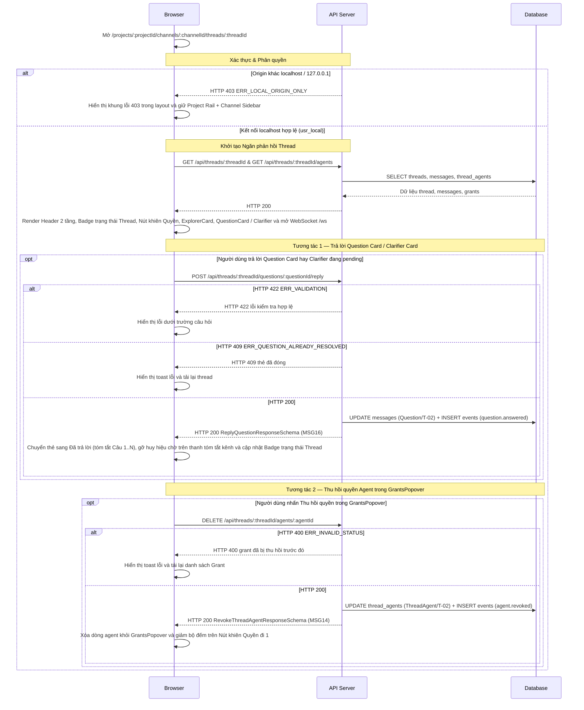

# UI-TR-01 - Header 2 tầng, Trạng thái Workflow, Explorer Card, Question / Clarifier Card & Quyền truy cập Agent trong Ngăn phản hồi Thread (Thread Reply Header, Explorer Card, Question / Clarifier Card & Grants Popover)

| Trường | Giá trị |
| --- | --- |
| Mã màn hình | `UI-TR-01` |
| Tên màn hình | Header 2 tầng, Trạng thái Workflow, Explorer Card, Question / Clarifier Card & Quyền truy cập Agent trong Ngăn phản hồi Thread (Thread Reply Header, Explorer Card, Question / Clarifier Card & Grants Popover) |
| Đường dẫn chốt | `specs/dd/trigger/tr-01/ui-workflow-cards.md` |
| URL | `/projects/:projectId/channels/:channelId/threads/:threadId` |
| Ngày tạo | 2026-10-31 |
| Ngày cập nhật | 2026-10-31 |

## TÓM TẮT

- **Mục tiêu**: Người dùng theo dõi trạng thái workflow của thread công việc trên Header 2 tầng của `Ngăn phản hồi Thread`, điều chỉnh độ rộng và đóng `Ngăn phản hồi Thread`, quản lý danh sách Agent có quyền đọc ngữ cảnh trên `GrantsPopover`, giám sát `Banner Dừng Rule Engine`, xem tin nhắn phản hồi `BOT` cùng thẻ giải thích mã nguồn `ExplorerCard` (`@explorer`) kèm trích dẫn `file:start_line-end_line`, và trả lời câu hỏi đơn hay bảng phỏng vấn đa câu hỏi `Clarifier` từ Agent / Rule Engine trên `QuestionCard` đồng bộ với thanh tóm tắt dưới tin nhắn gốc trên `Channel Chat Box`.
- **Actor**: Chủ dự án local (`usr_local`, `role = owner`) truy cập qua `localhost` hay `127.0.0.1` ở chế độ `ADE_MODE=solo`.
- **Trong phạm vi**:
  - `Ngăn phản hồi Thread` (`data-testid="thread-panel"`) co giãn độ rộng (`340px..780px`, mặc định `448px`, lưu tại `localStorage["ade-thread-panel-w"]`) với `Vách kéo Độ rộng Ngăn phản hồi` cạnh trái và **Header 2 tầng**:
    - **Header Tầng 1 (Topbar)**: hiển thị trên mọi Thread đang mở, gồm tiêu đề `"Thread"`, chip `#<channels.name>`, tổng số phản hồi ở bên trái; `Nút khiên Quyền ({activeCount})`, `Nút Đổi độ rộng Ngăn phản hồi` (`448px ↔ 640px`, `aria-label="Đổi độ rộng ngăn Thread"`) và `Nút Đóng Ngăn phản hồi` dạng icon `×` (`aria-label="Đóng ngăn Thread"`) ở bên phải.
    - **Header Tầng 2 (Subbar)**: chỉ hiển thị trên thread công việc có agent tham gia (`grants.length >= 1` hay `threads.main_agent_id IS NOT NULL`) hay khi `threads.state <> 'open'`; ẩn trên thread chỉ trao đổi giữa người với người; hiển thị `Badge trạng thái Thread` theo semantic tokens của `tokens.css`.
  - `GrantsPopover` mở từ `Nút khiên Quyền ({activeCount})`: có `Nút Đóng GrantsPopover` dạng icon `×` (`aria-label="Đóng"`), hiển thị từng dòng agent bằng chip kỹ thuật `.ade-mention--agent` (font mono `--font-outlier`, bo góc `4px`, kèm icon SVG `bot` `12x12`), nhãn `role` (`main` / `worker`), `scope` (`brief` / `full`) và `Nút Thu hồi quyền` (`DELETE /api/threads/:threadId/agents/:agentId`).
  - `Banner Dừng Rule Engine` ngay dưới Header của `Ngăn phản hồi Thread` khi `threads.engine_halted = 1` hay khi nhận sự kiện `engine.halted`.
  - `Dòng Tin nhắn Phản hồi Agent` (`author_type = 'agent'` và `kind = 'text'` tạo từ MCP `post_message`) hiển thị huy hiệu `BOT` cạnh tên tác giả và kết xuất phân biệt `.ade-mention--agent` (chip vuông `4px`, font mono `--font-outlier`, icon SVG `bot` `12x12`) với `.ade-mention--human` (pill tròn `999px`, font sans `--font-display`, icon SVG `user` `12x12`).
  - `Khung Explorer Card` (`kind = 'explorer_card'` tạo từ MCP `post_message` của agent chỉ đọc như `@explorer`): kết xuất bằng `.ade-panel .ade-explorer-card` với viền hairline `1px` `--color-agent` bao quanh (không dùng vạch dọc `border-left` dày), huy hiệu `"Chỉ đọc · 0 file sửa"`, thông số chi phí và thời lượng bằng `--font-outlier` (`tabular-nums`), khung nhật ký `Trace (<N>)`, danh sách bước luồng xử lý `1..N`, khối trích dẫn mã nguồn thu gọn `<file>:<start_line>-<end_line>` kèm nút `"Chép vị trí"`, nút `"Hỏi sâu thêm @explorer"` và nút chính `"Nhờ @planner lập phương án từ kết quả này"`, đồng bộ với `Huy hiệu Chỉ đọc Explorer trên Thanh tóm tắt Thread` (`"Chỉ đọc · <N> file"`) dưới tin nhắn gốc trên `Channel Chat Box`.
  - `Khung Question Card` kiêm `Clarifier` đa câu hỏi (`kind = 'question_card'`): kết xuất bằng `.ade-panel .ade-gate-card` (thêm `.ade-clarify-card` khi có mảng `questions[]`) với viền hairline `1px` `--color-human` bao quanh kèm dấu vuông `8x8` `--color-human` (`.ade-gate-mark`), hỗ trợ cả chế độ 1 câu hỏi đơn lẫn chế độ phỏng vấn đa câu hỏi (`single` radio, `multi` checkbox, `text` kèm chip gợi ý và mục `"Khác"` nhập tự do), huy hiệu tiến độ `"Đã trả lời X/N"`, đồng bộ `question.timed_out`, và cập nhật `Huy hiệu Chờ trả lời trên Thanh tóm tắt Thread` dưới tin nhắn gốc trên `Channel Chat Box`.
- **Ngoài phạm vi**: Thẻ duyệt quyền công cụ của harness (`PermissionCard` thuộc module `runner`), công tắc phân đoạn `Phản hồi | Sổ nháp`, chip Main Agent, thanh tiến độ ngân sách và thẻ cổng duyệt có đánh số phiên bản (`ApprovalGateCard` thuộc module `orchestration` và `memory`), trình soạn thảo tệp Workflow YAML (thuộc module `memory`).
- **Giả định**: Khung bố cục Slack 3+1 cột (`Project Rail 64px` → `Channel Sidebar 224px` → `Channel Chat Box 1fr` + `Ngăn phản hồi Thread co giãn 340px..780px` trên Desktop `>= 1025px`; `Ngăn phản hồi Thread` trượt đè bên phải `min(448px, 88vw)` trên nền `--color-backdrop` ở Tablet `768px..1024px`; `Ngăn phản hồi Thread` toàn màn hình `100vw` ở Mobile `< 768px`), mô hình `1 Tin nhắn gốc = 1 Thread` và hệ thống semantic tokens `tokens.css` theo [design.md](design.md) đã được dựng từ Phase P0–P1.
- **Câu hỏi mở**: Không có.

## Lịch sử sửa đổi

| Ver | Ngày | Tác giả | Thay đổi |
| --- | --- | --- | --- |
| 1.0 | 2026-10-31 | — | Phát hành lần đầu cho Phase P3 |
| 1.1 | 2026-10-31 | — | Đồng bộ vòng 1 spec-review: chuẩn hóa cột DB của Item 8 và Item 10, đồng bộ `Banner Dừng Rule Engine` cho `causation_limit`, sắp lại thứ tự bước `API-3` khớp `API-TR-01`, gỡ `optionId` khỏi validate ô nhập tự do phía client và bổ sung sự kiện `question.timed_out` (`E-17`, `AC-UI-TR-01-15`) |
| 1.2 | 2026-10-31 | — | Đồng bộ giao diện Slack 3+1 cột (`design.md`): thiết kế Header 2 tầng của `Ngăn phản hồi Thread` co giãn (`340px..780px`), ẩn Tầng 2 trên thread thuần người-người, `GrantsPopover` dùng nút đóng icon `×` và chip `.ade-mention--agent`, `QuestionCard` dùng viền hairline `1px` `--color-human` kèm dấu vuông `8x8` `.ade-gate-mark`, đồng bộ huy hiệu chờ trả lời trên thanh tóm tắt tin nhắn gốc của kênh và kết xuất tin nhắn `post_message` kèm huy hiệu `BOT` (`AC-UI-TR-01-16..21`) |
| 1.3 | 2026-10-31 | — | Bổ sung `Khung Explorer Card` (`.ade-explorer-card`, viền `1px` `--color-agent`, trích dẫn mã nguồn `file:start_line-end_line`, nhật ký `Trace`, nút chuyển giao cho `@planner`) kèm huy hiệu `"Chỉ đọc · <N> file"` dưới tin nhắn gốc trên kênh, và mở rộng `QuestionCard` hỗ trợ chế độ phỏng vấn đa câu hỏi `Clarifier` (`.ade-clarify-card`, `single` / `multi` / `text`, mục `"Khác"` và chip gợi ý) (`Items 23..33`, `V-05..V-09`, `I-09..I-10`, `E-23..E-32`, `AC-UI-TR-01-22..30`) |

---

## BỐ CỤC

```text
+-----------------------------------+||+------------------------------------------------------------+
| CHANNEL CHAT BOX (1fr)            |||| NGĂN PHẢN HỒI THREAD (340px..780px, mặc định 448px)        |
| # auth-feature                    |||| TẦNG 1 TOPBAR: Thread [#auth-feature] 4 phản hồi           |
| Xác thực MCP và phân quyền đọc    ||||                              [🛡 Quyền (2)] [⤢] [×]        |
+-----------------------------------+||+------------------------------------------------------------+
| [CP] Local Owner           09:15  |||| TẦNG 2 SUBBAR (ẩn khi thread thuần người-người):           |
|  @explorer giải thích luồng grant |||| Trạng thái workflow:                    [ plan_review ]    |
|  +------------------------------+ |||+------------------------------------------------------------+
|  | [CP][EX][PL] 4 phản hồi      | ||||           +----------------------------------------------+ |
|  | [Chỉ đọc · 2 file]           | ||||           | Quyền đọc Thread này                     [×] | |
|  | [plan_review] [1 chờ trả lời]| ||||           | [🤖 @explorer] (worker · full) [Thu hồi quyền]| |
|  +------------------------------+ ||||           | [🤖 @planner] (main · full)   [Thu hồi quyền]| |
|                                   ||||           +----------------------------------------------+ |
|                                   |||+------------------------------------------------------------+
|                                   |||| [!] BANNER DỪNG RULE ENGINE (khi engine_halted = 1):       |
|                                   |||| Rule engine đã tạm dừng do chuỗi sự kiện vượt quá giới hạn |
|                                   |||| an toàn (20 bước).                                         |
|                                   |||+------------------------------------------------------------+
|                                   |||| LUỒNG PHẢN HỒI TRONG NGĂN THREAD                           |
|                                   ||||                                                            |
|                                   |||| +-- 1px --color-agent (.ade-panel .ade-explorer-card) ---+ |
|                                   |||| | [🤖 @explorer] [Chỉ đọc · 0 file sửa] $0.012 · 1.8s    | |
|                                   |||| | Luồng kiểm tra Grant trong ADE MCP          [Trace (2)]| |
|                                   |||| | 1. Đọc Bearer mcp_token · 2. Đối chiếu thread_agents   | |
|                                   |||| | ▼ apps/hub/src/trigger/grant.service.ts:12-24 [Chép]   | |
|                                   |||| |   12 | export class GrantService {                     | |
|                                   |||| | [Hỏi sâu thêm @explorer]                               | |
|                                   |||| | [Nhờ @planner lập phương án từ kết quả này]            | |
|                                   |||| +--------------------------------------------------------+ |
|                                   ||||                                                            |
|                                   |||| +-- 1px --color-human (.ade-panel .ade-clarify-card) ----+ |
|                                   |||| | ■ [🤖 @planner] Làm rõ yêu cầu  [Đã trả lời 1/3]       | |
|                                   |||| | Câu 1 · Chọn 1 đáp án: Cơ chế phiên đăng nhập?         | |
|                                   |||| |   (•) Cookie HttpOnly   ( ) Bearer JWT   ( ) Khác      | |
|                                   |||| | Câu 2 · Chọn nhiều đáp án: Yếu tố xác thực phụ?        | |
|                                   |||| |   [x] TOTP   [ ] SMS   [x] Khác: [Passkey WebAuthn___] | |
|                                   |||| | Câu 3 · Điền câu trả lời: [+ Giới hạn 5 lần sai]       | |
|                                   |||| |   [Nhập câu trả lời___________________________________]| |
|                                   |||| |                           [Gửi câu trả lời cho @planner]| |
|                                   |||| +--------------------------------------------------------+ |
+-----------------------------------+||+------------------------------------------------------------+
                                     ^^ Vách kéo độ rộng (340px..780px)
```

---

## LOGIC

### I. Các phần tử (Items)

| STT | Tên logic | Loại đối tượng | Cột trong DB | Mô tả | Ghi chú |
| --- | --- | --- | --- | --- | --- |
| 1 | Vách kéo Độ rộng Ngăn phản hồi | Thanh kéo | — | Vách dọc cạnh trái của `Ngăn phản hồi Thread` (`data-testid="thread-panel"`), có `role="separator"` và `aria-orientation="vertical"`, hỗ trợ kéo chuột và phím `ArrowLeft` (tăng độ rộng thêm `24px`) / `ArrowRight` (giảm độ rộng đi `24px`) kẹp trong đoạn `340px..780px` | Lưu vào `localStorage["ade-thread-panel-w"]`; ẩn ở Mobile `< 768px`; vách kéo có `data-testid="thread-panel-resizer"`, khung ngăn có `data-testid="thread-panel"` |
| 2 | Header Tầng 1 (Topbar) | Khung đầu trang | `channels.name` | Khung `.ade-thread-topbar` hiển thị biểu tượng phản hồi, tiêu đề `"Thread"`, chip `#<channels.name>` (`.ade-chip .ade-mono`) và bộ đếm phản hồi ở bên trái; nhóm nút điều khiển ở bên phải | Hiển thị trên mọi Thread đang mở |
| 3 | Nút khiên Quyền ({activeCount}) | Nút | — | Nút `.ade-btn .ade-btn--sm` kèm icon SVG lá chắn hiển thị nhãn `"Quyền (<activeCount>)"` | Hiển thị trên Topbar khi `grants.length >= 1`, `threads.main_agent_id IS NOT NULL` hay `threads.state <> 'open'`; ẩn trên thread thuần người-người; `data-testid="thread-grants-trigger"` |
| 4 | Nút Đổi độ rộng Ngăn phản hồi | Nút icon | — | Nút icon `.ade-icon-btn .ade-icon-btn--outlined` (`aria-label="Đổi độ rộng ngăn Thread"`) đổi độ rộng `Ngăn phản hồi Thread` (`data-testid="thread-panel"`) giữa `448px` và `640px` | Ẩn ở Mobile `< 768px`; `aria-label="Đổi độ rộng ngăn Thread"`; `data-testid="thread-width-toggle"` |
| 5 | Nút Đóng Ngăn phản hồi | Nút icon | — | Nút icon `×` (`.ade-icon-btn`, `aria-label="Đóng ngăn Thread"`) đóng ngăn phản hồi và điều hướng về `/projects/:projectId/channels/:channelId` | Đặt ở góc phải của Topbar; `data-testid="thread-close-btn"` |
| 6 | Header Tầng 2 (Subbar) | Khung phụ đầu trang | `threads.main_agent_id` | Khung `.ade-thread-subbar` ngay dưới Topbar chứa `Badge trạng thái Thread` | Chỉ hiển thị khi `grants.length >= 1`, `threads.main_agent_id IS NOT NULL` hay `threads.state <> 'open'`; ẩn trên thread chỉ trao đổi giữa người với người; `data-testid="thread-work-subbar"` |
| 7 | Badge trạng thái Thread | Nhãn | `threads.state` | Chip `.ade-chip .ade-mono` hiển thị tên state hiện hành (`open`, `plan`, `planning`, `plan_review`, `implement`, `building`, `review`, `done`) | Dùng semantic tokens trong `tokens.css`: `.ade-chip` cho `open`, `.ade-chip--human` cho state chứa `review`, `.ade-chip--ok` cho `done`, `.ade-chip--agent` cho các state đang thực thi còn lại; `data-testid="workflow-state-badge"` |
| 8 | GrantsPopover | Khung nổi | — | Khung nổi `.ade-panel .ade-popover` liệt kê các agent có bản ghi `thread_agents` với `revoked_at IS NULL` | Khi danh sách rỗng thì hiển thị dòng `"Chưa có agent nào được cấp quyền đọc thread này."`; `data-testid="thread-grants-popover"` |
| 9 | Nút Đóng GrantsPopover | Nút icon | — | Nút icon `×` (`.ade-icon-btn .ade-icon-btn--sm`, `aria-label="Đóng"`) ở góc trên bên phải của `GrantsPopover` | Không dùng nút chữ `"Hủy"` trên header của Popover; `data-testid="thread-grants-close"` |
| 10 | Dòng Agent được cấp quyền | Dòng danh sách | `thread_agents.agent_id` | Hiển thị chip kỹ thuật `.ade-mention--agent` (bo góc `4px`, font mono `--font-outlier`, màu `--color-agent` trên nền `--color-agent-soft`, kèm icon SVG `bot` `12x12`), nhãn `thread_agents.role` (`main` / `worker`) và `thread_agents.scope` (`brief` / `full`) | Nối dữ liệu từ `GET /api/threads/:threadId/agents` |
| 11 | Nút Thu hồi quyền | Nút | — | Nút `.ade-btn .ade-btn--sm .ade-btn--danger` gửi yêu cầu thu hồi quyền đọc ngữ cảnh thread của dòng agent tương ứng | Hiển thị trên từng dòng trong `GrantsPopover`; `data-testid="revoke-grant-<handle>"` |
| 12 | Banner Dừng Rule Engine | Khung cảnh báo | `threads.engine_halted` | Thanh cảnh báo `.ade-panel--bad` ngay dưới Header của `Ngăn phản hồi Thread` khi Rule Engine tạm dừng do vượt giới hạn chuỗi nhân quả 20 bước | Hiển thị thông điệp tiếng Việt của mã `ERR_CAUSATION_LIMIT_EXCEEDED` từ [message.md](specs/message.md); các cảnh báo `max_depth` và `budget_exceeded` hiển thị thành tin nhắn `kind = 'system'` trong luồng phản hồi; `data-testid="engine-halted-banner"` |
| 13 | Dòng Tin nhắn Phản hồi Agent | Dòng tin nhắn | `messages.body` | Hiển thị bản ghi phản hồi có `author_type = 'agent'` và `kind = 'text'` (tạo từ MCP `post_message`) kèm huy hiệu `BOT` (`.ade-chip .ade-chip--agent .ade-mono`) cạnh tên tác giả và `agents.handle` | Các `@mention` trong nội dung được kết xuất thành `.ade-mention--agent` (`messages.mentions_json`) và `.ade-mention--human` (`messages.human_mentions_json`); khi `card_json.messageKind = 'result'` thì hiển thị thêm nhãn `"Kết quả"`; `data-testid="agent-reply-message"` |
| 14 | Huy hiệu Chờ trả lời trên Thanh tóm tắt Thread | Nhãn | `messages.card_json` | Chip `.ade-chip .ade-chip--human` hiển thị `"<pendingCount> chờ trả lời"` trên thanh tóm tắt `.ade-thread-bar` ngay dưới tin nhắn gốc của thread trên `Channel Chat Box` | Hiển thị khi thread có ít nhất 1 `QuestionCard` ở trạng thái `pending`; ẩn khi `pendingCount = 0`; `data-testid="thread-summary-pending-question"` |
| 15 | Khung Question Card | Thẻ tương tác | `messages.card_json` | Thẻ `.ade-panel .ade-gate-card` (thêm lớp `.ade-clarify-card` khi `card_json.questions.length >= 1`) hiển thị bản ghi `messages` có `kind = 'question_card'` với viền hairline `1px` `--color-human` bao quanh và dấu vuông `8x8` `--color-human` (`.ade-gate-mark`) | Không dùng vạch dọc `border-left` dày; tuân thủ `QuestionCardPayloadSchema`; `data-testid="question-card"` |
| 16 | Nhãn Nguồn Câu hỏi | Nhãn | `messages.card_json` | Hiển thị chip `.ade-mention--agent` (kèm icon SVG `bot` `12x12`) của `card_json.agent_handle` khi `card_json.source = 'mcp'`; hiển thị nhãn `"Rule Engine"` khi `card_json.source = 'rule'` | Đặt cạnh dấu vuông `.ade-gate-mark` trên tiêu đề của `QuestionCard` |
| 17 | Badge Trạng thái Câu hỏi | Nhãn | `messages.card_json` | Chip `.ade-chip` hiển thị `"Đang chờ trả lời"` (`.ade-chip--human` khi `pending`), `"Đã trả lời"` (`.ade-chip--ok` khi `answered`), `"Hết hạn chờ"` (`.ade-chip--bad` khi `expired`) | Trích từ `card_json.status`; `data-testid="question-status-badge"` |
| 18 | Nội dung Câu hỏi | Nhãn | `messages.card_json` | Hiển thị văn bản câu hỏi hay tiêu đề làm rõ từ `card_json.question` | Giữ xuống dòng văn bản thuần |
| 19 | Nhóm Nút Phương án | Nhóm nút | `messages.card_json` | Hiển thị mỗi phần tử trong `card_json.options` thành một nút bấm `.ade-btn .ade-btn--sm .ade-btn--primary` | Chỉ hiển thị ở chế độ câu hỏi đơn (`card_json.questions.length = 0`) khi `card_json.status = 'pending'` và mảng `options` có độ dài `>= 1`; `data-testid="question-option-<opt>"` |
| 20 | Ô nhập Câu trả lời | Ô nhập | — | Ô nhập `.ade-input` cho phép người dùng gõ câu trả lời tự do ở chế độ câu hỏi đơn | Chỉ hiển thị khi `card_json.status = 'pending'` và `card_json.questions.length = 0`; vô hiệu hóa trong lúc mutation đang gửi; `data-testid="question-answer-input"` |
| 21 | Nút Gửi trả lời | Nút | — | Nút `.ade-btn .ade-btn--sm` (thêm `.ade-btn--primary` ở chế độ đa câu hỏi `Clarifier`, hiển thị `"Gửi câu trả lời cho <agent_handle>"` khi có `agent_handle` trên `Clarifier`, hiển thị `"Gửi trả lời"` ở chế độ câu hỏi đơn) xác nhận gửi câu trả lời | Chỉ hiển thị khi `card_json.status = 'pending'`; `data-testid="question-submit-btn"` |
| 22 | Khối Câu trả lời đã chốt | Nhãn | `messages.card_json` | Khung `.ade-well` hiển thị `card_json.answer` (ở chế độ đa câu hỏi `Clarifier` liệt kê thêm từng dòng `"Câu <index + 1>"` từ `card_json.answers`) và thời điểm `card_json.answered_at` | Chỉ hiển thị khi `card_json.status = 'answered'`; `data-testid="question-resolved-answer"` |
| 23 | Huy hiệu Chỉ đọc Explorer trên Thanh tóm tắt Thread | Nhãn | `messages.card_json` | Chip `.ade-chip .ade-chip--agent` hiển thị `"Chỉ đọc · <citationCount> file"` trên thanh tóm tắt `.ade-thread-bar` dưới tin nhắn gốc của thread trên `Channel Chat Box` | Hiển thị khi thread có ít nhất 1 bản ghi `kind = 'explorer_card'`, lấy số lượng `citations` của thẻ mới nhất; `data-testid="thread-summary-explorer-insight"` |
| 24 | Khung Explorer Card | Thẻ tương tác | `messages.card_json` | Thẻ `.ade-panel .ade-explorer-card` hiển thị bản ghi `messages` có `kind = 'explorer_card'` với viền hairline `1px` `--color-agent` bao quanh (không dùng vạch dọc `border-left` dày), chip `.ade-mention--agent` của `card_json.agent_handle`, huy hiệu `.ade-chip .ade-chip--agent` `"Chỉ đọc · 0 file sửa"` kèm icon SVG kính lúp, tiêu đề `card_json.topic`, thông số `cost_usd` và `duration_ms` bằng `--font-outlier` (`tabular-nums`) | Tuân thủ `ExplorerCardPayloadSchema`; `data-testid="explorer-card"` |
| 25 | Nút Bật/tắt Nhật ký Trace | Nút | `messages.card_json` | Nút `.ade-btn .ade-btn--sm` hiển thị `"Trace (<trace_steps.length>)"` khi đóng và `"Ẩn trace"` khi mở, điều khiển khung `.ade-well` liệt kê tuần tự `card_json.trace_steps` | Chỉ hiển thị khi `card_json.trace_steps.length >= 1`; nút có `data-testid="explorer-trace-toggle"`, khung nhật ký có `data-testid="explorer-trace-well"` |
| 26 | Danh sách Bước Luồng xử lý | Danh sách | `messages.card_json` | Danh sách có thứ tự `.ade-flow-list` hiển thị từng phần tử `card_json.flow_steps` trong dòng `.ade-flow-step` kèm huy hiệu số thứ tự `1..N` (`.ade-flow-num`, font `--font-outlier` `tabular-nums`) | `data-testid="explorer-flow-list"` |
| 27 | Khối Trích dẫn Mã nguồn | Khối thu gọn | `messages.card_json` | Danh sách các khối accordion `.ade-code-ref` cho từng phần tử `card_json.citations`; thanh tiêu đề `.ade-code-ref-head` hiển thị `<file>:<start_line>-<end_line>` (font `--font-outlier`) cùng nhãn `role`; khi mở hiển thị khoang code `.ade-code-snippet` đánh số dòng `tabular-nums` bắt đầu từ `start_line`, ghi chú `note` (khi có) và nút `"Chép vị trí"` | Mục đầu tiên (`index = 0`) mở sẵn khi khởi tạo thẻ; khối có `data-testid="explorer-citation-<index>"`, thanh tiêu đề có `data-testid="explorer-citation-toggle-<index>"`, nút chép có `data-testid="explorer-copy-loc-<index>"` |
| 28 | Nút Hỏi sâu thêm @explorer | Nút | — | Nút `.ade-btn .ade-btn--sm` điền chuỗi `"@explorer Giải thích sâu hơn các nhánh trong <citations[0].file> "` vào ô nhập phản hồi của `Ngăn phản hồi Thread` và đặt tiêu điểm bàn phím vào ô nhập đó | `data-testid="explorer-followup-btn"` |
| 29 | Nút Chuyển giao cho @planner | Nút | — | Nút chính `.ade-btn .ade-btn--sm .ade-btn--primary` nhãn `"Nhờ @planner lập phương án từ kết quả này"`, điền chuỗi `"@planner Dựa trên kết quả tra cứu \"<topic>\" tại <citations[0].file>, hãy làm rõ yêu cầu và lập phương án triển khai"` vào ô nhập phản hồi của `Ngăn phản hồi Thread` và đặt tiêu điểm bàn phím vào ô nhập đó | `data-testid="explorer-handoff-planner-btn"` |
| 30 | Huy hiệu Tiến độ Trả lời Clarifier | Nhãn | `messages.card_json` | Chip `.ade-chip` trên đầu `QuestionCard` chế độ đa câu hỏi hiển thị `"Đã trả lời <answeredCount>/<questions.length>"` (`.ade-chip--human` khi `answeredCount < questions.length`, `.ade-chip--ok` khi `answeredCount = questions.length`); một câu hỏi được tính vào `answeredCount` khi câu `type = 'text'` có `text.trim().length >= 1`, hay câu `type` thuộc `('single', 'multi')` có ít nhất 1 lựa chọn được chọn và khi tập chọn chứa `"__other__"` thì `other_text.trim().length >= 1` | Chỉ hiển thị khi `card_json.status = 'pending'` và `card_json.questions.length >= 1`; `data-testid="clarifier-progress-badge"` |
| 31 | Khối Câu hỏi Làm rõ | Khối tương tác | `messages.card_json` | Khung `.ade-q-block` cho từng phần tử trong `card_json.questions`, hiển thị số thứ tự `"Câu <index + 1>"`, nhãn kiểu trả lời (`"Chọn 1 đáp án"` cho `single`, `"Chọn nhiều đáp án"` cho `multi`, `"Điền câu trả lời"` cho `text`) và nội dung `prompt` | Chỉ hiển thị khi `card_json.status = 'pending'` và `card_json.questions.length >= 1`; `data-testid="clarifier-q-block-<question.id>"` |
| 32 | Danh sách Lựa chọn Radio / Checkbox và Mục Khác | Nhóm lựa chọn | `messages.card_json` | Danh sách `.ade-choice-list` chứa các thẻ `.ade-choice-option` (`role="radio"` cho `single`, `role="checkbox"` cho `multi`) hiển thị `label`, `hint` (khi có), nhãn `"Khuyến nghị"` (khi `recommended = true`); khi câu hỏi thuộc kiểu `'single'` hay `'multi'` và `allow_other !== false` thì hiển thị thêm mục `"Khác (tự điền câu trả lời)"` (`option_id = "__other__"`) kèm ô nhập `.ade-input` cho `other_text` ngay khi mục `"Khác"` đang được chọn | Lựa chọn có `data-testid="clarifier-option-<question.id>-<option.id>"`, ô nhập `"Khác"` có `data-testid="clarifier-other-input-<question.id>"` |
| 33 | Nhóm Chip Gợi ý và Ô nhập Tự luận Clarifier | Nhóm điều khiển | `messages.card_json` | Hiển thị các nút `.ade-quick-chip` nhãn `"+ <suggestion>"` (từ `question.suggestions`) và ô `textarea` `.ade-input` cho câu hỏi có `type = 'text'` | Chỉ hiển thị trong `Khối Câu hỏi Làm rõ` có `type = 'text'`; chip có `data-testid="clarifier-quick-chip-<question.id>-<idx>"`, ô nhập có `data-testid="clarifier-text-input-<question.id>"` |

### II. Kiểm tra hợp lệ (Validate)

Trên `QuestionCard`, phía client kiểm tra theo bộ quy tắc `trigger.question.reply` trong `VALIDATION_CATALOG` (`packages/shared/src/validation-catalog.ts`) và [message.md](specs/message.md) đồng bộ với [api-mcp-trigger.md](specs/dd/trigger/tr-01/api-mcp-trigger.md): `V-01..V-04` trên `answer` áp dụng cho `Ô nhập Câu trả lời` ở chế độ câu hỏi đơn (`card_json.questions.length = 0`, cũng như giới hạn `trim` / `min:1` / `max:2000` trên ô `text` bắt buộc của `Clarifier`), `V-05` trên `answers` chỉ áp dụng ở chế độ đa câu hỏi `Clarifier` (`card_json.questions.length >= 1`; ở chế độ câu hỏi đơn trường `answers` là `nullable` theo `API-TR-01` `V-79`), và `V-06..V-09` trên `answers[].other_text` (ánh xạ nhãn `FIELD_LABELS.otherText`) áp dụng cho ô nhập mục `"Khác"`, trong đó `V-08` (`min:1`) kích hoạt khi `selected_option_ids` chứa `"__other__"`:

| ID | Tên logic | Tên | Quy tắc kiểm tra | Mã message | Message |
| --- | --- | --- | --- | --- | --- |
| V-01 | Câu trả lời | `answer` | `trim` | — | — |
| V-02 | Câu trả lời | `answer` | `required` | MSG01 | Câu trả lời là bắt buộc. |
| V-03 | Câu trả lời | `answer` | `min:1` | MSG01 | Câu trả lời là bắt buộc. |
| V-04 | Câu trả lời | `answer` | `max:2000` | MSG02 | Câu trả lời không được vượt quá 2000 ký tự. |
| V-05 | Danh sách câu trả lời | `answers` | `required` | MSG01 | Danh sách câu trả lời là bắt buộc. |
| V-06 | Câu trả lời khác | `answers[].other_text` | `nullable` | — | — |
| V-07 | Câu trả lời khác | `answers[].other_text` | `trim` | — | — |
| V-08 | Câu trả lời khác | `answers[].other_text` | `min:1` | MSG01 | Câu trả lời khác là bắt buộc. |
| V-09 | Câu trả lời khác | `answers[].other_text` | `max:1000` | MSG02 | Câu trả lời khác không được vượt quá 1000 ký tự. |

### III. Logic

#### Thông tin màn hình
- **Phân quyền**: Chủ dự án local (`usr_local`, `role = owner`) truy cập qua `localhost` hay `127.0.0.1` ở chế độ `ADE_MODE=solo` theo [reference.md](specs/reference.md).
- **Mẫu URL**: `/projects/:projectId/channels/:channelId/threads/:threadId`
- **API chính**:

| STT | Method | Path | Mục đích |
| --- | --- | --- | --- |
| 1 | `GET` | `/api/threads/:threadId` | Tải thông tin thread (`state`, `workflow_id`, `main_agent_id`, `engine_halted`) và danh sách tin nhắn gồm tin nhắn gốc, phản hồi của agent, `explorer_card` và `question_card` |
| 2 | `GET` | `/api/threads/:threadId/agents` | Tải danh sách agent đang có grant `active` trong thread (`API-TR-01` · `API-4`) |
| 3 | `POST` | `/api/threads/:threadId/questions/:questionId/reply` | Gửi câu trả lời đơn hay mảng câu trả lời `Clarifier` cho `QuestionCard` đang chờ (`API-TR-01` · `API-2`) |
| 4 | `DELETE` | `/api/threads/:threadId/agents/:agentId` | Thu hồi quyền truy cập ngữ cảnh của agent khỏi thread (`API-TR-01` · `API-3`) |

#### 1. Kiểm tra phân quyền

| ID | Mô tả |
| --- | --- |
| P-01 | Khi người dùng mở URL màn hình trên `localhost` hay `127.0.0.1` ở chế độ `ADE_MODE=solo`, hệ thống phải gắn định danh `usr_local` (`role = owner`) và cho phép hiển thị `Ngăn phản hồi Thread`. |
| P-02 | Nếu API khởi tạo trả HTTP 403 `ERR_LOCAL_ORIGIN_ONLY`, thì màn hình phải hiển thị khung lỗi 403 trong khu vực nội dung chính và giữ nguyên thanh điều hướng bên trái (`Project Rail` và `Channel Sidebar`). |

#### 2. Khởi tạo màn hình

| ID | Mô tả |
| --- | --- |
| I-01 | Khi `Ngăn phản hồi Thread` mở theo `:threadId`, màn hình phải gọi đồng thời `GET /api/threads/:threadId` và `GET /api/threads/:threadId/agents`. |
| I-02 | Khi `Ngăn phản hồi Thread` (`data-testid="thread-panel"`) khởi tạo trên Desktop (`>= 1025px`), màn hình phải đọc `localStorage["ade-thread-panel-w"]` (mặc định `448px`, kẹp trong đoạn `340px..780px`) để áp độ rộng cho `Ngăn phản hồi Thread`. |
| I-03 | Khi dữ liệu khởi tạo có `grants.length = 0`, `threads.main_agent_id IS NULL` và `threads.state = 'open'` (thread chỉ trao đổi giữa người với người), màn hình phải ẩn `Header Tầng 2 (Subbar)` và ẩn `Nút khiên Quyền ({activeCount})`. |
| I-04 | Khi dữ liệu khởi tạo có `grants.length >= 1`, `threads.main_agent_id IS NOT NULL` hay `threads.state <> 'open'`, màn hình phải hiển thị `Nút khiên Quyền ({activeCount})` với nhãn `"Quyền (<grants.length>)"` trên `Header Tầng 1 (Topbar)` và hiển thị `Header Tầng 2 (Subbar)` chứa `Badge trạng thái Thread` mang giá trị `threads.state`. |
| I-05 | Khi `GET /api/threads/:threadId` trả `engine_halted = 1`, màn hình phải hiển thị `Banner Dừng Rule Engine` ngay dưới Header của `Ngăn phản hồi Thread`. |
| I-06 | Khi `GET /api/threads/:threadId` trả danh sách `messages` chứa phần tử `kind = 'question_card'`, màn hình phải hiển thị `Khung Question Card` với viền `1px` `--color-human` và dấu vuông `8x8` `.ade-gate-mark` theo giá trị `card_json.status` (`pending`, `answered`, `expired`), đồng thời hiển thị `Huy hiệu Chờ trả lời trên Thanh tóm tắt Thread` dưới tin nhắn gốc trên `Channel Chat Box` khi số thẻ `pending >= 1`. |
| I-07 | Khi `GET /api/threads/:threadId` trả các bản ghi phản hồi có `author_type = 'agent'` và `kind = 'text'`, màn hình phải hiển thị `Dòng Tin nhắn Phản hồi Agent` kèm huy hiệu `BOT` và kết xuất các `@mention` trong nội dung thành `.ade-mention--agent` và `.ade-mention--human`. |
| I-08 | Khi `Ngăn phản hồi Thread` khởi tạo xong, màn hình phải đăng ký nhận sự kiện trên kết nối WebSocket `/ws` của `:threadId` cho các loại sự kiện `thread.state_changed`, `question.asked`, `question.answered`, `question.timed_out`, `agent.granted`, `agent.revoked`, `engine.halted` và `message.posted`. |
| I-09 | Khi `GET /api/threads/:threadId` trả danh sách `messages` chứa phần tử `kind = 'explorer_card'`, màn hình phải hiển thị `Khung Explorer Card` với viền `1px` `--color-agent` (mục trích dẫn đầu tiên mở sẵn, khung `Trace` đóng sẵn) và hiển thị `Huy hiệu Chỉ đọc Explorer trên Thanh tóm tắt Thread` dưới tin nhắn gốc trên `Channel Chat Box` theo số lượng trích dẫn của thẻ mới nhất. |
| I-10 | Khi `GET /api/threads/:threadId` trả phần tử `kind = 'question_card'` có `card_json.questions.length >= 1` và `card_json.status = 'pending'`, màn hình phải hiển thị `Khung Question Card` ở chế độ đa câu hỏi `Clarifier` (`.ade-clarify-card`) gồm `Huy hiệu Tiến độ Trả lời Clarifier` (`"Đã trả lời 0/<questions.length>"`) và danh sách `Khối Câu hỏi Làm rõ` theo đúng thứ tự mảng `card_json.questions`. |

#### 3. Xử lý hành vi sự kiện

> Nội dung message của các mã trong mục này: xem [message.md](specs/message.md).

| ID | Sự kiện | Kích hoạt | Mô tả |
| --- | --- | --- | --- |
| E-01 | Đổi trạng thái workflow realtime | Khi kết nối `/ws` phát sự kiện `thread.state_changed` của `:threadId` | Màn hình phải hiển thị `Header Tầng 2 (Subbar)` và cập nhật văn bản cùng lớp màu ngữ nghĩa của `Badge trạng thái Thread` sang giá trị `payload.to` (`Thread/T-02..T-11`). |
| E-02 | Xuất hiện Question Card mới | Khi kết nối `/ws` phát sự kiện `question.asked` kèm bản ghi tin nhắn `kind = 'question_card'` | Màn hình phải thêm `Khung Question Card` ở trạng thái `pending` (`Question/T-01`) vào cuối luồng phản hồi trong `Ngăn phản hồi Thread`, cập nhật `Huy hiệu Chờ trả lời trên Thanh tóm tắt Thread` dưới tin nhắn gốc trên `Channel Chat Box` và cuộn tới thẻ mới. |
| E-03 | Nhấn nút phương án có sẵn | Khi người dùng nhấn một nút phương án trong `Nhóm Nút Phương án` trên `QuestionCard` đang `pending` | Màn hình phải gọi `POST /api/threads/:threadId/questions/:questionId/reply` với `answer` bằng nhãn phương án đã nhấn và `optionId` bằng giá trị phương án đó. |
| E-04 | Gửi câu trả lời tự do hợp lệ | Khi người dùng nhấn `Nút Gửi trả lời` ở chế độ câu hỏi đơn và giá trị `Ô nhập Câu trả lời` vượt qua kiểm tra `V-01..V-04` | Màn hình phải gọi `POST /api/threads/:threadId/questions/:questionId/reply` với `answer` đã cắt ký tự trắng hai đầu và `optionId = null`. |
| E-05 | Lỗi kiểm tra hợp lệ phía client trên Question Card đơn | Nếu người dùng nhấn `Nút Gửi trả lời` ở chế độ câu hỏi đơn mà giá trị `Ô nhập Câu trả lời` vi phạm `V-02`, `V-03` hay `V-04` | Màn hình phải hiển thị thông báo lỗi tương ứng dưới `Ô nhập Câu trả lời` và không gọi API. |
| E-06 | Trả lời Question Card thành công | Khi `POST /api/threads/:threadId/questions/:questionId/reply` trả HTTP 200 | Màn hình phải cập nhật `QuestionCard` sang trạng thái `answered` (`Question/T-02`), ẩn vùng nhập câu hỏi đang mở, hiển thị `Khối Câu trả lời đã chốt` (gồm tóm tắt từng câu `Câu 1..N` ở chế độ `Clarifier`), cập nhật lại `Huy hiệu Chờ trả lời trên Thanh tóm tắt Thread` trên `Channel Chat Box`, cập nhật `Badge trạng thái Thread` theo `response.thread_state` và hiển thị toast `MSG16`. |
| E-07 | Đồng bộ câu trả lời từ phiên khác qua WebSocket | Khi kết nối `/ws` phát sự kiện `question.answered` của `:threadId` | Màn hình phải chuyển `QuestionCard` có `question_id` tương ứng sang trạng thái `answered` (`Question/T-02`) với nội dung `payload.answer` cùng `payload.answers` và cập nhật lại `Huy hiệu Chờ trả lời trên Thanh tóm tắt Thread` trên `Channel Chat Box`. |
| E-08 | Trả lời vào Question Card đã đóng | Nếu `POST /api/threads/:threadId/questions/:questionId/reply` trả HTTP 409 `ERR_QUESTION_ALREADY_RESOLVED` | Màn hình phải hiển thị toast tiếng Việt qua `translateApiError` và gọi lại `GET /api/threads/:threadId` để đồng bộ trạng thái thẻ. |
| E-09 | Lỗi kiểm tra hợp lệ từ server khi trả lời | Nếu `POST /api/threads/:threadId/questions/:questionId/reply` trả HTTP 422 `ERR_VALIDATION` | Màn hình phải hiển thị thông báo lỗi inline theo `details.fieldErrors` (khóa `answer` dưới `Ô nhập Câu trả lời` ở chế độ câu hỏi đơn; khóa `answers.<index>.other_text` hay `answers.<question_id>` dưới `Khối Câu hỏi Làm rõ` tương ứng ở chế độ `Clarifier`). |
| E-10 | Bật/tắt GrantsPopover | Khi người dùng nhấn `Nút khiên Quyền ({activeCount})` trên `Header Tầng 1 (Topbar)` | Màn hình phải đảo trạng thái ẩn/hiện của `GrantsPopover`. |
| E-11 | Yêu cầu thu hồi quyền Agent | Khi người dùng nhấn `Nút Thu hồi quyền` trên một dòng agent trong `GrantsPopover` | Màn hình phải gọi `DELETE /api/threads/:threadId/agents/:agentId` cho agent đó. |
| E-12 | Thu hồi quyền Agent thành công | Khi `DELETE /api/threads/:threadId/agents/:agentId` trả HTTP 200 | Màn hình phải xóa dòng agent đó khỏi `GrantsPopover`, giảm số đếm trên `Nút khiên Quyền ({activeCount})` đi `1` (`ThreadAgent/T-02`) và hiển thị toast `MSG14`. |
| E-13 | Thu hồi quyền Agent thất bại do sai trạng thái | Nếu `DELETE /api/threads/:threadId/agents/:agentId` trả HTTP 400 `ERR_INVALID_STATUS` | Màn hình phải hiển thị toast tiếng Việt qua `translateApiError` và gọi lại `GET /api/threads/:threadId/agents` để làm mới danh sách. |
| E-14 | Đồng bộ cấp quyền Agent mới qua WebSocket | Khi kết nối `/ws` phát sự kiện `agent.granted` của `:threadId` | Màn hình phải hiển thị `Nút khiên Quyền ({activeCount})` cùng `Header Tầng 2 (Subbar)` và gọi lại `GET /api/threads/:threadId/agents` để cập nhật danh sách cùng số đếm (`ThreadAgent/T-01`, `ThreadAgent/T-03`, `ThreadAgent/T-04`). |
| E-15 | Đồng bộ thu hồi quyền Agent qua WebSocket | Khi kết nối `/ws` phát sự kiện `agent.revoked` của `:threadId` | Màn hình phải loại bỏ dòng `payload.agent_id` khỏi `GrantsPopover` và cập nhật lại số đếm trên `Nút khiên Quyền ({activeCount})` (`ThreadAgent/T-02`). |
| E-16 | Hiển thị cảnh báo dừng Rule Engine realtime | Khi kết nối `/ws` phát sự kiện `engine.halted` của `:threadId` (`reason = 'causation_limit'`) | Màn hình phải hiển thị `Banner Dừng Rule Engine` kèm thông điệp cảnh báo `ERR_CAUSATION_LIMIT_EXCEEDED` ngay dưới Header của `Ngăn phản hồi Thread`. |
| E-17 | Question Card hết hạn chờ qua WebSocket | Khi kết nối `/ws` phát sự kiện `question.timed_out` của `:threadId` | Màn hình phải chuyển `QuestionCard` có `question_id` tương ứng sang trạng thái `expired` (`Question/T-03`), hiển thị nhãn `"Hết hạn chờ"` trên `Badge Trạng thái Câu hỏi`, ẩn vùng nhập câu hỏi và cập nhật lại `Huy hiệu Chờ trả lời trên Thanh tóm tắt Thread` trên `Channel Chat Box`. |
| E-18 | Đóng GrantsPopover bằng nút icon `×` | Khi người dùng nhấn `Nút Đóng GrantsPopover` (`aria-label="Đóng"`) ở góc trên bên phải của `GrantsPopover` | Màn hình phải đóng `GrantsPopover` và trả tiêu điểm bàn phím về `Nút khiên Quyền ({activeCount})`. |
| E-19 | Chuyển đổi độ rộng Ngăn phản hồi Thread | Khi người dùng nhấn `Nút Đổi độ rộng Ngăn phản hồi` (`aria-label="Đổi độ rộng ngăn Thread"`) trên `Header Tầng 1 (Topbar)` | Màn hình phải chuyển độ rộng của `Ngăn phản hồi Thread` (`data-testid="thread-panel"`) sang `640px` (khi độ rộng hiện tại `< 560px`) hay thu về `448px` (khi độ rộng hiện tại `>= 560px`) và lưu giá trị mới vào `localStorage["ade-thread-panel-w"]`. |
| E-20 | Kéo hay dùng bàn phím chỉnh độ rộng Ngăn phản hồi Thread | Khi người dùng kéo `Vách kéo Độ rộng Ngăn phản hồi` bằng chuột hay nhấn phím `ArrowLeft` / `ArrowRight` lúc tiêu điểm nằm trên vách kéo | Màn hình phải cập nhật độ rộng `Ngăn phản hồi Thread` (`data-testid="thread-panel"`) theo độ dịch chuột, tăng thêm `24px` khi nhấn `ArrowLeft`, giảm đi `24px` khi nhấn `ArrowRight`, kẹp kết quả trong đoạn `340px..780px` và lưu giá trị mới vào `localStorage["ade-thread-panel-w"]`. |
| E-21 | Đóng Ngăn phản hồi Thread bằng nút icon `×` | Khi người dùng nhấn `Nút Đóng Ngăn phản hồi` (`aria-label="Đóng ngăn Thread"`) trên `Header Tầng 1 (Topbar)` | Màn hình phải đóng `Ngăn phản hồi Thread` (`data-testid="thread-panel"`) và điều hướng URL về `/projects/:projectId/channels/:channelId`. |
| E-22 | Nhận tin nhắn phản hồi văn bản mới từ Agent qua WebSocket | Khi kết nối `/ws` phát sự kiện `message.posted` có `is_root = false`, `author_type = 'agent'` và `kind = 'text'` trên `:threadId` | Màn hình phải thêm `Dòng Tin nhắn Phản hồi Agent` mang huy hiệu `BOT` vào cuối luồng phản hồi và kết xuất các `@mention` trong nội dung thành `.ade-mention--agent` và `.ade-mention--human`. |
| E-23 | Nhận Explorer Card mới qua WebSocket | Khi kết nối `/ws` phát sự kiện `message.posted` có `is_root = false` và `kind = 'explorer_card'` trên `:threadId` | Màn hình phải thêm `Khung Explorer Card` vào cuối luồng phản hồi trong `Ngăn phản hồi Thread`, cập nhật `Huy hiệu Chỉ đọc Explorer trên Thanh tóm tắt Thread` dưới tin nhắn gốc trên `Channel Chat Box` và cuộn tới thẻ mới. |
| E-24 | Bật/tắt nhật ký Trace trên Explorer Card | Khi người dùng nhấn `Nút Bật/tắt Nhật ký Trace` trên `Khung Explorer Card` | Màn hình phải đảo trạng thái ẩn/hiện của khung `.ade-well` chứa `trace_steps` và đổi nhãn nút giữa `"Trace (<trace_steps.length>)"` và `"Ẩn trace"`. |
| E-25 | Đóng/mở khối trích dẫn mã nguồn trên Explorer Card | Khi người dùng nhấn thanh tiêu đề `.ade-code-ref-head` của một `Khối Trích dẫn Mã nguồn` | Màn hình phải đảo trạng thái đóng/mở của khoang `.ade-code-snippet` thuộc mục trích dẫn đó. |
| E-26 | Chép vị trí tệp và dòng trên Explorer Card | Khi người dùng nhấn nút `"Chép vị trí"` trong một `Khối Trích dẫn Mã nguồn` đang mở | Màn hình phải ghi chuỗi `"<file>:<start_line>-<end_line>"` vào `navigator.clipboard` và đổi nhãn nút sang `"Đã chép"` trong `1500 ms`. |
| E-27 | Điền câu lệnh hỏi sâu thêm cho `@explorer` | Khi người dùng nhấn `Nút Hỏi sâu thêm @explorer` trên `Khung Explorer Card` | Màn hình phải điền chuỗi `"@explorer Giải thích sâu hơn các nhánh trong <citations[0].file> "` vào ô nhập phản hồi của `Ngăn phản hồi Thread` và đặt tiêu điểm bàn phím vào ô nhập đó. |
| E-28 | Chuyển giao kết quả sang `@planner` | Khi người dùng nhấn `Nút Chuyển giao cho @planner` trên `Khung Explorer Card` | Màn hình phải điền chuỗi `"@planner Dựa trên kết quả tra cứu \"<topic>\" tại <citations[0].file>, hãy làm rõ yêu cầu và lập phương án triển khai"` vào ô nhập phản hồi của `Ngăn phản hồi Thread` và đặt tiêu điểm bàn phím vào ô nhập đó. |
| E-29 | Cập nhật lựa chọn hay văn bản trong Khối Câu hỏi Làm rõ | Khi người dùng chọn/bỏ chọn mục trong `Danh sách Lựa chọn Radio / Checkbox và Mục Khác` hay gõ vào ô nhập văn bản của một `Khối Câu hỏi Làm rõ` | Màn hình phải cập nhật đáp án cục bộ của câu hỏi đó (hiển thị ô nhập `other_text` khi mục `"__other__"` được chọn) và tính lại `answeredCount` trên `Huy hiệu Tiến độ Trả lời Clarifier` theo quy tắc tại Item 30. |
| E-30 | Nhấn chip gợi ý trên câu hỏi tự luận của Clarifier | Khi người dùng nhấn một nút `.ade-quick-chip` trong `Nhóm Chip Gợi ý và Ô nhập Tự luận Clarifier` | Màn hình phải nối văn bản gợi ý của chip đó vào ô `textarea` của câu hỏi (ngăn cách bằng dấu chấm phẩy `; ` khi ô đã có chữ) và cập nhật lại `Huy hiệu Tiến độ Trả lời Clarifier`. |
| E-31 | Gửi bảng câu trả lời đa câu hỏi Clarifier hợp lệ | Khi người dùng nhấn `Nút Gửi trả lời` trên `QuestionCard` chế độ đa câu hỏi và mọi `Khối Câu hỏi Làm rõ` đều vượt qua kiểm tra `V-01..V-09` | Màn hình phải gọi `POST /api/threads/:threadId/questions/:questionId/reply` kèm mảng `answers` chuẩn hóa. |
| E-32 | Lỗi kiểm tra hợp lệ phía client trên Clarifier | Nếu người dùng nhấn `Nút Gửi trả lời` trên `QuestionCard` chế độ đa câu hỏi mà có câu hỏi bắt buộc chưa trả lời hay ô `"Khác"` / ô tự luận vi phạm `V-01..V-09` | Màn hình phải hiển thị thông báo lỗi tương ứng ngay dưới `Khối Câu hỏi Làm rõ` vi phạm và không gọi API. |

#### 4. Xử lý phía server

> Chi tiết hợp đồng dữ liệu và bảng thao tác DB nằm tại [api-mcp-trigger.md](specs/dd/trigger/tr-01/api-mcp-trigger.md) (`API-TR-01`).

**API-1: GET /api/threads/:threadId**

| ID | Bước | Mô tả |
| --- | --- | --- |
| S1-01 | Kiểm tra phân quyền Localhost | Nếu request có `Origin` hay `Host` khác `localhost` / `127.0.0.1` ở `ADE_MODE=solo`, thì server phải trả HTTP 403 `ERR_LOCAL_ORIGIN_ONLY`. |
| S1-02 | Tải Thread và danh sách tin nhắn | Server truy vấn bản ghi `threads` nối kênh cha `channels` (`channels.deleted_at IS NULL`) và các bản ghi `messages` thuộc `:threadId`; nếu thread không tồn tại hay kênh cha đã bị xóa mềm thì server phải trả HTTP 404 `ERR_NOT_FOUND`. |
| S1-03 | Trả về | Server trả HTTP 200 kèm dữ liệu chi tiết thread và danh sách `messages`. |

**API-2: GET /api/threads/:threadId/agents**

| ID | Bước | Mô tả |
| --- | --- | --- |
| S2-01 | Kiểm tra phân quyền Localhost | Nếu request có `Origin` hay `Host` khác `localhost` / `127.0.0.1` ở `ADE_MODE=solo`, thì server phải trả HTTP 403 `ERR_LOCAL_ORIGIN_ONLY`. |
| S2-02 | Tải Thread | Server kiểm tra sự tồn tại của `:threadId` trong bảng `threads` nối kênh cha `channels` có `channels.deleted_at IS NULL`; nếu không tồn tại hay kênh cha đã bị xóa mềm thì server phải trả HTTP 404 `ERR_NOT_FOUND`. |
| S2-03 | Trả về danh sách Grant | Server truy vấn `thread_agents` nối `agents` với điều kiện `revoked_at IS NULL` và trả HTTP 200 `ThreadAgentListResponseSchema`. |

**API-3: POST /api/threads/:threadId/questions/:questionId/reply**

| ID | Bước | Mô tả |
| --- | --- | --- |
| S3-01 | Kiểm tra phân quyền Localhost | Nếu request có `Origin` hay `Host` khác `localhost` / `127.0.0.1` ở `ADE_MODE=solo`, thì server phải trả HTTP 403 `ERR_LOCAL_ORIGIN_ONLY`. |
| S3-02 | Kiểm tra hợp lệ cú pháp body | Server kiểm tra body theo `ReplyQuestionInputSchema`; nếu thất bại thì server phải trả HTTP 422 `ERR_VALIDATION`. |
| S3-03a | Kiểm tra sự tồn tại của Thread và Question Card | Server tải `threads` theo `:threadId` nối kênh cha `channels` có `channels.deleted_at IS NULL` và tải `question_card` theo `:questionId` trong `:threadId`; nếu thread không tồn tại, kênh cha đã bị xóa mềm hay không tìm thấy thẻ câu hỏi thì server phải trả HTTP 404 `ERR_NOT_FOUND`. |
| S3-03b | Kiểm tra trạng thái chờ của Question Card | Nếu `card_json.status !== 'pending'`, thì server phải trả HTTP 409 `ERR_QUESTION_ALREADY_RESOLVED`. |
| S3-03c | Kiểm tra phương án ở chế độ câu hỏi đơn | Nếu `card_json.questions` rỗng và (`answer` rỗng sau `trim` hay `card_json.options` không rỗng mà `optionId` được truyền khác `null` nhưng không thuộc `card_json.options`), thì server phải trả HTTP 422 `ERR_VALIDATION`. |
| S3-03d | Kiểm tra mảng câu trả lời ở chế độ đa câu hỏi `Clarifier` | Nếu `card_json.questions` có ít nhất 1 phần tử mà `answers` rỗng, trùng `question_id`, sai `question_id`, câu `single` có `selected_option_ids.length > 1` (kể cả khi `required = false`), thiếu đáp án cho câu `required !== false` hay chứa mã lựa chọn ngoài `options[].id` (trừ `"__other__"` khi `allow_other !== false`), thì server phải trả HTTP 422 `ERR_VALIDATION` kèm khóa lỗi `details.fieldErrors["answers.<question_id>"]`. |
| S3-04 | Ghi nhận câu trả lời | Server chuẩn hóa `answers` cùng `answer`, chuyển thẻ sang `answered` (`Question/T-02`) và ghi duy nhất bản ghi `question.answered` vào bảng `events`. |
| S3-05 | Đánh thức Run chờ MCP, chạy Rule và trả về | Ở nơi thẻ gắn với run đang `waiting_human`, server chuyển run về `running` theo `Run/T-07` và trả `{ answer, option_id, answers, answered_by }` cho kết nối MCP; sau khi `RuleEngine` chạy xong các rule `on: question.answered`, server trả HTTP 200 `ReplyQuestionResponseSchema`. |

**API-4: DELETE /api/threads/:threadId/agents/:agentId**

| ID | Bước | Mô tả |
| --- | --- | --- |
| S4-01 | Kiểm tra phân quyền Localhost | Nếu request có `Origin` hay `Host` khác `localhost` / `127.0.0.1` ở `ADE_MODE=solo`, thì server phải trả HTTP 403 `ERR_LOCAL_ORIGIN_ONLY`. |
| S4-02a | Kiểm tra sự tồn tại của bản ghi Grant | Server tìm `threads` theo `:threadId` nối kênh cha `channels` có `channels.deleted_at IS NULL` và tìm bản ghi `thread_agents` theo `(:threadId, :agentId)`; nếu thread không tồn tại, kênh cha đã bị xóa mềm hay không tìm thấy bản ghi grant thì server phải trả HTTP 404 `ERR_NOT_FOUND`. |
| S4-02b | Kiểm tra trạng thái active của Grant | Nếu bản ghi `thread_agents` có `revoked_at IS NOT NULL`, thì server phải trả HTTP 400 `ERR_INVALID_STATUS`. |
| S4-03 | Thu hồi Grant và trả về | Server cập nhật `revoked_at = now()` (`ThreadAgent/T-02`), ghi `agent.revoked` vào `events` và trả HTTP 200 `RevokeThreadAgentResponseSchema`. |

### IV. Sơ đồ luồng



---

## TIÊU CHÍ CHẤP NHẬN

```gherkin
Feature: UI-TR-01 — Header 2 tầng, Badge trạng thái Thread, Question Card và GrantsPopover trong Ngăn phản hồi Thread

  Background:
    Given người dùng mở trình duyệt trên "http://127.0.0.1" ở chế độ "ADE_MODE=solo"
    And project "prj_01" có workflow "feature" và channel "chn_01" có `name` là "auth-feature" chứa tin nhắn gốc của thread "thr_01"

  Scenario: AC-UI-TR-01-01 — Cập nhật Badge trạng thái Thread từ plan sang plan_review, hiển thị Question Card và huy hiệu chờ trả lời dưới tin nhắn gốc của kênh (nguồn: P-01, I-01, I-04, I-08, E-01, E-02, Question/T-01; nghiệm thu: e2e/p3-workflow.spec.ts)
    Given người dùng đang mở `Ngăn phản hồi Thread` tại "/projects/prj_01/channels/chn_01/threads/thr_01" có `state` là "plan"
    And agent "@planner" được cấu hình kịch bản fake hoàn tất với `report_outcome` là "done"
    When người dùng gửi phản hồi "@planner lập kế hoạch" trong `Ngăn phản hồi Thread`
    Then `Badge trạng thái Thread` trên `Header Tầng 2 (Subbar)` chuyển văn bản thành "plan_review"
    And luồng phản hồi xuất hiện `Khung Question Card` có dấu vuông `.ade-gate-mark` ở trạng thái "Đang chờ trả lời" chứa nội dung "Duyệt spec để chuyển sang code?" kèm hai nút phương án "approve" và "revise"
    And thanh tóm tắt dưới tin nhắn gốc của "thr_01" trên `Channel Chat Box` hiển thị `Huy hiệu Chờ trả lời trên Thanh tóm tắt Thread` với văn bản "1 chờ trả lời"

  Scenario: AC-UI-TR-01-02 — Nhấn nút phương án trên Question Card gửi câu trả lời, gỡ huy hiệu chờ trên kênh và chuyển state tiếp theo (nguồn: E-03, E-06, Question/T-02, Thread/T-11; nghiệm thu: e2e/p3-workflow.spec.ts)
    Given `Ngăn phản hồi Thread` của "thr_01" đang ở state "plan_review" và có `QuestionCard` "qst_01" đang ở trạng thái "pending" với nút phương án "approve"
    When người dùng nhấn nút phương án "approve" trên `QuestionCard` "qst_01"
    Then `QuestionCard` "qst_01" chuyển sang hiển thị nhãn "Đã trả lời" với giá trị "approve"
    And `Huy hiệu Chờ trả lời trên Thanh tóm tắt Thread` của "thr_01" trên `Channel Chat Box` biến mất
    And màn hình hiển thị toast `MSG16` ("Đã gửi phản hồi duyệt.")
    And `Badge trạng thái Thread` chuyển sang "implement"

  Scenario: AC-UI-TR-01-03 — Gửi câu trả lời tự do hợp lệ trên Question Card (nguồn: E-04, E-06, Question/T-02; nghiệm thu: e2e/p3-workflow.spec.ts)
    Given `Ngăn phản hồi Thread` của "thr_01" có `QuestionCard` "qst_free" không có `options` đang ở trạng thái "pending"
    And `Ô nhập Câu trả lời` của "qst_free" đã có giá trị "Sử dụng cổng 4310 cho môi trường dev"
    When người dùng nhấn `Nút Gửi trả lời` trên "qst_free"
    Then `QuestionCard` "qst_free" ẩn `Ô nhập Câu trả lời` và hiển thị `Khối Câu trả lời đã chốt` chứa "Sử dụng cổng 4310 cho môi trường dev"
    And màn hình hiển thị toast `MSG16`

  Scenario: AC-UI-TR-01-04 — Đồng bộ trạng thái Question Card và thanh tóm tắt kênh qua WebSocket khi có sự kiện question.answered (nguồn: E-07, Question/T-02; nghiệm thu: e2e/p3-workflow.spec.ts)
    Given người dùng đang mở thread "thr_01" có `QuestionCard` "qst_sync" đang ở trạng thái "pending"
    When kết nối WebSocket `/ws` phát sự kiện `question.answered` cho "qst_sync" với `answer` là "approve"
    Then `QuestionCard` "qst_sync" trên màn hình chuyển sang trạng thái "Đã trả lời" với nội dung "approve"
    And `Huy hiệu Chờ trả lời trên Thanh tóm tắt Thread` của "thr_01" trên `Channel Chat Box` được gỡ bỏ

  Scenario: AC-UI-TR-01-05 — Hiển thị Question Card hỏi người dùng và giữ nguyên state khi run kết thúc với outcome unknown (nguồn: I-06, E-02, Run/T-08, Question/T-01; nghiệm thu: e2e/p3-unknown-outcome.spec.ts)
    Given người dùng đang mở `Ngăn phản hồi Thread` của "thr_01" ở state "plan"
    When agent kết thúc lượt chạy với `outcome` bằng "unknown"
    Then luồng phản hồi hiển thị `QuestionCard` mới từ "Rule Engine" yêu cầu người dùng xem lại
    And `Badge trạng thái Thread` trên `Header Tầng 2 (Subbar)` vẫn giữ nguyên giá trị "plan"

  Scenario Outline: AC-UI-TR-01-06 — Kiểm tra hợp lệ phía client trên Ô nhập Câu trả lời (nguồn: V-01, V-02, V-03, V-04, E-05; nghiệm thu: e2e/p3-workflow.spec.ts)
    Given `Ngăn phản hồi Thread` của "thr_01" có `QuestionCard` "qst_val" đang ở trạng thái "pending"
    And `Ô nhập Câu trả lời` của "qst_val" đang chứa giá trị "<input>"
    When người dùng nhấn `Nút Gửi trả lời` trên "qst_val"
    Then dưới `Ô nhập Câu trả lời` hiển thị thông báo mã `<msg>`
    But trình duyệt không gửi request `POST /api/threads/thr_01/questions/qst_val/reply`

    Examples:
      | input                   | msg   |
      |                         | MSG01 |
      | "   "                   | MSG01 |
      | (chuỗi 2001 ký tự "a")  | MSG02 |

  Scenario: AC-UI-TR-01-07 — Hiển thị lỗi inline khi API trả lời câu hỏi trả HTTP 422 (nguồn: E-09; nghiệm thu: e2e/p3-workflow.spec.ts)
    Given `Ngăn phản hồi Thread` của "thr_01" có `QuestionCard` "qst_422" đang ở trạng thái "pending" với câu trả lời đã nhập
    And server trả về HTTP 422 `ERR_VALIDATION` cho trường `answer` với mã `MSG02` khi gọi `POST /api/threads/thr_01/questions/qst_422/reply`
    When người dùng nhấn `Nút Gửi trả lời` trên "qst_422"
    Then màn hình hiển thị thông báo lỗi dưới `Ô nhập Câu trả lời` và giữ nguyên văn bản đã nhập

  Scenario: AC-UI-TR-01-08 — Hiển thị toast tiếng Việt và tải lại thẻ khi trả lời Question Card đã đóng trả HTTP 409 (nguồn: E-08; nghiệm thu: e2e/p3-workflow.spec.ts)
    Given `Ngăn phản hồi Thread` của "thr_01" đang hiển thị `QuestionCard` "qst_race" vừa được đóng ở phiên khác nên API trả HTTP 409 `ERR_QUESTION_ALREADY_RESOLVED`
    And `Ô nhập Câu trả lời` của "qst_race" có giá trị "approve"
    When người dùng nhấn `Nút Gửi trả lời` trên "qst_race"
    Then màn hình hiển thị toast "Câu hỏi này đã được trả lời trước đó."
    And `QuestionCard` "qst_race" được làm mới sang trạng thái "Đã trả lời"

  Scenario: AC-UI-TR-01-09 — Mở GrantsPopover và thu hồi quyền truy cập của agent khỏi thread (nguồn: I-04, E-10, E-11, E-12, ThreadAgent/T-02; nghiệm thu: e2e/p3-workflow.spec.ts, scripts/verify/grant.ts)
    Given thread "thr_01" đang có grant active cho "@planner" ("agt_planner") và `Nút khiên Quyền ({activeCount})` hiển thị "Quyền (1)"
    And người dùng đã nhấn `Nút khiên Quyền ({activeCount})` để mở `GrantsPopover` hiển thị chip `.ade-mention--agent` của "@planner"
    When người dùng nhấn `Nút Thu hồi quyền` tại dòng của "@planner"
    Then dòng "@planner" biến mất khỏi `GrantsPopover`
    And `Nút khiên Quyền ({activeCount})` cập nhật nhãn thành "Quyền (0)"
    And màn hình hiển thị toast `MSG14` ("Đã lưu thay đổi.")

  Scenario: AC-UI-TR-01-10 — Hiển thị toast lỗi và làm mới danh sách khi thu hồi quyền trả HTTP 400 (nguồn: E-13; nghiệm thu: e2e/p3-workflow.spec.ts)
    Given `GrantsPopover` đang mở trên "thr_01" có dòng "@planner" đã bị thu hồi ở phiên khác nên API trả HTTP 400 `ERR_INVALID_STATUS`
    When người dùng nhấn `Nút Thu hồi quyền` tại dòng "@planner"
    Then màn hình hiển thị toast "Thao tác không hợp lệ với trạng thái hiện tại."
    And màn hình gọi lại `GET /api/threads/thr_01/agents` để làm mới danh sách

  Scenario: AC-UI-TR-01-11 — Đồng bộ tăng số đếm Grant và hiển thị Header Tầng 2 khi nhận sự kiện agent.granted qua WebSocket (nguồn: E-14, ThreadAgent/T-01, ThreadAgent/T-03, ThreadAgent/T-04; nghiệm thu: e2e/p3-workflow.spec.ts)
    Given người dùng đang mở thread "thr_01" chưa có agent tham gia
    When kết nối WebSocket `/ws` phát sự kiện `agent.granted` cho "@coder" trên "thr_01"
    Then màn hình hiển thị `Header Tầng 2 (Subbar)`, tải lại danh sách Grant và cập nhật `Nút khiên Quyền ({activeCount})` hiển thị "Quyền (1)"

  Scenario: AC-UI-TR-01-12 — Đồng bộ giảm số đếm Grant khi nhận sự kiện agent.revoked qua WebSocket (nguồn: E-15, ThreadAgent/T-02; nghiệm thu: e2e/p3-workflow.spec.ts)
    Given người dùng đang mở thread "thr_01" có `GrantsPopover` đang hiển thị "@coder" ("agt_coder") và `Nút khiên Quyền ({activeCount})` hiển thị "Quyền (1)"
    When kết nối WebSocket `/ws` phát sự kiện `agent.revoked` cho "agt_coder" trên "thr_01"
    Then dòng "@coder" bị loại khỏi `GrantsPopover` và `Nút khiên Quyền ({activeCount})` hiển thị "Quyền (0)"

  Scenario: AC-UI-TR-01-13 — Hiển thị Banner cảnh báo dừng Rule Engine khi chạm giới hạn chuỗi nhân quả 20 bước (nguồn: I-05, E-16; nghiệm thu: loop-guard.test.ts, e2e/p3-workflow.spec.ts)
    Given người dùng đang mở `Ngăn phản hồi Thread` của "thr_01" có `engine_halted` bằng 0
    When kết nối WebSocket `/ws` phát sự kiện `engine.halted` với `reason` bằng "causation_limit"
    Then `Banner Dừng Rule Engine` xuất hiện ngay dưới Header của `Ngăn phản hồi Thread` với nội dung "Rule engine đã tạm dừng do chuỗi sự kiện vượt quá giới hạn an toàn (20 bước)."

  Scenario: AC-UI-TR-01-14 — Hiển thị khung lỗi 403 khi API khởi tạo từ chối Origin ngoài localhost (nguồn: P-02; nghiệm thu: e2e/p3-workflow.spec.ts)
    Given API `GET /api/threads/thr_01` trả về HTTP 403 `ERR_LOCAL_ORIGIN_ONLY`
    When người dùng mở màn hình "/projects/prj_01/channels/chn_01/threads/thr_01"
    Then màn hình hiển thị khung lỗi 403 trong khu vực nội dung chính và giữ nguyên thanh điều hướng bên trái

  Scenario: AC-UI-TR-01-15 — Cập nhật Question Card sang trạng thái Hết hạn chờ và gỡ huy hiệu trên kênh khi nhận sự kiện question.timed_out (nguồn: I-08, E-17, Question/T-03; nghiệm thu: e2e/p3-workflow.spec.ts)
    Given người dùng đang mở thread "thr_01" có `QuestionCard` "qst_timeout" đang ở trạng thái "pending"
    When kết nối WebSocket `/ws` phát sự kiện `question.timed_out` cho "qst_timeout"
    Then `Badge Trạng thái Câu hỏi` trên "qst_timeout" hiển thị "Hết hạn chờ"
    And `Nhóm Nút Phương án` cùng `Ô nhập Câu trả lời` trên "qst_timeout" bị ẩn
    And `Huy hiệu Chờ trả lời trên Thanh tóm tắt Thread` của "thr_01" trên `Channel Chat Box` được gỡ bỏ

  Scenario: AC-UI-TR-01-16 — Ẩn Header Tầng 2 Subbar và Nút khiên Quyền trên thread chỉ trao đổi giữa người với người (nguồn: I-03; nghiệm thu: e2e/p3-workflow.spec.ts)
    Given thread "thr_human" thuộc channel "chn_01" (có `name` là "auth-feature") có `state` là "open", `main_agent_id` là null và `grants` rỗng
    When người dùng mở `Ngăn phản hồi Thread` của "thr_human"
    Then `Header Tầng 1 (Topbar)` hiển thị tiêu đề "Thread" cùng nhãn kênh "#auth-feature"
    And `Header Tầng 2 (Subbar)` cùng `Nút khiên Quyền ({activeCount})` đều bị ẩn

  Scenario: AC-UI-TR-01-17 — Đóng GrantsPopover bằng nút icon × ở góc phải header (nguồn: E-18; nghiệm thu: e2e/p3-workflow.spec.ts)
    Given người dùng đang mở `GrantsPopover` trên `Ngăn phản hồi Thread` của "thr_01"
    When người dùng nhấn `Nút Đóng GrantsPopover` (`aria-label="Đóng"`)
    Then `GrantsPopover` bị ẩn khỏi màn hình

  Scenario: AC-UI-TR-01-18 — Đổi độ rộng Ngăn phản hồi Thread từ 448px sang 640px và lưu localStorage (nguồn: I-02, E-19; nghiệm thu: e2e/p3-workflow.spec.ts)
    Given người dùng đang mở `Ngăn phản hồi Thread` (`data-testid="thread-panel"`) của "thr_01" trên Desktop với độ rộng mặc định `448px`
    When người dùng nhấn `Nút Đổi độ rộng Ngăn phản hồi` (`aria-label="Đổi độ rộng ngăn Thread"`) trên `Header Tầng 1 (Topbar)`
    Then độ rộng của `Ngăn phản hồi Thread` (`data-testid="thread-panel"`) chuyển thành `640px` và `localStorage["ade-thread-panel-w"]` lưu giá trị `"640"`

  Scenario: AC-UI-TR-01-19 — Điều chỉnh độ rộng Ngăn phản hồi Thread bằng bàn phím trên Vách kéo Độ rộng Ngăn phản hồi (nguồn: E-20; nghiệm thu: e2e/p3-workflow.spec.ts)
    Given người dùng đang đặt tiêu điểm bàn phím tại `Vách kéo Độ rộng Ngăn phản hồi` khi độ rộng của `Ngăn phản hồi Thread` (`data-testid="thread-panel"`) là `448px`
    When người dùng nhấn phím `ArrowLeft`
    Then độ rộng của `Ngăn phản hồi Thread` (`data-testid="thread-panel"`) tăng thêm `24px` thành `472px` và `localStorage["ade-thread-panel-w"]` lưu giá trị `"472"`

  Scenario: AC-UI-TR-01-20 — Đóng Ngăn phản hồi Thread bằng nút icon × và điều hướng về URL kênh (nguồn: E-21; nghiệm thu: e2e/p3-workflow.spec.ts)
    Given người dùng đang mở `Ngăn phản hồi Thread` (`data-testid="thread-panel"`) tại "/projects/prj_01/channels/chn_01/threads/thr_01"
    When người dùng nhấn `Nút Đóng Ngăn phản hồi` (`aria-label="Đóng ngăn Thread"`) trên `Header Tầng 1 (Topbar)`
    Then `Ngăn phản hồi Thread` (`data-testid="thread-panel"`) đóng lại và URL trình duyệt chuyển về "/projects/prj_01/channels/chn_01"

  Scenario: AC-UI-TR-01-21 — Kết xuất Dòng Tin nhắn Phản hồi Agent từ MCP post_message với huy hiệu BOT và phân tách mention (nguồn: I-07, E-22; nghiệm thu: e2e/p3-workflow.spec.ts)
    Given người dùng đang mở `Ngăn phản hồi Thread` của "thr_01"
    When kết nối WebSocket `/ws` phát sự kiện `message.posted` có `is_root` bằng false và `kind` bằng "text" từ agent "@coder" với nội dung "Báo cáo @owner: đã gửi bản vá cho @planner" và `messageKind` là "result"
    Then luồng phản hồi hiển thị `Dòng Tin nhắn Phản hồi Agent` có huy hiệu `BOT`, nhãn "Kết quả", pill tròn `.ade-mention--human` cho "@owner" và chip vuông `.ade-mention--agent` cho "@planner"

  Scenario: AC-UI-TR-01-22 — Hiển thị Explorer Card từ agent chỉ đọc kèm trích dẫn mã nguồn và huy hiệu chỉ đọc trên thanh tóm tắt kênh (nguồn: I-09, E-23; nghiệm thu: e2e/p3-workflow.spec.ts)
    Given người dùng đang mở `Ngăn phản hồi Thread` của "thr_01"
    When kết nối WebSocket `/ws` phát sự kiện `message.posted` có `is_root` bằng false và `kind` bằng "explorer_card" từ "@explorer" với `topic` là "Luồng kiểm tra Grant trong ADE MCP", 2 phần tử `flow_steps`, 2 phần tử `trace_steps` và 2 phần tử `citations` (mục đầu là `"apps/hub/src/trigger/grant.service.ts"` dòng `12..24`)
    Then luồng phản hồi hiển thị `Khung Explorer Card` có chip `.ade-mention--agent` của "@explorer", huy hiệu "Chỉ đọc · 0 file sửa", `Danh sách Bước Luồng xử lý` đánh số `1..2` và `Khối Trích dẫn Mã nguồn` đầu tiên đang mở sẵn hiển thị `"apps/hub/src/trigger/grant.service.ts:12-24"`
    And thanh tóm tắt dưới tin nhắn gốc của "thr_01" trên `Channel Chat Box` hiển thị `Huy hiệu Chỉ đọc Explorer trên Thanh tóm tắt Thread` với nhãn "Chỉ đọc · 2 file"

  Scenario: AC-UI-TR-01-23 — Bật nhật ký Trace trên Explorer Card hiển thị các lệnh tra cứu đã chạy (nguồn: E-24; nghiệm thu: e2e/p3-workflow.spec.ts)
    Given `Ngăn phản hồi Thread` của "thr_01" đang hiển thị `Khung Explorer Card` có 2 dòng `trace_steps` và khung nhật ký đang ẩn
    When người dùng nhấn `Nút Bật/tắt Nhật ký Trace` mang nhãn "Trace (2)"
    Then khung nhật ký `data-testid="explorer-trace-well"` hiển thị đầy đủ 2 dòng `trace_steps` và nút đổi nhãn thành "Ẩn trace"

  Scenario: AC-UI-TR-01-24 — Mở khối trích dẫn mã nguồn thứ hai trên Explorer Card hiển thị đoạn code kèm số dòng (nguồn: E-25; nghiệm thu: e2e/p3-workflow.spec.ts)
    Given `Ngăn phản hồi Thread` của "thr_01" đang hiển thị `Khung Explorer Card` có `Khối Trích dẫn Mã nguồn` thứ hai (`index = 1`, `"apps/hub/src/mcp/ade-mcp-server.ts:40-48"`) đang đóng
    When người dùng nhấn thanh tiêu đề `data-testid="explorer-citation-toggle-1"` của khối trích dẫn thứ hai
    Then khoang `.ade-code-snippet` của khối trích dẫn thứ hai mở ra hiển thị số dòng bắt đầu từ `40`

  Scenario: AC-UI-TR-01-25 — Chép vị trí tệp và dòng từ Explorer Card vào clipboard (nguồn: E-26; nghiệm thu: e2e/p3-workflow.spec.ts)
    Given `Ngăn phản hồi Thread` của "thr_01" đang hiển thị `Khung Explorer Card` có `Khối Trích dẫn Mã nguồn` đầu tiên (`"apps/hub/src/trigger/grant.service.ts:12-24"`) đang mở
    When người dùng nhấn nút `data-testid="explorer-copy-loc-0"` mang nhãn "Chép vị trí"
    Then clipboard nhận giá trị `"apps/hub/src/trigger/grant.service.ts:12-24"` và nút đổi nhãn thành "Đã chép"

  Scenario: AC-UI-TR-01-26 — Nhấn Nút Hỏi sâu thêm @explorer điền sẵn câu lệnh đào sâu vào ô nhập phản hồi (nguồn: E-27; nghiệm thu: e2e/p3-workflow.spec.ts)
    Given `Ngăn phản hồi Thread` của "thr_01" đang hiển thị `Khung Explorer Card` có `citations[0].file` là `"apps/hub/src/trigger/grant.service.ts"`
    When người dùng nhấn `Nút Hỏi sâu thêm @explorer`
    Then ô nhập phản hồi của `Ngăn phản hồi Thread` có giá trị `"@explorer Giải thích sâu hơn các nhánh trong apps/hub/src/trigger/grant.service.ts "` và nhận tiêu điểm bàn phím

  Scenario: AC-UI-TR-01-27 — Nhấn Nút Chuyển giao cho @planner điền sẵn câu lệnh lập phương án vào ô nhập phản hồi (nguồn: E-28; nghiệm thu: e2e/p3-workflow.spec.ts)
    Given `Ngăn phản hồi Thread` của "thr_01" đang hiển thị `Khung Explorer Card` có `topic` là "Luồng kiểm tra Grant trong ADE MCP" và `citations[0].file` là `"apps/hub/src/trigger/grant.service.ts"`
    When người dùng nhấn `Nút Chuyển giao cho @planner` ("Nhờ @planner lập phương án từ kết quả này")
    Then ô nhập phản hồi của `Ngăn phản hồi Thread` chứa `"@planner Dựa trên kết quả tra cứu \"Luồng kiểm tra Grant trong ADE MCP\" tại apps/hub/src/trigger/grant.service.ts, hãy làm rõ yêu cầu và lập phương án triển khai"` và nhận tiêu điểm bàn phím

  Scenario: AC-UI-TR-01-28 — Nhấn chip gợi ý trên câu hỏi tự luận của Clarifier nối văn bản và tăng bộ đếm tiến độ (nguồn: I-10, E-29, E-30; nghiệm thu: e2e/p3-workflow.spec.ts)
    Given `Ngăn phản hồi Thread` của "thr_01" đang hiển thị `QuestionCard` chế độ đa câu hỏi `Clarifier` gồm 3 câu hỏi chưa trả lời với `Huy hiệu Tiến độ Trả lời Clarifier` là "Đã trả lời 0/3"
    And câu thứ 3 (`id = "q_note"`, `type = "text"`) có chip gợi ý `"+ Giới hạn 5 lần sai"`
    When người dùng nhấn chip gợi ý `data-testid="clarifier-quick-chip-q_note-0"`
    Then ô `textarea` `data-testid="clarifier-text-input-q_note"` có giá trị "Giới hạn 5 lần sai" và `Huy hiệu Tiến độ Trả lời Clarifier` cập nhật thành "Đã trả lời 1/3"

  Scenario Outline: AC-UI-TR-01-29 — Kiểm tra hợp lệ phía client trên bảng câu hỏi Clarifier khi bỏ trống câu bắt buộc hay sai ô Khác (nguồn: V-05, V-06, V-07, V-08, V-09, E-29, E-32; nghiệm thu: e2e/p3-workflow.spec.ts)
    Given `Ngăn phản hồi Thread` của "thr_01" có thẻ `Clarifier` "qst_clarify_val" gồm 1 câu hỏi `single` bắt buộc (`id = "q_auth"`, `allow_other = true`) đang ở trạng thái `<state_setup>`
    When người dùng nhấn `Nút Gửi trả lời` trên "qst_clarify_val"
    Then dưới khối câu hỏi "q_auth" hiển thị thông báo mã `<msg>`
    But trình duyệt không gửi request `POST /api/threads/thr_01/questions/qst_clarify_val/reply`

    Examples:
      | state_setup                                                       | msg   |
      | chưa chọn bất kỳ phương án nào                                    | MSG01 |
      | đã chọn mục "__other__" và ô Câu trả lời khác đang chứa "   "     | MSG01 |
      | đã chọn mục "__other__" và ô Câu trả lời khác dài 1001 ký tự "a"  | MSG02 |

  Scenario: AC-UI-TR-01-30 — Gửi bảng câu trả lời đa câu hỏi Clarifier thành công thu gọn thành khối tóm tắt từng câu (nguồn: E-06, E-29, E-31, Question/T-02; nghiệm thu: e2e/p3-workflow.spec.ts)
    Given `Ngăn phản hồi Thread` của "thr_01" có thẻ `Clarifier` "qst_clarify_01" của "@planner" ở trạng thái "pending" gồm 3 câu hỏi: "q_auth" (`single`), "q_2fa" (`multi` có `allow_other = true`) và "q_note" (`text`)
    And người dùng đã chọn `"cookie"` cho "q_auth", chọn `"totp"` cùng mục `"__other__"` điền `"Passkey WebAuthn"` cho "q_2fa", và điền `"Giới hạn 5 lần sai"` cho "q_note" nên huy hiệu hiển thị "Đã trả lời 3/3"
    When người dùng nhấn `Nút Gửi trả lời` ("Gửi câu trả lời cho @planner")
    Then thẻ "qst_clarify_01" chuyển sang nhãn "Đã trả lời", ẩn các `Khối Câu hỏi Làm rõ` và hiển thị `Khối Câu trả lời đã chốt` liệt kê đủ "Câu 1", "Câu 2" (chứa "Passkey WebAuthn") và "Câu 3" (chứa "Giới hạn 5 lần sai")
    And màn hình hiển thị toast `MSG16`
```

---

## Màn hình liên quan

| Mã màn hình / DD | Tên | Quan hệ |
| --- | --- | --- |
| [specs/dd/chat/ch-01/ui-chat.md](specs/dd/chat/ch-01/ui-chat.md) | Khung làm việc Chat Slack 3+1 cột (Phase P1) | Cung cấp `Project Rail`, `Channel Sidebar`, `Channel Chat Box`, thanh tóm tắt `.ade-thread-bar` dưới tin nhắn gốc và kết nối `/ws` nền tảng |
| [specs/dd/runner/rn-01/ui-run-cards.md](specs/dd/runner/rn-01/ui-run-cards.md) | Live Card & Permission Card (Phase P2) | Cùng kết xuất thẻ tương tác bên trong `Ngăn phản hồi Thread` |
| [specs/dd/trigger/tr-01/api-mcp-trigger.md](specs/dd/trigger/tr-01/api-mcp-trigger.md) (`API-TR-01`) | API ADE MCP, Trả lời Câu hỏi & Quản lý Grant | Cung cấp các endpoint REST và sự kiện `/ws` cho màn hình này |
| [specs/dd/trigger/overview.md](specs/dd/trigger/overview.md) (`OV-TR-01`) | Overview Module `trigger` | Quy định máy trạng thái `Question` và cơ chế `RuleEngine` / `LoopGuard` |
