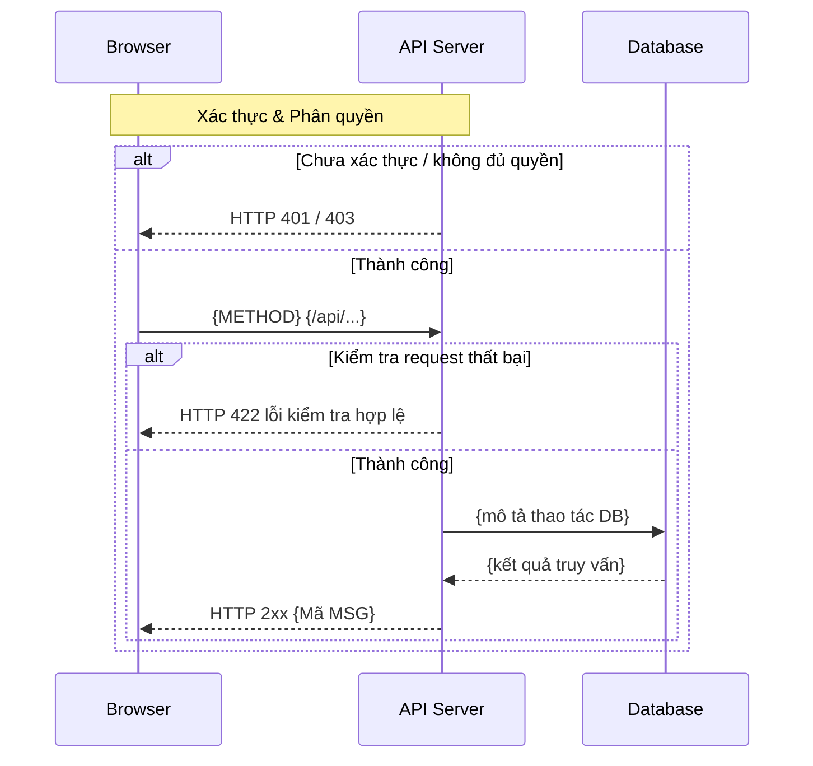

# [API-ID] — {METHOD} {/api/...} — [Tên API]

| Trường | Giá trị |
|--------|--------|
| API ID | API-xxx |
| Method | GET / POST / PATCH / DELETE |
| Endpoint | /api/... |
| Phân quyền | Bearer JWT · <vai trò + permissionKey> |
| Zod schema | Create/Update/Response (packages/contracts) |
| Ngày tạo | YYYY-MM-DD |
| Ngày cập nhật | YYYY-MM-DD |

## Lịch sử sửa đổi

| Ver | Ngày | Tác giả | Thay đổi |
|-----|------|--------|---------|
| 1.0 | YYYY-MM-DD | — | Phát hành lần đầu |

---

## 1. Mục đích

<!-- Đọc 30 giây là biết API làm gì và ranh giới ở đâu. Mỗi dòng 1 câu.
     Câu hỏi mở: ghi marker `[CẦN LÀM RÕ: <câu hỏi>]` tại đúng chỗ trong DD và liệt kê lại ở đây;
     tối đa 3; còn marker thì không được "Đã duyệt". Không có → ghi "Không có". -->

- **Actor**: <ai gọi API này — vai trò / màn hình / endpoint>
- **Use case**: <1 câu: API này phục vụ gì>
- **Kết quả thành công**: <trạng thái cuối khi thành công>
- **Ngoài phạm vi**: <hành vi dễ bị hiểu nhầm là thuộc API này nhưng không làm>
- **Giả định**: <điều coi là đúng mà DD không kiểm chứng> | Không có
- **Câu hỏi mở**: Không có

## 2. Request

### 2.1 Headers & Phân quyền

<!-- Authorization, Content-Type, và header phụ như Current-Shop (nếu có ngữ cảnh shop). -->

| Header | Bắt buộc | Mô tả |
|--------|----------|-------|
| Authorization | Có | `Bearer <access token>` |
| Content-Type | Có | `application/json` |

### 2.2 Path & Query params

<!-- Chỉ TÊN Zod schema làm nguồn chân lý (packages/contracts); chép từng param khi cần thấy rule. -->

| Tên | Loại | Bắt buộc | Zod | Mô tả |
|-----|------|----------|-----|-------|
| `:id` | path | Có | `MasterRecordParamSchema` | ID bản ghi |

### 2.3 Request body

<!-- Chỉ TÊN Zod schema (packages/contracts); chép field chỉ khi cần thấy rule ở mức trường. -->

| Trường | Loại | Bắt buộc | Quy tắc | Mô tả |
|--------|------|----------|---------|-------|
| `name` | string | Có | required · max:255 | Tên bản ghi |

## 3. Kiểm tra hợp lệ (Validate)

<!-- Dòng rule: tham chiếu [message.md](../message.md) cho mã message; trỏ thẳng Zod schema nếu rule nằm trong đó.
     Mỗi dòng một quy tắc — không gộp nhiều rule bằng ";".
     Cột ID (`V-01`…) cố định khi đã duyệt — AC và test trỏ vào; thêm rule thì nối số mới, không đánh lại. -->

| ID | Tên logic | Quy tắc kiểm tra | Mã message | Message |
|-----|-----------|-----------------|------------|---------|
| V-01 | Tên bản ghi | required | MSG01 | Tên bản ghi là bắt buộc. |
| V-02 | Tên bản ghi | max:255 | MSG04 | Tên bản ghi vượt quá độ dài cho phép. |

## 4. Xử lý phía server

<!-- Bố cục: **1 endpoint** → bảng bước đơn (không có header `API-N`).
     **2+ endpoint** (CRUD 1 resource) → một khối `**API-N: METHOD path**` cho mỗi endpoint; `N` đánh số tuần tự.
     Thứ tự bước chuẩn: kiểm tra phân quyền → kiểm tra request → tải bản ghi → xử lý nghiệp vụ → ghi DB → trả về.
     ID bước: 1 endpoint → `S-01`…; nhiều endpoint → `S<N>-01`… theo `API-N`.
     Nhánh lỗi viết theo EARS: "Nếu <điều kiện> thì phải trả HTTP <mã> `<ERR_…>`" — mỗi nhánh 1 điều kiện, 1 kết quả.
     Bước đổi trạng thái → "Chuyển theo `<Entity>/T-NN`", không mô tả lại guard/side effect bằng lời. -->

**API-1: GET /api/.../{id}**

| ID | Bước | Mô tả |
|-----|------|-------|
| S1-01 | Kiểm tra phân quyền | Xác thực Bearer JWT; kiểm tra vai trò + permissionKey. |
| S1-02 | Tải bản ghi | Tìm bản ghi theo ID, loại trừ dòng đã xóa mềm (`deleted_at IS NULL`); nếu không tìm thấy thì phải trả HTTP 404 `ERR_NOT_FOUND`. |
| S1-03 | Trả về | Trả HTTP 200 — <tên Zod response schema>. |

**API-2: POST /api/...**

| ID | Bước | Mô tả |
|-----|------|-------|
| S2-01 | Kiểm tra phân quyền | Xác thực Bearer JWT; kiểm tra vai trò + permissionKey. |
| S2-02 | Kiểm tra request | Kiểm tra body theo §3; nếu thất bại thì phải trả HTTP 422. |
| S2-03 | Xử lý nghiệp vụ | Kiểm tra trùng khóa nghiệp vụ; nếu trùng và chưa gửi `force=true` thì phải trả HTTP 409 `ERR_DUPLICATE_BUSINESS_KEY`. |
| S2-04 | Ghi DB | Tạo bản ghi trong transaction. |
| S2-05 | Trả về | Trả HTTP 201 — <tên Zod response schema>. |

<!-- Ví dụ 1 endpoint (thay hai khối trên bằng một bảng, không có header `API-N`):
| ID | Bước | Mô tả |
|-----|------|-------|
| S-01 | Kiểm tra phân quyền | ... |
| S-02 | Kiểm tra request | ... |
| S-03 | Xử lý nghiệp vụ | ... |
| S-04 | Trả về | ... |
-->

## 5. Response

### 5.1 Thành công

<!-- HTTP status + tên Zod response schema + ví dụ JSON. -->

| HTTP | Zod schema | Mô tả |
|------|-----------|-------|
| 200 | `<Model>ResponseSchema` | Thành công |

```json
{
  "id": 1,
  "name": "..."
}
```

### 5.2 Lỗi

<!-- Nội dung message của các mã: xem [message.md](../message.md). -->

| HTTP | Mã lỗi | Điều kiện | Mã message |
|------|--------|-----------|------------|
| 401 | — | Thiếu/không hợp lệ Bearer JWT | — |
| 403 | — | Vai trò không có permissionKey | — |
| 404 | `ERR_NOT_FOUND` | Bản ghi không tồn tại hoặc đã xóa mềm | — |
| 409 | `ERR_DUPLICATE_BUSINESS_KEY` | Trùng khóa nghiệp vụ, chưa gửi `force=true` | — |
| 422 | — | Body không khớp Zod schema | — |

### 5.3 Bản đồ dữ liệu

<!-- Field response lấy từ đâu. Chỉ liệt kê field không phải chép thẳng 1 cột cùng tên
     (tính toán, join, đổi tên, mặc định, ẩn). Kiểu/nullable theo Zod — không định nghĩa lại.
     Không có field nào như vậy → ghi "Chép thẳng từ `<Model>`, không biến đổi". -->

| Field | Nguồn | Biến đổi | Ghi chú |
|-------|-------|----------|---------|
| `id` | `<table>.id` | — | — |
| `officeName` | `offices.name` qua `<table>.office_id` | `null` khi office đã xóa mềm | Join |
| `isEditable` | Tính toán | `status IN ('draft')` và vai trò `admin` | Không lưu DB |

## 6. Database

<!-- Mỗi dòng 1 model × 1 thao tác. Filter xóa mềm, FK, tenant ghi ở cột Điều kiện.
     Invariant, transaction, concurrency ghi thành dòng riêng bên dưới bảng.
     Đổi `status` → cột Ghi chú trỏ `<Entity>/T-NN` (xem reference.md § State machine). -->

| Model | Thao tác | Field | Điều kiện / filter | Ghi chú |
|-------|----------|-------|--------------------|---------|
| `<Model>` | R | toàn bộ | `company_id = JWT.companyId`, `deleted_at IS NULL` | — |
| `<Model>` | C | `name`, `office_id`, `company_id` | `company_id` lấy từ JWT | `office_id` phải trỏ office active cùng công ty |
| `<Model>` | U | field có trong body | như R | Đổi `status` → `<Entity>/T-NN` |

- **Invariant**: <bất biến nghiệp vụ, vd tối đa 1 office `Main` active / công ty> | Không có
- **Transaction**: <các thao tác ghi trong cùng transaction> | Không có
- **Concurrency**: PATCH chỉ cập nhật field được gửi; cùng field → last-write-wins theo thứ tự commit.

## 7. Sơ đồ luồng

<!-- Tuân theo pattern nghiêm ngặt trong ../_dd-pipeline/FLOW-DIAGRAM-PATTERNS.md.
     Các participant cố định: Browser / API as API Server / DB as Database.
     Khối auth đầu tiên; opt/alt cho các nhánh xử lý và lỗi. -->



---

## 8. Liên quan

<!-- Màn hình gọi API này; endpoint liên quan; DD liên quan (specs/dd/...). -->

| Loại | Tên / ID | Quan hệ |
|------|----------|---------|
| Màn hình | MC-xxx | Gọi API này |
| DD | specs/dd/<module>/<id>/ | Cùng module / phụ thuộc |

## 9. Tiêu chí chấp nhận

<!-- Gherkin: từ khóa tiếng Anh, nội dung tiếng Việt. Xem reference.md § Viết requirement.
     Tên Scenario = `AC-<API ID>-NN — <tóm tắt>` + `(nguồn: <ID V/S/T hoặc HTTP + ERR_…>)`; ID cố định khi đã duyệt.
     Phủ tối thiểu: mỗi endpoint 1 AC thành công; mỗi lỗi nghiệp vụ ở §5.2 (mã `ERR_…`);
     403 cho vai trò bị chặn; mỗi trường ở §3 ít nhất 1 AC (Scenario Outline cho nhiều rule);
     API đổi `status` → mỗi chuyển trạng thái `T-NN` dùng tới + 1 chuyển trạng thái bị cấm.
     Then phải quan sát được: HTTP status, mã lỗi, field response, giá trị DB. -->

```gherkin
Feature: API-xxx — Tạo / xem bản ghi

  Background:
    Given đăng nhập vai trò "admin" của công ty C1

  Scenario: AC-API-xxx-01 — Tạo bản ghi (nguồn: S2-01…S2-05)
    Given công ty C1 chưa có bản ghi tên "A"
    When POST "/api/..." với body {"name": "A"}
    Then nhận HTTP 201, body khớp `<Model>ResponseSchema`
    And DB có đúng 1 bản ghi tên "A" thuộc C1

  Scenario: AC-API-xxx-02 — Trùng khóa nghiệp vụ (nguồn: S2-03, 409 ERR_DUPLICATE_BUSINESS_KEY)
    Given công ty C1 đã có bản ghi tên "A"
    When POST "/api/..." với body {"name": "A"} và không gửi `force`
    Then nhận HTTP 409 `ERR_DUPLICATE_BUSINESS_KEY`
    And DB không đổi

  Scenario: AC-API-xxx-03 — Bản ghi đã xóa mềm (nguồn: S1-02, 404 ERR_NOT_FOUND)
    Given bản ghi R1 của C1 có `deleted_at` khác null
    When GET "/api/.../R1"
    Then nhận HTTP 404 `ERR_NOT_FOUND`
```
