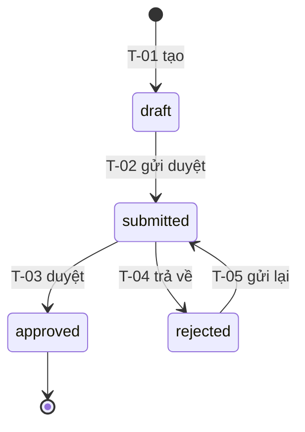

<!-- Khuôn một mục state machine. Chèn nguyên khối vào specs/dd/domain-model.md
     (thực thể dùng chung) hoặc specs/dd/<module>/overview.md (thực thể của một module).
     Một thực thể = một mục. Luật: specs/reference.md § State machine. -->

### State machine — `<Entity>.<cột trạng thái>`

| Trường | Giá trị |
|--------|--------|
| Thực thể | `<Entity>` (bảng `<table>`) |
| Cột | `<column>` — enum `<PrismaEnum>` |
| Trạng thái đầu | `<state>` (khi tạo bởi `<API / job>`) |
| Trạng thái cuối | `<state>`, `<state>` \| Không có |
| Khi bị cấm | HTTP `<4xx>` `<ERR_…>` |

#### Trạng thái

| Trạng thái | Ý nghĩa nghiệp vụ | Được sửa dữ liệu? |
|------------|-------------------|-------------------|
| `draft` | Mới tạo, chưa gửi duyệt | Có |
| `submitted` | Đã gửi, chờ duyệt | Không |
| `approved` | Đã duyệt | Không |
| `rejected` | Bị trả về | Có |

#### Sơ đồ



#### Chuyển trạng thái

<!-- Mỗi dòng 1 cặp (Từ, Sự kiện). Cặp không có trong bảng = bị cấm, trả lỗi ở "Khi bị cấm".
     Guard viết thành điều kiện kiểm chứng được (cột, vai trò, giá trị) — không "khi hợp lệ".
     Side effect: ghi DB khác, audit, job, thông báo; không có thì "—".
     ID `T-NN` cố định khi đã duyệt; DD UI/API trỏ `<Entity>/T-NN`. -->

| ID | Từ | Sự kiện | Guard | Sang | Actor | Side effect | API / job |
|----|----|---------|-------|------|-------|-------------|-----------|
| T-01 | — | Tạo | — | `draft` | `staff`, `admin` | — | `POST /api/...` |
| T-02 | `draft` | Gửi duyệt | Đủ field bắt buộc theo `<Zod>` | `submitted` | Người tạo | Ghi audit | `POST /api/.../:id/submit` |
| T-03 | `submitted` | Duyệt | Vai trò `admin`, khác người tạo | `approved` | `admin` | Ghi `approved_at`, `approved_by` | `POST /api/.../:id/approve` |
| T-04 | `submitted` | Trả về | Vai trò `admin`; `reason` không rỗng | `rejected` | `admin` | Ghi `reason` | `POST /api/.../:id/reject` |
| T-05 | `rejected` | Gửi lại | Như T-02 | `submitted` | Người tạo | Ghi audit | `POST /api/.../:id/submit` |

#### Tiêu chí chấp nhận

```gherkin
Feature: <Entity> — vòng đời trạng thái

  Scenario: AC-<Entity>-01 — Duyệt bản đã gửi (nguồn: T-03)
    Given bản ghi R1 ở trạng thái "submitted" do "staff1" tạo
    When "admin1" duyệt R1
    Then R1 có trạng thái "approved"
    And `approved_by` của R1 là "admin1"

  Scenario: AC-<Entity>-02 — Không được duyệt bản nháp (nguồn: bị cấm)
    Given bản ghi R2 ở trạng thái "draft"
    When "admin1" duyệt R2
    Then nhận HTTP <4xx> `<ERR_…>`
    And R2 vẫn ở trạng thái "draft"
```
