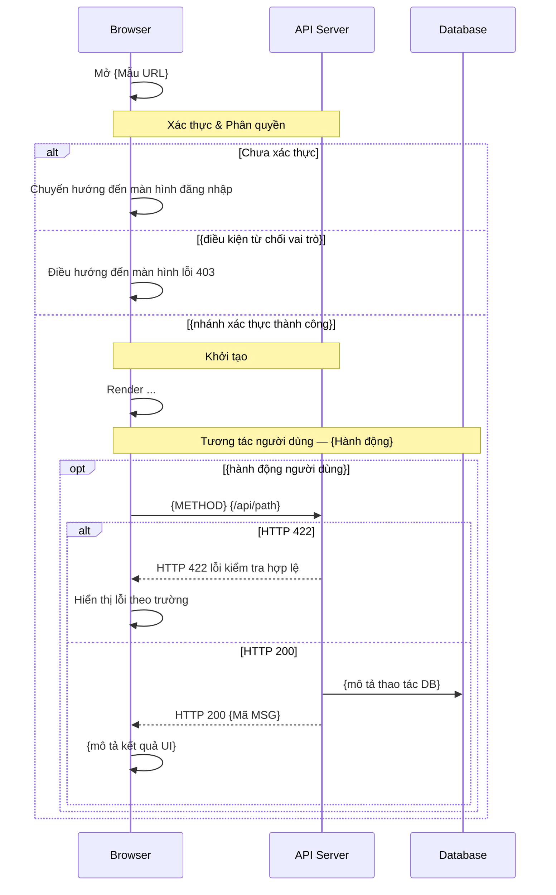

# [Mã màn hình] - [Tên màn hình JA] ([Tên tiếng Anh])

| Trường | Giá trị |
|-------|-------|
| Mã màn hình | MC-xxx |
| Tên màn hình | (Tên JA) (Tên tiếng Anh) |

| URL | /{đường-dẫn} |
| Ngày tạo | YYYY-MM-DD |
| Ngày cập nhật | YYYY-MM-DD |

## TÓM TẮT

<!-- Đọc 30 giây là biết màn hình làm gì và ranh giới ở đâu. Mỗi dòng 1 câu.
     Câu hỏi mở: ghi marker `[CẦN LÀM RÕ: <câu hỏi>]` tại đúng chỗ trong DD và liệt kê lại ở đây;
     tối đa 3; còn marker thì không được "Đã duyệt". Không có → ghi "Không có". -->

- **Mục tiêu**: <1 câu: người dùng làm được gì trên màn hình này>
- **Actor**: <vai trò được vào màn hình>
- **Trong phạm vi**: <các hành vi chính>
- **Ngoài phạm vi**: <hành vi dễ bị hiểu nhầm là thuộc màn hình này nhưng không làm>
- **Giả định**: <điều coi là đúng mà DD không kiểm chứng> | Không có
- **Câu hỏi mở**: Không có

## Lịch sử sửa đổi

| Ver | Ngày | Tác giả | Thay đổi |
|-----|------|--------|---------|
| 1.0 | YYYY-MM-DD | — | Phát hành lần đầu |

---

## BỐ CỤC


---

## LOGIC

### I. Các phần tử (Items)

| STT | Tên logic | Loại đối tượng | Cột trong DB | Mô tả | Ghi chú |
|----|-------------|----------------|-------------|-------------|------|
| 1 | Logo | Ảnh | — | — | Logo trang web; hiển thị phía trên form đăng nhập |
| 2 | Tiêu đề trang | Nhãn | — | — | Tiêu đề màn hình bên trong thẻ đăng nhập |
| 3 | Nhãn Account ID | Nhãn | — | — | Nhãn của ô định danh tài khoản |
| 4 | Ô nhập Account ID | Ô nhập | `administrators.email` | Nhập địa chỉ email dùng làm Account ID | Ô văn bản; nhận email đăng nhập |
| 5 | Nhãn Mật khẩu | Nhãn | — | — | Nhãn của ô mật khẩu |
| 6 | Ô nhập Mật khẩu | Mật khẩu | `administrators.password` | Nhập mật khẩu; giá trị được che và có thể bật/tắt hiển thị | Ô mật khẩu; giá trị được che; có nút bật/tắt hiển thị |
| 7 | Nút Đăng nhập | Nút | — | — | Nút gửi; truyền thông tin đăng nhập đến server |

### II. Kiểm tra hợp lệ (Validate)

<!-- Định dạng dòng rule: mỗi dòng một Quy tắc kiểm tra — không được gộp nhiều rule bằng ";".
     Trường tùy chọn: dòng đầu = nullable (MSG —); sau đó các rule integer/min/max/file trên các dòng riêng.
     Rule chéo trường: dòng nullable trước, rồi rule có tên (from_lt_to, from_rank_lt_to_rank) — không kèm chữ "(when both provided)".
     Xem [reference.md](../reference.md) § Validate §II — định dạng dòng rule.
     Cột ID (`V-01`…) cố định khi đã duyệt — AC và test trỏ vào; thêm rule thì nối số mới, không đánh lại. -->

| ID | Tên logic | Tên | Quy tắc kiểm tra | Mã message | Message |
|----|-------------|------|-----------------|--------------|---------|
| V-01 | Account ID (email) | Account ID (email) | required | MSG01 | Account ID là bắt buộc. |
| V-02 | Account ID (email) | Account ID (email) | email | MSG04 | Định dạng email không hợp lệ. |
| V-03 | Account ID (email) | Account ID (email) | max:255 | MSG19 ※ | Đăng nhập thất bại. Email hoặc mật khẩu không đúng. |
| V-04 | Mật khẩu | Mật khẩu | required | MSG01 | Mật khẩu là bắt buộc. |
| V-05 | Mật khẩu | Mật khẩu | max:20 | MSG19 ※ | Đăng nhập thất bại. Email hoặc mật khẩu không đúng. |
<!-- Ví dụ trường tùy chọn (bỏ các dòng không dùng trên màn hình này):

-->


### III. Logic

#### Thông tin màn hình
- **Phân quyền**: Chỉ Master (không có ngữ cảnh shop) | Ngữ cảnh Shop (Store Manager hoặc Master kèm header Current-Shop) | Mọi vai trò (Master hoặc Store Manager) — phân loại theo [ADMIN-ACCESS-CONTEXT.md](../_dd-pipeline/ADMIN-ACCESS-CONTEXT.md)
- **Mẫu URL**: `/admin/{đường-dẫn}` — phải khớp chính xác URL trên header
<!-- API chính — 1 endpoint: dùng dòng bullet bên dưới. Nhiều endpoint: thay bullet bằng bảng (xem khối comment). -->
- **API chính**: `POST /api/admin/...`
<!-- Ví dụ nhiều API (dùng bảng thay cho dòng bullet API chính ở trên):
- **API chính**:

| STT | Method | Path | Mục đích |
|----|--------|------|---------|
| 1 | GET | `/api/admin/.../{id}` | Tải dữ liệu form |
| 2 | PUT | `/api/admin/.../{id}` | Lưu thay đổi |
| 3 | DELETE | `/api/admin/.../{id}` | Xóa bản ghi |
-->

#### 1. Kiểm tra phân quyền

<!-- Admin: chép toàn bộ các dòng từ template ADMIN-ACCESS-CONTEXT.md cho master_only (3 dòng) hoặc shop_context (4 dòng). Không được bỏ dòng Master + Current-Shop deny trên master_only. -->

| ID | Mô tả |
|----|-------------|
| P-01 | ... |
| P-02 | ... |
| P-03 | ... |

#### 2. Khởi tạo màn hình
| ID | Mô tả |
|----|-------------|
| I-01 | ... |

#### 3. Xử lý hành vi sự kiện

> Nội dung message của các mã trong mục này: xem [message.md](../message.md).

<!-- Viết theo EARS: cột "Kích hoạt" là mệnh đề "Khi <sự kiện>" / "Nếu <lỗi>" / "Trong khi <trạng thái>";
     cột "Mô tả" là phản hồi bắt buộc của hệ thống ("phải …"). Mỗi dòng 1 kích hoạt, 1 kết quả —
     hai kết quả khác nhau thì tách dòng; không dùng "hoặc" giữa hai hành vi hiển thị.
     Sự kiện đổi trạng thái thực thể → ghi `<Entity>/T-NN` trong Mô tả (reference.md § State machine). -->

| ID | Sự kiện | Kích hoạt | Mô tả |
|----|-------|---------|-------------|
| E-01 | Gửi đăng nhập | Khi nhấn nút Đăng nhập hoặc nhấn Enter trong form | Phải kiểm tra hợp lệ phía client (V-01…V-05); hợp lệ thì gọi `POST /api/admin/auth/login` với email và mật khẩu. |
| E-02 | Đăng nhập thành công — mật khẩu mặc định | Khi API trả 200 và `administrators.requires_password_change` là true | Phải lưu access token rồi điều hướng đến MC-0002 (Đổi mật khẩu đăng nhập). |
| E-03 | Đăng nhập thành công — bình thường | Khi API trả 200 và `administrators.requires_password_change` là false | Phải lưu access token rồi điều hướng đến MC-1001 (Dashboard). |
| E-04 | Đăng nhập thất bại — sai thông tin | Nếu API trả HTTP 400 `ERR_INVALID_CREDENTIAL` | Phải hiển thị MSG19 inline dưới form và giữ nguyên giá trị Account ID. |
| E-05 | Đăng nhập thất bại — tài khoản bị khóa | Nếu API trả HTTP 400 `ERR_ACCOUNT_LOCKED` | Phải hiển thị MSG20 inline dưới form. |
| E-06 | Lỗi kiểm tra hợp lệ | Nếu API trả HTTP 422 | Phải hiển thị message lỗi dưới từng trường theo response. |
| E-07 | Lỗi server | Nếu API trả HTTP 500 | Phải điều hướng đến màn hình lỗi 500. |
| E-08 | Bật/tắt hiển thị mật khẩu | Khi nhấn biểu tượng hiện/ẩn trên ô mật khẩu | Phải chuyển ô mật khẩu giữa che và hiện; biểu tượng đổi theo trạng thái. |

#### 4. Xử lý phía server

> Nội dung message của các mã trong mục này: xem [message.md](../message.md).

<!-- Bố cục §III.4: **1 API chính** → bảng bước đơn bên dưới (không có header `API-N`), ID `S-01`….
     **2+ API chính** → một khối cho mỗi API: `**API-N: METHOD path**` rồi bảng bước; `N` khớp cột `STT` của bảng API chính (bao gồm cả API phụ thuộc/picker dùng trên màn hình này); ID bước `S<N>-01`…. -->

**API-1: GET /api/admin/.../{id}**

| ID | Bước | Mô tả |
|----|------|-------------|
| S1-01 | Kiểm tra phân quyền | ... |
| S1-02 | Tải bản ghi | Tìm bản ghi theo ID, loại trừ các dòng đã xóa mềm; nếu không tìm thấy thì phải trả HTTP 404. |
| S1-03 | Trả về | Trả về các trường của bản ghi cho màn hình. |

**API-2: PUT /api/admin/.../{id}**

| ID | Bước | Mô tả |
|----|------|-------------|
| S2-01 | Kiểm tra phân quyền | ... |
| S2-02 | Kiểm tra request | Kiểm tra các trường theo §II; nếu thất bại thì phải trả HTTP 422. |
| S2-03 | Cập nhật bản ghi | Cập nhật bản ghi. |
| S2-04 | Trả về | Trả HTTP 200 — MSG14. |

<!-- Ví dụ 1 API (thay hai khối trên bằng một bảng, không có header `API-N`):
| ID | Bước | Mô tả |
|----|------|-------------|
| S-01 | Kiểm tra đầu vào | Kiểm tra email (bắt buộc, định dạng, tối đa 255) và mật khẩu (bắt buộc, tối đa 255). |
| S-02 | ... | ... |
-->

### IV. Sơ đồ luồng

<!-- Tuân theo pattern nghiêm ngặt trong ../_dd-pipeline/FLOW-DIAGRAM-PATTERNS.md.
     Các participant cố định: Browser / API as API Server / DB as Database.
     Khối auth đầu tiên; khối init nằm trong nhánh auth thành công; opt/alt cho các tương tác. -->



---

## TIÊU CHÍ CHẤP NHẬN

<!-- Gherkin: từ khóa tiếng Anh (Feature / Background / Scenario / Scenario Outline / Examples /
     Given / When / Then / And / But), nội dung tiếng Việt. Xem reference.md § Viết requirement.
     Tên Scenario = `AC-<mã màn hình>-NN — <tóm tắt>` + `(nguồn: <ID P/I/V/E/S/T>)`; ID cố định khi đã duyệt.
     Phủ tối thiểu: luồng thành công chính; mỗi dòng E; mỗi vai trò bị chặn (P);
     mỗi trường ở §II ít nhất 1 AC — nhiều rule cùng trường gom bằng Scenario Outline + Examples.
     Then phải quan sát được (MSG, URL, trạng thái control, dữ liệu) — không viết "hiển thị phù hợp". -->

```gherkin
Feature: MC-xxx — Đăng nhập

  Background:
    Given đang ở màn hình "/admin/login" và chưa đăng nhập

  Scenario: AC-MC-xxx-01 — Đăng nhập thành công (nguồn: E-01, E-03)
    Given tài khoản "a@example.jp" đang active và không phải đổi mật khẩu
    When gửi form đăng nhập với Account ID "a@example.jp" và mật khẩu đúng
    Then điều hướng đến MC-1001

  Scenario: AC-MC-xxx-02 — Sai mật khẩu giữ Account ID (nguồn: E-04)
    Given tài khoản "a@example.jp" tồn tại
    When gửi form đăng nhập với Account ID "a@example.jp" và mật khẩu sai
    Then thấy MSG19 dưới form
    And ô Account ID vẫn là "a@example.jp"
    And URL không đổi

  Scenario Outline: AC-MC-xxx-03 — Validate Account ID (nguồn: V-01, V-02, V-03)
    When gửi form đăng nhập với Account ID "<input>"
    Then thấy <msg> dưới ô Account ID
    But không gọi API đăng nhập

    Examples:
      | input                      | msg   |
      |                            | MSG01 |
      | abc                        | MSG04 |
      | (251 ký tự "a")@x.jp       | MSG19 |
```

---

## Màn hình liên quan

| Mã màn hình | Tên | Quan hệ |
|-----------|------|----------|
